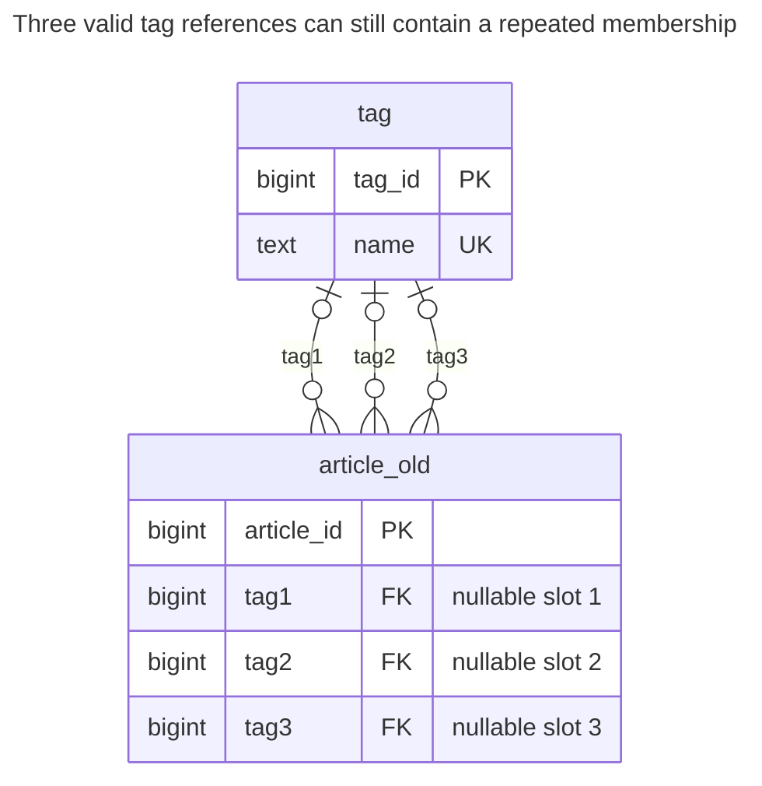
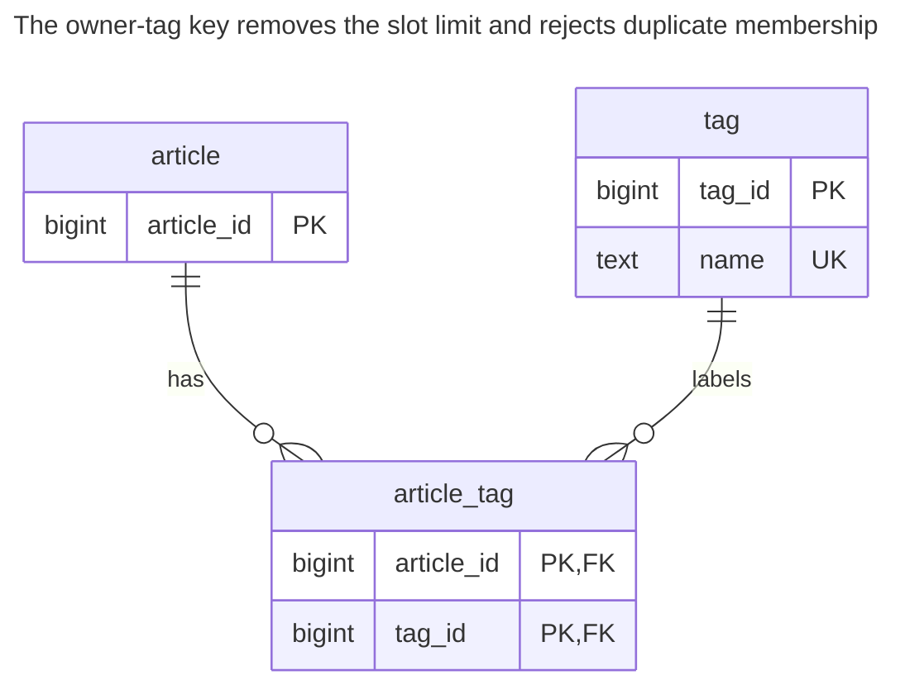
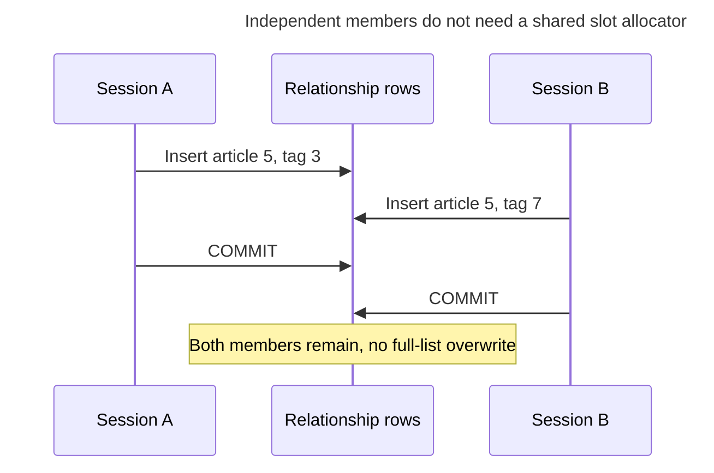
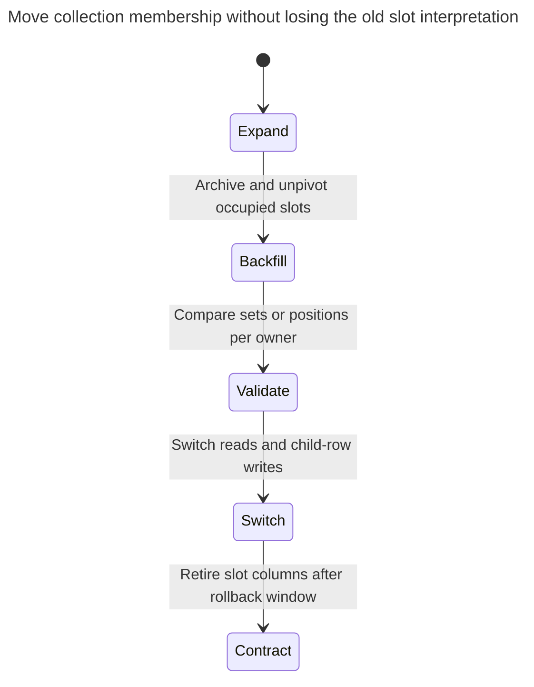

# Repeated Columns

Repeated columns model several values of one attribute as numbered columns: `tag1`, `tag2`, `tag3`, or `phone_home`, `phone_work`, `phone_mobile`. Searching by value means checking every column, uniqueness among them needs an explicit cross-column check, and a fourth value needs a migration. The chapter shows the queries that break and the move to a child table, and tells this apart from columns that are genuinely different attributes. Bill Karwin calls this Multicolumn Attributes.

## Also known as

Multicolumn Attributes, in Bill Karwin's [SQL Antipatterns contents](https://pragprog.com/titles/bksap1/sql-antipatterns-volume-1/). Here the problem is an expandable collection disguised as a fixed tuple of fields.

## Context

You let an article have several tags and initially allow three. You add `tag1`, `tag2` and `tag3`, perhaps with an FK on each. Each slot looks easy to display in a form. Later users want another tag, search by any tag, or attach a timestamp to one membership.

## Problem

You make the number of collection members part of the table definition. Adding a fourth tag requires changing storage and every reader that enumerates the slots. A tag can repeat in two columns even if each column separately references a valid tag. A unique constraint over `(tag1, tag2, tag3)` would compare complete rows, not require distinct values within one row; PostgreSQL documents that distinction in its [unique-constraint rules](https://www.postgresql.org/docs/18/ddl-constraints.html#DDL-CONSTRAINTS-UNIQUE-CONSTRAINTS).

Cross-column checks can reject repeated non-null values. That is a valid repair for a genuinely fixed tuple, but it grows with the slot design and does not remove the arbitrary capacity. Do not call different attributes a repeating group merely because they share a type: `starts_at` and `ends_at` have different roles. Likewise, separate home and work phone columns can be defensible when each is a single, stable business role; they fail as a substitute for arbitrary labeled phone entries.

## Why people do it

The first form contains three boxes, and storing three columns avoids child inserts and a join. A fixed two-point coordinate, bounded ranking or explicitly modeled role tuple can deserve that shape. The temptation becomes harmful when a current UI limit is mistaken for a permanent domain limit.

## Consequences

- ➖ Searches and aggregates must enumerate every slot.
- ➖ Adding capacity changes DDL, application SQL and export layouts.
- ➖ Duplicate memberships occupy separate slots without violating the sample FKs.
- ➖ Per-membership metadata multiplies into `tag1_added_at`, `tag2_added_at` and similar fields.
- ➖ Slot order becomes accidental meaning unless you define whether positions matter.

## Signs

- New feature requests repeatedly add the next numbered column.
- You use a long `OR` across interchangeable fields in every search.
- You count occupied slots when the question asks for distinct members.
- A value's attributes inherit the same numeric suffix as its column.

## A better way

Use one child row per value, with the owner ID in its key. For shared tags, this is an [Association Table](association-table.md). The primary key over owner and tag makes membership a set; an optional position is a separate ordering requirement. Preserve the original slot mapping during migration until you know whether it has meaning.

### Alternatives and selection

| Choice | Relationship | Choose it when |
| --- | --- | --- |
| [Association Table](association-table.md) | Replacement | Members reference a shared set such as tags |
| Owned child table | Replacement | Values such as contact methods belong to one owner and have their own label and lifecycle |
| Fixed role columns | Implementation option | Every column has a distinct, permanent role with at most one value |
| [Delimited Lists](delimited-lists.md) | Another failure mode | Packing the same collection into text loses the per-member FKs already available here |

Use the [Decision Atlas](decision-atlas.md) for the full table. Do not replace a meaningful fixed tuple with an untyped key/value table merely to avoid every nullable column.

## Example

### Structure

**Before:** each slot has an FK, but slots compete to represent the same kind of fact.



The three edges are separate optional references. None of the three FKs compares its value with the other slots.

```sql
CREATE TABLE tag (tag_id bigint PRIMARY KEY, name text NOT NULL UNIQUE);
CREATE TABLE article_old (
    article_id bigint PRIMARY KEY,
    tag1 bigint REFERENCES tag (tag_id),
    tag2 bigint REFERENCES tag (tag_id),
    tag3 bigint REFERENCES tag (tag_id)
);
INSERT INTO tag VALUES (3, 'sql'), (7, 'schema'), (12, 'keys'), (15, 'queries');
INSERT INTO article_old VALUES (1, 3, 7, 3), (2, NULL, 12, NULL);
SELECT article_id FROM article_old
WHERE tag1 = 12 OR tag2 = 12 OR tag3 = 12;
SELECT article_id, tag1, tag2, tag3 FROM article_old WHERE article_id = 1;
```

The search finds article `2`. Article `1` stores `(3, 7, 3)`, so counting occupied slots would report three tags where the intended set has two.

**After:** add members through rows instead of schema changes.



The two FKs retain target existence. The pair key adds the uniqueness missing between slots.

```sql
CREATE TABLE article (article_id bigint PRIMARY KEY);
CREATE TABLE article_tag (
    article_id bigint NOT NULL REFERENCES article (article_id),
    tag_id bigint NOT NULL REFERENCES tag (tag_id),
    CONSTRAINT article_tag_pkey PRIMARY KEY (article_id, tag_id)
);
CREATE INDEX article_tag_tag_idx ON article_tag (tag_id, article_id);
CREATE TABLE tag_slot_archive (
    article_id bigint NOT NULL,
    slot integer NOT NULL,
    tag_id bigint NOT NULL,
    PRIMARY KEY (article_id, slot)
);
BEGIN;
LOCK TABLE article_old IN SHARE ROW EXCLUSIVE MODE;
INSERT INTO article SELECT article_id FROM article_old;
INSERT INTO tag_slot_archive
SELECT a.article_id, v.slot, v.tag_id FROM article_old AS a
CROSS JOIN LATERAL (VALUES (1, a.tag1), (2, a.tag2), (3, a.tag3)) AS v(slot, tag_id)
WHERE v.tag_id IS NOT NULL;
INSERT INTO article_tag SELECT DISTINCT article_id, tag_id FROM tag_slot_archive;
COMMIT;
INSERT INTO article_tag VALUES (1, 12), (1, 15);
SELECT tag_id FROM article_tag WHERE article_id = 1 ORDER BY tag_id;
SELECT article_id FROM article_tag WHERE tag_id = 12 ORDER BY article_id;
```

Article `1` now has tags `3, 7, 12, 15`: four members without another column. The reverse lookup for `12` returns articles `1, 2`. The archive retains all four original occupied slots, including the duplicate `3`, so the migration's set conversion is auditable.

```sql
INSERT INTO article_tag VALUES (1, 3);
```

PostgreSQL 18.6 raises SQLSTATE `23505`: `ERROR: duplicate key value violates unique constraint "article_tag_pkey"`. The detail names `(article_id, tag_id)=(1, 3)`. The [complete script](../assets/repeated-columns/repeated-columns.sql) verifies the before/after data and this error.

### Engine support

- **PostgreSQL 18:** the lab uses [`LATERAL` with a `VALUES` table](https://www.postgresql.org/docs/18/queries-table-expressions.html#QUERIES-LATERAL) to unpivot slots. This is migration logic; the new read needs no unpivot.
- **MySQL 8.4 / InnoDB:** [FK columns need indexes](https://dev.mysql.com/doc/refman/8.4/en/create-table-foreign-keys.html). Translate the unpivot using the engine's query syntax while retaining both references and pair uniqueness.
- **SQLite:** [enable FK enforcement per connection](https://www.sqlite.org/foreignkeys.html#fk_enable). Keep the pair components explicitly non-null.

### Failure and concurrency

Adding distinct relationship rows does not replace a whole slot tuple. Pair uniqueness still decides two concurrent attempts to add the same member. PostgreSQL's [unique-index conflict handling](https://www.postgresql.org/docs/18/index-unique-checks.html) waits and rechecks rather than trusting two independent application pre-checks.



If the business genuinely limits an article to three tags, the child table alone does not enforce that aggregate limit. Serialize additions on the owner before counting, or design another explicit capacity rule. Removing the physical slot limit must not silently remove an actual business limit.

### Migration

Determine whether slots are positions, roles or interchangeable places. Unpivot every occupied slot and preserve source positions. Resolve duplicates according to that decision: the lab collapses duplicates only because tags are a set. If two duplicate slots have conflicting metadata, preserve and review both records.



The example uses a source write pause. For live migration, maintain both forms under an owner-row lock while backfilling under that same lock. Do not accept a fourth member until old writers are retired or can represent it: a three-slot rollback cannot preserve four tags. Keep the archive and original columns through reconciliation; see [Expand and Contract](expand-contract.md).

## Related patterns and anti-patterns

- [Association Table](association-table.md) models shared set membership.
- [Delimited Lists](delimited-lists.md) substitutes another encoding for the same collection problem.
- [Mandatory Surrogates](mandatory-surrogates.md) explains why a child ID alone must not replace pair uniqueness.
