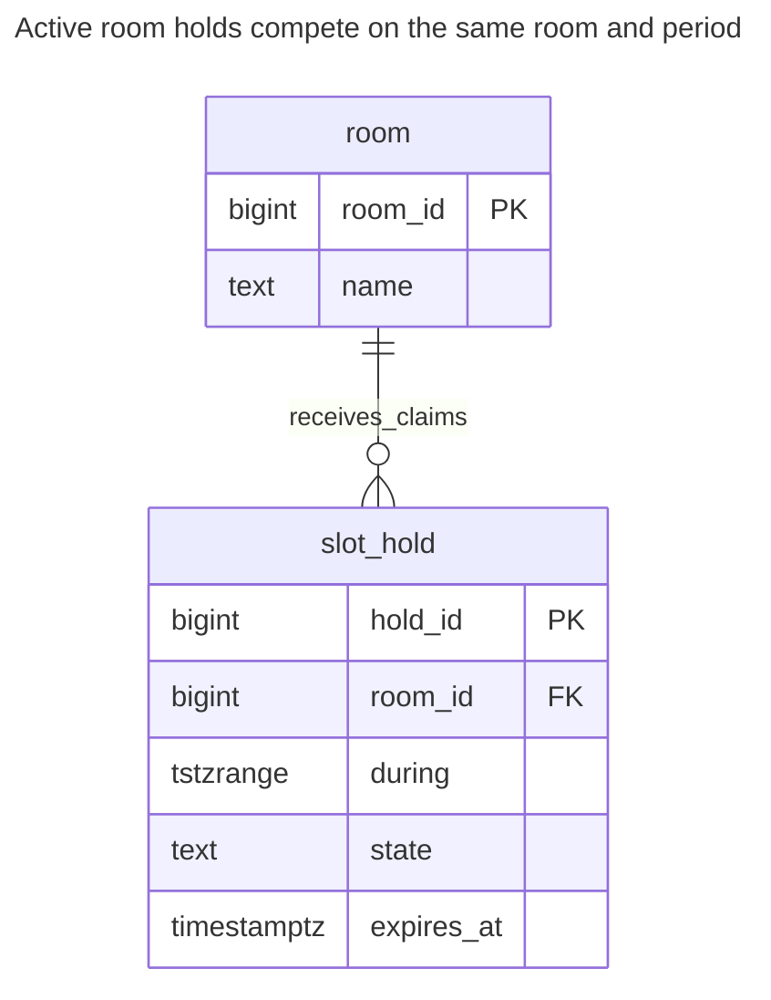
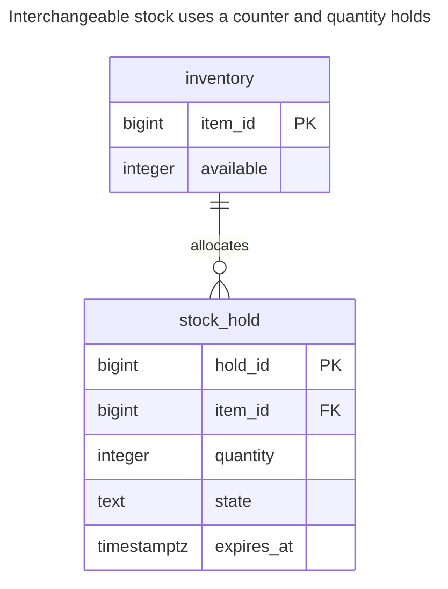
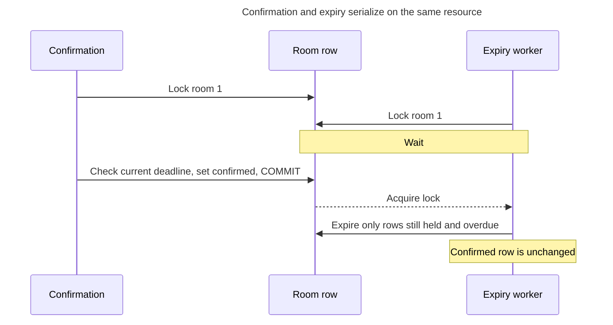
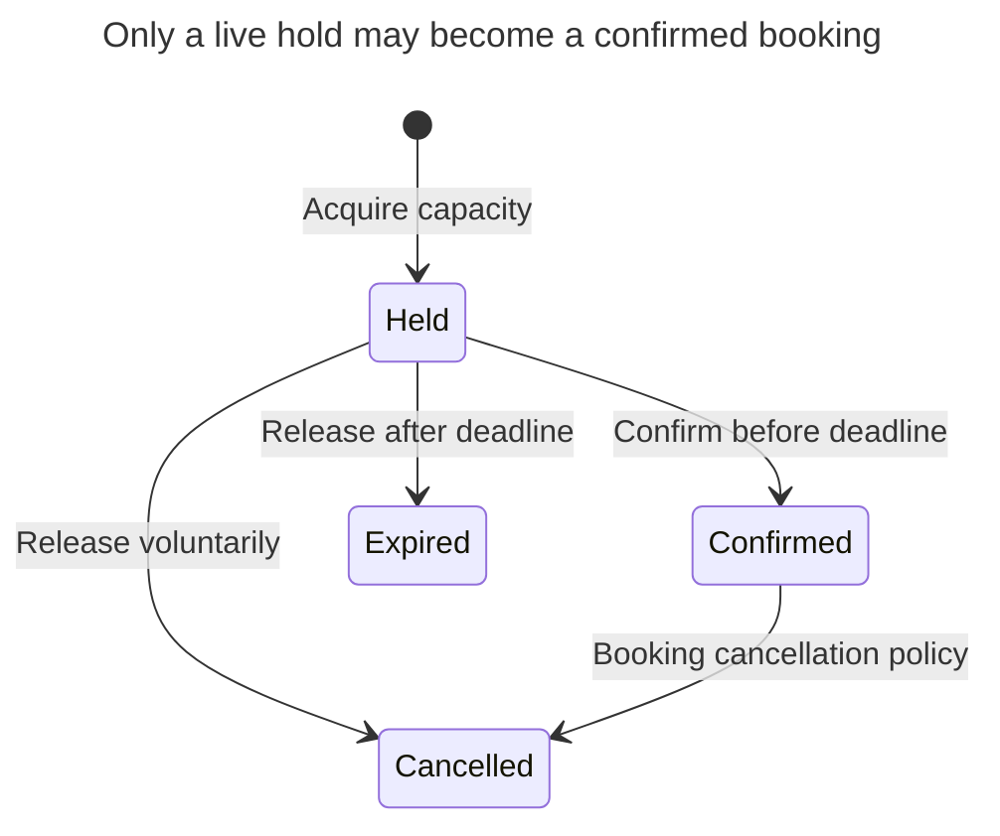

# Reservation

## Intent

A reservation is a temporary claim on limited capacity — a hotel room for given nights, a seat on a flight, an item in a cart — that expires unless confirmed. The schema must guarantee that claims never exceed capacity even under concurrent requests: with exclusion constraints on time ranges for slots, and with counters and row locks for quantities. The chapter covers holds with expiry, confirmation and cancellation, cleaning up expired holds, and how the structure differs for time slots and for stock.

## Also known as

Inventory hold; booking hold; pending claim. These describe the lifecycle in this chapter. PostgreSQL's [range-constraint example](https://www.postgresql.org/docs/18/rangetypes.html#RANGETYPES-CONSTRAINT) calls its room claims reservations; expiry and quantity accounting below are additional application policies.

## Problem

A room is free when two customers open its booking page. Both can pass “no overlapping booking exists” before either inserts. With stock, two carts can each observe the last three units and each claim two. A transaction around an unlocked availability query does not establish exclusive ownership of what it read.

A hold also outlives the transaction that creates it. You need to release abandoned claims without allowing an expired confirmation to compete successfully with a new customer. Availability, the hold's deadline and its business state must agree at the point where you commit a decision.

## Solution

Represent a hold as a row with its owner resource, claimed period or quantity, expiry and explicit state. For one room at a time, prevent intersecting active periods with a partial exclusion constraint over room equality and range overlap. For interchangeable stock, atomically decrement a nonnegative available counter and insert the quantity hold in the same transaction.

Make expiry a write from `held` to `expired`, not a query filter that silently changes the meaning of stored rows. Serialize each room's acquisition, confirmation, cancellation and expiry on its stable room row. For stock, use the inventory row as the common lock target. A background reaper performs the same release operation as an interactive request; it gets no special bypass path.

## Alternatives and selection

| Sibling or representation | Relationship | Deciding requirement |
| --- | --- | --- |
| [Effective Dating](effective-dating.md) | Complement; replacement for a permanent schedule | You need valid periods but no temporary claim or expiry |
| [Version Column](version-column.md) | Complement | Reject a stale customer's command; the capacity rule still needs its own constraint or coordinated counter |
| [Queue Table](queue-table.md) | Complement | Schedule cleanup attempts, while the reservation remains the authority on whether a hold is active |
| [Idempotency Record](idempotency-record.md) | Complement | A retried acquisition must return the same hold rather than allocate another |
| One row per discrete seat or unit | Implementation option | Individual units matter; enforce one active claim per unit instead of maintaining a quantity total |
| [Double-Entry Ledger](double-entry-ledger.md) | Complement; replacement for balance-only movement storage | You need conserved stock movements with a durable explanation as well as temporary availability |

Use the [Decision Atlas](decision-atlas.md) for the full comparison. One room is capacity one **per instant**; a stock counter is capacity across a pool. Do not use a no-overlap rule for a pool that legitimately allows several simultaneous claims.

## Structure



The exclusion rule applies to `held` and `confirmed` rows. Expired and cancelled rows remain for explanation but no longer occupy the period. One room may have many adjacent or disjoint active reservations.

## Tables and invariants

- **`room`** identifies a single bookable unit and provides a lock target even when it has no holds.
- **`slot_hold`** requires a nonempty bounded half-open range, a valid state and a deadline. `slot_hold_no_overlap` rejects intersecting active ranges for the same room.
- **Expiry** is enforced by a state transition under the room lock. Confirm only a still-held row whose deadline is strictly later than the decision's current time; the deadline itself is already expired.
- **Quantity availability** belongs to the separate inventory variant below. Nonnegative availability is a row check; agreement between that counter and hold rows is a transactional write-protocol invariant.

## When to use

- Checkout, booking or approval needs a short period of guaranteed capacity before confirmation.
- You can define the resource, unit, deadline and policy for a confirmation that arrives late.
- Releasing abandoned capacity is required, and keeping the old claim helps explain what happened.

## Consequences and trade-offs

- ➕ The slot constraint rejects overbooking even if an application pre-check races.
- ➕ Explicit terminal states distinguish cancellation from timeout.
- ➖ Capacity remains unavailable until expired rows are transitioned. Run cleanup during acquisition as well as in the background if prompt reuse matters.
- ➖ A popular resource or inventory pool becomes a serialization point.
- ➖ A local deadline cannot cancel an already completed external payment. Define refund or reconciliation behavior when payment success arrives after the hold has expired.

## Implementation

The [complete PostgreSQL 18.6 script](../assets/reservation/reservation.sql) includes both variants, overlap rejection, confirmation, cancellation and expiry. PostgreSQL documents [GiST exclusion over scalar equality and ranges](https://www.postgresql.org/docs/18/rangetypes.html#RANGETYPES-CONSTRAINT), using `btree_gist` for the scalar part:

```sql
CREATE EXTENSION IF NOT EXISTS btree_gist WITH SCHEMA public;
CREATE TABLE room (
    room_id bigint PRIMARY KEY,
    name text NOT NULL
);
CREATE TABLE slot_hold (
    hold_id bigint PRIMARY KEY,
    room_id bigint NOT NULL REFERENCES room (room_id),
    during tstzrange NOT NULL,
    state text NOT NULL CHECK (state IN ('held', 'confirmed', 'cancelled', 'expired')),
    expires_at timestamptz NOT NULL,
    CONSTRAINT slot_hold_period CHECK (
        NOT isempty(during) AND NOT lower_inf(during) AND NOT upper_inf(during)
        AND lower_inc(during) AND NOT upper_inc(during)
    ),
    CONSTRAINT slot_hold_no_overlap EXCLUDE USING gist (
        room_id WITH =, during WITH &&
    ) WHERE (state IN ('held', 'confirmed'))
);
CREATE INDEX slot_hold_expiry_idx ON slot_hold (room_id, expires_at)
WHERE state = 'held';
INSERT INTO room VALUES (1, 'Blue room');
BEGIN;
SELECT room_id FROM room WHERE room_id = 1 FOR UPDATE;
UPDATE slot_hold SET state = 'expired'
WHERE room_id = 1 AND state = 'held' AND expires_at <= clock_timestamp();
INSERT INTO slot_hold VALUES
    (1, 1, tstzrange('2027-01-01 10:00+00', '2027-01-01 11:00+00', '[)'),
     'held', clock_timestamp() + interval '10 minutes');
COMMIT;
```

The first statement after obtaining the lock reclaims expired holds before inserting. Keep the lock until commit. PostgreSQL's [`clock_timestamp()`](https://www.postgresql.org/docs/18/functions-datetime.html#FUNCTIONS-DATETIME-CURRENT) reads execution time; `CURRENT_TIMESTAMP` is fixed at transaction start and can be stale after a lock wait. This deadline concerns the checkout hold, independently of the booked service period.

Confirm under the same lock and require exactly one updated row. A zero-row result means it is no longer a confirmable hold; roll back or return its existing terminal outcome according to your API contract:

```sql
BEGIN;
SELECT room_id FROM room WHERE room_id = 1 FOR UPDATE;
UPDATE slot_hold SET state = 'confirmed'
WHERE room_id = 1 AND hold_id = 1 AND state = 'held'
  AND expires_at > clock_timestamp()
RETURNING hold_id, state;
COMMIT;
```

The result is `(1, confirmed)`. The following competing claim is invalid even with a fresh expiry:

```sql
-- Expected SQLSTATE 23P01.
INSERT INTO slot_hold VALUES
    (2, 1, tstzrange('2027-01-01 10:30+00', '2027-01-01 11:30+00', '[)'),
     'held', clock_timestamp() + interval '10 minutes');
```

PostgreSQL 18.6 raises SQLSTATE `23P01`: `ERROR: conflicting key value violates exclusion constraint "slot_hold_no_overlap"`. A `[11:00,12:00)` claim would not overlap the existing `[10:00,11:00)` claim. The script cancels the confirmed booking under the room lock, then demonstrates reclamation of an abandoned, already-expired hold.

Do not put `expires_at > now()` into the partial constraint predicate. PostgreSQL requires [index expressions and predicates to use immutable functions](https://www.postgresql.org/docs/18/sql-createindex.html); an index entry does not remove itself as time passes. The predicate therefore uses stored state.

For stock, store a quantity rather than a time range:



`available` excludes both outstanding holds and confirmed sales. Confirmation leaves it unchanged; cancellation or expiry restores units only when transitioning from `held`. Cancelling a confirmed sale requires a separate returns policy, deliberately absent here.

```sql
CREATE TABLE inventory (
    item_id bigint PRIMARY KEY,
    available integer NOT NULL CHECK (available >= 0)
);
CREATE TABLE stock_hold (
    hold_id bigint PRIMARY KEY,
    item_id bigint NOT NULL REFERENCES inventory (item_id),
    quantity integer NOT NULL CHECK (quantity > 0),
    state text NOT NULL CHECK (state IN ('held', 'confirmed', 'cancelled', 'expired')),
    expires_at timestamptz NOT NULL
);
INSERT INTO inventory VALUES (1, 3);
BEGIN;
WITH taken AS (
    UPDATE inventory SET available = available - 2
    WHERE item_id = 1 AND available >= 2
    RETURNING item_id
)
INSERT INTO stock_hold
SELECT 10, item_id, 2, 'held', clock_timestamp() + interval '10 minutes'
FROM taken
RETURNING hold_id;
COMMIT;
```

This returns hold `10`, leaving one available unit. If the guarded update finds insufficient stock, no hold is inserted: require one returned hold before reporting success. In a real operation, validate a positive bound quantity and deadline; a failed hold insert must roll back the decrement too. For cancellation, lock inventory first and restore only the quantity returned by the winning transition:

```sql
BEGIN;
SELECT item_id FROM inventory WHERE item_id = 1 FOR UPDATE;
WITH released AS (
    UPDATE stock_hold SET state = 'cancelled'
    WHERE item_id = 1 AND hold_id = 10 AND state = 'held'
    RETURNING item_id, quantity
)
UPDATE inventory AS i SET available = i.available + r.quantity
FROM released AS r WHERE i.item_id = r.item_id
RETURNING i.available;
COMMIT;
```

The result is `3`. Repeating this transition changes nothing and cannot restore the units twice. Expiry uses the same operation with target state `expired` and an additional deadline predicate; confirmation uses a still-live deadline predicate and changes only the hold state. Reclaim expired stock holds under the inventory lock before deciding insufficient availability. Do not independently sum unlocked holds and then decrement a counter.

## Engine support

- **PostgreSQL 18:** the partial exclusion rule models active slots. [`WITHOUT OVERLAPS`](https://www.postgresql.org/docs/18/sql-createtable.html) is useful for unconditional temporal keys; this lifecycle needs a conditional rule.
- **MySQL 8.4 / InnoDB:** a port can store start/end columns and serialize overlap checks on the resource with [`SELECT ... FOR UPDATE`](https://dev.mysql.com/doc/refman/8.4/en/innodb-locking-reads.html). Every writer must participate; the application check replaces this example's declarative exclusion guard.
- **SQL Server 2025 (17.x):** use a resource transaction with [`UPDLOCK`](https://learn.microsoft.com/en-us/sql/t-sql/queries/hints-transact-sql-table?view=sql-server-ver17) for the coordinated-check implementation. Do not use `READPAST` to decide availability: skipping a claim is not evidence of free capacity.
- **Oracle AI Database 26ai:** [`FOR UPDATE`](https://docs.oracle.com/en/database/oracle/oracle-database/26/sqlrf/SELECT.html) provides the resource lock for a start/end-column implementation. Skipping a busy resource is acceptable only if your API treats it as unavailable, never free.
- **SQLite 3:** use [`BEGIN IMMEDIATE`](https://www.sqlite.org/lang_transaction.html) before checking and changing availability; handle `SQLITE_BUSY`. This serializes writers at database scope rather than per resource.

## Failure and concurrency



At Read Committed, lock the resource before a separate statement reads or transitions its holds. All writers use that order, including administrative cancellation. If expiry wins first, confirmation updates zero rows; do not resurrect the hold. If confirmation acquired the lock before the deadline but checked after it, it must still fail the deadline test.



There is no expired-to-confirmed edge. The slot variant permits confirmed cancellation; the stock variant deliberately reserves that operation for a separate returns workflow.

A crash before commit leaves neither allocation nor hold. A crash after commit leaves a durable hold that the reaper can release. For a request claiming several resources, lock them in a consistent ID order and commit all allocations together; otherwise you can hold half an itinerary. Keep payment calls outside these database lock transactions and reconcile late results explicitly.

## Migration

Create hold storage beside existing bookings, import confirmed bookings, and resolve overlaps or negative stock before enabling the new writer. Derive initial availability at one agreed cutoff, excluding existing committed allocations; do not subtract imported holds again. Coordinate or briefly pause old writers while establishing that baseline.

Switch every acquisition and release path to the shared resource protocol before exposing temporary holds. Compare availability and expiry lag, then retire the old check-then-insert path through [Expand and Contract](expand-contract.md). On rollback, stop new holds and continue honoring or releasing accepted holds until drained. Dropping the hold table while customers still own capacity is not a reversible UI rollback.

## Anti-patterns and common mistakes

- Filtering expired rows out of reads while leaving them active in the exclusion constraint.
- Confirming based on request-arrival time rather than a current check after acquiring the resource lock.
- Releasing a quantity twice because cleanup and cancellation update the counter without a conditional hold transition.
- Treating a positive availability counter as proof that it agrees with all historic stock movements; reconcile against your authoritative inventory records.
- Using approximate arithmetic for exact quantities; see [Inexact Arithmetic](inexact-arithmetic.md).

## Known uses

- PostgreSQL's [range documentation](https://www.postgresql.org/docs/18/rangetypes.html#RANGETYPES-CONSTRAINT) demonstrates room reservations rejected by exclusion constraints. It supplies the overlap mechanism, not a timeout service.
- TigerBeetle's [two-phase transfers](https://docs.tigerbeetle.com/coding/two-phase-transfers/) reserve funds with pending transfers that can be posted, voided or timed out. This is a specialized conserved-quantity implementation, not the relational slot schema above.

## Related patterns

- [Effective Dating](effective-dating.md) explains period bounds independently of holds.
- [Version Column](version-column.md) detects stale commands about a reservation.
- [Idempotency Record](idempotency-record.md) makes repeated acquisition return the original hold.
- [Queue Table](queue-table.md) can schedule cleanup without owning capacity decisions.
- [Double-Entry Ledger](double-entry-ledger.md) records conserved stock or money movements.
- [Inexact Arithmetic](inexact-arithmetic.md) explains why exact counts need exact representation.
