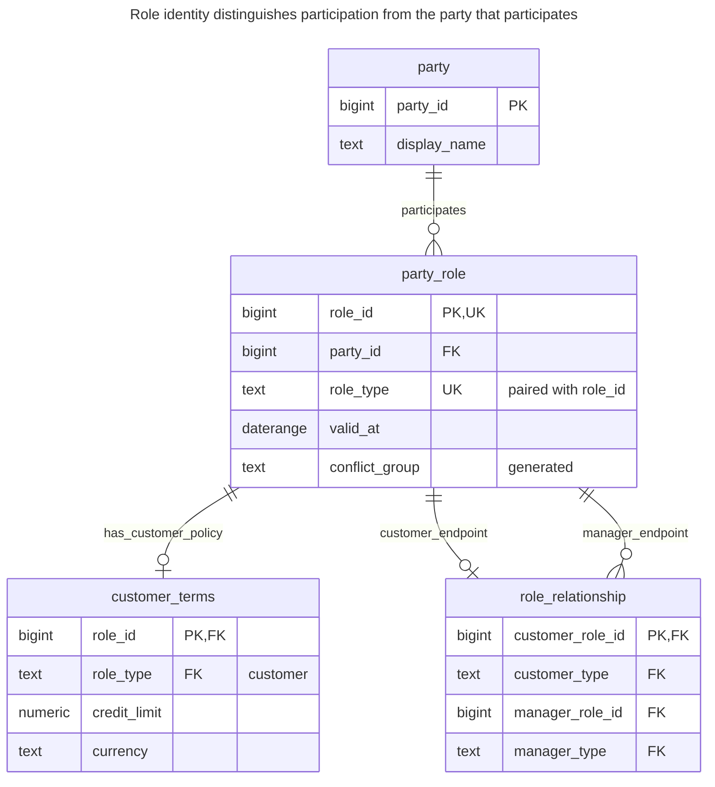
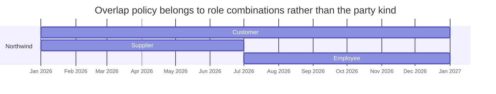
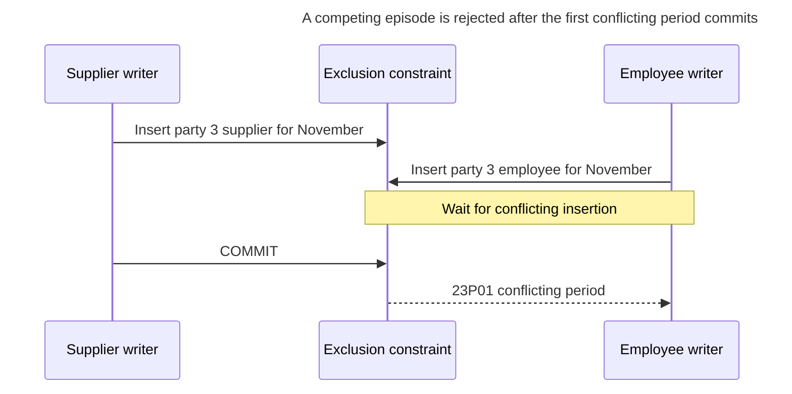
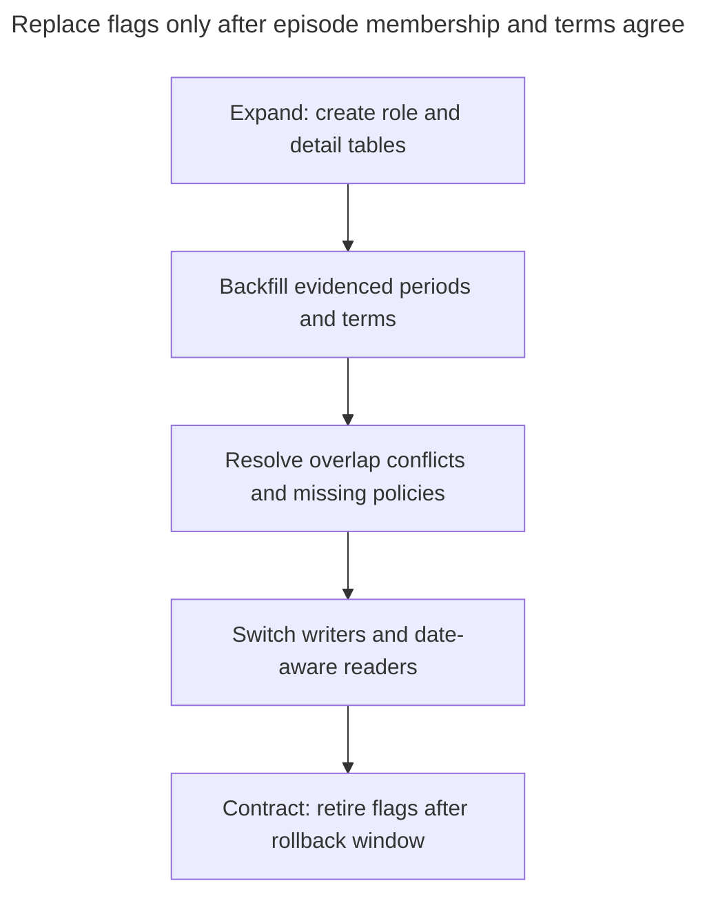

# Role Object

## Intent

A role object stores each role a party plays — customer, supplier, employee, account manager — as a separate row with its own attributes and validity period, instead of boolean flags or rigid subtypes. A person can hold several roles at once, gain and lose them over time, and each role carries the data that belongs to it, such as a customer's credit limit. The chapter covers the role table, role-specific detail tables, constraints on which roles may combine, and relationships between parties expressed through their roles.

## Also known as

Role instance; party role. Fowler's [Dealing with Roles](https://martinfowler.com/apsupp/roles.pdf), pages 14–16, puts shared features on a host and exposes separate objects for its roles. This chapter translates that conceptual choice into dated relational records; the SQL and concurrency policy are not taken from the paper.

## Problem

Northwind buys from you and supplies you during the same year. `party.kind = 'customer'` cannot represent both capacities, and `is_customer` plus `is_supplier` cannot record different onboarding dates, credit limits or the end of a supplier relationship. Reusing the party ID as the customer agreement ID also confuses a returning customer's new terms with the earlier agreement.

Some combinations are legitimate; others are forbidden by your business. For this example, customer and supplier may overlap, but employee and supplier may not overlap for the same party. That is an illustrative procurement policy, not a universal rule. State the exact combination and time rule before selecting constraints.

## Solution

Keep the [Party](party.md) identity stable and create a `party_role` row for each episode of participation. Give the episode its own `role_id`, role type and half-open validity period. Put credit terms on the customer episode. A relationship to an account manager references the relevant role IDs, so the meaning of each endpoint is explicit.

Use an exclusion constraint to reject overlapping episodes in the same conflict group. The generated group maps supplier and employee to one group; customer and account manager each have their own. Thus the same mechanism rejects duplicate overlapping episodes of one type and the example's forbidden cross-type overlap. PostgreSQL's [range exclusion constraints](https://www.postgresql.org/docs/18/rangetypes.html#RANGETYPES-CONSTRAINT) combine scalar equality with period overlap; [`btree_gist`](https://www.postgresql.org/docs/18/btree-gist.html) supplies the scalar operator classes.

## Alternatives and selection

| Sibling | Relationship | Deciding requirement |
| --- | --- | --- |
| [Party](party.md) | Complement | Several roles belong to the same enduring person or organization |
| [Class Table Inheritance](class-table-inheritance.md) | Implementation option for role details; replacement for fixed classification | Choose a subtype when classification is intrinsic and exclusive; choose episodes when participation can overlap or recur |
| [Effective Dating](effective-dating.md) | Complement | Role participation applies over business periods rather than just a current flag |
| Fixed boolean or fixed column | Replacement | There is one simple capacity, no role attributes and no episode history |

See the [Decision Atlas](decision-atlas.md) for the full comparison. A role relationship is a complement when responsibility is relative to another participant: “account manager for this customer” is more specific than “is an account manager.”

## Structure



A party has many episodes, including several of different types at once. Composite role references check endpoint types. Customer terms are optional in this example: absence means no approved credit policy, not a zero or unlimited credit limit. The schema does not require every customer role to have terms.

## Tables and invariants

- **`party_role`** has a stable episode ID, a bounded start and a nonempty date range. `role_no_conflict` forbids overlap within `(party_id, conflict_group)`.
- **`customer_terms`** can reference only a customer episode; its credit amount is nonnegative. Currency is required, with exact-amount policy discussed in [Quantity](quantity.md).
- **`role_relationship`** permits one manager per customer episode, with checked customer and manager endpoint types. Its applicability is the intersection of the two role periods; it promises neither coverage of the whole customer period nor independent assignment history.
- **Metadata policy** keeps party IDs and role types fixed after episode creation. The sample demonstrates period edits; it does not install a general authorization layer or an immutable episode-history mechanism.

## When to use

- A party can gain, lose or simultaneously hold business capacities.
- Each capacity has attributes and references that belong to a particular episode.
- Forbidden combinations depend on overlapping business periods.

## Consequences and trade-offs

- ➕ Customer terms and supplier participation stop competing for the party's identity fields.
- ➕ A returning participant gets a new episode without erasing the previous one.
- ➖ Every current-role query needs an explicit business date.
- ➖ A shared conflict group expresses mutual exclusion within a set. It cannot express an arbitrary compatibility matrix: if A conflicts with B and B with C, grouping all three would also forbid A with C.
- ➖ Role validity does not automatically establish the coverage or history of role-to-role assignments.

## Implementation

The [complete script](../assets/role-object/role-object.sql), checked on PostgreSQL 18.6, includes the manager relationship and episode renewal. Its tables are:

```sql
CREATE EXTENSION IF NOT EXISTS btree_gist;
CREATE SCHEMA role_example;
SET search_path = role_example, public;

CREATE TABLE party (
    party_id bigint PRIMARY KEY,
    display_name text NOT NULL
);
CREATE TABLE party_role (
    role_id bigint PRIMARY KEY,
    party_id bigint NOT NULL REFERENCES party (party_id),
    role_type text NOT NULL CHECK (role_type IN ('customer', 'supplier', 'employee', 'account_manager')),
    valid_at daterange NOT NULL CHECK (NOT isempty(valid_at) AND NOT lower_inf(valid_at)),
    conflict_group text GENERATED ALWAYS AS
        (CASE WHEN role_type IN ('supplier', 'employee') THEN 'procurement' ELSE role_type END) STORED,
    UNIQUE (role_id, role_type),
    CONSTRAINT role_no_conflict EXCLUDE USING gist
        (party_id WITH =, conflict_group WITH =, valid_at WITH &&)
);
CREATE TABLE customer_terms (
    role_id bigint PRIMARY KEY,
    role_type text NOT NULL DEFAULT 'customer' CHECK (role_type = 'customer'),
    credit_limit numeric(14,2) NOT NULL CHECK (credit_limit >= 0 AND credit_limit < 'Infinity'::numeric),
    currency text NOT NULL,
    FOREIGN KEY (role_id, role_type) REFERENCES party_role (role_id, role_type)
);
CREATE TABLE role_relationship (
    customer_role_id bigint PRIMARY KEY,
    customer_type text NOT NULL DEFAULT 'customer' CHECK (customer_type = 'customer'),
    manager_role_id bigint NOT NULL,
    manager_type text NOT NULL DEFAULT 'account_manager' CHECK (manager_type = 'account_manager'),
    FOREIGN KEY (customer_role_id, customer_type) REFERENCES party_role (role_id, role_type),
    FOREIGN KEY (manager_role_id, manager_type) REFERENCES party_role (role_id, role_type)
);
CREATE INDEX role_relationship_manager_idx ON role_relationship (manager_role_id);
```

Use `[start, end)` periods so a supplier episode can end on July 1 and an employee episode begin that day. The timeline below deliberately has a customer episode spanning both.



The supplier and employee bars meet without overlapping. The customer bar overlaps each, which is allowed by the example's policy.

```sql
INSERT INTO party VALUES (1, 'Northwind'), (2, 'Ada');
INSERT INTO party_role (role_id, party_id, role_type, valid_at) VALUES
    (10, 1, 'customer', '[2026-01-01,)'),
    (11, 1, 'supplier', '[2026-01-01,2026-07-01)'),
    (12, 1, 'employee', '[2026-07-01,)'),
    (20, 2, 'account_manager', '[2026-01-01,)');
INSERT INTO customer_terms (role_id, credit_limit, currency) VALUES (10, 5000, 'EUR');
INSERT INTO role_relationship (customer_role_id, manager_role_id) VALUES (10, 20);
SELECT role_type FROM party_role
WHERE party_id = 1 AND valid_at @> DATE '2026-08-01' ORDER BY role_type;
SELECT c.party_id AS customer, m.party_id AS manager
FROM role_relationship AS r
JOIN party_role AS c ON c.role_id = r.customer_role_id
JOIN party_role AS m ON m.role_id = r.manager_role_id
WHERE c.valid_at @> DATE '2026-08-01' AND m.valid_at @> DATE '2026-08-01';
```

At August 1 the first query returns `customer` and `employee`; the relationship query returns customer party `1`, manager party `2`. Filtering both periods is necessary: an existing manager reference alone does not mean the manager is still participating.

Renew customer terms by ending the old episode and creating a new one atomically:

```sql
BEGIN;
SELECT party_id FROM party WHERE party_id = 1 FOR UPDATE;
UPDATE party_role SET valid_at = '[2026-01-01,2027-01-01)' WHERE role_id = 10;
INSERT INTO party_role (role_id, party_id, role_type, valid_at)
VALUES (13, 1, 'customer', '[2027-01-01,)');
INSERT INTO customer_terms (role_id, credit_limit, currency) VALUES (13, 6000, 'EUR');
COMMIT;
```

The new episode's credit limit is 6000 EUR; the old episode keeps its 5000 EUR terms. The manager assignment remains on role `10` and must be explicitly copied or reassigned if the renewal needs one. A supplier period crossing into employee participation is invalid:

```sql
INSERT INTO party_role (role_id, party_id, role_type, valid_at)
VALUES (14, 1, 'supplier', '[2026-06-01,2026-08-01)');
```

PostgreSQL 18.6 raises SQLSTATE `23P01`: `ERROR: conflicting key value violates exclusion constraint "role_no_conflict"`. This example overlaps both the earlier supplier episode and the later employee episode; either conflict suffices to reject it.

## Engine support

- **PostgreSQL 18:** the exclusion constraint protects overlaps directly. Period splitting still needs an atomic multi-statement operation.
- **MySQL 8.4 / InnoDB:** implement start/end columns and serialize overlap checks by locking the party with [`FOR UPDATE`](https://dev.mysql.com/doc/refman/8.4/en/innodb-locking-reads.html) inside a transaction. A row-local [`CHECK` cannot query other episodes](https://dev.mysql.com/doc/refman/8.4/en/create-table-check-constraints.html).
- **SQL Server 2025 (17.x):** a trigger port must validate all affected episodes because [DML triggers see multi-row sets](https://learn.microsoft.com/en-us/sql/relational-databases/triggers/create-dml-triggers-to-handle-multiple-rows-of-data?view=sql-server-ver17). Include coordination between competing writers; validating each set in isolation is insufficient.
- **Oracle AI Database 26ai:** [check constraints cannot contain subqueries](https://docs.oracle.com/en/database/oracle/oracle-database/26/sqlrf/constraint.html). Use a coordinated writer for cross-row overlap policy rather than translating it into a scalar check.
- **SQLite 3:** a writer can check explicit bounds under [`BEGIN IMMEDIATE`](https://www.sqlite.org/lang_transaction.html), handling `SQLITE_BUSY`. Enable [foreign keys](https://www.sqlite.org/foreignkeys.html) for the typed endpoints.

## Failure and concurrency

For a period edit, lock the party before reading its episodes, at Read Committed, and make every multi-step editor use that protocol. The exclusion constraint remains the final authority if two writers try incompatible inserts. PostgreSQL's [exclusion-check implementation waits for potential conflicts](https://github.com/postgres/postgres/blob/REL_18_STABLE/src/backend/executor/execIndexing.c); after a conflict, reconsider the whole episode request rather than retrying unchanged forever.



When shortening a manager period, decide whether losing assignment coverage is acceptable before committing. The example's intersection semantics allow it. A stronger rule requires validating dependent assignments too, under the same locks. Keep repeated-request identity separate from role identity; creating a fresh episode ID after an uncertain commit can duplicate a nonoverlapping request.

## Migration

Create role episodes alongside existing flags. Assign only evidenced start dates; an existing `is_customer = true` does not reveal when the relationship began. Backfill role-specific columns into detail rows, then compare date-specific role membership with old reads. Resolve forbidden overlaps before enabling the exclusion rule.



Keep old flags synchronized as a projection of roles at the agreed current business date during rollout. Before rollback, check whether new future or repeated episodes can be represented by the old application. Returning to flags may require retaining the new tables even if old readers temporarily resume.

## Anti-patterns and common mistakes

- Using person/organization subtypes as customer/supplier roles, making simultaneous participation impossible.
- Making `(party_id, role_type)` unique for all time and preventing a later episode.
- Reading the latest start date without checking the end and requested date.
- Treating a role reference as proof of continuous assignment coverage.
- Implementing a nontransitive compatibility matrix with one shared conflict group.

## Known uses

- Fowler's [Role Object examples](https://martinfowler.com/apsupp/roles.pdf) let a person expose separate role objects and discuss constraints between roles. His Role Relationship variant makes a role relative to another object. These establish the conceptual alternatives, not this schema's period enforcement.

## Related patterns

- [Party](party.md) supplies the common host identity.
- [Effective Dating](effective-dating.md) explains period boundaries and coverage.
- [Quantity](quantity.md) makes the currency and rounding contract of credit limits explicit.
- [Class Table Inheritance](class-table-inheritance.md) separates fixed subtype membership from changing participation.
