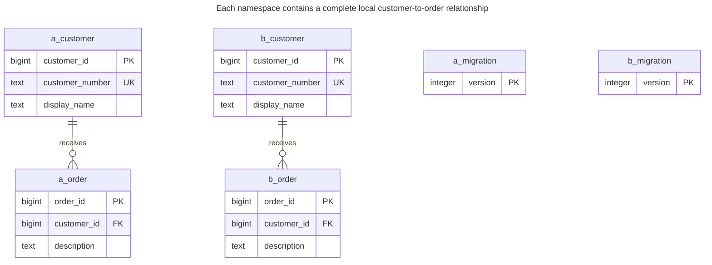
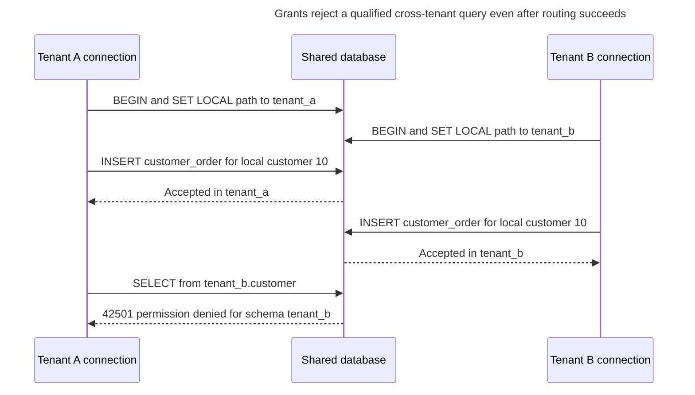
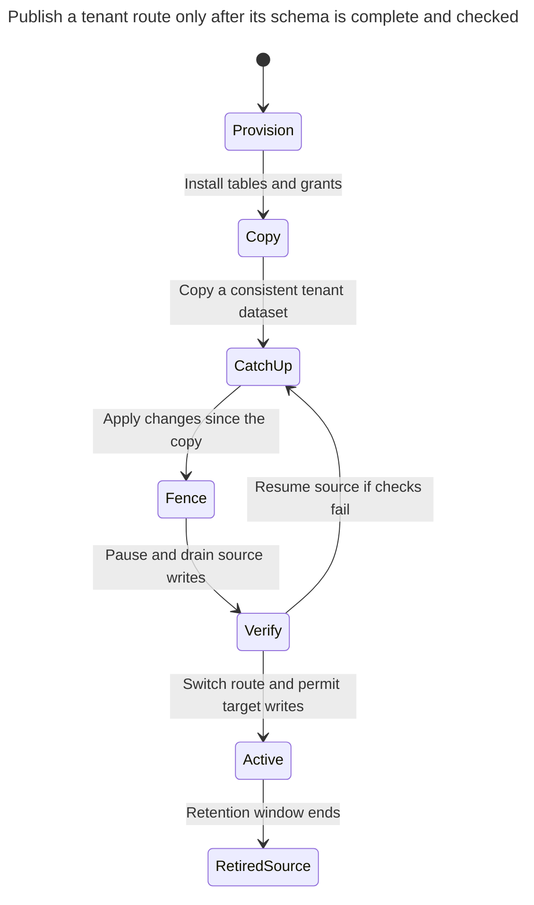

# Schema per Tenant

## Intent

Schema per tenant gives each tenant its own schema with an identical set of tables inside one database. With separate privileges, isolation no longer depends on row filters; a self-contained tenant schema can be exported, restored or moved separately, and per-tenant customization becomes possible. The chapter shows how to route connections to the right schema, why migrations now run once per tenant, and how the number of schemas affects catalog size, connection pools and tooling. PostgreSQL distinguishes [schema access privileges](https://www.postgresql.org/docs/18/sql-grant.html) from namespace selection and documents [schema-export dependencies](https://www.postgresql.org/docs/18/app-pgdump.html).

## Also known as

Separate schemas; namespace per tenant. Citus calls its distributed implementation [schema-based sharding](https://docs.citusdata.com/en/stable/get_started/concepts.html). AWS's historical [SaaS Storage Strategies](https://docs.aws.amazon.com/pdfs/whitepapers/latest/multi-tenant-saas-storage-strategies/multi-tenant-saas-storage-strategies.pdf) places separate representations inside a shared instance in the bridge family; that family is broader than PostgreSQL schemas.

## Problem

You adopt an application written for one company. Every query names `customer` and `customer_order`, and each relationship assumes an ordinary local customer ID. Adding tenant predicates and composite keys throughout the application is possible, but you also need to deploy a new column to a pilot tenant before the rest.

Duplicating tables as `customer_acme` and `customer_birch` makes tenant identity part of every table name. You want one complete namespace per tenant, one repeatable schema definition, and a way to authorize access to that namespace. A namespace without grants only changes how you find data; it does not decide who may read it.

## Solution

Create a schema for each tenant and put its full set of tenant-owned tables there. Keep foreign keys inside that schema. Use a trusted directory to resolve authenticated tenant identity to a schema name and a runtime credential. Keep schema ownership and migrations under a separate role; runtime roles receive object access without the ability to create or alter objects.

Choose one of two access contracts explicitly. A shared application credential with access to every schema makes the application router the tenant boundary. Separate credentials with access to one schema make a misrouted, explicitly qualified query fail at the database boundary too. This chapter implements the second contract. A role able to assume every tenant role remains a trusted router, not an untrusted tenant credential.

Use qualified names or set a controlled `search_path` for the transaction. PostgreSQL resolves an unqualified name to the [first matching object in that path](https://www.postgresql.org/docs/18/ddl-schemas.html#DDL-SCHEMAS-PATH). Exclude writable, untrusted namespaces. The path selects objects; schema and table grants authorize their use.

## Alternatives and selection

| Sibling or mechanism | Relationship | Deciding requirement |
| --- | --- | --- |
| [Shared Schema](shared-schema.md) | Replacement | Tenant count and uniform releases favor one set of tables with scoped keys |
| [Database per Tenant](database-per-tenant.md) | Replacement | The lifecycle boundary must include a database, or the tenant needs separate deployment placement |
| Qualified table names | Implementation option | You want every query to show its destination explicitly |
| Transaction-local `search_path` | Implementation option | Existing SQL should retain unqualified table names |
| [Expand and Contract](expand-contract.md) | Complement | Different tenant schemas will temporarily run different migration versions |

See the [Decision Atlas](decision-atlas.md) for the full table. Do not choose this pattern merely to keep tables small: it buys a namespace and privilege boundary at the price of repeated objects and repeated migrations.

## Structure



`a_customer`, `a_order` and `a_migration` label `tenant_a.customer`, `tenant_a.customer_order` and `tenant_a.schema_migration`; the `b_` entities are their counterparts in `tenant_b`. Equal IDs and customer numbers can exist in both namespaces. No foreign-key line crosses namespaces, and each schema records its own applied migration versions.

## Tables and invariants

- **`tenant_a.customer` and `tenant_b.customer`** each enforce local row identity and customer-number uniqueness. There is no global uniqueness claim for customer `10`.
- **Each `customer_order`** references its own schema's customer table through a qualified foreign key. A customer in the other schema cannot satisfy a missing local reference.
- **Each `schema_migration`** records positive, unique version numbers. The primary key prevents recording a version twice; the migration runner remains responsible for applying versions in order and checking their contents.
- **Runtime privileges** give `st_app_a` access only to tenant A, and `st_app_b` access only to tenant B. PostgreSQL distinguishes schema [`USAGE` from table privileges](https://www.postgresql.org/docs/18/sql-grant.html); granting one does not grant the other.
- **Provisioning completeness** is a workflow invariant: do not publish a tenant route until all tables, constraints, grants and version markers are installed.

## When to use

- Your application already has substantial SQL written for one tenant at a time.
- You need separate object privileges while retaining a shared database.
- Pilot migrations or a limited set of controlled schema variants are useful enough to justify a migration fleet.
- You can measure and operate the actual number of schema objects you will create.

## Consequences and trade-offs

- ➕ Queries within a correctly selected schema can use ordinary local IDs and foreign keys.
- ➕ You can deploy a compatible migration to one tenant first and inspect its result before continuing.
- ➖ Every tenant adds tables, indexes and constraints. PostgreSQL's [`pg_class` catalog](https://www.postgresql.org/docs/18/catalog-pg-class.html) records tables and indexes, among other relations; catalog and tooling work therefore grows with the copied structure. There is no universal safe tenant-count threshold.
- ➖ A pool per runtime credential needs connection budgeting. With a broad shared credential, fewer pools may be practical, but the router carries more of the isolation responsibility.
- ➖ A schema is not a dedicated CPU, memory or recovery allocation. PostgreSQL's [server resource settings](https://www.postgresql.org/docs/18/runtime-config-resource.html) include shared buffers; separate namespaces do not reserve them for tenants.
- ➖ Cross-tenant reports must intentionally enumerate approved schemas or read a reporting copy. They cannot assume one tenant's table represents the whole application.

## Implementation

The [complete PostgreSQL 18.6 script](../assets/schema-per-tenant/schema-per-tenant.sql) provisions two schemas, exercises restricted roles, and applies a migration to each schema. Its login roles have no passwords because the throwaway lab uses local trust authentication; provision production authentication independently. Start with a non-login owner and tenant-specific runtime roles:

```sql
CREATE ROLE st_owner NOLOGIN;
CREATE ROLE st_app_a LOGIN NOSUPERUSER NOBYPASSRLS;
CREATE ROLE st_app_b LOGIN NOSUPERUSER NOBYPASSRLS;
REVOKE CREATE ON SCHEMA public FROM PUBLIC;
CREATE SCHEMA tenant_a AUTHORIZATION st_owner;
CREATE SCHEMA tenant_b AUTHORIZATION st_owner;
SET ROLE st_owner;
CREATE TABLE tenant_a.customer (
    customer_id bigint PRIMARY KEY,
    customer_number text NOT NULL UNIQUE,
    display_name text NOT NULL
);
CREATE TABLE tenant_a.customer_order (
    order_id bigint PRIMARY KEY,
    customer_id bigint NOT NULL,
    description text NOT NULL,
    CONSTRAINT order_customer_fk FOREIGN KEY (customer_id)
        REFERENCES tenant_a.customer (customer_id)
);
CREATE INDEX order_customer_idx ON tenant_a.customer_order (customer_id);
CREATE TABLE tenant_a.schema_migration (
    version integer PRIMARY KEY CHECK (version > 0)
);
INSERT INTO tenant_a.schema_migration VALUES (1);
```

The script repeats those definitions under `tenant_b`, with a foreign key to `tenant_b.customer`. PostgreSQL [`CREATE SCHEMA ... AUTHORIZATION`](https://www.postgresql.org/docs/18/sql-createschema.html) assigns schema ownership; running the table DDL as that owner also keeps the tables under the migration role. Do not grant the runtime roles membership in `st_owner`.

Grant exactly the application's table operations, plus read access to the migration marker:

```sql
GRANT USAGE ON SCHEMA tenant_a TO st_app_a;
GRANT SELECT, INSERT, UPDATE, DELETE
    ON tenant_a.customer, tenant_a.customer_order TO st_app_a;
GRANT SELECT ON tenant_a.schema_migration TO st_app_a;
RESET ROLE;
SET ROLE st_app_a;
BEGIN;
SET LOCAL search_path = pg_catalog, tenant_a;
INSERT INTO customer VALUES (10, 'C-10', 'Acme customer');
INSERT INTO customer_order VALUES (100, 10, 'First order');
UPDATE customer SET display_name = 'Acme renamed' WHERE customer_id = 10;
SELECT o.order_id, c.display_name
FROM customer_order AS o JOIN customer AS c USING (customer_id);
COMMIT;
```

The join returns `(100, Acme renamed)`. The other role's equivalent transaction inserts `(10, C-10, Birch customer)` and its own order `100` without conflict. The administrator's `SET ROLE` tests grants; actual tenant connections authenticate directly as their runtime role.

Before executing unqualified SQL, set the path on the same connection and inside the same transaction as the query. [`SET LOCAL`](https://www.postgresql.org/docs/18/sql-set.html) ends at commit or rollback. Place `pg_catalog` explicitly first, exclude `public`, and deny the runtime role object creation, including temporary-object creation if its database privileges otherwise permit it. The script revokes the database's public `TEMPORARY` grant; PostgreSQL [grants it to `PUBLIC` by default](https://www.postgresql.org/docs/18/ddl-priv.html). Fully qualify provisioning DDL, because this path is intended for runtime lookup, not unqualified object creation.

Schema names are trusted identifiers resolved from your directory, not raw hostnames or tenant display names concatenated into SQL. If your migration runner generates DDL, use the driver's identifier-quoting facility. New objects also need grants: PostgreSQL's [`ALTER DEFAULT PRIVILEGES`](https://www.postgresql.org/docs/18/sql-alterdefaultprivileges.html) affects future objects created by the specified role, not existing ones or objects created by an unrelated role.

Under `st_app_a`, a qualified attempt to bypass the route fails:

```sql
SELECT count(*) FROM tenant_b.customer;
```

PostgreSQL 18.6 raises SQLSTATE `42501`: `ERROR: permission denied for schema tenant_b`. This rejection comes from the missing schema grant; `search_path` is not the defense. Under tenant A's path, the relationship constraint also rejects:

```sql
INSERT INTO customer_order VALUES (101, 20, 'Missing customer');
```

The error is SQLSTATE `23503`: `ERROR: insert or update on table "customer_order" violates foreign key constraint "order_customer_fk"`. Each invalid statement runs in its own exception block in the full script so the lab can assert both failures and continue.

## Engine support

- **PostgreSQL 18:** schemas coexist within one database, and qualified references can cross them when privileges allow. The [schema security guidance](https://www.postgresql.org/docs/18/ddl-schemas.html#DDL-SCHEMAS-PATTERNS) warns that trusting writable schemas in the search path permits object substitution. Keep runtime roles separate from owners.
- **MySQL 8.4:** [`CREATE SCHEMA` is a synonym for `CREATE DATABASE`](https://dev.mysql.com/doc/refman/8.4/en/create-database.html). There is no extra PostgreSQL-style schema layer beneath a MySQL database; translate the isolation boundary, not its name.
- **SQL Server 2025 (17.x):** [`CREATE SCHEMA ... AUTHORIZATION`](https://learn.microsoft.com/en-us/sql/t-sql/statements/create-schema-transact-sql?view=sql-server-ver17) creates an owned namespace inside a database. Use qualified names and SQL Server permissions; PostgreSQL `search_path` is not portable syntax.
- **Oracle AI Database 26ai:** [`ALTER SESSION SET CURRENT_SCHEMA`](https://docs.oracle.com/en/database/oracle/oracle-database/26/sqlrf/ALTER-SESSION.html) changes resolution of unqualified names without changing the user or granting privileges. Preserve the same distinction between routing and authorization.
- **SQLite 3:** [`ATTACH DATABASE`](https://www.sqlite.org/lang_attach.html) names another database file within a connection. That is a file-based arrangement, not a namespace with independent database roles; SQLite's [access permissions are filesystem permissions](https://www.sqlite.org/omitted.html).

## Failure and concurrency



The two local order IDs do not conflict because they belong to different tables. Concurrent writes to the same tenant still need the usual local constraints; namespace isolation does not settle two edits to one row. A routing error under a broad all-schema credential would instead succeed, which is why the credential contract matters.

Serialize migration runners per tenant, and commit transactional DDL with its version marker. The script uses [`pg_advisory_xact_lock`](https://www.postgresql.org/docs/18/explicit-locking.html#ADVISORY-LOCKS) with one assigned key per tenant. Every runner must honor the same mapping and recheck the version after acquiring the lock. An advisory lock coordinates cooperating runners; it does not block arbitrary runtime SQL. DDL takes its own locks, so use a short [`lock_timeout`](https://www.postgresql.org/docs/18/runtime-config-client.html#GUC-LOCK-TIMEOUT) in production and retry an individual tenant later rather than stalling the whole fleet.

A worker that crashes between tenant migrations leaves a partially upgraded fleet. Record completion per tenant and resume only the outstanding versions. Keep the application compatible with that mixed state. Retry only after determining whether that tenant's previous transaction committed; do not equate a lost connection with a failed migration.

## Migration

For an existing single-tenant database, first separate tenant-owned objects from shared control and reference data. For a shared-schema source, copy each tenant's customer and order rows into a complete target namespace, preserving their local relationships. Do not create cross-schema foreign keys merely to avoid copying tenant-owned children: that would make later movement depend on another tenant's namespace.



The switch requires a write fence, not merely an updated schema name in a cache. Drain source transactions, apply remaining changes, verify counts and references, then invalidate old routes and connection state. Before target writes start you can reopen the source; afterward, rollback needs a reverse copy or change capture. Keep the source through the recovery window without letting both copies accept writes.

For routine upgrades, apply [Expand and Contract](expand-contract.md) tenant by tenant. Add compatible columns first, move all application versions, then remove obsolete objects. The lab's sample upgrade performs `ADD COLUMN billing_note text` and records version `2` in one transaction per tenant; it demonstrates resumable boundaries rather than a complete deployment service.

A schema export can simplify movement, but it is not automatically self-contained. PostgreSQL [`pg_dump --schema`](https://www.postgresql.org/docs/18/app-pgdump.html) does not automatically include objects outside the selected schema on which it depends. Inventory shared types, functions, extensions, roles and reference tables and rehearse restoration. Physical [point-in-time recovery restores a whole cluster](https://www.postgresql.org/docs/18/continuous-archiving.html), so recover to a scratch cluster and extract a tenant if you need an earlier version of one schema.

## Anti-patterns and common mistakes

- Treating `SET search_path` as authorization while every request uses an all-schema owner credential.
- Leaving tenant-writable schemas on another tenant's lookup path.
- Applying a migration once and assuming all schemas changed, or using one global version marker for a partially upgraded fleet.
- Giving tenants arbitrary schema customizations without recording supported variants and their upgrade paths.
- Calling an ad hoc set of suffixed tables a schema strategy; see [Cloned Tables](cloned-tables.md). Keep a complete namespace, provisioning contract and migration history.
- Assuming a schema export includes external dependencies or supplies tenant-only physical recovery.

## Known uses

- Citus's [schema-based sharding](https://docs.citusdata.com/en/stable/get_started/concepts.html#schema-based-sharding), available since Citus 12.0, uses a schema as a logical shard and permits heterogeneous tenant schemas. Its restrictions and tenant density are extension-specific; they are not limits promised for ordinary PostgreSQL schemas.
- AWS's historical [RDS bridge model](https://docs.aws.amazon.com/pdfs/whitepapers/latest/multi-tenant-saas-storage-strategies/multi-tenant-saas-storage-strategies.pdf) describes separate tenant representations within an instance and gradual migration between tenant schema versions. Its vocabulary covers several engine-specific container choices.

## Related patterns

- [Shared Schema](shared-schema.md) trades per-tenant object sets for tenant-qualified rows.
- [Database per Tenant](database-per-tenant.md) moves the routing boundary to connection establishment.
- [Expand and Contract](expand-contract.md) keeps mixed schema versions usable during a fleet rollout.
- [Cloned Tables](cloned-tables.md) explains why repeated names without a lifecycle contract become difficult to maintain.
