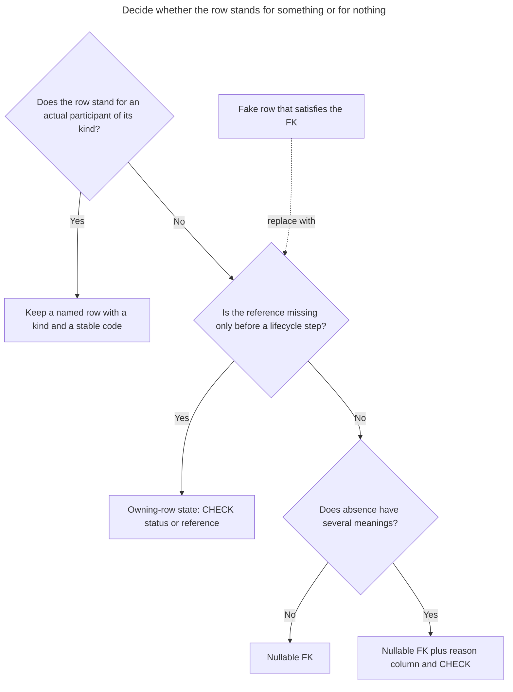
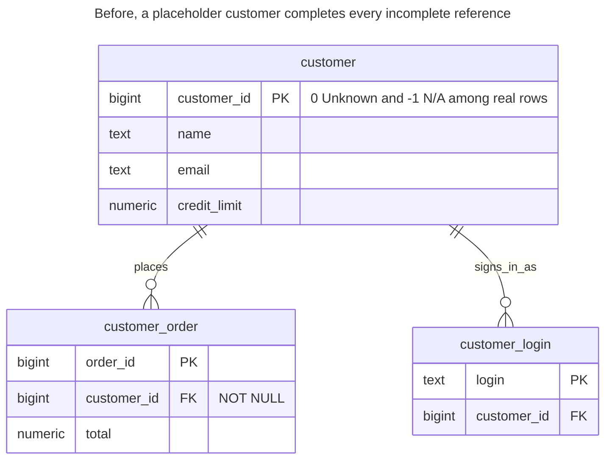
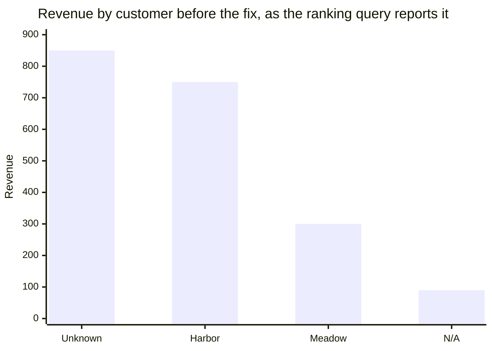
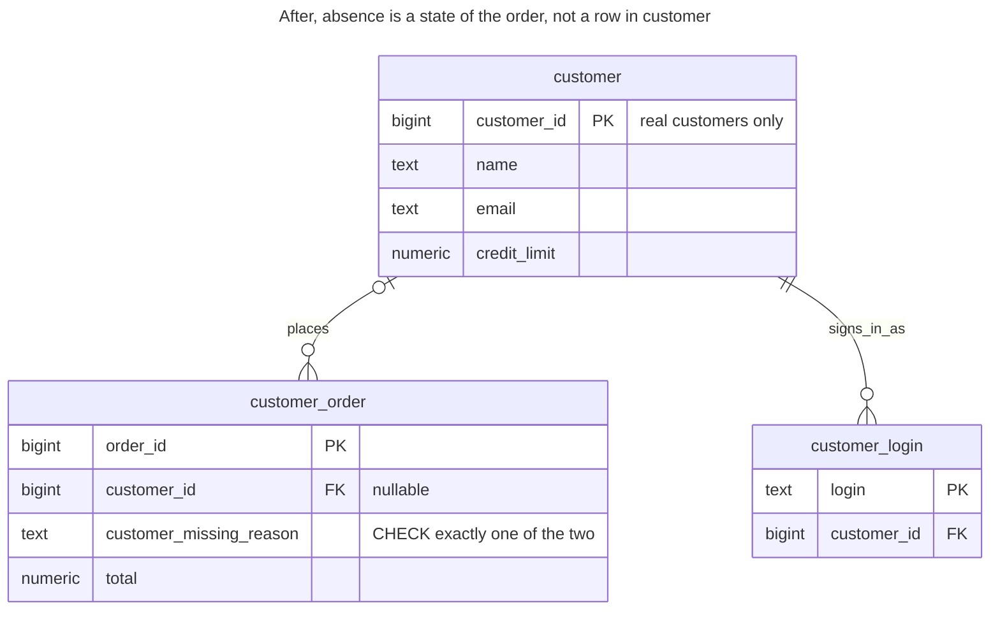
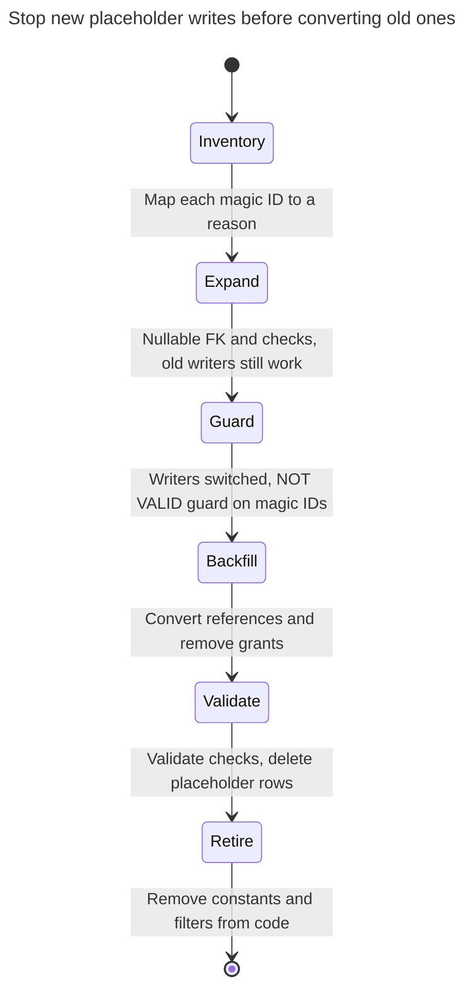

# Sentinel Rows

A sentinel row is a fake record, such as `customer_id = 0` named `Unknown`, `N/A` or `-`, that other rows point to when the real reference is missing. It lets a `NOT NULL` foreign key pass, so the schema reports complete data where none exists. Reports then count the fake row as a customer, permissions attached to it reach strangers' data, and every team that meets the problem adds a placeholder of its own. The chapter shows how the damage appears, when a fixed named row is a legitimate part of the domain, and how to replace placeholders with a nullable reference plus an explicit reason, or with a state of the owning row.

## Also known as

Placeholder row, dummy record, magic ID. In object code the same idea is a respectable pattern: Fowler's [Special Case](https://martinfowler.com/eaaCatalog/specialCase.html) returns an object with the caller's expected interface instead of null, and his page recalls a utility customer who was not fully known and was referred to as “occupant”. That object lives in code and carries behavior. A sentinel row copies it into a table, where it has no behavior, only data that every query treats as a real customer.

## Context

Orders reference customers through a mandatory foreign key. Then guest checkout arrives, a legacy import brings orders whose buyer was never recorded, and an internal replacement shipment has no customer at all. The column is `NOT NULL`, the ORM maps the association as required, and changing either looks like a schema project. Inserting one customer called `Unknown` takes a minute.

## Problem

You insert a row into the referenced table that does not describe anything in the domain and point every incomplete reference at it. The `NOT NULL` constraint and the foreign key are both satisfied, so the database confirms a fact that is false: that each order has a customer. The missing data has not disappeared; it has become indistinguishable from real data except by a magic ID or a label that code must know.

The fake row is a full member of its table. It has a name, an email address, a credit limit and whatever columns the table gains later. Logins, addresses and discounts can reference it. Aggregates, joins and uniqueness rules treat it as one more customer, because to the database it is one.

## Why people do it

- A `NOT NULL` foreign key is already in place, and making it nullable feels like weakening the schema rather than describing it.
- Inner joins drop rows with a NULL reference, so someone adds a row that every join finds.
- A report wants a label in the customer column, and `Unknown` reads better than a blank.
- A team rule says “no NULLs”, often adopted to avoid three-valued logic in queries.
- The habit comes from dimensional modeling, where an “unknown member” row is the documented technique, or from the object-side Special Case.

Each force is real. None of them requires a fake customer: a nullable reference with a declared reason keeps the rule, the join and the label, as shown below.

## Consequences

- ➖ The `NOT NULL` constraint and the foreign key report success while the data is missing. Only a check that already knows the magic ID can tell an unknown buyer from a real one; generic constraints, catalog queries and completeness reports cannot.
- ➖ Counts, joins and aggregates include the fake row. In the example, `Unknown` becomes the biggest customer, and `count(DISTINCT customer_id)` counts two customers that do not exist.
- ➖ The fake row collects attributes and permissions. It gets a credit limit, a mailing address or a default discount that then applies to every guest order; a login linked to it sees every order that points at it.
- ➖ Placeholders multiply. The next team adds `-1 'N/A'` or `99 'Unknown customer'`, and filters written as `customer_id <> 0` silently let the new ones through.
- ➖ Deleting the row fails while references exist, or cascades through them if the FK says so. Renaming it breaks code that finds it by label, and renumbering it breaks code with a hard-coded ID.
- ➖ Different kinds of absence collapse into one value. “The customer did not give an account”, “this order has no customer by nature” and “the identity was withheld” all become `0`.

## Signs

- Rows with ID `0` or negative IDs, or names such as `Unknown`, `N/A`, `-`, `None`, `TBD` or `Default`, in an entity table.
- Constants such as `UNKNOWN_CUSTOMER_ID` in application code, and filters such as `customer_id <> 0` or `name <> 'Unknown'` repeated across queries.
- Seed migrations that insert fixed-ID rows into a table that otherwise grows by user action.
- A report whose top line is `Unknown`, or an email bounce rate driven by addresses like `noreply@...` stored on a customer.
- A delete of an obsolete record that fails because tens of thousands of rows reference it.

## A better way

Say in the schema that the reference can be absent, and say why. Make the foreign key nullable where “missing” is a legal state. When absence has more than one meaning, add a reason column on the referencing row and tie the two together with a `CHECK`: exactly one of them is present. The vocabulary of reasons is small and developer-owned, so a `CHECK` list fits it. Move it to a [Lookup Table](lookup-table.md) if reasons need labels or retirement.

A reason code is not a sentinel. It sits on the row whose data is missing, it does not pretend to be a customer, and no join to `customer` ever finds it. Reports that rank customers use an inner join and see only customers; reports that reconcile revenue show the unattributed share as its own line, broken down by reason.

When absence is legal only during part of a lifecycle, make it a state of the owning row instead. A draft quote can lack a customer; an issued one cannot. The rule `CHECK (status = 'draft' OR customer_id IS NOT NULL)` says exactly that and needs no reason column.

NULL brings its own trap. `WHERE customer_id <> 1` evaluates to unknown for a NULL reference and drops the row; write `IS DISTINCT FROM` when absent references must stay in the result. A `CHECK` passes when its expression is NULL, which PostgreSQL [documents](https://www.postgresql.org/docs/18/ddl-constraints.html) explicitly, so build the presence rule from `IS NULL` tests, which never return NULL.

### When a fixed row is legitimate

A fixed, named row is not a sentinel when it describes something that exists in the domain and takes part in it. A scheduled repricing job changes prices; recording it as a `service` actor with the code `system.repricer` states who acted, and a report of changes by people excludes it by `kind`, not by a magic ID. A ledger's clearing or opening-equity account is a real account that holds a balance and receives entries; [Double-Entry Ledger](double-entry-ledger.md) needs such counterpart accounts for conservation. Ask two questions: does the row stand for an actual participant of its kind, and should queries that count its kind include it? If both answers are yes, keep the row, give it a stable code and a kind, and reference it like any other row. Who acted belongs in the [Audit Log](audit-log.md), and a person or organization belongs in [Party](party.md); neither needs a placeholder for “nobody”.

Data warehouses use a deliberate variant. Kimball's dimensional technique avoids NULL foreign keys in fact tables and has the dimension carry a [default row for the unknown or not applicable condition](https://www.kimballgroup.com/data-warehouse-business-intelligence-resources/kimball-techniques/dimensional-modeling-techniques/fact-table-null/). That is a reporting-layer convention with its own load process, out of scope for an OLTP schema. If you feed a warehouse, the reason column gives its loader exactly the distinction those default rows need.

### Alternatives and selection

| Choice | Relationship | Choose it when |
| --- | --- | --- |
| Nullable FK | Replacement | Absence has one meaning and readers handle NULL deliberately |
| Nullable FK plus reason column | Replacement | Absence has several meanings that reports or rules must tell apart |
| Owning-row state | Replacement | The reference becomes mandatory at a lifecycle step, such as issuing a draft |
| [Table Split](table-split.md) | Implementation option | The reference and its attributes are optional together and you prefer a separate row to NULL columns |
| Real named row with a kind | Defensible case | The row is an actual participant of its kind, such as a service actor or a clearing account |
| [Lookup Table](lookup-table.md) | Complement | Reasons need labels, translations or retirement |

See the [Decision Atlas](decision-atlas.md) for the full repair map.



The first question separates the defensible case from the anti-pattern. Every other path ends in a schema that says the data is missing instead of pretending it is present.

## Example

### Structure

**Before:** a fake customer satisfies the mandatory reference from orders and logins.



The diagram shows a required relationship. Nothing in it reveals that two of the customers are not customers.

The [complete PostgreSQL 18.7 script](../assets/sentinel-rows/sentinel-rows.sql) runs in its own schema, `sentinel_example`, and asserts every result below:

```sql
CREATE TABLE customer (
    customer_id bigint PRIMARY KEY,
    name text NOT NULL,
    email text NOT NULL,
    credit_limit numeric(12,2) NOT NULL DEFAULT 0
);
CREATE TABLE customer_order (
    order_id bigint PRIMARY KEY,
    customer_id bigint NOT NULL REFERENCES customer (customer_id),
    total numeric(12,2) NOT NULL CHECK (total > 0)
);
CREATE TABLE customer_login (
    login text PRIMARY KEY,
    customer_id bigint NOT NULL REFERENCES customer (customer_id)
);
INSERT INTO customer VALUES
    (0, 'Unknown', 'noreply@shop.example', 1000.00),
    (1, 'Harbor', 'buyer@harbor.example', 5000.00),
    (2, 'Meadow', 'orders@meadow.example', 2000.00);
INSERT INTO customer_order VALUES
    (101, 1, 400.00), (102, 1, 350.00), (103, 2, 300.00),
    (104, 0, 200.00), (105, 0, 250.00), (106, 0, 180.00), (107, 0, 220.00);
INSERT INTO customer_login VALUES ('kiosk', 0), ('harbor-buyer', 1);
```

Order `107` has no buyer, and both constraints accept it. The four guest orders now carry the `1000.00` credit limit someone gave `Unknown`, and the shared `kiosk` login sees all four, although unrelated guests placed them. The customer ranking is wrong:

```sql
SELECT c.name, sum(o.total) AS revenue
FROM customer_order AS o JOIN customer AS c USING (customer_id)
GROUP BY c.name ORDER BY revenue DESC;
```

It returns `Unknown 850.00`, `Harbor 750.00`, `Meadow 300.00`. Later another team inserts `(-1, 'N/A', ...)` for internal replacement shipments and order `108` for `90.00`. `count(DISTINCT customer_id)` over orders returns `4` where two customers exist, and the filter `customer_id <> 0` that everyone copied still returns `3`, because it knows only the first placeholder.



The largest bar is not a customer, and neither is the smallest. A sales dashboard built on this query would send its best-customer offer to `noreply@shop.example`.

Renaming the row to `Guest` makes code that looks it up by name find nothing; the script checks this inside a savepoint. Deleting it fails:

```sql
DELETE FROM customer WHERE customer_id = 0;
```

PostgreSQL 18.7 raises SQLSTATE `23503`: `ERROR: update or delete on table "customer" violates foreign key constraint "customer_order_customer_id_fkey" on table "customer_order"`, with `DETAIL: Key (customer_id)=(0) is still referenced from table "customer_order".`

**After:** the order says that its customer is missing and why.



The relationship from `customer` is now zero-or-one. The `kiosk` login lost its link, because a shared device has no customer whose orders it may see.

```sql
ALTER TABLE customer_order
    ALTER COLUMN customer_id DROP NOT NULL,
    ADD COLUMN customer_missing_reason text,
    ADD CONSTRAINT customer_order_missing_reason_check
        CHECK (customer_missing_reason IN ('not_provided', 'not_applicable', 'withheld')) NOT VALID,
    ADD CONSTRAINT customer_order_customer_presence
        CHECK ((customer_id IS NULL) <> (customer_missing_reason IS NULL)) NOT VALID;
```

`not_provided` covers guest checkout and legacy orders whose buyer was never recorded; `not_applicable` covers internal shipments that have no customer by nature; `withheld` covers a buyer whose identity is not disclosed to this system. This step only widens the schema: an old writer that still inserts customer `0` without a reason passes every new check, and a new writer can already store NULL plus a reason. The script inserts one order of each kind and rolls them back. Once all writers use the new form, a guard closes the magic IDs, and the references are converted:

```sql
ALTER TABLE customer_order
    ADD CONSTRAINT customer_order_no_sentinel CHECK (customer_id NOT IN (0, -1)) NOT VALID;
CREATE TABLE sentinel_map (
    customer_id bigint PRIMARY KEY,
    missing_reason text NOT NULL
);
INSERT INTO sentinel_map VALUES (0, 'not_provided'), (-1, 'not_applicable');
UPDATE customer_order AS o
SET customer_id = NULL, customer_missing_reason = m.missing_reason
FROM sentinel_map AS m
WHERE o.customer_id = m.customer_id;
DELETE FROM customer_login AS l USING sentinel_map AS m
WHERE l.customer_id = m.customer_id;
ALTER TABLE customer_order VALIDATE CONSTRAINT customer_order_missing_reason_check;
ALTER TABLE customer_order VALIDATE CONSTRAINT customer_order_customer_presence;
ALTER TABLE customer_order VALIDATE CONSTRAINT customer_order_no_sentinel;
DELETE FROM customer AS c USING sentinel_map AS m WHERE c.customer_id = m.customer_id;
```

The final delete succeeds, which proves that no order or login still points at a placeholder. The ranking query is unchanged and now returns `Harbor 750.00`, `Meadow 300.00`, with `count(DISTINCT customer_id)` equal to `2`. The unattributed share gets its own report:

```sql
SELECT customer_missing_reason, count(*) AS orders, sum(total) AS revenue
FROM customer_order WHERE customer_id IS NULL
GROUP BY customer_missing_reason ORDER BY customer_missing_reason;
```

It returns `not_applicable 1 90.00` and `not_provided 4 850.00`. Attributed `1050.00` plus unattributed `940.00` equals the `1990.00` total, so nothing was lost; the script asserts all four sums. Each invalid combination is rejected with SQLSTATE `23514`:

- no customer and no reason: `ERROR: new row for relation "customer_order" violates check constraint "customer_order_customer_presence"`;
- a customer and a reason together: the same constraint;
- the reason `unknown`: `violates check constraint "customer_order_missing_reason_check"`;
- customer `0`: `violates check constraint "customer_order_no_sentinel"`.

The owning-row alternative needs no reason column:

```sql
CREATE TABLE quote (
    quote_id bigint PRIMARY KEY,
    status text NOT NULL CHECK (status IN ('draft', 'issued')),
    customer_id bigint REFERENCES customer (customer_id),
    CONSTRAINT quote_issued_has_customer CHECK (status = 'draft' OR customer_id IS NOT NULL)
);
INSERT INTO quote VALUES (1, 'draft', NULL);
UPDATE quote SET status = 'issued' WHERE quote_id = 1;
```

The update raises SQLSTATE `23514`: `ERROR: new row for relation "quote" violates check constraint "quote_issued_has_customer"`. Setting the customer in the same update succeeds.

### Engine support

- **PostgreSQL 18:** a single-column foreign key that is NULL is not checked. For a composite key the default [`MATCH SIMPLE`](https://www.postgresql.org/docs/18/sql-createtable.html) skips the check when any referencing column is NULL, so a tenant-scoped reference with a NULL customer is still accepted.
- **SQL Server 2025 (17.x):** the documentation of [CHECK constraints](https://learn.microsoft.com/en-us/sql/relational-databases/tables/unique-constraints-and-check-constraints?view=sql-server-ver17) warns that an expression evaluating to UNKNOWN does not reject the row, and states that a UNIQUE constraint allows only one NULL per column. If the reference is also unique, use a [filtered unique index](https://learn.microsoft.com/en-us/sql/relational-databases/tables/create-unique-constraints?view=sql-server-ver17) on the non-NULL values.

### Migration

Retiring placeholders is a data migration with a compatibility window; [Expand and Contract](expand-contract.md) supplies the rollout discipline and [Missing Foreign Keys](missing-foreign-keys.md) the `NOT VALID` mechanics.

1. **Find the magic rows.** Search entity tables for zero or negative IDs and placeholder labels, and search code for the constants and filters that name them. List every foreign key that targets the table from `pg_constraint`; the example finds `customer_order` and `customer_login`.
2. **Name what each row meant.** Record the mapping in a table, here `sentinel_map (customer_id, missing_reason)` with `0 → not_provided` and `-1 → not_applicable`. If one placeholder hid several meanings, split it by other evidence, such as order channel or import batch, before mapping.
3. **Expand.** Drop `NOT NULL`, add the reason column and add the vocabulary and presence checks as `NOT VALID`. Old writers that still store `0` keep working. Decide what each attribute on the fake row meant, such as the guest credit limit, and turn it into an explicit rule.
4. **Switch writers and guard.** Deploy writers that store NULL plus a reason. Then add the guard against the magic IDs as `NOT VALID`; it rejects a forgotten writer while old rows are still being converted, and in the example raises `23514` for customer `0`.
5. **Backfill.** Update references in batches to NULL plus the mapped reason, and remove grants such as the `kiosk` login link.
6. **Validate and retire.** Validate the constraints, then delete the placeholder rows. The delete succeeds only when no reference remains, which makes it the final check. Remove the constants and `<> 0` filters from code, and drop the guard once no writer knows the magic IDs.



The guard goes in before the backfill, not after it: otherwise an old writer can insert a new `0` reference between the last batch and the delete, and the delete fails with `23503`. Each `ALTER TABLE` here takes a brief `ACCESS EXCLUSIVE` lock without scanning, because the new checks are `NOT VALID`; [`VALIDATE CONSTRAINT`](https://www.postgresql.org/docs/18/sql-altertable.html) then scans under `SHARE UPDATE EXCLUSIVE`, which does not block reads and writes.

## Related patterns and anti-patterns

- [Missing Foreign Keys](missing-foreign-keys.md) is the opposite failure: a reference without a declared rule, rather than a declared rule satisfied by a fake target.
- [Lookup Table](lookup-table.md) holds the reason vocabulary when it needs labels or retirement.
- [Party](party.md) models real people and organizations; a placeholder party is the same anti-pattern one level up.
- [Audit Log](audit-log.md) records who acted; a scheduled job is better recorded there as a named service actor than as a placeholder.
- [Double-Entry Ledger](double-entry-ledger.md) uses real counterpart accounts with fixed meanings, the defensible case.
- [Table Split](table-split.md) moves an optional reference and its attributes into a separate row.
- [Expand and Contract](expand-contract.md) supplies the rollout for the migration.
