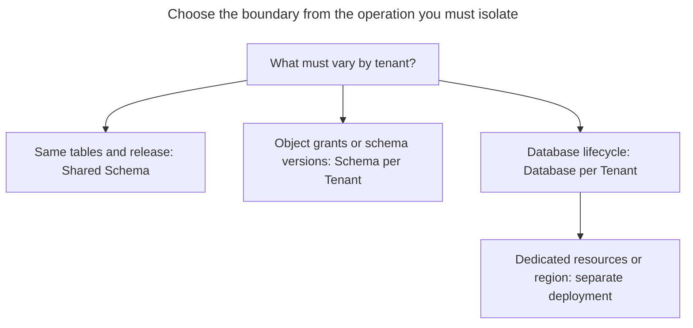
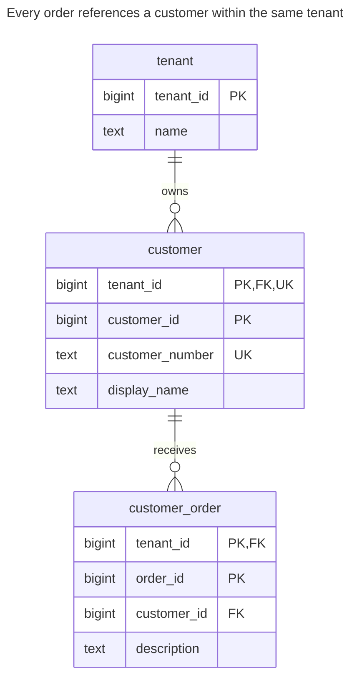
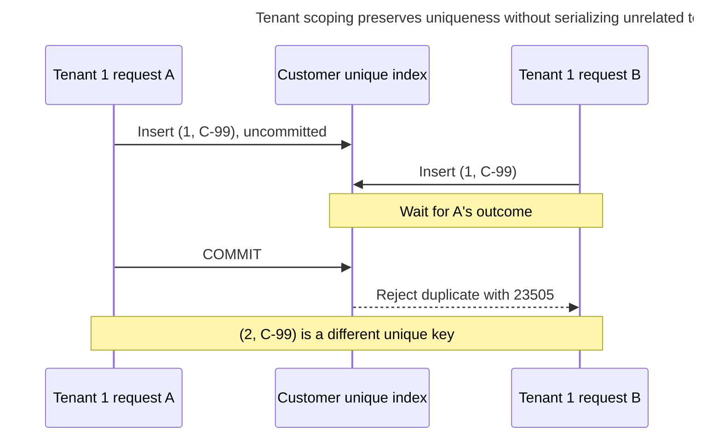
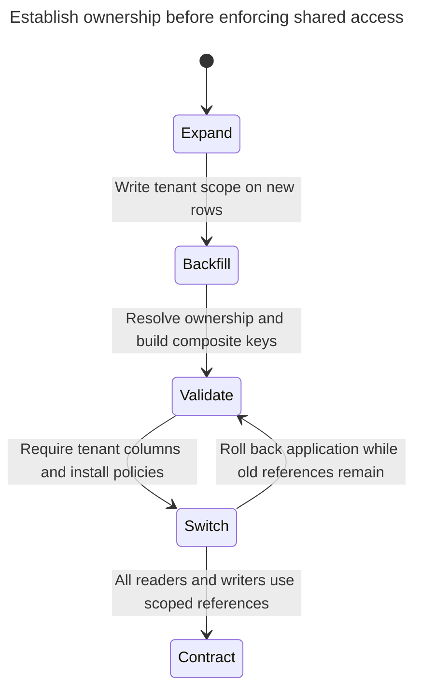

# Shared Schema

## Intent

A shared schema keeps the data of all tenants in the same tables, told apart by a `tenant_id` column on every row. It is usually the cheapest model to operate — one schema to migrate, one connection pool — but isolation depends on enforcing tenant scope on every access path. The chapter shows how to make `tenant_id` part of keys and foreign keys so that rows of different tenants cannot reference each other, how PostgreSQL row-level security enforces the filter in the database, and what to do with a tenant that outgrows the rest. The [Azure tenancy comparison](https://learn.microsoft.com/en-us/azure/azure-sql/database/saas-tenancy-app-design-patterns) identifies the low per-tenant cost of shared databases for small tenants.

## Also known as

Shared tables; pooled tenancy. AWS calls shared storage the [pool model](https://docs.aws.amazon.com/whitepapers/latest/saas-architecture-fundamentals/data-partitioning.html) and distinguishes partitioning data from isolating access. Citus calls the distributed form [row-based sharding](https://docs.citusdata.com/en/stable/get_started/concepts.html); sharding is a placement option, not a prerequisite for this pattern.

## Problem

You sell the same order-management application to many companies. Customer number `C-10` is legitimate in each company, and an order must reference a customer belonging to its own company. A globally unique order ID does not express that ownership rule. A foreign key on `customer_id` alone can accept an order whose customer belongs to someone else.

Adding `WHERE tenant_id = ...` to the main customer screen leaves imports, background jobs, reports and maintenance endpoints to get right independently. You need both a relationship invariant and an access boundary. Neither substitutes for authenticating which tenant a request may act for.

## Solution

Put `tenant_id` in every tenant-owned table, including association and work tables. Define row identity and business uniqueness within that scope, and carry the scope through every tenant-owned foreign key. In the example, `(tenant_id, customer_id)` identifies a customer and `(tenant_id, customer_number)` identifies its business number. PostgreSQL supports these [multicolumn unique and foreign-key constraints](https://www.postgresql.org/docs/18/ddl-constraints.html).

Apply row-level security (RLS) to each tenant-owned table. Use `USING` to select existing rows and `WITH CHECK` to validate inserted or changed rows, following PostgreSQL's [`CREATE POLICY` contract](https://www.postgresql.org/docs/18/sql-createpolicy.html). The example takes the authenticated scope from a transaction-local setting supplied by trusted application code. You still include tenant predicates in application queries: they explain intent and make tenant-scoped joins explicit.

Treat a connection allowed to set its own tenant context as trusted middleware. This implementation protects against a forgotten row predicate; it does not prevent arbitrary SQL executed under that same role from choosing another tenant. If tenants receive direct SQL access, give them independently constrained credentials or choose one of the stronger routing boundaries below.

## Alternatives and selection

| Sibling or mechanism | Relationship | Deciding requirement |
| --- | --- | --- |
| [Schema per Tenant](schema-per-tenant.md) | Replacement | You need separate object privileges or staged schema versions inside one database |
| [Database per Tenant](database-per-tenant.md) | Replacement; complement in a hybrid deployment | You need a tenant-sized database export or dedicated placement for selected tenants |
| Row-level security | Implementation option | Shared tables need a database-enforced row filter for a restricted application role |
| [Table Partitioning](table-partitioning.md) | Complement | Physical table maintenance or pruning needs a partition key; access isolation remains separate |

See the [Decision Atlas](decision-atlas.md) for the full table. Avoid [Cloned Tables](cloned-tables.md) as a naming-based substitute for an explicit tenancy model.



A large tenant can leave the shared pool without changing the model for everyone else. A separate database on the same server still needs an additional deployment decision if resources must be isolated.

## Structure



The customer's `UK` markers together mean `(tenant_id, customer_number)`, not two separate unique columns. An order's foreign key includes both `tenant_id` and `customer_id`; you cannot make it cross the ownership boundary by copying another tenant's customer number or ID.

## Tables and invariants

- **`ss.tenant`** registers tenants. It is control data, not exposed to the runtime role in this lab.
- **`ss.customer`** has a composite primary key and tenant-local customer-number uniqueness. Two tenants may both have customer `10` and number `C-10`.
- **`ss.customer_order`** requires a matching customer under the same tenant. Its `(tenant_id, customer_id)` index supports that access path; PostgreSQL does [not automatically index the referencing columns](https://www.postgresql.org/docs/18/ddl-constraints.html#DDL-CONSTRAINTS-FK).
- **Access policy** applies to both customer and order rows. An absent context yields no visible rows and cannot authorize an insertion. Do not grant the runtime role ownership, `BYPASSRLS`, or whole-table operations such as `TRUNCATE`; PostgreSQL documents these [RLS exceptions](https://www.postgresql.org/docs/18/ddl-rowsecurity.html).

## When to use

- Tenants use the same schema and can receive each release together.
- You want to provision a tenant as data rather than create another set of database objects.
- Most application work belongs to one authenticated tenant, and you can establish that scope before accessing data.
- You can isolate unusually expensive tenants later through routing rather than promising every tenant dedicated resources now.

## Consequences and trade-offs

- ➕ One table definition, index definition and migration serve every tenant in the pool.
- ➕ Tenant-local uniqueness remains a database constraint rather than an application pre-check.
- ➖ Tenant identity widens keys and must propagate into children, joins, caches and job payloads.
- ➖ A slow migration or an expensive workload shares the pool's operational budget. RLS restricts rows, not resource consumption; AWS discusses [noisy neighbors separately from partitioning](https://docs.aws.amazon.com/whitepapers/latest/saas-architecture-fundamentals/data-partitioning.html).
- ➖ Recovering one tenant requires identifying its entire row graph and reconciling it with shared reference data. There is no tenant-sized object to restore wholesale.

## Implementation

The [complete PostgreSQL 18.6 script](../assets/shared-schema/shared-schema.sql) creates two tenants, checks missing-context behavior, and asserts the two expected rejections. Run it as a lab administrator in a fresh database; it switches to an unprivileged role for runtime operations. The essential DDL is:

```sql
CREATE ROLE ss_app NOLOGIN NOSUPERUSER NOBYPASSRLS;
CREATE SCHEMA ss;
CREATE TABLE ss.tenant (
    tenant_id bigint PRIMARY KEY,
    name text NOT NULL
);
CREATE TABLE ss.customer (
    tenant_id bigint NOT NULL REFERENCES ss.tenant (tenant_id),
    customer_id bigint NOT NULL,
    customer_number text NOT NULL,
    display_name text NOT NULL,
    PRIMARY KEY (tenant_id, customer_id),
    UNIQUE (tenant_id, customer_number)
);
CREATE TABLE ss.customer_order (
    tenant_id bigint NOT NULL,
    order_id bigint NOT NULL,
    customer_id bigint NOT NULL,
    description text NOT NULL,
    PRIMARY KEY (tenant_id, order_id),
    CONSTRAINT order_customer_fk FOREIGN KEY (tenant_id, customer_id)
        REFERENCES ss.customer (tenant_id, customer_id)
);
CREATE INDEX order_customer_idx ON ss.customer_order (tenant_id, customer_id);
```

The sample supplies IDs explicitly so tenant scoping is visible; choose an allocator separately, as explained in [Surrogate Key](surrogate-key.md). The administrator seeds `(1, 10)`, `(2, 10)` and `(2, 20)` as customers, then installs the same policy on both tenant-owned tables:

```sql
ALTER TABLE ss.customer ENABLE ROW LEVEL SECURITY;
ALTER TABLE ss.customer FORCE ROW LEVEL SECURITY;
CREATE POLICY tenant_scope ON ss.customer TO ss_app
    USING (tenant_id = nullif(current_setting('app.tenant_id', true), '')::bigint)
    WITH CHECK (tenant_id = nullif(current_setting('app.tenant_id', true), '')::bigint);
ALTER TABLE ss.customer_order ENABLE ROW LEVEL SECURITY;
ALTER TABLE ss.customer_order FORCE ROW LEVEL SECURITY;
CREATE POLICY tenant_scope ON ss.customer_order TO ss_app
    USING (tenant_id = nullif(current_setting('app.tenant_id', true), '')::bigint)
    WITH CHECK (tenant_id = nullif(current_setting('app.tenant_id', true), '')::bigint);
GRANT USAGE ON SCHEMA ss TO ss_app;
GRANT SELECT, INSERT, UPDATE, DELETE ON ss.customer, ss.customer_order TO ss_app;
```

`app.tenant_id` is this example's application convention, not a built-in PostgreSQL tenant variable. PostgreSQL accepts [two-part custom option names](https://www.postgresql.org/docs/18/runtime-config-custom.html); [`current_setting(..., true)`](https://www.postgresql.org/docs/18/functions-admin.html#FUNCTIONS-ADMIN-SET) returns null for a missing setting. `nullif` also handles an empty reset value. The lab verifies this expression rather than attributing the convention to the RLS documentation.

At request entry, authenticate the tenant, begin a transaction, establish its scope and execute all work on that checked-out connection:

```sql
SET ROLE ss_app;
BEGIN;
SET LOCAL app.tenant_id = '1';
INSERT INTO ss.customer_order VALUES (1, 100, 10, 'First order');
SELECT tenant_id, customer_id, customer_number FROM ss.customer;
UPDATE ss.customer SET display_name = 'Acme renamed'
WHERE tenant_id = 1 AND customer_id = 10;
SELECT o.order_id, c.display_name
FROM ss.customer_order AS o
JOIN ss.customer AS c USING (tenant_id, customer_id);
COMMIT;
```

The customer query returns only `(1, 10, C-10)` despite having no tenant predicate; the join returns `(100, Acme renamed)`. [`SET LOCAL`](https://www.postgresql.org/docs/18/sql-set.html) lasts until transaction end, so the next request must establish context again. Production connections should authenticate with restricted logins that inherit `ss_app`; the lab's administrator-only `SET ROLE` is a testing convenience.

Within a tenant-1 transaction, these two invalid operations fail for different reasons:

```sql
INSERT INTO ss.customer_order VALUES (1, 101, 20, 'Wrong tenant');
INSERT INTO ss.customer_order VALUES (2, 102, 10, 'Forged scope');
```

Run each independently or through the script's exception blocks. PostgreSQL 18.6 rejects the first with SQLSTATE `23503`: `ERROR: insert or update on table "customer_order" violates foreign key constraint "order_customer_fk"`. Customer `(2, 20)` exists, but `(1, 20)` does not. The second raises SQLSTATE `42501`: `ERROR: new row violates row-level security policy for table "customer_order"`. The first check protects relationships; the second protects the authorized write scope.

## Engine support

- **PostgreSQL 18:** the policies and composite constraints above implement independent access and relationship checks. `FORCE` covers ordinary owners, but superusers and `BYPASSRLS` roles still bypass policies; keep them out of request handling. [Referential-integrity checks bypass RLS](https://www.postgresql.org/docs/18/ddl-rowsecurity.html), so do not rely on parent invisibility as the foreign-key rule.
- **MySQL 8.4:** an implementation option is a restricted, updatable view with [`WITH CHECK OPTION`](https://dev.mysql.com/doc/refman/8.4/en/create-view.html), which rejects writes outside the view predicate. Deny callers a base-table path and design trusted context separately; this is not a translation of PostgreSQL policy DDL.
- **SQL Server 2025 (17.x):** [security policies](https://learn.microsoft.com/en-us/sql/relational-databases/security/row-level-security?view=sql-server-ver17) use inline table-valued predicate functions. Use filter predicates for visibility and block predicates for invalid writes; a filter alone does not prevent inserting invisible rows.
- **Oracle AI Database 26ai:** [Virtual Private Database](https://docs.oracle.com/en/database/oracle/oracle-database/26/dbseg/oracle-virtual-private-database.html) attaches dynamically generated predicates to protected objects. Oracle recommends Real Application Security for new projects needing row and column access controls; evaluate that implementation choice rather than copying the PostgreSQL policy syntax.
- **SQLite 3:** [no `GRANT` or `REVOKE`](https://www.sqlite.org/omitted.html) means the database file's permissions are the outer access boundary. Keep tenant scope in trusted application code or separate files; this lab's role-based enforcement does not transfer.

## Failure and concurrency



PostgreSQL's [unique-index checking](https://www.postgresql.org/docs/18/index-unique-checks.html) waits for an uncommitted conflicting transaction and checks its outcome. If A rolls back, B can proceed. You need no tenant-wide lock merely to create a customer; let the scoped constraint arbitrate.

The more dangerous failure is a reused connection with a previous tenant's session state. Begin and end the scope on every request, including jobs and retries; discard failed transactions before returning connections. Missing context should deny access rather than select a default tenant. Test all supported runtime roles, because a superuser test can pass while bypassing the intended boundary.

After an uncertain commit, retry with the same tenant and operation identity; a [Public Identifier](public-identifier.md) still needs tenant authorization. Never interpret an ID resolved outside the authorized scope as proof that the caller owns that row.

## Migration

Start with one company's existing tables. Add nullable tenant columns, assign every old row to a known tenant, and make new writes include authenticated scope. Backfill children through their parent relationship; do not guess ownership from coincidentally equal IDs. Retain old references while you build composite uniqueness and the new foreign keys. PostgreSQL supports adding foreign keys as [`NOT VALID` and validating later](https://www.postgresql.org/docs/18/sql-altertable.html); schedule DDL lock windows rather than promising a lock-free conversion.



Switch restricted runtime roles only after testing reads and rejected writes for at least two tenants. Remove the old unscoped foreign keys and columns only when every writer has moved; use [Expand and Contract](expand-contract.md) for the compatibility period. Keep the ownership constraints if you roll back application code.

To extract an outgrown tenant, provision a target schema or database, copy its complete tenant-owned row graph, catch up intervening changes, and briefly fence source writes before switching the trusted tenant route. Check counts and references before opening destination writes. Once destination writes begin, rollback requires reverse synchronization or another write pause and copy; simply restoring the old route would lose those writes. Shared reference tables need an explicit copy or ownership policy.

## Anti-patterns and common mistakes

- Declaring `FOREIGN KEY (customer_id)` and assuming a separate `tenant_id` column makes the relationship safe; see [Missing Foreign Keys](missing-foreign-keys.md) for the broader integrity problem.
- Installing RLS on the parent but forgetting children, exports, or newly introduced tables.
- Letting the request supply trusted scope directly, or allowing arbitrary SQL under a role that can change the context setting.
- Testing as the owner or superuser and mistaking that result for runtime-policy coverage.
- Creating `orders_tenant_42` to escape a shared-table problem; [Cloned Tables](cloned-tables.md) turns provisioning into repeated DDL without supplying a complete access model.

## Known uses

- Citus's [multi-tenant advertising example](https://docs.citusdata.com/en/stable/use_cases/multi_tenant.html) adds `company_id` to child tables and to composite keys before distributing tenant data. Its large-tenant section describes moving a tenant to dedicated nodes; these are extension capabilities, not built-in PostgreSQL sharding.
- Microsoft's [multitenant database model](https://learn.microsoft.com/en-us/azure/azure-sql/database/saas-tenancy-app-design-patterns) stores multiple tenants together with tenant identifier columns and contrasts that arrangement with database-per-tenant and hybrid models.

## Related patterns

- [Schema per Tenant](schema-per-tenant.md) moves scope into object namespaces and grants.
- [Database per Tenant](database-per-tenant.md) moves routing and lifecycle to a database boundary.
- [Surrogate Key](surrogate-key.md) chooses row-ID allocation separately from ownership.
- [Public Identifier](public-identifier.md) defines external handles without replacing authorization.
- [Table Partitioning](table-partitioning.md) changes physical organization within the shared model.
- [Expand and Contract](expand-contract.md) stages the ownership migration.
- [Cloned Tables](cloned-tables.md) explains the cost of uncontrolled table copies.
- [Missing Foreign Keys](missing-foreign-keys.md) explains why application checks cannot replace relationship constraints.
