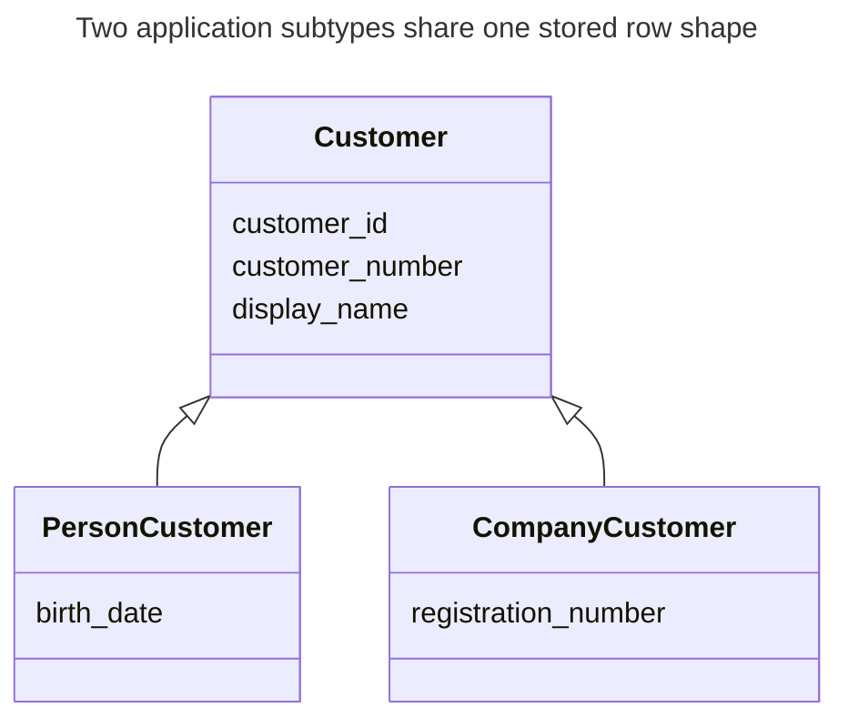
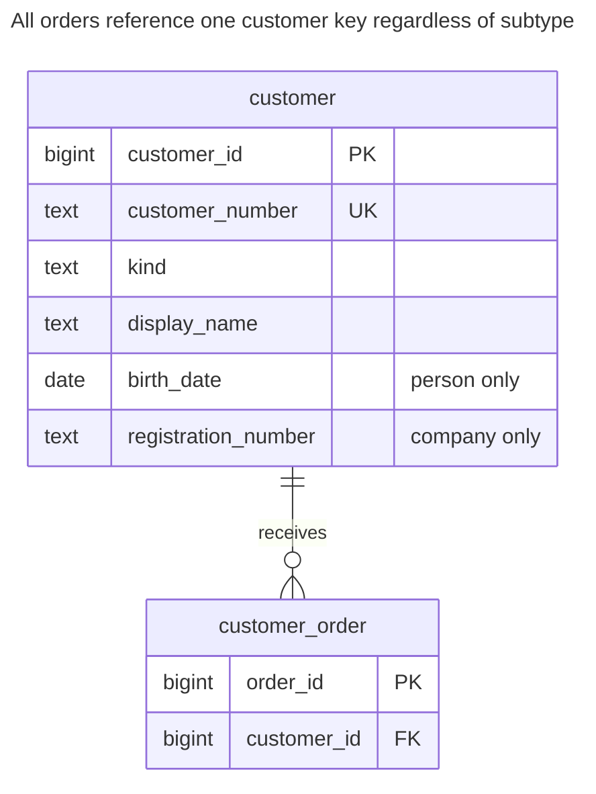
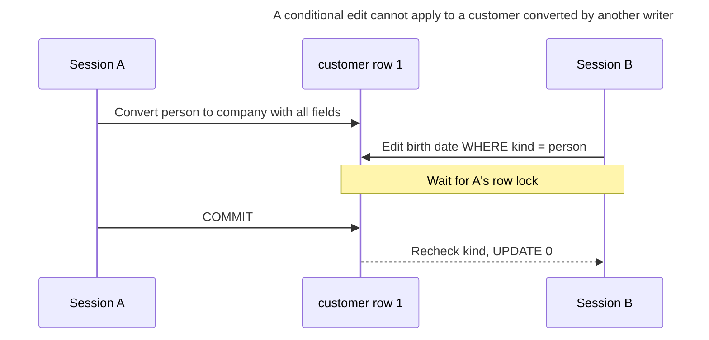
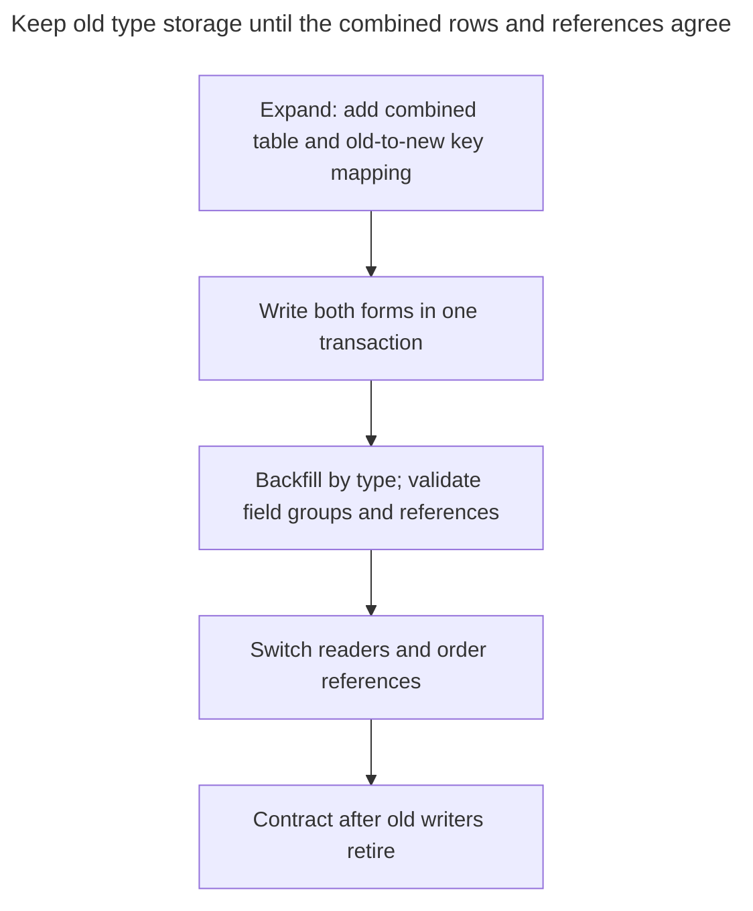

# Single Table Inheritance

## Intent

Single table inheritance stores all subtypes of an entity — say, individual and corporate customers — in one table with a column that names the type and the union of all subtype columns. Queries across subtypes need no joins, and adding a subtype rarely needs a new table. The chapter shows how CHECK constraints keep subtype-specific columns filled or empty according to the type, a rule otherwise left to the application, and when a growing number of nullable columns signals that another inheritance mapping fits better.

## Also known as

Hibernate's `SINGLE_TABLE` strategy. Fowler's [Single Table Inheritance](https://martinfowler.com/eaaCatalog/singleTableInheritance.html) gives the pattern its name; the [Hibernate guide](https://docs.hibernate.org/orm/6.6/userguide/html_single/Hibernate_User_Guide.html#entity-inheritance-single-table) shows the discriminator mapping.

## Problem

Your order system serves people and companies. Both have a customer number and display name; only people have a birth date, and only companies have a registration number. You frequently list all customers and want every order to have one ordinary customer reference.

Two complete tables duplicate the shared columns and leave the order with a choice of targets. A shared table without shape constraints creates a different problem: a company can carry a person's birth date while lacking its own registration number. The type label then says less than you expect.

## Solution

Store the complete customer in one row. Make shared fields mandatory, give `kind` a closed vocabulary, and express the allowed combinations of subtype fields in one named check. The example deliberately requires both presence of the right fields and absence of the wrong fields. Changing a type means replacing its field group in the same statement.



These are application types, not three tables. Their combined fields become the single `customer` row shown below; the discriminator chooses which subtype fields are valid.

## Alternatives and selection

| Sibling | Relationship | Deciding requirement |
| --- | --- | --- |
| [Class Table Inheritance](class-table-inheritance.md) | Replacement | Subtype field groups are substantial, need their own references, or change independently |
| [Concrete Table Inheritance](concrete-table-inheritance.md) | Replacement | You mostly read one concrete type and do not need a common reference target |
| [JSON Column](json-column.md) | Complement or replacement for the variable field group | Attributes have an open shape; you accept explicit path validation rather than fixed subtype columns |
| [Typed Properties](typed-properties.md) | Replacement for runtime-defined attributes | Administrators define fields after deployment; known classes are the wrong boundary |
| [Role Object](role-object.md) | Replacement for overlapping classifications | A customer may hold several roles simultaneously rather than exactly one subtype |

See the [Decision Atlas](decision-atlas.md) for the full table. A few nullable columns alone do not justify changing mappings; count the field groups, reads and write rules you actually have to maintain.

## Structure



Each order names one customer. There is no person or company table to join, and the row check connects `kind` to the nullable subtype fields. The key does not change when a permitted subtype conversion occurs.

## Tables and invariants

- **`customer`** has a primary key for references and a separate unique customer number across both subtypes. `kind` is mandatory and restricted to `person` or `company`.
- **`customer_shape`** requires exactly the field group selected by `kind`. The explicit `IS NULL` / `IS NOT NULL` predicates avoid an unknown result: PostgreSQL [accepts a check whose result is null](https://www.postgresql.org/docs/18/ddl-constraints.html#DDL-CONSTRAINTS-CHECK-CONSTRAINTS).
- **`customer_order`** requires an existing customer and prevents deleting a customer with orders. Its foreign key checks existence, not a particular subtype; use a different reference design if an order is company-only.

## When to use

- The set of subtypes is known, and each adds a manageable number of fields.
- You frequently search, sort or reference the whole customer family.
- A customer has one exclusive type, and you can describe a valid row with local predicates.

## Consequences and trade-offs

- ➕ One insert creates a whole customer, and one reference covers the family.
- ➕ Customer-number uniqueness spans every subtype without a second registry.
- ➖ Subtype columns cannot all be declared unconditionally `NOT NULL`; checks carry conditional requiredness.
- ➖ Every new subtype changes the shared table and its shape rule, involving the writers of existing types too.
- ➖ Reading a complete row includes a union of fields that no one subtype needs. Avoid promising a storage or throughput benefit without measuring your actual projections and indexes.

## Implementation

The [complete script](../assets/single-table-inheritance/single-table-inheritance.sql) checks insertion, rejection and a subtype conversion. IDs are supplied to keep allocation separate from the mapping; [Surrogate Key](surrogate-key.md) covers generators.

```sql
CREATE TABLE customer (
    customer_id bigint PRIMARY KEY,
    customer_number text NOT NULL UNIQUE,
    kind text NOT NULL CHECK (kind IN ('person', 'company')),
    display_name text NOT NULL,
    birth_date date,
    registration_number text,
    CONSTRAINT customer_shape CHECK (
        (kind = 'person' AND birth_date IS NOT NULL AND registration_number IS NULL)
        OR
        (kind = 'company' AND birth_date IS NULL AND registration_number IS NOT NULL)
    )
);
CREATE TABLE customer_order (
    order_id bigint PRIMARY KEY,
    customer_id bigint NOT NULL REFERENCES customer (customer_id)
);
CREATE INDEX customer_order_customer_idx ON customer_order (customer_id);
```

Create both types, attach orders, and query the shared fields without a subtype join:

```sql
INSERT INTO customer VALUES
    (1, 'C-1', 'person', 'Ada', DATE '1990-01-01', NULL),
    (2, 'C-2', 'company', 'Northwind', NULL, 'REG-2');
INSERT INTO customer_order VALUES (10, 1), (20, 2);
SELECT customer_number, kind, display_name FROM customer ORDER BY customer_id;
UPDATE customer SET display_name = 'Ada Lovelace' WHERE customer_id = 1;
```

The query returns `(C-1, person, Ada)` and `(C-2, company, Northwind)`. Changing just the discriminator is invalid:

```sql
UPDATE customer SET kind = 'company' WHERE customer_id = 1;
```

PostgreSQL 18.6 raises SQLSTATE `23514`: `ERROR: new row for relation "customer" violates check constraint "customer_shape"`. A complete conversion succeeds:

```sql
UPDATE customer
SET kind = 'company', birth_date = NULL, registration_number = 'REG-1'
WHERE customer_id = 1;
SELECT o.order_id, c.kind, c.registration_number
FROM customer_order AS o JOIN customer AS c USING (customer_id)
WHERE o.order_id = 10;
```

The result is `(10, company, REG-1)`. The reference survived; whether converting a particular real customer is a valid business operation is a separate policy. Do not use this conversion to merge two distinct identities accidentally.

## Engine support

- **PostgreSQL 18:** ordinary tables and a row check implement this mapping. Native [`INHERITS`](https://www.postgresql.org/docs/18/ddl-inherit.html) is a different mechanism; it is unnecessary here.
- **MySQL 8.4:** keep the check [enforced](https://dev.mysql.com/doc/refman/8.4/en/create-table-check-constraints.html), rather than declaring `NOT ENFORCED`. Translate the column types as needed.
- **SQL Server 2025 (17.x):** its [`CHECK` constraints](https://learn.microsoft.com/en-us/sql/t-sql/statements/create-table-transact-sql?view=sql-server-ver17) express the same discriminator rule. The ORM name does not install that rule for you.
- **Oracle AI Database 26ai:** [empty character strings are treated as null](https://docs.oracle.com/en/database/oracle/oracle-database/26/sqlrf/Nulls.html). A blank registration number therefore cannot satisfy this example's required non-null company field; decide explicitly whether blank values are valid during import.
- **SQLite 3:** use [`STRICT` tables](https://www.sqlite.org/stricttables.html) when relying on stored scalar types, translating `bigint` to `INTEGER` and dates to a validated representation. Enable [foreign keys on every connection](https://www.sqlite.org/foreignkeys.html#fk_enable).

## Failure and concurrency

The row check protects every ordinary insert and update without an application pre-check. For a read-edit-save workflow, include the previously read type in the update and require one affected row, or use a [Version Column](version-column.md). PostgreSQL [rechecks an update's condition after waiting for a concurrent updater](https://www.postgresql.org/docs/18/transaction-iso.html#XACT-READ-COMMITTED) at read committed isolation.



The losing edit needs a reload, not a blind retry with a weaker predicate. An unconditional subtype-specific edit would instead encounter the shape check if it leaves fields incompatible with the current type.

## Migration

Start with an inventory of actual types and the fields each requires. Resolve rows that contain two incompatible field groups or neither. If merging separate tables, preserve a mapping from each old table and key to the new key; the same integer can already exist in both. Preserve customer-number uniqueness deliberately rather than arbitrarily discarding duplicate numbers.



Backfill using the same source-row lock as live dual writers so stale rows cannot overwrite newer changes. For an existing table, PostgreSQL supports [adding a check `NOT VALID` and validating it separately](https://www.postgresql.org/docs/18/sql-altertable.html); DDL still needs a planned lock window. Keep the old representation during the [Expand and Contract](expand-contract.md) overlap. Roll back reads while dual writes remain; do not introduce a new subtype the old representation cannot store until that rollback window closes.

## Anti-patterns and common mistakes

- Checking only that required fields are present while allowing incompatible subtype fields to remain populated.
- Omitting `NOT NULL` on `kind`, which undermines predicates written as ordinary equality comparisons.
- Treating supplier and buyer as exclusive subtypes when one company can be both; use [Role Object](role-object.md).
- Moving every new field to [Untyped Properties](untyped-properties.md) just to avoid changing the shape check.
- Assuming a foreign key to `customer` restricts the referenced customer to a company.

## Known uses

- Rails documents [single table inheritance](https://guides.rubyonrails.org/association_basics.html#single-table-inheritance-sti) with a `type` column selecting the model class.
- Hibernate's [`SINGLE_TABLE` mapping](https://docs.hibernate.org/orm/6.6/userguide/html_single/Hibernate_User_Guide.html#entity-inheritance-single-table) explicitly discusses checks or triggers for subtype integrity. The check here is a worked schema design, not Rails-generated DDL.

## Related patterns

- [Class Table Inheritance](class-table-inheritance.md) separates subtype constraints while retaining common identity.
- [Concrete Table Inheritance](concrete-table-inheritance.md) makes each subtype independently complete.
- [JSON Column](json-column.md) accommodates variable attributes beside fixed shared columns.
- [Typed Properties](typed-properties.md) gives runtime-defined attributes a metadata model.
- [Role Object](role-object.md) models overlapping, changing roles.
