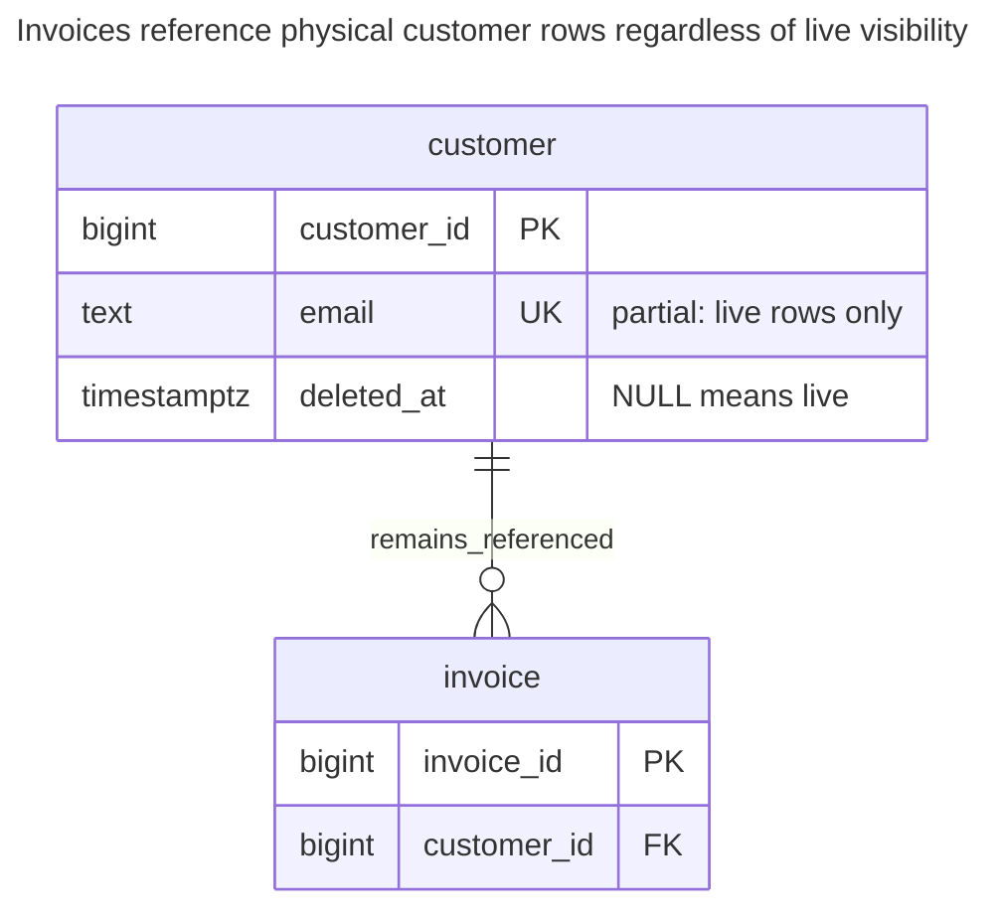
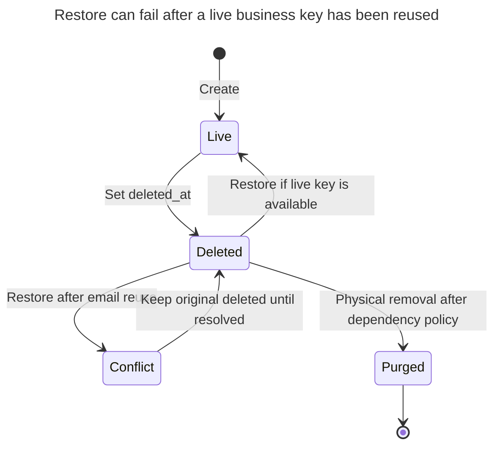
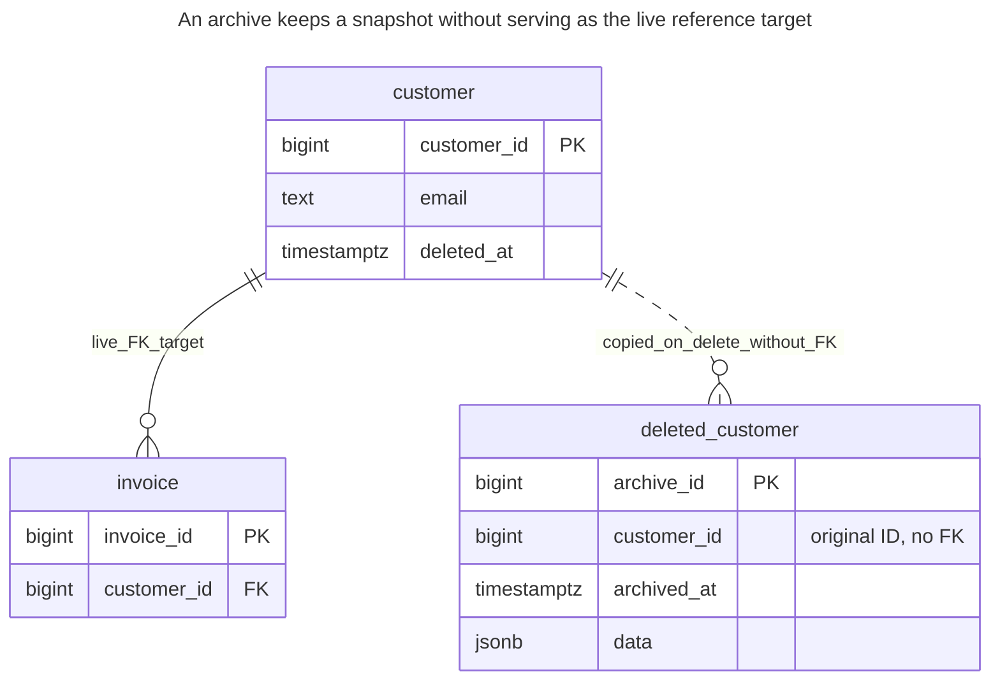
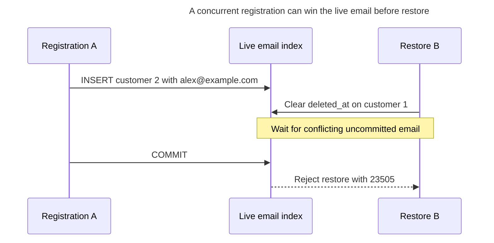
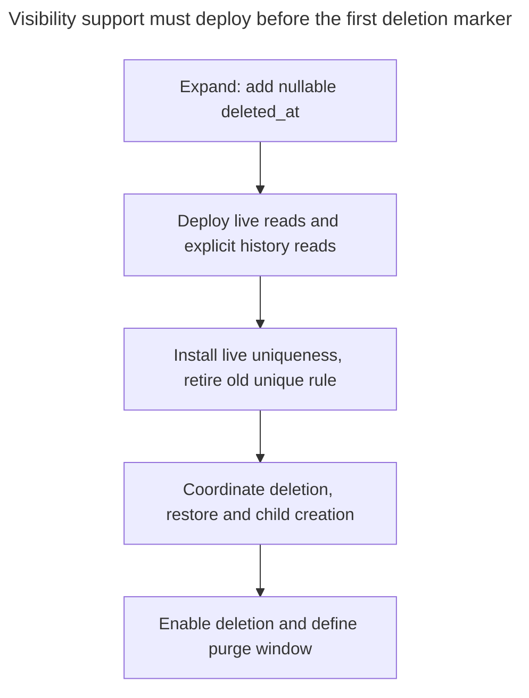

# Soft Delete

## Intent

Soft delete marks a row as deleted, usually with a `deleted_at` timestamp, instead of removing it, so the data can be restored and stays visible to reports. The chapter shows the costs that make it controversial: every query and every unique constraint must account for deleted rows, foreign keys keep pointing at rows the application considers gone, and personal data stays where privacy rules require it to disappear. It compares the approach with moving deleted rows to a separate archive table and shows how partial unique indexes keep uniqueness among live rows. See [Laravel’s soft deletion behavior](https://laravel.com/docs/12.x/eloquent#soft-deleting) and [PostgreSQL’s partial unique indexes](https://www.postgresql.org/docs/18/indexes-partial.html).

## Also known as

Soft deleting in [Laravel Eloquent](https://laravel.com/docs/12.x/eloquent#soft-deleting). The name describes a lifecycle policy: an application hides a row that remains physically present. It does not imply historical versions, erasure or a complete restoration workflow.

## Problem

A support agent needs to undo an accidental customer removal, while invoices must still identify that customer. A physical delete is intentionally blocked by the invoice FK. Replacing it with a timestamp update preserves the referenced row, but now “exists” and “available for new work” are different questions.

The difficult case arrives when another customer registers with the deleted customer's email. If you allow reuse, restoring the old row can conflict. If you forbid reuse indefinitely, deletion does not release the email. Neither outcome follows automatically from adding `deleted_at`; you must choose the identity and restoration contract.

## Solution

Retain the original primary key, set `deleted_at` to hide the customer from live operations, and expose a live view using `deleted_at IS NULL`. Enforce email uniqueness only among live rows with a PostgreSQL [partial unique index](https://www.postgresql.org/docs/18/indexes-partial.html). Define reports explicitly: historical invoice reporting joins the retained customer, while new-customer selection uses the live view.

Restoration clears the timestamp only when live uniqueness and your business rules still hold. A purge is a separate physical deletion workflow that resolves dependent rows, retained evidence and other copies according to your retention policy. The example preserves invoices and therefore does not permit purging their customer. It also does not enforce “new invoices require a live customer”; add a coordinated writer if that is a requirement.

## Alternatives and selection

| Sibling | Relationship | Deciding requirement |
| --- | --- | --- |
| Physical delete | Replacement | References and retention allow immediate removal and you do not need in-place restore |
| Deleted-record archive | Replacement | You want a recovery copy without keeping removed rows in live tables; restoration can be an explicit import |
| [History Table](history-table.md) | Complement; replacement for retained previous values | You need earlier values, not just the last row plus a deletion marker |
| [Audit Log](audit-log.md) | Complement | You need who deleted or restored the row, why and under which request |
| [Status History](status-history.md) | Replacement for a broader lifecycle | “Archived,” “suspended” and “closed” are distinct business states with legal transitions |

Use the [Decision Atlas](decision-atlas.md) for the full family comparison. Brandur Leach's [argument against soft deletion](https://brandur.org/soft-deletion) emphasizes query leakage, weakened live-reference semantics and difficult pruning, and proposes a deleted-record archive. Treat that as a design argument, not proof that restoration is never valuable. Choose soft deletion only when you can specify and support the restoration workflow.

## Structure



The FK targets the full customer table. It preserves physical referential integrity after marking a customer deleted, but says nothing about whether the referenced customer is available for a new sale.

## Tables and invariants

- **`customer`** retains one physical row per ID. Deleted rows keep the same ID; restoring a customer must not attach its invoices to a newly allocated ID.
- **`customer_live_email_key`** permits at most one live row with an email and allows deleted duplicates. The example treats the supplied email text as the application's already chosen canonical key; it does not implement email normalization.
- **`invoice`** requires a physically present customer. Its FK still blocks physical deletion, including after soft deletion; it does not fire on a change to `deleted_at` because the referenced key remains.
- **`live_customer`** is a convenience read view, not a security boundary. Callers with base-table reads can still retrieve deleted data; define grants separately when visibility is an access restriction.
- **Deletion time** is the marker's processing time. It records neither the actor nor earlier values or multiple delete/restore cycles; use audit events for those.

## When to use

- You offer a defined restore window and know how dependencies behave during that window.
- Existing reports must retain the object's identity while live selection excludes it.
- Your team can maintain separate live, historical and purge operations, including background jobs and exports.

## Consequences and trade-offs

- ➕ In-place restoration retains the primary key and its existing references.
- ➕ Old invoices can still show the retained customer without copying every attribute into an archive.
- ➖ Every live access path must apply the visibility rule, including joins, background jobs and hand-written SQL.
- ➖ Uniqueness is a lifecycle decision: releasing a live key makes later restore conditional.
- ➖ The marker leaves the row and its data in place. For example, GDPR [Article 17](https://eur-lex.europa.eu/eli/reg/2016/679/art_17/oj/eng) defines erasure grounds and exceptions; hiding a row does not itself remove its personal data. Derive your purge or anonymization policy from the applicable requirements rather than treating the timestamp as erasure.

## Implementation

The [complete PostgreSQL 18.6 script](../assets/soft-delete/soft-delete.sql) verifies visibility, retained references, restore conflict, the archive alternative and physical-delete rejection:

```sql
CREATE SCHEMA soft_example;
CREATE TABLE soft_example.customer (
    customer_id bigint PRIMARY KEY,
    email text NOT NULL,
    deleted_at timestamptz
);
CREATE UNIQUE INDEX customer_live_email_key ON soft_example.customer (email)
WHERE deleted_at IS NULL;
CREATE TABLE soft_example.invoice (
    invoice_id bigint PRIMARY KEY,
    customer_id bigint NOT NULL REFERENCES soft_example.customer (customer_id)
);
CREATE VIEW soft_example.live_customer AS
SELECT customer_id, email FROM soft_example.customer WHERE deleted_at IS NULL;
```

There is deliberately no unconditional unique constraint on email. A unique key on `(email, deleted_at)` would not enforce the chosen “one live row” rule with PostgreSQL's [default null-distinct uniqueness](https://www.postgresql.org/docs/18/ddl-constraints.html#DDL-CONSTRAINTS-UNIQUE-CONSTRAINTS). The partial index states the live subset directly.

```sql
INSERT INTO soft_example.customer VALUES (1, 'alex@example.com', NULL);
INSERT INTO soft_example.invoice VALUES (10, 1);
UPDATE soft_example.customer SET deleted_at = clock_timestamp()
WHERE customer_id = 1 AND deleted_at IS NULL;
INSERT INTO soft_example.customer VALUES (2, 'alex@example.com', NULL);
SELECT customer_id FROM soft_example.live_customer;
SELECT i.invoice_id, c.customer_id, c.deleted_at IS NOT NULL AS deleted
FROM soft_example.invoice AS i
JOIN soft_example.customer AS c USING (customer_id);
```

The live view returns customer `2`. The invoice query returns `(10, 1, true)`: its original customer is still present but marked deleted. Avoid joining historical reports through the live view if that would erase the relationship from the report. Conversely, a new-sale picker should not query the unrestricted base table.

Restore of customer `1` now conflicts:

```sql
UPDATE soft_example.customer SET deleted_at = NULL WHERE customer_id = 1;
```

PostgreSQL 18.6 raises SQLSTATE `23505`: `ERROR: duplicate key value violates unique constraint "customer_live_email_key"`, with `DETAIL: Key (email)=(alex@example.com) already exists.` Decide whether the user must change an email, cancel the new registration, merge identities through a dedicated workflow or abandon the restore. Do not resolve the conflict by silently moving invoice references.



Purge is outside the reversible lifecycle. A deletion timestamp alone cannot tell a restoration workflow which children were independently deleted and which were hidden as part of a parent operation.

If you want a recovery copy but prefer physical deletion from the live table, use an archive. The example archives customer `2`, which has no invoices, in one statement using [`DELETE ... RETURNING`](https://www.postgresql.org/docs/18/sql-delete.html) and a [data-modifying CTE](https://www.postgresql.org/docs/18/queries-with.html#QUERIES-WITH-MODIFYING):

```sql
CREATE TABLE soft_example.deleted_customer (
    archive_id bigint GENERATED ALWAYS AS IDENTITY PRIMARY KEY,
    customer_id bigint NOT NULL,
    archived_at timestamptz NOT NULL DEFAULT clock_timestamp(),
    data jsonb NOT NULL
);
WITH removed AS (
    DELETE FROM soft_example.customer WHERE customer_id = 2 RETURNING *
)
INSERT INTO soft_example.deleted_customer (customer_id, data)
SELECT customer_id, to_jsonb(removed) FROM removed;
UPDATE soft_example.customer SET deleted_at = NULL WHERE customer_id = 1;
```

The archive insert and delete succeed or fail together. Customer `1` can then be restored because its email is free. The script finally verifies that physically deleting customer `1` still raises `23503` on `invoice_customer_id_fkey`. The archive is a separate retained copy and needs its own retention and access policy; it does not bypass FKs or implement erasure.



The dashed edge describes copying, not a reference constraint. In a pure archive-based replacement you omit `deleted_at` from the live schema; it remains here because the runnable example compares both approaches using the same starting tables. An archive cannot receive a live invoice FK merely by storing the original ID inside JSON.

## Engine support

- **PostgreSQL 18:** [partial unique indexes](https://www.postgresql.org/docs/18/indexes-partial.html) enforce the live subset. Keep FKs on the full primary key rather than expecting a reference to a live-only view or predicate.
- **MySQL 8.4:** use an [indexed generated column](https://dev.mysql.com/doc/refman/8.4/en/create-table-secondary-indexes.html) that yields the email for live rows and null for deleted rows, then make that value unique. MySQL [permits multiple null values in a unique index](https://dev.mysql.com/doc/refman/8.4/en/create-table.html); preserve the chosen email type and equality rules when translating. This is an alternative definition, not PostgreSQL partial-index syntax.
- **SQL Server 2025 (17.x):** [unique filtered indexes](https://learn.microsoft.com/en-us/sql/relational-databases/indexes/create-filtered-indexes?view=sql-server-ver17) can enforce uniqueness for a `deleted_at IS NULL` subset. The filter belongs on the index rather than a unique constraint.
- **Oracle AI Database 26ai:** [function-based unique indexes](https://docs.oracle.com/en/database/oracle/oracle-database/26/sqlrf/CREATE-INDEX.html) support conditional uniqueness. Map deleted rows to null for every indexed key expression; Oracle's example relies on all-null index keys being omitted.
- **SQLite 3:** [unique partial indexes](https://www.sqlite.org/partialindex.html) express the same live predicate. Enable [FK enforcement per connection](https://www.sqlite.org/foreignkeys.html#fk_enable) if you rely on physical-delete rejection.

## Failure and concurrency



A pre-check that the email is free does not reserve it. PostgreSQL's [unique-index checking](https://www.postgresql.org/docs/18/index-unique-checks.html) waits for an uncommitted conflict and rechecks. Return a restore conflict to the application; do not bypass the index to make the request succeed.

If new invoices require a live customer, both invoice creation and customer deletion must lock the same customer row before checking or changing `deleted_at`, within their transactions. PostgreSQL's [`FOR UPDATE` row locks](https://www.postgresql.org/docs/18/explicit-locking.html#LOCKING-ROWS) provide that coordination. A parent FK alone cannot enforce a non-key lifecycle predicate. Decide whether invoices accepted before the deletion may remain; the example says yes. Define equivalent rules for every child instead of introducing an automatic cascade whose restore semantics you cannot explain.

Use conditional operations and inspect affected rows for repeated delete or restore requests. Clearing an already cleared marker should not fabricate a second “restored” business event. A timestamp is also insufficient for concurrent edit detection across a delete/restore cycle; use a [Version Column](version-column.md) if a stale editor must be rejected. Record actor and reason through [Audit Log](audit-log.md), committed with the lifecycle change.

## Migration

Add a nullable marker while old code still sees the same rows. Inventory every reader and writer before enabling deletion: ordinary lists, joins, uniqueness checks, exports, administrative screens and jobs. Deploy live filtering and explicit historical access, plus dependency-aware delete and restore operations. Only then allow the first soft deletion, because an old reader cannot understand the new visibility rule.



If the old schema has unconditional email uniqueness, build the partial unique index first and remove the old constraint only after all writers support key reuse and restore conflicts. PostgreSQL supports [concurrent index construction](https://www.postgresql.org/docs/18/sql-createindex.html#SQL-CREATEINDEX-CONCURRENTLY), while constraint removal still needs a planned DDL lock window. During rollback, stop new deletions and key reuse, reconcile duplicates before restoring unconditional uniqueness, and preserve filtering until existing deleted rows have a deliberate disposition. Simply deploying old readers would expose them again.

An archive-based migration instead changes physical-delete writers to capture the returned row transactionally. Move dependent data under an explicit FK-compatible policy and test a restore as an import, including key conflicts and changed schema. Keep the archive until its retention window ends; do not pretend that a blob of old JSON is automatically a valid current customer.

## Anti-patterns and common mistakes

- Describing soft deletion as disabling FKs. They still protect physical references; they do not enforce the additional “live” predicate.
- Filtering ordinary lists but forgetting reports, joins, batch jobs or uniqueness rules.
- Assuming restoration is just clearing a flag after keys have been reused or dependents have changed.
- Adding several unrelated business meanings to one marker instead of modelling a lifecycle with [Status History](status-history.md).
- Calling a retained row, archive, history table or backup erased because the normal application hides it.
- Treating deleted rows as disposable test data and later purging them without checking the same dependency graph that blocked physical deletion originally.

## Known uses

- Laravel 12's [SoftDeletes](https://laravel.com/docs/12.x/eloquent#soft-deleting) retains the row, sets `deleted_at` and excludes soft-deleted models from normal model queries. That scope is framework behavior, not a database FK rule or protection for unrelated raw SQL.
- Brandur Leach's [deleted-record-table alternative](https://brandur.org/soft-deletion) demonstrates transactional deletion into a recovery archive and argues for its simpler live-query semantics. It still leaves restoration, references and retention to a deliberate policy.

## Related patterns

- [History Table](history-table.md) records earlier values that a deletion marker does not retain.
- [Audit Log](audit-log.md) attributes deletion, restoration and purge actions.
- [Status History](status-history.md) handles a richer lifecycle than live versus deleted.
- [Version Column](version-column.md) rejects edits based on a stale lifecycle version.
- [Missing Foreign Keys](missing-foreign-keys.md) explains why physical relationships still need enforcement.
- [Expand and Contract](expand-contract.md) stages readers before enabling new write behavior.
