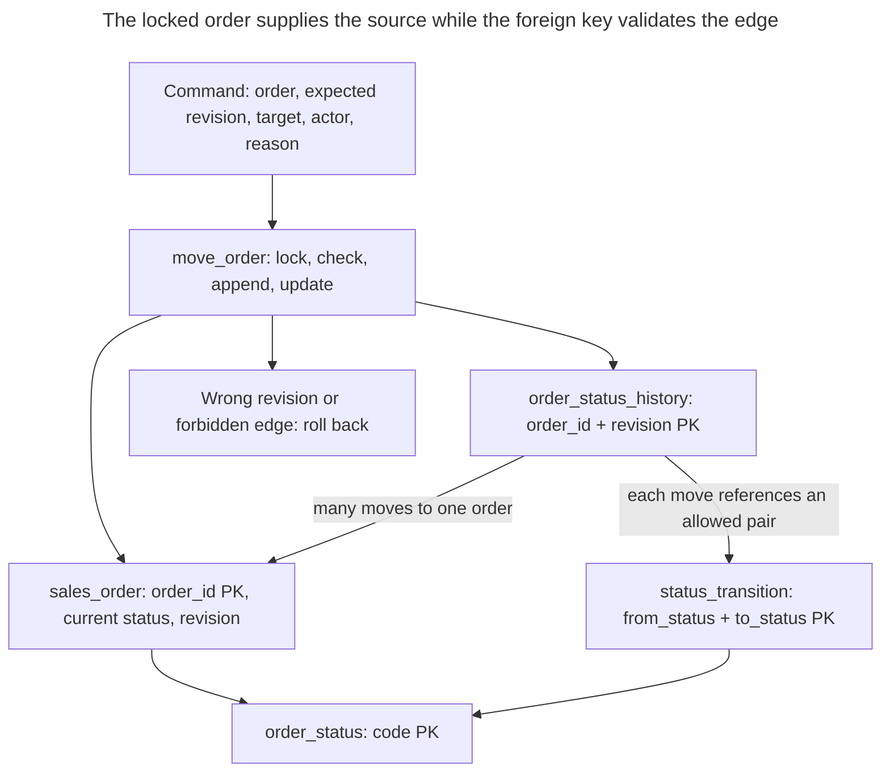

# Status History

## Intent

Status history keeps the current state of an entity — an order, a ticket, an application — together with a log of every transition: from which state, to which, when, by whom and why. A table of allowed transitions, referenced by a foreign key, rejects moves the process does not permit, such as going from `shipped` back to `draft`. The chapter shows how to write the current status and the history row atomically, why a foreign key alone cannot check that a transition starts from the actual current state, and which locking closes that gap under concurrent updates.

## Also known as

State-transition history; workflow history. This chapter uses those terms for a typed record of lifecycle moves. The FK-and-lock implementation below is a worked schema design, not an attribution to a named catalog technique.

## Problem

Your order row says `shipped`, but support needs to know when payment was accepted, who released the shipment and why an earlier order was cancelled. Overwriting one status column loses those answers. Logging a message after the update introduces another problem: a failure between the two writes leaves a current state without its explanation.

A list of valid status names is also weaker than a workflow. Both `draft` and `shipped` can be valid names while `shipped → draft` is forbidden. Even a table of allowed pairs is insufficient on its own: two writers can both read `draft`, then independently record `draft → paid` and `draft → cancelled`. Each pair is allowed, but they cannot both describe the next move from the same order revision.

## Solution

Keep the current status and revision on the order. Keep the allowed directed edges in `status_transition`, keyed by `(from_status, to_status)`. Append one history row for each accepted move, including its order revision, source and destination, processing time, actor and reason. The history's composite FK validates the edge against that table; it does not compare the edge's source with the order row.

Route transitions through one writer that locks the order, checks the revision supplied by the caller, derives the source from the locked row, inserts history and updates current state. PostgreSQL's [row locks](https://www.postgresql.org/docs/18/explicit-locking.html#LOCKING-ROWS) serialize writers for that order, and its [transaction boundary](https://www.postgresql.org/docs/18/tutorial-transactions.html) makes the two writes succeed or roll back together. Obtain the actor from trusted application authentication context; a nonempty string constraint cannot authenticate a person.

Use revisions for per-order sequence and timestamps for processing-time reporting. The example creates every order in `draft` at revision zero; its creation time is on the order, and the history begins with the first move. Creation is not represented as a fictitious transition from another business state. Record a separate creation actor if that is part of your accountability requirement.

## Alternatives and selection

| Sibling or representation | Relationship | Deciding requirement |
| --- | --- | --- |
| [Lookup Table](lookup-table.md) with only a current status | Replacement for simpler requirements; complement here | You need membership but do not need the transition sequence |
| [History Table](history-table.md) | Replacement for reconstructing whole rows; complement for other attributes | You need previous addresses, totals and other row values, not only lifecycle moves |
| [Audit Log](audit-log.md) | Complement; replacement if occasional investigation is enough | You need actions across many tables, request context or unsuccessful attempts |
| [Version Column](version-column.md) | Complement; optimistic implementation option | You must reject stale commands; a conditional update can replace the explicit lock protocol if history is written only for the winning update |
| One timestamp column per milestone | Replacement for a fixed, single-pass process summary | You need known milestones and can accept losing repeated visits and arbitrary moves |

The last option resembles Kimball's [accumulating snapshot fact table](https://www.kimballgroup.com/data-warehouse-business-intelligence-resources/kimball-techniques/dimensional-modeling-techniques/accumulating-snapshot-fact-table/), which updates a process row as milestones occur. That is a reporting representation, not an automatic enforcement mechanism for the operational workflow. For the full family comparison, see the [Decision Atlas](decision-atlas.md).

## Structure



An order has zero or more accepted moves. Each edge can occur in many orders' histories. Source and destination reference the same vocabulary, but direction matters: permitting `paid → shipped` does not permit its reverse. Current state is stored for direct reads, so the write path must maintain its agreement with the history.

## Tables and invariants

- **`order_status`** defines the state names. Its primary key is referenced by orders and both ends of each allowed edge.
- **`status_transition`** permits each directed pair once and rejects self-transitions. In this example it is a retained rule set: used edges cannot be deleted while history references them.
- **`sales_order`** stores one current status and a nonnegative revision. The controlled creation path starts at `draft`, revision zero. The defaults do not prohibit a privileged writer from explicitly inserting another state.
- **`order_status_history`** identifies a move by `(order_id, revision)`, requires a positive revision and nonempty actor and reason, and validates the pair through `history_transition_fk`. The primary key supports an order's ordered history; no separate history ID is needed.
- **Chain agreement and completeness** come from the restricted writer: it derives `from_status`, increments once, inserts once and updates once. Neither the pair FK nor the history primary key alone enforces that protocol. Application roles receive no direct table-write privileges; ownership remains a trusted maintenance capability.

## When to use

- Support and process reporting need the sequence of accepted state changes and their attribution.
- Some pairs of valid state names must still be forbidden.
- Concurrent workers or users can submit competing commands for the same entity.
- You can define a controlled creation path and a single transactional transition path.

## Consequences and trade-offs

- ➕ Current-state reads stay simple while transition reads retain the process narrative.
- ➕ The allowed-pair FK catches forbidden edges even when the routine has no branch for that edge.
- ➕ Revisions expose stale commands, including a state that was left and later revisited.
- ➖ You store current state and history together and must prevent bypass writers from making them disagree.
- ➖ The order lock serializes moves for a busy entity; history storage grows with moves.
- ➖ A pair table cannot express every guard. “Ship only after all items are packed” needs additional checks and coordination with item writers.
- ➖ This history contains only accepted moves. Rejected commands and changes to other attributes need separate logging.

## Implementation

The [complete PostgreSQL 18.6 script](../assets/status-history/status-history.sql) verifies accepted moves, forbidden pairs, stale revisions and atomic rollback after an injected update failure. The dedicated schema is a trusted container for the tables and routine:

```sql
CREATE SCHEMA workflow_example;
REVOKE ALL ON SCHEMA workflow_example FROM PUBLIC;

CREATE TABLE workflow_example.order_status (
    code text PRIMARY KEY
);
CREATE TABLE workflow_example.status_transition (
    from_status text REFERENCES workflow_example.order_status (code),
    to_status text REFERENCES workflow_example.order_status (code),
    PRIMARY KEY (from_status, to_status),
    CHECK (from_status <> to_status)
);
CREATE TABLE workflow_example.sales_order (
    order_id bigint PRIMARY KEY,
    status_code text NOT NULL DEFAULT 'draft'
        REFERENCES workflow_example.order_status (code),
    revision bigint NOT NULL DEFAULT 0 CHECK (revision >= 0),
    created_at timestamptz NOT NULL DEFAULT clock_timestamp()
);
CREATE TABLE workflow_example.order_status_history (
    order_id bigint REFERENCES workflow_example.sales_order (order_id),
    revision bigint CHECK (revision > 0),
    from_status text NOT NULL,
    to_status text NOT NULL,
    changed_at timestamptz NOT NULL,
    actor text NOT NULL CHECK (btrim(actor) <> ''),
    reason text NOT NULL CHECK (btrim(reason) <> ''),
    PRIMARY KEY (order_id, revision),
    CONSTRAINT history_transition_fk FOREIGN KEY (from_status, to_status)
        REFERENCES workflow_example.status_transition (from_status, to_status)
);
```

The composite FK uses mandatory source and destination columns, so a missing value cannot evade pair validation. The script leaves all foreign keys enforced. Keep the transition table under maintenance control rather than letting order writers add an edge that makes their request valid.

```sql
CREATE FUNCTION workflow_example.move_order(
    p_order_id bigint, p_expected_revision bigint, p_to_status text,
    p_actor text, p_reason text
) RETURNS bigint LANGUAGE plpgsql SECURITY DEFINER
SET search_path = pg_catalog, pg_temp AS $$
DECLARE
    current_order workflow_example.sales_order%ROWTYPE;
    next_revision bigint;
BEGIN
    SELECT * INTO STRICT current_order
    FROM workflow_example.sales_order
    WHERE order_id = p_order_id FOR UPDATE;
    IF current_order.revision IS DISTINCT FROM p_expected_revision THEN
        RAISE EXCEPTION 'stale order revision: expected %, found %',
            p_expected_revision, current_order.revision USING ERRCODE = 'P0001';
    END IF;
    next_revision := current_order.revision + 1;
    INSERT INTO workflow_example.order_status_history
        (order_id, revision, from_status, to_status, changed_at, actor, reason)
    VALUES (p_order_id, next_revision, current_order.status_code,
            p_to_status, clock_timestamp(), p_actor, p_reason);
    UPDATE workflow_example.sales_order
    SET status_code = p_to_status, revision = next_revision
    WHERE order_id = p_order_id;
    RETURN next_revision;
END;
$$;
REVOKE ALL ON FUNCTION workflow_example.move_order(bigint, bigint, text, text, text)
    FROM PUBLIC;
REVOKE ALL ON ALL TABLES IN SCHEMA workflow_example FROM PUBLIC;
```

The [security-definer routine](https://www.postgresql.org/docs/18/sql-createfunction.html#SQL-CREATEFUNCTION-SECURITY) runs with its owner's privileges. Its table references are qualified, its search path excludes caller-writable schemas, and public execution is revoked. Deploy it under a trusted owner distinct from the application login. Grant the application schema usage, the reads it needs and execution of this exact function; grant it no order, history or rule-table writes and no membership in the owner role. Keep order creation behind a separate controlled operation that inserts the initial state. A database owner can still bypass this boundary.

[`SELECT ... INTO STRICT`](https://www.postgresql.org/docs/18/plpgsql-statements.html#PLPGSQL-STATEMENTS-SQL-ONEROW) reports a missing order instead of silently doing nothing. The custom [`RAISE EXCEPTION`](https://www.postgresql.org/docs/18/plpgsql-errors-and-messages.html) with SQLSTATE `P0001` reports a revision mismatch before history is inserted. The history timestamp uses [`clock_timestamp()`](https://www.postgresql.org/docs/18/functions-datetime.html#FUNCTIONS-DATETIME-CURRENT), which reads wall-clock time at execution rather than transaction start. It is a processing timestamp, not the external event's occurrence time or the transaction's commit timestamp.

```sql
INSERT INTO workflow_example.order_status VALUES
    ('draft'), ('paid'), ('shipped'), ('cancelled');
INSERT INTO workflow_example.status_transition VALUES
    ('draft', 'paid'), ('draft', 'cancelled'),
    ('paid', 'shipped'), ('paid', 'cancelled');
INSERT INTO workflow_example.sales_order (order_id) VALUES (1001);

SELECT workflow_example.move_order(1001, 0, 'paid', 'user:42', 'Payment captured');
SELECT workflow_example.move_order(1001, 1, 'shipped', 'user:81', 'Carrier pickup');
SELECT order_id, status_code, revision FROM workflow_example.sales_order;
SELECT revision, from_status, to_status, actor, reason
FROM workflow_example.order_status_history
WHERE order_id = 1001 ORDER BY revision;
```

Both calls return the new revision, first `1`, then `2`. Current state is `(1001, shipped, 2)`. The two history rows describe `draft → paid` by `user:42` for `Payment captured` and `paid → shipped` by `user:81` for `Carrier pickup`. A forbidden return to draft is rejected:

```sql
SELECT workflow_example.move_order(1001, 2, 'draft', 'user:42', 'Reopen order');
```

PostgreSQL 18.6 raises SQLSTATE `23503`: `ERROR: insert or update on table "order_status_history" violates foreign key constraint "history_transition_fk"`, with `DETAIL: Key (from_status, to_status)=(shipped, draft) is not present in table "status_transition".` No history or current-state change survives the failed call. A request using revision `1` instead raises `P0001`: `ERROR: stale order revision: expected 1, found 2`.

The script also demonstrates the FK's limit under owner privileges: manually inserting a `draft → cancelled` history row succeeds even while this order is `shipped`, because the pair exists. That demonstration is rolled back immediately. The normal application role must not have this insertion path.

## Engine support

- **PostgreSQL 18:** the routine uses `FOR UPDATE` at Read Committed and PL/pgSQL. At stronger isolation levels, [concurrent changes can instead produce serialization failures](https://www.postgresql.org/docs/18/transaction-iso.html); retry the whole transaction when appropriate.
- **MySQL 8.4 / InnoDB:** use [`SELECT ... FOR UPDATE` inside an explicit transaction](https://dev.mysql.com/doc/refman/8.4/en/innodb-locking-reads.html). Locking reads require autocommit to be disabled, including by starting a transaction. Translate the routine and its error handling; a plain consistent read is insufficient for this protocol.
- **SQL Server 2025 (17.x):** translate the locking read to an explicit transaction using [`UPDLOCK`](https://learn.microsoft.com/en-us/sql/t-sql/queries/hints-transact-sql-table?view=sql-server-ver17#updlock), which holds update locks until transaction completion. Reimplement the routine's atomic error handling and privileges in T-SQL.
- **Oracle AI Database 26ai:** [`SELECT ... FOR UPDATE`](https://docs.oracle.com/en/database/oracle/oracle-database/26/sqlrf/SELECT.html) locks the returned rows until transaction end. Port the writer to PL/SQL and preserve its revision check, composite FK and single commit boundary.
- **SQLite 3:** enable [foreign keys per connection](https://www.sqlite.org/foreignkeys.html#fk_enable). Use [`BEGIN IMMEDIATE`](https://www.sqlite.org/lang_transaction.html#deferred_immediate_and_exclusive_transactions) before reading and changing state: SQLite has one simultaneous writer rather than this row-lock protocol. Handle `SQLITE_BUSY`; keep both writes in that transaction.

## Failure and concurrency

At PostgreSQL Read Committed, two calls with expected revision zero contend on the same order lock. After the winner commits revision one, the waiting locking read obtains the updated row and its revision check fails. If the winner rolls back, the waiter can proceed from revision zero. This follows PostgreSQL's [locking-read behavior](https://www.postgresql.org/docs/18/explicit-locking.html#LOCKING-ROWS). Locking and revision checks serve different purposes: the lock coordinates the write, while the revision rejects a command based on an older view of the order.

Return success only after the caller's transaction commits. If the history insert fails, current state is unchanged; if the following update fails, the preceding insert is rolled back too. Do not catch an error and then commit only one side. The timestamp is not a reliable global ordering key; revisions establish order only within one entity.

After a lost response, do not automatically reinterpret a retry as a fresh transition from the new state. Repeating the old revision will conflict, but that conflict alone does not tell you whether this client's earlier request won. Use an [Idempotency Record](idempotency-record.md), committed with the move, when the API must return the original result. Keep multi-order operations in a consistent order of order IDs to reduce deadlocks, and retry aborted transactions according to PostgreSQL's [deadlock guidance](https://www.postgresql.org/docs/18/explicit-locking.html#LOCKING-DEADLOCKS).

If transition policy must evolve, retain historical edges and version the rule set, including the rule version in orders and history references. Alternatively add an enabled flag and check it under a lock in the writer, as [Lookup Table](lookup-table.md) does for retirement. The example implements neither policy change mechanism: deleting a used edge is intentionally blocked. Extra guards over inventory or payments require locking those facts or an equivalent shared write protocol; locking only the order cannot stabilize unrelated data.

## Migration

Start from your current-status column by cleaning its vocabulary and defining the edges that new commands may use. Preserve real historic moves from an existing reliable log if you have one; do not infer actors or transition times from the final status. For orders whose earlier process is unknown, record a separate migration baseline with the observed state and cutover time. That baseline marks the beginning of reliable history, not an invented `draft → current` business transition.

Create the history and rule tables, add a revision to existing orders, and deploy the new writer. During the [Expand and Contract](expand-contract.md) overlap, route every legacy status update through the same locked operation or a compatibility adapter. For each baseline batch, take order locks shared with the new writer and mark which orders have been baselined, so a live move cannot race with a stale snapshot. Establish the restricted application privileges before claiming that every accepted move is recorded. Plan DDL lock windows; PostgreSQL's [`NOT VALID` and later validation](https://www.postgresql.org/docs/18/sql-altertable.html) can separate FK installation from checking existing rows.

Reconcile the current revision and status with the last recorded move, or the baseline if no move exists, before switching reporting. Keep old reads available during rollout. To back out, you can return readers to the current-status column while continuing to maintain history; reverting to unrestricted status writes ends the completeness guarantee. Preserve the history and record any resulting gap rather than pretending it can later be reconstructed.

## Anti-patterns and common mistakes

- Assuming an allowed-pair FK proves the source matches the current row. The owner-only counterexample demonstrates the missing comparison.
- Appending history in a second transaction, or allowing direct status updates that bypass the routine.
- Choosing the “latest” move solely by timestamp. Use the per-order revision and keep the timestamp's meaning explicit.
- Treating a repeated status name as proof that nothing changed since the caller read it. A revision also detects intervening visits.
- Editing an old history row to correct a business action. Record an allowed compensating move with a reason; keep privileged data repairs explicit and separately accountable.
- Letting callers supply an arbitrary actor identity, or assuming this record of accepted transitions includes failed attempts.
- Treating the transition table as authorization. An edge can be globally legal while this particular caller lacks permission to take it; authenticate and authorize before invoking the writer.

## Known uses

- The [Apache OFBiz developer manual](https://nightlies.apache.org/ofbiz/stable/ofbiz/html5/developer-manual.html) shows querying `BudgetStatus` by budget and date, and looking up `StatusValidChange` by current `statusId` and requested `statusIdTo`. It demonstrates stored status history and transition data; it does not establish the pair FK, lock protocol or permissions used here.
- Kimball's [accumulating snapshot](https://www.kimballgroup.com/data-warehouse-business-intelligence-resources/kimball-techniques/dimensional-modeling-techniques/accumulating-snapshot-fact-table/) summarizes a process with milestone dates. You can derive a reporting projection from accepted moves while retaining the operational sequence separately.
- Fowler's [Audit Log](https://martinfowler.com/eaaDev/AuditLog.html) records significant changes and notes the difficulty of repeated historical queries. A typed transition table narrows that general idea to the lifecycle queries this chapter needs.

## Related patterns

- [Lookup Table](lookup-table.md) defines the controlled vocabulary and distinguishes membership from availability.
- [History Table](history-table.md) preserves whole row versions when a transition record is insufficient.
- [Audit Log](audit-log.md) captures broader actions and request context.
- [Version Column](version-column.md) supplies the stale-command check or an optimistic write alternative.
- [Idempotency Record](idempotency-record.md) resolves retries after uncertain commits.
- [Expand and Contract](expand-contract.md) provides the rollout structure for replacing uncontrolled status writes.
