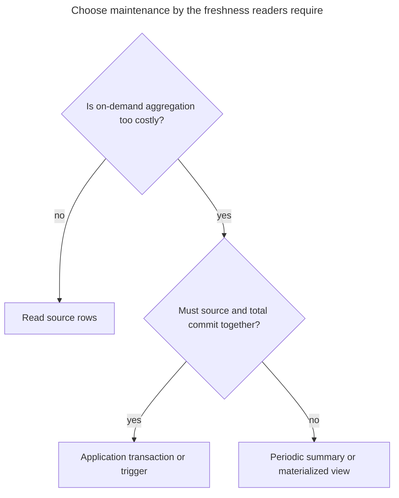
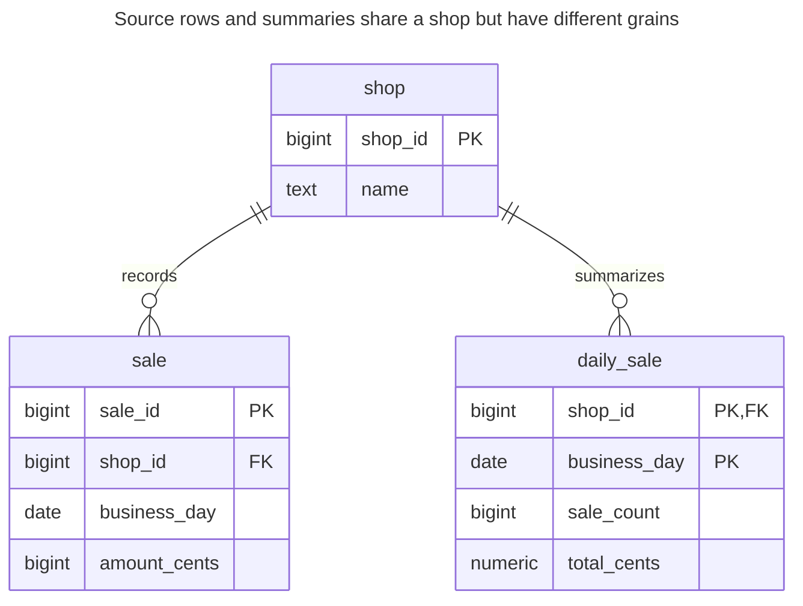
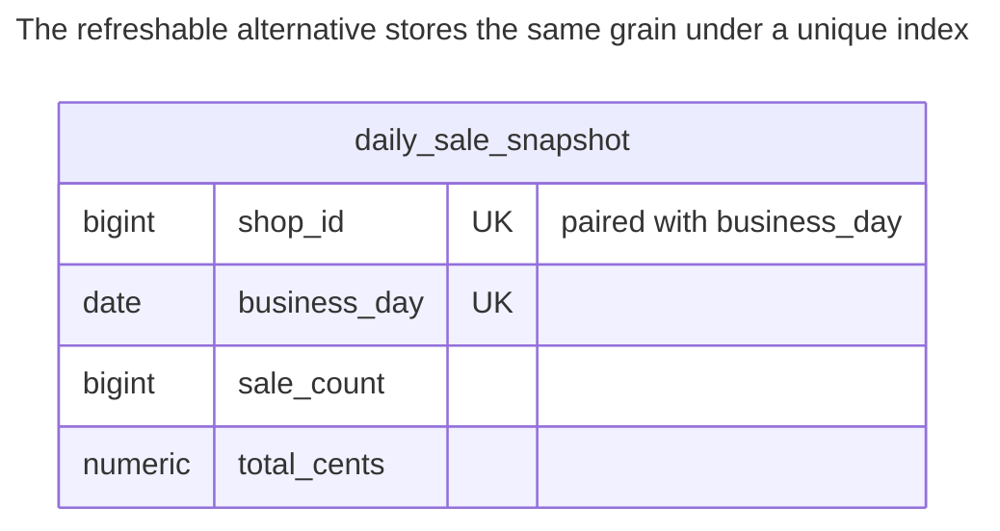
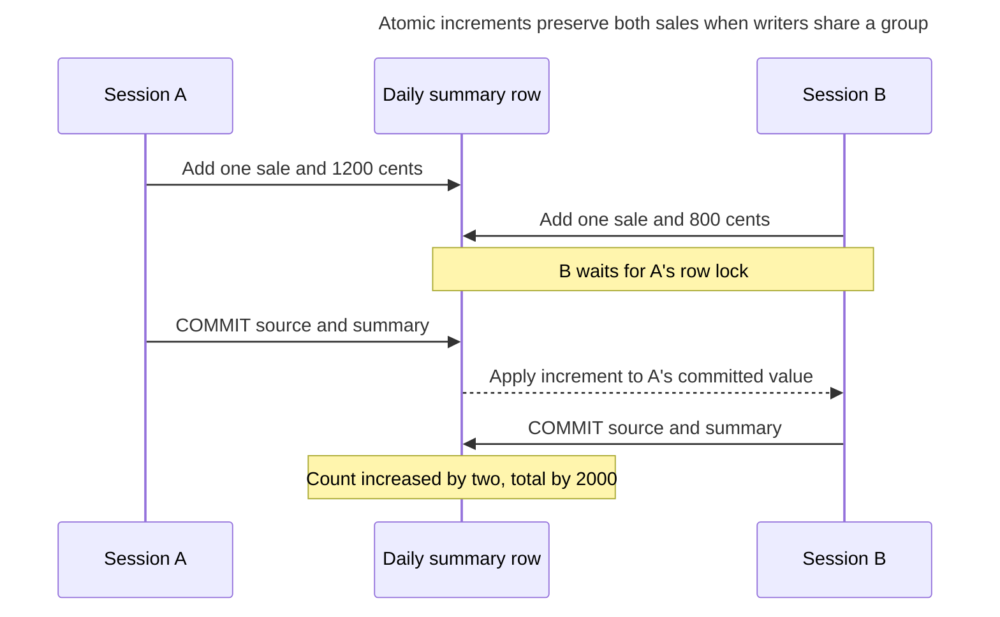
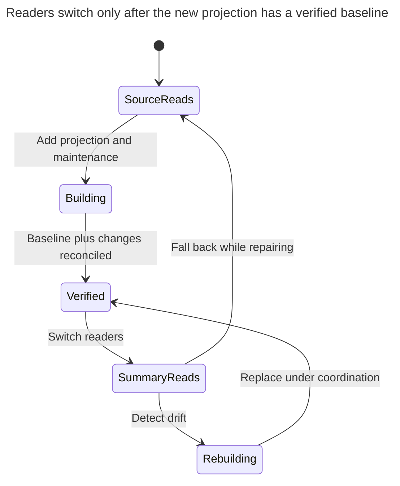

# Summary Table

## Intent

A summary table stores precomputed aggregates — daily sales totals, comment counts, account balances — so frequent reads no longer scan the source rows. The chapter compares ways to keep it in sync: updates in the same transaction, triggers, periodic refreshes and materialized views, with a counter cache on the parent row as the simplest form. It shows how to keep concurrent increments correct and how to rebuild a summary from the source when it drifts.

## Also known as

Rollup table; aggregate table. A counter cache is the one-counter-per-parent form: Rails documents [`counter_cache`](https://guides.rubyonrails.org/association_basics.html#counter-cache) on an association. A [materialized view](https://www.postgresql.org/docs/18/rules-materializedviews.html) is an implementation option that stores a query result and its defining query together.

## Problem

Your dashboard repeatedly totals sales by shop and business day. An index may help locate the day's sales, but the dashboard still asks for the same reduction over those rows. As sales accumulate, the cost of deriving each answer grows while the answer remains a small row.

Copying yesterday's total into a table moves the problem to maintenance. A correction, cancellation, import or retry can leave that total wrong. Before storing it, decide whether the dashboard needs the total as of the reading transaction or a published reporting snapshot. A cached account balance used to accept a withdrawal has a different freshness requirement from yesterday's sales chart.

## Solution

Keep individual `sale` rows authoritative and store one `daily_sale` row per `(shop_id, business_day)`. Maintain both the count and sum; derive an average from those two values rather than averaging daily averages. Define the business day before insertion, including the time-zone policy outside this example, and do not combine amounts in different currencies. The lab fixes every shop to one reporting currency and stores integer cents.

Choose one maintenance owner. The example uses an application statement that changes the source and its summary together. PostgreSQL's [data-modifying CTEs](https://www.postgresql.org/docs/18/queries-with.html#QUERIES-WITH-MODIFYING) pass changed rows through `RETURNING`; the outer statement applies only their deltas. Treat the arithmetic and reconciliation query as part of the schema's write contract.

| Maintenance | Freshness contract | Work you take on |
| --- | --- | --- |
| Application transaction | Source and summary commit together | Every writer, including imports and corrections, must use the protocol |
| Trigger | Source mutations invoke database maintenance | Cover inserts, updates, deletes and group moves; inspect bulk-write and locking costs |
| Periodic rebuild | A published snapshot, with a stated cutoff | Schedule, publish and monitor refreshes; readers must accept lag |
| PostgreSQL materialized view | Contents from its last refresh | Store the grouping query and run `REFRESH`; direct row updates are unavailable |

PostgreSQL documents [trigger execution within the triggering transaction](https://www.postgresql.org/docs/18/trigger-definition.html). Its [materialized-view example](https://www.postgresql.org/docs/18/rules-materializedviews.html) instead summarizes invoices for a dashboard and refreshes on a schedule. Neither implementation establishes that your chosen freshness contract is suitable for authorization or funds checks.

## Alternatives and selection

| Sibling or mechanism | Relationship | Deciding requirement |
| --- | --- | --- |
| Aggregate the source on demand | Replacement | Reads are infrequent or the indexed source slice is already cheap enough |
| Counter on the parent row | Implementation option | You need one count per parent, without another grouping dimension |
| Materialized view | Implementation option | You accept refresh lag and want the database to retain the defining query |
| [Table Partitioning](table-partitioning.md) | Complement | Source retention and range scans need management; partitioning does not precompute totals |
| [Double-Entry Ledger](double-entry-ledger.md) | Complement | Balances need authoritative, balanced movements; a summary cannot replace posting integrity |
| [Transactional Outbox](transactional-outbox.md) plus [Idempotency Record](idempotency-record.md) | Implementation option for asynchronous maintenance | A separate projection consumes durable events and deduplicates their effects |

See the [Decision Atlas](decision-atlas.md) for the full comparison. Start with a measured query cost and a freshness requirement, then choose where to pay for aggregation.



A summary is justified by repeated work you can avoid. The second decision determines whether you move that work into each write or a later refresh.

## Structure



There is no foreign key from a summary to a particular sale. Its key identifies a group, and the relationship to all contributing sales is a computation, not referential integrity. A shop with no sales need not have a summary row.

## Tables and invariants

- **`shop`** identifies the reporting owner. The example assumes one currency per shop; cross-shop currency conversion is outside its total.
- **`sale`** has a stable primary key and a nonnegative amount. The key prevents the same source ID being inserted twice. The application keeps the shop and business day fixed during the correction operation shown below.
- **`daily_sale`** has one row per group, a nonnegative count and a nonnegative total. These local checks catch impossible values, not arbitrary drift: a plausible but wrong total still passes.
- **Equality with the source** is a maintenance invariant, not a declarative constraint. PostgreSQL [does not support cross-row/table assertions in a `CHECK`](https://www.postgresql.org/docs/18/ddl-constraints.html#DDL-CONSTRAINTS-CHECK-CONSTRAINTS). Restrict direct summary writes and reconcile against the source.
- **Empty groups** may remain as `(0, 0)` after the final sale is removed. Readers and reconciliation treat an absent group and this retained zero row equivalently.

## When to use

- Many reads repeat the same grouping, and source aggregation is a measured cost.
- You can name the source of truth, the grouping grain and the freshness contract.
- You can cover every source mutation and operate a rebuild when maintenance fails.

## Consequences and trade-offs

- ➕ A dashboard can fetch one stored row for a day instead of reducing every sale for that day.
- ➕ Retaining source rows lets you explain and recompute the answer.
- ➖ Synchronous maintenance makes popular groups write hot spots; separating the summary does not remove contention on its row.
- ➖ Counts and sums have simple deltas. Deleting the current minimum or maximum may require finding a replacement in the source.
- ➖ Every new dimension changes the grain and maintenance cost. A shop/day summary cannot answer product/day questions without another source query or projection.
- ➖ Dropping source partitions can remove the evidence needed to rebuild older totals. Decide whether those totals become retained reporting facts before applying retention.

## Implementation

The [complete PostgreSQL 18.6 script](../assets/summary-table/summary-table.sql) verifies inserts, corrections, deletion, duplicate rejection, reconciliation and materialized-view refresh. These tables fix the grain explicitly:

```sql
CREATE TABLE shop (
    shop_id bigint PRIMARY KEY,
    name text NOT NULL
);
CREATE TABLE sale (
    sale_id bigint PRIMARY KEY,
    shop_id bigint NOT NULL REFERENCES shop (shop_id),
    business_day date NOT NULL,
    amount_cents bigint NOT NULL CHECK (amount_cents >= 0)
);
CREATE INDEX sale_group_idx ON sale (shop_id, business_day);
CREATE TABLE daily_sale (
    shop_id bigint REFERENCES shop (shop_id),
    business_day date,
    sale_count bigint NOT NULL CHECK (sale_count >= 0),
    total_cents numeric NOT NULL CHECK (total_cents >= 0),
    PRIMARY KEY (shop_id, business_day)
);
INSERT INTO shop VALUES (1, 'Harbor');
```

Insert source rows first, then aggregate their returned values into one delta per group. PostgreSQL [`ON CONFLICT DO UPDATE`](https://www.postgresql.org/docs/18/sql-insert.html#SQL-ON-CONFLICT) provides an atomic insert-or-update outcome; the increment uses the locked stored value rather than a total read earlier by the client:

```sql
WITH added AS (
    INSERT INTO sale VALUES
        (101, 1, DATE '2026-11-01', 1200),
        (102, 1, DATE '2026-11-01', 800)
    RETURNING shop_id, business_day, amount_cents
)
INSERT INTO daily_sale AS d
SELECT shop_id, business_day, count(*), sum(amount_cents)
FROM added GROUP BY shop_id, business_day
ON CONFLICT (shop_id, business_day) DO UPDATE
SET sale_count = d.sale_count + EXCLUDED.sale_count,
    total_cents = d.total_cents + EXCLUDED.total_cents;
SELECT * FROM daily_sale;
```

The result is `(1, 2026-11-01, 2, 2000)`. Grouping the batch first also avoids proposing several updates to the same conflict target in one command, which PostgreSQL's [`INSERT` rules](https://www.postgresql.org/docs/18/sql-insert.html#SQL-ON-CONFLICT) reject.

For an amount correction, use the difference between the old and new source values, not the entire new amount. PostgreSQL 18 [`UPDATE ... RETURNING`](https://www.postgresql.org/docs/18/sql-update.html) can expose both versions:

```sql
WITH changed AS (
    UPDATE sale SET amount_cents = 1500 WHERE sale_id = 101
    RETURNING WITH (OLD AS o, NEW AS n)
        n.shop_id, n.business_day, n.amount_cents - o.amount_cents AS delta
)
UPDATE daily_sale AS d SET total_cents = d.total_cents + c.delta
FROM changed AS c
WHERE (d.shop_id, d.business_day) = (c.shop_id, c.business_day)
RETURNING d.*;
```

This returns `(1, 2026-11-01, 2, 2300)`. Require exactly one summary update for an existing sale; if it is missing, roll back the transaction and reconcile before retrying. In production, wrap the statement and that affected-row check in one transaction or controlled routine. Moving a sale to another shop/day needs subtraction from the old group and addition to the new group; this amount-only operation deliberately does neither.

Cancellation removes a contributing row and subtracts only if deletion returned it:

```sql
WITH removed AS (
    DELETE FROM sale WHERE sale_id = 102
    RETURNING shop_id, business_day, amount_cents
)
UPDATE daily_sale AS d
SET sale_count = d.sale_count - 1,
    total_cents = d.total_cents - r.amount_cents
FROM removed AS r
WHERE (d.shop_id, d.business_day) = (r.shop_id, r.business_day)
RETURNING d.*;
```

The result is `(1, 2026-11-01, 1, 1500)`. Repeating this deletion changes nothing. It has the same affected-row requirement when a source row was actually removed. A duplicate source insertion is rejected before any increment can commit:

```sql
INSERT INTO sale VALUES (101, 1, DATE '2026-11-01', 1500);
```

PostgreSQL 18.6 raises SQLSTATE `23505`: `ERROR: duplicate key value violates unique constraint "sale_pkey"`, with `DETAIL: Key (sale_id)=(101) already exists.` A source key is useful for duplicate detection only if retries reuse it. See [Idempotency Record](idempotency-record.md) for comparing request content after an uncertain commit.

For a scheduled implementation, use a separate projection instead of mixing refreshes with live delta updates:

```sql
CREATE MATERIALIZED VIEW daily_sale_snapshot AS
SELECT shop_id, business_day, count(*) AS sale_count,
       sum(amount_cents) AS total_cents
FROM sale GROUP BY shop_id, business_day;
CREATE UNIQUE INDEX daily_sale_snapshot_key
    ON daily_sale_snapshot (shop_id, business_day);
REFRESH MATERIALIZED VIEW CONCURRENTLY daily_sale_snapshot;
```

[`CONCURRENTLY`](https://www.postgresql.org/docs/18/sql-refreshmaterializedview.html) permits concurrent reads, requires an already populated view and a unique index on plain columns covering all rows, and allows only one refresh of that view at a time. It replaces the contents from the defining query; do not mistake it for automatic incremental maintenance.



This separate projection has the same shop/day grain. The example declares its unique index, but no foreign key to `shop`; its contents come from the source query on each refresh.

## Engine support

- **PostgreSQL 18:** choose an ordinary maintained table or the refreshable materialized view above. A normal view retains a query, whereas a materialized view [persists its result](https://www.postgresql.org/docs/18/rules-materializedviews.html).
- **MySQL 8.4 / InnoDB:** port the ordinary-table implementation using its [`INSERT ... ON DUPLICATE KEY UPDATE`](https://dev.mysql.com/doc/refman/8.4/en/insert-on-duplicate.html); it reacts to primary or unique key conflicts. Keep the source and summary in one transaction and adapt the PostgreSQL CTE syntax.
- **SQL Server 2025 (17.x):** [indexed views](https://learn.microsoft.com/en-us/sql/relational-databases/views/create-indexed-views?view=sql-server-ver17) are an engine-maintained option with restrictions including schema binding and `COUNT_BIG(*)` for grouped views. Their maintenance adds work to base-table writes; they are not PostgreSQL scheduled refreshes.
- **Oracle Database 19c:** [materialized-view refresh](https://docs.oracle.com/en/database/oracle/oracle-database/19/dwhsg/refreshing-materialized-views.html) distinguishes `ON COMMIT` from `ON DEMAND` and fast from complete refresh. Check eligibility before selecting a freshness and cost contract.
- **SQLite 3:** an [ordinary view](https://www.sqlite.org/lang_createview.html) names a `SELECT`; use an explicitly maintained table for this stored projection. Its [single simultaneous writer](https://www.sqlite.org/lang_transaction.html) makes long rebuild transactions a database-wide write concern.

## Failure and concurrency

Use Read Committed for the local delta statements. PostgreSQL's [isolation documentation](https://www.postgresql.org/docs/18/transaction-iso.html#XACT-READ-COMMITTED) explains how a waiting update uses the updated row version. Two increments serialize on the summary row rather than replacing each other's pre-read values:



A rollback discards the corresponding source mutation and delta together. A lost response after commit still requires retry identity; issuing another source ID would count another sale.

For multi-group writes, acquire affected summary locks in a consistent key order where practical and retry the whole transaction after a deadlock. PostgreSQL's [deadlock guidance](https://www.postgresql.org/docs/18/explicit-locking.html#LOCKING-DEADLOCKS) recommends consistent ordering. Never retry just the increment after rolling back its source insert. With asynchronous maintenance, store the processed event ID and delta in the consumer's same transaction; the [outbox and deduplication patterns](transactional-outbox.md) explain why delivery alone does not prevent duplicate effects.

Reconcile with one query snapshot so a concurrent committed write cannot appear on only one side of the comparison:

```sql
WITH expected AS (
    SELECT shop_id, business_day, count(*) AS sale_count,
           sum(amount_cents) AS total_cents
    FROM sale GROUP BY shop_id, business_day
)
SELECT shop_id, business_day
FROM expected AS e FULL JOIN daily_sale AS d USING (shop_id, business_day)
WHERE coalesce(e.sale_count, 0) <> coalesce(d.sale_count, 0)
   OR coalesce(e.total_cents, 0) <> coalesce(d.total_cents, 0);
```

The lab returns no rows. To repair a small deployment safely, pause source writers with a [`SHARE` table lock](https://www.postgresql.org/docs/18/sql-lock.html), rebuild under an exclusive summary-writer lock and commit the replacement together:

```sql
BEGIN;
LOCK TABLE sale IN SHARE MODE;
LOCK TABLE daily_sale IN EXCLUSIVE MODE;
DELETE FROM daily_sale;
INSERT INTO daily_sale
SELECT shop_id, business_day, count(*), sum(amount_cents)
FROM sale GROUP BY shop_id, business_day;
COMMIT;
```

This deliberately blocks source writes during the scan; ordinary summary readers can keep reading their committed snapshot. It avoids the unsafe sequence “scan, then overwrite a total that live writers already advanced.” For large online rebuilds, introduce a per-shop coordination protocol used by every writer before touching source rows, or build from a consistent snapshot plus a durable change stream. Do not claim an online rebuild merely because the scan runs in the background.

## Migration

Create the summary without changing readers. Install maintenance for all writers, establish a consistent baseline, reconcile and only then switch reads. A simple baseline uses the locked rebuild above during a measured write pause. An online baseline needs the explicit snapshot/change boundary just described. Starting from zero while counting only new writes omits the old population.



Keep source-based reads available through rollout. You can back out by returning reads to the source while repairing the projection; do not discard source facts to repair a bad total. When using a parent counter, backfill before trusting it. Rails explicitly documents [inactive counter-cache reads during backfill](https://guides.rubyonrails.org/association_basics.html#counter-cache).

## Anti-patterns and common mistakes

- Updating the source and total in separate commits, or using a client-side read/replace increment.
- Covering insertion but forgetting deletion, corrections, imports or moves between groups.
- Letting both a trigger and the application apply the same delta.
- Treating a nonnegative total as proof that it agrees with the source.
- Averaging averages without their weights, or adding unlike currencies into one total.
- Rebuilding from an old snapshot while live deltas continue to update the table being overwritten.

## Known uses

- PostgreSQL's [sales-summary materialized-view example](https://www.postgresql.org/docs/18/rules-materializedviews.html) groups invoices by salesperson and date for dashboard reads.
- Rails' [`counter_cache`](https://guides.rubyonrails.org/association_basics.html#counter-cache) keeps an association count on its owner and documents backfill and repair concerns.
- Microsoft's [Materialized View pattern](https://learn.microsoft.com/en-us/azure/architecture/patterns/materialized-view) treats a stored read projection as rebuildable data derived from its source. This chapter's shop schema is a worked design, not a published vendor schema.

## Related patterns

- [Double-Entry Ledger](double-entry-ledger.md) supplies authoritative movements behind a balance projection.
- [Table Partitioning](table-partitioning.md) manages source retention independently of aggregation.
- [Idempotency Record](idempotency-record.md) prevents replayed commands or events from applying another delta.
- [Transactional Outbox](transactional-outbox.md) supplies durable asynchronous projection input.
- [Expand and Contract](expand-contract.md) stages projection rollout and fallback.
