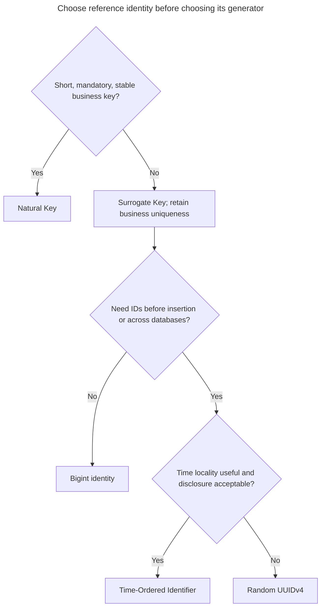
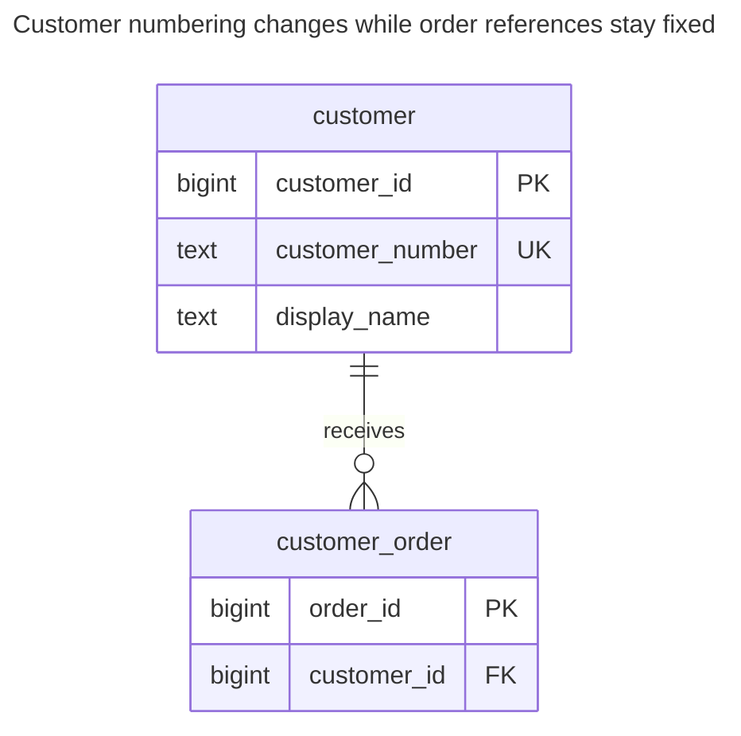
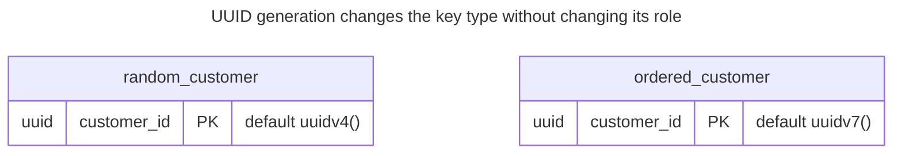
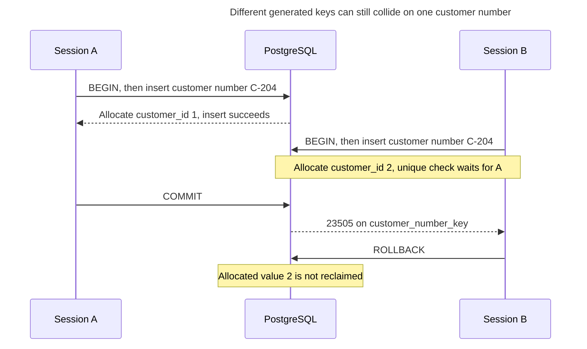
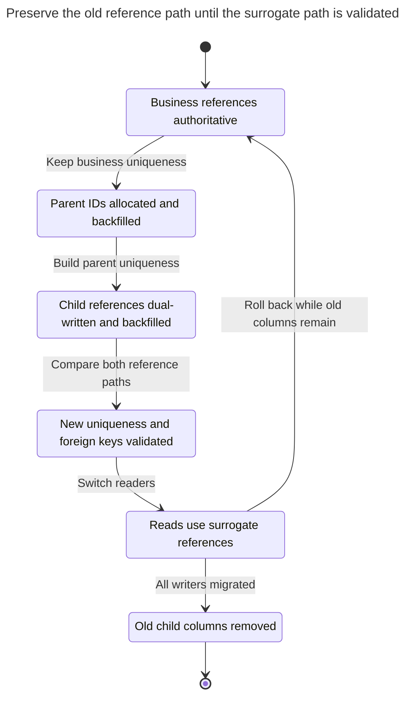

# Surrogate Key

## Intent

A surrogate key is a value generated solely to identify a row: it carries no business meaning, you keep it unchanged, and you use it as the target of foreign keys. Choose between a bigint identity column, a random UUIDv4 and a time-ordered UUIDv7/ULID by weighing index size, insert locality, merging databases and generating IDs before insertion. A surrogate does not replace a uniqueness constraint on business attributes: without one, you can store the same customer twice. [Ambler's key vocabulary](https://agiledata.org/essays/keys.html) makes the distinction between business identity and a meaningless key explicit.

## Also known as

Artificial key; system-assigned key. Fowler's [Identity Field](https://martinfowler.com/eaaCatalog/identityField.html) is a related mapping pattern: you retain the database key in an object to connect the object to its stored row. It does not prescribe a particular key generator.

## Problem

You identify customers by a customer number, but a merger can replace that numbering scheme. If orders reference the number, renumbering a customer becomes an operation over its orders too. A missing number at registration creates another problem: you need to persist a customer before the business has assigned its identifier. These are reasons to separate row identity from customer numbering.

Adding an integer alone solves neither duplicate registration nor ambiguous matching during import. Two different integers can identify two rows containing the same customer number. Decide which business attributes actually distinguish customers before choosing their storage key.

## Solution

Give `customer` a generated `customer_id` primary key and reference it from `customer_order`. Keep `customer_number` as a separate, mandatory unique value in this example. Change the number without changing the ID. PostgreSQL's [identity columns](https://www.postgresql.org/docs/18/ddl-identity-columns.html) generate values from an implicit sequence; they do not themselves guarantee uniqueness, so declare the primary key explicitly.

Choose the generator separately from the decision to use a surrogate:

| Generator | Choose it when | Cost you accept |
| --- | --- | --- |
| `bigint` identity | One database allocates IDs and you can obtain them at insertion | Independent databases can issue the same numbers; merging requires a mapping |
| UUIDv4 | Writers need IDs before insertion, without a central allocator | Wider keys; random index insertion locations |
| UUIDv7 / ULID | You need distributed generation and time locality | Wider keys and a disclosed generation time; see [Time-Ordered Identifier](time-ordered-identifier.md) |

PostgreSQL [`bigint`](https://www.postgresql.org/docs/18/datatype-numeric.html) occupies eight bytes; its [`uuid`](https://www.postgresql.org/docs/18/datatype-uuid.html) value is 128 bits. This is a key-payload comparison, not a promise that a UUID index will be exactly twice as large. The [RFC's database guidance](https://www.rfc-editor.org/rfc/rfc9562.html#section-6.13) explains the locality advantage of time-ordered UUIDs over random ones. Measure the complete workload before assigning a throughput benefit.

## Alternatives and selection

| Sibling | Relationship | Deciding requirement |
| --- | --- | --- |
| [Natural Key](natural-key.md) | Replacement for the primary key; complement as a unique constraint | A short, mandatory business key is stable enough for references |
| [Time-Ordered Identifier](time-ordered-identifier.md) | Implementation option | Generate before insertion while retaining approximate time order |
| [Public Identifier](public-identifier.md) | Complement | Clients need a separate identity contract |

Use the [Decision Atlas](decision-atlas.md) for the full family comparison. Avoid [Mandatory Surrogates](mandatory-surrogates.md): a relationship identified by two existing keys may need only their composite primary key.



The first branch chooses the reference contract; the later branches choose an allocator for a generated key. Business uniqueness remains necessary whichever generator you select.

## Structure



The order stores the generated key. The customer row stores both the stable reference target and the changeable number. Uniqueness of the number is an independent invariant.

## Tables and invariants

- **`customer`** has one row per customer number. Its primary key distinguishes rows; `NOT NULL` plus `customer_number_key` prevents missing or duplicate numbers.
- **`customer_order`** has one customer per order. Its mandatory foreign key rejects references to missing customers; the child index supports customer-based lookups. PostgreSQL does [not automatically index referencing columns](https://www.postgresql.org/docs/18/ddl-constraints.html#DDL-CONSTRAINTS-FK).
- **Key stability** is a write-policy invariant: ordinary application operations never update `customer_id`. `GENERATED ALWAYS` guards explicit insertion, not every possible key rewrite; see the [identity rules](https://www.postgresql.org/docs/18/ddl-identity-columns.html).

## When to use

- Business identifiers can be assigned late or corrected after dependent rows exist.
- Many tables reference an entity whose business key is wide or sensitive.
- You need independent ID generation and have chosen a UUID generator for that purpose.

## Consequences and trade-offs

- ➕ Changing a customer's business number leaves order references unchanged.
- ➕ You can give an incomplete registration a row identity before its business workflow finishes; adjust the example's mandatory number if that is your requirement.
- ➖ You maintain both a primary-key index and a business-key unique index.
- ➖ An order's internal customer ID does not tell an operator the customer number without a lookup.
- ➖ Different generated IDs do not prove different real-world customers. The chosen business constraint only catches the duplicates it defines.

## Implementation

The [complete script](../assets/surrogate-key/surrogate-key.sql) includes UUID alternatives and verifies the expected duplicate error. These are the essential tables:

```sql
CREATE TABLE customer (
    customer_id bigint GENERATED ALWAYS AS IDENTITY PRIMARY KEY,
    customer_number text NOT NULL,
    display_name text NOT NULL,
    CONSTRAINT customer_number_key UNIQUE (customer_number)
);
CREATE TABLE customer_order (
    order_id bigint GENERATED ALWAYS AS IDENTITY PRIMARY KEY,
    customer_id bigint NOT NULL REFERENCES customer (customer_id)
);
CREATE INDEX customer_order_customer_idx ON customer_order (customer_id);
```

Insert the customer, capture its ID with [`RETURNING`](https://www.postgresql.org/docs/18/sql-insert.html#SQL-INSERT-RETURNING), and use that ID for subsequent references. Here the lookup keeps the example executable without client variables:

```sql
INSERT INTO customer (customer_number, display_name)
VALUES ('C-104', 'Northwind') RETURNING customer_id;
INSERT INTO customer_order (customer_id)
SELECT customer_id FROM customer WHERE customer_number = 'C-104';
UPDATE customer SET customer_number = 'C-204'
WHERE customer_number = 'C-104';
SELECT o.order_id, c.customer_id, c.customer_number
FROM customer_order AS o JOIN customer AS c USING (customer_id);
```

In the empty example database the result is `(1, 1, C-204)`. A second registration with that number fails even though it would receive a different surrogate:

```sql
INSERT INTO customer (customer_number, display_name)
VALUES ('C-204', 'Duplicate');
```

PostgreSQL 18.6 raises SQLSTATE `23505`: `ERROR: duplicate key value violates unique constraint "customer_number_key"`, with `DETAIL: Key (customer_number)=(C-204) already exists.`

For an independent UUID implementation, change the key declaration and every referencing column to `uuid`. PostgreSQL 18 supplies both [generators](https://www.postgresql.org/docs/18/functions-uuid.html):

```sql
CREATE TABLE random_customer (
    customer_id uuid PRIMARY KEY DEFAULT uuidv4()
);
CREATE TABLE ordered_customer (
    customer_id uuid PRIMARY KEY DEFAULT uuidv7()
);
```

For application generation, send an explicit UUID instead of using the default. Do not change the identity of an existing row each time you retry a request.



These are independent alternative tables, each with a UUID primary key. A real conversion must also change every referencing column to the matching type.

## Engine support

- **PostgreSQL 18:** use the identity and UUID definitions above. An identity is an allocator plus a constraint, not a business numbering service.
- **MySQL 8.4 / InnoDB:** [secondary index entries contain the primary key](https://dev.mysql.com/doc/refman/8.4/en/innodb-index-types.html). A wide surrogate therefore affects secondary indexes too; key width matters beyond foreign-key columns.
- **SQL Server 2025 (17.x):** [`IDENTITY`](https://learn.microsoft.com/en-us/sql/t-sql/statements/create-table-transact-sql-identity-property?view=sql-server-ver17) also needs a primary-key or unique constraint and can leave gaps after failures.
- **Oracle AI Database 26ai:** [identity columns](https://docs.oracle.com/en/database/oracle/oracle-database/26/sqlrf/CREATE-TABLE.html) require a numeric type; translate the bigint example to a suitable `NUMBER` definition.
- **SQLite 3:** [`INTEGER PRIMARY KEY`](https://www.sqlite.org/lang_createtable.html#rowid) aliases the rowid and receives an automatically chosen integer when omitted. `BIGINT PRIMARY KEY` does not have that special behavior.

## Failure and concurrency

Use the allocator and constraints at the normal transaction isolation level; do not introduce a table lock just to calculate the next ID. PostgreSQL [`nextval`](https://www.postgresql.org/docs/18/functions-sequence.html) allocates distinct values atomically across sessions, and allocated values are not reclaimed on rollback. Gaps are expected. Never use `MAX(customer_id) + 1` or renumber rows to close holes.

Two concurrent registrations can both pass an application pre-check. PostgreSQL's [unique-index conflict checking](https://www.postgresql.org/docs/18/index-unique-checks.html) waits for an uncommitted conflicting writer and rechecks its outcome. Handle the business-key conflict explicitly. After an uncertain commit, resolve the original request by its business key or an [Idempotency Record](idempotency-record.md); generating a fresh surrogate is not a retry strategy.



The allocator prevents an ID collision, while the business-key constraint prevents duplicate registration. The failed registration can leave a sequence gap.

## Migration

Keep the existing business key unique. Add a nullable surrogate column without a table-wide generated default, arrange allocation for new rows, and backfill existing rows in bounded batches. Build its unique index [concurrently](https://www.postgresql.org/docs/18/sql-createindex.html#SQL-CREATEINDEX-CONCURRENTLY). Add surrogate columns to children, write both references, and backfill through the old key. Add new foreign keys as [`NOT VALID`, then validate them](https://www.postgresql.org/docs/18/sql-altertable.html). Plan short DDL lock windows and retry lock acquisition; this is not a lock-free conversion.

Switch reads after checking that old and new references agree. Delay removing old child columns until all writers have changed. To back out before removal, switch reads and writes back to the retained business references. When merging databases with integer surrogates, build an explicit old-to-new ID map and apply it to every child; copying the integers unchanged can identify the wrong customer.



The retained business references provide the rollback path during the overlap. Removing them ends that direct rollback route.

## Anti-patterns and common mistakes

- Dropping business uniqueness after adding a surrogate: the demonstrated duplicate then becomes valid.
- Treating an ID as an invoice sequence or row count: sequence gaps invalidate that interpretation.
- Adding an ID to a pure association and forgetting pair uniqueness; see [Mandatory Surrogates](mandatory-surrogates.md).
- Exposing the storage key by accident and later discovering that clients depend on its shape; make the [public identity](public-identifier.md) decision explicitly.

## Known uses

- PostgreSQL's [identity-column example](https://www.postgresql.org/docs/18/ddl-identity-columns.html) assigns generated numbers to people.
- Fowler's [Identity Field](https://martinfowler.com/eaaCatalog/identityField.html) shows the application mapping that retains a stored row's key in memory; the mapping works with either natural or surrogate keys.

## Related patterns

- [Natural Key](natural-key.md) defines the business uniqueness you retain alongside the surrogate.
- [Time-Ordered Identifier](time-ordered-identifier.md) examines ordered surrogate generators.
- [Public Identifier](public-identifier.md) separates external references from internal joins.
- [Mandatory Surrogates](mandatory-surrogates.md) explains when the extra key buys nothing.
