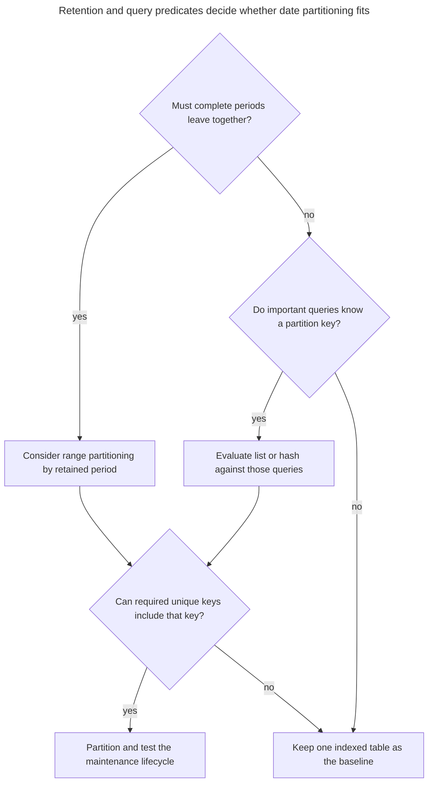
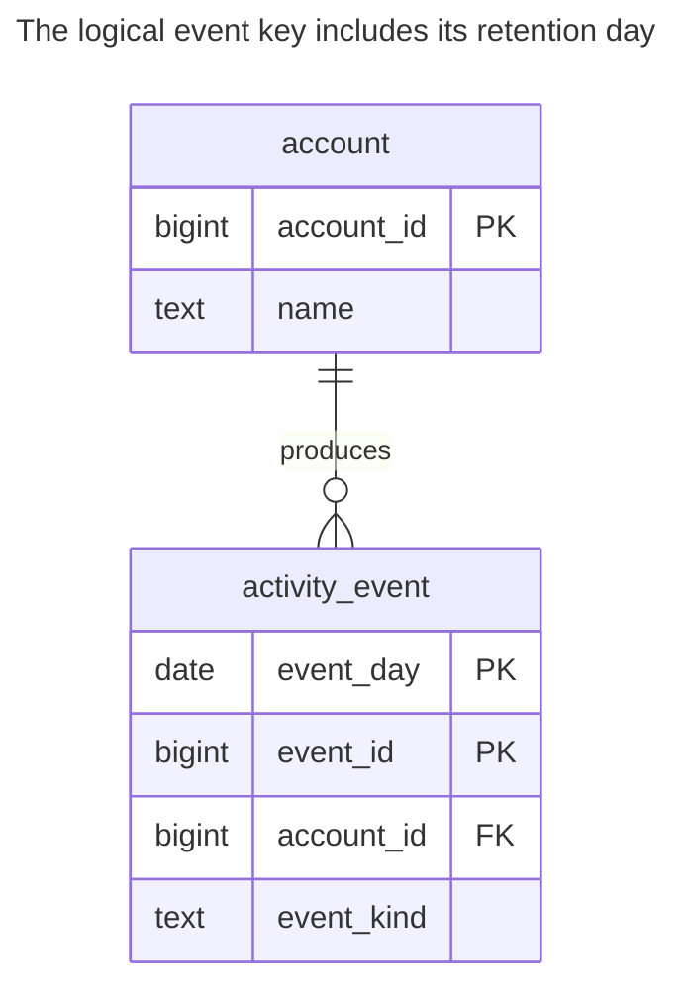
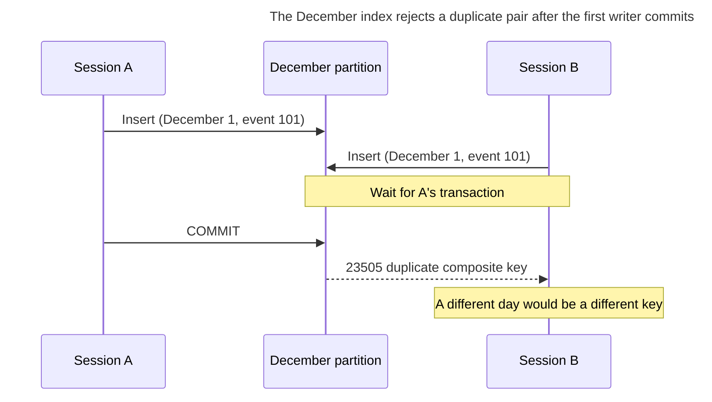
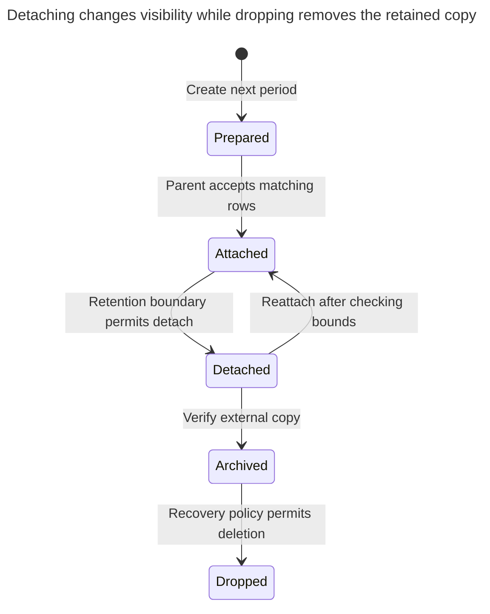

# Table Partitioning

## Intent

Table partitioning splits one large table into partitions by range, list or hash of a key, while queries still see a single table. Old data can be detached or dropped a whole partition at a time instead of with a long DELETE, and queries that filter by the partition key read only the partitions they need. The chapter shows declarative partitioning in PostgreSQL, choosing the key, the restrictions it places on primary keys and unique constraints, and the overhead as the number of partitions grows.

## Also known as

Declarative partitioning; horizontal partitioning within one database. PostgreSQL's [partitioning vocabulary](https://www.postgresql.org/docs/18/ddl-partitioning.html) describes one logical table with physical pieces. This chapter keeps that separate from sharding across databases and from [Table Split](table-split.md), which separates columns.

## Problem

Your application retains event rows for a fixed number of months. Most requests read a recent date range, but retention repeatedly deletes old rows individually. You want the retention unit and the physical storage unit to match, while applications keep querying one relation.

Choosing a key solely because it spreads rows evenly can defeat that purpose. Hashing an event ID distributes a month's rows across every partition; it does not give you a month you can detach. Conversely, monthly partitions do little for a lookup that knows only an event ID. Start with the predicates and retention operation you need, then check whether their preferred key is compatible with your uniqueness requirements.

## Solution

Define `activity_event` as a partitioned parent with a stored `event_day` and nonoverlapping monthly ranges. Insert and query through the parent. Create upcoming partitions ahead of writes, monitor the covered horizon and detach expired partitions only after deciding what late arrivals and historical readers should see.

PostgreSQL [routes rows by the partition bound](https://www.postgresql.org/docs/18/sql-createtable.html), with lower-inclusive, upper-exclusive ranges. A parent primary key includes the partition columns. Here `(event_day, event_id)` identifies an event; `event_id` alone is deliberately not declared globally unique. If callers require an ID-only foreign-key target, keep that entity in an unpartitioned identity table or choose another design rather than silently weakening its contract.

| Strategy | Requirement it serves | Cost to examine |
| --- | --- | --- |
| Range by event day | Drop or archive complete periods; filter by those periods | Late data, future coverage and boundary maintenance |
| List by a bounded category | Isolate explicitly named groups | Skew and a growing category set |
| Hash by a stable key | Divide key-based access into a fixed set of pieces | Time retention still touches every piece |

These are PostgreSQL's [three declarative strategies](https://www.postgresql.org/docs/18/ddl-partitioning.html#DDL-PARTITIONING-DECLARATIVE). None is a throughput guarantee; measure planning, execution and maintenance with your intended partition count.

## Alternatives and selection

| Sibling or mechanism | Relationship | Deciding requirement |
| --- | --- | --- |
| One ordinary table with suitable indexes | Replacement | Queries and retention already meet their budget; retain simple global keys |
| [Summary Table](summary-table.md) | Complement; replacement for repeated aggregate scans | Readers need precomputed totals, not merely fewer physical pieces to inspect |
| [Table Split](table-split.md) | Complement or replacement for wide-row problems | Cold or separately protected columns, rather than old rows, cause the difficulty |
| [Expand and Contract](expand-contract.md) | Complement | An existing table must move to the partitioned shape while clients overlap |
| Sharding across databases | Replacement for a different capacity boundary | One database cannot carry the required workload; native partitions alone do not add servers |

See the [Decision Atlas](decision-atlas.md) for the full comparison. Avoid [Cloned Tables](cloned-tables.md): application code should not assemble a new list of table names whenever a month begins. Native partitions retain the single relation contract.



The unique-key check comes before DDL. A layout that makes retention easy can still be unsuitable for your entity's reference contract.

## Structure



Many events belong to one account. The foreign key is ordinary referential integrity; the month containing an event is physical routing, not another business entity. The November and December pieces have the same columns and composite key as the parent.

## Tables and invariants

- **`account`** is an unpartitioned identity table. An event cannot reference a missing account.
- **`activity_event`** is the application's logical relation, with primary key `(event_day, event_id)`. The key rejects duplicates of that pair, including two writes racing in one partition. It allows the same ID on another day.
- **`activity_event_2026_11` / `activity_event_2026_12`** accept only their declared ranges. Bounds cannot overlap; an uncovered date fails routing. These rules come from PostgreSQL's [partition declaration](https://www.postgresql.org/docs/18/sql-createtable.html).
- **Retention day** is a business assignment in this example. Compute it consistently before insertion; do not let different clients apply different day-boundary policies.
- **Incoming references** must target the complete event key if they reference this primary key. This design has no child referencing events, which keeps its detach example independent of child retention.

## When to use

- A large source table has a predictable retention or archive unit.
- Important queries constrain the selected partition key.
- You can operate partition creation, detach, restore and late-arrival handling as recurring work.
- You accept the resulting composite uniqueness and reference shape.

## Consequences and trade-offs

- ➕ Period-level maintenance does not require issuing a delete for every old event. PostgreSQL [documents detach/drop as avoiding bulk-delete vacuum work](https://www.postgresql.org/docs/18/ddl-partitioning.html#DDL-PARTITIONING-OVERVIEW).
- ➕ Queries can exclude irrelevant periods when their predicates support pruning.
- ➖ More pieces mean more indexes, metadata and planning work. PostgreSQL's [best-practice guidance](https://www.postgresql.org/docs/18/ddl-partitioning.html#DDL-PARTITIONING-DECLARATIVE-BEST-PRACTICES) warns against assuming that more partitions are better.
- ➖ An ID-only lookup may inspect many partitions. Retaining an ID index on each piece does not create a single global uniqueness rule.
- ➖ PostgreSQL can [move an updated row to another partition](https://www.postgresql.org/docs/18/sql-update.html); treating `event_day` as immutable simplifies this example's key and retention contract.
- ➖ Partition operations still require locks. “Metadata operation” is not a promise of uninterrupted traffic.

## Implementation

The [complete PostgreSQL 18.6 script](../assets/table-partitioning/table-partitioning.sql) verifies routing, range boundaries, composite uniqueness, pruning, concurrent detach and reattachment. Start with two months:

```sql
CREATE TABLE account (
    account_id bigint PRIMARY KEY,
    name text NOT NULL
);
CREATE TABLE activity_event (
    event_day date NOT NULL,
    event_id bigint NOT NULL,
    account_id bigint NOT NULL REFERENCES account (account_id),
    event_kind text NOT NULL,
    PRIMARY KEY (event_day, event_id)
) PARTITION BY RANGE (event_day);
CREATE TABLE activity_event_2026_11 PARTITION OF activity_event
    FOR VALUES FROM ('2026-11-01') TO ('2026-12-01');
CREATE TABLE activity_event_2026_12 PARTITION OF activity_event
    FOR VALUES FROM ('2026-12-01') TO ('2027-01-01');
CREATE INDEX activity_event_account_day_idx
    ON activity_event (account_id, event_day);
INSERT INTO account VALUES (1, 'Harbor');
INSERT INTO activity_event VALUES
    ('2026-11-30', 101, 1, 'login'),
    ('2026-12-01', 101, 1, 'login');
SELECT tableoid::regclass AS physical_table, event_day, event_id
FROM activity_event ORDER BY event_day;
```

The rows reside in `activity_event_2026_11` and `activity_event_2026_12` respectively. The shared ID succeeds because the dates differ. PostgreSQL exposes the physical relation through [`tableoid`](https://www.postgresql.org/docs/18/ddl-system-columns.html). The index declared on the parent creates corresponding partition indexes under the [partitioned-index rules](https://www.postgresql.org/docs/18/sql-createindex.html).

Read by a half-open date interval and inspect the actual plan:

```sql
EXPLAIN (COSTS OFF)
SELECT event_id, event_kind FROM activity_event
WHERE account_id = 1
  AND event_day >= DATE '2026-12-01'
  AND event_day < DATE '2027-01-01';
UPDATE activity_event SET event_kind = 'session_started'
WHERE event_day = DATE '2026-12-01' AND event_id = 101;
```

The checked plan names only `activity_event_2026_12`; the particular scan method is cost-dependent. Pruning uses partition bounds, [not the presence of an index](https://www.postgresql.org/docs/18/ddl-partitioning.html#DDL-PARTITION-PRUNING). Keep predicates on the stored partition key rather than assuming an arbitrary expression on it will prune.

This insert has no destination:

```sql
INSERT INTO activity_event VALUES ('2027-01-01', 102, 1, 'login');
```

PostgreSQL 18.6 raises SQLSTATE `23514`: `ERROR: no partition of relation "activity_event" found for row`, with `DETAIL: Partition key of the failing row contains (event_day) = (2027-01-01).` A repeated December `(day, ID)` raises `23505` for `activity_event_2026_12_pkey`. Trying `UNIQUE (event_id)` on the parent raises `0A000`: `ERROR: unique constraint on partitioned table must include all partitioning columns`. The script checks all three cases.

Create January before its first accepted event. For retention, detach November while preserving its standalone table:

```sql
CREATE TABLE activity_event_2027_01 PARTITION OF activity_event
    FOR VALUES FROM ('2027-01-01') TO ('2027-02-01');
ALTER TABLE activity_event
    DETACH PARTITION activity_event_2026_11 CONCURRENTLY;
SELECT count(*) FROM activity_event;
SELECT count(*) FROM activity_event_2026_11;
```

Both counts are `1`: parent reads now exclude November, and the detached table still contains its row. Run concurrent detach outside a transaction block. PostgreSQL's [`DETACH` contract](https://www.postgresql.org/docs/18/sql-altertable.html#SQL-ALTERTABLE-DETACH-PARTITION) uses a reduced parent lock, disallows this mode with a default partition, and provides `FINALIZE` if interrupted between its stages. Decide how writers reject or reroute newly arriving November data before detaching it.

For a reversible archive rehearsal, attach the table again:

```sql
ALTER TABLE activity_event ATTACH PARTITION activity_event_2026_11
    FOR VALUES FROM ('2026-11-01') TO ('2026-12-01');
```

Only drop the detached table after your archive and recovery requirements are satisfied. If other tables reference retained event keys, their dependency and retention policy must be resolved before removal; this lab intentionally has no incoming event foreign keys.

## Engine support

- **PostgreSQL 18:** parent primary/unique constraints require all partition-key columns and cannot use expression partition keys for that guarantee. Review the [declarative limitations](https://www.postgresql.org/docs/18/ddl-partitioning.html#DDL-PARTITIONING-DECLARATIVE-LIMITATIONS) before choosing the key.
- **MySQL 8.4 / InnoDB:** [every unique key must include the partitioning columns](https://dev.mysql.com/doc/refman/8.4/en/partitioning-limitations-partitioning-keys-unique-keys.html), and [partitioned InnoDB tables cannot have or be targets of foreign keys](https://dev.mysql.com/doc/refman/8.4/en/partitioning-limitations-storage-engines.html). This chapter's account FK therefore prevents a direct port.
- **SQL Server 2025 (17.x):** uses a [partition function and partition scheme](https://learn.microsoft.com/en-us/sql/relational-databases/partitions/partitioned-tables-and-indexes?view=sql-server-ver17). A partitioned unique index must contain its partitioning column; a nonaligned index can preserve uniqueness on another key, with a different maintenance design. Do not generalize PostgreSQL's limitation to every SQL Server unique index.
- **Oracle Database 19c:** [interval partitioning](https://docs.oracle.com/en/database/oracle/oracle-database/19/vldbg/partition-concepts.html) can create future interval partitions automatically. Reference partitioning can derive a child's partitioning from its parent FK; these are additional design choices, not syntax equivalents of this lab.
- **SQLite 3:** its [`CREATE TABLE` grammar](https://www.sqlite.org/lang_createtable.html) has no native `PARTITION BY`. Keep an ordinary indexed table or accept that manually separated tables need application-level routing and a separate integrity design.

## Failure and concurrency

The partition boundary does not make two inserts with the same composite key safe. PostgreSQL's [unique-index checking](https://www.postgresql.org/docs/18/index-unique-checks.html) waits for an uncommitted conflicting writer and then checks its outcome:



Read Committed is sufficient for this key guarantee. It says nothing about ID-only uniqueness or request deduplication; keep the complete identity stable across retries.

Precreate partitions and alert on the last covered date. A default partition can catch out-of-range data, but then unexpected rows accumulate instead of producing the demonstrated error. PostgreSQL's [attach rules](https://www.postgresql.org/docs/18/sql-altertable.html#SQL-ALTERTABLE-ATTACH-PARTITION) can require scanning a default partition to prove that none of its rows belong to the new range. Treat a default as an operated exception path, not automatic capacity management.

Concurrent detach is designed to wait for relevant transactions rather than ignore them. Monitor old transactions before retention work, set a bounded [`lock_timeout`](https://www.postgresql.org/docs/18/runtime-config-client.html#GUC-LOCK-TIMEOUT) for DDL acquisition, and inspect attachment state before retrying an interrupted detach. A client timeout does not prove that the server completed no stage.



Detached data remains queryable by its standalone name. That gives you a recovery window before a destructive drop; it does not preserve the old parent's result set for historical callers.

## Migration

PostgreSQL [cannot directly turn an ordinary table into a partitioned parent](https://www.postgresql.org/docs/18/ddl-partitioning.html#DDL-PARTITIONING-DECLARATIVE). Create a new parent and future pieces, deploy compatible writers, and backfill bounded periods using the [Expand and Contract](expand-contract.md) protocol. Capture concurrent inserts, corrections and deletions; a one-time copy alone loses changes made during the scan. Reconcile keys and contents before switching readers.

For existing period-sized tables, attach instead of copying when the shape, indexes and constraints meet PostgreSQL's [`ATTACH PARTITION` requirements](https://www.postgresql.org/docs/18/sql-altertable.html#SQL-ALTERTABLE-ATTACH-PARTITION). A valid matching `CHECK` can avoid the candidate-table validation scan. Add and validate that check before the attachment lock window. PostgreSQL does not support [`CREATE INDEX CONCURRENTLY` directly on a partitioned parent](https://www.postgresql.org/docs/18/sql-createindex.html); build partition indexes concurrently and attach them when converting a large live hierarchy.

Keep the old storage synchronized until the rollback window ends. Before retiring it, verify that incoming foreign keys target the new complete key and that no query relies on the old table's global ID constraint. For the small lab, reattachment is the rollback for detach; it is possible only while you retain the rows and a compatible uncovered range.

## Anti-patterns and common mistakes

- Partitioning solely because a row count sounds large, without testing the actual workload and maintenance operation.
- Choosing a date key but continuing ID-only queries and references as if a global key still existed.
- Creating one partition per customer without bounding the count and measuring planning overhead.
- Forgetting the next month, or letting a default partition grow without monitoring.
- Treating a fast detach as permission to discard late arrivals, historical readers or dependent rows.
- Maintaining [Cloned Tables](cloned-tables.md) in application SQL when one partitioned relation meets the requirement.

## Known uses

- PostgreSQL's [measurement example](https://www.postgresql.org/docs/18/ddl-partitioning.html) uses monthly ranges and detaches or drops old periods. This chapter applies that mechanism to application events.
- Microsoft's [partitioned-table documentation](https://learn.microsoft.com/en-us/sql/relational-databases/partitions/partitioned-tables-and-indexes?view=sql-server-ver17) describes partition-level retention, index maintenance and switching to an archive table.
- Oracle's [partitioning concepts](https://docs.oracle.com/en/database/oracle/oracle-database/19/vldbg/partition-concepts.html) include interval and reference partitioning. Their existence broadens the choice of physical lifecycle; it does not establish a performance gain for your schema.

## Related patterns

- [Summary Table](summary-table.md) reduces repeated aggregation over retained events.
- [Cloned Tables](cloned-tables.md) describes the cost of exposing physical slices to application queries.
- [Expand and Contract](expand-contract.md) stages a move from ordinary storage.
- [Table Split](table-split.md) separates columns rather than date ranges.
