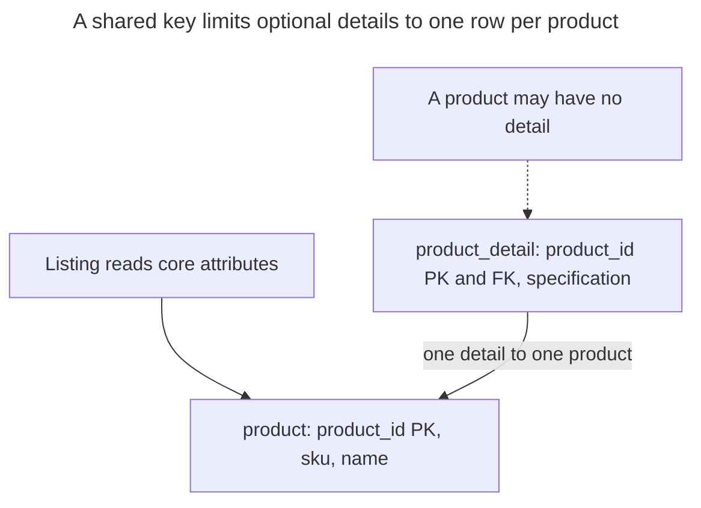

# Table Split

## Intent

A table split moves part of an entity's columns into a second table that shares its primary key, forming a one-to-one relationship. You do it for different reasons: optional data that only some rows have, large or rarely read columns that bloat the main table, or columns with different access rules or change rates. The chapter separates these motivations, shows how keys and constraints enforce "at most one" and, where needed, "exactly one", and when the extra join costs more than it saves.

## Also known as

Split Table in the [Ambler/Sadalage refactoring catalog](https://databaserefactoring.com/); vertical partitioning in Microsoft's [partitioning guidance](https://learn.microsoft.com/en-us/azure/well-architected/design-guides/partition-data). Here the split stays inside one database and transaction boundary; it does not imply distributing the parts across services.

## Problem

A product listing needs an SKU and a short name. An editor needs a long specification, and only some products have one. If both operations use the same wide row, it is tempting to split immediately. First identify the actual reason: optionality, access control, read size and concurrent updates need different evidence.

An optional specification needs a clear distinction between “no detail record” and “a detail record with an empty specification.” A sensitive specification needs privileges. A frequently updated stock counter needs a separate update target only if that separation reduces contention in your workload. Adding a table alone does not establish any of these policies.

## Solution

Keep identity and common attributes in `product`. Put the optional specification in `product_detail`, whose primary key is also a foreign key to `product`. You can create a product without a detail, but cannot create two details for it or a detail without a product. Use a left join when the result must include products without details.

For a mandatory extension, add the reverse foreign key too: the parent's key must reference the detail key. Defer that reverse check until transaction end so you can insert the parent before the detail. The example below uses a separate account pair to make the difference explicit. PostgreSQL's [deferrable-constraint rules](https://www.postgresql.org/docs/18/sql-createtable.html) permit this temporary insertion gap without accepting a committed missing extension.

## Alternatives and selection

| Sibling | Relationship | Deciding requirement |
| --- | --- | --- |
| Keep ordinary columns in the original table | Replacement | The attributes are usually read and changed together; a join adds no useful boundary |
| [JSON Column](json-column.md) | Replacement for flexible detail shape; complement inside the detail table | Structure varies, rather than merely being optional or cold |
| [Class Table Inheritance](class-table-inheritance.md) | Complement using a similar key shape | The extension represents a subtype with type-specific rules, rather than another part of every product |
| [Localized Values](localized-values.md) | Replacement for translated detail attributes | One entity needs several language-specific rows, rather than at most one extension |

Use the [Decision Atlas](decision-atlas.md) for the full comparison. Keeping columns together and selecting only what you need is the baseline to measure before introducing a physical split.

## Structure



The detail uses the same identity as its owner. No second generated ID or redundant unique index is needed. The foreign key points from detail to core; that direction alone does not require a detail for every core row.

## Tables and invariants

- **`product`** has a mandatory unique SKU and a name. It exists independently of optional details.
- **`product_detail`** has at most one row per product, enforced by its primary key, and no orphan rows, enforced by its foreign key. Product deletion cascades to its detail.
- **`account` / `account_private`**, the mandatory variant, have equal key sets at transaction boundaries because each side references the other. The private row's key is unique, so there is exactly one extension per account.
- **Access control** needs actual grants. PostgreSQL supports [table and column privileges](https://www.postgresql.org/docs/18/sql-grant.html), so a split is an administrative option, not a prerequisite for protecting columns. The sample does not install application roles.

## When to use

- An optional group has a meaningful lifecycle as a whole, and its fields should be mandatory when that group exists.
- You have measured a benefit from reading a smaller core or updating separate rows.
- A table boundary makes permission management simpler for separately managed attributes.

## Consequences and trade-offs

- ➕ You can make detail fields mandatory without requiring the detail itself.
- ➕ Core queries can name only the core table; detail updates have their own row target.
- ➖ Full-entity reads require joins and must handle absence intentionally.
- ➖ Mandatory extensions introduce a creation and deletion protocol across tables.
- ➖ Every extension has its own row and primary-key index; a split can increase storage for small groups.

Do not assume a long `text` value forces every core read to fetch all its bytes. PostgreSQL's [TOAST storage](https://www.postgresql.org/docs/18/storage-toast.html) already compresses or moves large values out of line and normally preserves unchanged out-of-line values during updates. Benchmark projected reads and updates against the unsplit schema; splitting large text is not automatically an I/O improvement.

## Implementation

The [complete script](../assets/table-split/table-split.sql) covers both optional and mandatory extensions:

```sql
CREATE TABLE product (
    product_id bigint PRIMARY KEY,
    sku text NOT NULL UNIQUE,
    name text NOT NULL
);
CREATE TABLE product_detail (
    product_id bigint PRIMARY KEY REFERENCES product (product_id)
        ON DELETE CASCADE,
    specification text NOT NULL
);
INSERT INTO product VALUES (1, 'CHAIR', 'Chair'), (2, 'DESK', 'Desk');
INSERT INTO product_detail VALUES (1, 'Oak frame');
SELECT p.sku, d.specification FROM product AS p
LEFT JOIN product_detail AS d USING (product_id)
ORDER BY p.product_id;
UPDATE product_detail SET specification = 'Ash frame' WHERE product_id = 1;
```

The query returns `(CHAIR, Oak frame)` and `(DESK, NULL)`. An inner join would omit the desk. A second detail for the chair is invalid:

```sql
INSERT INTO product_detail VALUES (1, 'Another specification');
```

PostgreSQL 18.6 raises SQLSTATE `23505`: `ERROR: duplicate key value violates unique constraint "product_detail_pkey"`, with `DETAIL: Key (product_id)=(1) already exists.` For exactly one extension, add the reverse reference, rather than assuming the child foreign key already guarantees it:

```sql
CREATE TABLE account (
    account_id bigint PRIMARY KEY,
    display_name text NOT NULL
);
CREATE TABLE account_private (
    account_id bigint PRIMARY KEY REFERENCES account (account_id)
        ON DELETE CASCADE,
    billing_reference text NOT NULL
);
ALTER TABLE account ADD CONSTRAINT account_requires_private
    FOREIGN KEY (account_id) REFERENCES account_private (account_id)
    DEFERRABLE INITIALLY DEFERRED;
BEGIN;
INSERT INTO account VALUES (10, 'Northwind');
INSERT INTO account_private VALUES (10, 'B-10');
COMMIT;
```

Both rows now exist. An account inserted alone fails at commit:

```sql
BEGIN;
INSERT INTO account VALUES (11, 'Incomplete');
COMMIT;
```

The error is SQLSTATE `23503`: `ERROR: insert or update on table "account" violates foreign key constraint "account_requires_private"`, with `DETAIL: Key (account_id)=(11) is not present in table "account_private".` The failed transaction leaves no account `11`. Deleting account `10` cascades to its private row; deleting only the private row cannot leave an account without its required extension. The script checks both behaviors.

## Engine support

- **PostgreSQL 18:** use the ordinary primary-key/foreign-key pair for optional details and the deferred reverse reference for the mandatory variant.
- **MySQL 8.4 / InnoDB:** [foreign-key checks are immediate](https://dev.mysql.com/doc/refman/8.4/en/ansi-diff-foreign-keys.html). The mandatory circular insertion cannot be ported unchanged. Keep mandatory fields together, or use a controlled creation procedure with a weaker schema guarantee.
- **SQL Server 2025 (17.x):** its [`CREATE TABLE` constraint syntax](https://learn.microsoft.com/en-us/sql/t-sql/statements/create-table-transact-sql?view=sql-server-ver17) has no `DEFERRABLE` option. The optional split is straightforward; do not promise this deferred circular guarantee when porting the mandatory variant.
- **Oracle AI Database 26ai:** supports [deferrable constraints](https://docs.oracle.com/en/database/oracle/oracle-database/26/sqlrf/constraint.html). Adapt types and test the circular lifecycle with both constraints enabled.
- **SQLite 3:** supports [deferred foreign keys](https://www.sqlite.org/foreignkeys.html#fk_deferred); enable enforcement per connection. Translate the DDL to SQLite's table-creation facilities rather than copying PostgreSQL's later `ADD CONSTRAINT` step.

## Failure and concurrency

Create or change both parts in one transaction when they form one business change. Deferred integrity is checked at commit, so do not acknowledge success to a caller merely because the inserts succeeded. PostgreSQL documents [constraint timing](https://www.postgresql.org/docs/18/sql-set-constraints.html); a failed commit is an unsuccessful operation.

A split can let independent field groups use different row locks, but that benefit disappears if every operation first locks the core row. If a rule spans both parts, adopt one lock order, core before detail, for every participating writer. PostgreSQL's [row-lock and deadlock rules](https://www.postgresql.org/docs/18/explicit-locking.html) explain why inconsistent ordering can deadlock. A [Version Column](version-column.md) on the core protects detail edits only when every such edit also checks and advances that version in the same transaction.

## Migration

Create the extension table first. Deploy writers that update old columns and the new row atomically. Backfill in bounded batches while locking each source row with the same protocol as live writers; otherwise an old copy can overwrite a newer detail. Compare values and distinguish absent groups from groups containing null fields before switching reads.

For mandatory extensions, populate and verify every row before adding the reverse foreign key; PostgreSQL permits [adding it `NOT VALID` and validating separately](https://www.postgresql.org/docs/18/sql-altertable.html). Apply deferred insertion rules to all writers before enforcing the cycle. DDL still needs a planned lock window. Retain old columns during the [Expand and Contract](expand-contract.md) overlap so reads can switch back. If the new model permits absent detail rows, define how rollback represents them in the old columns before dropping anything.

## Anti-patterns and common mistakes

- Calling a child foreign key “exactly one”: it guarantees existence of the parent, not existence of the child.
- Splitting every optional scalar into a table even when fields have no shared lifecycle or access pattern.
- Using an inner join and silently losing products without optional details.
- Treating a table name such as `private` as authorization without reviewing privileges.
- Mistaking an extension for a subtype; use [Class Table Inheritance](class-table-inheritance.md) when type membership is the requirement.

## Known uses

- Microsoft's [vertical-partitioning example](https://learn.microsoft.com/en-us/azure/well-architected/design-guides/partition-data#vertical-partitioning) separates product information from stock and last-order data according to their access and change patterns.
- Ambler and Sadalage's catalog names [Split Table](https://databaserefactoring.com/). The optional and mandatory schemas here are worked designs, not SQL reproduced from that catalog.

## Related patterns

- [Class Table Inheritance](class-table-inheritance.md) uses shared keys for subtype identity.
- [JSON Column](json-column.md) addresses variable structure independently of row placement.
- [Localized Values](localized-values.md) extends an entity with one row per language.
- [Version Column](version-column.md) can coordinate edits across the split.
- [Expand and Contract](expand-contract.md) provides the staged migration approach.
