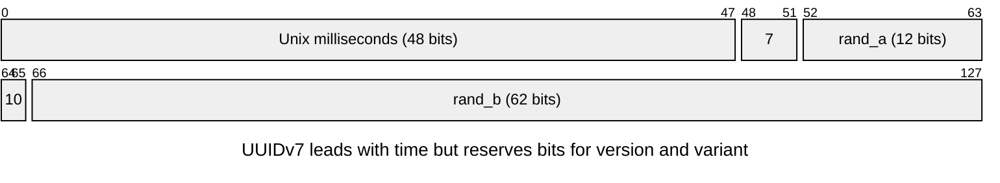
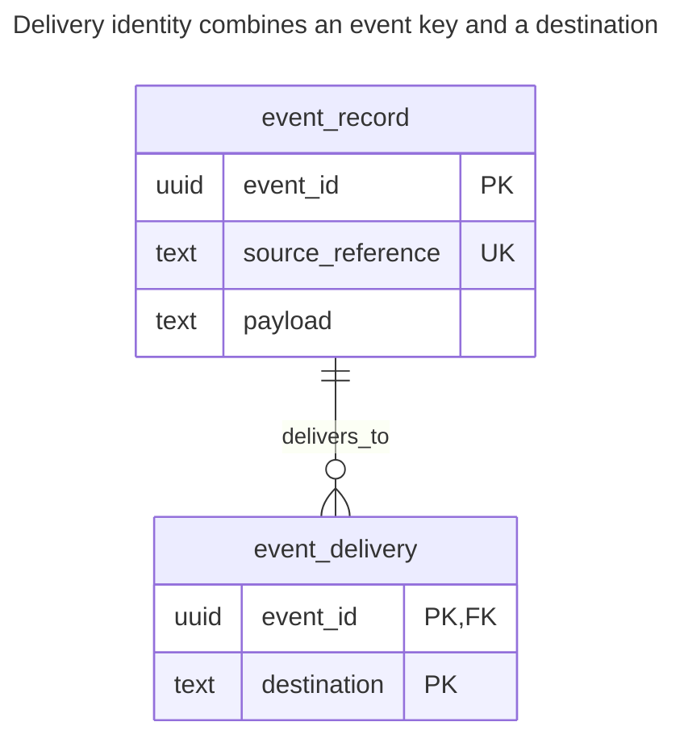
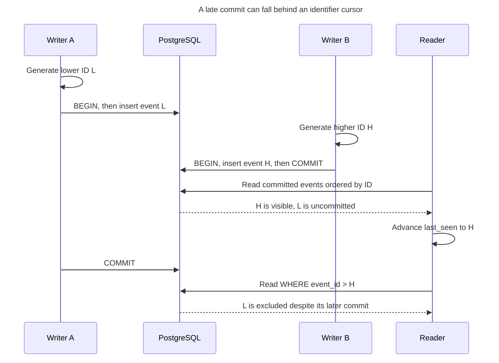
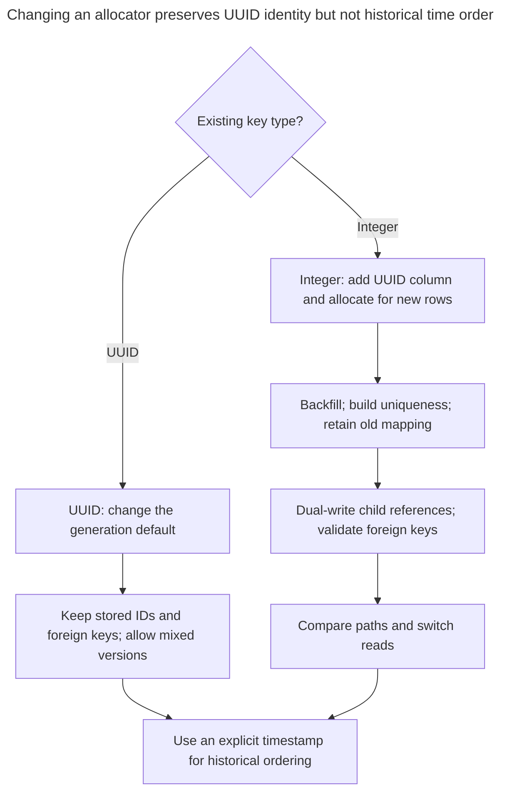

# Time-Ordered Identifier

## Intent

A time-ordered identifier is designed for global uniqueness and puts generation time in its leading bits: UUIDv7, ULID, or a Snowflake-style value. You use it to concentrate new B-tree entries near the recent end of the index, as sequential integers do, while allowing application-side generation on many nodes. UUIDv7 and ULID need no central allocator; Snowflake needs configured machine identities. Compare the formats, their ordering within a millisecond and across machines, and the timestamp disclosed to anyone who sees an ID. The primary definitions are [RFC 9562 §5.7](https://www.rfc-editor.org/rfc/rfc9562.html#section-5.7), the [ULID specification](https://github.com/ulid/spec), and the [Snowflake README](https://github.com/twitter-archive/snowflake/tree/snowflake-2010).

## Also known as

Time-sortable ID. UUIDv7 is the RFC format; ULID expands to Universally Unique Lexicographically Sortable Identifier. Twitter's [Snowflake README](https://github.com/twitter-archive/snowflake/tree/snowflake-2010) calls its approximate ordering “k-sorted.” These names describe different formats, not interchangeable encodings.

## Problem

You want to construct an event and its dependent records before sending them to storage. A central integer allocator adds a dependency to that path. Random UUIDs avoid the allocator, but scatter new keys through the index; [RFC 9562 §6.13](https://www.rfc-editor.org/rfc/rfc9562.html#section-6.13) identifies database locality as a reason for time-ordered UUIDs.

You also want to browse recent events by ID. That is a useful key order, but it does not tell you which transactions have committed or whether an offline writer will later submit an older ID. Separate the requirements for identity, browsing and reliable change delivery.

## Solution

Generate a timestamp-leading surrogate and retain a primary-key constraint. For PostgreSQL 18, start with native `uuid` and `DEFAULT uuidv7()`; applications can also supply their own UUIDv7. Keep a separate source reference for duplicate-request detection. Use an explicit business timestamp when you need the event's occurrence time rather than the generator's clock reading.

| Format | Layout and ordering | Selection cost |
| --- | --- | --- |
| [UUIDv7](https://www.rfc-editor.org/rfc/rfc9562.html#section-5.7) | 128 bits: 48-bit Unix milliseconds, version/variant, 74 remaining bits; optional fractions/counters can replace some randomness | Select a generator with documented within-millisecond and clock-rollback behavior |
| [ULID](https://github.com/ulid/spec#specification) | 48-bit Unix milliseconds plus 80 random bits; canonical 26-character Crockford Base32 text | Ordinary same-millisecond order is unspecified; a monotonic factory increments the suffix within its own state |
| [Original Snowflake](https://github.com/twitter-archive/snowflake/tree/snowflake-2010) | 41-bit custom-epoch milliseconds, 10-bit configured machine ID, 12-bit sequence, fitting a signed 64-bit value | Assign machine IDs without overlap; handle sequence exhaustion and backward clocks |

With a random UUIDv7 suffix, same-millisecond IDs have no generation order; the [RFC's optional monotonicity mechanisms](https://www.rfc-editor.org/rfc/rfc9562.html#section-6.2) apply to the chosen generator. A monotonic ULID factory's state is likewise local. Neither gives you a shared suffix order across machines. For canonical ULID text, use ASCII ordering as the spec requires. Do not put a ULID string into a UUID column or label its arbitrary binary representation “UUIDv7.”



The version field is `0111` and the variant is `10`; the remaining 74 bits are split between `rand_a` and `rand_b`. A generator may use some of those bits for fractions or counters, so the layout alone does not promise order within a millisecond.

## Alternatives and selection

| Sibling | Relationship | Deciding requirement |
| --- | --- | --- |
| [Surrogate Key](surrogate-key.md) | Parent decision; integer and UUIDv4 are replacement implementations | Use an integer for central allocation or UUIDv4 when time disclosure is undesirable |
| [Natural Key](natural-key.md) | Replacement primary key, or complement as business uniqueness | A mandatory business identifier already supplies suitable identity |
| [Public Identifier](public-identifier.md) | Complement | Keep the ordered ID internal and publish an independently random handle |

The [Decision Atlas](decision-atlas.md) gathers the full table. Choosing UUIDv7 does not answer whether a table needs a surrogate at all; see [Mandatory Surrogates](mandatory-surrogates.md).

## Structure



Both generation paths populate the same key column. Delivery rows refer to an event without depending on which path allocated its ID. The source reference, not the generated ID alone, identifies a repeated import.

## Tables and invariants

- **`event_record`** has a unique, non-null `event_id` and a separate mandatory unique `source_reference`. The example additionally rejects non-v7 IDs with `event_id_v7`.
- **`event_delivery`** permits one destination per event/destination pair and requires the event to exist.
- **Time order** is a generator property, not a cross-row constraint. The schema cannot prove that a submitted timestamp is truthful or that a higher ID committed later.

## When to use

- You need IDs before insertion or across independently writing databases.
- Your measured write workload benefits from concentrating recent keys in a smaller index region.
- Approximate time order is useful and disclosing generation time is acceptable, or you publish a separate identifier.

## Consequences and trade-offs

- ➕ You can build references before inserting the parent.
- ➕ Recent generated keys occupy a related key range rather than random locations throughout it.
- ➖ UUIDv7 and ULID retain 128-bit keys; ordered does not mean small.
- ➖ The leading timestamp reveals generation time, not necessarily when the business event happened.
- ➖ A concentrated insertion range can also concentrate contention. Benchmark with your writer count; locality is not a throughput guarantee.

## Implementation

The [complete PostgreSQL 18.6 script](../assets/time-ordered-identifier/time-ordered-identifier.sql) tests both server-default and explicit IDs:

```sql
CREATE TABLE event_record (
    event_id uuid PRIMARY KEY DEFAULT uuidv7(),
    source_reference text NOT NULL UNIQUE,
    payload text NOT NULL,
    CONSTRAINT event_id_v7 CHECK ((uuid_extract_version(event_id) = 7) IS TRUE)
);
CREATE TABLE event_delivery (
    event_id uuid NOT NULL REFERENCES event_record (event_id),
    destination text NOT NULL,
    PRIMARY KEY (event_id, destination)
);
```

The [PostgreSQL UUID functions](https://www.postgresql.org/docs/18/functions-uuid.html) generate v7 using millisecond time, sub-millisecond time and randomness. They also extract the version and timestamp; version extraction returns null for other UUID variants. The check requires `IS TRUE` because a PostgreSQL [`CHECK` accepts null](https://www.postgresql.org/docs/18/ddl-constraints.html#DDL-CONSTRAINTS-CHECK-CONSTRAINTS). An application-generated value uses the same insertion path; this fixed value makes the example reproducible:

```sql
INSERT INTO event_record (source_reference, payload)
VALUES ('import:104', 'created') RETURNING event_id;
INSERT INTO event_record (event_id, source_reference, payload)
VALUES ('019535d9-3df7-79fb-b466-fa907fa17f9e', 'import:105', 'created');
INSERT INTO event_delivery
VALUES ('019535d9-3df7-79fb-b466-fa907fa17f9e', 'billing');
UPDATE event_record SET payload = 'validated'
WHERE source_reference = 'import:105';
SELECT source_reference, payload FROM event_record
WHERE event_id = '019535d9-3df7-79fb-b466-fa907fa17f9e';
SELECT uuid_extract_version(event_id) AS version,
       uuid_extract_timestamp(event_id) AT TIME ZONE 'UTC' AS generated_at
FROM event_record WHERE source_reference = 'import:105';
SELECT source_reference FROM event_record ORDER BY event_id;
```

The lookup returns `(import:105, validated)`. Extraction returns version `7` and UTC time `2025-02-24 02:46:24.503`. The last query sorts keys; it does not implement a reliable commit feed. A repeated key with a different source reference fails:

```sql
INSERT INTO event_record (event_id, source_reference, payload)
VALUES ('019535d9-3df7-79fb-b466-fa907fa17f9e', 'import:106', 'duplicate');
```

PostgreSQL 18.6 raises SQLSTATE `23505`: `ERROR: duplicate key value violates unique constraint "event_record_pkey"`, with `DETAIL: Key (event_id)=(019535d9-3df7-79fb-b466-fa907fa17f9e) already exists.` Global uniqueness is a design goal; the primary key remains the local enforcement boundary.

## Engine support

- **PostgreSQL 18:** [`uuidv7()`](https://www.postgresql.org/docs/18/functions-uuid.html) is built in. Store UUIDs as native [`uuid`](https://www.postgresql.org/docs/18/datatype-uuid.html), not a 36-character text rendering.
- **MySQL 8.4:** [`UUID()` generates v1](https://dev.mysql.com/doc/refman/8.4/en/miscellaneous-functions.html#function_uuid), not v7. For application-generated v7, retain canonical byte order in binary storage; the [`UUID_TO_BIN` swap flag](https://dev.mysql.com/doc/refman/8.4/en/miscellaneous-functions.html#function_uuid-to-bin) is a v1 optimization, so leave it off.
- **SQL Server 2025 (17.x):** [`uniqueidentifier` ordering is not a comparison of the raw bit patterns](https://learn.microsoft.com/en-us/sql/t-sql/data-types/uniqueidentifier-transact-sql?view=sql-server-ver17). Do not assume UUIDv7 timestamp order transfers unchanged. [`NEWSEQUENTIALID()`](https://learn.microsoft.com/en-us/sql/t-sql/functions/newsequentialid-transact-sql?view=sql-server-ver17) uses Windows sequential GUIDs, is limited to column defaults, and can restart in a lower range after Windows restarts.
- **Oracle AI Database 26ai:** [`SYS_GUID()`](https://docs.oracle.com/en/database/oracle/oracle-database/26/sqlrf/SYS_GUID.html) returns 16 bytes incorporating host/process information on most platforms; it is not the documented UUIDv7 generator. For this pattern, supply v7 from an application and store its bytes in `RAW(16)`.
- **SQLite 3:** choose application generation with binary or canonical text storage; SQLite's [storage classes](https://www.sqlite.org/datatype3.html) include `BLOB` and `TEXT`, rather than a native UUID type. Use byte/ASCII ordering appropriate to the chosen representation.

## Failure and concurrency

Keep IDs unchanged across delivery retries and retain source uniqueness for requests that may accidentally generate a new ID. The primary and unique constraints arbitrate concurrent duplicates; no stronger isolation level is needed merely to store an ordered ID. PostgreSQL's [unique-index checks](https://www.postgresql.org/docs/18/index-unique-checks.html) resolve conflicts with concurrent uncommitted rows.

Clock skew and independent suffix generation prevent a universal generation order; neither generation order nor ID order establishes commit order. An old client can submit an ID below a reader's current cursor. Use a [Transactional Outbox](transactional-outbox.md) or another explicit delivery protocol for reliable consumption rather than polling only `id > last_seen`.



Both inserts have valid unique IDs, yet the cursor misses L permanently if it only moves upward. Reliable delivery needs a protocol independent of the generation timestamp.

For Snowflake, establish exclusive machine-ID ownership and its restart policy before accepting traffic. The [original implementation](https://github.com/twitter-archive/snowflake/tree/snowflake-2010) refuses generation after a backward clock movement until time passes the last generated value and protects against same-millisecond sequence rollover. Decide how your selected implementation reports these conditions; do not silently fall back to a potentially overlapping generator.

## Migration

For an existing UUID key, you may change only the generation default and preserve all stored IDs and foreign keys. Do not install the example's v7-only check while v4 rows remain. Mixed versions preserve identity but do not make historical random keys time-sortable; order historical queries by an explicit timestamp. PostgreSQL supports changing defaults through [`ALTER TABLE`](https://www.postgresql.org/docs/18/sql-altertable.html).

For an integer key, add a separate UUID column, generate new values for future rows and backfill old rows without pretending those new IDs encode original creation times. Build uniqueness, dual-write child references and validate foreign keys before switching reads; see [Expand and Contract](expand-contract.md). Keep the old mapping until rollback is no longer needed. Reverting a default is easy; withdrawing IDs already published to clients is a separate contract change.



Changing a UUID default leaves historical keys untouched, while integer conversion requires a reference migration. Neither route recovers original creation times from newly generated IDs.

## Anti-patterns and common mistakes

- Promising strict global order, including inside one millisecond. [RFC 9562 §6.2](https://www.rfc-editor.org/rfc/rfc9562.html#section-6.2) describes optional generator monotonicity mechanisms; a version number alone is not that guarantee.
- Using the embedded timestamp as an audited event time or as proof of commit.
- Publishing an ordered ID when generation time must remain private; use a [Public Identifier](public-identifier.md).
- Treating a better generator as a reason for [Mandatory Surrogates](mandatory-surrogates.md) on every table.

## Known uses

- PostgreSQL 18 implements [UUIDv7 generation and timestamp extraction](https://www.postgresql.org/docs/18/functions-uuid.html).
- Twitter's [Snowflake README](https://github.com/twitter-archive/snowflake/tree/snowflake-2010) explains its need for compact, approximately ordered IDs across data centers. This is the original 2010 design, not a claim about Twitter's current production architecture.

## Related patterns

- [Surrogate Key](surrogate-key.md) decides whether generated identity is useful.
- [Natural Key](natural-key.md) retains the business uniqueness that generated IDs cannot supply.
- [Public Identifier](public-identifier.md) separates observable identity from time-bearing storage keys.
- [Transactional Outbox](transactional-outbox.md) handles reliable publication independently of ID order.
- [Mandatory Surrogates](mandatory-surrogates.md) warns against choosing a generator before choosing a key.
