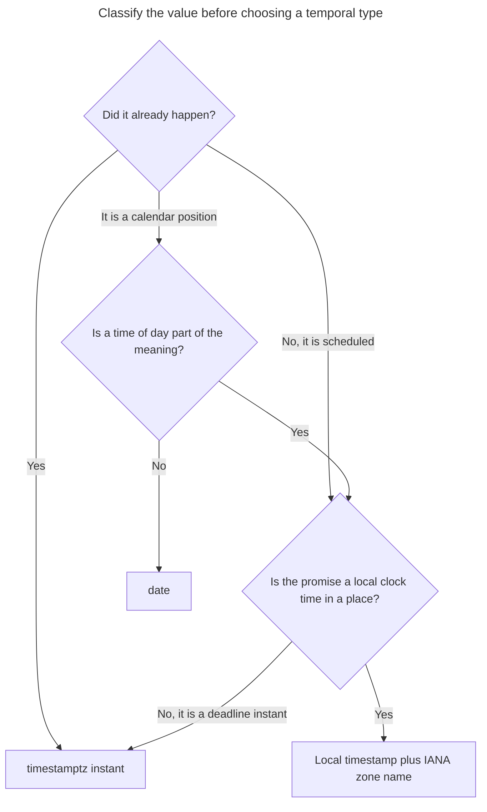
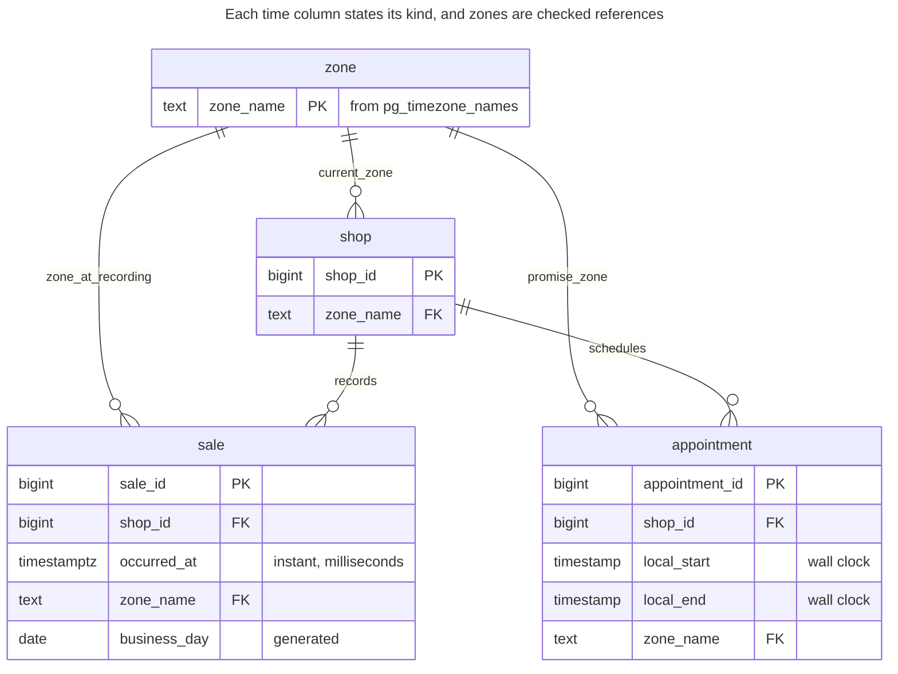
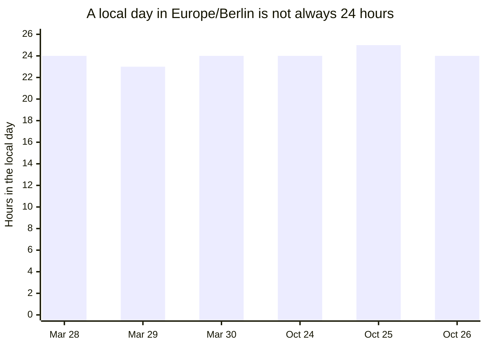
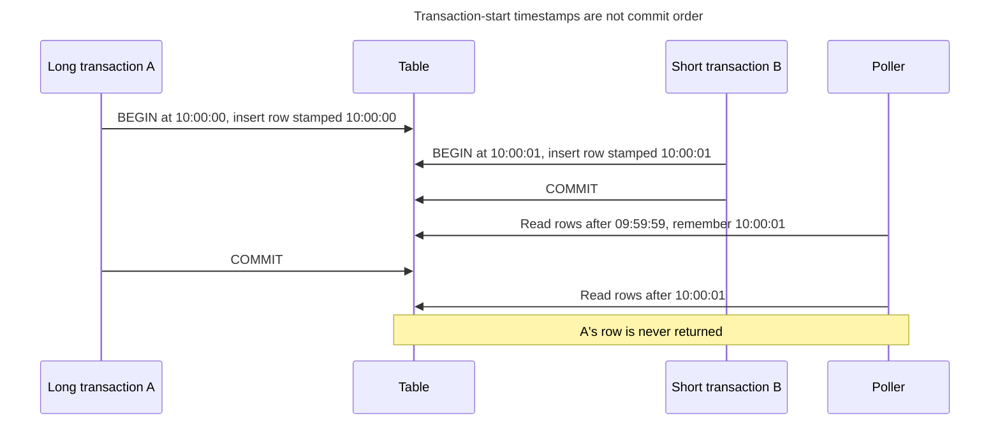
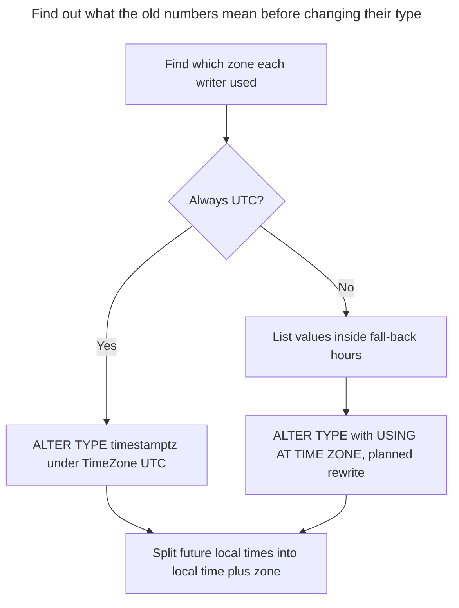

# Time Point

## Intent

A time point is a stored moment or calendar position whose type says what it means: an instant that happened, a civil date, or a wall-clock time that will happen in a named place. The chapter shows how to choose between `timestamptz`, `date` and a local time plus an IANA zone name, how to make precision part of the column type, how to turn an instant into a business day without assuming 24-hour days, and which clock `now()` actually reads. The other temporal chapters in this book build on these choices. See [PostgreSQL's date/time types](https://www.postgresql.org/docs/18/datatype-datetime.html) and the [IANA time zone database](https://www.iana.org/time-zones).

## Also known as

[Time Point](https://martinfowler.com/eaaDev/TimePoint.html) in Fowler's further enterprise patterns, which treats precision and time zone as properties of the value rather than of the code that reads it. The JavaScript [Temporal API](https://tc39.es/proposal-temporal/docs/) names the same distinctions `Instant`, `PlainDate`, `PlainDateTime` and `ZonedDateTime`.

## Problem

A shop in Tokyo records a sale at 23:30 UTC on March 1. The daily report groups by `occurred_at::date` in a session whose time zone is UTC and books the sale on March 1, although the shop's till already closed March 1 and the sale belongs to March 2. A Berlin customer books a consultation for 09:00 on April 1 next year, and the application converts it to UTC on save. If the clock rules change before then — governments change daylight-saving rules, and the tz database follows — the stored instant no longer means 09:00 in Berlin, and nothing in the row records what the customer asked for.

The opposite mistake is as common. A `timestamp without time zone` column filled with “server local time” stores numbers whose offset lives in a deployment setting. Moving the server, or one application server configured differently, silently mixes offsets. The fall-back hour happens twice, so some stored values cannot be mapped back to a single instant. A JavaScript client sends milliseconds, the database keeps microseconds, and an equality lookup on a timestamp the client echoed back finds nothing.

## Solution

Classify every temporal column before choosing its type:

- **Instant** — something happened or was recorded: `timestamptz`. PostgreSQL stores an absolute moment and renders it in the session's `TimeZone`; the offset you typed is not kept.
- **Civil date** — a birthday, a due date, a business day: `date`. It is not midnight anywhere. When you derive it from an instant, derive it in a declared zone and store the zone you used.
- **Future wall-clock time** — an appointment, an opening hour, a scheduled publication: a local `timestamp` plus an IANA zone name such as `Europe/Berlin`, not a fixed offset. Compute the instant when you need it, using the zone's rules in force at that moment.
- **Elapsed duration** — `interval` or an integer in a declared unit, never the difference of two local times.

Make precision part of the type (`timestamptz(3)` when clients carry milliseconds), keep ranges half-open, and name the clock each column records: transaction start (`now()`), the moment of the call (`clock_timestamp()`), or an occurrence time supplied by the caller.

## Alternatives and selection

| Choice | Relationship | Deciding requirement |
| --- | --- | --- |
| `timestamptz` instant | Default for events | The value records when something happened, wherever it happened |
| `date` | Replacement for an instant | The value is a calendar position with no time of day |
| Local `timestamp` plus zone name | Replacement for an instant in the future | The promise is a wall-clock time in a place; a rule change must move the instant, not the local time |
| Instant plus captured zone | Complement | You must show or group by the local time in force when the event was recorded |
| Integer epoch | Implementation option | An external protocol fixes the unit; name the unit in the column and convert in one place |
| [Effective Dating](effective-dating.md) | Complement | A value applies over a business period whose bounds are time points |

See the [Decision Atlas](decision-atlas.md) for the full comparison.



A deadline such as “the auction closes at 18:00 UTC” is an instant even though it lies in the future. A local promise such as “the clinic opens at 09:00” is not; only the zone's rules on that day turn it into an instant.

## Structure



A sale keeps the zone that applied when it was recorded, so moving the shop to another zone later does not rewrite its history. An appointment keeps only local fields and a zone; its instants are computed in a view.

## Tables and invariants

- **`zone`** lists the zone names this server's time zone database accepts, copied from [`pg_timezone_names`](https://www.postgresql.org/docs/18/view-pg-timezone-names.html). References to it reject typos at write time. It is a snapshot of one tzdata build: refresh it after server upgrades, and expect legacy aliases to be absent on some builds. The Debian-based PostgreSQL 18.7 image used for the lab rejects `Europe/Kiev` and accepts only `Europe/Kyiv`.
- **`shop`** owns its current zone, which can change when a shop moves.
- **`sale`** stores the instant with millisecond precision and the zone in force at recording. `business_day` is a stored generated column, so it cannot disagree with them. PostgreSQL accepts the expression because `timezone(text, timestamptz)` is declared immutable.
- **`appointment`** stores the promised local start and end with a zone name. The `appointment_instant` view computes instants on every read, so a tzdata update changes them without touching rows.

## When to use

- For every new temporal column: the classification is one decision per column and is expensive to reverse.
- When reports group by day, week or month for people in several zones, or in one zone that observes daylight-saving time.
- When you schedule future events in local time, or exchange timestamps with clients that use another precision.

## Consequences and trade-offs

- ➕ Instants compare and order correctly regardless of server, session or client zone.
- ➕ Future local times survive daylight-saving rule changes, because their instants are derived rather than frozen.
- ➕ Precision mismatches are settled once, at the column boundary, instead of in every comparison.
- ➖ A future local time has no instant until you resolve it. Reminders and indexes over “starts in the next hour” need a resolved column that you recompute after tzdata updates.
- ➖ A nonexistent or repeated local time is resolved silently by a rule, not rejected. The application must ask the user when the difference matters.
- ➖ The zone list depends on the server's tzdata build and changes with upgrades.

## Implementation

The [complete PostgreSQL 18.7 script](../assets/time-point/time-point.sql) verifies the business day, session-independent storage, precision rounding, day lengths, gap and overlap resolution, calendar arithmetic, appointment instants, zone and generated-column rejections, the clocks and a rewrite-free type change:

```sql
CREATE SCHEMA time_example;
CREATE TABLE time_example.zone (zone_name text PRIMARY KEY);
INSERT INTO time_example.zone (zone_name) SELECT name FROM pg_timezone_names;
CREATE TABLE time_example.shop (
    shop_id bigint PRIMARY KEY,
    zone_name text NOT NULL REFERENCES time_example.zone (zone_name)
);
CREATE TABLE time_example.sale (
    sale_id bigint PRIMARY KEY,
    shop_id bigint NOT NULL REFERENCES time_example.shop (shop_id),
    occurred_at timestamptz(3) NOT NULL,
    zone_name text NOT NULL REFERENCES time_example.zone (zone_name),
    business_day date GENERATED ALWAYS AS
        ((occurred_at AT TIME ZONE zone_name)::date) STORED
);
CREATE TABLE time_example.appointment (
    appointment_id bigint PRIMARY KEY,
    shop_id bigint NOT NULL REFERENCES time_example.shop (shop_id),
    local_start timestamp(0) NOT NULL,
    local_end timestamp(0) NOT NULL,
    zone_name text NOT NULL REFERENCES time_example.zone (zone_name),
    CHECK (local_end > local_start)
);
CREATE VIEW time_example.appointment_instant AS
SELECT appointment_id,
       local_start AT TIME ZONE zone_name AS starts_at,
       local_end AT TIME ZONE zone_name AS ends_at
FROM time_example.appointment;
```

Record the Tokyo sale with the shop's current zone:

```sql
INSERT INTO time_example.shop VALUES (1, 'Asia/Tokyo'), (2, 'Europe/Berlin');
INSERT INTO time_example.sale (sale_id, shop_id, occurred_at, zone_name)
SELECT 10, shop_id, TIMESTAMPTZ '2026-03-01 23:30:00+00', zone_name
FROM time_example.shop WHERE shop_id = 1;
SELECT business_day FROM time_example.sale WHERE sale_id = 10;
```

The query returns `2026-03-02`. With `SET TIME ZONE 'America/New_York'`, the same `occurred_at` displays as `2026-03-01 18:30:00-05`; only the rendering changed. The [`AT TIME ZONE` operator](https://www.postgresql.org/docs/18/functions-datetime.html#FUNCTIONS-DATETIME-ZONECONVERT) turns an instant into local fields of a named zone and local fields into an instant. An input of `2026-03-29 10:00:00.1235+00` is stored as `.124`, because the column declares three fractional digits.

A business day in a zone is a half-open range of instants, from local midnight to the next local midnight:

```sql
SELECT count(*) FROM time_example.sale
WHERE occurred_at >= DATE '2026-03-29'::timestamp AT TIME ZONE 'Europe/Berlin'
  AND occurred_at <  DATE '2026-03-30'::timestamp AT TIME ZONE 'Europe/Berlin';
```

That range is 23 hours long. The script checks that October 25 in Berlin lasts 25 hours, and that adding `interval '1 day'` to a `timestamptz` in a Berlin session keeps 12:00 local time across the transition while adding `interval '24 hours'` gives 13:00.



The two short and long bars are the 2026 daylight-saving transitions. A report that divides a daily total by 24 or builds days with `+ interval '24 hours'` is wrong twice a year in such zones.

Local times that fall into a transition are resolved, not rejected. [PostgreSQL's rule](https://www.postgresql.org/docs/18/datetime-invalid-input.html) gives a nonexistent time the offset in force just before the transition and gives an ambiguous one the offset in force just after it:

```sql
SELECT TIMESTAMP '2026-03-29 02:30' AT TIME ZONE 'Europe/Berlin',
       TIMESTAMP '2026-10-25 02:30' AT TIME ZONE 'Europe/Berlin';
```

Both return `01:30:00+00`: the first is 03:30 summer time, a time the user never typed, and the second is the later of the two 02:30s. Ask the user when a booking lands in either hour.

An appointment stores the promise and derives the instant:

```sql
INSERT INTO time_example.appointment VALUES
    (20, 2, TIMESTAMP '2027-04-01 09:00', TIMESTAMP '2027-04-01 09:30', 'Europe/Berlin');
SELECT starts_at FROM time_example.appointment_instant WHERE appointment_id = 20;
```

Under current rules it returns `2027-04-01 07:00:00+00`. A misspelled zone is rejected by the reference:

```sql
INSERT INTO time_example.appointment VALUES
    (21, 2, TIMESTAMP '2027-04-01 10:00', TIMESTAMP '2027-04-01 10:30', 'Europe/Berlinn');
```

PostgreSQL 18.7 raises SQLSTATE `23503`: `ERROR: insert or update on table "appointment" violates foreign key constraint "appointment_zone_name_fkey"`, with `DETAIL: Key (zone_name)=(Europe/Berlinn) is not present in table "zone".` Without the reference, the typo would surface only when a query evaluated `AT TIME ZONE` and failed with `22023`. Writing `business_day` directly raises `428C9`: `ERROR: column "business_day" can only be updated to DEFAULT`.

## Engine support

- **PostgreSQL 18:** `timestamptz` stores a UTC moment with microsecond resolution and no zone; [time zone names](https://www.postgresql.org/docs/18/datatype-datetime.html#DATATYPE-TIMEZONES) come from the tz database the server was built with, which may be the operating system's copy. [`now()` and `transaction_timestamp()`](https://www.postgresql.org/docs/18/functions-datetime.html#FUNCTIONS-DATETIME-CURRENT) return the transaction start, `statement_timestamp()` the statement start and `clock_timestamp()` the moment of the call.
- **MySQL 8.4:** [`TIMESTAMP`](https://dev.mysql.com/doc/refman/8.4/en/datetime.html) converts from the session time zone to UTC for storage and back on retrieval, and is limited to 1970–2038; `DATETIME` stores fields without a zone. Named zones work only after the [time zone tables](https://dev.mysql.com/doc/refman/8.4/en/time-zone-support.html) are loaded. Store a zone name in its own column as here.
- **SQL Server 2025 (17.x):** [`datetimeoffset`](https://learn.microsoft.com/en-us/sql/t-sql/data-types/datetimeoffset-transact-sql?view=sql-server-ver17) keeps an offset, not a zone name, so it cannot follow a rule change. [`AT TIME ZONE`](https://learn.microsoft.com/en-us/sql/t-sql/queries/at-time-zone-transact-sql?view=sql-server-ver17) uses Windows zone names such as `Central European Standard Time`; map IANA names explicitly if clients send them.
- **Oracle AI Database 26ai:** [`TIMESTAMP WITH TIME ZONE`](https://docs.oracle.com/en/database/oracle/oracle-database/26/sqlrf/Data-Types.html) can store a region name with the value, and `TIMESTAMP WITH LOCAL TIME ZONE` normalizes to the database zone. `DATE` includes a time of day, so a civil date needs a truncation rule.
- **SQLite 3:** there is no date type. Store ISO 8601 text in UTC or a Unix epoch number; the [date functions](https://www.sqlite.org/lang_datefunc.html) know only UTC and the process's local zone, so named-zone conversion belongs to the application.

## Failure and concurrency

`now()` is fixed when the transaction starts. A long transaction that commits late writes rows that look older than rows committed earlier by short transactions. A reader that polls `WHERE updated_at > :last_seen` therefore skips them:



`clock_timestamp()` does not fix this, because commit happens after the stamp either way. Feed downstream consumers through a mechanism ordered by commit: a [Transactional Outbox](transactional-outbox.md) claimed with row locks, a [Queue Table](queue-table.md) or logical decoding. A safety lag with deduplication by ID only narrows the window.

Timestamps generated in application servers carry their clocks' skew. Use the database clock to order events inside one database. For events reported by devices, store the reported `occurred_at` and the database's `received_at` side by side and decide which one each report uses.

A tzdata update changes instants derived from future local times. If you cache a resolved `starts_at` for reminders or indexing, recompute it from `local_start` and `zone_name` after every server upgrade and treat the cache as derived data, never as the promise.

## Migration

From `timestamp` columns that hold UTC, change the type under a UTC session. PostgreSQL 18.7 then keeps the table file — the script compares `pg_relation_filenode` before and after — though `ALTER TABLE` still takes its [`ACCESS EXCLUSIVE` lock](https://www.postgresql.org/docs/18/sql-altertable.html) briefly. Under any other session zone the same statement rewrites the table.

From `timestamp` columns that hold a local zone, convert with `USING recorded_at AT TIME ZONE 'Europe/Berlin'`, which rewrites the table. Values inside a fall-back hour are ambiguous: list them before the change and decide them from other evidence, such as sequence order, rather than accepting the default rule.



Future events stored as UTC instants can be returned to local time only if you know the zone each was booked in and the tzdata that was current at booking. Recover the local time with that data, store it beside the zone, and switch readers to the derived view through [Expand and Contract](expand-contract.md).

## Anti-patterns and common mistakes

- Casting an instant with `::date`, which uses the session's zone rather than the business's.
- Writing `BETWEEN '... 00:00' AND '... 23:59:59'`, which drops fractional seconds and the 25th hour. Use half-open ranges.
- Storing a fixed offset such as `+01:00` for a future local time.
- Building days with `interval '24 hours'` or assuming every day has 24 hours.
- Stamping a long batch's rows with `now()` and later reading them as individual occurrence times.
- Comparing client-echoed timestamps for equality when the client keeps fewer fractional digits than the column.
- Using abbreviations such as `CST`, which mean different offsets in different regions; store IANA names.

## Known uses

- Jon Skeet's [“Storing UTC is not a silver bullet”](https://codeblog.jonskeet.uk/2019/03/27/storing-utc-is-not-a-silver-bullet/) follows a conference registered for 09:00 in Amsterdam through a tz rule change and stores the local time with the zone identifier for that reason.
- [RFC 9557](https://www.rfc-editor.org/rfc/rfc9557.html) extends RFC 3339 timestamps with a bracketed zone name, as in `2022-07-08T00:14:07+01:00[Europe/Paris]`, so an API can carry the instant and the zone that gives it local meaning.
- The JavaScript [Temporal API](https://tc39.es/proposal-temporal/docs/) separates `Instant`, `PlainDate`, `PlainDateTime` and `ZonedDateTime`, the same classification as this chapter's columns.

## Related patterns

- [Effective Dating](effective-dating.md) builds business periods from dates or instants.
- [History Table](history-table.md) and [Bitemporal Table](bitemporal-table.md) choose which clock records a version.
- [Summary Table](summary-table.md) aggregates by business day, which needs the zone policy shown here.
- [Lookup Table](lookup-table.md) explains the referenced vocabulary used for zone names.
- [Transactional Outbox](transactional-outbox.md) delivers changes in commit order rather than by timestamp.
