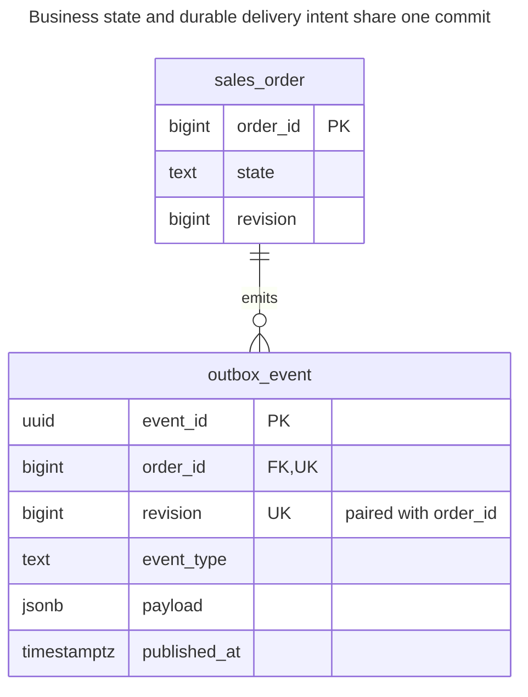
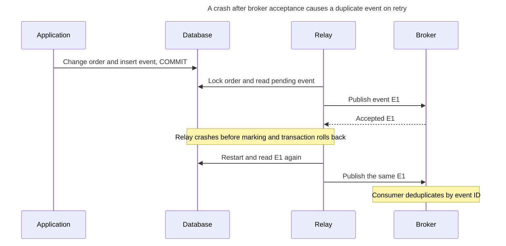
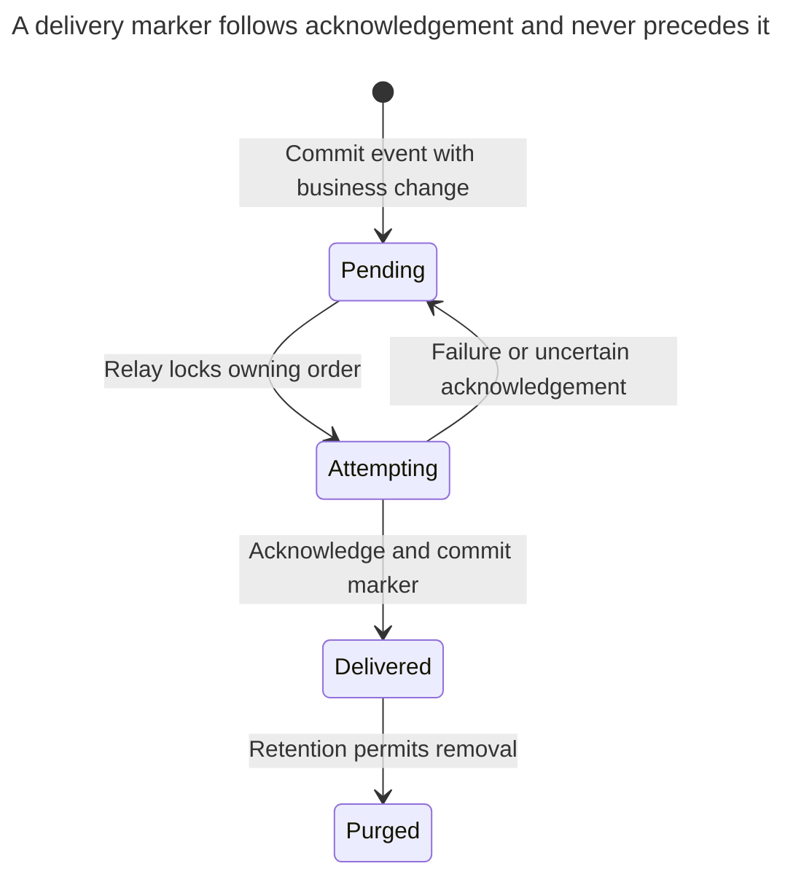
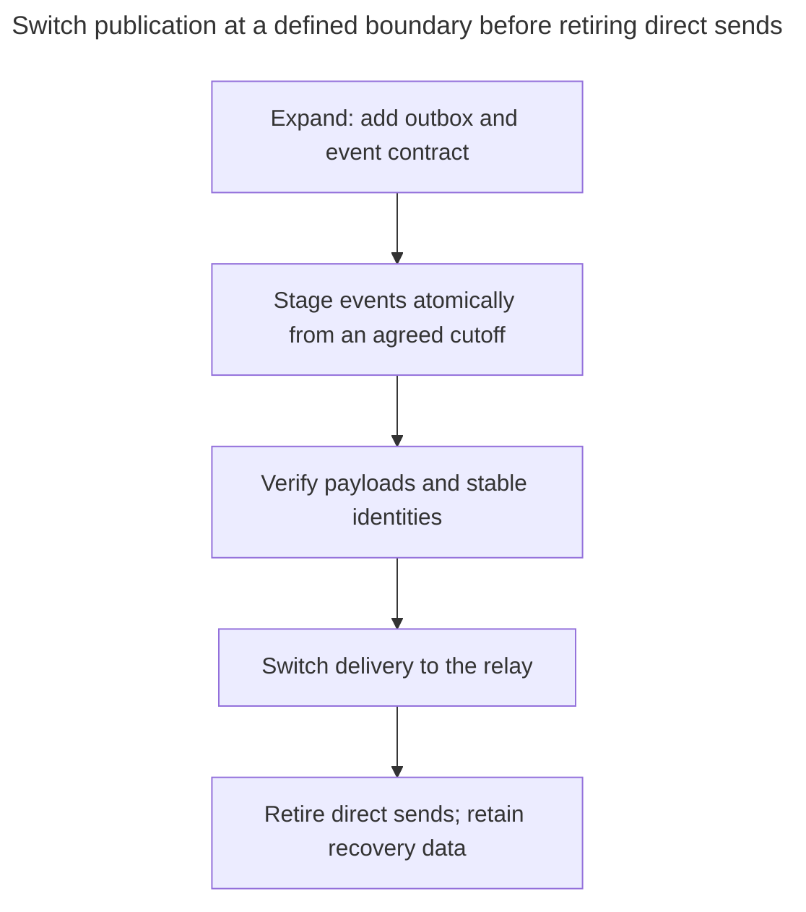

# Transactional Outbox

## Intent

A transactional outbox solves the dual-write problem: when a service changes data and must publish an event, it writes the event to an outbox table in the same transaction as the change. A separate relay — a polling process or change data capture such as Debezium — reads the outbox and delivers events to a message broker. The chapter shows the outbox table, ordering and delivery guarantees, why consumers must tolerate duplicates, and how to clean up delivered rows.

## Also known as

Application events in Richardson's [Transactional Outbox](https://microservices.io/patterns/data/transactional-outbox.html) catalog. [Polling Publisher](https://microservices.io/patterns/data/polling-publisher.html) and [Transaction Log Tailing](https://microservices.io/patterns/data/transaction-log-tailing.html) are relay implementation options, not different business schemas.

## Problem

You mark an order paid, then send `OrderPaid` to a broker. If the process crashes after commit but before sending, the order remains paid without an event. Sending first reverses the failure: the broker can announce a payment whose database transaction later rolls back.

A retrying HTTP client introduces another ambiguity, but solving request deduplication alone does not close this database-to-broker gap. You need a durable local fact saying which message must still be delivered, with no independent commit between it and the business change.

## Solution

Insert an immutable event snapshot into `outbox_event` in the same database transaction that changes `sales_order`. A relay reads committed events, publishes them and records acknowledged delivery. A failed business transaction leaves neither the change nor its event; a committed transaction leaves delivery work that survives a process restart. PostgreSQL's [transaction model](https://www.postgresql.org/docs/18/tutorial-transactions.html) supplies this local atomicity.

Keep event identity separate from order identity. Retain a stable `event_id` across every publish attempt, an order key for routing, and an explicit per-order revision for ordering. Consumers deduplicate by event ID with an [Idempotency Record](idempotency-record.md). Richardson's [outbox pattern](https://microservices.io/patterns/data/transactional-outbox.html) explicitly includes duplicate publication after a relay crash; delivery is not automatically exactly once.

## Alternatives and selection

| Sibling or mechanism | Relationship | Deciding requirement |
| --- | --- | --- |
| [Queue Table](queue-table.md) | Replacement when all work stays local; implementation option for polling delivery | A worker can perform the job directly without publishing an integration event |
| [Idempotency Record](idempotency-record.md) | Complement | Deduplicate incoming commands and consumer effects; it does not deliver messages |
| [Version Column](version-column.md) | Complement | Reject stale commands and supply an explicit aggregate revision |
| Polling publisher | Implementation option | You want an ordinary SQL relay and can operate polling, retries and retention |
| Transaction log tailing | Implementation option | You already operate CDC and can preserve connector offsets and replay requirements |
| Coordinated distributed transaction | Replacement with different coupling | Both resources and your operational model support one distributed commit protocol |

See the [Decision Atlas](decision-atlas.md) for the full comparison. An after-commit callback without durable delivery storage still has the crash gap. Logging arbitrary table changes through CDC also does not by itself define a stable business-event payload.

## Structure



One order can emit many events, with one event per revision in this example. The FK is deliberately typed to orders. For several unrelated aggregate types, choose separate typed outboxes or an explicit alternative reference design rather than pretending a `(type, id)` pair is a foreign key; see [Missing Foreign Keys](missing-foreign-keys.md).

## Tables and invariants

- **`sales_order`** is the authority for current business state. Its revision advances under the order's row lock for each event-producing change.
- **`outbox_event`** has a stable event primary key and unique `(order_id, revision)`. Payload and event type describe the committed change, not a later reconstruction from today's order.
- **Atomic production** is a write-path invariant: constraints do not force every order update to emit an event. Centralize the relevant mutations or use a deliberately designed database writer.
- **Delivery state** is separate from event content. Only set `published_at` after the broker's required durable acknowledgement. It means the relay recorded acceptance, not that every consumer finished processing.
- **Ordering** is per order. The example serializes relays on that order and selects its earliest unpublished revision; there is no global cross-order event order.

## When to use

- A local business commit must cause an integration event or remote command eventually.
- You accept asynchronous delivery and can expose or monitor delivery lag.
- Consumers can tolerate duplicate messages, and per-entity ordering has a defined implementation.

## Consequences and trade-offs

- ➕ A broker outage does not erase committed delivery intent; new events accumulate durably.
- ➕ A business rollback cannot leave its staged event committed independently.
- ➖ Delivery has lag and a backlog that needs capacity limits, monitoring and recovery.
- ➖ Acknowledgement and marking are separate commits across systems, so duplicate sends remain possible.
- ➖ Event contracts and retention become part of schema evolution. Deleting an old event can remove the only copy available for a late relay or replay.

## Implementation

The [complete PostgreSQL 18.6 script](../assets/transactional-outbox/transactional-outbox.sql) checks atomic production and rollback, per-order uniqueness and delivery marking. It simulates the relay's successful broker acknowledgement; it does not start a broker. [`uuidv4()`](https://www.postgresql.org/docs/18/functions-uuid.html) generates event IDs; the first ID below is fixed to make the lab reproducible:

```sql
CREATE TABLE sales_order (
    order_id bigint PRIMARY KEY,
    state text NOT NULL CHECK (state IN ('pending', 'paid', 'cancelled')),
    revision bigint NOT NULL DEFAULT 0 CHECK (revision >= 0)
);
CREATE TABLE outbox_event (
    event_id uuid PRIMARY KEY DEFAULT uuidv4(),
    order_id bigint NOT NULL REFERENCES sales_order (order_id),
    revision bigint NOT NULL CHECK (revision > 0),
    event_type text NOT NULL,
    payload jsonb NOT NULL,
    published_at timestamptz,
    CONSTRAINT outbox_order_revision_key UNIQUE (order_id, revision)
);
CREATE INDEX outbox_pending_idx ON outbox_event (order_id, revision)
WHERE published_at IS NULL;
INSERT INTO sales_order VALUES (1, 'pending', 0);
BEGIN;
WITH changed AS (
    UPDATE sales_order SET state = 'paid', revision = revision + 1
    WHERE order_id = 1 AND state = 'pending' AND revision = 0
    RETURNING order_id, revision, state
)
INSERT INTO outbox_event (event_id, order_id, revision, event_type, payload)
SELECT '00000000-0000-4000-8000-000000000001', order_id, revision, 'OrderPaid',
       jsonb_build_object('schema_version', 1, 'order_id', order_id,
                          'revision', revision, 'state', state)
FROM changed
RETURNING event_id, revision;
COMMIT;
```

This returns the fixed event ID with revision `1`. The [data-modifying CTE](https://www.postgresql.org/docs/18/queries-with.html#QUERIES-WITH-MODIFYING) inserts an event only for a changed row. Require one returned event before reporting that this command was accepted; zero rows means the command precondition failed. If the insert fails, its order update cannot commit separately.

The following attempt duplicates a revision under a different event ID:

```sql
-- Expected SQLSTATE 23505.
INSERT INTO outbox_event (event_id, order_id, revision, event_type, payload)
VALUES ('00000000-0000-4000-8000-000000000002', 1, 1, 'OrderPaid', '{}');
```

PostgreSQL 18.6 raises SQLSTATE `23505`: `ERROR: duplicate key value violates unique constraint "outbox_order_revision_key"`. Uniqueness rejects duplicate revisions; it does not prove no event was omitted or that a producer chose the right payload.

For the polling implementation, take a lock on an order with pending events, then read its first pending event. The seeded order selected here is `1`; a relay binds the actual returned order ID in the second query:

```sql
BEGIN;
SELECT o.order_id FROM sales_order AS o
WHERE EXISTS (
    SELECT 1 FROM outbox_event AS e
    WHERE e.order_id = o.order_id AND e.published_at IS NULL
)
ORDER BY o.order_id LIMIT 1
FOR UPDATE OF o SKIP LOCKED;
SELECT event_id, event_type, payload FROM outbox_event
WHERE order_id = 1 AND published_at IS NULL
ORDER BY revision LIMIT 1 FOR UPDATE;
-- Publish this exact event; wait for the broker acknowledgement.
-- The SQL-only lab assumes that acknowledgement succeeds here.
UPDATE outbox_event SET published_at = clock_timestamp()
WHERE event_id = '00000000-0000-4000-8000-000000000001'
  AND published_at IS NULL
RETURNING event_id;
COMMIT;
```

Hold the order lock through acknowledgement and marking; every polling relay must follow this protocol. If no order or event is returned, end the transaction and poll later. On publication failure, roll back and retry the same event. Configure bounded broker timeouts because this simple implementation holds a database transaction during network work. A lease-based relay can shorten the transaction but needs the [Queue Table](queue-table.md) ownership and recovery protocol.

The parent lock prevents a second relay from overtaking an earlier revision for that order. It also briefly blocks order writers. Publish with the order ID as a stable routing key and preserve order in the broker/consumer path; SQL revision order alone cannot control an arbitrary downstream transport. Never mark several rows delivered simply because a batch publish was attempted.

## Engine support

- **PostgreSQL 18:** the poller uses [`FOR UPDATE SKIP LOCKED`](https://www.postgresql.org/docs/18/sql-select.html#SQL-FOR-UPDATE-SHARE) on the order serialization point. Log tailing is an alternative relay; do not also run an uncoordinated poller for the same stream.
- **MySQL 8.4 / InnoDB:** [`SKIP LOCKED`](https://dev.mysql.com/doc/refman/8.4/en/innodb-locking-reads.html) supports a similar polling claim. It is unsafe for statement-based replication; choose replication configuration deliberately.
- **SQL Server 2025 (17.x):** a polling port can use [`READPAST` with an update-lock protocol](https://learn.microsoft.com/en-us/sql/t-sql/queries/hints-transact-sql-table?view=sql-server-ver17); account for isolation restrictions. It is not a textual replacement for the PostgreSQL CTE and locking syntax.
- **Oracle AI Database 26ai:** [`FOR UPDATE SKIP LOCKED`](https://docs.oracle.com/en/database/oracle/oracle-database/26/sqlrf/SELECT.html) supports competing relay selection. Keep order-level serialization and acknowledgement rules when translating the statements.
- **SQLite 3:** its [one-writer limit](https://www.sqlite.org/lang_transaction.html) makes a write transaction held across broker I/O especially restrictive. Prefer a short claim protocol or a single relay appropriate to the workload.

## Failure and concurrency



The durable unit is “order change plus event intent,” not “database change plus broker publish.” Event IDs must survive the retry; allocating a new ID on each send defeats consumer deduplication.

Use Read Committed for the local guarded update and polling transactions. PostgreSQL's [row locks](https://www.postgresql.org/docs/18/explicit-locking.html#LOCKING-ROWS) last until transaction end, so a competing relay skips the locked order. `SKIP LOCKED` improves independent-order progress; it provides no strict fairness. Monitor the age of the oldest pending event, not just the number published per second.



`Attempting` is a transaction and process state here, not a stored status column. An uncertain acknowledgement follows the retry branch even if the broker actually accepted the first send.

For a CDC implementation, configure the connector's table mapping and preserve its recovery position. Debezium's [Outbox Event Router](https://debezium.io/documentation/reference/stable/transformations/outbox-event-router.html) defaults to `id`, `aggregatetype`, `aggregateid`, `type` and `payload`; it uses `aggregateid` as the emitted message key and exposes the event ID for deduplication. This chapter's typed polling schema needs configuration or adaptation, not a claim of drop-in compatibility. The router expects inserted event records and filters deletes; its documented update restrictions are another reason not to combine its default table contract with this poller's delivery-marker updates.

## Migration

Create the outbox before switching producers. Establish a publication cutoff and stable event identity policy. Capture all new mutations at that boundary, validate the staged events, then start relay delivery. Historical rows are not evidence that their original events were delivered; publish explicit snapshot/backfill events under a separate contract if consumers need a baseline.



Avoid a gap or two independent producers during the handoff. If direct publishing overlaps, use the same event IDs and deduplicating consumers. During rollback, you may stop new outbox production only after arranging equivalent durable delivery; drain already accepted pending rows. See [Expand and Contract](expand-contract.md).

For polling cleanup, delete only acknowledged rows older than the promised recovery/diagnostic window, in bounded batches. The pending-only index keeps the selection focused, but deleted and updated rows still need PostgreSQL's [routine vacuum maintenance](https://www.postgresql.org/docs/18/routine-vacuuming.html). CDC cleanup must instead account for the connector's recoverability and replay needs; a polling `published_at` is not its offset. Do not delete pending events to relieve an outage without explicitly abandoning delivery.

## Anti-patterns and common mistakes

- Publishing after commit without a durable record, or publishing before commit and assuming rollback can recall the message.
- Rebuilding an old event payload from the latest order state.
- Claiming global or per-order delivery order merely because event IDs or timestamps sort.
- Marking delivered before acknowledgement, or promising exactly-once delivery because the outbox insert is unique.
- Running several relays that claim individual events without coordinating revisions of the same order.

## Known uses

- Richardson's [polling publisher](https://microservices.io/patterns/data/polling-publisher.html) and [log-tailing relay](https://microservices.io/patterns/data/transaction-log-tailing.html) describe the two delivery mechanisms and identify Eventuate Tram implementations.
- Debezium's [Outbox Event Router](https://debezium.io/documentation/reference/stable/transformations/outbox-event-router.html) maps inserted outbox records into routed events; event ID, routing key and payload are distinct fields.
- [Leach's staged background jobs](https://brandur.org/idempotency-keys) use the same local-transaction staging principle for work that is enqueued later.

## Related patterns

- [Idempotency Record](idempotency-record.md) deduplicates requests and consumer effects.
- [Queue Table](queue-table.md) supplies claiming, retries and lease recovery for asynchronous work.
- [Version Column](version-column.md) provides the aggregate revision used by accepted changes.
- [Missing Foreign Keys](missing-foreign-keys.md) challenges unvalidated aggregate references.
- [Expand and Contract](expand-contract.md) stages event-production and consumer-contract changes.
