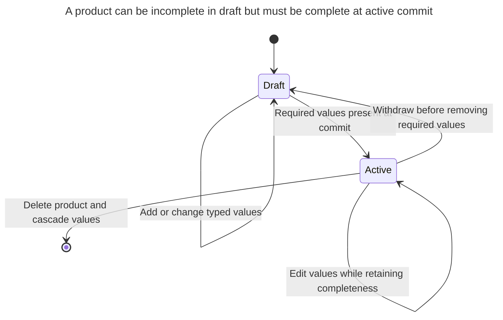
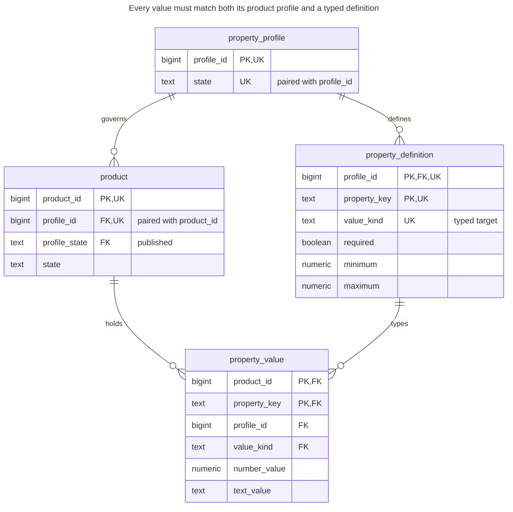
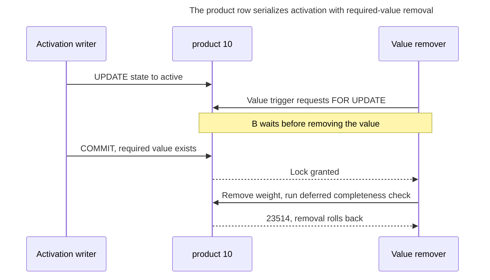
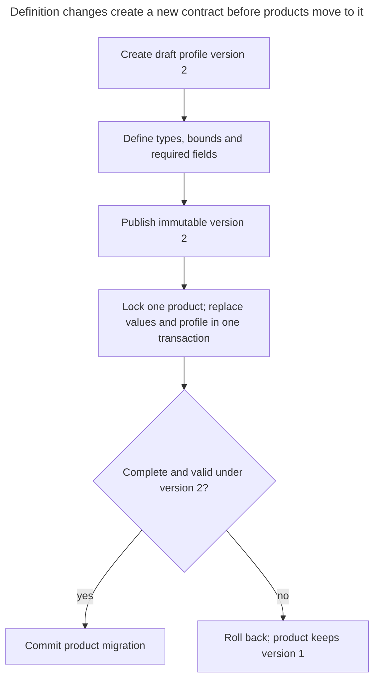

# Typed Properties

## Intent

Typed properties let users or administrators define new attributes without schema changes: a table of property definitions with names, data types and constraints, and a table of values that refers to both the entity and the definition. This is the designed form of entity–attribute–value: values are stored in columns of the right type, required properties and allowed ranges are checked, and definitions can evolve. The chapter shows how to build it, how to query entities by several properties at once, and when a JSON column is the cheaper way to the same goal.

## Also known as

Typed dynamic properties; defined dynamic properties with value types. Fowler's [Dealing with Properties](https://martinfowler.com/apsupp/properties.pdf) distinguishes string-named properties, defined properties, typed properties and rules governing which object types may have which properties. The schema below is a worked implementation of those ideas, not SQL reproduced from the paper.

## Problem

Your catalog administrators define attributes after deployment. A shipping profile requires `weight_kg` with a numeric range; `color` is optional text. Products must remain editable while incomplete, but an active product must contain every required value. A later profile can tighten the weight range without silently changing the contract of products still using the old profile.

A table of `(product_id, name, text_value)` makes a field easy to add but does not connect its name to a declared type or requiredness. Making `text_value` non-null prevents a null inside an existing row; it cannot require a missing weight row to exist. These are different constraints and need different enforcement.

## Solution

Model a profile version, its property definitions, products assigned to that profile, and typed values. Publish a complete profile before products use it, then freeze its definitions. Evolve definitions by creating and publishing another profile rather than changing the meaning of existing values in place.

Enforce one value per product and property with a primary key. Use composite foreign keys to match both the product's profile and the definition's declared type. Use a row check to select the right value column, a trigger for metadata-defined bounds, and deferred constraint triggers for required-value existence. PostgreSQL [checks cannot safely enforce rules over other table rows](https://www.postgresql.org/docs/18/ddl-constraints.html#DDL-CONSTRAINTS-CHECK-CONSTRAINTS); a metadata lookup hidden inside a check function would not solve definition changes or concurrent writes.



The requiredness rule applies to the active lifecycle state. The transaction may temporarily remove and replace a required value, but cannot commit an active product with that value missing.

## Alternatives and selection

| Sibling | Relationship | Deciding requirement |
| --- | --- | --- |
| Ordinary typed columns | Replacement for stable fields; complement for product identity | Field names are known to developers and deserve direct constraints and simple queries |
| [JSON Column](json-column.md) | Replacement | You normally read and edit one document and do not need a full property-definition workflow |
| [Single Table Inheritance](single-table-inheritance.md) / [Class Table Inheritance](class-table-inheritance.md) | Replacement | Variation follows a known subtype family rather than administrator-defined fields |
| [Observation](observation.md) | Replacement for a different fact lifecycle | A measurement has its own time, method or provenance rather than one current value |
| [Quantity](quantity.md) | Complement | Numeric properties need explicit units and compatible comparisons |
| [Untyped Properties](untyped-properties.md) | Anti-pattern to replace | Names and values are unconstrained strings with no definition contract |

See the [Decision Atlas](decision-atlas.md) for the full table. Typed properties earn their complexity only when property definitions are part of the product you are building. They are not a general way to avoid ordinary column migrations.

## Structure



The repeated profile and type tags are checked reference components, not independent editable facts. `UK` markers identify components of the composite unique targets described in the DDL. The product-to-value edge permits absence; the deferred lifecycle rule supplies requiredness for active products.

## Tables and invariants

- **`property_profile`** represents one definition version. A published profile cannot be edited back to draft, and definition edits lock its row before checking whether it is published.
- **`property_definition`** identifies a field by `(profile_id, property_key)`. This sample supports bounded numbers and text, not arbitrary type expressions, relational references or multi-valued fields.
- **`product`** references only published profiles through `(profile_id, profile_state)`. Draft products can be incomplete; active products cannot.
- **`property_value`** has one non-null typed value per product/property pair. Composite foreign keys enforce profile membership and the declared value kind; `property_value_shape` selects exactly one value column.
- **Cross-row validation** is explicit: a value trigger checks numeric bounds, and deferred product/value triggers check every required definition. Value mutations first lock the product, serializing them with activation at read committed isolation.

## When to use

- End users or administrators genuinely create new fields at runtime.
- You need managed field names, types, ranges and requiredness, not just an opaque settings payload.
- Products need different versioned field contracts, and migrations between contracts are visible business operations.
- Searches across several properties justify maintaining typed indexes and more involved queries.

## Consequences and trade-offs

- ➕ New definitions within a supported type family need data changes rather than new columns.
- ➕ Numeric predicates use numeric values, and a declared number cannot be replaced by arbitrary text.
- ➕ Published profiles preserve the interpretation of existing products during definition evolution.
- ➖ A product read reconstructs multiple value rows; every additional search field adds another predicate or join.
- ➖ Requiredness, metadata changes and publication need a lifecycle and concurrency protocol.
- ➖ Adding a new primitive type, an entity reference or repeated values still changes this schema and its validation logic.
- ➖ Mixed-property indexes require workload review. Do not assume they behave like an ordinary composite index over fixed product columns.

## Implementation

The [complete script](../assets/typed-properties/typed-properties.sql) is checked on PostgreSQL 18.6. It includes all guards, indexes, expected failures and profile migration. The tables define the reference and value-shape rules:

```sql
CREATE TABLE property_profile (
    profile_id bigint PRIMARY KEY,
    state text NOT NULL DEFAULT 'draft' CHECK (state IN ('draft', 'published')),
    UNIQUE (profile_id, state)
);
CREATE TABLE property_definition (
    profile_id bigint NOT NULL REFERENCES property_profile (profile_id),
    property_key text NOT NULL,
    value_kind text NOT NULL CHECK (value_kind IN ('number', 'text')),
    required boolean NOT NULL DEFAULT false,
    minimum numeric,
    maximum numeric,
    PRIMARY KEY (profile_id, property_key),
    UNIQUE (profile_id, property_key, value_kind),
    CHECK (
        (value_kind = 'number' AND minimum IS NOT NULL AND maximum IS NOT NULL
            AND minimum <= maximum AND minimum > '-Infinity'::numeric
            AND maximum < 'Infinity'::numeric)
        OR (value_kind = 'text' AND minimum IS NULL AND maximum IS NULL)
    )
);
CREATE TABLE product (
    product_id bigint PRIMARY KEY,
    profile_id bigint NOT NULL,
    profile_state text NOT NULL DEFAULT 'published' CHECK (profile_state = 'published'),
    state text NOT NULL DEFAULT 'draft' CHECK (state IN ('draft', 'active')),
    UNIQUE (product_id, profile_id),
    FOREIGN KEY (profile_id, profile_state) REFERENCES property_profile (profile_id, state)
);
CREATE TABLE property_value (
    product_id bigint NOT NULL,
    profile_id bigint NOT NULL,
    property_key text NOT NULL,
    value_kind text NOT NULL,
    number_value numeric,
    text_value text,
    PRIMARY KEY (product_id, property_key),
    FOREIGN KEY (product_id, profile_id) REFERENCES product (product_id, profile_id)
        ON DELETE CASCADE,
    FOREIGN KEY (profile_id, property_key, value_kind)
        REFERENCES property_definition (profile_id, property_key, value_kind),
    CONSTRAINT property_value_shape CHECK (
        (value_kind = 'number' AND number_value IS NOT NULL AND text_value IS NULL)
        OR (value_kind = 'text' AND number_value IS NULL AND text_value IS NOT NULL)
    )
);
CREATE INDEX property_value_number_idx
    ON property_value (profile_id, property_key, number_value, product_id)
    WHERE value_kind = 'number';
CREATE INDEX property_value_text_idx
    ON property_value (profile_id, property_key, text_value, product_id)
    WHERE value_kind = 'text';
```

The numeric definitions require finite lower and upper bounds; a real product may need a richer type vocabulary. Units are encoded explicitly in `weight_kg` for this example. If users can choose units, model them rather than comparing kilograms and pounds as raw numbers; see [Quantity](quantity.md).

Publishing must freeze the metadata that range checks read. These guards take a profile lock before definition edits and reject changes to published definitions. Row locks are held to transaction end under PostgreSQL's [locking rules](https://www.postgresql.org/docs/18/explicit-locking.html#LOCKING-ROWS):

```sql
CREATE FUNCTION guard_published_profile() RETURNS trigger LANGUAGE plpgsql AS $$
BEGIN
    IF OLD.state = 'published' THEN
        RAISE EXCEPTION USING ERRCODE = '23514', MESSAGE = 'published profile is immutable';
    END IF;
    RETURN NEW;
END $$;
CREATE TRIGGER profile_immutable BEFORE UPDATE ON property_profile
    FOR EACH ROW EXECUTE FUNCTION guard_published_profile();

CREATE FUNCTION guard_definition() RETURNS trigger LANGUAGE plpgsql AS $$
DECLARE
    target_profile bigint;
    profile_status text;
BEGIN
    IF TG_OP = 'UPDATE' AND NEW.profile_id <> OLD.profile_id THEN
        RAISE EXCEPTION 'create a new definition instead of moving it';
    END IF;
    target_profile := CASE WHEN TG_OP = 'DELETE' THEN OLD.profile_id ELSE NEW.profile_id END;
    SELECT state INTO profile_status FROM property_profile
    WHERE profile_id = target_profile FOR UPDATE;
    IF profile_status = 'published' THEN
        RAISE EXCEPTION USING ERRCODE = '23514', MESSAGE = 'published definitions are immutable';
    END IF;
    IF TG_OP = 'DELETE' THEN RETURN OLD; END IF;
    RETURN NEW;
END $$;
CREATE TRIGGER definition_guard BEFORE INSERT OR UPDATE OR DELETE ON property_definition
    FOR EACH ROW EXECUTE FUNCTION guard_definition();
```

A value write locks the product and checks the declared range. Both activation and removal of a required row must schedule the completeness check. PostgreSQL's [constraint triggers](https://www.postgresql.org/docs/18/sql-createtrigger.html) support this deferred timing:

```sql
CREATE FUNCTION guard_property_value() RETURNS trigger LANGUAGE plpgsql AS $$
DECLARE
    target_product bigint;
    definition property_definition%ROWTYPE;
BEGIN
    IF TG_OP = 'UPDATE' AND NEW.product_id <> OLD.product_id THEN
        RAISE EXCEPTION 'delete and insert instead of moving a value';
    END IF;
    target_product := CASE WHEN TG_OP = 'DELETE' THEN OLD.product_id ELSE NEW.product_id END;
    PERFORM 1 FROM product WHERE product_id = target_product FOR UPDATE;
    IF TG_OP = 'DELETE' THEN RETURN OLD; END IF;
    SELECT * INTO definition FROM property_definition
    WHERE profile_id = NEW.profile_id AND property_key = NEW.property_key;
    IF NEW.value_kind = 'number' AND NOT
        (NEW.number_value BETWEEN definition.minimum AND definition.maximum) THEN
        RAISE EXCEPTION USING ERRCODE = '23514', MESSAGE = 'property value outside allowed range';
    END IF;
    RETURN NEW;
END $$;
CREATE TRIGGER value_guard BEFORE INSERT OR UPDATE OR DELETE ON property_value
    FOR EACH ROW EXECUTE FUNCTION guard_property_value();

CREATE FUNCTION check_required_properties() RETURNS trigger LANGUAGE plpgsql AS $$
DECLARE
    target_product bigint;
BEGIN
    target_product := CASE WHEN TG_OP = 'DELETE' THEN OLD.product_id ELSE NEW.product_id END;
    IF EXISTS (
        SELECT 1 FROM product AS p
        JOIN property_definition AS d ON d.profile_id = p.profile_id
        WHERE p.product_id = target_product AND p.state = 'active' AND d.required
          AND NOT EXISTS (
              SELECT 1 FROM property_value AS v
              WHERE v.product_id = p.product_id AND v.property_key = d.property_key
          )
    ) THEN
        RAISE EXCEPTION USING ERRCODE = '23514', MESSAGE = 'active product lacks required property';
    END IF;
    RETURN NULL;
END $$;
CREATE CONSTRAINT TRIGGER product_complete AFTER INSERT OR UPDATE ON product
    DEFERRABLE INITIALLY DEFERRED FOR EACH ROW EXECUTE FUNCTION check_required_properties();
CREATE CONSTRAINT TRIGGER value_complete AFTER INSERT OR UPDATE OR DELETE ON property_value
    DEFERRABLE INITIALLY DEFERRED FOR EACH ROW EXECUTE FUNCTION check_required_properties();
```

Use these tables through an application role that cannot replace functions, disable triggers or truncate the metadata tables. Treat IDs as stable, and use one transaction per product edit. The script uses read committed; a value operation on several products should acquire product locks in a consistent order to reduce deadlocks.

Publish the profile, create a draft product and activate it with its values in the same transaction:

```sql
BEGIN;
INSERT INTO property_profile (profile_id) VALUES (1);
INSERT INTO property_definition VALUES
    (1, 'weight_kg', 'number', true, 0.01, 1000),
    (1, 'color', 'text', false, NULL, NULL);
UPDATE property_profile SET state = 'published' WHERE profile_id = 1;
INSERT INTO product (product_id, profile_id) VALUES (10, 1);
INSERT INTO property_value VALUES
    (10, 1, 'weight_kg', 'number', 2.5, NULL),
    (10, 1, 'color', 'text', NULL, 'red');
UPDATE product SET state = 'active' WHERE product_id = 10;
COMMIT;
SELECT p.product_id FROM product AS p
JOIN property_value AS w ON w.product_id = p.product_id
    AND w.profile_id = p.profile_id AND w.property_key = 'weight_kg'
JOIN property_value AS c ON c.product_id = p.product_id
    AND c.profile_id = p.profile_id AND c.property_key = 'color'
WHERE p.profile_id = 1 AND p.state = 'active'
  AND w.value_kind = 'number' AND w.number_value < 5
  AND c.value_kind = 'text' AND c.text_value = 'red';
UPDATE property_value SET number_value = 3 WHERE product_id = 10 AND property_key = 'weight_kg';
```

The two-property search returns `10`. An invalid range change is rejected immediately:

```sql
UPDATE property_value SET number_value = 2000
WHERE product_id = 10 AND property_key = 'weight_kg';
```

The trigger raises SQLSTATE `23514`: `ERROR: property value outside allowed range`. Deleting the required row is rejected when the transaction ends:

```sql
BEGIN;
DELETE FROM property_value WHERE product_id = 10 AND property_key = 'weight_kg';
COMMIT;
```

The error is SQLSTATE `23514`: `ERROR: active product lacks required property`. The failed commit preserves the original row. Inserting an active product with no values fails the same rule. The full script also verifies that a text value for `weight_kg` fails its composite type foreign key with SQLSTATE `23503`, and that editing a published definition raises `published definitions are immutable`.

## Engine support

- **PostgreSQL 18:** ordinary composite keys plus PL/pgSQL guards and deferred constraint triggers implement this design. A single metadata-reading check is not an equivalent replacement.
- **MySQL 8.4 / InnoDB:** [checks disallow subqueries and stored functions](https://dev.mysql.com/doc/refman/8.4/en/create-table-check-constraints.html), and [foreign-key checks are immediate](https://dev.mysql.com/doc/refman/8.4/en/create-table-foreign-keys.html). Port the lifecycle validation deliberately; an application save procedure alone does not protect writes that bypass it.
- **SQL Server 2025 (17.x):** DML [triggers process sets of rows](https://learn.microsoft.com/en-us/sql/relational-databases/triggers/create-dml-triggers-to-handle-multiple-rows-of-data?view=sql-server-ver17). Porting a per-row PL/pgSQL function literally would miss multi-row operations. Its [`CREATE TABLE` syntax](https://learn.microsoft.com/en-us/sql/t-sql/statements/create-table-transact-sql?view=sql-server-ver17) also supplies no PostgreSQL-style deferred constraint trigger.
- **Oracle AI Database 26ai:** supports [deferrable constraints](https://docs.oracle.com/en/database/oracle/oracle-database/26/sqlrf/constraint.html), but that does not directly port these PL/pgSQL trigger bodies or this deferred custom completeness check. Design and verify the validation boundary for the Oracle implementation.
- **SQLite 3:** [`STRICT` tables](https://www.sqlite.org/stricttables.html) restrict scalar type storage but do not accept PostgreSQL's `numeric` declaration. Choose the numeric representation deliberately; SQLite's [triggers](https://www.sqlite.org/lang_createtrigger.html) are row triggers and do not provide this deferred constraint-trigger facility.

## Failure and concurrency

At read committed isolation, lock the product before changing its values. The `value_guard` does so even for deletes; changing the product's state already locks the product row. If activation wins, a later required-value removal sees the active product and is rejected at commit. If removal wins, later activation finds the missing value and is rejected instead. PostgreSQL [rechecks rows after a waiting lock or update](https://www.postgresql.org/docs/18/transaction-iso.html#XACT-READ-COMMITTED); the checks deliberately run after the parent lock and again at deferred validation.



Publication has a separate serialization point: a definition edit locks the profile, and publication updates that same profile. Published definitions cannot then change under a range check. Retrying after an uncertain commit means reloading product state and current values; never assume that an insert statement's success proves the deferred checks passed. Deadlocks or serialization failures require retrying the complete transaction, not only its final value statement.

## Migration

From [Untyped Properties](untyped-properties.md), first reconcile names, duplicate values, units and invalid numeric text. Create a draft profile from the accepted definitions and decide which fields are required. Publish it, backfill products in draft state and retain rejected source values for correction rather than silently coercing them. Validate every product before activating it.



The runnable script demonstrates this move: delete the old value rows, change the product's profile and insert the converted values in one transaction. The deferred check permits the temporary gap. A stricter range or newly required field must be satisfied before commit. Keep the old profile and old representation during the [Expand and Contract](expand-contract.md) overlap; rollback to an old profile is possible only if the values can still satisfy it. A new primitive value kind requires a schema change even though new definitions of existing kinds do not.

## Anti-patterns and common mistakes

- Making value rows non-null and assuming that required rows must therefore exist.
- Mutating a published definition so existing stored values acquire a different meaning without migration.
- Checking completeness only on activation while permitting later deletion of required values.
- Checking ranges in the application while imports write directly to the value table.
- Omitting the profile/type components from foreign keys and permitting values from another contract.
- Using dynamic properties for a small, stable set of developer-owned fields that ordinary columns express more clearly.

## Known uses

- Fowler's [Typed Dynamic Property](https://martinfowler.com/apsupp/properties.pdf), on page 9, attaches a declared value type to the property definition; the paper also distinguishes rules about which kinds of objects may have which properties. The publication and completeness protocol here is this chapter's design, not a vendor framework guarantee.

## Related patterns

- [JSON Column](json-column.md) offers a simpler document boundary when definition management is unnecessary.
- [Untyped Properties](untyped-properties.md) describes the unconstrained string-value design this pattern repairs.
- [Observation](observation.md) gives independently recorded measurements their own lifecycle.
- [Quantity](quantity.md) defines numeric values with explicit units.
- [Class Table Inheritance](class-table-inheritance.md) handles known subtype shapes without runtime field metadata.
