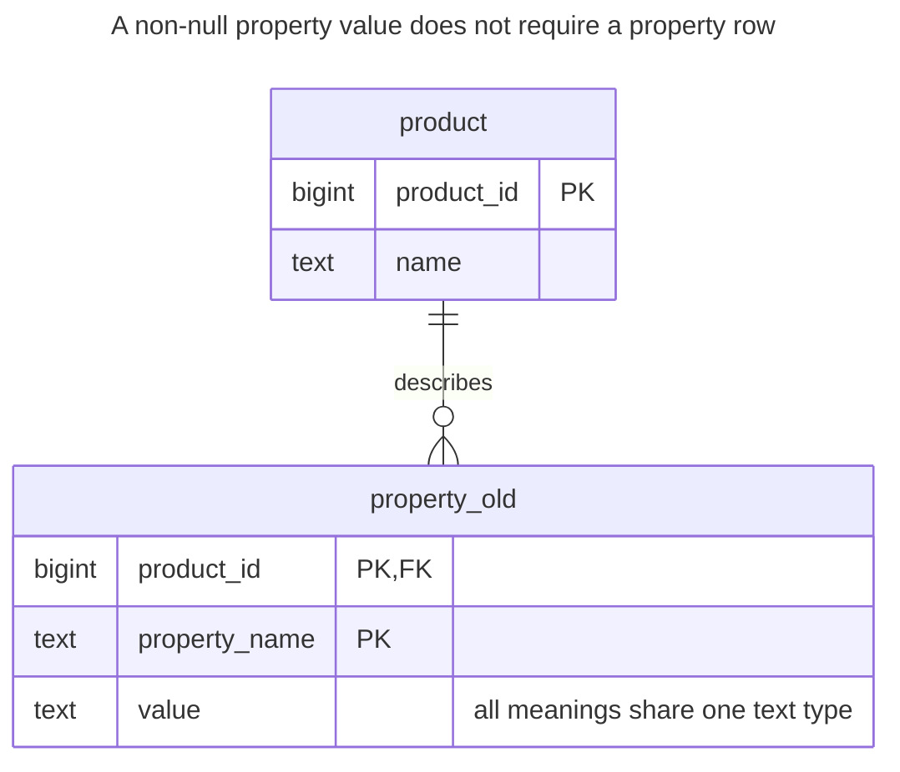
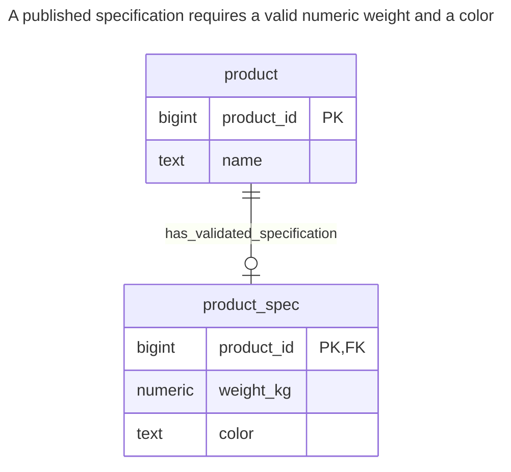
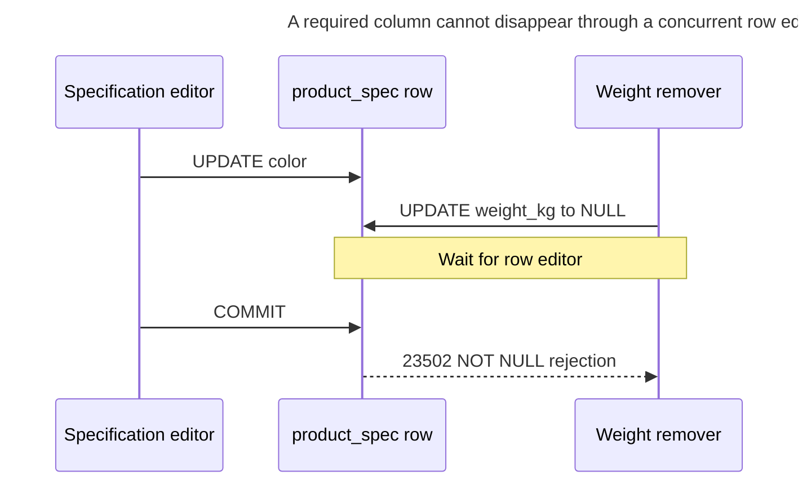
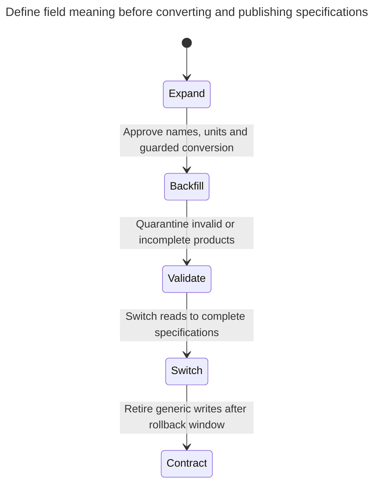

# Untyped Properties

Untyped properties store arbitrary attributes as rows of entity, attribute name and a value in a text column — the naive form of entity–attribute–value. Without additional validation, the generic text column does not check each attribute's type or references, mandatory attributes can be absent, and queries that need several attributes require reconstruction through joins or aggregation. The chapter shows these failures and how to migrate to columns, a JSON column or typed properties. Bill Karwin calls this Entity-Attribute-Value.

## Also known as

Entity-Attribute-Value, in Bill Karwin's [SQL Antipatterns contents](https://pragprog.com/titles/bksap1/sql-antipatterns-volume-1/). The harmful case here is the unconstrained string-value model, not every design with attribute rows. Fowler's [Dealing with Properties](https://martinfowler.com/apsupp/properties.pdf) distinguishes flexible, defined and typed dynamic properties; those are different levels of contract.

## Context

Your products have weight and color today, and you expect more attributes later. Instead of creating product columns, you create `(product_id, property_name, value)` rows. One generic editor can now save any name and any string without a migration.

## Problem

You use one text type for fields that have different meanings and rules. A unique product/name pair prevents duplicate names but does not require a weight row, make its value numeric or connect a supplier-like property to a real supplier. Storing `heavy` and storing `2` both satisfy the sample column's contract. A numeric comparison then becomes text ordering or a cast that may fail on existing data.

Those rules are not impossible to implement. You can add metadata, typed storage and lifecycle validation, but that is a designed [Typed Properties](typed-properties.md) system. Calling the generic string table flexible while omitting its validation moves the schema into an undocumented agreement among writers.

## Why people do it

Users may genuinely define fields while the application runs. You may also need to retain unknown source properties before deciding their meanings. Both are legitimate requirements. The mistake is to give stable, essential application fields that same weak contract merely because it avoids DDL today.

For opaque imports, keep raw values and source names as evidence, then publish validated data separately. For runtime definitions, budget the definition lifecycle, indexing, requiredness and conversion work explicitly rather than expecting a text table to supply it.

## Consequences

- ➖ Numeric-looking text follows text comparison until you explicitly convert it.
- ➖ A required field can be absent as a row, despite `value NOT NULL`.
- ➖ Misspelled property names create new apparent attributes rather than failing.
- ➖ Multi-field reads require joins, aggregation or another reconstruction step.
- ➖ Definition changes can reinterpret stored values unless you version the contract.

## Signs

- A frequently used query casts the same `value` column differently for each property name.
- Every product save contains a separate “required properties” loop.
- An import of one malformed value breaks a later report's cast.
- The data dictionary lives only in application conditionals over strings.

## A better way

Promote stable required fields into ordinary typed columns. Keep the owner identity relational and choose a flexible representation only for the truly variable remainder. In the example, product specification is a fixed schema: weight is required, finite and positive, and color is required. The unit is explicitly kilograms; introducing selectable units is a separate [Quantity](quantity.md) requirement.

### Alternatives and selection

| Sibling | Relationship | Deciding requirement |
| --- | --- | --- |
| Ordinary typed columns | Replacement | Developers own a stable field set and need direct predicates and constraints |
| [Typed Properties](typed-properties.md) | Replacement | Users define fields, types and requiredness as managed data |
| [JSON Column](json-column.md) | Replacement for an aggregate document; complement to fixed columns | Optional properties are usually read and edited together |
| [Class Table Inheritance](class-table-inheritance.md) | Replacement for known subtype-specific fields | A finite type family needs distinct required column groups |

PostgreSQL [JSON types](https://www.postgresql.org/docs/18/datatype-json.html#JSON-DOC-DESIGN) support a hybrid model, but valid JSON does not establish business requiredness or reference integrity. Converting every old string to a JSON string preserves the typing problem. Use the [Decision Atlas](decision-atlas.md) for the full table.

## Example

### Structure

**Before:** names and values have no property-specific schema.



The real owner FK is useful. It says nothing about whether a product has a weight or whether that weight is a number.

```sql
CREATE TABLE product (product_id bigint PRIMARY KEY, name text NOT NULL);
CREATE TABLE property_old (
    product_id bigint NOT NULL REFERENCES product (product_id),
    property_name text NOT NULL,
    value text COLLATE "C" NOT NULL,
    PRIMARY KEY (product_id, property_name)
);
INSERT INTO product VALUES (1, 'Crate'), (2, 'Box'), (3, 'Bag'), (4, 'Envelope');
INSERT INTO property_old VALUES
    (1, 'weight_kg', '100'), (1, 'color', 'red'),
    (2, 'weight_kg', '2'), (2, 'color', 'red'),
    (3, 'weight_kg', 'heavy'), (3, 'color', 'blue'), (4, 'color', 'green');
SELECT product_id FROM property_old
WHERE property_name = 'weight_kg' AND value < '20' ORDER BY product_id;
```

The text predicate returns products `1, 2`: `100` sorts before `20` under the chosen [bytewise `C` collation](https://www.postgresql.org/docs/18/collation.html). Product `3` has an invalid numeric description, while product `4` has no weight at all. Both are valid under the old schema.

**After:** publish complete specifications with typed fields.



A product can remain without a published specification while its source data is quarantined. Every specification row is complete; this design does not claim that every product already has one.

```sql
CREATE TABLE product_spec (
    product_id bigint PRIMARY KEY REFERENCES product (product_id),
    weight_kg numeric NOT NULL,
    color text NOT NULL,
    CONSTRAINT product_spec_weight CHECK (weight_kg > 0 AND weight_kg < 'Infinity'::numeric)
);
CREATE INDEX product_spec_weight_color_idx ON product_spec (weight_kg, color);
CREATE TABLE property_reject (
    product_id bigint PRIMARY KEY REFERENCES product (product_id),
    reason text NOT NULL
);
BEGIN;
LOCK TABLE product, property_old IN SHARE ROW EXCLUSIVE MODE;
CREATE TEMP TABLE parsed_spec ON COMMIT DROP AS
SELECT p.product_id, c.value AS color,
       CASE WHEN pg_input_is_valid(w.value, 'numeric') THEN w.value::numeric END AS weight_kg
FROM product AS p
LEFT JOIN property_old AS w ON w.product_id = p.product_id AND w.property_name = 'weight_kg'
LEFT JOIN property_old AS c ON c.product_id = p.product_id AND c.property_name = 'color';
INSERT INTO product_spec
SELECT product_id, weight_kg, color FROM parsed_spec
WHERE color IS NOT NULL AND weight_kg > 0 AND weight_kg < 'Infinity'::numeric;
INSERT INTO property_reject
SELECT product_id, 'missing or invalid required field' FROM parsed_spec AS p
WHERE NOT EXISTS (SELECT 1 FROM product_spec AS s WHERE s.product_id = p.product_id);
COMMIT;
SELECT product_id FROM product_spec WHERE weight_kg < 20 AND color = 'red';
SELECT * FROM property_reject ORDER BY product_id;
```

The numeric/color search returns only product `2`. Products `3` and `4` enter `property_reject`; their original rows remain in `property_old`. PostgreSQL's [`pg_input_is_valid`](https://www.postgresql.org/docs/18/functions-info.html#FUNCTIONS-INFO-VALIDITY) checks the input before the guarded numeric cast. The finite positive filter then rejects values outside this field's contract. It is not a general definition engine.

```sql
INSERT INTO product_spec VALUES (3, 'heavy', 'blue');
```

PostgreSQL 18.6 raises SQLSTATE `22P02`: `ERROR: invalid input syntax for type numeric: "heavy"`. Requiredness is checked independently:

```sql
INSERT INTO product_spec (product_id, color) VALUES (4, 'green');
```

That raises SQLSTATE `23502`: `ERROR: null value in column "weight_kg" of relation "product_spec" violates not-null constraint`. The [complete script](../assets/untyped-properties/untyped-properties.sql) asserts both rejections and the quarantine counts.

### Engine support

- **PostgreSQL 18:** the input-validity guard is engine-specific. Retain both the conversion audit and actual typed destination constraints.
- **SQL Server:** [`TRY_CONVERT`](https://learn.microsoft.com/en-us/sql/t-sql/functions/try-convert-transact-sql?view=sql-server-ver17) returns null for supported conversions that fail. Explicitly permitted nulls still need a separate requiredness decision.
- **SQLite:** ordinary tables use [type affinity](https://www.sqlite.org/datatype3.html), so a declaration resembling this numeric column is not the same guarantee. [`STRICT` tables](https://www.sqlite.org/stricttables.html) restrict supported types; choose scaled integers or another explicit numeric representation rather than copying `numeric` and assuming identical checks.

### Failure and concurrency

Required value rows create a cross-row race: activation can observe a weight while another transaction removes it. The fixed-column repair places weight and specification publication in one row. A typed-property replacement must instead coordinate activation and value edits, as its chapter demonstrates.



PostgreSQL's [row locks](https://www.postgresql.org/docs/18/explicit-locking.html#LOCKING-ROWS) serialize these updates; the column rule rejects the resulting null. This does not protect against deleting the whole optional specification row. If all published products must retain one, add an explicit lifecycle/completeness boundary rather than assuming the shared key requires a child.

### Migration

Inventory names, duplicate names, units and missing required values. Approve a definition for each promoted field before parsing it. Preserve original text and conversion decisions, and separate invalid or absent values from genuine zero. Never substitute zero for failed numeric input unless zero is the documented meaning.



The lab copies under a write pause. A live backfill must lock the product before reading or changing either representation, with live writers using that same lock. Compare reconstructed source values against the typed result and gate activation until required data is complete. A new typed-property system also needs versioned definitions and checks when required values are later removed. See [Expand and Contract](expand-contract.md).

## Related patterns and anti-patterns

- [Typed Properties](typed-properties.md) turns runtime extensibility into an explicit managed contract.
- [JSON Column](json-column.md) keeps an aggregate document beside a constrained relational core.
- [Class Table Inheritance](class-table-inheritance.md) handles known subtype fields without arbitrary property names.
- [Quantity](quantity.md) keeps numeric values tied to their units.
