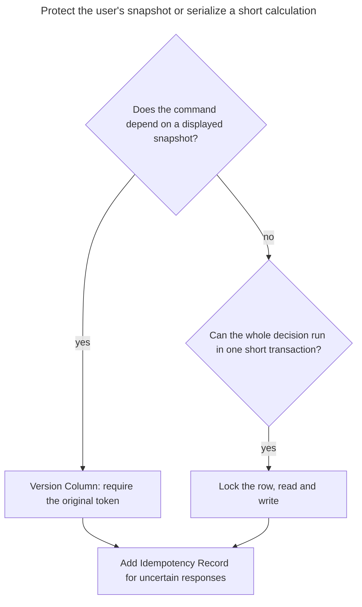
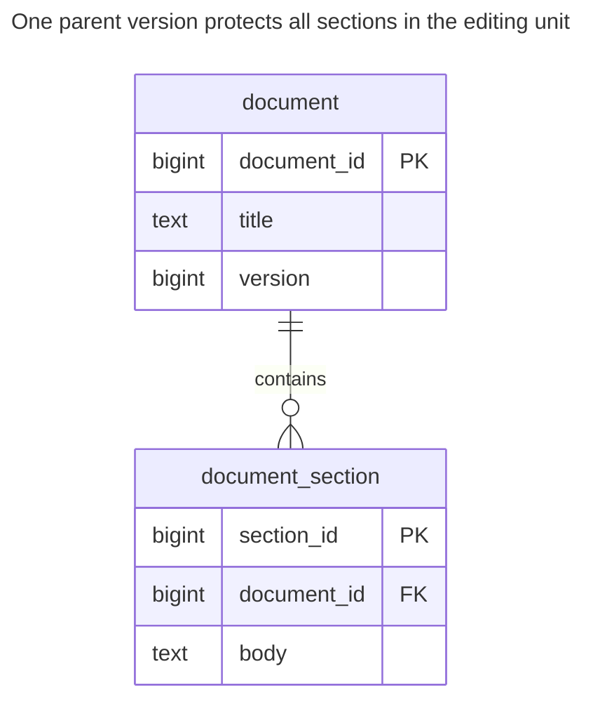
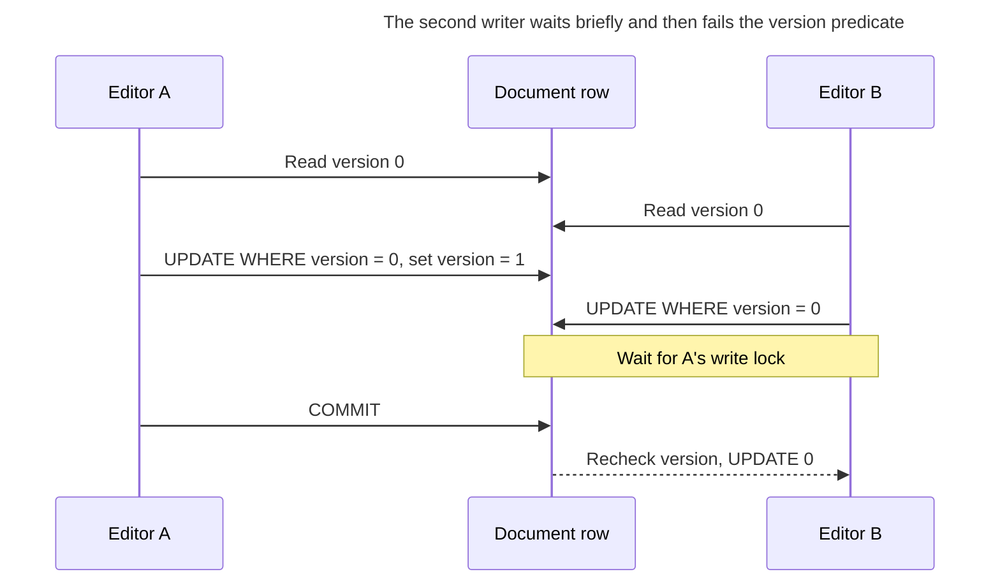
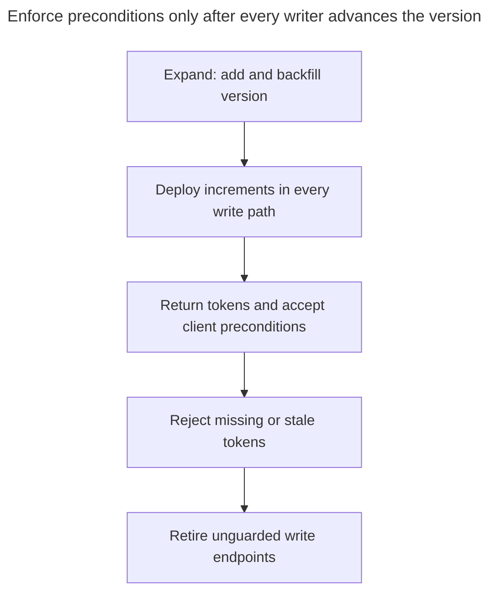

# Version Column

## Intent

A version column implements optimistic locking: each row carries a counter or timestamp, and an update succeeds only if the version is still the one the client read. Two people editing the same record no longer overwrite each other silently — the second gets a conflict and can reload. The chapter shows the update statement and how to detect zero affected rows, how ORMs implement it, native row versions such as `rowversion` in SQL Server and `xmin` in PostgreSQL, and when pessimistic locking is the better choice.

## Also known as

[Optimistic Offline Lock](https://martinfowler.com/eaaCatalog/optimisticOfflineLock.html); optimistic concurrency token. The offline part means that the user's editing conversation spans database transactions, not that the database is unavailable.

## Problem

Two editors load the same document title. One changes it to “Launch checklist”; the other, still seeing the original, saves “Release checklist.” An unconditional update accepts both and loses the first editor's work. Keeping a transaction open while someone edits would turn human response time into lock duration.

Checking a version in application code and then issuing an unconditional update leaves a race between the check and the write. You need the comparison inside the statement that changes the row. You also need to distinguish a stale edit from a repeated request whose earlier response was lost.

## Solution

Add a mandatory integer `version`, initially zero. Return it with the document and require the caller to send that same value when saving. Update by primary key **and expected version**, incrementing the version in the same statement. One returned row means success; no row means the caller's precondition did not match. Reload or present a merge rather than overwriting automatically.

Choose the scope deliberately. Here `document` owns several sections, so its version protects the whole editing unit. Every section insertion, edit and deletion must first win a version update on the parent in the same transaction. A version on the title alone cannot protect changes to child rows. Read the parent version and its sections from one consistent snapshot, for example one query, so the displayed document corresponds to its token.

## Alternatives and selection

| Sibling or mechanism | Relationship | Deciding requirement |
| --- | --- | --- |
| Short transaction with a row lock | Replacement for the conflict protocol | You can read, decide and write immediately without human or network waits |
| [Reservation](reservation.md) | Complement | A user must hold scarce capacity while deciding; detecting a later stale edit does not reserve it |
| [Idempotency Record](idempotency-record.md) | Complement | A retry must recover the result of an already accepted command |
| [Status History](status-history.md) | Complement | You need accepted workflow transitions as well as stale-command rejection |
| [Ordered Collection](ordered-collection.md) | Complement | The token covers a collection while positions describe its current order |
| Engine-generated token | Implementation option | Its lifetime and update semantics fit the external editing contract |

See the [Decision Atlas](decision-atlas.md) for the full comparison. For a counter increment with no dependency on previously displayed state, an atomic increment may suffice; requiring a token can create conflicts the operation does not need.



The version answers whether the source state is still current. A request key answers whether this command has already succeeded; the two values have different lifetimes.

## Structure



Sections reference the document's stable identity, not its changing version. The version is a write precondition, not another primary key or a history of prior contents.

## Tables and invariants

- **`document`** has a primary key and a nonnegative, non-null version. `document_version_nonnegative` rejects invalid stored counters.
- **`document_section`** has one owner enforced by a foreign key. The parent version advances for every accepted change within this editing unit.
- **The guarded write** enforces stale-edit rejection. A check constraint cannot make an arbitrary writer include an expected version; route all writes through the same application boundary or a restricted database routine.
- **Token stability** requires keeping document IDs unreused and never resetting versions on an existing identity. Otherwise an old token can match a different incarnation.

## When to use

- Forms, administrative tools or APIs edit a snapshot across separate requests.
- Conflicts should be reported to the caller instead of silently resolved by last write.
- Most edits touch different documents, and retrying or merging an occasional conflict is acceptable.

## Consequences and trade-offs

- ➕ You hold no database lock during user think time.
- ➕ One token can cover several related tables when all writers advance the parent.
- ➖ An aggregate-wide token rejects simultaneous edits to unrelated sections too; narrower tokens permit more concurrency but protect a smaller invariant.
- ➖ The write still takes ordinary database locks. “Optimistic” does not mean lock-free execution.
- ➖ A conflict response needs a product decision: reload, merge, or explicitly override using the newly observed version. Blind automatic resubmission defeats the stale-edit policy.

## Implementation

The [complete script](../assets/version-column/version-column.sql) checks a winning update, a stale update, a guarded section edit and constraint rejection on PostgreSQL 18.6:

```sql
CREATE TABLE document (
    document_id bigint PRIMARY KEY,
    title text NOT NULL,
    version bigint NOT NULL DEFAULT 0,
    CONSTRAINT document_version_nonnegative CHECK (version >= 0)
);
CREATE TABLE document_section (
    section_id bigint PRIMARY KEY,
    document_id bigint NOT NULL REFERENCES document (document_id),
    body text NOT NULL
);
CREATE INDEX document_section_owner_idx ON document_section (document_id);
INSERT INTO document VALUES (1, 'Checklist', 0);
INSERT INTO document_section VALUES (10, 1, 'Review draft');
SELECT document_id, title, version FROM document WHERE document_id = 1;
UPDATE document SET title = 'Launch checklist', version = version + 1
WHERE document_id = 1 AND version = 0
RETURNING version;
UPDATE document SET title = 'Release checklist', version = version + 1
WHERE document_id = 1 AND version = 0
RETURNING version;
```

The first update returns `1`; the second returns no rows and reports `UPDATE 0`, without a SQL error. PostgreSQL's [Read Committed update rules](https://www.postgresql.org/docs/18/transaction-iso.html#XACT-READ-COMMITTED) recheck the predicate after a concurrent updater commits. A missing or inaccessible document can also produce zero rows; use your API's visibility policy when distinguishing those cases. Do not call every zero-row result a serialization error.

For a section edit, start by advancing the parent. Require exactly one parent and one section update; otherwise roll back the transaction. In this seeded example both succeed:

```sql
BEGIN;
UPDATE document SET version = version + 1
WHERE document_id = 1 AND version = 1
RETURNING version;
UPDATE document_section SET body = 'Review final draft'
WHERE document_id = 1 AND section_id = 10;
COMMIT;
```

The new token is `2`. In application code, do not run the child update if the parent update returned no row, and roll back if the child was not found. Guard deletion by the expected version too. The following counter value is invalid regardless of which application issues it:

```sql
-- Expected SQLSTATE 23514.
UPDATE document SET version = -1 WHERE document_id = 1;
```

PostgreSQL 18.6 raises `ERROR: new row for relation "document" violates check constraint "document_version_nonnegative"` (SQLSTATE `23514`). This demonstrates stored-domain enforcement; the stale editor's normal result remains `UPDATE 0`.

## Engine support

- **PostgreSQL 18:** prefer the explicit counter for a durable application contract. [`xmin`](https://www.postgresql.org/docs/18/ddl-system-columns.html) identifies the inserting transaction of a row version; transaction IDs are 32-bit and wrap. It is not a permanent unique revision number.
- **MySQL 8.4:** use an explicit counter. An [auto-updated timestamp](https://dev.mysql.com/doc/refman/8.4/en/timestamp-initialization.html) stays unchanged when other columns are assigned their existing values; do not assume SQL Server token semantics.
- **SQL Server 2025 (17.x):** [`rowversion`](https://learn.microsoft.com/en-us/sql/t-sql/data-types/rowversion-transact-sql?view=sql-server-ver17) is an automatically generated eight-byte database counter, not a date. Updates advance it even if values are unchanged. Compare the old binary token and obtain the new one; do not increment it yourself or use it as the stable key.
- **Oracle AI Database 26ai:** [`ORA_ROWSCN`](https://docs.oracle.com/en/database/oracle/oracle-database/26/sqlrf/ORA_ROWSCN-Pseudocolumn.html) defaults to block-level dependency tracking and is not an exact commit SCN even with row dependencies. Use an explicit numeric version when you need this chapter's simple per-entity counter contract.
- **SQLite 3:** retain the conditional counter update. Its [single-writer model](https://www.sqlite.org/lang_transaction.html) serializes write transactions, but cannot detect an obsolete form without the application's expected version.

## Failure and concurrency



At Read Committed the single-row comparison is sufficient for this stale-write rule. At Repeatable Read or Serializable, a competing write can instead require a whole-transaction retry under PostgreSQL's [isolation rules](https://www.postgresql.org/docs/18/transaction-iso.html). Retain the user's original precondition during that retry; do not substitute a freshly read token and overwrite their competitor.

A per-document token cannot enforce a rule over independent documents, such as “at least one reviewer remains assigned,” unless every relevant write coordinates on a shared root. After a lost response, the old token failing does not prove your command succeeded: another command could have advanced it. Resolve that ambiguity with an [Idempotency Record](idempotency-record.md).

## Migration

Add and backfill a version column, then deploy writers that increment it on every mutation. Keep old clients temporarily readable, but establish a cutoff after which writes without an expected token are rejected. Until every writer participates, new clients cannot trust the token: an old writer can change the contents without advancing it.



Keep a rollback-compatible writer that still advances versions even if the UI stops requiring them. Resetting counters or restoring an unguarded writer while token-bearing clients remain active breaks their contract. Use [Expand and Contract](expand-contract.md) to stage the API and schema separately.

## Anti-patterns and common mistakes

- Reading the version, comparing it in memory, then updating only by ID.
- Reloading the latest version immediately before saving a stale form: that replaces the evidence the user actually edited.
- Letting bulk imports or child-table writes bypass the version increment.
- Treating a timestamp as a guaranteed distinct counter without establishing its generation and precision rules.
- Confusing a conflict token with a retained history or a request deduplication key.

## Known uses

- Rails [optimistic locking](https://api.rubyonrails.org/classes/ActiveRecord/Locking/Optimistic.html) uses `lock_version`, raises `ActiveRecord::StaleObjectError` for a stale save or destroy, and recommends carrying the version in a hidden form field across requests.
- Hibernate's [optimistic locking guide](https://docs.hibernate.org/orm/6.6/userguide/html_single/#locking-optimistic) documents numeric and timestamp version properties and `@Version`. The ORM mapping does not excuse uncoordinated direct SQL writers.

## Related patterns

- [Reservation](reservation.md) gives an expiring capacity claim a lifecycle.
- [Status History](status-history.md) retains accepted transitions alongside a revision guard.
- [Ordered Collection](ordered-collection.md) can use one parent token for a displayed ordering.
- [Idempotency Record](idempotency-record.md) recovers a command's result after a lost response.
- [Expand and Contract](expand-contract.md) coordinates old writers and new preconditions.
