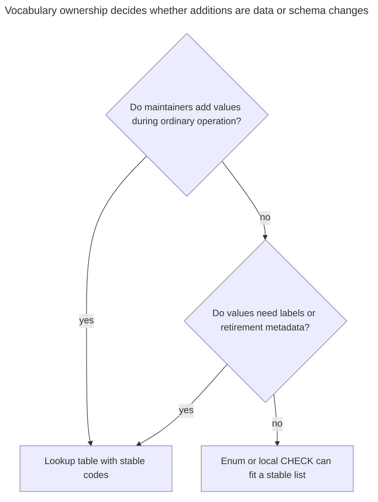
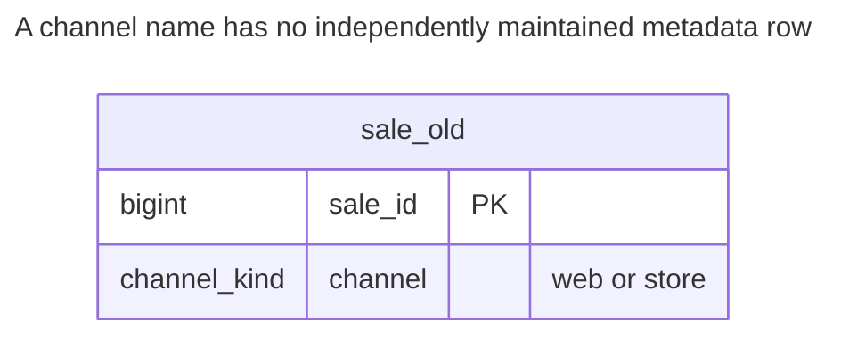
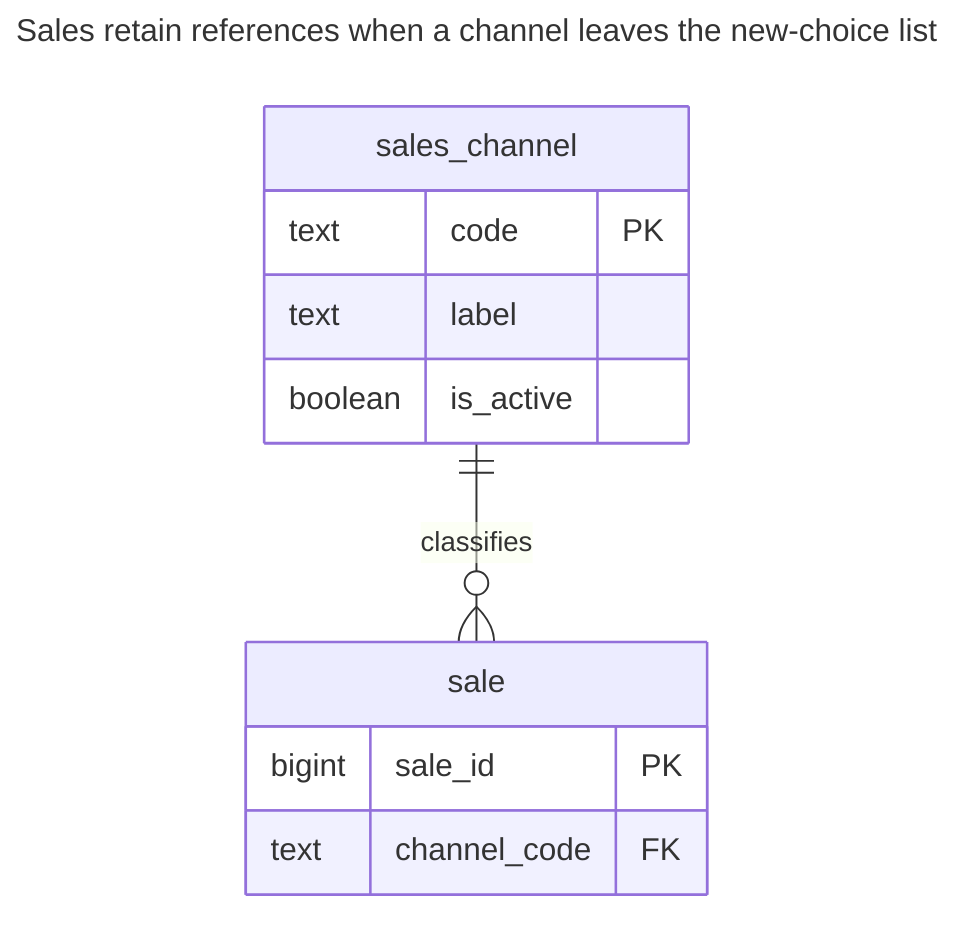
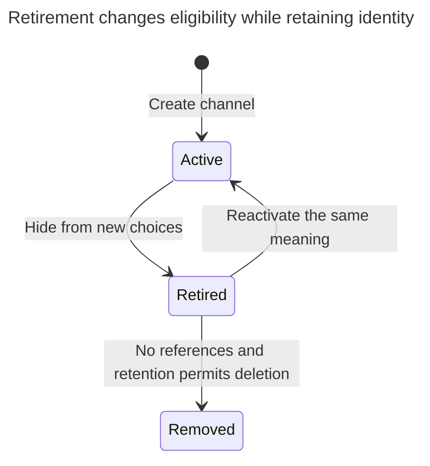
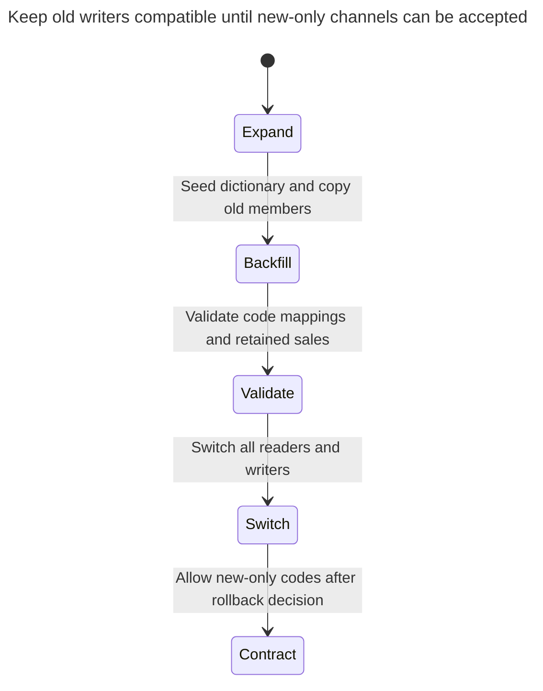

# Volatile Enums

Volatile enums put a list of values that changes with business data — product categories, regions, sales channels — into an enum type or a CHECK constraint. Every new value then needs a schema migration, removing a PostgreSQL enum value requires recreating the type, and the application must inspect the schema list or duplicate it in code to list the allowed values. The chapter shows when such lists belong in a lookup table and when a stable enum is still the better choice. Bill Karwin calls this 31 Flavors.

## Also known as

31 Flavors, in Bill Karwin's [SQL Antipatterns contents](https://pragprog.com/titles/bksap1/sql-antipatterns-volume-1/). This chapter narrows the harmful condition to business-maintained vocabularies whose lifecycle does not fit schema releases.

## Context

Your sales team opens and retires channels, changes their display labels and chooses which appear in new-order forms. You initially have only `web` and `store`, so a native enum or a local `CHECK ... IN (...)` list seems sufficient. The list later becomes operational data owned by people who do not deploy schema changes.

## Problem

You encode each business addition as DDL and leave no row for its label, availability or other metadata. PostgreSQL [enum types](https://www.postgresql.org/docs/18/datatype-enum.html) have declaration order and distinct type identity; existing members cannot be removed or reordered without recreating the type. That is a concrete mismatch for channels that are retired while old sales retain their meaning.

A CHECK list can be replaced to remove a member after reconciling stored rows, so do not describe removal as universally impossible. Both representations can be inspected through schema metadata. The cost is requiring an application that maintains choices to understand the schema's representation or keep a second list synchronized with it.

## Why people do it

A short schema list gives immediate validation without another table. A small developer-owned vocabulary can reasonably change only with releases, especially when every new value requires new application behavior anyway. Stable enums remain useful. The anti-pattern begins when adding a category is supposed to be ordinary business work but still requires a type migration.

## Consequences

- ➖ Business maintenance inherits DDL permissions, scheduling and compatibility costs.
- ➖ Hiding a retired choice and preserving its old references become awkward without per-value metadata.
- ➖ An enum's declaration order can be mistaken for an editable display order.
- ➖ A database accepting a new member does not make older application logic understand it.
- ➖ Reusing a retired code for another meaning reinterprets old records regardless of representation.

## Signs

- A ticket for a new region or channel asks a developer to change an enum.
- Labels and active flags live in a separate application dictionary keyed by enum spelling.
- Deletion means removing a code from the type even though historical rows still use it.
- Dropdown generation reads database catalog definitions on ordinary requests.

## A better way

Give the vocabulary its own [Lookup Table](lookup-table.md), with a stable key and mutable presentation attributes. Reference the key from sales. Retire an entry without deleting it; distinguish existence from eligibility for a new assignment. The example supplies membership integrity and a choices query. Enforcing active-only assignment requires the additional synchronized write rule described in the lookup chapter.

### Alternatives and selection

| Choice | Relationship | Choose it when |
| --- | --- | --- |
| [Lookup Table](lookup-table.md) | Replacement | Values need labels, retirement or routine business maintenance |
| PostgreSQL enum | Implementation option for a stable vocabulary | A developer-owned type has a small release-controlled member set |
| Local CHECK list | Implementation option | A small stable rule belongs to one column and needs no metadata |
| Lookup table plus guarded assignment | Complement | Retired values must remain readable but must reject new assignments |

Use the [Decision Atlas](decision-atlas.md) for the full comparison. A table changes how you maintain choices, not how you deploy code that branches on them.



A permanently fixed technical distinction can stay in DDL. The need for metadata alone can justify rows even when additions are rare.

## Example

### Structure

**Before:** the allowed channels live inside the type definition.



The custom type constrains the stored spelling. It does not give each channel a label or retirement state.

```sql
CREATE TYPE channel_kind AS ENUM ('web', 'store');
CREATE TABLE sale_old (sale_id bigint PRIMARY KEY, channel channel_kind NOT NULL);
INSERT INTO sale_old VALUES (1, 'web'), (2, 'store');
```

A newly negotiated channel is rejected:

```sql
INSERT INTO sale_old VALUES (3, 'partner');
```

PostgreSQL 18.6 raises SQLSTATE `22P02`: `ERROR: invalid input value for enum channel_kind: "partner"`. [`ALTER TYPE ... ADD VALUE`](https://www.postgresql.org/docs/18/sql-altertype.html) can extend the type, but an addition made inside a transaction cannot be used until that transaction commits.

**After:** channels are referenceable data.



Every sale needs one existing channel. The FK checks the code, not `is_active`.

```sql
CREATE TABLE sales_channel (
    code text PRIMARY KEY,
    label text NOT NULL,
    is_active boolean NOT NULL DEFAULT true
);
CREATE TABLE sale (
    sale_id bigint PRIMARY KEY,
    channel_code text NOT NULL,
    CONSTRAINT sale_channel_fk FOREIGN KEY (channel_code) REFERENCES sales_channel (code)
);
CREATE INDEX sale_channel_idx ON sale (channel_code);
BEGIN;
LOCK TABLE sale_old IN SHARE ROW EXCLUSIVE MODE;
INSERT INTO sales_channel (code, label)
SELECT DISTINCT channel::text, initcap(channel::text) FROM sale_old;
INSERT INTO sale SELECT sale_id, channel::text FROM sale_old;
COMMIT;
BEGIN;
INSERT INTO sales_channel (code, label) VALUES ('partner', 'Partner sales');
INSERT INTO sale VALUES (3, 'partner');
COMMIT;
UPDATE sales_channel SET is_active = false WHERE code = 'store';
SELECT code, label FROM sales_channel WHERE is_active ORDER BY code;
SELECT s.sale_id, c.label, c.is_active FROM sale AS s
JOIN sales_channel AS c ON c.code = s.channel_code ORDER BY s.sale_id;
```

The choices are `partner, web`. The sales read retains sale `2` with label `Store` and `is_active = false`; no sale disappears from the join. The new channel and its first sale are inserted in one transaction. The [complete script](../assets/volatile-enums/volatile-enums.sql) verifies the enum failure, migration and the following two membership failures.

```sql
INSERT INTO sale VALUES (4, 'unknown');
```

That raises SQLSTATE `23503`: `ERROR: insert or update on table "sale" violates foreign key constraint "sale_channel_fk"`.

```sql
DELETE FROM sales_channel WHERE code = 'store';
```

Deleting referenced `store` raises SQLSTATE `23503`: `ERROR: update or delete on table "sales_channel" violates foreign key constraint "sale_channel_fk" on table "sale"`. Clearing the active flag was the intended operation.

### Engine support

- **PostgreSQL 18:** use enum [ordering and evolution rules](https://www.postgresql.org/docs/18/datatype-enum.html) deliberately. A display order that changes independently belongs in data.
- **MySQL 8.4:** [`ENUM` is declared on the column, sorts by member position and has a special invalid-value member](https://dev.mysql.com/doc/refman/8.4/en/enum.html). Strict mode rejects invalid input; non-strict or error-suppressed writes can have different outcomes from the PostgreSQL failure above.
- **SQL Server:** an [alias type](https://learn.microsoft.com/en-us/sql/t-sql/statements/create-type-transact-sql?view=sql-server-ver17) is not PostgreSQL's enumerated type. Choose a CHECK or FK table for value membership.
- **Oracle:** [SQL domains](https://docs.oracle.com/en/database/oracle/oracle-database/26/sqlrf/create-domain.html) can centralize value rules. Reusable validation still does not provide an editable row per channel.
- **SQLite:** [CHECK expressions](https://www.sqlite.org/lang_createtable.html#check_constraints) can constrain fixed text values; an FK table needs [enforcement enabled on each connection](https://www.sqlite.org/foreignkeys.html#fk_enable).

### Failure and concurrency

A cached form can submit a code after retirement. The lab FK still accepts an existing retired code, because availability is outside its key. If that must fail, lock and validate availability during assignment, with retirement participating in the same protocol; [Lookup Table](lookup-table.md) supplies the implementation. A choices query alone is not enforcement.



Existing references survive retirement. Reactivating a code is appropriate only for the same meaning; a new meaning needs a new identity.

### Migration

Inventory stored members and seed a row for each, including retired values. The lab derives the initial dictionary from used members; a production migration must also seed valid unused members from its approved vocabulary. Add a text reference column or shadow table, synchronize writes and backfill by an explicit code mapping. Validate membership before switching reads.



A new code that the old enum cannot represent closes the old-code rollback path. Delay accepting it until old writers retire, or define a compatibility mapping before launch. Keep original data until reconciliation finishes, and do not promise that replacing the type or changing a CHECK is lock-free; consult PostgreSQL's [ALTER TABLE rules](https://www.postgresql.org/docs/18/sql-altertable.html) and [Expand and Contract](expand-contract.md).

## Related patterns and anti-patterns

- [Lookup Table](lookup-table.md) compares enum, CHECK, domain and reference-data representations.
- [Missing Foreign Keys](missing-foreign-keys.md) explains why a dropdown cannot replace membership enforcement.
- [Expand and Contract](expand-contract.md) stages the schema and application compatibility change.
