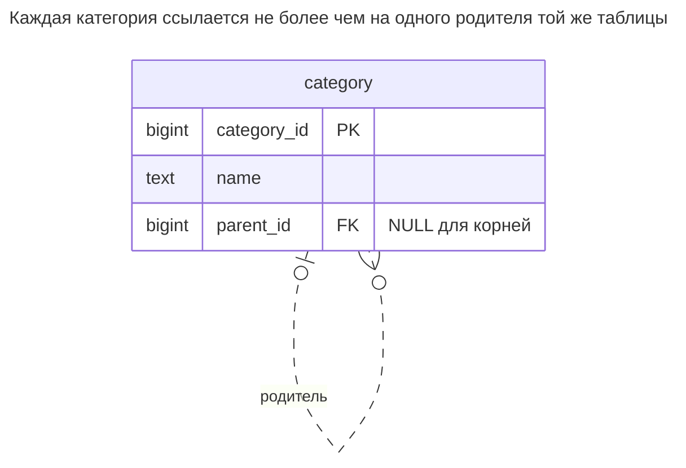
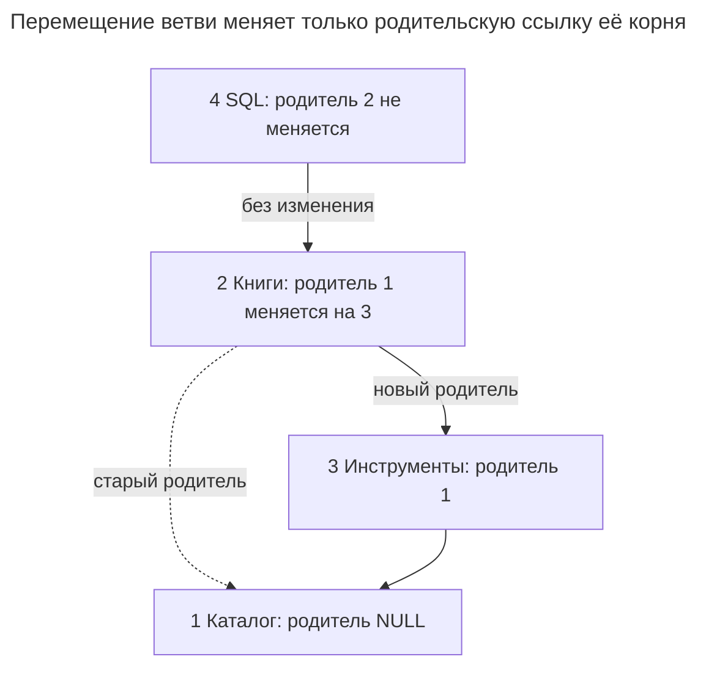
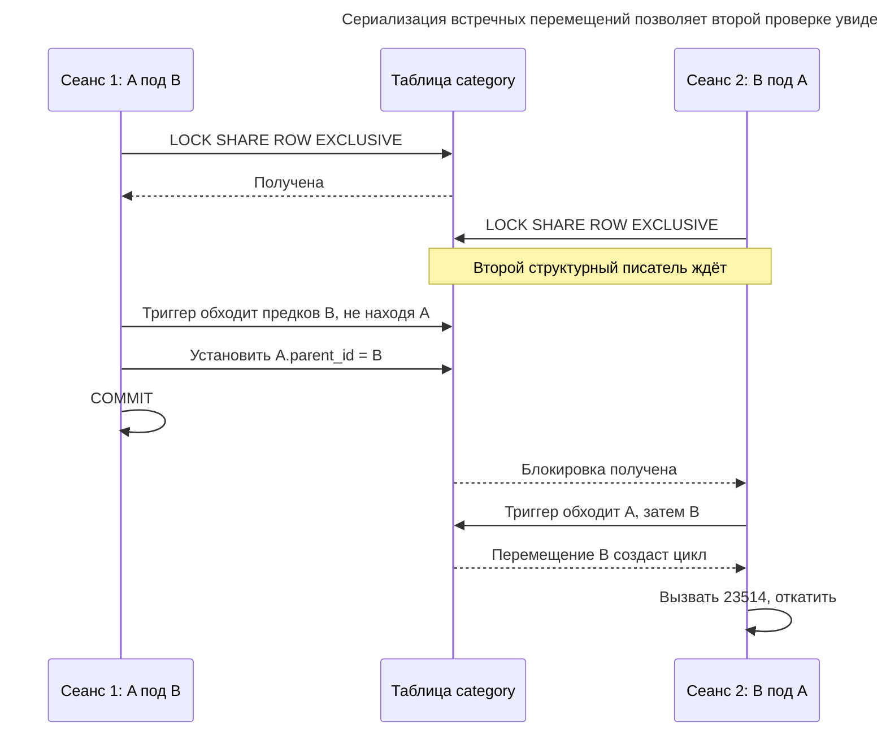

# Список смежности

## Назначение

Список смежности хранит дерево, задавая каждой строке ссылку на родителя в той же таблице. Это самая простая структура для записи и поддержания согласованности: перемещение поддерева меняет одно значение, а внешний ключ гарантирует существование каждого родителя. Глава показывает, как рекурсивные обобщённые табличные выражения читают потомков, предков и пути одним запросом, как предотвращать циклы и при какой глубине и нагрузке чтения начинают окупаться альтернативы. [Примеры рекурсивных запросов PostgreSQL](https://www.postgresql.org/docs/18/queries-with.html) показывают обход родительских ссылок.

## Также известен как

Модель «родитель/потомок»; родительские ссылки. [Руководство Microsoft по иерархиям](https://learn.microsoft.com/en-us/sql/relational-databases/hierarchical-data-sql-server?view=sql-server-ver17) использует «parent/child»; [руководство MongoDB по деревьям](https://www.mongodb.com/docs/manual/tutorial/model-tree-structures-with-parent-references/) называет то же направление ссылки «Parent References».

## Проблема

Вы организуете каталог по категориям. У каждой категории не более одного родителя, но заранее неизвестно, сколько уровней создадут редакторы. Нужно выводить непосредственных детей, показывать навигационную цепочку и иногда перемещать целую ветвь. Столбец на каждый уровень делает схему зависимой от сегодняшней глубины. Фиксированное число самосоединений вводит то же ограничение в запрос; см. [Фиксированная глубина](fixed-depth-queries.md).

Более сложный инвариант: следование по родителям должно в итоге достигать корня. Внешний ключ отклоняет отсутствующего родителя, но две существующие строки всё равно могут ссылаться друг на друга. Существование родителя и предотвращение циклов нужно проверять отдельно; [документация ограничений PostgreSQL](https://www.postgresql.org/docs/18/ddl-constraints.html) явно поддерживает самоссылки, но не превращает их в деревья.

## Решение

Храните в строке неизменяемый ID категории и допускающий `NULL` `parent_id`. Родитель `NULL` обозначает корень; пример допускает несколько корней, поэтому точнее назвать его лесом. Индексируйте столбец родителя для поиска детей. Обходите столько уровней, сколько требуют данные, с помощью [рекурсивного CTE](https://www.postgresql.org/docs/18/queries-with.html#QUERIES-WITH-RECURSIVE): начните с выбранной категории и последовательно присоединяйте детей к текущему фронту обхода.

Для перемещения меняйте лишь родителя перемещаемого узла. До этого пройдите вверх от предлагаемого родителя и отклоните перемещение, если встретите перемещаемый узел. Сериализуйте структурных писателей до этой проверки. Реализация использует триггер для обхода и явную блокировку таблицы на время транзакции для сериализации. Блокировка — часть контракта записи; одного триггера при конкурентных перемещениях недостаточно.

## Альтернативы и выбор

| Соседний паттерн | Связь | Определяющее требование |
| --- | --- | --- |
| [Материализованный путь](materialized-path.md) | Замена; дополнение в виде поддерживаемого представления чтения | Вы часто читаете целые поддеревья или цепочки предков и принимаете перезапись потомков при перемещениях |
| [Вложенные множества](nested-sets.md) | Замена; дополнение как публикуемое представление чтения | Почти статичной иерархии нужны диапазонные проходы и подсчёт потомков по плотной нумерации |
| [Таблица замыканий](closure-table.md) | Замена; дополнение как индекс достижимости | Соединения и предков, и потомков оправдывают хранение всех достижимых пар |

Полное сравнение семейства — в [Атласе решений](decision-atlas.md). Рекурсия — способ чтения этой схемы, а не конкурирующий паттерн хранения. Универсальной глубины обязательного перехода нет: сравнивайте размеры ветвей, частоту перемещений и измеренное время запросов.

## Структура



Самоссылка допускает много детей у родителя и ноль или одного родителя у ребёнка. Перемещение Books под Tools оставляет ссылку SQL на Books нетронутой.



Стрелки идут вверх по сохранённым родительским ссылкам; перемещение записывает лишь новую сплошную связь из Books. SQL следует за Books на новое место без обновления собственной строки.

## Таблицы и инварианты

- **`category`** хранит узлы с ключом `category_id`. `category_parent_fk` требует существования каждого родителя, отличного от `NULL`. Действие удаления по умолчанию не позволяет удалить родителя, сохранив детей.
- **`category_not_self`** отклоняет прямую ссылку на себя. Триггер отклоняет более длинные циклы, проверяя предков предлагаемого родителя.
- **Протокол записи** сохраняет ID, меняет одного родителя за операцию и берёт структурную блокировку до любых чтений дерева. Ни внешний ключ, ни проверка одной строки не обеспечивают этот протокол.
- **Порядок** задаётся явно. Пример сортирует по пути из ID; идентификаторы не выражают предпочтительный для редактора порядок соседей.

## Когда применять

- Вы преимущественно создаёте узлы, читаете непосредственных детей или перемещаете ветви.
- Переменная глубина действительно нужна, но чтение поддеревьев пока не оправдывает избыточное хранение.
- Нужен компактный источник истины, из которого можно перестроить другое представление иерархии.

## Последствия и компромиссы

- ➕ Перемещение обновляет одну сохранённую ссылку независимо от размера поддерева; проверка цикла всё ещё читает предков.
- ➕ Вы храните одну строку узла вместо путей или всех достижимых пар.
- ➖ Чтение поддеревьев и цепочек предков выполняет обход во время запроса.
- ➖ Внешний ключ доказывает существование родителя, но не ацикличность и не политику единственного корня.
- ➖ Простой протокол блокировки сериализует все структурные изменения, даже в разных ветвях.

## Реализация

[Полный скрипт PostgreSQL 18.6](../assets/adjacency-list/adjacency-list.sql) создаёт дерево, читает оба направления, перемещает Books и удаляет это поддерево. Блок исключения проверяет ожидаемую диагностику цикла. Начните с таблицы и триггера:

```sql
CREATE TABLE category (
    category_id bigint PRIMARY KEY,
    name text NOT NULL,
    parent_id bigint,
    CONSTRAINT category_parent_fk FOREIGN KEY (parent_id)
        REFERENCES category (category_id),
    CONSTRAINT category_not_self CHECK (parent_id <> category_id)
);
CREATE INDEX category_parent_idx ON category (parent_id);

CREATE FUNCTION reject_category_cycle() RETURNS trigger
LANGUAGE plpgsql AS $$
BEGIN
    IF EXISTS (
        WITH RECURSIVE ancestors AS (
            SELECT category_id, parent_id FROM category
            WHERE category_id = NEW.parent_id
            UNION
            SELECT c.category_id, c.parent_id
            FROM category AS c JOIN ancestors AS a
                ON c.category_id = a.parent_id
        )
        SELECT 1 FROM ancestors WHERE category_id = NEW.category_id
    ) THEN
        RAISE EXCEPTION 'category cycle' USING ERRCODE = '23514';
    END IF;
    RETURN NEW;
END;
$$;
CREATE TRIGGER category_cycle
BEFORE INSERT OR UPDATE OF parent_id ON category
FOR EACH ROW EXECUTE FUNCTION reject_category_cycle();
```

`UNION` триггера убирает повторяющиеся строки `(category_id, parent_id)`, поэтому проверочный обход завершается, даже если старые данные уже содержат цикл. Он не исправляет эти данные. Все писатели используют показанную ниже блокировку при стандартной [изоляции Read Committed PostgreSQL](https://www.postgresql.org/docs/18/transaction-iso.html#XACT-READ-COMMITTED); получайте её отдельным оператором до проверочных чтений:

```sql
BEGIN;
LOCK TABLE category IN SHARE ROW EXCLUSIVE MODE;
INSERT INTO category VALUES (1, 'Catalog', NULL);
INSERT INTO category VALUES (2, 'Books', 1), (3, 'Tools', 1);
INSERT INTO category VALUES (4, 'SQL', 2);
COMMIT;
```

Прочитайте корень и потомков, вычисляя путь для порядка отображения:

```sql
WITH RECURSIVE subtree AS (
    SELECT category_id, name, ARRAY[category_id] AS path
    FROM category WHERE category_id = 1
    UNION ALL
    SELECT c.category_id, c.name, s.path || c.category_id
    FROM category AS c JOIN subtree AS s ON c.parent_id = s.category_id
)
SELECT category_id, name, path FROM subtree ORDER BY path;
```

Результат содержит ID `1, 2, 4, 3` с путями `{1}`, `{1,2}`, `{1,2,4}`, `{1,3}`. Итоговый `ORDER BY` определяет порядок представления; [документация PostgreSQL о порядке поиска](https://www.postgresql.org/docs/18/queries-with.html#QUERIES-WITH-SEARCH) отличает его от порядка выполнения рекурсии. Для навигационной цепочки разверните соединение:

```sql
WITH RECURSIVE ancestors AS (
    SELECT category_id, parent_id, name, 0 AS distance
    FROM category WHERE category_id = 4
    UNION ALL
    SELECT c.category_id, c.parent_id, c.name, a.distance + 1
    FROM category AS c JOIN ancestors AS a ON c.category_id = a.parent_id
)
SELECT category_id, name FROM ancestors ORDER BY distance DESC;
```

До перемещения цепочка — Catalog, Books, SQL. Переместите Books вместе с потомком SQL под Tools:

```sql
BEGIN;
LOCK TABLE category IN SHARE ROW EXCLUSIVE MODE;
UPDATE category SET parent_id = 3 WHERE category_id = 2;
COMMIT;
```

Теперь у Books родитель `3`; у SQL всё ещё `2`. Следующая попытка замкнула бы цикл Tools → SQL → Books → Tools:

```sql
BEGIN;
LOCK TABLE category IN SHARE ROW EXCLUSIVE MODE;
UPDATE category SET parent_id = 4 WHERE category_id = 3;
ROLLBACK;
```

PostgreSQL 18.6 возвращает SQLSTATE `23514`, `ERROR: category cycle`. Триггер намеренно задаёт эти сообщение и код через [PL/pgSQL `RAISE`](https://www.postgresql.org/docs/18/plpgsql-errors-and-messages.html). Откатите неудачную транзакцию. Для удаления скрипт сначала рекурсивно выбирает всё поддерево и удаляет все узлы одним оператором; удаление только Books — другая политика, требующая явно обработать детей.

Удалите перемещённое поддерево Books в одной транзакции:

```sql
BEGIN;
LOCK TABLE category IN SHARE ROW EXCLUSIVE MODE;
WITH RECURSIVE subtree AS (
    SELECT category_id FROM category WHERE category_id = 2
    UNION ALL
    SELECT c.category_id FROM category AS c
    JOIN subtree AS s ON c.parent_id = s.category_id
)
DELETE FROM category WHERE category_id IN (SELECT category_id FROM subtree);
COMMIT;
```

## Поддержка в движках

- **PostgreSQL 18:** рекурсивные запросы выше используют массивы для путей отображения. [`CYCLE`](https://www.postgresql.org/docs/18/queries-with.html#QUERIES-WITH-CYCLE) — дополнительная защита при чтении недоверенных данных; он не предотвращает недопустимую запись.
- **MySQL 8.4:** [рекурсивные CTE](https://dev.mysql.com/doc/refman/8.4/en/with.html) поддерживают обход, но `cte_max_recursion_depth` по умолчанию равен 1000. Выберите осмысленный предел и адаптируйте выражение массива PostgreSQL, а не копируйте его.
- **SQL Server 2025 (17.x):** [синтаксис рекурсивных CTE](https://learn.microsoft.com/en-us/sql/t-sql/queries/recursive-common-table-expression-transact-sql?view=sql-server-ver17) использует `WITH` без `RECURSIVE`; `MAXRECURSION` управляет пределом рекурсии. Выбор схемы родитель/потомок остаётся тем же.
- **Oracle AI Database 26ai:** [`START WITH ... CONNECT BY PRIOR`](https://docs.oracle.com/en/database/oracle/oracle-database/26/sqlrf/Hierarchical-Queries.html) обходит родительские ссылки. `NOCYCLE` помогает работать с циклическими данными, но не является ограничением записи.
- **SQLite 3:** [рекурсивные CTE](https://www.sqlite.org/lang_with.html) читают такую структуру. Включайте [внешние ключи](https://www.sqlite.org/foreignkeys.html) для каждого соединения, чтобы обеспечить существование родителей.

## Сбои и конкурентность

Пусть A и B — корни. Одна транзакция помещает A под B, другая — B под A. Каждая может видеть корректное старое дерево и пройти собственную проверку предков. Блокировка только перемещаемой строки не сериализует эти проверки. Пример берёт `SHARE ROW EXCLUSIVE` до любого структурного чтения; PostgreSQL документирует, что режим [конфликтует с собой и обычной записью, разрешая простое чтение](https://www.postgresql.org/docs/18/explicit-locking.html#LOCKING-TABLES). Каждая вставка, перемещение и удаление обязаны соблюдать протокол. Поместите операции за управляемыми процедурами или единым путём записи приложения вместо выдачи несвязанным писателям неограниченного изменения структуры.



Второй триггер выполняется после фиксации первого перемещения и находит B среди предков A. Блокировка таблицы защищает проверочное чтение, включая строки помимо перемещаемого узла.

Держите проверку и изменение в одной транзакции. При ошибке откатывайте оба. После неопределённой фиксации перечитайте текущего родителя до повтора: требуемое состояние могло уже установиться или другой редактор мог его изменить. Более крупная система может заменить глобальную блокировку тщательно спроектированными блокировками деревьев или [транзакциями Serializable с полными повторами](https://www.postgresql.org/docs/18/transaction-iso.html#XACT-SERIALIZABLE), но должна доказать участие вставок, междеревных перемещений и удалений.

## Миграция

Добавьте допускающие `NULL` ID родителей, пока старое представление остаётся основным. Заполняйте по стабильным ID узлов; устраните отсутствующих родителей, неоднозначность нескольких родителей и циклы до переключения писателей. Новых писателей сразу запускайте с протоколом блокировки и проверки, сравнивая рекурсивные результаты со старым представлением. При переносе ограничивайте диагностические обходы или используйте `CYCLE`, чтобы некорректные старые ссылки не обходились бесконтрольно.

Если читателям нужен непрерывный доступ, сохраняйте старое представление во время проверки нового и переключайте читателей поэтапно. Запланируйте короткую паузу структурной записи для итоговой сверки и включения ограничений; обычное чтение может продолжать использовать старые данные. Поддерживайте старое представление на протяжении окна отката. Для последующей отмены перемещения нужен прежний родитель, поэтому записывайте его в журнал миграции, а не пытайтесь вывести из текущего дерева.

```mermaid
---
title: Родительские ссылки становятся основными лишь после проверки и сверки
---
stateDiagram-v2
  state "Старое представление основное" as Old
  state "ID родителей заполнены и проверены" as Validated
  state "Структурная запись приостановлена" as Paused
  state "Новый протокол и ограничения включены" as Ready
  state "Читатели переключены; старая форма поддерживается" as Switched
  [*] --> Old
  Old --> Validated: Устранить отсутствующих родителей и циклы
  Validated --> Paused: Начать итоговую сверку
  Paused --> Ready: Сверить последние изменения
  Ready --> Switched: Возобновить запись; переключать читателей поэтапно
  Switched --> Old: Вернуть в течение окна отката
  class Old muted
  class Validated,Ready,Switched accent
  class Paused warn
```



Читатели могут использовать старое представление, пока структурная запись приостановлена для итоговой сверки. Стрелка отката зависит от продолжения поддержки этого представления.

## Антипаттерны и частые ошибки

- Заменять рекурсию фиксированным числом самосоединений; [Фиксированная глубина](fixed-depth-queries.md) объясняет незаметное усечение результата.
- Считать самоссылочный внешний ключ защитой от циклов или принимать детектор циклов запроса за ограничение.
- Перемещать несколько узлов массовым обновлением, полагаясь на триггер для одиночных перемещений.
- Следовать произвольному правилу «три уровня означают вложенные множества» без измерений реального чтения и записи.

## Известные применения

- [Пример организации родитель/потомок Microsoft](https://learn.microsoft.com/en-us/sql/relational-databases/hierarchical-data-sql-server?view=sql-server-ver17) хранит `ManagerId` как самоссылочный внешний ключ.
- [Руководство Parent References MongoDB](https://www.mongodb.com/docs/manual/tutorial/model-tree-structures-with-parent-references/) хранит ID родителя в каждом документе категории. Оно иллюстрирует представление, но не предоставляет гарантию внешнего ключа этой реляционной схемы.

## Связанные паттерны

- [Материализованный путь](materialized-path.md) хранит предков в каждом узле для чтения по путям.
- [Вложенные множества](nested-sets.md) превращают чтение поддеревьев в проходы по интервалам.
- [Таблица замыканий](closure-table.md) материализует достижимость отдельно от узлов.
- [Фиксированная глубина](fixed-depth-queries.md) выявляет ошибку обхода, не осуждая родительские ссылки.
