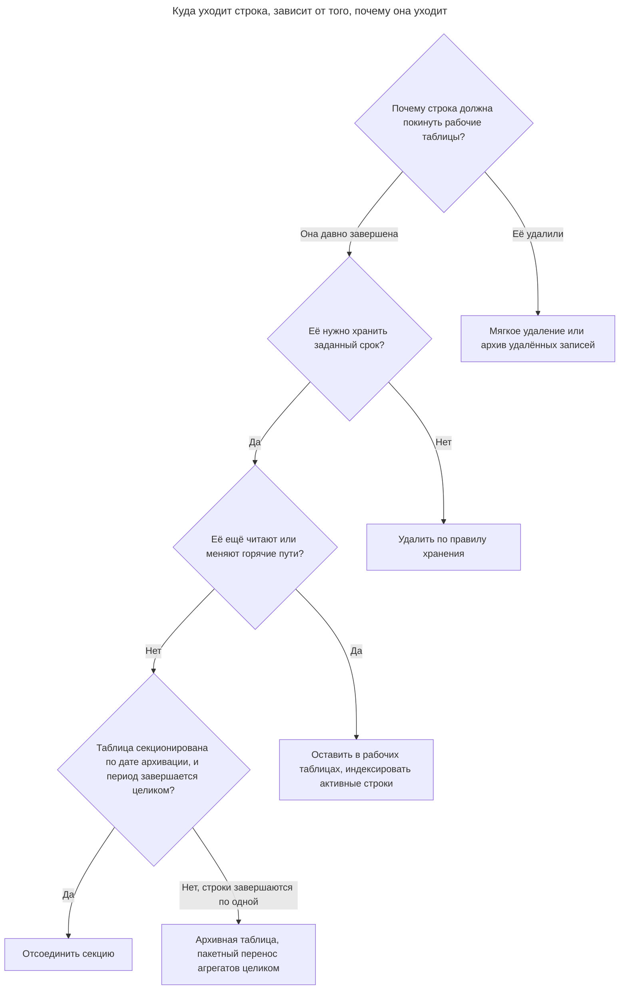
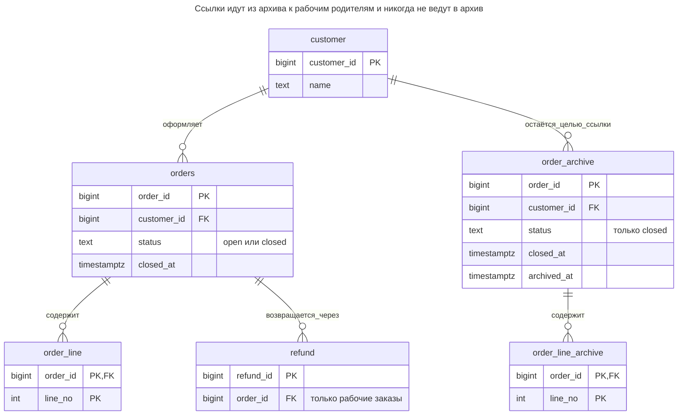
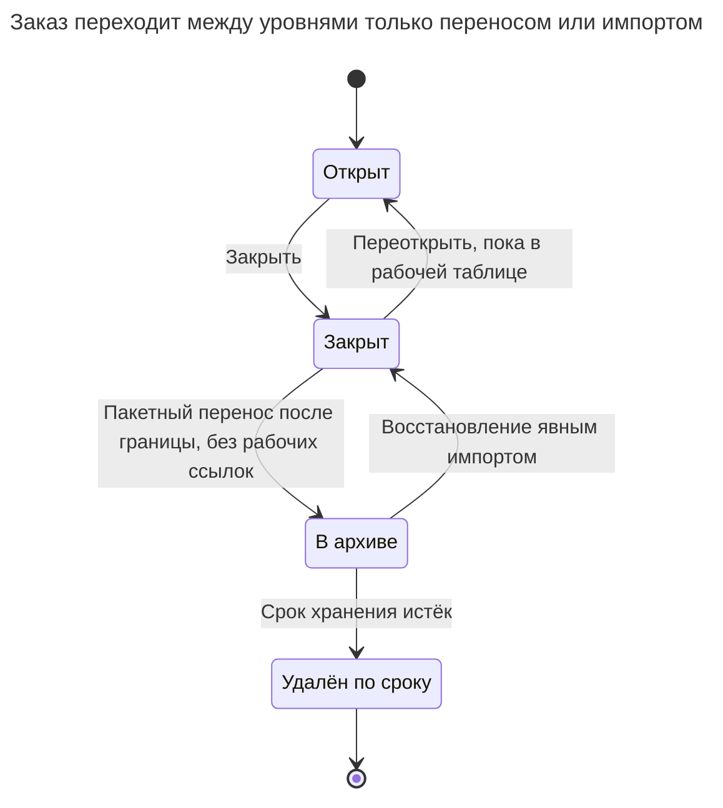
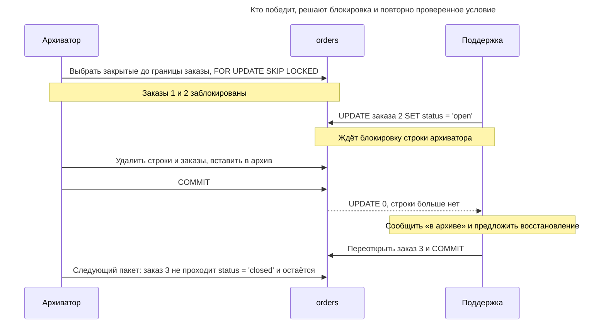

# Архивная таблица

## Назначение

Архивная таблица хранит завершённые строки, которые нужно сохранить, например заказы, закрытые больше двух лет назад, вне рабочих таблиц и по собственным правилам хранения и доступа. Рабочие таблицы и их индексы содержат тогда только рабочий набор, а старые данные остаются доступными для запросов поддержки, аудита и юристов. Глава показывает два механизма: пакетный перенос, который удаляет агрегат целиком из рабочих таблиц и вставляет его в архивные одним оператором, и отсоединённые секции для таблиц, уже секционированных по дате архивации. Разобраны граница переноса, при которой внешние ключи остаются корректными, представление над обоими уровнями и его цена, восстановление как явный импорт, срок хранения и гонка между архиватором и поздним переоткрытием заказа. Перенос строится на [`DELETE ... RETURNING`](https://www.postgresql.org/docs/18/sql-delete.html) и [изменяющих данные CTE](https://www.postgresql.org/docs/18/queries-with.html#QUERIES-WITH-MODIFYING) PostgreSQL.

## Также известен как

Архивный уровень, холодная таблица, онлайн-архив. [Руководство Oracle по управлению жизненным циклом информации](https://docs.oracle.com/en/database/oracle/oracle-database/26/vldbg/time-based-info.html#GUID-AC2B567F-14EF-4E7A-9992-076A2A820305) называет онлайн-архивом старые данные, которые хранятся и остаются доступными для запросов. [In-Database Archiving](https://docs.oracle.com/en/database/oracle/oracle-database/26/vldbg/time-based-info.html#GUID-BD1D524E-A55F-4CD4-911E-092E596F0D80) в Oracle называет этим словом другое: функция добавляет столбец `ORA_ARCHIVE_STATE`, и помеченные архивными строки остаются в той же таблице, но исключаются из обычных запросов. Это флаг видимости, близкий к [мягкому удалению](soft-delete.md), а не перенос.

## Проблема

Магазин хранит все заказы с 2015 года в `orders` и `order_line`. Почти все они закрыты много лет назад, но по-прежнему лежат в каждом индексе, проходят через каждую очистку и каждую перезапись таблицы при миграции, а каждый рабочий запрос вынужден их отфильтровывать. Удалить их нельзя: налоговые правила требуют хранить сведения о продажах годами, а поддержка ищет четырёхлетний заказ, когда приходит гарантийная претензия.

Первая версия архивации обычно состоит из двух операторов в одной длинной транзакции: `INSERT INTO order_archive SELECT ... WHERE closed_at < cutoff`, затем `DELETE FROM orders WHERE closed_at < cutoff`. Она держит блокировки на миллионах строк, порождает всплеск WAL и, пока работает, не даёт очистке убрать ничего более нового. Она переносит заказы без их строк или падает на возврате, который ещё ссылается на старый заказ. Если кто-то переоткроет заказ между двумя операторами, второй уже не совпадает с первым. А после переноса инструмент поддержки, который читает только `orders`, сообщает, что заказа не существует.

## Решение

Определите, что переносится и когда это допустимо, а затем переносите небольшими атомарными пакетами:

- **Единица переноса — агрегат.** Заказ переносится вместе со своими строками в одном операторе, поэтому внешние ключи внутри агрегата остаются корректными на обоих уровнях.
- **Архивируемое состояние задано явно:** статус `closed`, закрыт раньше границы, и ни одна рабочая строка вне агрегата (возврат, обращение в поддержку) на него не ссылается. Архивная таблица повторяет это состояние в `CHECK`, поэтому заказ, который к моменту переноса снова открыт, будет отклонён.
- **Ссылки идут только из архива.** Архивные строки могут ссылаться на рабочих родителей, например на `customer`; рабочие строки не могут ссылаться на архивные, потому что внешний ключ указывает на одну таблицу, а архивного заказа в ней больше нет. Проводите границу так, чтобы ни одна рабочая ссылка не пересекала её, или оставляйте строки, на которые ссылаются, в рабочих таблицах.
- **Каждый пакет — один оператор:** выбрать кандидатов с `FOR UPDATE SKIP LOCKED`, выполнить `DELETE ... RETURNING` для строк заказа и самих заказов и вставить возвращённое в архивные таблицы через `INSERT`. Каждый пакет фиксируется отдельно.
- **Чтение обоих уровней идёт через представление `UNION ALL`** с флагом `archived`. Запись идёт только в рабочие таблицы.
- **Восстановление переносит агрегат обратно с явным сопоставлением столбцов**, а **хранение заканчивается удалением из архива**, когда истекает срок.

Таблица, секционированная по диапазону даты архивации, отдаёт период целиком через `DETACH PARTITION`. Отсоединение и повторное присоединение показаны в главе [Секционирование таблицы](table-partitioning.md); здесь добавлено только правило о внешних ключах.

## Альтернативы и выбор

| Вариант | Отношение | Решающее требование |
| --- | --- | --- |
| Архивная таблица с пакетным переносом | Эта глава | Каждая строка становится архивируемой по своему состоянию и возрасту и должна храниться заданный срок |
| [Отсоединённая секция](table-partitioning.md) | Вариант реализации | Таблица секционирована по дате архивации, и целый период становится архивируемым одновременно |
| [Мягкое удаление](soft-delete.md) и его архив удалённых записей | Замена для другого вопроса | Строка уходит, потому что её удалили, а не потому, что она завершена |
| Завершённые строки остаются в рабочих таблицах, активные покрыты частичными индексами | Замена | Размер таблицы пока не мешает; горячие запросы фильтруют открытые строки |
| [Таблица итогов](summary-table.md) | Дополнение | Отчётам по старым периодам нужны итоги, а не строки: итоги остаются в рабочем уровне, детали уходят в архив |
| [Таблица истории](history-table.md) | Дополнение | Нужны прежние версии строки; история тоже растёт и архивируется так же |

Выгрузка архива в файлы объектного хранилища, например в Parquet, — следующий уровень вне базы данных: он отказывается от ограничений, транзакций и соединений с рабочими данными и в этой главе не рассматривается. Полное сравнение — в [Атласе решений](decision-atlas.md).



Заказы не завершаются по календарным периодам: заказ, оформленный в марте, может закрыться в марте или быть переоткрыт в мае. Поэтому они переносятся построчно, а журнал только для добавления, секционированный по дням, может уходить целым днём.

## Структура



Архивные таблицы повторяют рабочий агрегат типизированными столбцами и теми же ключами. Обратите внимание на отсутствующую связь: ничто рабочее не ссылается на `order_archive`. `refund` ссылается только на рабочие заказы, поэтому заказ с возвратом остаётся в рабочем уровне, пока не сможет уйти сам возврат. На `customer` ссылаются оба уровня, поэтому клиент остаётся в рабочей таблице, пока хранится хотя бы один его архивный заказ.

## Таблицы и инварианты

- **`orders`** хранит рабочие заказы. `CHECK` связывает `status = 'closed'` с непустым `closed_at`. Частичный индекс по `closed_at` для закрытых строк позволяет архиватору находить кандидатов, не читая открытые заказы.
- **`order_line`** ссылается на `orders` внешним ключом по умолчанию, `NO ACTION`. PostgreSQL проверяет его в конце оператора, поэтому один оператор может удалить строки и их заказ вместе. `ON DELETE CASCADE` здесь опасен: перенос, забывший про строки, удалил бы их вместо архивации.
- **`refund`** — рабочая строка вне агрегата. Её внешний ключ делает заказ, на который она ссылается, неархивируемым: удаление такого заказа вызывает `23503`.
- **`order_archive`** имеет тот же первичный ключ, что и `orders`, метку `archived_at`, внешний ключ на рабочий `customer` и проверку `order_archive_closed`, которая пропускает только закрытые заказы. Два первичных ключа — отдельные ограничения: ничто в схеме не мешает одному заказу оказаться на обоих уровнях. Уровни не пересекаются благодаря переносу: один оператор удаляет строку из одной таблицы и вставляет её в другую.
- **`order_line_archive`** ссылается на `order_archive` с `NO ACTION` по той же причине, что и рабочие строки. Хранение должно удалять строки и заказы вместе.
- **`order_all`** — представление `UNION ALL` над обоими уровнями с флагом `archived`. Оно доступно только для чтения.

## Когда применять

- Большинство строк таблицы завершены, редко читаются и всё же должны храниться заданный срок.
- Завершённое состояние окончательно или отменяется редко, и отмена может пройти через процедуру восстановления.
- Строки становятся архивируемыми по одной, по собственному состоянию, и ключ секционирования не может выразить эту границу.
- Старым данным нужны другие правила, чем рабочим: их читает меньше людей, у них свой срок хранения или им место в более дешёвом [табличном пространстве](https://www.postgresql.org/docs/18/manage-ag-tablespaces.html).

## Последствия и компромиссы

- ➕ Работа индексов и очистки на рабочих таблицах масштабируется с рабочим набором, а миграции рабочих таблиц затрагивают меньше строк.
- ➕ Доступ и хранение задаются для каждого уровня: роль поддержки может читать архив, не имея права его менять, а хранение удаляет только из архива.
- ➕ Каждый пакет атомарен и невелик, поэтому задание можно остановить в любой точке и продолжить.
- ➖ Каждый читатель, которому может понадобиться старый заказ, должен выбрать: только рабочий уровень, только архив или представление. Поиск по ключу через представление обращается к обоим уровням.
- ➖ Каждая миграция рабочей таблицы должна решить, что происходит с архивом, а восстановление — приводить старые строки к текущей форме.
- ➖ Уникальность между уровнями — свойство процедуры, а не ограничение.
- ➖ Перенос строк — это `DELETE` плюс `INSERT`: он пишет WAL и оставляет мёртвые строки в рабочих таблицах. Обычный `VACUUM` делает это место пригодным для повторного использования, но [не возвращает его операционной системе](https://www.postgresql.org/docs/18/routine-vacuuming.html), кроме пустых страниц в конце таблицы. Отсоединённая секция обходится без обеих затрат.
- ➖ Архивные таблицы в той же базе данных по-прежнему входят в её размер и резервные копии. Перенос в другую базу лишает внешнего ключа на рабочих родителей и переноса одним оператором.

## Реализация

[Полный скрипт PostgreSQL 18.7](../assets/archive-table/archive-table.sql) проверяет отклонённый перенос заказа, на который ссылаются, устаревший список кандидатов, размеры пакетов, ссылки между уровнями, представление и его планы, оба отказа восстановления и импорт, хранение и отклонённое отсоединение секции. Архивные таблицы повторяют рабочие:

```sql
CREATE TABLE archive_example.order_archive (
    order_id bigint PRIMARY KEY,
    customer_id bigint NOT NULL REFERENCES archive_example.customer (customer_id),
    status text NOT NULL,
    closed_at timestamptz,
    archived_at timestamptz NOT NULL DEFAULT now(),
    CONSTRAINT order_archive_closed CHECK (status = 'closed' AND closed_at IS NOT NULL)
);
CREATE TABLE archive_example.order_line_archive (
    order_id bigint NOT NULL REFERENCES archive_example.order_archive (order_id),
    line_no integer NOT NULL,
    sku text NOT NULL,
    amount numeric(12, 2) NOT NULL,
    PRIMARY KEY (order_id, line_no)
);
```

Один пакет — один оператор. Он выбирает самые старые архивируемые заказы, блокирует их, удаляет их строки и сами заказы и вставляет то, что вернули удаления:

```sql
CREATE FUNCTION archive_example.archive_closed_orders(cutoff timestamptz, batch_size integer)
RETURNS bigint LANGUAGE sql AS $$
WITH picked AS (
    SELECT o.order_id FROM archive_example.orders AS o
    WHERE o.status = 'closed' AND o.closed_at < cutoff
      AND NOT EXISTS (SELECT FROM archive_example.refund AS r WHERE r.order_id = o.order_id)
    ORDER BY o.closed_at, o.order_id
    LIMIT batch_size
    FOR UPDATE SKIP LOCKED
), moved_lines AS (
    DELETE FROM archive_example.order_line AS l USING picked AS p
    WHERE l.order_id = p.order_id RETURNING l.*
), moved_orders AS (
    DELETE FROM archive_example.orders AS o USING picked AS p
    WHERE o.order_id = p.order_id RETURNING o.*
), archived_orders AS (
    INSERT INTO archive_example.order_archive (order_id, customer_id, status, closed_at)
    SELECT order_id, customer_id, status, closed_at FROM moved_orders
    RETURNING order_id
), archived_lines AS (
    INSERT INTO archive_example.order_line_archive (order_id, line_no, sku, amount)
    SELECT order_id, line_no, sku, amount FROM moved_lines
)
SELECT count(*) FROM archived_orders;
$$;
```

Все части оператора с изменяющими данные CTE видят один снимок и фиксируются или откатываются вместе. Скрипт вызывает функцию с границей `2024-11-27`: с размером пакета `1` она переносит ровно один заказ и обе его строки, следующий вызов переносит оставшегося кандидата, а третий возвращает `0`. Управляющий код вызывает функцию в отдельной транзакции, пока она не вернёт `0`, и делает паузы между пакетами, если реплики отстают.

Уберите `NOT EXISTS` и попробуйте перенести заказ `4`, у которого есть возврат, вместе с заказом `1`. Весь оператор завершается ошибкой, и заказ `1` тоже остаётся в рабочей таблице. PostgreSQL 18.7 выдаёт SQLSTATE `23503`: `ERROR: update or delete on table "orders" violates foreign key constraint "refund_order_id_fkey" on table "refund"` с `DETAIL: Key (order_id)=(4) is still referenced from table "refund".` Без `NOT EXISTS` в границе каждый запуск первым выбирал бы тот же заказ и снова падал.

В обратную сторону тоже не получится. Возврат для архивного заказа `2` вызывает `23503`: `ERROR: insert or update on table "refund" violates foreign key constraint "refund_order_id_fkey"`, `DETAIL: Key (order_id)=(2) is not present in table "orders".` Переоткрытие заказа `2` через `UPDATE` таблицы `orders` сообщает `UPDATE 0`; приложение должно понимать это как «в архиве» и предлагать восстановление. Удаление клиента `1`, все заказы которого в архиве, отклоняет `order_archive_customer_id_fkey`: родитель остаётся в рабочей таблице, как и обещала структура.



Перехода из «В архиве» в «Открыт» нет. Переоткрытие — операция рабочего уровня, поэтому архивный заказ сначала импортируется обратно и только потом переоткрывается.

Запросы к обоим уровням читают через представление:

```sql
CREATE VIEW archive_example.order_all AS
SELECT order_id, customer_id, status, closed_at, false AS archived
FROM archive_example.orders
UNION ALL
SELECT order_id, customer_id, status, closed_at, true AS archived
FROM archive_example.order_archive;
```

У представления есть цена. Поиск по ключу не знает, на каком уровне лежит заказ, поэтому `EXPLAIN` для `WHERE order_id = 2` показывает два обращения:

```text
Append
  ->  Index Scan using orders_pkey on orders
        Index Cond: (order_id = 2)
  ->  Index Scan using order_archive_pkey on order_archive
        Index Cond: (order_id = 2)
```

Условие `NOT archived` позволяет планировщику отбросить архивную ветвь, потому что флаг в каждой ветви — константа: план сводится к одному индексному сканированию `orders`. Каждый индекс, на который опирается запрос, должен существовать на обоих уровнях, а сортировка или агрегат по представлению читают и архив. Представление не обновляется автоматически: `UPDATE` через него вызывает SQLSTATE `55000`, `ERROR: cannot update view "order_all"` с `DETAIL: Views containing UNION, INTERSECT, or EXCEPT are not automatically updatable.` Так и должно быть, ведь запись принадлежит рабочим таблицам. См. [обновляемые представления](https://www.postgresql.org/docs/18/sql-createview.html#SQL-CREATEVIEW-UPDATABLE-VIEWS).

Восстановление — это импорт, а не переключение флага. Если скопировать заказ `2` обратно в `orders`, не удалив его из архива, он окажется на обоих уровнях: представление вернёт его дважды, а следующий запуск архивации упадёт с `23505`, `ERROR: duplicate key value violates unique constraint "order_archive_pkey"`, `DETAIL: Key (order_id)=(2) already exists.` Кроме того, рабочая схема меняется после архивации. Здесь миграция добавила `channel text NOT NULL` в `orders` и допускающий NULL `channel` в `order_archive`, потому что у ранее заархивированных заказов его никогда не было. Восстановление, копирующее архивные столбцы как есть, падает с `23502`: `ERROR: null value in column "channel" of relation "orders" violates not-null constraint`. Импорт переносит агрегат и приводит старую форму к новой:

```sql
WITH restored_order AS (
    DELETE FROM archive_example.order_archive WHERE order_id = 2 RETURNING *
), restored_lines AS (
    DELETE FROM archive_example.order_line_archive WHERE order_id = 2 RETURNING *
), live_order AS (
    INSERT INTO archive_example.orders (order_id, customer_id, status, closed_at, channel)
    SELECT order_id, customer_id, status, closed_at, coalesce(channel, 'unknown')
    FROM restored_order
)
INSERT INTO archive_example.order_line (order_id, line_no, sku, amount)
SELECT order_id, line_no, sku, amount FROM restored_lines;
```

Восстановленный заказ, который по-прежнему закрыт и старше границы, снова подходит под архивацию: скрипт показывает, как следующий запуск снова переносит его в архив. Восстанавливайте заказ с целью, например переоткрывая его в той же транзакции, или исключайте его столбцом удержания, который проверяет архиватор.

Хранение удаляет архивные агрегаты с истёкшим сроком, тоже по одному оператору на пакет. Удаление одних заказов падает с `23503` на `order_line_archive_order_id_fkey` — поэтому в архиве оставлен `NO ACTION`, а не `CASCADE`:

```sql
WITH expired AS (
    DELETE FROM archive_example.order_archive
    WHERE closed_at < '2019-11-27 00:00+00'
    RETURNING order_id
)
DELETE FROM archive_example.order_line_archive AS l
USING expired AS e
WHERE l.order_id = e.order_id;
```

Для таблицы, секционированной по диапазону, то же правило о ссылках действует на уровне секций. Скрипт секционирует `invoice` по `issued_on`, и на неё ссылается `payment`. Отсоединение секции 2023 года, пока платёж ссылается на счёт в ней, вызывает `23503`: `ERROR: removing partition "invoice_2023" violates foreign key constraint "payment_invoice_id_issued_on_fkey_1"` с `DETAIL: Key (invoice_id, issued_on)=(100, 2023-05-01) is still referenced from table "payment".` Когда этих платежей не остаётся, отсоединение проходит, и `invoice_2023` остаётся доступной под собственным именем. Практикум использует обычный `DETACH`, потому что работает внутри транзакции; `DETACH PARTITION ... CONCURRENTLY` нельзя выполнить в блоке транзакции, и о нём рассказывает глава [Секционирование таблицы](table-partitioning.md).

## Поддержка в движках

- **PostgreSQL 18:** [`DELETE ... RETURNING`](https://www.postgresql.org/docs/18/sql-delete.html) внутри [изменяющих данные CTE](https://www.postgresql.org/docs/18/queries-with.html#QUERIES-WITH-MODIFYING) переносит строки между таблицами одним оператором. [`DETACH PARTITION ... CONCURRENTLY`](https://www.postgresql.org/docs/18/sql-altertable.html#SQL-ALTERTABLE-DETACH-PARTITION) берёт на родителе более слабую блокировку, а [глава о секционировании](https://www.postgresql.org/docs/18/ddl-partitioning.html) отмечает, что отсоединение или удаление секции избавляет от накладных расходов очистки после массового `DELETE`.
- **MySQL 8.4:** у [`DELETE`](https://dev.mysql.com/doc/refman/8.4/en/delete.html) нет `RETURNING`, но удаление из одной таблицы принимает `ORDER BY` и `LIMIT`. Заблокируйте кандидатов через `SELECT ... FOR UPDATE`, выполните `INSERT ... SELECT` в архив и `DELETE` тех же ключей в одной транзакции. [`ALTER TABLE ... EXCHANGE PARTITION ... WITH TABLE`](https://dev.mysql.com/doc/refman/8.4/en/partitioning-management-exchange.html) меняет секцию местами с обычной таблицей; у этой таблицы не должно быть внешних ключей, и ни одна таблица не должна на неё ссылаться.
- **SQL Server 2025 (17.x):** `DELETE ... OUTPUT DELETED.* INTO archive_table` переносит строки одним оператором, но [целевая таблица `OUTPUT INTO`](https://learn.microsoft.com/en-us/sql/t-sql/queries/output-clause-transact-sql?view=sql-server-ver17) не может иметь включённых триггеров, участвовать во внешнем ключе с любой стороны и иметь ограничения `CHECK`. Чтобы сохранить ограничения архива из этой главы, выводите строки во временную таблицу или табличную переменную и вставляйте из неё в той же транзакции. [`ALTER TABLE ... SWITCH`](https://learn.microsoft.com/en-us/sql/t-sql/statements/alter-table-transact-sql?view=sql-server-ver17) переносит секцию в архивную таблицу.
- **Oracle AI Database 26ai:** [предложение `RETURNING` в `DELETE`](https://docs.oracle.com/en/database/oracle/oracle-database/26/sqlrf/DELETE.html) возвращает значения в переменные хоста или PL/SQL, а не в другую таблицу, поэтому перенос — это `INSERT ... SELECT` и `DELETE` в одной транзакции. [Обмен секций](https://docs.oracle.com/en/database/oracle/oracle-database/26/vldbg/partition-admin.html#GUID-E08650B4-06B1-43F9-91B0-FBF685A3B848) превращает секцию в обычную таблицу. In-Database Archiving помечает строки на месте, как сказано выше.
- **SQLite 3:** [`RETURNING`](https://www.sqlite.org/lang_returning.html) есть с версии 3.35.0, но только в операторах верхнего уровня, и его нельзя использовать как подзапрос. Используйте `INSERT ... SELECT` и `DELETE` в одной транзакции. Встроенного секционирования в SQLite нет.

## Сбои и конкурентность

Архиватор соревнуется с людьми, которые ещё работают со старыми заказами. Поддержка переоткрывает заказ ради гарантийной претензии; приходит возврат по заказу, закрытому два года назад. Перенос должен проверять архивируемое состояние в момент переноса строки, а не тогда, когда строился список. В скрипте архиватор сначала собирает кандидатов `{1,2,3}`, затем поддержка переоткрывает заказ `3`, и перенос по устаревшему списку пытается заархивировать открытый заказ. Проверка архива останавливает весь пакет с SQLSTATE `23514`: `ERROR: new row for relation "order_archive" violates check constraint "order_archive_closed"`. Без этой проверки открытый заказ исчез бы в архиве. Функция выше корректна, потому что её условие `WHERE` и блокировка — часть самого переноса.



На уровне `READ COMMITTED` PostgreSQL [обрабатывает оба порядка событий](https://www.postgresql.org/docs/18/transaction-iso.html#XACT-READ-COMMITTED). Если архиватор заблокировал строку первым, `UPDATE` поддержки ждёт, а затем пропускает строку, потому что архиватор её удалил, — поэтому приложение должно проверять число строк. Если изменение поддержки зафиксировано первым, ожидающий `FOR UPDATE` заново вычисляет `WHERE` на новой версии и отбрасывает переоткрытый заказ. С [`SKIP LOCKED`](https://www.postgresql.org/docs/18/sql-select.html#SQL-FOR-UPDATE-SHARE) архиватор вообще не ждёт: строки, которые держит кто-то другой, пропускаются и попадают в следующий пакет, если всё ещё подходят.

Внешние ключи закрывают оставшиеся щели. Возврат или новая строка для заказа, который заблокировал архиватор, проверяют внешний ключ с блокировкой key share на этом заказе, ждут фиксации архиватора и затем падают с `23503`, потому что заказа больше нет. Возврат, зафиксированный после начала оператора архиватора, но до того, как тот заблокировал заказ, ловит сам перенос: проверка внешнего ключа в конце переноса падает с `23503`, пакет откатывается, и следующий запуск пропускает этот заказ.

Сбой или `lock_timeout` отменяет только текущий пакет, который откатывается целиком; ничего не остаётся перенесённым наполовину. Держите пакеты настолько малыми, чтобы каждая транзакция была короткой. Одна длинная транзакция держит блокировки строк, задерживает очистку на всех таблицах и делает повтор отменённого запуска дорогим.

## Миграция

Вводите архив по шагам, в духе [расширения и свёртывания](expand-contract.md):

1. Создайте архивные таблицы с рабочими столбцами, теми же ключами, `archived_at` и проверкой архивируемого состояния. Разместите их в отдельной схеме или табличном пространстве, если им нужны другие права или хранилище.
2. Создайте представление `order_all` и переведите на него читателей, которым нужны старые заказы: поиск поддержки, выгрузки для аудита, историю заказов клиента. Читатели, обслуживающие текущую работу, остаются на рабочих таблицах.
3. Сделайте так, чтобы каждый путь, меняющий старые заказы, проверял число затронутых строк: тогда `UPDATE 0` для архивного заказа превращается в предложение восстановить его, а не в тихое бездействие.
4. Запустите архиватор с маленькими пакетами и осторожной границей, следите за отставанием реплик и ожиданием блокировок, затем увеличьте размер пакета. Рабочие таблицы сохранят размер файлов после переноса накопленных данных; освобождённое место займут новые строки.
5. Задание хранения добавьте последним, когда договоритесь, сколько хранятся архивные данные.

С этого момента каждая миграция рабочей таблицы охватывает и её архив. Добавляйте новые столбцы в архив как допускающие NULL, обновляйте списки столбцов архиватора в том же выпуске и учите импорт восстановления заполнять значения, которых у старых строк никогда не было. Для отката импортируйте все архивные агрегаты тем же оператором восстановления и удалите архивные таблицы.

## Антипаттерны и частые ошибки

- Переносить весь накопленный объём в одной транзакции или как `INSERT ... SELECT` с отдельным `DELETE`, где одно и то же условие вычисляется дважды.
- Строить список кандидатов и переносить его позже, не проверяя состояние заново: заказ, переоткрытый в промежутке, уходит в архив открытым.
- Переносить заказы без их строк или полагаться на `ON DELETE CASCADE`, который удаляет строки вместо архивации.
- Удалять рабочий внешний ключ, чтобы рабочие строки могли продолжать ссылаться на архивные. Это [отсутствующие внешние ключи](missing-foreign-keys.md) с архивом в качестве оправдания.
- Восстанавливать копированием строки обратно или переключением флага: заказ остаётся на обоих уровнях и не проходит проверки столбцов, добавленных после архивации.
- Хранить архив как снимок JSON, когда поддержке и аудиту нужно выполнять по нему запросы. Снимок подходит для копии удалённых записей на случай восстановления, как в главе [Мягкое удаление](soft-delete.md); сохраняемой бизнес-записи нужны типизированные столбцы и ограничения.
- Держать архив без задания хранения, пока он не станет второй рабочей таблицей, которую никто не может уменьшить.
- Называть архив резервной копией или называть архивные данные стёртыми.

## Известные применения

- [pt-archiver](https://docs.percona.com/percona-toolkit/pt-archiver.html) от Percona «откусывает» (nibbles) старые строки из таблицы MySQL в другую таблицу или файл небольшими порциями, чтобы задание почти не мешало OLTP-запросам. Это пакетный перенос из этой главы в виде инструмента.
- [Глава о секционировании PostgreSQL](https://www.postgresql.org/docs/18/ddl-partitioning.html) отсоединяет старые секции, чтобы их данные можно было сохранить в резервную копию или обработать перед удалением. Это вариант с секциями.
- [Руководство Oracle по управлению жизненным циклом информации](https://docs.oracle.com/en/database/oracle/oracle-database/26/vldbg/time-based-info.html#GUID-AC2B567F-14EF-4E7A-9992-076A2A820305) распределяет классы данных по уровням хранения, включая уровень онлайн-архива для редко используемых, но доступных для запросов данных, и добавляет политики доступа, перемещения и соответствия требованиям.

## Связанные паттерны

- [Мягкое удаление](soft-delete.md) оставляет удалённые строки на месте и показывает архив удалённых записей, который Брандур Лич [предлагает](https://brandur.org/soft-deletion) вместо мягкого удаления.
- [Секционирование таблицы](table-partitioning.md) отсоединяет и снова присоединяет целые периоды; его отсоединение — вариант этой главы с секциями.
- [Таблица истории](history-table.md) хранит прежние версии строк; архив хранит целые завершённые строки, а таблицам истории нужна та же работа по хранению.
- [Таблица итогов](summary-table.md) оставляет итоги по архивным периодам доступными в рабочем уровне.
- [Расширение и свёртывание](expand-contract.md) вводит архив и его представление, а также каждое последующее изменение обоих уровней.
- [История статусов](status-history.md) фиксирует переходы закрытия и переоткрытия, которые архиватор должен учитывать.
