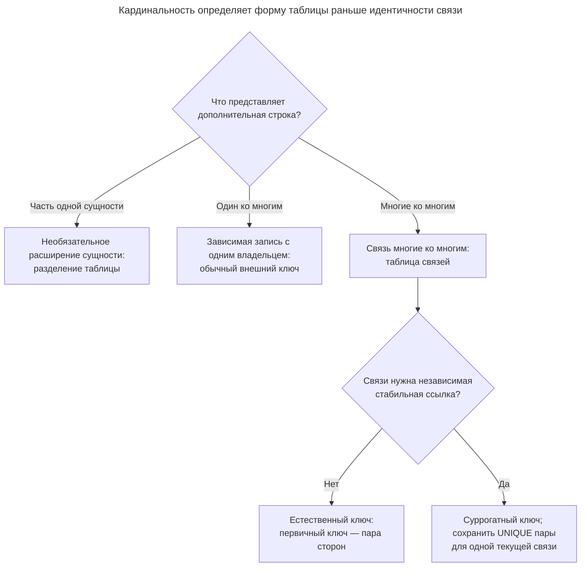
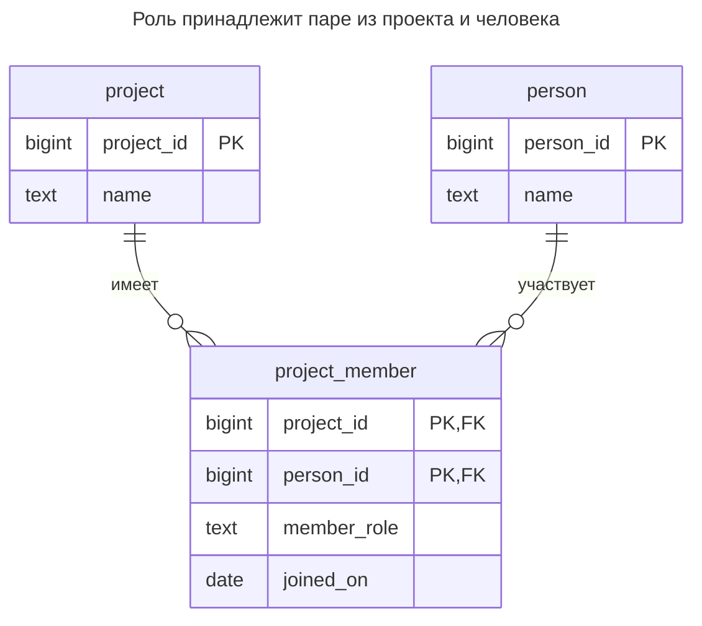
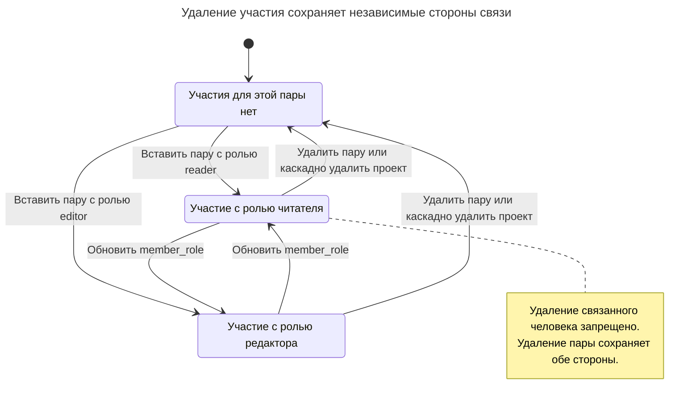
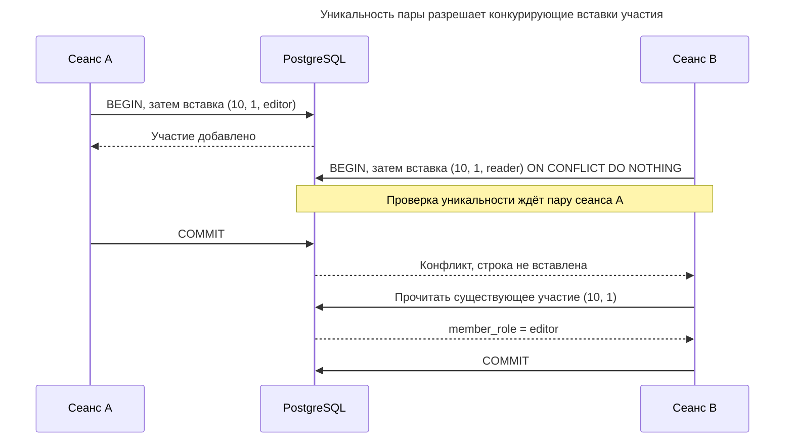

# Таблица связей

## Назначение

Таблица связей представляет отношение «многие ко многим» строками: каждая строка связывает по одной записи с каждой стороны через два внешних ключа, а ключом служит их пара. Как только у связи появляются собственные факты — количество в позиции заказа, роль участника проекта, дата добавления метки, — они становятся столбцами таблицы связей, и она превращается в самостоятельную сущность. Глава рассматривает выбор между составным первичным ключом и суррогатом, индексы для обоих направлений навигации и обеспечение уникальности связей.

## Также известен как

Join table; junction table; link table; associative table. Фаулер называет отображение [Association Table Mapping](https://martinfowler.com/eaaCatalog/associationTableMapping.html); [отображение «многие ко многим» у Эмблера](https://agiledata.org/essays/mappingObjects.html) вводит ассоциативную таблицу между двумя таблицами сущностей.

## Проблема

У проекта несколько участников, а человек может участвовать в нескольких проектах. Столбец `member_id` в проекте допускает лишь одного участника; `project_id` в записи человека — лишь один проект. Нумерованные столбцы участников делают максимальное число участников частью схемы. В списке через запятую негде хранить роль участника без изобретения ещё одной кодировки.

Роль принадлежит участию. Назначение Ады редактором одного проекта не должно делать её редактором везде. До выбора ключа определите, может ли у человека быть одно текущее участие в проекте или несколько отдельных эпизодов. Это разные идентичности.

## Решение

Создайте `project_member` с внешним ключом на каждую сторону и первичным ключом `(project_id, person_id)`. Храните там `member_role` и `joined_on`. Такая схема означает одно текущее участие на пару. Если нужны повторные эпизоды, дайте каждому собственную идентичность или включите согласованный различитель; не допускайте случайного дублирования текущего участия.

Используйте суррогатный первичный ключ, когда другим записям нужна стабильная ссылка на само участие, особенно если его стороны могут меняться. Сохраняйте `UNIQUE (project_id, person_id)`, пока действует правило одного текущего участия. Сами по себе атрибуты не требуют суррогата: составной ключ столь же хорошо идентифицирует строку с ролью.

## Альтернативы и выбор

| Соседний паттерн | Связь | Определяющее требование |
| --- | --- | --- |
| Внешний ключ в зависимой таблице | Замена для настоящей связи «один ко многим» | У каждой зависимой записи только один родитель; таблица связей не нужна |
| [Естественный ключ](natural-key.md) / [Суррогатный ключ](surrogate-key.md) | Варианты идентичности связи | Используйте пару напрямую либо добавьте ID для независимых ссылок, сохранив уникальность пары |
| [Упорядоченная коллекция](ordered-collection.md) | Дополнение | Участие имеет заданный пользователем порядок внутри владельца |
| [Разделение таблицы](table-split.md) | Замена для другой кардинальности | Вторая строка расширяет одну сущность, а не связывает два множества |

Полное сравнение — в [Атласе решений](decision-atlas.md). [Списки с разделителями](delimited-lists.md) и [Повторяющиеся столбцы](repeated-columns.md) — исходные точки миграции, когда отдельным участникам нужны ссылки и ограничения.



Атрибуты связи не определяют кардинальность и не вынуждают использовать генерируемый ключ. Правило одного текущего участия требует уникальности пары, даже если участие идентифицируется суррогатом.

## Структура



Каждый проект и человек могут встречаться во многих строках участия. Каждое участие называет ровно одного из каждого вида. Ни одна сторона не обязана иметь участия; требование хотя бы одного — дополнительное правило за пределами этой схемы.

## Таблицы и инварианты

- **`project`** идентифицирует проект независимо от списка его участников.
- **`person`** идентифицирует человека независимо от проектов, в которых он участвует.
- **`project_member`** содержит одну обязательную пару существующих сторон. Первичный ключ предотвращает повторение пары; внешние ключи предотвращают осиротевшие строки. `member_role` — небольшой пример словаря, обеспеченного проверкой.
- **Политика удаления** удаляет участия при удалении проекта, но запрещает удаление человека, на которого есть ссылка. PostgreSQL документирует эти [действия внешних ключей](https://www.postgresql.org/docs/18/ddl-constraints.html#DDL-CONSTRAINTS-FK); выбирайте их по владению, а не применяйте каскады повсюду.

## Когда применять

- Обе стороны могут участвовать в нескольких связях.
- Связь несёт факты — роль, количество или дату действия, — которые не принадлежат ни одной стороне отдельно.
- Нужно запрашивать и ограничивать отдельные связи вместо получения непрозрачного списка.

## Последствия и компромиссы

- ➕ Уникальность пары прямо выражает правило участия.
- ➕ Исправление роли меняет одно отношение, не затрагивая ни одну сторону.
- ➖ Получение атрибутов сторон требует соединений, а каждый дополнительный индекс увеличивает работу при записи.
- ➖ Пара становится широкой ссылкой, если многим другим таблицам нужно идентифицировать участие.
- ➖ Множество текущих связей не сохраняет прошлые изменения участия; если выход и повторное вступление важны, добавьте историю осознанно.

## Реализация

[Полный скрипт](../assets/association-table/association-table.sql) проверяет оба направления навигации, смену роли, отклонение дубликата и удаление сторон:

```sql
CREATE TABLE project (
    project_id bigint PRIMARY KEY,
    name text NOT NULL
);
CREATE TABLE person (
    person_id bigint PRIMARY KEY,
    name text NOT NULL
);
CREATE TABLE project_member (
    project_id bigint NOT NULL REFERENCES project (project_id)
        ON DELETE CASCADE,
    person_id bigint NOT NULL REFERENCES person (person_id),
    member_role text NOT NULL CHECK (member_role IN ('reader', 'editor')),
    joined_on date NOT NULL,
    CONSTRAINT project_member_pkey PRIMARY KEY (project_id, person_id)
);
CREATE INDEX project_member_person_idx
    ON project_member (person_id, project_id);
```

Индекс первичного ключа начинается с `project_id`; обратный индекс — с `person_id`. [Правила многоколоночных B-деревьев PostgreSQL](https://www.postgresql.org/docs/18/indexes-multicolumn.html) отдают преимущество ограничениям по ведущим столбцам. PostgreSQL 18 иногда применяет skip scan для последующих столбцов, но это не повод считать один индекс одинаково подходящим обоим направлениям. Внешние ключи [не создают индексы дочерних таблиц автоматически](https://www.postgresql.org/docs/18/ddl-constraints.html#DDL-CONSTRAINTS-FK).

```sql
INSERT INTO project VALUES (10, 'Catalog'), (20, 'Checkout');
INSERT INTO person VALUES (1, 'Ada'), (2, 'Lin');
INSERT INTO project_member VALUES
    (10, 1, 'editor', DATE '2026-11-10'),
    (10, 2, 'reader', DATE '2026-11-10'),
    (20, 1, 'reader', DATE '2026-11-10');
SELECT p.name, m.member_role
FROM project_member AS m JOIN person AS p USING (person_id)
WHERE m.project_id = 10 ORDER BY m.person_id;
SELECT p.name FROM project_member AS m
JOIN project AS p USING (project_id)
WHERE m.person_id = 1 ORDER BY m.project_id;
UPDATE project_member SET member_role = 'editor'
WHERE project_id = 10 AND person_id = 2;
```

Запросы возвращают `(Ada, editor), (Lin, reader)`, затем `Catalog, Checkout`. Вторая запись участия не может незаметно добавить вторую роль той же паре:

```sql
INSERT INTO project_member VALUES
    (10, 1, 'reader', DATE '2026-11-11');
```

В PostgreSQL 18.6 это вызывает SQLSTATE `23505`: `ERROR: duplicate key value violates unique constraint "project_member_pkey"`, с уточнением `DETAIL: Key (project_id, person_id)=(10, 1) already exists.` Чтобы удалить участие, удалите пару. Удаление проекта вместо этого удаляет все участия в нём:

```sql
DELETE FROM project_member WHERE project_id = 20 AND person_id = 1;
DELETE FROM project WHERE project_id = 10;
SELECT count(*) FROM project_member;
```

Итоговое число строк — `0`; оба человека остаются. ID заданы явно, чтобы сосредоточить пример на отношениях; выдача значений рассмотрена в [Суррогатном ключе](surrogate-key.md).



Состояние принадлежит одной паре «проект и человек», поэтому изменение роли не влияет на остальные участия человека. Удаление проекта убирает связь, а удаление человека блокируется, пока на него ссылается участие.

## Поддержка в движках

- **PostgreSQL 18:** составной первичный ключ, внешние ключи и обратный индекс реализуют пример напрямую.
- **MySQL 8.4 / InnoDB:** подходящий [индекс внешнего ключа дочерней таблицы создаётся автоматически, если отсутствует](https://dev.mysql.com/doc/refman/8.4/en/create-table-foreign-keys.html). Проверьте существующие индексы, прежде чем добавлять избыточный обратный индекс.
- **SQL Server 2025 (17.x):** внешний ключ [не создаёт соответствующий индекс автоматически](https://learn.microsoft.com/en-us/sql/relational-databases/tables/primary-and-foreign-key-constraints?view=sql-server-ver17). При проверке индексов учитывайте оба направления навигации.
- **Oracle AI Database 26ai:** [составные первичные и внешние ключи](https://docs.oracle.com/en/database/oracle/oracle-database/26/sqlrf/constraint.html) выражают тот же инвариант пары; при переносе примера используйте типы столбцов Oracle.
- **SQLite 3:** включайте [внешние ключи для каждого соединения](https://www.sqlite.org/foreignkeys.html#fk_enable). Сохраняйте явные объявления `NOT NULL`, потому что у обычных таблиц SQLite есть [исключения по допустимости `NULL` в первичном ключе](https://www.sqlite.org/lang_createtable.html#the_primary_key).

## Сбои и конкурентность

Поиск перед вставкой не разрешает конкурирующее вступление. Пусть решение принимает первичный ключ: [проверки уникальности PostgreSQL](https://www.postgresql.org/docs/18/index-unique-checks.html) ждут конфликтующие незавершённые записи и повторно проверяют их результат. Для инварианта пары достаточно обычных транзакций read committed.

Для команды «обеспечить существование участия» возможна политика повторов [`ON CONFLICT (project_id, person_id) DO NOTHING`](https://www.postgresql.org/docs/18/sql-insert.html). Прочитайте существующую роль, если её значение важно; игнорирование конфликта не доказывает совпадения с запрошенной ролью. Для изменения ролей используйте [Столбец версии](version-column.md) или условное обновление, если недопустимо затирать конкурентное исправление. Правило вроде «в каждом проекте есть редактор» требует дополнительной сериализации и проверки; ни один внешний ключ на стороны его не обеспечивает.



Пара может существовать лишь один раз, но игнорирование второй вставки не применяет запрошенную ею роль. B должен проверить существующую строку, если роль «читатель» входила в смысл команды.

## Миграция

При переходе со списков или нумерованных столбцов сначала определите, какие элементы обозначают людей, устраните отсутствующие стороны и решите, как объединять повторяющиеся пары с конфликтующими ролями. Создайте таблицу связей, затем направьте все изменения участия через транзакцию, записывающую оба представления. Переносите данные по одному проекту под той же блокировкой проекта, которую используют писатели, чтобы устаревший снимок не восстановил участие, только что удалённое запросом.

Сравните множества в обоих направлениях до переключения чтения. При необходимости добавляйте внешние ключи уже заполненной таблице этапами PostgreSQL [`NOT VALID` и `VALIDATE CONSTRAINT`](https://www.postgresql.org/docs/18/sql-altertable.html); предусмотрите окно блокировки DDL. Сохраняйте старое представление, пока не переключены все читатели. Откат возможен, пока оно отражает каждый новый факт отношения; если оно не умеет хранить роли, сначала сохраните эти факты отдельно. См. [Расширение и свёртывание](expand-contract.md).

## Антипаттерны и частые ошибки

- Добавление `membership_id` и удаление уникальности пары: [Обязательные суррогаты](mandatory-surrogates.md) описывают эту потерю бизнес-идентичности.
- Индексация только по проекту при частой навигации от людей.
- Размещение `member_role` в `person`, превращающее факт отдельного проекта в глобальный.
- Каскадное удаление человека или проекта при удалении участия: связь зависима, а стороны имеют независимые жизненные циклы.
- Замена настоящих ограничений проверками ORM; см. [Отсутствующие внешние ключи](missing-foreign-keys.md).

## Известные применения

- [Пример «многие ко многим» PostgreSQL](https://www.postgresql.org/docs/18/ddl-constraints.html#DDL-CONSTRAINTS-FK) использует `order_items` с составным ключом «товар и заказ» и количеством.
- [Руководство Rails по связям](https://guides.rubyonrails.org/association_basics.html#has-many-through-vs-has-and-belongs-to-many) рекомендует `has_many :through`, когда модели связи нужны атрибуты, проверки или обратные вызовы. Более простое отображение HABTM ожидает таблицу связей без первичного ключа; это соглашение фреймворка не отменяет необходимости обеспечивать уникальность пары.

## Связанные паттерны

- [Естественный ключ](natural-key.md) объясняет составную бизнес-идентичность.
- [Суррогатный ключ](surrogate-key.md) даёт необязательный независимый идентификатор связи.
- [Упорядоченная коллекция](ordered-collection.md) добавляет порядок внутри родителя без изменения идентичности связи.
- [Списки с разделителями](delimited-lists.md) и [Повторяющиеся столбцы](repeated-columns.md) показывают представления, заменяемые этой схемой.
- [Столбец версии](version-column.md) защищает конкурирующие изменения атрибутов связи.
