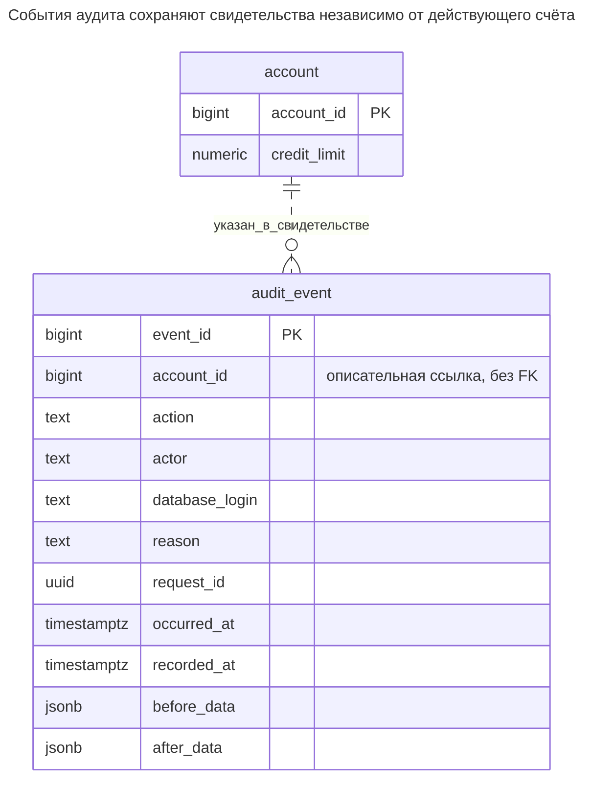
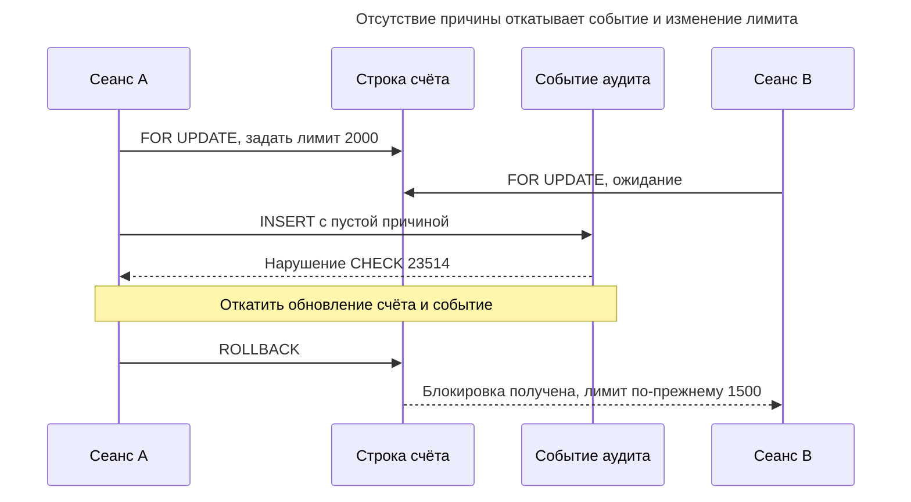
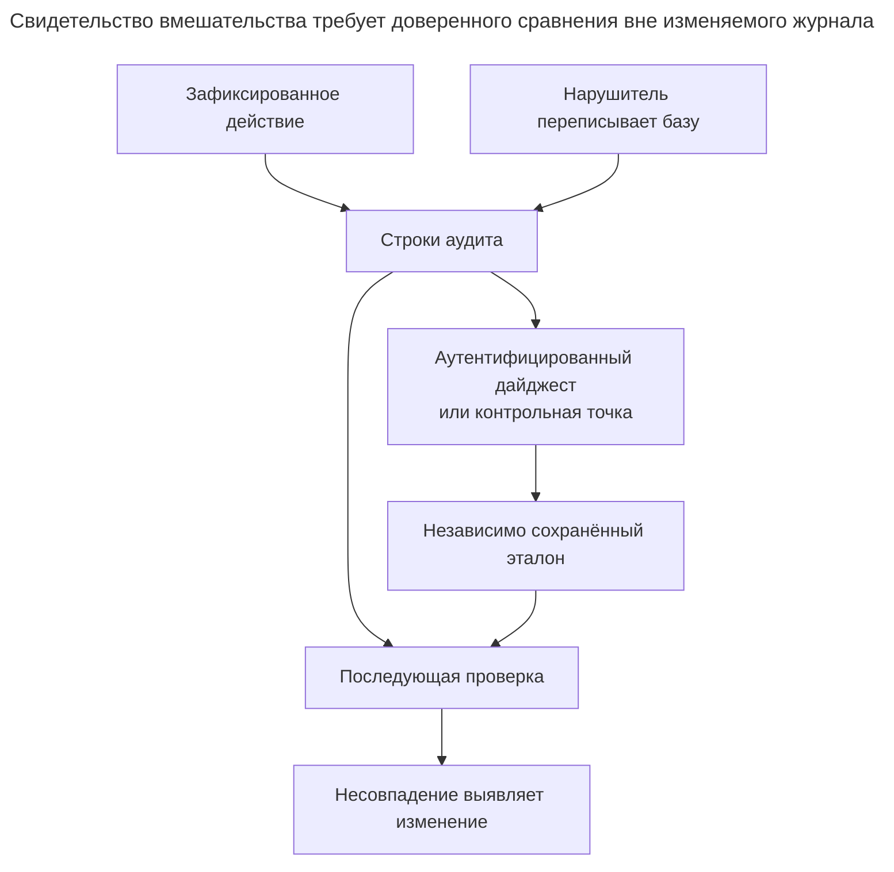
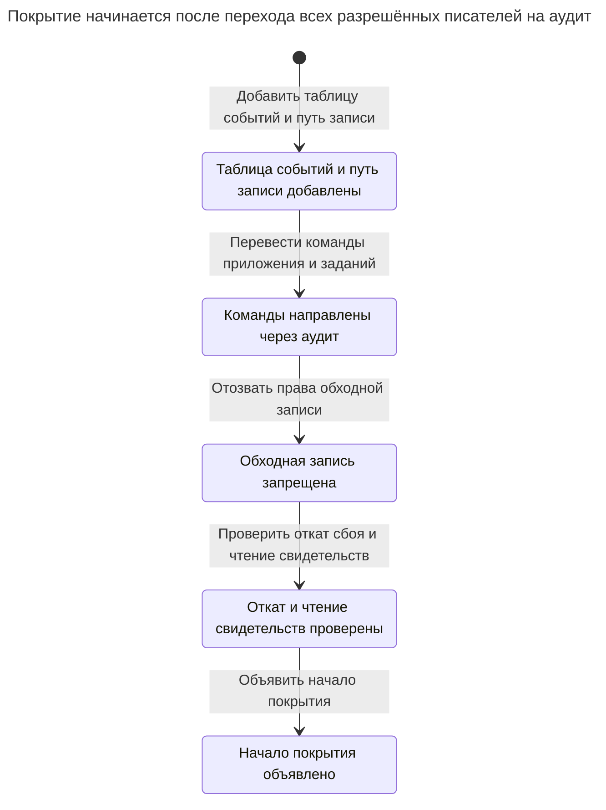

# Журнал аудита

## Назначение

Журнал аудита — дополняемая без перезаписи запись действий: кто, что, когда, откуда и почему изменил, часто для многих таблиц в одном месте. В отличие от таблицы истории, он предназначен не для восстановления прошлых состояний, а для объяснения каждого изменения, поэтому сохраняет автора, причину и корреляционный ID, связывающий изменение с запросом. Глава рассматривает, что может зафиксировать база и что известно только приложению, как права делают журнал доступным лишь для добавления и что дают свидетельства вмешательства вроде цепочек хешей или ledger-таблиц и от какой угрозы. Фаулер описывает регистрацию действий в [Audit Log](https://martinfowler.com/eaaDev/AuditLog.html).

## Также известен как

Audit trail — аудиторский след. Фаулер называет паттерн [Audit Log](https://martinfowler.com/eaaDev/AuditLog.html) и различает простоту регистрации изменений и труд последующего толкования. Глава реализует таблицу принятых действий приложения, а не утверждает, что аудит охватывает каждый оператор базы данных.

## Проблема

Кредитный лимит клиента изменился с 1000 до 1500. Текущая строка сообщает новый лимит; таблица истории могла бы сообщить старый. Ни одна не объясняет, какой аутентифицированный пользователь одобрил повышение, почему и какой запрос связывает его с обращением в поддержку. Эти факты о действии нужно записывать на границе записи.

Соединение с базой из пула обычно представляет сервис. Конечного пользователя и решение об авторизации знает сервис. Сохранив только логин базы, вы определите служебную учётную запись, но потеряете человека, отправившего действие. Напротив, приём произвольного автора от недоверенной стороны позволяет ей выбрать объяснение, на которое вы потом положитесь.

## Решение

Используйте одну управляемую операцию, которая блокирует целевой счёт, меняет лимит и вставляет событие аудита в одной транзакции. Сохраняйте аутентифицированного автора приложения, логин базы, причину, ID запроса, время события, время обработки и выбранные данные до/после. Предоставьте приложению выполнение операции и чтение без прямой записи счёта и таблицы аудита. Возможность только добавлять — утверждение о правах этой роли, а не всесильного администратора.

Пример использует типизированные поля `account_id` и действия для одного семейства команд. Для централизованного аудита многих типов сущностей определите версионируемую оболочку события с видом объекта, его стабильным идентификатором и контрактом полезной нагрузки либо оставьте типизированные журналы предметных областей и объедините их для поиска. Пара «вид объекта и ID» в общем журнале — описательная ссылка, а не контролируемый внешний ключ на несколько независимых таблиц; см. [Полиморфные связи](polymorphic-associations.md). Не путайте удобную для поиска оболочку со ссылочной целостностью, обеспеченной схемой.

## Альтернативы и выбор

| Соседний паттерн | Связь | Определяющее требование |
| --- | --- | --- |
| [Таблица истории](history-table.md) | Дополнение; замена для регулярных запросов состояния | Регулярно нужны значения целой строки на прошлый момент |
| [Битемпоральная таблица](bitemporal-table.md) | Дополнение | Помимо автора исправления нужны прежние представления о бизнес-датах |
| [История статусов](status-history.md) | Специализированная замена | Действие аудита — принятый переход жизненного цикла с типизированными исходным и целевым состояниями |
| [Транзакционный outbox](transactional-outbox.md) | Дополнение | События должны попасть в другую систему после фиксации; ход доставки — отдельная задача |
| [Запись идемпотентности](idempotency-record.md) | Дополнение | Повтор запроса должен вернуть исходный результат вместо нового выполнения |
| Ledger движка | Вариант реализации свидетельств вмешательства | Нужно обнаруживать поздние изменения относительно независимо сохранённого свидетельства |

Полное сравнение — в [Атласе решений](decision-atlas.md). Корреляционный ID группирует события; само его присутствие не даёт идемпотентности.

## Структура



Пунктирная связь описательная: у событий аудита намеренно нет внешнего ключа на действующий счёт, поэтому хранение свидетельств не требует хранения действующей строки. ID счёта остаётся частью свидетельства события. Если последующее толкование зависит от этого, запретите повторное использование ID в жизненном цикле счёта.

## Таблицы и инварианты

- **`account`** — текущая цель записи. Проверка запрещает отрицательный кредитный лимит.
- **`audit_event`** требует действие, оба времени, автора, причину, корреляцию и данные до/после. Проверяется непустота автора и причины; таблица не может проверить правдивость переданной личности или объяснения.
- **Только добавление для `audit_example_app`** обеспечивается правами: роль не имеет привилегий вставки, обновления, удаления или усечения журнала и не может прямо писать в счёт. События вставляет только доверенная процедура владельца.
- **Атомарная полнота** охватывает успешные вызовы этой операции. Она исключает исправления владельца, другие неинструментированные команды, чтения, попытки входа и отклонённые операции.
- **Порядок** использует `event_id` для навигации, а не доказательства порядка фиксации. [Выдача последовательности PostgreSQL не откатывается](https://www.postgresql.org/docs/18/functions-sequence.html); пропущенные номера не доказывают пропуск событий.

## Когда применять

- Операторам нужно объяснение принятых изменений с установленным автором.
- Один запрос может менять несколько объектов, и нужен общий корреляционный идентификатор.
- Вы можете аутентифицировать вызывающих до доверенного пути записи и ограничить обходные записи.
- Политика хранения определяет допустимые свидетельства, читателей и срок истечения.

## Последствия и компромиссы

- ➕ Причина действия и контекст запроса остаются доступны рядом с изменёнными значениями.
- ➕ Неудачная вставка события не даёт бизнес-изменению незаметно завершиться успешно.
- ➖ Журнал увеличивает объём записи и может дублировать чувствительные данные. Фиксируйте выбранные поля вместо копирования секретов только потому, что сериализация проста.
- ➖ Общие полезные нагрузки требуют толкования версии схемы после изменения приложения. Контракт нагрузки примера — только ID счёта и лимит.
- ➖ Свидетельства успешных изменений не записывают запрещённые или прерванные попытки. Им нужен отдельный канал с другой транзакционной семантикой.

## Реализация

[Полный скрипт PostgreSQL 18.6](../assets/audit-log/audit-log.sql) создаёт временную прикладную роль внутри транзакции, проверяет запрет редактирования журнала и доказывает, что отсутствие контекста откатывает изменение лимита. Запускайте в одноразовой базе ролью с правом создать и принять эту тестовую роль:

```sql
CREATE SCHEMA audit_example;
REVOKE ALL ON SCHEMA audit_example FROM PUBLIC;
CREATE TABLE audit_example.account (
    account_id bigint PRIMARY KEY,
    credit_limit numeric(12,2) NOT NULL CHECK (credit_limit >= 0)
);
CREATE TABLE audit_example.audit_event (
    event_id bigint GENERATED ALWAYS AS IDENTITY PRIMARY KEY,
    account_id bigint NOT NULL,
    action text NOT NULL CHECK (action = 'change_limit'),
    occurred_at timestamptz NOT NULL,
    recorded_at timestamptz NOT NULL,
    actor text NOT NULL CHECK (btrim(actor) <> ''),
    database_login text NOT NULL,
    reason text NOT NULL CHECK (btrim(reason) <> ''),
    request_id uuid NOT NULL,
    before_data jsonb NOT NULL,
    after_data jsonb NOT NULL
);
CREATE INDEX audit_event_account_idx
    ON audit_example.audit_event (account_id, event_id);
CREATE INDEX audit_event_request_idx ON audit_example.audit_event (request_id);
CREATE FUNCTION audit_example.change_limit(
    p_account_id bigint, p_limit numeric, p_actor text,
    p_reason text, p_request_id uuid, p_occurred_at timestamptz
) RETURNS void LANGUAGE plpgsql SECURITY DEFINER
SET search_path = pg_catalog, pg_temp AS $$
DECLARE
    before_row audit_example.account%ROWTYPE;
    after_row audit_example.account%ROWTYPE;
BEGIN
    SELECT * INTO STRICT before_row FROM audit_example.account
    WHERE account_id = p_account_id FOR UPDATE;
    UPDATE audit_example.account SET credit_limit = p_limit
    WHERE account_id = p_account_id RETURNING * INTO after_row;
    INSERT INTO audit_example.audit_event
        (account_id, action, occurred_at, recorded_at, actor, database_login,
         reason, request_id, before_data, after_data)
    VALUES (p_account_id, 'change_limit', p_occurred_at, clock_timestamp(),
            p_actor, session_user, p_reason, p_request_id,
            to_jsonb(before_row), to_jsonb(after_row));
END;
$$;
REVOKE ALL ON FUNCTION audit_example.change_limit(bigint, numeric, text, text, uuid, timestamptz)
    FROM PUBLIC;
CREATE ROLE audit_example_app NOLOGIN;
GRANT USAGE ON SCHEMA audit_example TO audit_example_app;
GRANT SELECT ON audit_example.account, audit_example.audit_event TO audit_example_app;
GRANT EXECUTE ON FUNCTION audit_example.change_limit(bigint, numeric, text, text, uuid, timestamptz)
    TO audit_example_app;
```

Владелец процедуры — доверенная административная идентичность, отличная от логина приложения. [Правила функций с правами владельца](https://www.postgresql.org/docs/18/sql-createfunction.html#SQL-CREATEFUNCTION-SECURITY) объясняют фиксированный путь поиска и отзыв публичного выполнения. Не предоставляйте приложению членство в роли владельца. Лабораторный скрипт использует `SET ROLE` только для проверки границы привилегий; при развёртывании используются обычные настройки логина и ролей.

[`session_user`](https://www.postgresql.org/docs/18/functions-info.html#FUNCTIONS-INFO-SESSION) PostgreSQL сохраняет идентичность сеанса, тогда как `current_user` внутри процедуры с правами владельца — владелец функции. Ни один не идентифицирует конечного пользователя за сервисом с пулом соединений. Берите `p_actor` из аутентифицированного серверного контекста и разрешайте изменение лимита до вызова; роль базы в примере — доверенный бэкенд, а не учётные данные для браузерных клиентов. Если полезно, отдельно фиксируйте источник или IP клиента, указывая поставщика этих сведений; адрес соединения базы может принадлежать прокси, а не пользователю.

```sql
INSERT INTO audit_example.account VALUES (1, 1000);
SET ROLE audit_example_app;
SELECT audit_example.change_limit(
    1, 1500, 'user:42', 'Approved review',
    '550e8400-e29b-41d4-a716-446655440000', '2026-03-01 12:00+00'
);
SELECT actor, reason, before_data ->> 'credit_limit' AS old_limit,
       after_data ->> 'credit_limit' AS new_limit
FROM audit_example.audit_event WHERE account_id = 1 ORDER BY event_id;
```

Результат — `(user:42, Approved review, 1000.00, 1500.00)`. Время события запроса — 1 марта; время регистрации — фактическое время обработки. [`clock_timestamp()`](https://www.postgresql.org/docs/18/functions-datetime.html#FUNCTIONS-DATETIME-CURRENT) не утверждает время фиксации транзакции вызывающей стороны. Здесь JSON до/после содержит только ID счёта и лимит, поскольку это вся схема счёта.

Под ролью `audit_example_app` попытка переписать объяснение завершается ошибкой:

```sql
UPDATE audit_example.audit_event SET reason = 'Rewritten' WHERE event_id = 1;
```

PostgreSQL 18.6 возвращает SQLSTATE `42501`: `ERROR: permission denied for table audit_event`. Разрешённая процедура также запрещает отсутствие контекста:

```sql
SELECT audit_example.change_limit(
    1, 2000, 'user:42', '',
    '550e8400-e29b-41d4-a716-446655440001', '2026-03-02 12:00+00'
);
```

Это вызывает SQLSTATE `23514`: `ERROR: new row for relation "audit_event" violates check constraint "audit_event_reason_check"`; лимит счёта остаётся `1500.00`, в журнале — ровно одно событие. Владелец таблицы всё ещё может его изменить: [модель привилегий PostgreSQL](https://www.postgresql.org/docs/18/ddl-priv.html) оставляет контроль объектов владельцам и суперпользователям.

## Поддержка в движках

- **PostgreSQL 18:** явные процедуры фиксируют смысл приложения; [строчные триггеры](https://www.postgresql.org/docs/18/plpgsql-trigger.html) — вариант регистрации всех инструментированных изменений строк обычным DML. Полезным нагрузкам триггеров всё равно нужны доверенные автор и контекст запроса из приложения.
- **MySQL 8.4:** [`CREATE TRIGGER`](https://dev.mysql.com/doc/refman/8.4/en/create-trigger.html) предоставляет `OLD`, `NEW` и проверку привилегий по определителю. При переносе сохраняйте атомарную транзакционную запись и различие между идентичностью сервиса и конечного пользователя.
- **SQL Server 2025 (17.x):** [ledger-таблицы](https://learn.microsoft.com/en-us/sql/relational-databases/security/ledger/ledger-overview?view=sql-server-ver17), доступные с SQL Server 2022, добавляют криптографические свидетельства вмешательства. Дайджесты базы нужно сохранять для последующей проверки; обычная темпоральная история — другой механизм.
- **Oracle AI Database 26ai:** [триггеры PL/SQL](https://docs.oracle.com/en/database/oracle/oracle-database/26/lnpls/plsql-triggers.html) реагируют на события базы. Если запись должна выражать бизнес-одобрение или причину, которых не даёт само событие базы, используйте управляемую операцию приложения.
- **SQLite 3:** [триггеры](https://www.sqlite.org/lang_createtrigger.html) могут вставлять свидетельства вместе с изменениями строк. SQLite [не реализует `GRANT` и `REVOKE`](https://www.sqlite.org/omitted.html); создайте отдельную границу доступа вокруг файла базы и интерфейса приложения.

## Сбои и конкурентность



[Блокировка строки](https://www.postgresql.org/docs/18/explicit-locking.html#LOCKING-ROWS) сериализует фиксацию данных до/после для счёта. Она не обнаруживает устаревшее намерение клиента; добавьте [Столбец версии](version-column.md), если изменение должно зависеть от увиденного клиентом значения. Никогда не подтверждайте успех до фиксации транзакции вызывающей стороны.

Вставка аудита в той же транзакции исчезает при её прерывании. Для свидетельств принятых изменений это правильно, но непригодно как единственная запись злонамеренных попыток. Отдельный сервис логирования может записывать попытки команд с явными отметками результата и корреляцией. Если вы экспортируете принятые события, используйте [Транзакционный outbox](transactional-outbox.md) или другой механизм доставки зафиксированных данных; внешняя отправка до фиксации может сообщить об изменении, которого не было.

Свидетельствам вмешательства нужна модель нарушителя. Пример запрещает прикладной роли переписывать строки, но не останавливает владельца, суперпользователя или скомпрометированного администратора резервных копий. Проекту с цепочкой хешей также нужны точное правило сериализации конкурентных добавлений и независимо сохранённая контрольная точка: сторона, способная переписать строки и единственный сохранённый корень цепочки, может изготовить внутренне согласованную замену. [Проект ledger Microsoft](https://learn.microsoft.com/en-us/sql/relational-databases/security/ledger/ledger-overview?view=sql-server-ver17) использует дайджесты базы, сохранённые для поздней проверки. Если такая более сильная угроза важна, выберите проверенную реализацию; глава не реализует криптографию.



Если эталон для сравнения находится под исключительным контролем того же нарушителя, доверять позднему совпадению незачем. Проверке также нужны сохранённые свидетельства и реальный процесс проверки; один столбец дайджеста не предоставляет ни того, ни другого.

## Миграция

До создания общей таблицы событий определите словарь действий, источник автора и контракт полезной нагрузки. Добавьте журнал и управляемых писателей, направьте через них каждый прежний путь записи и отзовите прямые привилегии, прежде чем объявлять полноту. Включите в перечень фоновые задания и импорты. Запланируйте переключение и запишите начало покрытия; текущая строка не раскрывает причину прежнего изменения.



Во время [Расширения и свёртывания](expand-contract.md) можно сохранять старые интерфейсы чтения, меняя писателей. Не записывайте одно действие и процедурой, и триггером, если смысл двух событий не различается. Откат интерфейса чтения может сохранить аудит; возврат к неограниченной записи прекращает полноту и требует явной записи о пробеле покрытия. Решайте хранение и доступ к событиям вместе с экспортами, чтобы удаление одной копии не оставляло случайный второй архив.

## Антипаттерны и частые ошибки

- Доверять переданному пользователем автору без аутентификации или принимать логин базы из пула за конечного пользователя.
- Логировать лишь после фиксации бизнес-изменения, оставляя окно сбоя без объяснения.
- Считать пропуск ID доказательством вмешательства или значение identity — глобальным порядком фиксации.
- Широко выдавать вставку в журнал, предполагая, что запрет обновления предотвращает и выдуманные события.
- Хранить пароли, токены или неограниченные снимки строк в долгоживущем журнале.
- Использовать общую ссылку на объект как внешний ключ или удалять свидетельства каскадом от текущего объекта; [Отсутствующие внешние ключи](missing-foreign-keys.md) различают намеренно независимые свидетельства и неконтролируемые действующие связи.

## Известные применения

- [Audit Log](https://martinfowler.com/eaaDev/AuditLog.html) Фаулера записывает значимые изменения и рекомендует различать фактическую дату и дату регистрации.
- [Пример аудита функцией триггера PostgreSQL](https://www.postgresql.org/docs/18/plpgsql-trigger.html) записывает таблицу изменений из триггера. Он показывает механику фиксации, а не контракт аутентифицированного автора этой главы и не усиленные свидетельства вмешательства.
- [Документация ledger Microsoft](https://learn.microsoft.com/en-us/sql/relational-databases/security/ledger/ledger-overview?view=sql-server-ver17) описывает криптографически проверяемый вариант реализации с сохраняемыми дайджестами.

## Связанные паттерны

- [Таблица истории](history-table.md) сохраняет прежние состояния строк для регулярных запросов на момент времени.
- [История статусов](status-history.md) типизирует и проверяет переходы жизненного цикла.
- [Битемпоральная таблица](bitemporal-table.md) сохраняет бизнес-факты и прежние знания.
- [Транзакционный outbox](transactional-outbox.md) фиксирует работу по экспорту вместе с принятым изменением.
- [Запись идемпотентности](idempotency-record.md) разрешает повторы, а не просто помечает их.
- [Столбец версии](version-column.md) ставит выполнение команды в зависимость от ранее наблюдаемой версии.
