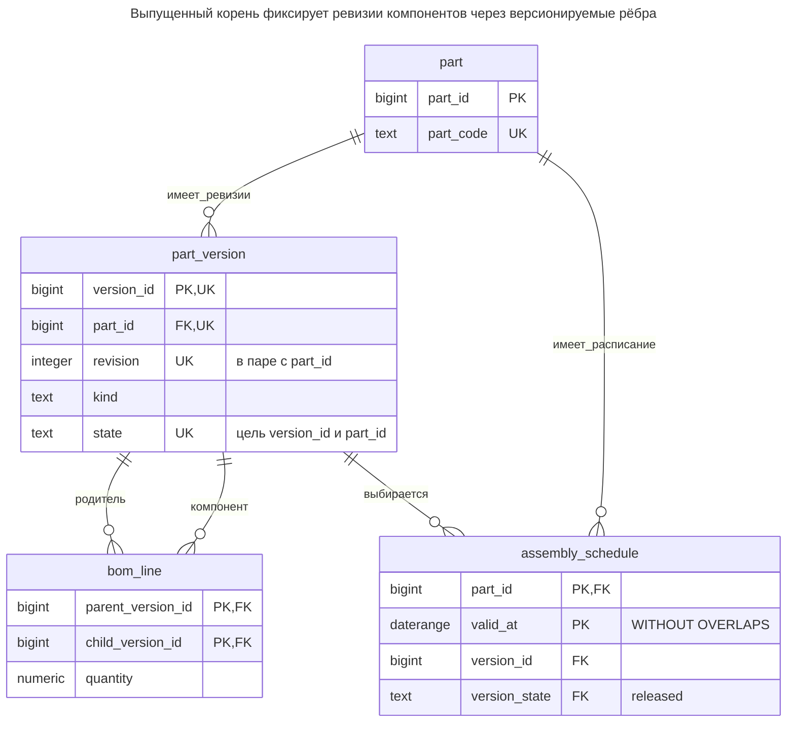
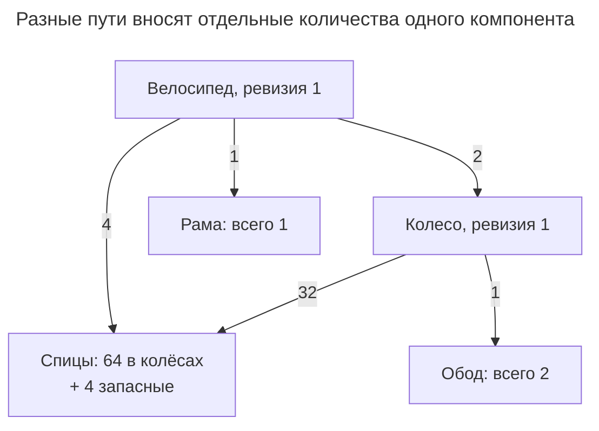
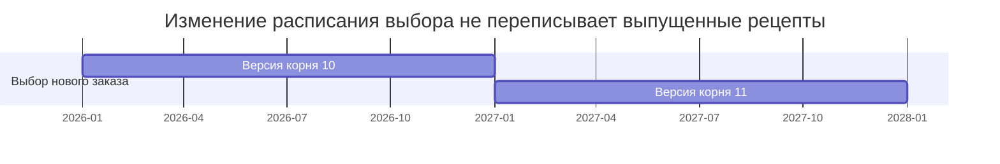
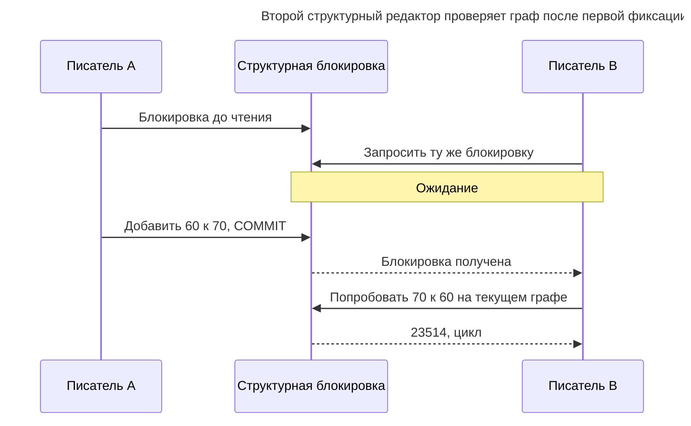

# Состав изделия

## Назначение

Состав изделия описывает продукты из компонентов, которые сами могут быть сборками: у велосипеда есть колёса, у колеса — спицы и обод. Это граф, где один компонент входит во многие сборки, а каждая связь содержит количество и часто период действия. Глава показывает таблицы деталей и структуры, рекурсивное разузлование сборки до суммарных количеств базовых деталей, предотвращение циклов и изменение версий структуры со временем.

## Также известен как

Product structure; assembly–component graph — структура изделия, граф сборок и компонентов. [Документация рекурсивных запросов PostgreSQL](https://www.postgresql.org/docs/18/queries-with.html#QUERIES-WITH-RECURSIVE) показывает умножение количеств по графу деталей и суммирование потребностей. Проект выпущенных ревизий ниже расширяет этот механизм.

## Проблема

Велосипеду нужны два колеса, каждому колесу — 32 спицы. Дополнительно вы упаковываете четыре запасные спицы. Подсчёт различных достижимых деталей находит спицы один раз; умножение количеств вдоль каждого пути и последующее суммирование даёт 68. Общий компонент — не исключительный узел дерева: одна спица может входить в несколько сборок и появляться разными маршрутами.

Редактируемая таблица рёбер создаёт другую проблему. Если изменить рецепт колеса после принятия производственного заказа, повторное разузлование даст другую потребность. Заказу нужна воспроизводимая корневая ревизия, потомки которой тоже указывают точные ревизии. Выбор последней ревизии каждого потомка во время запроса не фиксирует рецепт.

## Решение

Отделите стабильные детали от неизменяемых выпущенных версий. `bom_line` соединяет родительскую версию с дочерней и содержит требуемое количество на одного родителя. Черновые сборки редактируемы; выпуск требует непустых сборок с выпущенными потомками. После выпуска версия и исходящие строки неизменяемы. Исправления создают новую версию.

Разузлуйте выбранный корень рекурсивным `UNION ALL`, умножая накопленную потребность на каждом ребре. Для закупочных итогов суммируйте только листья. Сохраняйте каждый маршрут: устранение повторных компонентов до агрегации теряет законную потребность. Это соответствует механизму умножения в [примере деталей PostgreSQL](https://www.postgresql.org/docs/18/queries-with.html).

Добавьте независимое расписание периодов действия, если вопрос «какую ревизию выбрать новому заказу?» зависит от бизнес-даты. Сохраняйте выбранный ID версии в заказе. Позднейшее изменение расписания влияет на выбор для новой работы, не переписывая уже выбранный рецепт существующей.

## Альтернативы и выбор

| Соседний паттерн | Связь | Определяющее требование |
| --- | --- | --- |
| [Список смежности](adjacency-list.md) | Замена для иерархии с одним родителем | У каждого элемента один родитель, рёбра не задают потребности общих рецептов |
| [Таблица замыканий](closure-table.md) | Дополнение как индекс достижимости | Частые запросы применяемости оправдывают готовых предков; одна достижимость не даёт зависимых от пути количеств |
| [Величина](quantity.md) | Дополнение | Количества компонентов используют массу, длину или другие совместимые единицы вместо штук примера |
| [Период действия](effective-dating.md) | Дополнение | Бизнес-даты выбирают выпущенные ревизии новым заказам |

Полное сравнение — в [Атласе решений](decision-atlas.md). Фиксация версии — выбор реализации воспроизводимости; период действия выбирает версию, но не заменяет фиксацию.

## Структура



Версия может иметь много родителей и компонентов. `kind = 'leaf'` обозначает покупную или иначе неразворачиваемую деталь; пустая сборка не считается таковой молча. Составные ссылки расписания требуют принадлежности выбранной версии этой детали и уже состоявшегося выпуска.

## Таблицы и инварианты

- **`part`** владеет стабильной идентичностью детали; **`part_version`** обозначает ревизию, уникальную внутри детали. Пример фиксирует идентичность и вид даже в черновике.
- **`bom_line`** хранит одно положительное конечное количество на пару родительской и дочерней версий. Повторные применения одного компонента в сборке объединяются в это количество; отдельным идентифицируемым позициям нужен дополнительный ключ строки.
- **Предотвращение циклов** использует рекурсивный триггер вместе с протоколом структурных блокировок. Внешние ключи концов доказывают только существование. Триггер идёт от предполагаемого потомка и запрещает путь обратно к предполагаемому родителю.
- **Выпуск** проверяет непустоту сборок и выпуск каждого потомка. Проверки делают выпущенные версии и исходящие рёбра неизменяемыми.
- **`assembly_schedule`** запрещает пересекающиеся периоды выбора корня для детали [временным ключом](https://www.postgresql.org/docs/18/sql-createtable.html) PostgreSQL 18. Непрерывности расписания он не требует.
- **Политика единиц** — штуки компонента на одну штуку родителя. Числовой тип допускает дробные плановые количества; если допустимы только целые штуки, добавьте соответствующее правило. Брак, выход годного и замены намеренно вне этого рецепта.

## Когда применять

- Компоненты повторно используются в сборках, каждое включение имеет количество.
- Потребности нужно накапливать по каждому пути, включая общих потомков.
- Заказы или предложения должны сохранять точный выбранный рецепт.

## Последствия и компромиссы

- ➕ Общий компонент имеет одну идентичность, а каждая сборка задаёт свою потребность.
- ➕ Фиксация выпущенной ревизии делает старый рецепт воспроизводимым после новых выпусков.
- ➖ Путей в графе может быть значительно больше, чем разных деталей. Цена разузлования зависит от пройденных путей, а не только достижимых узлов.
- ➖ Новая ревизия потомка не обновляет родителей молча. Затронутые родительские ревизии нужно выпускать намеренно.
- ➖ Простая глобальная структурная блокировка сериализует и правки несвязанных рецептов.

## Реализация

[Полный скрипт PostgreSQL 18.6](../assets/bill-of-materials/bill-of-materials.sql) проверяет разузлование, выпуск, вторую корневую ревизию, выбор по дате, запрет циклов и замороженные рёбра. Определите таблицы с установленным [`btree_gist`](https://www.postgresql.org/docs/18/btree-gist.html) для скалярного равенства временного ключа:

```sql
CREATE EXTENSION IF NOT EXISTS btree_gist;
CREATE SCHEMA bom_example;
SET search_path = bom_example, public;

CREATE TABLE part (
    part_id bigint PRIMARY KEY,
    part_code text NOT NULL UNIQUE
);
CREATE TABLE part_version (
    version_id bigint PRIMARY KEY,
    part_id bigint NOT NULL REFERENCES part (part_id),
    revision integer NOT NULL CHECK (revision > 0),
    kind text NOT NULL CHECK (kind IN ('assembly', 'leaf')),
    state text NOT NULL DEFAULT 'draft' CHECK (state IN ('draft', 'released')),
    UNIQUE (part_id, revision),
    UNIQUE (version_id, part_id, state)
);
CREATE TABLE bom_line (
    parent_version_id bigint REFERENCES part_version (version_id),
    child_version_id bigint REFERENCES part_version (version_id),
    quantity numeric NOT NULL CHECK (quantity > 0 AND quantity < 'Infinity'::numeric),
    PRIMARY KEY (parent_version_id, child_version_id),
    CHECK (parent_version_id <> child_version_id)
);
CREATE INDEX bom_line_child_idx ON bom_line (child_version_id);
CREATE TABLE assembly_schedule (
    part_id bigint REFERENCES part (part_id),
    valid_at daterange NOT NULL CHECK (NOT lower_inf(valid_at)),
    version_id bigint NOT NULL,
    version_state text NOT NULL DEFAULT 'released' CHECK (version_state = 'released'),
    PRIMARY KEY (part_id, valid_at WITHOUT OVERLAPS),
    FOREIGN KEY (version_id, part_id, version_state)
        REFERENCES part_version (version_id, part_id, state)
);
```

Эти проверки существенны для модели. Запрос циклов использует `UNION` на посещённых ID, чтобы проверка завершалась даже на повреждённых старых данных; последующее разузлование количеств использует `UNION ALL` для иной цели.

```sql
CREATE FUNCTION guard_bom_line() RETURNS trigger LANGUAGE plpgsql SET search_path = bom_example, pg_temp AS $$
DECLARE
    parent_id bigint;
BEGIN
    IF TG_OP = 'UPDATE' THEN
        RAISE EXCEPTION 'replace a draft line with delete and insert' USING ERRCODE = '23514';
    END IF;
    parent_id := CASE WHEN TG_OP = 'DELETE' THEN OLD.parent_version_id ELSE NEW.parent_version_id END;
    IF EXISTS (SELECT FROM part_version WHERE version_id = parent_id
               AND (state = 'released' OR kind = 'leaf')) THEN
        RAISE EXCEPTION 'BOM parent must be a draft assembly' USING ERRCODE = '23514';
    END IF;
    IF TG_OP = 'DELETE' THEN RETURN OLD; END IF;
    IF EXISTS (
        WITH RECURSIVE reachable(id) AS (
            VALUES (NEW.child_version_id)
            UNION
            SELECT b.child_version_id FROM bom_line AS b JOIN reachable AS r
                ON b.parent_version_id = r.id
        )
        SELECT FROM reachable WHERE id = NEW.parent_version_id
    ) THEN
        RAISE EXCEPTION 'bill of materials cycle' USING ERRCODE = '23514';
    END IF;
    RETURN NEW;
END $$;
CREATE TRIGGER bom_line_guard BEFORE INSERT OR UPDATE OR DELETE ON bom_line
    FOR EACH ROW EXECUTE FUNCTION guard_bom_line();
CREATE FUNCTION guard_part_version() RETURNS trigger LANGUAGE plpgsql SET search_path = bom_example, pg_temp AS $$
BEGIN
    IF TG_OP = 'INSERT' THEN
        IF NEW.state <> 'draft' THEN
            RAISE EXCEPTION 'create versions in draft' USING ERRCODE = '23514';
        END IF;
        RETURN NEW;
    END IF;
    IF OLD.state = 'released' THEN
        RAISE EXCEPTION 'released version is immutable' USING ERRCODE = '23514';
    END IF;
    IF TG_OP = 'DELETE' THEN RETURN OLD; END IF;
    IF (NEW.version_id, NEW.part_id, NEW.revision, NEW.kind)
        IS DISTINCT FROM (OLD.version_id, OLD.part_id, OLD.revision, OLD.kind) THEN
        RAISE EXCEPTION 'version identity and kind are immutable' USING ERRCODE = '23514';
    END IF;
    IF NEW.state = 'released' AND (
        (NEW.kind = 'assembly' AND NOT EXISTS
            (SELECT FROM bom_line WHERE parent_version_id = NEW.version_id))
        OR EXISTS (SELECT FROM bom_line AS b JOIN part_version AS c
                   ON c.version_id = b.child_version_id
                   WHERE b.parent_version_id = NEW.version_id AND c.state <> 'released')
    ) THEN
        RAISE EXCEPTION 'release children before their nonempty assembly' USING ERRCODE = '23514';
    END IF;
    RETURN NEW;
END $$;
CREATE TRIGGER part_version_guard BEFORE INSERT OR UPDATE OR DELETE ON part_version
    FOR EACH ROW EXECUTE FUNCTION guard_part_version();
```

Все структурные писатели берут две табличные блокировки в показанном порядке до чтения или изменения рецептов при Read Committed. Создавайте и выпускайте потомков до родителей:

```sql
BEGIN;
LOCK TABLE part_version, bom_line IN SHARE ROW EXCLUSIVE MODE;
INSERT INTO part VALUES (1, 'bicycle'), (2, 'wheel'), (3, 'spoke'), (4, 'rim'), (5, 'frame');
INSERT INTO part_version (version_id, part_id, revision, kind) VALUES
    (10, 1, 1, 'assembly'), (20, 2, 1, 'assembly'),
    (30, 3, 1, 'leaf'), (40, 4, 1, 'leaf'), (50, 5, 1, 'leaf');
INSERT INTO bom_line VALUES (10, 20, 2), (10, 50, 1), (20, 30, 32), (20, 40, 1), (10, 30, 4);
UPDATE part_version SET state = 'released' WHERE version_id IN (30, 40, 50);
UPDATE part_version SET state = 'released' WHERE version_id = 20;
UPDATE part_version SET state = 'released' WHERE version_id = 10;
COMMIT;
```

Пример включает четыре запасные спицы непосредственно под велосипедом дополнительно к спицам двух колёс:



Спицы — одна версия с двумя маршрутами от корня. Обход уникальных узлов стёр бы один вклад. Умножайте до группировки:

```sql
WITH RECURSIVE explosion(version_id, required) AS (
    VALUES (10::bigint, 1::numeric)
    UNION ALL
    SELECT b.child_version_id, e.required * b.quantity
    FROM explosion AS e JOIN bom_line AS b ON b.parent_version_id = e.version_id
)
SELECT p.part_code, sum(e.required) AS pieces
FROM explosion AS e JOIN part_version AS v USING (version_id)
JOIN part AS p USING (part_id)
WHERE v.kind = 'leaf' GROUP BY p.part_code ORDER BY p.part_code;
```

Результат — `(frame, 1)`, `(rim, 2)`, `(spoke, 68)`. Фильтр листьев не добавляет промежуточные сборки в закупочный список. Для поиска применяемости детали разверните обход рёбер и сохраните нужные фильтры версий и расписания.

Создайте ревизию 2 копированием корневых строк, измените число колёс на три и выпустите новый корень. Исходному по-прежнему нужны два колеса:

```sql
BEGIN;
LOCK TABLE part_version, bom_line IN SHARE ROW EXCLUSIVE MODE;
INSERT INTO part_version (version_id, part_id, revision, kind) VALUES (11, 1, 2, 'assembly');
INSERT INTO bom_line
SELECT 11, child_version_id, CASE WHEN child_version_id = 20 THEN 3 ELSE quantity END
FROM bom_line WHERE parent_version_id = 10;
UPDATE part_version SET state = 'released' WHERE version_id = 11;
COMMIT;
INSERT INTO assembly_schedule (part_id, valid_at, version_id) VALUES
    (1, '[2026-01-01,2027-01-01)', 10), (1, '[2027-01-01,)', 11);
SELECT version_id FROM assembly_schedule
WHERE part_id = 1 AND valid_at @> DATE '2027-02-01';
```

Поиск по дате возвращает версию `11`. Это результат выбора для сохранения в новой работе, а не динамическое выражение, повторяемое при каждом чтении старого заказа.



Диаграмма показывает смежные периоды выбора; фактический второй период открыт. Заказы, уже привязанные к версии 10, продолжают использовать её после 1 января 2027 года.

Для проверки цикла скрипт создаёт черновые версии `60`, `70` и добавляет `60 → 70`. Обратное ребро недопустимо:

```sql
BEGIN;
LOCK TABLE part_version, bom_line IN SHARE ROW EXCLUSIVE MODE;
INSERT INTO part VALUES (6, 'draft-A'), (7, 'draft-B');
INSERT INTO part_version (version_id, part_id, revision, kind)
VALUES (60, 6, 1, 'assembly'), (70, 7, 1, 'assembly');
INSERT INTO bom_line VALUES (60, 70, 1);
INSERT INTO bom_line VALUES (70, 60, 1);
ROLLBACK;
```

PostgreSQL 18.6 возвращает SQLSTATE `23514`: `ERROR: bill of materials cycle`. Выполняйте попытку в той же транзакции и под теми же структурными блокировками, что остальные правки. Удаление ребра колеса выпущенного корня вместо этого вызывает `23514`: `ERROR: BOM parent must be a draft assembly`.

## Поддержка в движках

- **PostgreSQL 18:** рекурсивные CTE реализуют разузлование; временное расписание использует диапазоны и `WITHOUT OVERLAPS`. Проверки — специфичные для приложения функции триггеров.
- **MySQL 8.4:** [рекурсивные CTE](https://dev.mysql.com/doc/refman/8.4/en/with.html) выводят типы столбцов из нерекурсивной части. Приводите начальное накопленное количество к достаточно широкому типу для умножений и намеренно выбирайте предел рекурсии. Переносите расписание в явные границы и согласованные проверки пересечений.
- **SQL Server 2025 (17.x):** [рекурсивные CTE](https://learn.microsoft.com/en-us/sql/t-sql/queries/with-common-table-expression-transact-sql?view=sql-server-ver17) не используют `RECURSIVE` и запрещают `GROUP BY` и скалярную агрегацию в рекурсивной части. Накапливайте там пути и агрегируйте во внешнем запросе, как здесь.
- **Oracle AI Database 26ai:** [рекурсивное вынесение подзапросов](https://docs.oracle.com/en/database/oracle/oracle-database/26/sqlrf/SELECT.html) требует псевдонимов столбцов и `UNION ALL` между начальной и рекурсивной частями. Запрос проверки циклов переносите отдельно вместо копирования формы PostgreSQL с `UNION`.
- **SQLite 3:** используйте [рекурсивные CTE](https://www.sqlite.org/lang_with.html), намеренно выбирайте точную арифметику и согласуйте правки под [транзакционной моделью единственного писателя](https://www.sqlite.org/lang_transaction.html). Защита от циклов при чтении не обеспечивает ацикличности сохранённого графа.

## Сбои и конкурентность

Конкурирующие писатели могут сделать две черновые сборки компонентами друг друга. Каждая рекурсивная проверка проходит по старому графу. При Read Committed берите [`SHARE ROW EXCLUSIVE`](https://www.postgresql.org/docs/18/explicit-locking.html#LOCKING-TABLES) на `part_version`, затем `bom_line` отдельным оператором до любого проверочного чтения. Каждая структурная вставка, удаление и выпуск должны соблюдать протокол. Спрячьте его за управляемым путём записи; один триггер не защищает неограниченные прямые записи от этой гонки.



Блокировка только одного родителя не защищает проверку цикла всего графа. Выпуск должен следовать тому же протоколу, чтобы потомок не менялся во время выпуска родителя. Неопределённый ответ выпуска разрешается чтением существующей ревизии и состояния; не создавайте новую ревизию только из-за потери ответа.

```mermaid
---
title: Выпуск закрывает редактирование; исправлению нужна новая ревизия
---
stateDiagram-v2
  state "Черновик" as Draft
  state "Выпущено" as Released
  state "Новый черновик" as NewDraft
  [*] --> Draft
  Draft --> Draft: Добавить или заменить строки под структурной блокировкой
  Draft --> Released: Потомки выпущены, сборка непуста
  Released --> Released: Отклонять правки рецепта
  Released --> NewDraft: Скопировать в новую ревизию
  NewDraft --> Released: Независимо выпустить замену
  class Draft,NewDraft accent
  class Released muted
```



Прежний выпуск остаётся допустимой целью привязанной к нему работы. Выпуск и выбор по периоду действия — независимые решения.

## Миграция

Переходя от неверсионируемых связей компонентов, сначала проверьте отсутствующие компоненты, циклы и неоднозначные единицы. Определите, являются ли повторные применения объединёнными количествами или отдельными позициями. Скопируйте согласованный снимок рецепта в черновые версии, сохранив каждое прямое ребро, затем выпускайте снизу вверх. Корень нельзя выпустить до потомков.

Заполните каждому существующему заказу подтверждённую корневую ревизию. Если исторические рецепты перезаписаны, честно обозначьте начальный снимок вместо заявления об их восстановлении. Переключите выбор новых заказов на расписание, согласуйте двойную запись и сравните итоги листьев характерных корней до удаления старых связей. Синхронизируйте старое представление в окне отката; после новых ревизий сохраняйте их закреплённые идентичности даже при временном возврате старых читателей.

## Антипаттерны и частые ошибки

- Давать каждому компоненту один `parent_id`, теряя общие компоненты.
- Устранять повторные достигнутые детали до суммирования вкладов путей.
- Соединять каждого потомка с последней ревизией и молча менять старые заказы.
- Считать пустую черновую сборку покупным листом.
- Полагать, что внешние ключи, предел глубины запроса или обнаружение циклов при чтении предотвращают неверную конкурентную запись.

## Известные применения

- [Пример включённых деталей PostgreSQL](https://www.postgresql.org/docs/18/queries-with.html) рекурсивно умножает количества и агрегирует по компоненту. Он показывает основное разузлование, не заявляя реализацию политики выпуска или ревизий.

## Связанные паттерны

- [Список смежности](adjacency-list.md) рассматривает иерархии с одним родителем и согласованные проверки циклов.
- [Таблица замыканий](closure-table.md) ускоряет достижимость, но количествам нужны дополнительные сведения о путях.
- [Величина](quantity.md) задаёт размерность, когда штук недостаточно.
- [Период действия](effective-dating.md) объясняет расписания выбора, запрет пересечений и пробелы.
