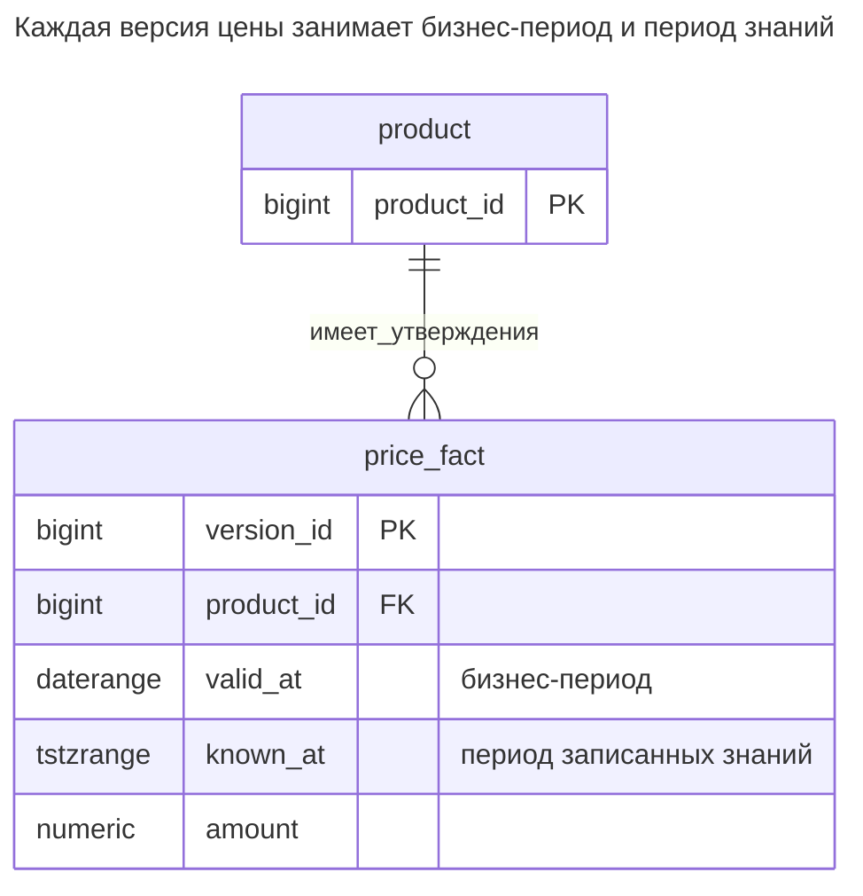
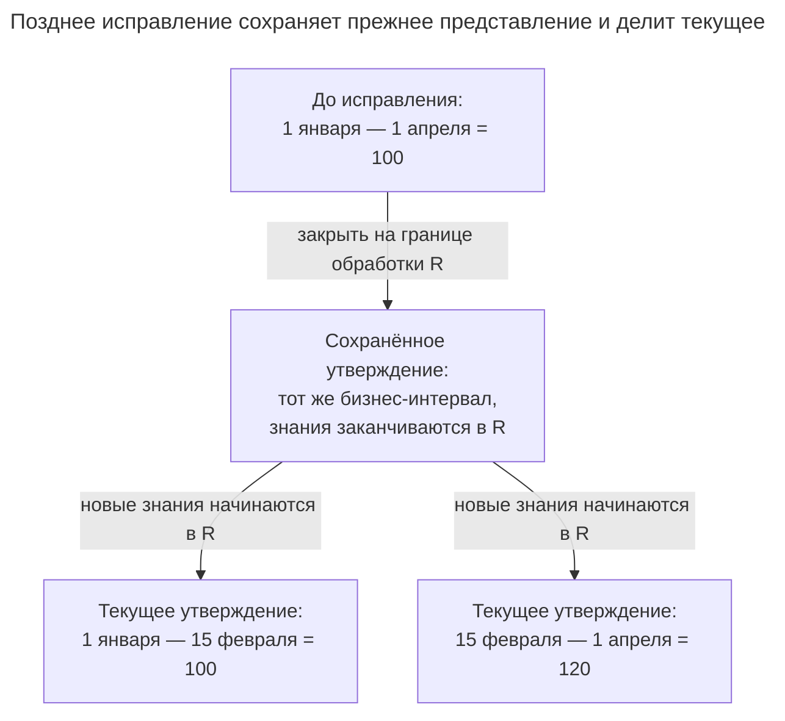
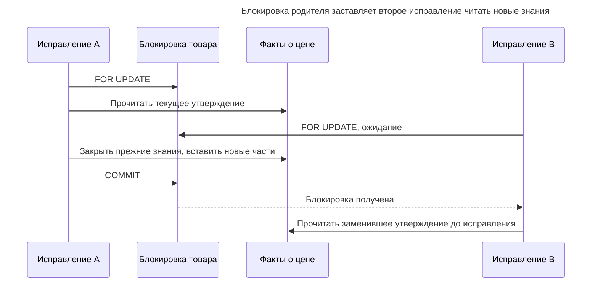
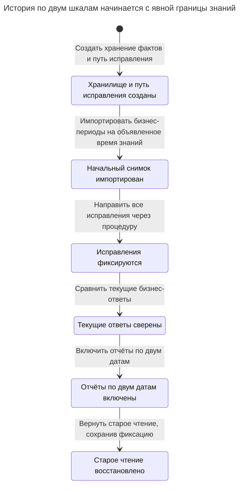

# Битемпоральная таблица

## Назначение

Битемпоральная таблица хранит на одних строках две независимые временные шкалы: когда факт был действителен в бизнесе и когда база данных знала о нём. Она отвечает на вопросы, на которые по отдельности не отвечают ни история, ни период действия: например, что система сообщала 1 марта о цене, действовавшей в феврале. Именно это нужно исправлениям, аудиту и пересчёту прошлых отчётов. Глава показывает структуру с двумя периодами, закрытие и создание строк при исправлении задним числом и причины, по которым сложность окупается лишь там, где нужно воспроизводить прошлые ответы. Фаулер объясняет два измерения в [Bitemporal History](https://martinfowler.com/articles/bitemporal-history.html).

## Также известен как

[Bitemporal History](https://martinfowler.com/articles/bitemporal-history.html) в терминологии Фаулера: фактическое время и время записи. [Статья о темпоральных возможностях SQL:2011](https://sigmodrecord.org/?download_id=3338&smd_process_download=1) использует прикладное и системное время и описывает таблицы, объединяющие оба. Называйте столбцы по смыслу вместо двух неразличимых пар «с» и «до».

## Проблема

Мартовский отчёт использовал февральскую цену 100. Позднее пришло исправление: с 15 февраля цена должна была составлять 120. Таблица с периодами действия теперь ответит «120 на 20 февраля», но исправление на месте теряет ответ, обосновавший отчёт. Таблица истории может сохранить введённое в каждый день, но без бизнес-действительности не определит, какие февральские даты меняет исправление.

Нужны два параметра: оцениваемая бизнес-дата и граница знаний для оценки. «Что сейчас считается верным о 20 февраля?» и «Что мы считали верным 1 марта о 20 февраля?» должны оставаться разными запросами. [Пример Фаулера с зарплатой задним числом](https://martinfowler.com/articles/bitemporal-history.html) обосновывает именно такое разделение.

## Решение

Представляйте каждое утверждение о цене прямоугольником: один интервал на бизнес-оси, другой — на оси записанных знаний. Для одного товара запрещайте два утверждения, прямоугольники которых пересекаются по обеим осям. На границе исправления закройте интервал знаний прежнего утверждения и вставьте исправленные бизнес-части с открытыми концами знаний. Сохраните прежнюю сумму и бизнес-интервал в закрытом утверждении.

Пример хранит оба поколения в одной таблице `price_fact`. Управляемая процедура сериализует исправления на стабильной строке товара. Её намеренно узкая команда меняет цену с переданной даты до конца одного текущего интервала, содержащего эту дату. Она не переписывает молча все последующие запланированные цены. Исправлению через несколько интервалов нужна более широкая, явно определённая переработка под той же блокировкой товара.

## Альтернативы и выбор

| Соседний паттерн | Связь | Определяющее требование |
| --- | --- | --- |
| [Период действия](effective-dating.md) | Более простая замена | Важна только последняя исправленная бизнес-история |
| [Таблица истории](history-table.md) | Более простая замена; компонент реализации при применении к датированным фактам | Важно только записанное состояние либо встроенное системное версионирование может архивировать строки с бизнес-датами |
| [Журнал аудита](audit-log.md) | Дополнение | Нужно знать, кто разрешил исправление и какой запрос его вызвал |
| [История статусов](status-history.md) | Замена для более узкого вопроса | Нужны принятые переходы, а не пересмотренные факты о прежних датах |
| Встроенная битемпоральная таблица | Вариант реализации | Движок предоставляет оба периода и подходящие операции исправления |

Полное сравнение семейства — в [Атласе решений](decision-atlas.md). Выбирайте две шкалы только для фактов, прежнее толкование которых нужно воспроизводить; несвязанные описательные столбцы не обязаны наследовать эту сложность.

## Структура



ID товара обозначает постоянную сущность; `version_id` — сохранённое утверждение. Обычный внешний ключ на товар не задаёт ни одну дату и не гарантирует существования факта на запрошенной паре дат.

## Таблицы и инварианты

- **`product`** обеспечивает стабильную идентичность и точку сериализации команд исправления.
- **`price_fact`** требует непустых бизнес-диапазонов и диапазонов знаний, ограниченных нижних концов, полуоткрытых границ знаний и неотрицательной суммы.
- **`price_fact_no_overlap`** исключает пары с одинаковыми ID товара и пересекающимися диапазонами по обеим осям. Бизнес-пересечения допустимы при непересекающихся периодах знаний; иначе прежние представления не могли бы сосуществовать с исправлениями.
- **Неизменяемость истории** зависит от пути записи и прав. Исключающее ограничение не запрещает владельцу переписать закрытую строку или изготовить знания задним числом. Ограничьте прямой DML, оставив импорт и ремонт доверенному обслуживанию.
- **Покрытие** сохраняется показанным исправлением в выбранном бизнес-интервале. Само исключающее ограничение даёт не более одного ответа в точке, но не гарантирует ответ в каждой точке.

## Когда применять

- Поздние исправления должны сосуществовать с воспроизводимыми прежними решениями или отчётами.
- Вызывающая сторона может указать и бизнес-дату, и границу знаний.
- Вы различаете «исправить бизнес-факт» и «изменить то, что знал прежний отчёт», сохраняя последнее без перезаписи.

## Последствия и компромиссы

- ➕ Исправленное текущее представление и прежнее записанное представление доступны вместе.
- ➕ Можно объяснить, почему исходное решение отличалось от пересчёта.
- ➖ Одно исправление может создать несколько строк, а каждому запросу нужны оба временных условия.
- ➖ Исправление исходных фактов не пересчитывает автоматически зависимые счета или отчёты; им нужна собственная политика исправления.
- ➖ Время регистрации и входные данные отчёта становятся частью контракта данных. Удаление старых знаний по сроку хранения удаляет и воспроизводимость на этих границах.

## Реализация

[Полный скрипт PostgreSQL 18.6](../assets/bitemporal-table/bitemporal-table.sql) проверяет оба ответа, запрет пересечения прямоугольников и откат неудачного исправления. [Исключающие ограничения PostgreSQL](https://www.postgresql.org/docs/18/sql-createtable.html) отклоняют строку, когда конфликтуют все заданные сравнения; [`btree_gist`](https://www.postgresql.org/docs/18/btree-gist.html) добавляет равенство bigint к пересечениям диапазонов:

```sql
CREATE EXTENSION IF NOT EXISTS btree_gist;
CREATE SCHEMA bitemporal_example;
CREATE TABLE bitemporal_example.product (
    product_id bigint PRIMARY KEY
);
CREATE TABLE bitemporal_example.price_fact (
    version_id bigint GENERATED ALWAYS AS IDENTITY PRIMARY KEY,
    product_id bigint NOT NULL REFERENCES bitemporal_example.product (product_id),
    valid_at daterange NOT NULL CHECK (NOT isempty(valid_at) AND NOT lower_inf(valid_at)),
    known_at tstzrange NOT NULL CHECK (
        NOT isempty(known_at) AND NOT lower_inf(known_at)
        AND lower_inc(known_at) AND NOT upper_inc(known_at)
    ),
    amount numeric(12,2) NOT NULL CHECK (amount >= 0),
    CONSTRAINT price_fact_no_overlap EXCLUDE USING gist
        (product_id WITH =, valid_at WITH &&, known_at WITH &&)
);
CREATE FUNCTION bitemporal_example.correct_price(
    p_product_id bigint, p_from date, p_amount numeric
) RETURNS timestamptz LANGUAGE plpgsql SECURITY DEFINER
SET search_path = pg_catalog, pg_temp AS $$
DECLARE
    old_fact bitemporal_example.price_fact%ROWTYPE;
    boundary timestamptz;
BEGIN
    PERFORM 1 FROM bitemporal_example.product
    WHERE product_id = p_product_id FOR UPDATE;
    SELECT * INTO STRICT old_fact FROM bitemporal_example.price_fact
    WHERE product_id = p_product_id AND upper_inf(known_at)
      AND valid_at @> p_from;
    SELECT greatest(clock_timestamp(),
                    max(lower(known_at)) + interval '1 microsecond')
    INTO boundary FROM bitemporal_example.price_fact
    WHERE product_id = p_product_id;
    UPDATE bitemporal_example.price_fact
    SET known_at = tstzrange(lower(known_at), boundary, '[)')
    WHERE version_id = old_fact.version_id;
    IF p_from > lower(old_fact.valid_at) THEN
        INSERT INTO bitemporal_example.price_fact
            (product_id, valid_at, known_at, amount)
        VALUES (p_product_id, daterange(lower(old_fact.valid_at), p_from, '[)'),
                tstzrange(boundary, NULL, '[)'), old_fact.amount);
    END IF;
    INSERT INTO bitemporal_example.price_fact
        (product_id, valid_at, known_at, amount)
    VALUES (p_product_id, daterange(p_from, upper(old_fact.valid_at), '[)'),
            tstzrange(boundary, NULL, '[)'), p_amount);
    RETURN boundary;
END;
$$;
REVOKE ALL ON FUNCTION bitemporal_example.correct_price(bigint, date, numeric)
    FROM PUBLIC;
```

Функция закрывает только `known_at`; она никогда не переписывает сумму или бизнес-интервал прежнего утверждения. При необходимости она вставляет левый остаток и исправленную правую часть. Отсутствие бизнес-покрытия приводит к ошибке `SELECT INTO STRICT`, а не к выдуманной цене; PostgreSQL документирует [строгую проверку одной строки](https://www.postgresql.org/docs/18/plpgsql-statements.html#PLPGSQL-STATEMENTS-SQL-ONEROW).

Развёртывайте под доверенным владельцем. Предоставьте приложению чтение и выполнение именно этой процедуры с доступом к схеме, но без прямой записи фактов или товаров. Создание товаров предоставьте другой управляемой операцией. [Путь поиска функции с правами владельца](https://www.postgresql.org/docs/18/sql-createfunction.html#SQL-CREATEFUNCTION-SECURITY) исключает схемы, куда может писать вызывающая сторона; публичное выполнение отозвано. Владелец лабораторной базы вставляет объявленный начальный снимок импорта; обычный вызывающий исправление не может задавать `known_at`.

```sql
INSERT INTO bitemporal_example.product VALUES (1);
-- Trusted import baseline: this example's knowledge begins on January 10.
INSERT INTO bitemporal_example.price_fact (product_id, valid_at, known_at, amount)
VALUES (1, daterange('2026-01-01', '2026-04-01', '[)'),
        tstzrange('2026-01-10 00:00+00', NULL, '[)'), 100);
SELECT bitemporal_example.correct_price(1, DATE '2026-02-15', 120);
SELECT amount FROM bitemporal_example.price_fact
WHERE product_id = 1 AND valid_at @> DATE '2026-02-20'
  AND known_at @> TIMESTAMPTZ '2026-03-01 00:00+00';
SELECT amount FROM bitemporal_example.price_fact
WHERE product_id = 1 AND valid_at @> DATE '2026-02-20'
  AND upper_inf(known_at);
```

Запускайте после 1 марта 2026 года, как при проверке в ноябре 2026 года. Доверенные тестовые данные объявляют начало знаний 10 января. Исправление возвращает фактическую границу обработки. Запрос знаний на 1 марта возвращает `100.00`; запрос текущих знаний — `120.00`. В текущих знаниях на 1 февраля левый остаток по-прежнему содержит 100. Тестовые данные — документированное допущение импорта, а не свидетельство того, что запуск скрипта создаёт настоящую январскую историю базы.



При границе знаний до `R` выбирается неразделённое старое утверждение. В `R` и позднее — соответствующая новая бизнес-часть. Общая граница делает изменение атомарным в модели.

Четвёртое утверждение, конкурирующее с существующими знаниями, недопустимо:

```sql
INSERT INTO bitemporal_example.price_fact (product_id, valid_at, known_at, amount)
VALUES (1, daterange('2026-02-20', '2026-03-01', '[)'),
        tstzrange('2026-01-10 00:00+00', NULL, '[)'), 90);
```

PostgreSQL 18.6 возвращает SQLSTATE `23P01`: `ERROR: conflicting key value violates exclusion constraint "price_fact_no_overlap"`. Скрипт также пробует отрицательную корректировку: `price_fact_amount_check` возвращает `23514`, а прежний открытый интервал знаний и исходное число строк после отката остаются неизменными.

## Поддержка в движках

- **PostgreSQL 18:** два диапазонных столбца и многомерное исключающее ограничение реализуют эту модель. [`WITHOUT OVERLAPS`](https://www.postgresql.org/docs/18/sql-createtable.html) проверяет пересечение последнего столбца; применение только к бизнес-датам ошибочно запретило бы архивные представления о тех же датах.
- **MySQL 8.4 / InnoDB:** переносите периоды в столбцы границ и сериализуйте каждую переработку прямоугольников через [блокирующее чтение родителя в транзакции](https://dev.mysql.com/doc/refman/8.4/en/innodb-locking-reads.html). Исключающего правила PostgreSQL нет в [грамматике таблиц MySQL](https://dev.mysql.com/doc/refman/8.4/en/create-table.html); управляемый писатель должен обеспечивать эквивалентные сравнения. [Встроенные битемпоральные таблицы MariaDB](https://mariadb.com/docs/server/reference/sql-structure/temporal-tables/bitemporal-tables) — отдельный вариант реализации.
- **SQL Server 2025 (17.x):** [таблицы с системным версионированием](https://learn.microsoft.com/en-us/sql/relational-databases/tables/temporal/overview?view=sql-server-ver17) могут архивировать строки, также содержащие бизнес-границы. Они дают записанную историю; разбиение бизнес-периодов и политика отсутствия пересечений по-прежнему нужны вам. Учитывайте семантику периодов от начала транзакции.
- **Oracle Database 21c:** [Temporal Validity вместе с Flashback](https://docs.oracle.com/en/database/oracle/oracle-database/21/adfns/design_basics.html) поддерживает бизнес-действительность и исторические запросы. Выберите сохраняемую историю flashback и явно обеспечьте правило бизнес-однозначности; видимость по времени действия сама по себе не является показанным ограничением прямоугольников.
- **SQLite 3:** используйте явные столбцы границ и управляемую переработку под [`BEGIN IMMEDIATE`](https://www.sqlite.org/lang_transaction.html) с проверкой пересечений. Ограничение одним писателем меняет построчную конкурентность на согласование писателей всей базы; обрабатывайте ошибки занятости до изменения частей.

## Сбои и конкурентность



При Read Committed берите блокировку родителя до выборки фактов, чтобы следующий оператор видел зафиксированную переработку победителя. PostgreSQL объясняет [снимки операторов](https://www.postgresql.org/docs/18/transaction-iso.html#XACT-READ-COMMITTED) и [блокировки строк](https://www.postgresql.org/docs/18/explicit-locking.html#LOCKING-ROWS). При более сильной изоляции конфликтующей транзакции может понадобиться полный повтор. При работе с несколькими товарами берите блокировки в едином порядке ID.

После получения блокировки процедура выбирает одну границу обработки, продвигая её за прежние начала знаний этого товара. [`clock_timestamp()`](https://www.postgresql.org/docs/18/functions-datetime.html#FUNCTIONS-DATETIME-CURRENT) — реальное время во время выполнения, а не время фиксации. Поэтому ручная модель записывает знания обработки приложения, а не точно восстанавливает, какие строки каждый конкурентный сеанс видел в конкретный момент реального времени. Воспроизводимый отчёт должен сохранять выбранные границы и все невременные входные данные. Согласованному отчёту по многим сущностям может потребоваться сохранённый снимок отчёта вместо предположения, что независимые часы обработки образуют один глобальный снимок.

Возвращайте успех только после фиксации. Потерянный ответ требует [Записи идемпотентности](idempotency-record.md), если повтор не должен создавать ещё одно записанное исправление. Не используйте `request_id` просто как метку, предполагая, что она предотвращает повторное выполнение.

## Миграция

Определите, какие существующие даты обозначают бизнес-действительность, а какие служат достоверным свидетельством регистрации. Таблица с периодами действия даёт первую ось, но не раскрывает прежние представления, которые вы уже перезаписали. Импортируйте её текущую принятую бизнес-историю с объявленным началом знаний. Если есть и надёжные записанные версии, сопоставьте их границы отдельно и проверьте каждый прямоугольник на неоднозначность; не приравнивайте время события к знаниям базы ради удобства.



Согласуйте начальный снимок с действующими писателями, чтобы между ними не потерялось исправление. Во время [Расширения и свёртывания](expand-contract.md) сохраняйте старую модель чтения как проекцию текущих знаний, затем перед переключением сравните бизнес-даты на границах. Откат читателей возможен при сохранении фиксации; удаление оси регистрации уничтожает принятую воспроизводимость.

## Антипаттерны и частые ошибки

- Перезаписывать прежний бизнес-диапазон или сумму при исправлении и называть результат битемпоральным.
- Применять исключение только к бизнес-пересечению, запрещая хранить прежние представления о тех же датах.
- Фильтровать только по бизнес-дате, возвращая все исторические представления как одновременно основные.
- Разрешать обычным вызывающим сторонам задавать знания задним числом или прямо редактировать закрытые утверждения.
- Утверждать, что исправленные исходные факты автоматически исправляют последующие решения или что метки обработки воспроизводят глобальную видимость фиксации.

## Известные применения

- [Bitemporal History](https://martinfowler.com/articles/bitemporal-history.html) Фаулера использует поздно полученные сведения о зарплате, чтобы различить фактическую историю и историю записей.
- [Документация битемпоральных таблиц MariaDB](https://mariadb.com/docs/server/reference/sql-structure/temporal-tables/bitemporal-tables) объединяет прикладные и системные периоды в таблице. Это поддерживаемая движком альтернатива ручному пути записи прямоугольников.
- [Пример Db2 13 for z/OS IBM](https://www.ibm.com/docs/en/db2-for-zos/13.0.0?topic=tables-creating-bitemporal) объединяет `BUSINESS_TIME`, `SYSTEM_TIME` и связанную таблицу истории с индексом, запрещающим пересечение бизнес-времени.

## Связанные паттерны

- [Таблица истории](history-table.md) сохраняет записанные состояния.
- [Период действия](effective-dating.md) задаёт ось бизнес-действительности.
- [Журнал аудита](audit-log.md) устанавливает авторов исправлений, не заменяя датированные утверждения.
- [Запись идемпотентности](idempotency-record.md) даёт запросам исправления стабильную семантику повторов.
- [Расширение и свёртывание](expand-contract.md) сохраняет работу текущих читателей при развёртывании.
