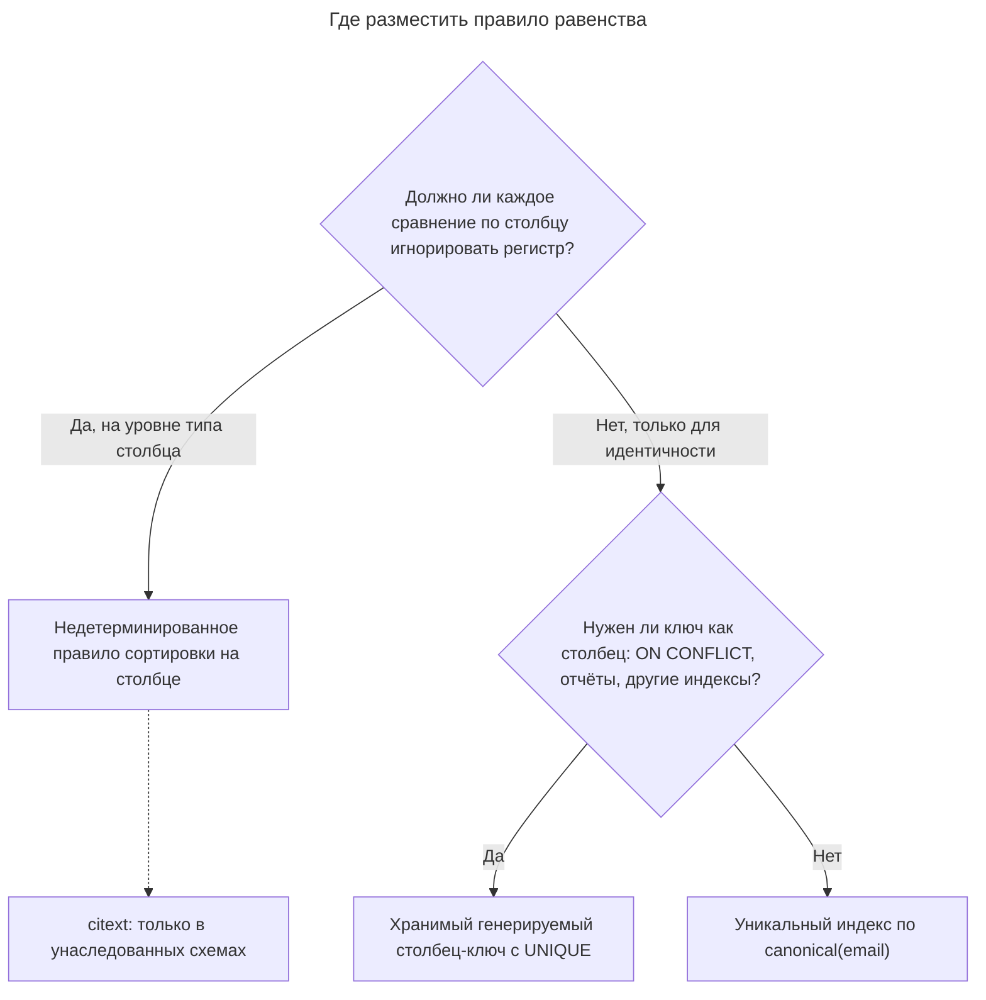
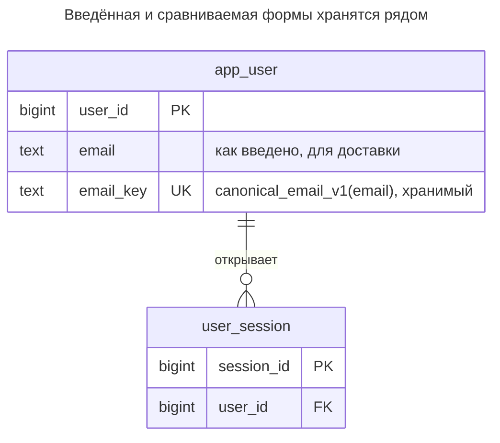
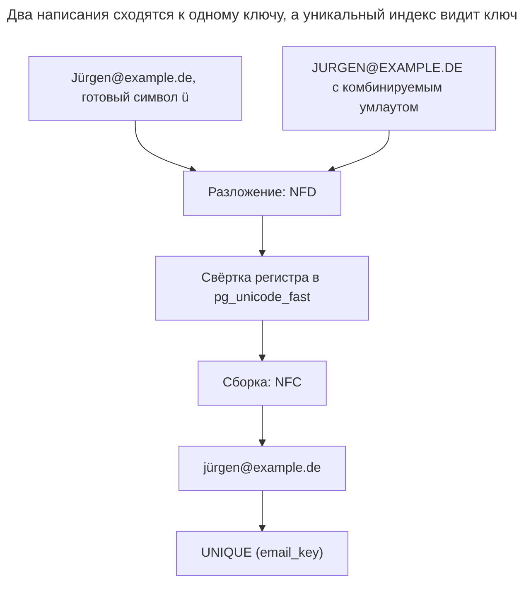
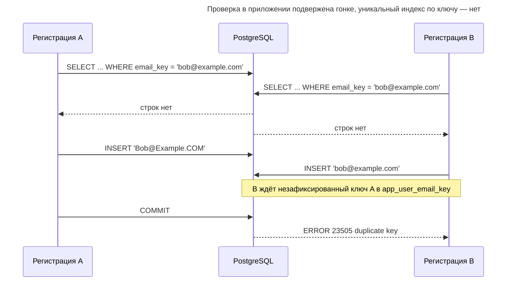
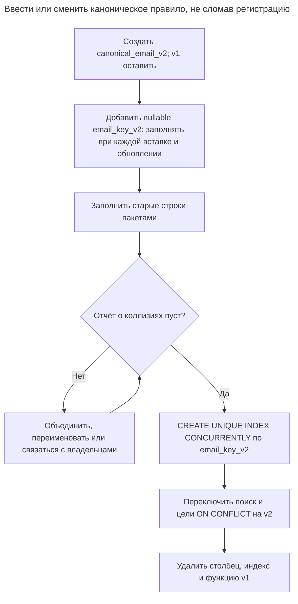

# Каноническое значение

## Назначение

Каноническое значение — единственная нормализованная форма, которую база данных сравнивает, когда люди вводят один и тот же идентификатор по-разному. Адрес e-mail, имя пользователя или slug сегодня приходит как `Bob@Example.COM`, а завтра как `bob@example.com`; приложение имеет в виду одну учётную запись, а обычное ограничение уникальности видит две разные строки. Запишите правило эквивалентности один раз в виде неизменяемой функции, храните или индексируйте её результат рядом с введённым значением и поставьте ограничение уникальности на этот результат. Тогда база отвергнет второе написание при любой конкурентности, поиск будет пользоваться тем же правилом, а отображаемая форма останется ровно такой, какой её ввёл пользователь.

## Также известен как

Нормализованный ключ; ключ, уникальный без учёта регистра; функциональное ограничение уникальности ([Django](https://docs.djangoproject.com/en/6.1/ref/models/constraints/#django.db.models.UniqueConstraint.expressions)). Стандарт Unicode называет такое сравнение [каноническим сопоставлением без учёта регистра](https://www.unicode.org/versions/Unicode18.0.0/core-spec/chapter-3/#G53523) (canonical caseless matching). PostgreSQL предлагает сторону сравнения в виде [недетерминированных правил сортировки](https://www.postgresql.org/docs/18/collation.html#COLLATION-NONDETERMINISTIC) и более старого типа [`citext`](https://www.postgresql.org/docs/18/citext.html).

## Проблема

Форма регистрации сохраняет `email text UNIQUE`. Человек регистрируется как `Bob@Example.COM`, потом забывает об этом и регистрируется снова как `bob@example.com`; обе вставки проходят, сброс пароля находит две учётные записи, а запрос входа `WHERE email = $1` не находит ни одной, если пользователь введёт третье написание. То же происходит с Unicode: `Jürgen` может прийти с готовым символом `ü` с одной клавиатуры и как `u` с комбинируемым умлаутом с другой. Строки выглядят одинаково, но при сравнении не равны.

Обычные исправления оставляют дыру. Приведение к нижнему регистру в коде приложения перед вставкой работает, пока какой-нибудь путь кода, скрипт импорта или админка не забудет это сделать. Проверка уникальности в приложении (`SELECT ... WHERE lower(email) = lower($1)`, затем `INSERT`) подвержена гонке: два одновременных запроса оба не видят строки и оба вставляют. Приведение к нижнему регистру хранимого значения уничтожает форму, выбранную пользователем, а она может понадобиться для отображения или доставки писем.

## Решение

Разделите две роли, которые играл столбец. Храните `email` в том виде, в каком его ввели, и выводите из него `email_key` одной именованной неизменяемой функцией канонизации: нормализация Unicode, затем свёртка регистра (case folding) в закреплённом правиле сортировки. Сделайте `email_key` уникальным ключом. Каждый поиск канонизирует свой вход той же функцией и сравнивает ключи; при каждой записи ключ вычисляет база, а не вызывающая сторона.

Unicode описывает такое же устройство для поиска: исходную строку обычно [хранят вместе со свёрнутой версией](https://www.unicode.org/versions/Unicode18.0.0/core-spec/chapter-5/#G21790) для быстрых сравнений, потому что замена исходной строки стёрла бы информацию.

Каноническая форма — бизнес-правило, а не технический факт. [RFC 5321](https://www.rfc-editor.org/rfc/rfc5321.html#section-2.4) требует, чтобы почтовое ПО считало локальную часть адреса чувствительной к регистру, потому что на некоторых узлах `smith` и `Smith` — разные пользователи, но не рекомендует на это полагаться; домены регистр не различают. Поэтому свёртка всего адреса — решение о ваших пользователях, а не прочтение стандарта, и вы фиксируете его в имени и комментарии функции. Правила конкретных провайдеров, например игнорирование точек в некоторых почтовых сервисах, меняют то, каких людей считать одним клиентом, и тоже относятся к этому решению, а не к разрозненному коду запросов.

## Альтернативы и выбор

| Соседний паттерн | Связь | Определяющее требование |
| --- | --- | --- |
| Уникальный индекс по выражению `canonical(email)` | Вариант реализации без хранимого столбца | Вам не нужен лишний столбец, и вы согласны, что каждый запрос должен повторять точное выражение, чтобы использовать индекс |
| Хранимый генерируемый столбец (эта глава) | Вариант реализации | Ключ должен быть видим, годиться как цель `ON CONFLICT` и индексироваться как любой столбец |
| Недетерминированное правило сортировки на столбце | Замена производного ключа | Равенство, уникальность и порядок должны игнорировать регистр на уровне типа столбца, и вы принимаете потерю производительности и ограниченный поиск по шаблону |
| `citext` | Устаревшая замена | Только в существующих схемах; PostgreSQL рекомендует вместо него недетерминированные правила сортировки, а `citext` сворачивает регистр по `LC_CTYPE` базы |
| [Естественный ключ](natural-key.md) | Дополнение | Каноническое значение — бизнес-идентификатор, но ссылки всё равно должны использовать стабильный ключ |

Идентификаторы сравниваются в [Атласе решений](decision-atlas.md). Каноническое значение обычно служит альтернативным ключом: таблица сохраняет [суррогатный ключ](surrogate-key.md) для ссылок, поэтому смена адреса не переписывает внешние ключи.



Производный ключ сохраняет обычное равенство для введённого текста и добавляет рядом одно правило идентичности. Недетерминированное правило сортировки меняет смысл `=` для столбца повсюду; это шире и несёт собственные ограничения.

## Структура



`app_user` хранит обе формы. Другие таблицы ссылаются на `user_id`, а не на ключ e-mail, поэтому смена адреса — обновление одной строки.



Конвейер следует каноническому сопоставлению Unicode без учёта регистра, `NFD(toCasefold(NFD(X)))`, а затем собирает символы обратно, чтобы хранимый ключ был в привычной форме NFC. Вторая нормализация нужна, потому что, как предупреждает документация PostgreSQL, `casefold()` не всегда сохраняет нормализованную форму входа. Оба входа приходят к одному ключу, поэтому вторая вставка упирается в ограничение.

## Таблицы и инварианты

- **`canonical_email_v1(text)`** объявлена `IMMUTABLE` и закрепляет правило сортировки `pg_unicode_fast` внутри тела, поэтому её результат не зависит от локали базы по умолчанию. Суффикс версии намеренный: другое правило — другая функция, а не тихий `CREATE OR REPLACE`.
- **`app_user.email`** хранит адрес ровно таким, каким его ввели. `app_user_email_shape` отвергает пробелы по краям и внутри, а не обрезает их молча.
- **`app_user.email_key`** — хранимый генерируемый столбец. `app_user_email_key` делает его уникальным, поэтому у двух пользователей не может быть одного канонического адреса, каким бы путём кода ни шла вставка.
- **Ссылки** ведут на `user_id`. Канонический ключ опознаёт человека на границе системы, но не служит целью внешних ключей.

## Когда применять

- Идентификатор вводят люди: адреса e-mail, имена пользователей, slug организаций, коды купонов, номера автомобилей.
- Бизнес считает некоторые написания одним и тем же, и вы можете точно сформулировать правило.
- В таблицу пишут несколько путей кода, импортов или сервисов, поэтому нормализацию на стороне приложения нельзя гарантировать.
- Нужно сохранить введённую форму для отображения, доставки или аудита.

## Последствия и компромиссы

- ➕ Уникальность по бизнес-правилу обеспечивает база, в том числе при одновременных вставках.
- ➕ Поиск, upsert и отчёты о дубликатах пользуются одним именованным правилом.
- ➕ Введённое значение сохраняется для отображения и доставки.
- ➖ Каждая строка хранит идентификатор дважды, и каждая вставка поддерживает уникальный индекс по производной форме.
- ➖ Функция — это контракт: её смена означает миграцию с обработкой коллизий, а не правку.
- ➖ Полная свёртка Unicode принимает решения, с которыми придётся согласиться: `STRAßE` и `strasse` совпадают.
- ➖ Запросы, сравнивающие `email` напрямую, обходят правило; проверяйте, что поиск идёт по ключу.

## Реализация

[Полный скрипт](../assets/canonical-value/canonical-value.sql) проверяет каждый оператор ниже, включая состояния ошибок. Определите правило один раз:

```sql
CREATE FUNCTION canonical_email_v1(raw text) RETURNS text
LANGUAGE sql IMMUTABLE PARALLEL SAFE STRICT
RETURN normalize(casefold(normalize(raw, NFD) COLLATE pg_unicode_fast), NFC);

CREATE TABLE app_user (
    user_id bigint GENERATED ALWAYS AS IDENTITY PRIMARY KEY,
    email text NOT NULL,
    email_key text GENERATED ALWAYS AS (canonical_email_v1(email)) STORED,
    CONSTRAINT app_user_email_key UNIQUE (email_key),
    CONSTRAINT app_user_email_shape CHECK (email ~ '^[^@[:space:]]+@[^@[:space:]]+$')
);
```

[`casefold()`](https://www.postgresql.org/docs/18/functions-string.html#FUNCTIONS-STRING-OTHER) в PostgreSQL 18 сворачивает регистр в соответствии с правилом сортировки. Документация различает две операции: свёртка регистра нужна для сравнения без учёта регистра, а преобразование регистра, например `lower()`, — для получения строки в определённом регистре. В предопределённом правиле `pg_unicode_fast` `ß` сворачивается в `ss`; в правиле libc `casefold()` совпадает с `lower()`, поэтому функция и закрепляет правило сортировки. `STORED` обязателен: в PostgreSQL 18 [генерируемые столбцы по умолчанию виртуальные](https://www.postgresql.org/docs/18/ddl-generated-columns.html), виртуальный столбец не может вызывать пользовательские функции, а PostgreSQL 18.7 ещё и отвергает ограничение уникальности на виртуальном генерируемом столбце с сообщением `unique constraints on virtual generated columns are not supported`.

```sql
INSERT INTO app_user (email) VALUES ('Bob@Example.COM')
RETURNING user_id, email, email_key;
```

Строка сохраняет `Bob@Example.COM` и получает ключ `bob@example.com`. Второе написание отвергает сама база:

```sql
INSERT INTO app_user (email) VALUES ('bob@example.com');
```

PostgreSQL 18.7 возвращает SQLSTATE `23505`: `ERROR: duplicate key value violates unique constraint "app_user_email_key"` и `DETAIL: Key (email_key)=(bob@example.com) already exists.` Разложенное `JU\0308RGEN@EXAMPLE.DE` в верхнем регистре так же сталкивается с сохранённым `Jürgen@example.de`, с `Key (email_key)=(jürgen@example.de)`.

Используйте ключ как цель конфликта, когда регистрация должна быть идемпотентной, и канонизируйте вход поиска той же функцией, чтобы запрос обслуживал уникальный индекс:

```sql
INSERT INTO app_user (email) VALUES ('BOB@example.com')
ON CONFLICT (email_key) DO NOTHING
RETURNING user_id;

SELECT user_id, email FROM app_user
WHERE email_key = canonical_email_v1('bob@EXAMPLE.com');
```

Вставка не возвращает строк, а поиск возвращает пользователя `1` с введённой формой `Bob@Example.COM`. Скрипт также проверяет, что план поиска использует `app_user_email_key`.

Если регистр должен игнорироваться при каждом сравнении по столбцу, а не только для идентичности, поместите правило в [недетерминированное правило сортировки](https://www.postgresql.org/docs/18/collation.html#COLLATION-NONDETERMINISTIC):

```sql
CREATE COLLATION case_insensitive (
    provider = icu, locale = 'und-u-ks-level2', deterministic = false
);
CREATE TABLE ci_user (
    user_id bigint GENERATED ALWAYS AS IDENTITY PRIMARY KEY,
    email text COLLATE case_insensitive NOT NULL,
    CONSTRAINT ci_user_email_key UNIQUE (email)
);
```

Здесь обычный `UNIQUE (email)` отвергает `bob@example.com` после `Bob@Example.COM` с тем же SQLSTATE `23505`. Правило сортировки требует сборки с ICU, а его логика — уровень сравнения ICU, а не функция, которую можно прочитать. PostgreSQL документирует цену: снижение производительности, отсутствие дедупликации в B-tree и ограниченный поиск по шаблону — `LIKE` работает с недетерминированными правилами сортировки начиная с 18, а `ILIKE` и регулярные выражения нет. Результаты ICU [могут зависеть от версии библиотеки](https://www.postgresql.org/docs/18/locale.html#LOCALE-PROVIDERS).

## Поддержка в движках

- **PostgreSQL 18:** хранимый генерируемый ключ, индекс по выражению и недетерминированные правила сортировки ICU работают, как показано. [`casefold()`](https://www.postgresql.org/docs/18/release-18.html#RELEASE-18-FUNCTIONS) и правило `pg_unicode_fast` появились в 18; в более ранних версиях используйте `lower()` и примите простое отображение регистра. [`citext`](https://www.postgresql.org/docs/18/citext.html) оставляйте только там, где он уже есть.
- **MySQL 8.4:** правило по умолчанию `utf8mb4_0900_ai_ci` [не учитывает ни диакритику, ни регистр](https://dev.mysql.com/doc/refman/8.4/en/charset-unicode-sets.html), а [строковые столбцы сравниваются по своему правилу сортировки](https://dev.mysql.com/doc/refman/8.4/en/char.html), поэтому обычный `UNIQUE` уже считает дубликатами `Bob` и `bob`, а также `resume` и `résumé`. Проверьте правило сортировки столбца, прежде чем переносить производный ключ: риск там обратный — непреднамеренная коллизия.
- **SQL Server 2025 (17.x):** [правила сортировки определяют, как сравниваются данные](https://learn.microsoft.com/en-us/sql/relational-databases/collations/collation-and-unicode-support?view=sql-server-ver17), столбец без явного правила получает правило базы по умолчанию, а [для установок с US English по умолчанию](https://learn.microsoft.com/en-us/sql/relational-databases/collations/set-or-change-the-server-collation?view=sql-server-ver17) это нечувствительное к регистру `SQL_Latin1_General_CP1_CI_AS`. Указывайте правило на столбце или индексируйте вычисляемый столбец, если правило выходит за рамки регистра; [индексы по вычисляемым столбцам](https://learn.microsoft.com/en-us/sql/relational-databases/indexes/indexes-on-computed-columns?view=sql-server-ver17) требуют детерминированного выражения.
- **Oracle AI Database 26ai:** [правило сортировки, привязанное к данным](https://docs.oracle.com/en/database/oracle/oracle-database/26/nlspg/linguistic-sorting-and-matching.html#GUID-7E70C5D5-82E1-4BA6-8DF8-01E365B202C2), например `BINARY_CI` на столбце, делает сравнения нечувствительными к регистру и задаёт порядок ключей в индексах ограничений уникальности. Для него нужен `MAX_STRING_SIZE = EXTENDED`.
- **SQLite 3:** [`COLLATE NOCASE`](https://www.sqlite.org/datatype3.html#collation) сворачивает только буквы ASCII. Встроенная `lower()` тоже [работает только для ASCII](https://www.sqlite.org/lang_corefunc.html), а функции нормализации Unicode в основной библиотеке нет, поэтому храните вычисленный приложением столбец-ключ с уникальным индексом.

## Сбои и конкурентность

Гонку закрывает уникальный индекс, а не предварительная проверка в приложении. PostgreSQL заставляет второй сеанс, вставляющий конфликтующий ключ, [дождаться первой транзакции и проверить снова](https://www.postgresql.org/docs/18/index-unique-checks.html), поэтому из двух одновременных регистраций побеждает ровно одна при любом уровне изоляции.



Обе предварительные проверки проходят, и вторую учётную запись останавливает только ограничение. Обрабатывайте `23505` на `app_user_email_key` в приложении как «адрес уже зарегистрирован» или используйте `ON CONFLICT (email_key)`, чтобы сделать исход явным.

Функция действительно должна быть неизменяемой. Встроенный провайдер использует собственные операции PostgreSQL, и документация обещает, что `pg_unicode_fast` [стабилен в пределах мажорной версии](https://www.postgresql.org/docs/18/collation.html#COLLATION-MANAGING-STANDARD). Результаты ICU могут зависеть от версии библиотеки ICU, а локали libc могут вести себя по-разному на разных платформах. Если результаты правила изменятся, индекс, построенный на старых результатах, будет хранить ключи, которые новая функция уже не выдаёт. Закрепление `pg_unicode_fast` убирает зависимость от библиотек операционной системы, но не от таблиц Unicode в самом PostgreSQL: после мажорного обновления повторите отчёт о коллизиях.

## Миграция

Обычная отправная точка — `email text UNIQUE`, в котором уже есть варианты написания. Сначала постройте отчёт о коллизиях, потому что новое правило превращает существующие строки в дубликаты:

```sql
SELECT canonical_email_v1(email) AS email_key,
       array_agg(user_id ORDER BY user_id) AS user_ids
FROM legacy_user
GROUP BY 1
HAVING count(*) > 1;
```

Построение индекса до их разрешения завершается SQLSTATE `23505`: `ERROR: could not create unique index "legacy_user_email_key_idx"` и `DETAIL: Key (public.canonical_email_v1(email))=(ann@example.com) is duplicated.` Разрешение коллизии — бизнес-операция: объедините учётные записи, свяжитесь с владельцами или переименуйте одну из них. Делайте это до включения ограничения, а не удалением строк в скрипте миграции.



На нагруженной таблице стройте уникальный индекс по столбцу `email_key_v2` [`CONCURRENTLY`](https://www.postgresql.org/docs/18/sql-createindex.html#SQL-CREATEINDEX-CONCURRENTLY), а затем подключайте его как ограничение через `ALTER TABLE ... ADD CONSTRAINT ... UNIQUE USING INDEX`; индекс по выражению не может стать основой ограничения, поэтому для этого шага нужен столбец. Добавление хранимого генерируемого столбца перезаписывает таблицу, поэтому на большой таблице на время перехода используйте обычный столбец, который заполняет триггер. Новые регистрации всё ещё могут столкнуться между отчётом и индексом; повторите отчёт непосредственно перед построением. Полная последовательность описана в главе [«Расширение и свёртывание»](expand-contract.md). Для отката удалите новый индекс и столбец: введённые значения не менялись.

## Антипаттерны и частые ошибки

- Приводить хранимое значение к нижнему регистру и терять форму, введённую пользователем.
- Нормализовать только в коде приложения, так что импорт или админка записывает второе написание.
- Проверять дубликат через `SELECT` и полагаться на это без ограничения уникальности.
- Менять каноническую функцию на месте через `CREATE OR REPLACE`: хранимые ключи и записи индекса сохраняют старые результаты.
- Строить правило на правиле сортировки libc или ICU, не планируя обновлений библиотек, которые меняют его результаты.
- Писать `WHERE lower(email) = lower($1)`, когда индекс построен по другому выражению, так что поиск сканирует таблицу.
- Зашивать в ключ особенности адресов конкретных провайдеров без бизнес-решения о том, кого считать одним клиентом.

## Известные применения

- [Справочник ограничений Django](https://docs.djangoproject.com/en/6.1/ref/models/constraints/#django.db.models.UniqueConstraint.expressions) поддерживает функциональные ограничения уникальности и показывает `UniqueConstraint(Lower("name").desc(), "category", ...)` — имя, уникальное без учёта регистра в пределах категории.
- [Документация PostgreSQL об индексах по выражениям](https://www.postgresql.org/docs/18/indexes-expressional.html) отмечает, что если объявить её индекс по `lower(col1)` как `UNIQUE`, он не допустит строк, отличающихся только регистром.
- [Проверка уникальности в Rails](https://api.rubyonrails.org/classes/ActiveRecord/Validations/ClassMethods.html#method-i-validates_uniqueness_of-label-Concurrency+and+integrity) документирует, что проверки уникальности на уровне приложения по своей природе подвержены гонкам, и рекомендует уникальный индекс; её параметр `case_sensitive` меняет только проверку, а не гарантию.

## Связанные паттерны

- [Естественный ключ](natural-key.md) обсуждает бизнес-идентификаторы; каноническое значение позволяет такому идентификатору оставаться уникальным, когда его вводят люди.
- [Суррогатный ключ](surrogate-key.md) несёт ссылки, чтобы каноническое значение могло меняться.
- [Публичный идентификатор](public-identifier.md) — противоположный случай: сгенерированный машиной ID, который сравнивается точно.
- [Расширение и свёртывание](expand-contract.md) задаёт рамку миграции для смены правила.
