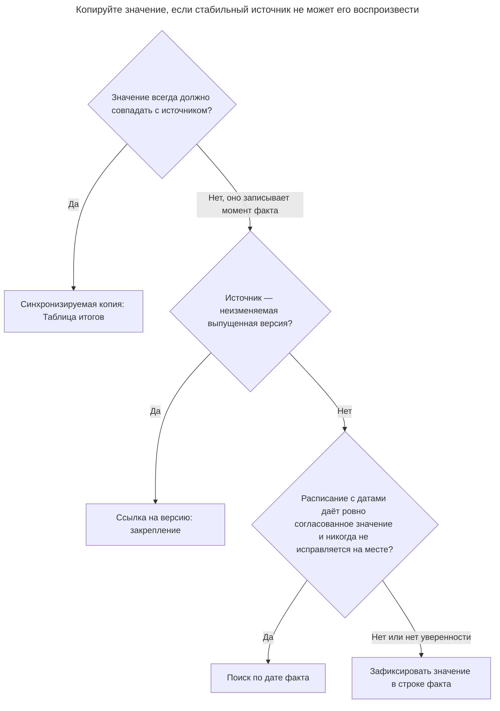
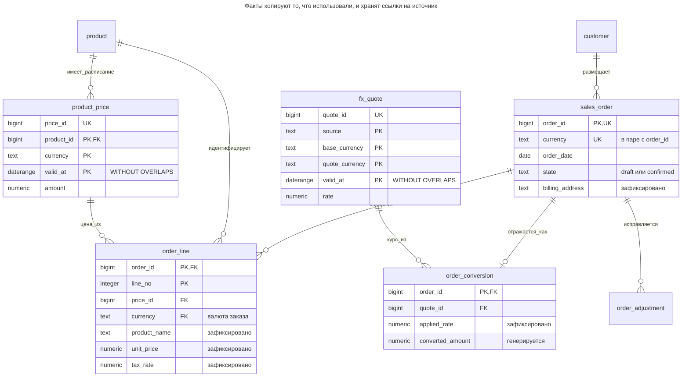
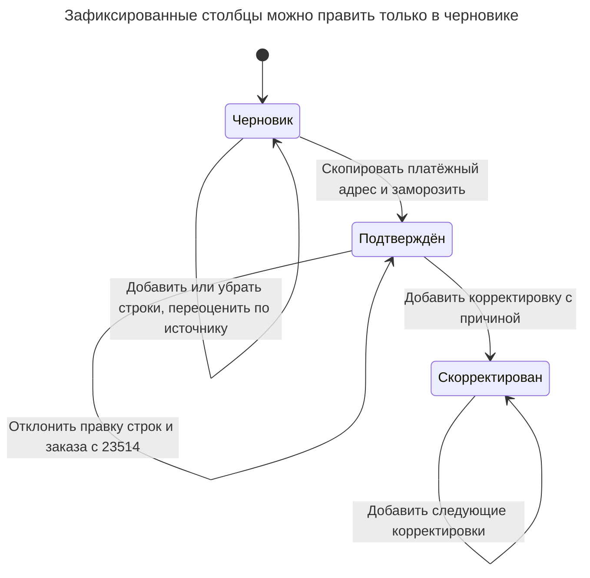
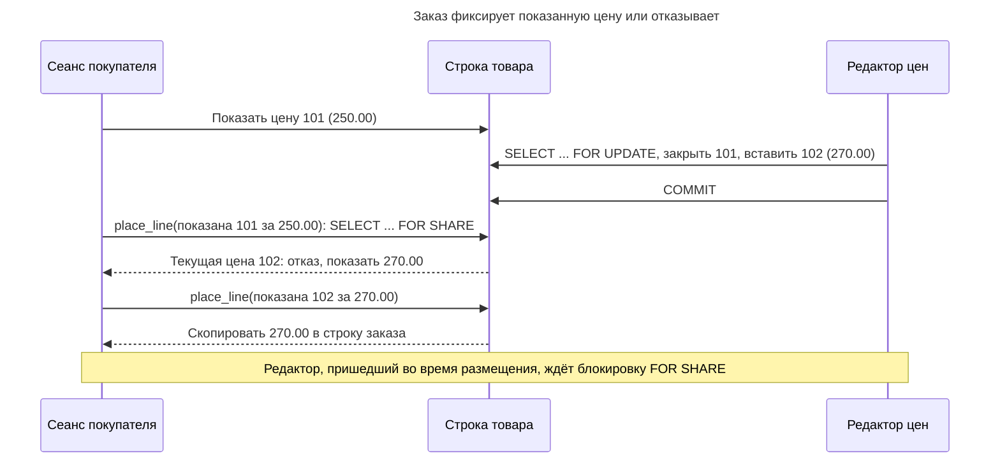
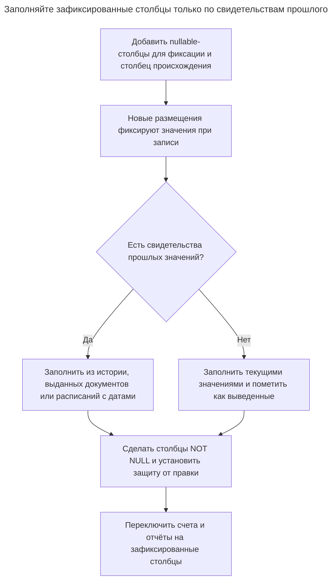

# Зафиксированное значение

## Назначение

Зафиксированное значение — это копия того, что было верно в момент бизнес-факта (цена за единицу, название товара и ставка налога в строке заказа, платёжный адрес в счёте), которая хранится в строке самого факта и больше никогда не синхронизируется с источником. Это часть факта, а не кеш: после подтверждения заказа копия и есть запись о том, на что согласился покупатель, а её изменение — это исправление отдельной строкой, а не правка. Глава отделяет эту законную половину «денормализации» от синхронизируемых копий, сравнивает её со ссылкой на неизменяемую версию и с поиском значения по дате, замораживает зафиксированные столбцы триггером или привилегиями и разбирает пересчёт валют, где зафиксированное значение — применённый курс.

## Также известен как

Столбец-снимок; замороженная копия; историческая копия. Часто это относят к денормализации, и это скрывает различие, на котором держится глава: денормализованная копия обязана совпадать с источником, а зафиксированное значение — не обязано. API Stripe документирует такое поведение для полей покупателя в счёте: [`customer_address`](https://docs.stripe.com/api/invoices/object) равен адресу покупателя, пока счёт не финализирован, а после этого «больше не обновляется».

## Проблема

Покупатель заказывает кофемолку за 250.00 EUR со ставкой налога 19 % и платёжным адресом в Берлине. Строка заказа хранит `product_id` и `quantity`; счёт соединяется с `product` и `customer`, чтобы напечатать остальное. Через неделю товар переименовывают, его налоговая категория меняется на 7 %, цена растёт до 270.00, а покупатель переезжает в Гамбург. Перепечатанный счёт теперь показывает название, которого покупатель не видел, сумму, на которую он не соглашался, и адрес, по которому товар никогда не выставлялся. Ничего не потерялось случайно: схема просто не записала эти факты.

Таблица цен с датами выглядит решением: найдите цену, действовавшую на дату заказа. Но она отвечает правильно, только пока выполняются три условия. Дата заказа выбирает ровно ту цену, которую показали. Расписание цен никогда не исправляют на месте. У каждого печатаемого атрибута есть своя таблица с датами, а у названий, адресов и налоговых категорий её обычно нет. Согласованная скидка, акция или цена вне прайс-листа нарушают первое условие сразу.

Обратный рефлекс не менее вреден. Команда, которой сказали «копии — это денормализация», добавляет триггер, обновляющий `order_line.product_name` при каждом изменении товара. Записанный факт превращается в кеш текущего каталога.

## Решение

Для каждого значения, от которого зависит факт, решите, принадлежит ли оно факту или источнику:

- **Зафиксированное**: значение было согласовано, показано, списано или отражено в отчёте в момент факта. Скопируйте его в строку факта при создании факта из строки, которую вы заблокировали или проверили, и больше никогда не обновляйте его из источника.
- **Ссылочное**: значение описывает идентичность или текущее состояние источника, например остаток товара на складе или текущий e-mail покупателя. Храните внешний ключ и соединяйте.

Храните ссылку на источник рядом с копией. `product_id` отвечает на вопрос «какой товар», скопированное название — «как мы его тогда называли». Ссылка на строку с датами, из которой пришло значение (`price_id`, `quote_id`), добавляет происхождение: она показывает, какое правило дало копию, и находит каждый факт, который изменило бы последующее исправление источника.

Замораживайте зафиксированные столбцы после подтверждения факта. Черновик заказа ещё можно переоценить, подтверждённый заказ — нельзя. Если зафиксированное значение оказалось ошибочным, запишите явную корректировку (кредитовую строку, сторно, исправленный документ) и оставьте исходную строку нетронутой.

## Альтернативы и выбор

| Вариант | Отношение | Решающее требование |
| --- | --- | --- |
| Зафиксированное значение | Вариант по умолчанию для фактов | Факт должен воспроизводить то, что было согласовано или показано, что бы потом ни случилось с источником |
| Синхронизируемая копия (кеш), см. главу [Таблица итогов](summary-table.md) | Другой контракт, не замена | Копия всегда должна совпадать с источником; она нужна ради скорости чтения, и расхождение — это ошибка |
| Ссылка на неизменяемую версию, как [Состав изделия](bill-of-materials.md) закрепляет выпущенные ревизии | Замена | Источник уже версионирован, и выпущенные версии никогда не меняются; многие факты разделяют объёмное версионированное содержимое |
| Поиск значения по дате факта, см. главу [Период действия](effective-dating.md) | Замена только для прайс-листа; дополнение для выбора | Значение в точности равно значению расписания на эту дату, и расписание никогда не исправляют на месте |
| [Таблица истории](history-table.md) на источнике | Дополнение | Нужно знать, что говорил источник в момент времени, а не что использовал конкретный факт |

Полное сравнение временных контрактов — в [Атласе решений](decision-atlas.md).



Закрепление и фиксация дают одну и ту же гарантию разными путями. Закреплённая ссылка обходится дёшево, когда версионированный источник уже есть и гарантированно неизменяем; Stripe, например, не позволяет [изменить сумму цены](https://docs.stripe.com/products-prices/manage-prices) и предлагает вместо этого создать новую цену. Фиксация — единственный путь, когда источник — обычные изменяемые данные, например адрес покупателя.

## Структура



Выделенные таблицы — факты, приглушённые — источники, которые продолжают меняться. Каждая связь от источника к факту — ссылка для идентичности и происхождения, а не для чтения значений, которые факт напечатал.

## Таблицы и инварианты

- **`product`** и **`customer`** хранят текущие описательные значения. Ничто в фактах не зависит от того, останутся ли они прежними.
- **`product_price`** — расписание с периодами действия и темпоральным ключом, как в главе [Период действия](effective-dating.md). Суррогатный `price_id` уникален, поэтому строка заказа может сослаться на ту самую строку, по которой её оценили.
- **`sales_order`** фиксирует `billing_address` при подтверждении. Проверка требует адрес и время подтверждения, когда состояние — `confirmed`; триггер `sales_order_frozen` отклоняет любое изменение и удаление подтверждённого заказа, включая возврат в черновик. `UNIQUE (order_id, currency)` служит целью для ссылок, проверяющих валюту.
- **`order_line`** копирует название товара, цену за единицу и ставку налога и хранит `product_id` и `price_id`. Составная ссылка `(order_id, currency)` заставляет каждую строку использовать валюту своего заказа. Триггер `order_line_frozen` блокирует родительский заказ через `FOR SHARE` и отклоняет вставку, изменение и удаление строк подтверждённого заказа. `FOR KEY SHARE` не конфликтовал бы с подтверждающим `UPDATE` и пропустил бы строку в заказ, который как раз подтверждается.
- **`order_adjustment`** записывает исправления как новые суммы со знаком и причиной в валюте заказа.
- **`fx_quote`** хранит курсы с датами по источнику и валютной паре: одна единица `base_currency` равна `rate` единицам `quote_currency`. Темпоральный ключ отклоняет две котировки одного источника для одной пары и одного дня.
- **`order_conversion`** копирует `applied_rate` и исходную сумму, выводит пересчитанную сумму хранимым генерируемым столбцом и ссылается на котировку через `(quote_id, from_currency, to_currency)`. Котировку для другой валютной пары указать нельзя.

## Когда применять

- Заказы, счета, чеки, договоры, расчётные листки и транспортные этикетки: любой документ, который контрагент получил или на который опирался.
- Значения, которые показали человеку до того, как он принял решение: цена, комиссия, срок доставки, условия.
- Значения из источников, которые меняются по причинам, не связанным с фактом: правки каталога, переезды, смена налоговых категорий, исправления курсов.
- Отчёты, которые должны воспроизводить те же цифры после изменения источников, например месячная выручка в валюте отчётности.

## Последствия и компромиссы

- ➕ Факт воспроизводит себя без истории источника: для перепечатки счёта нужны только строки счёта.
- ➕ Источники можно свободно править, переименовывать и исправлять; ни одна правка незаметно не переписывает прошлый документ.
- ➕ Сохранённая ссылка превращает исправление источника в запрос: какие факты использовали исправленную строку и насколько они расходятся.
- ➖ Объём растёт с каждым зафиксированным столбцом в каждой строке факта. Фиксируйте то, что факт использовал, а не всю строку источника.
- ➖ Ошибочные зафиксированные значения остаются ошибочными, пока кто-то не запишет корректировку. Схема обеспечивает процедуру, а не результат.
- ➖ Разработчики, приученные устранять дублирование, попытаются «починить» копию. Имена и комментарии столбцов должны говорить, что копия намеренная.

## Реализация

[Полный скрипт для PostgreSQL 18.7](../assets/captured-value/captured-value.sql) проверяет фиксацию при размещении и подтверждении, поиск по дате, который расходится после исправления на месте, заморозку заказа и строк, корректировку, отказ по устаревшей цене, ссылки с проверкой валюты, пересчёт валюты, переживающий исправление котировки, итоги по валютам и защиту одними привилегиями. Таблица строк:

```sql
CREATE TABLE order_line (
    order_id bigint NOT NULL,
    line_no integer NOT NULL,
    product_id bigint NOT NULL REFERENCES product (product_id),
    price_id bigint NOT NULL REFERENCES product_price (price_id),
    currency text NOT NULL,
    quantity integer NOT NULL CHECK (quantity > 0),
    product_name text NOT NULL,
    unit_price numeric(12,2) NOT NULL CHECK (unit_price >= 0),
    tax_rate numeric(5,4) NOT NULL CHECK (tax_rate >= 0 AND tax_rate < 1),
    PRIMARY KEY (order_id, line_no),
    FOREIGN KEY (order_id, currency) REFERENCES sales_order (order_id, currency)
);
```

Защита строк срабатывает перед каждой вставкой, изменением и удалением строки:

```sql
SELECT state INTO v_state FROM sales_order WHERE order_id = v_order_id FOR SHARE;
IF v_state = 'confirmed' OR (TG_OP = 'UPDATE' AND NEW.order_id <> OLD.order_id) THEN
    RAISE EXCEPTION 'lines of confirmed order % are immutable', v_order_id
        USING ERRCODE = '23514';
END IF;
```

Функция `place_line(order, line, product, quantity, shown_price_id, shown_amount)` принимает строку цены и сумму, которые показали покупателю, и копирует только из строк, которые заблокировала или проверила. Сумма важна, потому что строку расписания можно исправить на месте под тем же `price_id`:

```sql
SELECT * INTO STRICT v_product FROM product WHERE product_id = p_product_id FOR SHARE;
SELECT * INTO v_price FROM product_price
WHERE product_id = p_product_id
  AND currency = v_order.currency
  AND valid_at @> v_order.order_date;
IF NOT FOUND OR v_price.price_id <> p_shown_price_id
   OR v_price.amount <> p_shown_amount THEN
    RAISE EXCEPTION 'shown price % (%) is not current for product % on %',
        p_shown_price_id, p_shown_amount, p_product_id, v_order.order_date
        USING ERRCODE = 'P0001', HINT = 'Show the customer the current price.';
END IF;
INSERT INTO order_line (order_id, line_no, product_id, price_id, currency, quantity,
                        product_name, unit_price, tax_rate)
VALUES (p_order_id, p_line_no, p_product_id, v_price.price_id, v_price.currency,
        p_quantity, v_product.name, v_price.amount, v_product.tax_rate);
```

Подтверждение — это процедура, которая копирует текущий платёжный адрес покупателя и меняет состояние одним `UPDATE ... FROM customer`. После того как заказ 1 размещён за 250.00 EUR и подтверждён, скрипт переименовывает товар, меняет его ставку налога на 7 %, переселяет покупателя в Гамбург и делит расписание цен так, что с 27 февраля действует 270.00. Заказ 1 по-прежнему показывает `Espresso grinder`, `250.00`, `0.1900` и берлинский адрес, а соединение с источниками показывает сегодняшние значения.

Затем кто-то исправляет старую строку расписания на месте на 240.00. Поиск по дате заказа теперь возвращает `240.00`, а заказ по-прежнему говорит `250.00`. Сохранённая ссылка находит, что затронуло исправление:

```sql
SELECT l.order_id, l.line_no, l.unit_price, pp.amount
FROM order_line l JOIN product_price pp USING (price_id)
WHERE l.unit_price <> pp.amount;
```

Запрос возвращает заказ 1. Исправление — не правка. Изменение зафиксированной цены вызывает SQLSTATE `23514`: `ERROR: lines of confirmed order 1 are immutable`; удаление строки или добавление новой вызывает ту же ошибку, а изменение адреса заказа, возврат его в черновик или удаление — `ERROR: confirmed order 1 is immutable`. Черновик от 20 февраля по-прежнему можно править: размещение цены 101 по старой сумме `250.00` теперь отклоняется, по сумме `240.00` проходит, после чего скрипт изменяет и удаляет эту строку черновика и сам черновик. Вместо этого скрипт записывает бизнес-решение строкой:

```sql
INSERT INTO order_adjustment VALUES
    (1, 1, 'EUR', -10.00, 'Price list error corrected on 2026-03-02');
```

Чистая сумма заказа становится `240.00`, а строка по-прежнему показывает `250.00`, которые видел покупатель.

Покупатель, которому показали цену 101 за 250.00 и который размещает заказ 3 от 27 февраля, получает отказ с SQLSTATE `P0001`: `ERROR: shown price 101 (250.00) is not current for product 1 on 2026-02-27` и `HINT: Show the customer the current price.` С ценой 102 за 270.00 размещение проходит и фиксирует `270.00`. Строка, валюта которой отличается от валюты заказа, вызывает `23503`: `ERROR: insert or update on table "order_line" violates foreign key constraint "order_line_order_id_currency_fkey"`.



Единственный переход из состояния «Подтверждён» добавляет строки. Возврат в черновик снова открыл бы зафиксированные столбцы, поэтому триггер заказа отклоняет его, как и любую другую правку.

**Разобранный вариант: пересчёт валют.** Магазин ведёт отчётность в EUR, но продаёт и в USD. Курс, применённый к заказу, — зафиксированное значение, а котировки, из которых он берётся, — источник с периодами действия и названным поставщиком. [Величина](quantity.md) держит каждую валюту отдельным измерением, а [Двойная запись](double-entry-ledger.md) балансирует каждую валюту отдельно; этот раздел добавляет то, чего в тех главах нет: котировку с датой и применённый курс. У `fx_quote` та же форма, что у расписания цен: темпоральный ключ `(source, base_currency, quote_currency, valid_at WITHOUT OVERLAPS)`, уникальный `quote_id` и `UNIQUE (quote_id, base_currency, quote_currency)` как цель ссылки из пересчёта:

```sql
CREATE TABLE order_conversion (
    order_id bigint PRIMARY KEY,
    from_currency text NOT NULL,
    to_currency text NOT NULL,
    quote_id bigint NOT NULL,
    applied_rate numeric(18,8) NOT NULL CHECK (applied_rate > 0),
    source_amount numeric(12,2) NOT NULL,
    converted_amount numeric(12,2) GENERATED ALWAYS AS
        (round(source_amount * applied_rate, 2)) STORED,
    FOREIGN KEY (order_id, from_currency) REFERENCES sales_order (order_id, currency),
    FOREIGN KEY (quote_id, from_currency, to_currency)
        REFERENCES fx_quote (quote_id, base_currency, quote_currency)
);
```

Пересчёт выбирает котировку, действующую на дату заказа, и копирует её курс. Заказ 2 — это 60.00 USD; по котировке 301 (`0.86`) он отражается как `51.60` EUR. Направление котировки — часть её смысла: обратный к курсу USD→EUR — это новое число со своим округлением, поэтому храните ту пару, которую применили. Ссылка на котировку USD→EUR для заказа в EUR вызывает `23503` на `order_conversion_quote_id_from_currency_to_currency_fkey` с `DETAIL: Key (quote_id, from_currency, to_currency)=(301, EUR, USD) is not present in table "fx_quote".`

Применённый курс хранится, хотя на котировку есть ссылка, по двум причинам. Применённый курс может законно отличаться от котировки, например на договорной спред; если он у вас есть, храните его в отдельном столбце. И поставщик может исправить опубликованную котировку. Скрипт меняет котировку 301 на `0.87`; пересчёт сохраняет `0.86` и `51.60`, а условие `applied_rate <> rate` выводит его на проверку. Округление и разрядность промежуточных результатов описаны в главе [Неточная арифметика](inexact-arithmetic.md).

Суммы в разных валютах никогда не складываются. Итоги группируются по валюте, а итог в валюте отчётности складывает только суммы, которые уже в ней. Представление `order_total` из скрипта складывает строки и корректировки каждого заказа и всегда возвращает сумму вместе с валютой заказа:

```sql
SELECT sum(eur) FROM (
    SELECT net_amount AS eur FROM order_total WHERE currency = 'EUR'
    UNION ALL
    SELECT converted_amount FROM order_conversion WHERE to_currency = 'EUR'
) s;
```

Запрос возвращает `561.60`: заказы 1 и 3 в EUR плюс зафиксированный пересчёт заказа 2. Итоги по валютам — `510.00` EUR и `60.00` USD. У котировки тоже есть контракт: Европейский центральный банк публикует [референсные курсы евро](https://www.ecb.europa.eu/stats/policy_and_exchange_rates/euro_reference_exchange_rates/html/index.en.html) около 16:00 CET в рабочие дни «только для информации» и не рекомендует использовать их для сделок, поэтому столбец `source` говорит, на чьих условиях получен курс.

Пересчёты и корректировки после вставки никогда не меняются, поэтому их можно защитить одними привилегиями, без триггера, зависящего от состояния. Скрипт создаёт роль `captured_value_app` с правами `SELECT, INSERT` на обе таблицы; её `UPDATE` вызывает SQLSTATE `42501`: `ERROR: permission denied for table order_conversion`. [`GRANT`](https://www.postgresql.org/docs/18/sql-grant.html) в PostgreSQL принимает и списки столбцов, так что роль может менять столбец статуса, не имея доступа к зафиксированным. Таблице, где зафиксированные столбцы можно править в черновике, нужен триггер, потому что привилегии не зависят от значений в строке.

## Поддержка в движках

- **PostgreSQL 18:** [триггеры уровня строки](https://www.postgresql.org/docs/18/plpgsql-trigger.html) реализуют заморозку в зависимости от состояния, а [привилегии на столбцы](https://www.postgresql.org/docs/18/sql-grant.html) защищают факты, которые только вставляются. Темпоральным ключам для источников с датами нужен `btree_gist` для скалярных столбцов, как в главе [Период действия](effective-dating.md).
- **MySQL 8.4:** [`GRANT`](https://dev.mysql.com/doc/refman/8.4/en/grant.html) поддерживает привилегии на столбцы для `INSERT`, `REFERENCES`, `SELECT` и `UPDATE`, а триггеры могут отклонить правку через [`SIGNAL`](https://dev.mysql.com/doc/refman/8.4/en/signal.html). Темпорального ключа для расписания котировок нет; следуйте переносу из главы о периоде действия.
- **SQL Server 2025 (17.x):** [`GRANT` для объектов](https://learn.microsoft.com/en-us/sql/t-sql/statements/grant-object-permissions-transact-sql?view=sql-server-ver17) принимает список столбцов для `SELECT`, `REFERENCES`, `UPDATE` и `UNMASK`. [DML-триггеры работают с множествами](https://learn.microsoft.com/en-us/sql/relational-databases/triggers/create-dml-triggers-to-handle-multiple-rows-of-data?view=sql-server-ver17), поэтому проверка заморозки должна соединять `inserted` и `deleted` с родительскими заказами, а не рассчитывать на одну строку.
- **Oracle AI Database 26ai:** [`GRANT`](https://docs.oracle.com/en/database/oracle/oracle-database/26/sqlrf/GRANT.html) допускает привилегии `INSERT`, `UPDATE` и `REFERENCES` на уровне столбцов; для заморозки в зависимости от состояния всё равно нужен триггер.
- **SQLite 3:** привилегий нет. [Триггер](https://www.sqlite.org/lang_createtrigger.html) с `RAISE(ABORT, ...)` может отклонять изменения подтверждённых строк; остальное держится на дисциплине приложения.

## Сбои и конкурентность

Гонку между изменением цены и размещением заказа решает то, что копирует заказ. Повторное чтение «текущей цены» при размещении списывает цену, зафиксированную последней, а это может быть не та цена, на которую согласился покупатель. Передача показанной строки цены и суммы с проверкой под блокировкой списывает ровно показанное — или завершается отказом:



Протокол рассчитан на Read Committed, как и запись расписаний в главе о периоде действия. Блокируется строка товара, а не строка цены. Изменение цены вставляет новую строку с датами, и блокировка старой строки цены эту вставку не остановит; по протоколу периода действия каждый редактор расписания сначала блокирует товар, поэтому `FOR SHARE` при размещении заставляет редактора ждать, пока размещающая транзакция не зафиксируется. Внутри одного размещения название товара, ставка налога и цена приходят из одного согласованного состояния. Устаревшая цена — бизнес-конфликт, а не временная ошибка: не повторяйте размещение автоматически, покажите новую цену и спросите снова. [Столбец версии](version-column.md) обходится с устаревшим токеном так же.

Триггер строк блокирует родительский заказ через `FOR SHARE`, а это конфликтует с подтверждающим `UPDATE`. Строка, вставляемая одновременно с подтверждением, либо фиксируется до подтверждения заказа, либо видит подтверждённое состояние и получает отказ; появиться потом в замороженном заказе она не может.

Повторы не должны фиксировать дважды. Если ответ на размещение или пересчёт потерян, найдите существующую строку или пересчёт по ключу, прежде чем пробовать снова; повтор под новым ключом может зафиксировать другую цену или курс. Общий случай разобран в главе [Запись идемпотентности](idempotency-record.md).

## Миграция

Обычная отправная точка — строка заказа, хранящая только `product_id` и `quantity`, и счета, которые читают названия и цены из каталога. Зафиксированные столбцы нужно заполнить тем, что было верно тогда, а текущий каталог этого не доказывает.



Начните фиксировать значения для новых заказов до заполнения старых, чтобы множество строк для исправления перестало расти. Для старых заказов предпочитайте источники, которые видели прошлое: [таблицу истории](history-table.md) каталога, [журнал аудита](audit-log.md), отправленный PDF или письмо, сумму платежа. Если ничего такого нет, скопируйте текущее значение, но запишите, что оно выведено, чтобы никто не принял его за свидетельство. Установка `NOT NULL` и триггера берёт блокировки; следуйте главе [Расширение и свёртывание](expand-contract.md). Для отката верните читателей к соединению, но продолжайте фиксировать: значения, не зафиксированные за это время, потом не восстановить.

## Антипаттерны и частые ошибки

- Синхронизировать зафиксированные столбцы с источником триггером или ночным заданием, превращая факт в кеш.
- Удалять копию как «избыточную» при ревизии нормализации.
- Печатать прошлый документ через соединение с текущим каталогом, покупателем или таблицей налогов.
- Восстанавливать цену по дате, когда согласованная цена могла отличаться от прайс-листа.
- Фиксировать значение, присланное клиентом, не проверив его по источнику под блокировкой: клиент может прислать любое число.
- Править подтверждённое зафиксированное значение, чтобы исправить ошибку, вместо записи корректировки.
- Хранить применённый курс без котировки, из которой он получен, или котировку без применённого курса.
- Складывать суммы заказов в разных валютах или пересчитывать по курсу, который не был зафиксирован вместе с пересчётом.

## Известные применения

- [Объект Invoice](https://docs.stripe.com/api/invoices/object) в Stripe копирует в счёт имя, e-mail, адрес, данные доставки и налоговые идентификаторы покупателя; каждое поле следует за покупателем до финализации и после неё больше не обновляется.
- Stripe не позволяет менять денежные суммы и данные покупателя финализированного счёта через эндпоинт Update. [Ревизия](https://docs.stripe.com/invoicing/invoice-edits) — это новый черновик, связанный через `from_invoice`; его финализация аннулирует исходный счёт.
- [Цены](https://docs.stripe.com/products-prices/manage-prices) Stripe — это альтернатива с неизменяемыми версиями: сумму цены нельзя изменить через API, и Stripe рекомендует создать новую цену, перейти на её ID и деактивировать старую.

## Связанные паттерны

- [Период действия](effective-dating.md) даёт расписания цен и котировок с датами, из которых выбирает фиксация.
- [Состав изделия](bill-of-materials.md) закрепляет неизменяемые выпущенные версии вместо копирования.
- [Таблица итогов](summary-table.md) описывает копии, которые должны оставаться синхронными с источником.
- [Таблица истории](history-table.md) записывает, что говорил источник во времени, и это можно использовать при заполнении.
- [Величина](quantity.md) и [Двойная запись](double-entry-ledger.md) разделяют валюты в арифметике и проводках.
- [Неточная арифметика](inexact-arithmetic.md) объясняет точные суммы и округление пересчитанных значений.
- [Столбец версии](version-column.md) отклоняет команду, основанную на устаревшем представлении, — общий случай проверки показанной цены.
