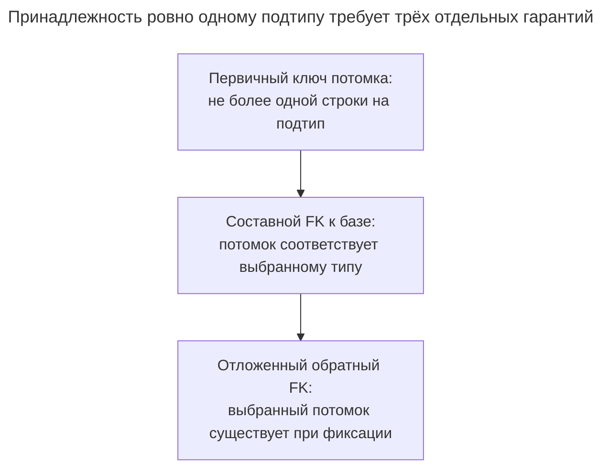
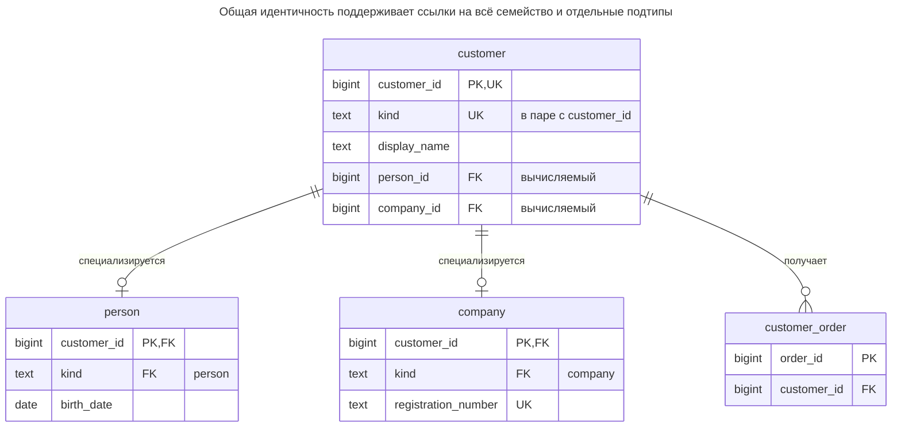
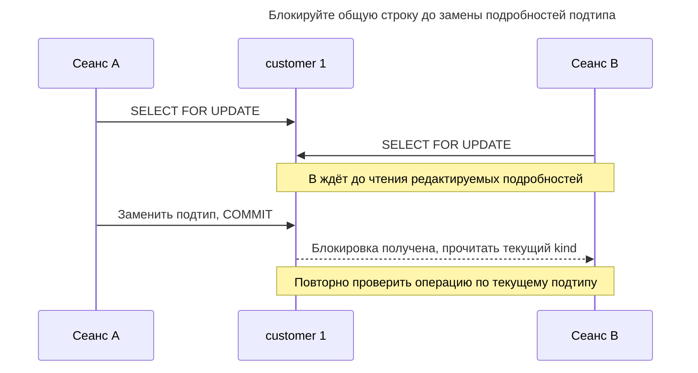
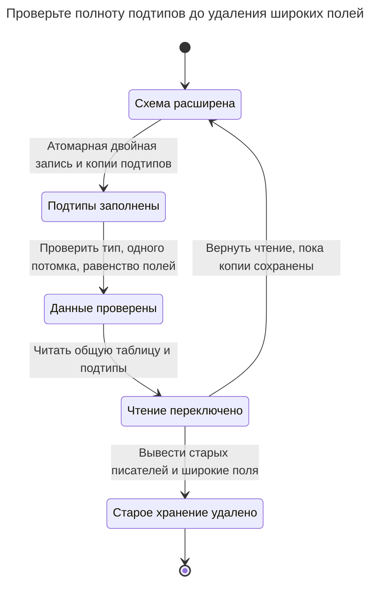

# Таблицы классов

## Назначение

Таблицы классов выделяют общим атрибутам семейства типов одну таблицу супертипа, а каждому подтипу — свою таблицу, чей первичный ключ одновременно является внешним ключом на супертип. Каждый столбец живёт ровно в одном месте, может быть `NOT NULL` по требованиям подтипа, а другие таблицы ссылаются либо на супертип, либо на конкретный подтип. Глава рассматривает гарантию ровно одной подходящей строки подтипа у каждой строки супертипа, цену соединений при чтении целого объекта и применение той же структуры как общего супертипа для ссылок на несколько видов сущностей.

## Также известен как

Class Table Inheritance; joined inheritance; таблица на подкласс. Фаулер называет паттерн [Class Table Inheritance](https://martinfowler.com/eaaCatalog/classTableInheritance.html); Hibernate — отображением [`JOINED`](https://docs.hibernate.org/orm/6.6/userguide/html_single/Hibernate_User_Guide.html#entity-inheritance-joined-table).

## Проблема

Людей и компании объединяют идентичность клиента и отображаемое имя, но их подробности велики и различны. Заказ должен ссылаться на любой вид клиента, а операция только для корпораций — именно на компанию. Одна широкая строка помещает поля всех подтипов в общее правило формы; независимые полные таблицы не оставляют единой таблицы клиентов для заказов.

Создание супертипа и двух расширений с общим ключом решает идентичность и размещение полей, но не полноту. FK из `person` в `customer` не требует строки человека или компании у каждого клиента. Он также не запрещает появление одного ID клиента в обоих расширениях.

## Решение

Храните общие поля один раз в `customer`, а обязательные поля подтипов — в `person` и `company`. В примере принадлежность полная и непересекающаяся: у каждого клиента ровно один из этих подтипов. Другие предметные области допускают абстрактную базовую строку или пересечение подтипов; им нужны другие инварианты.

Обеспечьте непересечение обязательным различителем, фиксированной меткой типа каждого потомка и составным FK по `(customer_id, kind)`. Полноту обеспечьте вычисляемыми ссылками из базовой строки на выбранного потомка с проверкой в конце транзакции. Это разработанная схема PostgreSQL на [вычисляемых столбцах](https://www.postgresql.org/docs/18/ddl-generated-columns.html) и [отложенных внешних ключах](https://www.postgresql.org/docs/18/sql-createtable.html), а не утверждение, что ORM устанавливает дополнительные ограничения.



Каждый шаг закрывает отдельный пробел. Если база может существовать без подробностей, намеренно уберите полноту; если подтипы пересекаются, замените исключающий различитель, а не ослабляйте проверки случайно.

## Альтернативы и выбор

| Соседний паттерн | Связь | Определяющее требование |
| --- | --- | --- |
| [Единая таблица](single-table-inheritance.md) | Замена | Малые различия подтипов и частое чтение целого объекта делают одну строку проще |
| [Таблицы конкретных классов](concrete-table-inheritance.md) | Замена | Не нужны общая идентичность или общая цель внешних ключей |
| [Исключающая дуга](exclusive-arc.md) | Замена ссылки на несвязанные существующие таблицы; вариант обратных ссылок полноты | Короткому списку целей не нужен общий жизненный цикл сущности |
| [Разделение таблицы](table-split.md) | Замена размещения атрибутов без подтипов | Расширение представляет необязательную группу полей, а не принадлежность типу |
| [Участник](party.md) / [Объект роли](role-object.md) | Дополнения | Люди и организации имеют общую идентичность, а бизнес-роли пересекаются |

Полная таблица — в [Атласе решений](decision-atlas.md). Общий супертип также заменяет [Полиморфные связи](polymorphic-associations.md): зависимые таблицы ссылаются на настоящий общий ключ вместо имени таблицы и непроверяемого числа.

## Структура



Каждое отдельное ребро подтипа допускает ноль или одного потомка. Вместе различитель и обратные ссылки требуют ровно одного выбранного потомка при фиксации. `UK` у базовых ID и типа обозначает составную уникальную пару, а не уникальность самого `kind`. Зависимая запись только для компаний может напрямую ссылаться на `company.customer_id`.

## Таблицы и инварианты

- **`customer`** владеет общим ключом и отображаемым именем. Различитель выбирает одну вычисляемую обратную ссылку; другая равна `NULL`.
- **`person` и `company`** используют ключ базы как первичный. Их фиксированные метки типов и составные FK не позволяют прикрепить к базовой строке неверный подтип.
- **Полноту** обеспечивают `customer_requires_person` и `customer_requires_company`, оба отложенные. Обычные внешние ключи от потомков к базе такой гарантии не дают.
- **`customer_order`** ссылается на супертип. Преобразование подтипа сохраняет ссылку; удаление клиента с заказами отклоняется. Удаление базового клиента без ссылок каскадно удаляет его подтип.

## Когда применять

- Важны общая идентичность и общие ссылки, но полям подтипов нужны отдельные обязательные столбцы.
- Одни отношения должны принимать всех клиентов, другие — лишь конкретный подтип.
- Вы можете создавать, преобразовывать и удалять целый объект в одной транзакции.

## Последствия и компромиссы

- ➕ Каждый подтип напрямую объявляет собственные обязательные поля и уникальные бизнес-атрибуты.
- ➕ У общих полей и ссылок на всё семейство один владелец.
- ➖ Чтение целого человека требует соединения; список полных разнородных объектов — соединений соответствующих таблиц подтипов.
- ➖ Принадлежность ровно одному подтипу добавляет ограничения и многооператорный протокол записи. Реализация обратных ссылок также добавляет вычисляемый столбец и FK для каждого подтипа.
- ➖ Общая база — обязательство предметной модели. Не создавайте её лишь ради сокрытия несвязанных таблиц за одинаковым целочисленным полем.

## Реализация

[Полный скрипт](../assets/class-table-inheritance/class-table-inheritance.sql) включает отказы при отсутствующем и неверном потомке, преобразование и удаление. Основная схема:

```sql
CREATE TABLE customer (
    customer_id bigint PRIMARY KEY,
    kind text NOT NULL CHECK (kind IN ('person', 'company')),
    display_name text NOT NULL,
    person_id bigint GENERATED ALWAYS AS
        (CASE WHEN kind = 'person' THEN customer_id END) STORED,
    company_id bigint GENERATED ALWAYS AS
        (CASE WHEN kind = 'company' THEN customer_id END) STORED,
    UNIQUE (customer_id, kind)
);
CREATE TABLE person (
    customer_id bigint PRIMARY KEY,
    kind text NOT NULL DEFAULT 'person' CHECK (kind = 'person'),
    birth_date date NOT NULL,
    FOREIGN KEY (customer_id, kind) REFERENCES customer (customer_id, kind)
        ON DELETE CASCADE
);
CREATE TABLE company (
    customer_id bigint PRIMARY KEY,
    kind text NOT NULL DEFAULT 'company' CHECK (kind = 'company'),
    registration_number text NOT NULL UNIQUE,
    FOREIGN KEY (customer_id, kind) REFERENCES customer (customer_id, kind)
        ON DELETE CASCADE
);
ALTER TABLE customer ADD CONSTRAINT customer_requires_person
    FOREIGN KEY (person_id) REFERENCES person (customer_id)
    DEFERRABLE INITIALLY DEFERRED;
ALTER TABLE customer ADD CONSTRAINT customer_requires_company
    FOREIGN KEY (company_id) REFERENCES company (customer_id)
    DEFERRABLE INITIALLY DEFERRED;
CREATE TABLE customer_order (
    order_id bigint PRIMARY KEY,
    customer_id bigint NOT NULL REFERENCES customer (customer_id)
);
CREATE INDEX customer_order_customer_idx ON customer_order (customer_id);
```

Дополнительная метка типа каждого потомка намеренная: составная ссылка доказывает этот тип родителя. Обратные ссылки — хранимые вычисляемые столбцы, чтобы писатели не выбирали ID другого потомка. Вставляйте базу раньше подтипа и фиксируйте пару вместе:

```sql
BEGIN;
INSERT INTO customer (customer_id, kind, display_name) VALUES (1, 'person', 'Ada');
INSERT INTO person (customer_id, birth_date) VALUES (1, DATE '1990-01-01');
INSERT INTO customer_order VALUES (10, 1);
COMMIT;
SELECT c.customer_id, c.display_name, p.birth_date
FROM customer AS c JOIN person AS p USING (customer_id);
```

Запрос возвращает `(1, Ada, 1990-01-01)`. Вставка базы компании без подробностей недопустима при фиксации:

```sql
BEGIN;
INSERT INTO customer (customer_id, kind, display_name)
VALUES (2, 'company', 'Incomplete');
COMMIT;
```

PostgreSQL 18.6 возвращает SQLSTATE `23503`: `ERROR: insert or update on table "customer" violates foreign key constraint "customer_requires_company"`. Клиент `2` откатывается. Попытка вставить подробности компании для клиента `1`, чей тип всё ещё `person`, вместо этого нарушает немедленную ссылку `company_customer_id_kind_fkey` с SQLSTATE `23503`.

Преобразуйте допустимого клиента заменой подтипа в одной транзакции:

```sql
BEGIN;
DELETE FROM person WHERE customer_id = 1;
UPDATE customer SET kind = 'company' WHERE customer_id = 1;
INSERT INTO company (customer_id, registration_number) VALUES (1, 'REG-1');
COMMIT;
SELECT o.order_id, c.kind, d.registration_number
FROM customer_order AS o JOIN customer AS c USING (customer_id)
JOIN company AS d USING (customer_id);
```

Результат — `(10, company, REG-1)`. Удаление только выбранной строки компании не проходит фиксацию; удаление базы после её заказов каскадно удаляет компанию. Отложенные проверки допускают неполное промежуточное состояние внутри транзакции, а не в зафиксированных данных. PostgreSQL документирует различие в [`SET CONSTRAINTS`](https://www.postgresql.org/docs/18/sql-set-constraints.html).

## Поддержка в движках

- **PostgreSQL 18:** пример использует обычные таблицы, а не [`INHERITS`](https://www.postgresql.org/docs/18/ddl-inherit.html#DDL-INHERIT-CAVEATS). Встроенное наследование не распространяет уникальность первичного ключа или внешние ключи на всех потомков и не заменяет показанные связи общих ключей.
- **MySQL 8.4 / InnoDB:** [проверки внешних ключей немедленные](https://dev.mysql.com/doc/refman/8.4/en/create-table-foreign-keys.html). Протокол отложенного циклического создания нельзя копировать без изменений; оставьте одну строку или явно примите границу полноты, обеспечиваемую процедурой.
- **SQL Server 2025 (17.x):** документированный [синтаксис `CREATE TABLE`](https://learn.microsoft.com/en-us/sql/t-sql/statements/create-table-transact-sql?view=sql-server-ver17) не содержит отложенных ограничений. Ключи от потомка к базе переносятся концептуально, но гарантия ровно одного подтипа требует другой реализации.
- **Oracle AI Database 26ai:** поддерживает [откладываемые ограничения](https://docs.oracle.com/en/database/oracle/oracle-database/26/sqlrf/constraint.html); адаптируйте синтаксис вычисляемых столбцов и типы, проверьте полный циклический жизненный цикл в Oracle до использования.
- **SQLite 3:** поддерживает [отложенные внешние ключи](https://www.sqlite.org/foreignkeys.html#fk_deferred) и [вычисляемые столбцы с внешними ключами](https://www.sqlite.org/gencol.html). Включайте проверку для каждого соединения и объявляйте всю схему DDL SQLite вместо копирования последующих шагов PostgreSQL `ADD CONSTRAINT`.

## Сбои и конкурентность

Объявленные ограничения защищают принадлежность ровно одному подтипу при read committed. Второй сеанс не может зафиксировать другой тип для того же базового ключа: первичные ключи потомков и ссылки различителя остаются определяющими. Для многооператорного изменения блокируйте базовую строку до строк подтипов и соблюдайте порядок у всех писателей. [Правила блокировки строк PostgreSQL](https://www.postgresql.org/docs/18/explicit-locking.html#LOCKING-ROWS) делают базовую строку удобной точкой сериализации.



Удерживайте блокировку до фиксации, включая отложенные проверки. Если ответ потерян, загрузите клиента и текущий подтип перед повтором преобразования. Успешная вставка базы ещё не означает успешного создания клиента: фиксация может отклонить отсутствие подробностей.

## Миграция

При переходе с широкой таблицы клиентов сохраняйте ID. Создайте таблицы подтипов, разверните атомарную двойную запись и перенесите выбранные подробности под блокировкой исходного клиента. Классифицируйте недопустимые широкие строки до добавления проверок. Установите ссылки типов потомков, затем вычисляемые обратные ссылки и ограничения полноты после появления каждого выбранного потомка; этапы PostgreSQL [`NOT VALID` / `VALIDATE CONSTRAINT`](https://www.postgresql.org/docs/18/sql-altertable.html) отделяют установку от проверки старых строк.



Путь отката доступен лишь при синхронизации обоих представлений. Планируйте окна блокировок DDL и откладывайте удаление старых столбцов до конца периода [Расширения и свёртывания](expand-contract.md). При исходных независимых таблицах подтипов сначала разрешите повторяющиеся ID и бизнес-ключи, затем стройте общую базу.

## Антипаттерны и частые ошибки

- Заявлять принадлежность ровно одному подтипу по одним FK потомков: иначе у базы может быть ноль или несколько потомков.
- Сопоставлять лишь ID, не проверяя метку типа потомка.
- Отображать пересекающиеся роли клиентов исключающим различителем; см. [Объект роли](role-object.md).
- Подтверждать создание до прохождения отложенных ограничений при фиксации.
- Считать, что отображение ORM включает обратные ограничения полноты из примера.

## Известные применения

- [Отображение Hibernate `JOINED`](https://docs.hibernate.org/orm/6.6/userguide/html_single/Hibernate_User_Guide.html#entity-inheritance-joined-table) получает унаследованное состояние соединением таблиц подкласса и суперкласса.
- [Наследование Django с несколькими таблицами](https://docs.djangoproject.com/en/5.2/topics/db/models/#multi-table-inheritance) автоматически создаёт связь один к одному с родителем. Это пример отображения общих ключей, а не более строгого правила полной непересекающейся принадлежности из этой реализации.

## Связанные паттерны

- [Единая таблица](single-table-inheritance.md) хранит то же исключающее семейство одной строкой.
- [Таблицы конкретных классов](concrete-table-inheritance.md) убирают общую базовую таблицу.
- [Исключающая дуга](exclusive-arc.md) даёт проверяемые ссылки на короткий список существующих целей.
- [Разделение таблицы](table-split.md) отделяет группы атрибутов без введения типов.
- [Участник](party.md) применяет общую идентичность к людям и организациям.
- [Полиморфные связи](polymorphic-associations.md) объясняют непроверяемую ссылку, заменяемую общим супертипом.
