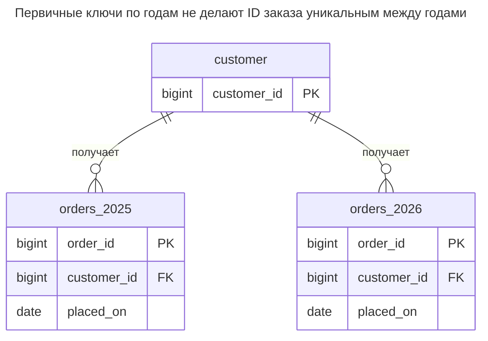
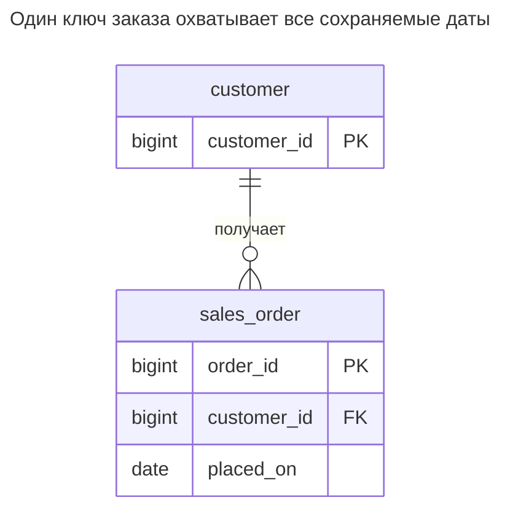
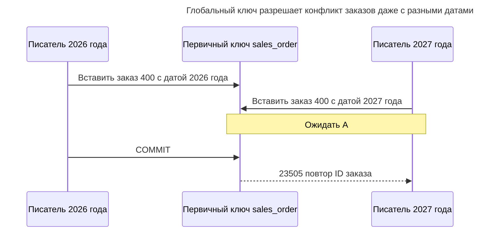
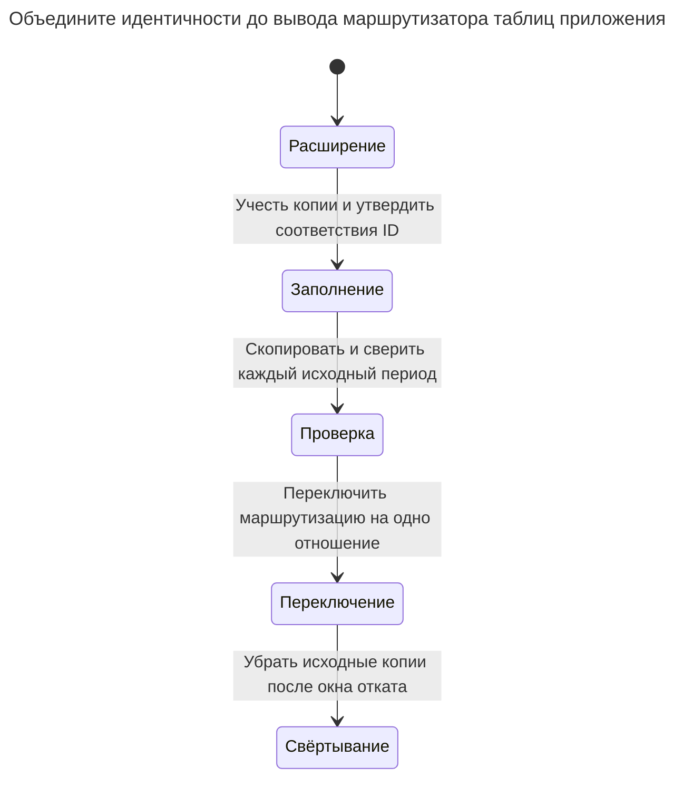

# Клонированные таблицы

Клонированные таблицы разделяют один вид данных между одинаковыми таблицами — `orders_2024`, `orders_2025` или таблицей на клиента, — чтобы каждая оставалась небольшой. Общим запросам нужен поддерживаемый `UNION` или динамический SQL, локальный уникальный ключ не обеспечивает уникальность между копиями, а каждое изменение схемы повторяется во всех. Глава показывает решение той же задачи секционированием или обычным столбцом с индексом. Билл Карвин называет это Metadata Tribbles.

## Также известен как

Metadata Tribbles в [оглавлении SQL Antipatterns Билла Карвина](https://pragprog.com/titles/bksap1/sql-antipatterns-volume-1/). Здесь размножаются метаданные: одно определение таблицы на период или клиента для единого логического отношения.

## Контекст

Заказы накапливаются, и вы хотите быстро читать недавние и легко архивировать старые. Создаёте таблицу заказов на каждый год. Либо подключение клиента создаёт очередную таблицу той же формы. SQL приложения выбирает имя по дате или клиенту и объединяет таблицы для общих отчётов.

## Проблема

Вы выставляете срез хранения отдельным отношением приложения, продолжая ожидать одну логическую модель заказа. Каждый новый срез меняет набор объектов, охватываемых читателями, миграциями, правами и средствами исправления. Локальный первичный ключ пропускает тот же ID заказа в другой копии. Внешний ключ одной копии не делает объединение всех копий глобально уникальной целью ссылок.

Это не означает невозможность любых ограничений между отдельно названными таблицами. Каждая копия имеет собственные внешние ключи и проверки, можно построить отдельный реестр идентичностей. Вредно ожидать, что локальные ограничения и растущий список имён будут вести себя как одно согласованно управляемое отношение.

## Почему так делают

Таблицу размером с период легко удалить, а строки клиента легко найти, когда его имя входит в имя объекта. Это полезные эксплуатационные границы. Ошибка — принять их без решения о согласованности логического контракта запросов, пространства ключей и жизненного цикла.

Отдельные архивные снимки оправданы как намеренно независимые наборы данных. Осознанные схемы или базы арендаторов — тоже другие проекты: им нужны маршрутизация, права, создание, миграции и восстановление. Один суффикс номера арендатора общей таблицы не определяет полную границу.

## Последствия

- ➖ Устаревший список таблиц возвращает правдоподобный частичный отчёт.
- ➖ Каждое изменение схемы должно дойти до всех независимо управляемых копий.
- ➖ Один ID обозначает разные строки в разных копиях.
- ➖ Политики ссылок и прав расходятся между срезами.
- ➖ Перенос строки между периодами становится видимой приложению межтабличной операцией.

## Признаки

- Январское создание объектов меняет SQL годовых отчётов.
- Миграция циклом обходит найденные таблицы с заданным префиксом.
- Невозможно определить заказ по ID без имени его таблицы.
- У одной копии другие ограничения или значения столбцов по умолчанию.

## Как лучше

Начните с обычной таблицы и явного различающего столбца, например `placed_on` или `tenant_id`, с индексами под реальные запросы. Выбирайте [Секционирование таблицы](table-partitioning.md), если оправданы хранение по секциям или их отсечение. Встроенные секции сохраняют одно родительское отношение для приложения, оставляя ограничения и обслуживание конкретного движка.

### Альтернативы и выбор

| Соседний паттерн | Связь | Определяющее требование |
| --- | --- | --- |
| Обычная индексированная таблица | Замена | Глобальная идентичность и обычные предикаты укладываются в бюджет нагрузки и хранения |
| [Секционирование таблицы](table-partitioning.md) | Замена физического разделения | Целые периоды обслуживаются вместе, а запросы ограничивают ключ секционирования |
| [Общая схема](shared-schema.md) | Замена копий таблиц с именами клиентов | Арендаторы разделяют схему с явными ключами области и правилами доступа |
| [Схема арендатора](schema-per-tenant.md) / [База арендатора](database-per-tenant.md) | Замена для осознанной границы изоляции | Независимое администрирование оправдывает отдельные пространства имён или базы |

См. [Атлас решений](decision-atlas.md). Секционирование и изоляция арендаторов решают разные требования и могут дополнять друг друга. Встроенные секции не делают доступным любой глобальный ключ.

## Пример

### Структура

**Было:** у двух годовых отношений независимые ключи заказа.



У обеих копий корректная связь с клиентом. Отдельные ключи не разрешают конфликт общей идентичности заказа.

```sql
CREATE TABLE customer (customer_id bigint PRIMARY KEY);
CREATE TABLE orders_2025 (
    order_id bigint PRIMARY KEY,
    customer_id bigint NOT NULL REFERENCES customer (customer_id),
    placed_on date NOT NULL
);
CREATE TABLE orders_2026 (LIKE orders_2025 INCLUDING ALL);
ALTER TABLE orders_2026 ADD FOREIGN KEY (customer_id) REFERENCES customer (customer_id);
INSERT INTO customer VALUES (1);
INSERT INTO orders_2025 VALUES (100, 1, DATE '2025-12-31');
INSERT INTO orders_2026 VALUES (200, 1, DATE '2026-01-01');
SELECT count(*) FROM orders_2025;
SELECT count(*) FROM (
    SELECT order_id FROM orders_2025
    UNION ALL SELECT order_id FROM orders_2026
) AS all_orders;
INSERT INTO orders_2026 VALUES (100, 1, DATE '2026-02-01');
SELECT order_id, count(*) FROM (
    SELECT order_id FROM orders_2025
    UNION ALL SELECT order_id FROM orders_2026
) AS all_orders GROUP BY order_id HAVING count(*) > 1;
```

Количество старой таблицы — `1`, а объединение сначала считает `2`. После второй вставки `100` поиск дубликатов возвращает `(100, 2)`. [`LIKE ... INCLUDING ALL`](https://www.postgresql.org/docs/18/sql-createtable.html) PostgreSQL копирует выбранные свойства таблицы, но не внешние ключи; второй ключ практикум устанавливает явно. Даже копирование всех локальных инвариантов не добавило бы уникальность между копиями.

**Стало:** выбираем один глобальный ключ и храним период данными.



Индекс клиента и дня поддерживает показанный предикат. Уникальность первичного ключа не зависит от даты.

```sql
CREATE TABLE sales_order (
    order_id bigint PRIMARY KEY,
    customer_id bigint NOT NULL REFERENCES customer (customer_id),
    placed_on date NOT NULL
);
CREATE INDEX sales_order_customer_day_idx ON sales_order (customer_id, placed_on);
CREATE TABLE order_id_review (
    source_table text NOT NULL,
    old_order_id bigint NOT NULL,
    new_order_id bigint NOT NULL UNIQUE,
    PRIMARY KEY (source_table, old_order_id)
);
-- Reviewed mapping: the two old order 100 rows are distinct orders in this lab.
INSERT INTO order_id_review VALUES
    ('orders_2025', 100, 100), ('orders_2026', 200, 200), ('orders_2026', 100, 300);
BEGIN;
LOCK TABLE orders_2025, orders_2026 IN SHARE ROW EXCLUSIVE MODE;
INSERT INTO sales_order
SELECT m.new_order_id, o.customer_id, o.placed_on FROM orders_2025 AS o
JOIN order_id_review AS m ON m.source_table = 'orders_2025' AND m.old_order_id = o.order_id
UNION ALL
SELECT m.new_order_id, o.customer_id, o.placed_on FROM orders_2026 AS o
JOIN order_id_review AS m ON m.source_table = 'orders_2026' AND m.old_order_id = o.order_id;
COMMIT;
SELECT count(*) FROM sales_order;
SELECT order_id FROM sales_order
WHERE customer_id = 1 AND placed_on >= DATE '2026-01-01' ORDER BY order_id;
```

Всего `3` заказа, ID 2026 года — `200, 300`. Сохранённое соответствие различает идентичность исходной таблицы и новую глобальную. Практикум считает две старые строки `100` разными заказами; если свидетельства говорят о дубликатах, осознанно объедините зависимые записи. Никогда не разрешайте коллизию слепой заменой одного числа.

```sql
INSERT INTO sales_order VALUES (100, 1, DATE '2027-01-01');
```

PostgreSQL 18.6 возвращает SQLSTATE `23505`: `ERROR: duplicate key value violates unique constraint "sales_order_pkey"`. Другой год больше не разрешает дубликат. [Полный скрипт](../assets/cloned-tables/cloned-tables.sql) сохраняет все исходные строки и проверяет соответствие и итоговые количества.

### Поддержка в движках

- **PostgreSQL 18:** [декларативное секционирование](https://www.postgresql.org/docs/18/ddl-partitioning.html#DDL-PARTITIONING-DECLARATIVE-LIMITATIONS) требует включать все столбцы секционирования в первичный или уникальный ключ родителя. Диапазонное разделение этой таблицы по дате изменит доступный контракт ключа; не подменяйте уникальность ID парой `(placed_on, order_id)` молча.
- **MySQL 8.4 / InnoDB:** [секционированные таблицы не участвуют во внешних ключах](https://dev.mysql.com/doc/refman/8.4/en/partitioning-limitations-storage-engines.html). При обязательных связях обычная таблица может быть лучшим исправлением.
- **SQL Server:** [функции и схемы секционирования](https://learn.microsoft.com/en-us/sql/relational-databases/partitions/partitioned-tables-and-indexes?view=sql-server-ver17) организуют встроенные секции. Уникальные выровненные и невыровненные индексы имеют разные требования; рассматривайте идентичность вместе с обслуживанием.
- **Oracle:** [интервальное секционирование](https://docs.oracle.com/en/database/oracle/oracle-database/19/vldbg/partition-concepts.html) автоматически создаёт дополнительные интервальные секции. Это встроенный вариант жизненного цикла, а не разрешение не обслуживать политику хранения.
- **SQLite:** [грамматика `CREATE TABLE`](https://www.sqlite.org/lang_createtable.html) не имеет декларативного `PARTITION BY`. Для единого отношения с ограничениями используйте обычную индексированную таблицу.

### Сбои и конкурентность

Две годовые таблицы независимо принимают один ID, поскольку у них отдельные уникальные индексы. У обычной замены один арбитр. [Проверка конфликтов уникальных индексов PostgreSQL](https://www.postgresql.org/docs/18/index-unique-checks.html) ждёт конкурирующую вставку до отклонения дубликата.



В секционированной альтернативе те же рассуждения требуют полного выбранного ключа. Первичный ключ даты и ID разрешает конфликт повторных пар, а не одинаковых ID разных дат. Согласуйте с выбором идентичность повторов и форму внешних ключей.

### Миграция

Учтите все копии и сравните столбцы, ограничения, права и коллизии идентичности. Постройте явное соответствие `(source_table, old_id)`, затем перенесите через него все входящие ссылки. Исходная таблица необходима, когда две копии выдали одно число. Сверяйте количества и содержимое по периодам, а не только суммарно.



Практикум приостанавливает запись на время копирования. Объединение работающей системы должно захватывать вставки, исправления и удаления каждой копии до окончательной сверки. Совместимые таблицы периодов PostgreSQL умеет [присоединять как секции](https://www.postgresql.org/docs/18/sql-altertable.html#SQL-ALTERTABLE-ATTACH-PARTITION) при подходящих форме и границах; это избавляет от постоянной маршрутизации приложения через объединение. Ограничения уникальных ключей при этом остаются. Синхронизируйте исходные копии во время отката, затем архивируйте или удаляйте лишь после перевода всех потребителей. См. [Расширение и свёртывание](expand-contract.md).

## Связанные паттерны и антипаттерны

- [Секционирование таблицы](table-partitioning.md) скрывает физические срезы за единым контрактом отношения.
- [Общая схема](shared-schema.md) делает область арендатора явной в строках и ссылках.
- [Схема арендатора](schema-per-tenant.md) задаёт осознанную границу пространства имён.
- [База арендатора](database-per-tenant.md) задаёт отдельный жизненный цикл базы.
- [Повторяющиеся столбцы](repeated-columns.md) переносят размножение по данным в поля вместо таблиц.
