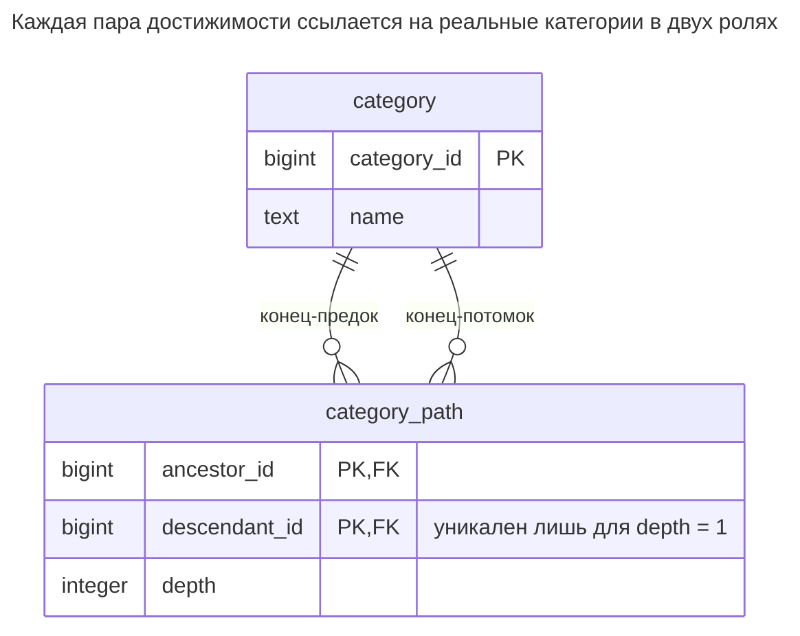
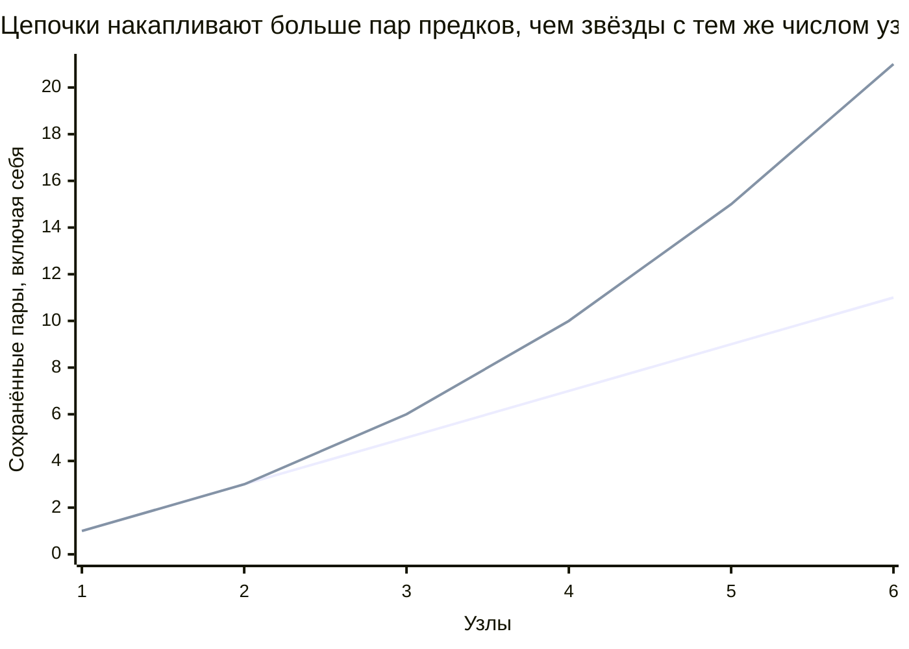
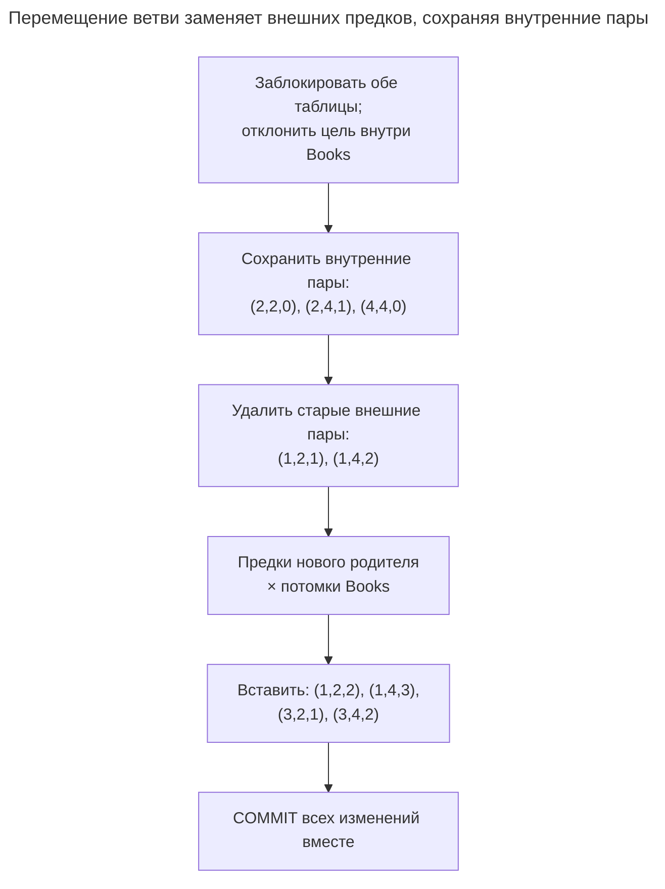
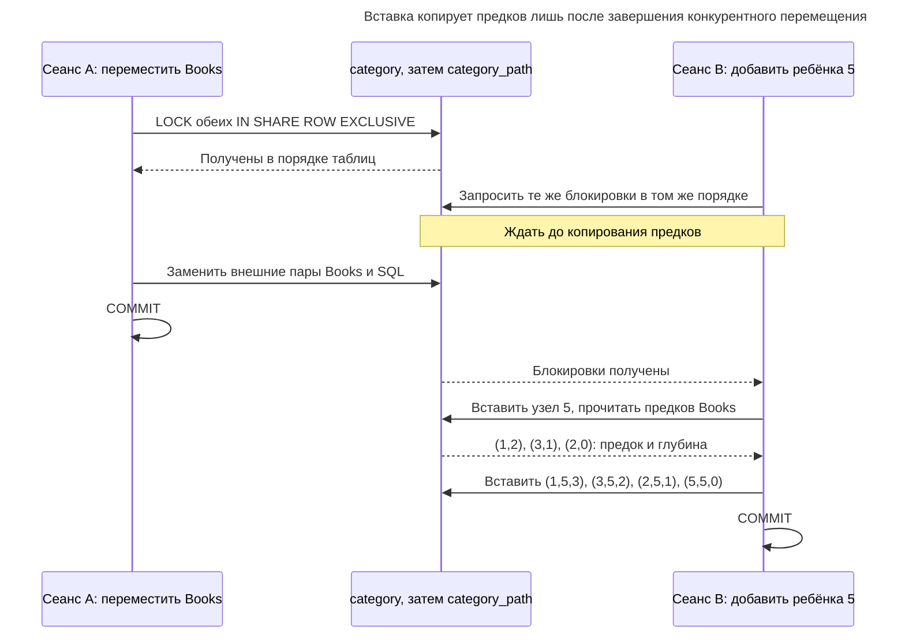
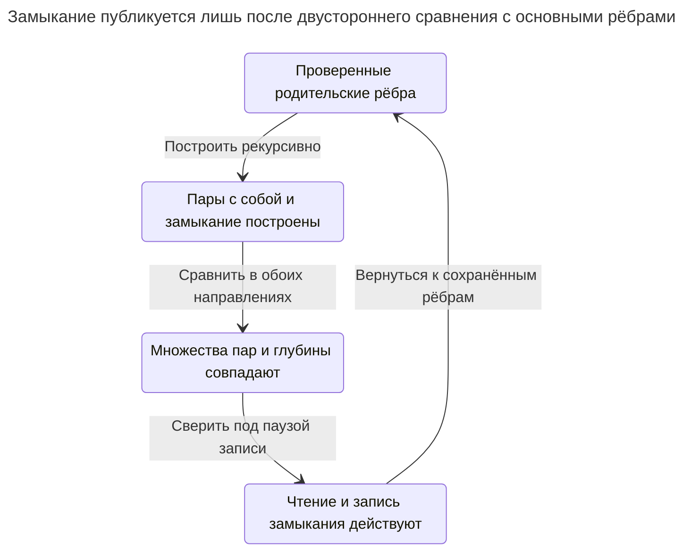

# Таблица замыканий

## Назначение

Таблица замыканий хранит каждую пару «предок — потомок» дерева в отдельной таблице, обычно с расстоянием между ними. Запросы потомков, предков и узлов в пределах глубины становятся обычными соединениями индексированной таблицы без рекурсии, а внешние ключи гарантируют, что пары ссылаются на реальные узлы. Глава показывает обновление пар при вставках, удалениях и перемещениях поддеревьев, рост объёма при углублении дерева и расширение структуры на графы с несколькими родителями. [Слайды Карвина об иерархиях](https://www.slideshare.net/billkarwin/models-for-hierarchical-data) демонстрируют представление пар и необязательную длину пути.

## Также известен как

Таблица транзитивного замыкания. [Слайды Билла Карвина об иерархиях](https://www.slideshare.net/billkarwin/models-for-hierarchical-data) используют «Closure Table». [Мост иерархии Кимбалла](https://www.kimballgroup.com/data-warehouse-business-intelligence-resources/kimball-techniques/dimensional-modeling-techniques/ragged-variable-depth-hierarchy/) — связанное представление полных путей иерархии в хранилище данных; его работа с совместным владением шире примера одного родителя в этой главе.

## Проблема

Нужны оба направления иерархии каталога: все категории под Books и все предки SQL. Также нужны непосредственные дети или потомки не дальше двух рёбер. Повторный обход заставляет каждое чтение зависеть от цепочки родителей. Строковый путь переносит работу на запись, но всё ещё кодирует предков одним значением.

Вы хотите представить каждое достижимое отношение строкой, которую можно индексировать и соединять. Это даёт базе настоящие цели внешних ключей с обоих концов, но ставит новый вопрос согласованности: какие строки обязаны существовать после вставки, перемещения или удаления? Внешние ключи отклоняют выдуманный узел, но не обнаруживают отсутствующую пару предков.

## Решение

Отделите узлы от достижимости. Храните `category` один раз на узел и `category_path(ancestor_id, descendant_id, depth)` один раз на достижимую упорядоченную пару. Включайте `(node, node, 0)` для каждого узла. В дереве у каждой достижимой пары одно расстояние, поэтому первичный ключ — два ID. [Примеры таблиц замыканий Карвина](https://www.slideshare.net/billkarwin/models-for-hierarchical-data) включают рефлексивные пары и добавляют длину пути для запросов непосредственных детей.

Вставляйте ребёнка копированием строк предков его родителя с увеличением каждого расстояния на единицу и добавлением пары ребёнка с собой. Перемещайте ветвь, сохраняя внутренние пары, удаляя связи со старыми внешними предками и добавляя связи с предками нового родителя. Удаляйте ветвь целиком, определив потомков до удаления узлов и связанных с ними пар. Каждое изменение выполняйте атомарно под одной структурной блокировкой.

## Альтернативы и выбор

| Соседний паттерн | Связь | Определяющее требование |
| --- | --- | --- |
| [Список смежности](adjacency-list.md) | Замена; дополнение как основное представление рёбер | Запись преобладает, и рекурсивного чтения достаточно, либо нужен независимый источник перестроения замыкания |
| [Материализованный путь](materialized-path.md) | Замена | Дереву с одним родителем нужен компактный обход по путям вместо отдельных пар |
| [Вложенные множества](nested-sets.md) | Замена | Почти статичная публикация предпочитает диапазонные проходы и плотный подсчёт хранению пар |
| [Состав изделия](bill-of-materials.md) | Дополнение: предметная модель | Рёбра несут количества, у компонентов несколько родителей; одна достижимость не вычисляет количества |

Полное сравнение — в [Атласе решений](decision-atlas.md). Таблица замыканий может заменить родительские ссылки, как в этом примере, или быть поддерживаемым индексом чтения рядом с ними. От выбора зависит, каким данным можно доверять при перестроении после ошибки.

## Структура



Многие пары ссылаются на одну категорию в каждой роли. Два ID определяют достижимость; `depth` считает рёбра, а не узлы. Пара с собой имеет нулевое расстояние и позволяет запросам вставки и перемещения обрабатывать выбранные корни без особого случая предка.

## Таблицы и инварианты

- **`category`** хранит стабильные идентичности и имена узлов. Этот вариант получает непосредственное родительство из пар глубины один, не сохраняя отдельного столбца родителя.
- **`category_path`** имеет составной первичный ключ и два внешних ключа на реальные категории. `category_path_depth` требует нулевой глубины у пар с собой и положительной у остальных.
- **`category_one_parent`** — частичный уникальный индекс потомков на глубине один. Он запрещает двух непосредственных родителей, но не доказывает ацикличность или полноту.
- **Полное замыкание** требует каждой пары с собой, каждой достижимой пары предков и правильного расстояния без лишних пар. Ни внешние ключи, ни проверка глубины не устанавливают глобальный инвариант; протокол записи поддерживает его, а скрипт сверяет с рёбрами глубины один.
- **Обратный поиск** использует индекс с `descendant_id` впереди; первичный ключ уже начинается с `ancestor_id`. Это поддерживает оба направления обхода без рекурсии при чтении.

## Когда применять

- Часто нужны и предки, и потомки, в том числе с фильтрами расстояния.
- Вы принимаете дополнительные строки и транзакционную поддержку ради простоты чтения.
- Вы можете держать всех структурных писателей на одном протоколе и проверять избыточную достижимость.

## Последствия и компромиссы

- ➕ Предки, потомки и непосредственные дети используют одно соединение с разными условиями концов или глубины.
- ➕ Внешние ключи обеспечивают существование каждого сохранённого конца, а уникальность пары предотвращает дубликаты достижимости.
- ➖ Объём зависит от глубины. Для дерева из `n` узлов число строк — `sum(depth_from_root + 1)`: звезде нужно `2n - 1` пар, цепочке — `n(n + 1) / 2`. Подсчёты прямо следуют из хранения одной строки на предка, включая сам узел.
- ➖ Перемещение обновляет отношения с каждым узлом ветви. Цена зависит от размера ветви и числа старых/новых предков, а не лишь перемещаемого узла.
- ➖ Удаление ребра в графе нескольких родителей существенно отличается от перемещения ветви дерева: другой маршрут может сохранять достижимость.



Первая линия — звезда (`2n - 1` пар); вторая — цепочка (`n(n + 1) / 2` пар). Это количества, выведенные из правила хранения: они показывают, почему одного числа узлов недостаточно для прогноза размера таблицы замыканий.

## Реализация

[Полный скрипт PostgreSQL 18.6](../assets/closure-table/closure-table.sql) строит Catalog, Books, Tools и SQL, проверяет замыкание после перемещения и удаляет ветвь. Он проверяет ожидаемую ошибку глубины, не принимая неожиданных ошибок. Определите узлы и пары:

```sql
CREATE TABLE category (
    category_id bigint PRIMARY KEY,
    name text NOT NULL
);
CREATE TABLE category_path (
    ancestor_id bigint REFERENCES category (category_id) ON DELETE CASCADE,
    descendant_id bigint REFERENCES category (category_id) ON DELETE CASCADE,
    depth integer NOT NULL,
    PRIMARY KEY (ancestor_id, descendant_id),
    CONSTRAINT category_path_depth CHECK (
        (ancestor_id = descendant_id AND depth = 0)
        OR (ancestor_id <> descendant_id AND depth > 0)
    )
);
CREATE INDEX category_path_descendant_idx
    ON category_path (descendant_id, ancestor_id) INCLUDE (depth);
CREATE UNIQUE INDEX category_one_parent
    ON category_path (descendant_id) WHERE depth = 1;
```

[Частичные индексы PostgreSQL](https://www.postgresql.org/docs/18/indexes-partial.html) обеспечивают уникальность только строк глубины один. Строки других глубин могут иметь того же потомка. Создайте корень и добавьте Books, Tools и SQL, копируя предков каждого родителя:

```sql
BEGIN;
LOCK TABLE category, category_path IN SHARE ROW EXCLUSIVE MODE;
INSERT INTO category VALUES (1, 'Catalog');
INSERT INTO category_path VALUES (1, 1, 0);
INSERT INTO category VALUES (2, 'Books');
INSERT INTO category_path
SELECT ancestor_id, 2, depth + 1 FROM category_path WHERE descendant_id = 1
UNION ALL SELECT 2, 2, 0;
INSERT INTO category VALUES (3, 'Tools');
INSERT INTO category_path
SELECT ancestor_id, 3, depth + 1 FROM category_path WHERE descendant_id = 1
UNION ALL SELECT 3, 3, 0;
INSERT INTO category VALUES (4, 'SQL');
INSERT INTO category_path
SELECT ancestor_id, 4, depth + 1 FROM category_path WHERE descendant_id = 2
UNION ALL SELECT 4, 4, 0;
COMMIT;
```

Прочитайте поддерево Books и цепочку предков SQL:

```sql
SELECT c.category_id, c.name, p.depth
FROM category_path AS p JOIN category AS c ON c.category_id = p.descendant_id
WHERE p.ancestor_id = 2 ORDER BY p.depth, c.category_id;
SELECT c.category_id, c.name, p.depth
FROM category_path AS p JOIN category AS c ON c.category_id = p.ancestor_id
WHERE p.descendant_id = 4 ORDER BY p.depth DESC;
```

Поддерево содержит `(2, Books, 0)` и `(4, SQL, 1)`; предки — Catalog, Books, SQL в этом порядке. Добавьте условие глубины для ограниченного чтения или потребуйте глубину один для непосредственных детей. Пара с собой означает, что нулевая глубина включает выбранный узел.

Переместите Books (`2`) под Tools (`3`). Проверьте назначение до удаления старых связей, затем замените лишь внешних предков:

```sql
BEGIN;
LOCK TABLE category, category_path IN SHARE ROW EXCLUSIVE MODE;
-- Check before deleting any evidence of the old ancestry.
DO $$
BEGIN
    IF EXISTS (SELECT 1 FROM category_path
               WHERE ancestor_id = 2 AND descendant_id = 3) THEN
        RAISE EXCEPTION 'category cycle' USING ERRCODE = '23514';
    END IF;
    ASSERT EXISTS (SELECT 1 FROM category WHERE category_id = 2);
    ASSERT EXISTS (SELECT 1 FROM category WHERE category_id = 3);
END;
$$;
DELETE FROM category_path AS p
USING category_path AS old_ancestor, category_path AS subtree
WHERE old_ancestor.descendant_id = 2 AND old_ancestor.ancestor_id <> 2
  AND subtree.ancestor_id = 2
  AND p.ancestor_id = old_ancestor.ancestor_id
  AND p.descendant_id = subtree.descendant_id;
INSERT INTO category_path
SELECT a.ancestor_id, s.descendant_id, a.depth + 1 + s.depth
FROM category_path AS a CROSS JOIN category_path AS s
WHERE a.descendant_id = 3 AND s.ancestor_id = 2;
COMMIT;
```

Операция удаляет две старые пары и вставляет четыре новые. Сохранённые предки SQL после этого — `(1,3)`, `(3,2)`, `(2,1)`, `(4,0)` в виде `(ancestor_id, depth)`. Books-to-SQL и обе пары с собой остаются. `category_one_parent` теперь фиксирует Tools единственным непосредственным родителем Books. В приложении замените демонстрационные утверждения явными ошибками отсутствующего узла и верните вызывающей стороне идентичность затронутой ветви.



Каждый кортеж — `(ancestor_id, descendant_id, depth)`, новая глубина вычисляется как `a.depth + 1 + s.depth`. Даже сохраняемая достижимость Catalog удаляется и вставляется заново, потому что расстояние до перемещённой ветви меняется.

Эта попытка назначает паре с собой невозможное расстояние:

```sql
INSERT INTO category_path VALUES (4, 4, 1);
```

PostgreSQL 18.6 возвращает SQLSTATE `23514`: `ERROR: new row for relation "category_path" violates check constraint "category_path_depth"`, с уточнением `DETAIL: Failing row contains (4, 4, 1).` Проверка выполняется до отклонения дубликата уже существующей пары с собой. Это доказывает локальное правило глубины; скрипт также независимо сравнивает полное замыкание с рекурсивным восстановлением по рёбрам глубины один.

Для удаления поддерева получите ID потомков в той же транзакции и удалите эти узлы. Скрипт делает это одним оператором удаления узлов; внешние ключи каскадно удаляют связанные пары. Удаление одной категории с сохранением и переподключением детей — другая операция: назначьте им новых родителей и перестройте затронутые пары до удаления узла.

Удалите перемещённое поддерево Books в одной транзакции:

```sql
BEGIN;
LOCK TABLE category, category_path IN SHARE ROW EXCLUSIVE MODE;
DELETE FROM category WHERE category_id IN (
    SELECT descendant_id FROM category_path WHERE ancestor_id = 2
);
COMMIT;
```

## Поддержка в движках

- **PostgreSQL 18:** составные ключи, внешние ключи, [частичный уникальный индекс](https://www.postgresql.org/docs/18/indexes-partial.html) и обычный обратный индекс реализуют модель дерева. Расширение иерархий не требуется.
- **SQL Server 2025 (17.x):** [уникальный фильтрованный индекс](https://learn.microsoft.com/en-us/sql/relational-databases/indexes/create-filtered-indexes?view=sql-server-ver17) обеспечивает правило глубины один. SQL Server отклоняет [несколько каскадных путей](https://learn.microsoft.com/en-us/sql/relational-databases/errors-events/mssqlserver-1785-database-engine-error?view=sql-server-ver17), поэтому замените два каскадных FK концов примера некаскадными ссылками и явно удаляйте связанные пары до узлов в той же транзакции. [`hierarchyid`](https://learn.microsoft.com/en-us/sql/relational-databases/hierarchical-data-sql-server?view=sql-server-ver17) — альтернативное представление пути, а не требование таблицы замыканий.
- **MySQL 8.4:** [грамматика `CREATE INDEX`](https://dev.mysql.com/doc/refman/8.4/en/create-index.html) не предлагает такого фильтра `WHERE`. Один вариант переноса — оставить `parent_id` в узлах для правила одного родителя и поддерживать замыкание рядом; проверяйте согласованность.
- **Oracle AI Database 26ai:** [документация `CREATE INDEX`](https://docs.oracle.com/en/database/oracle/oracle-database/26/sqlrf/CREATE-INDEX.html) демонстрирует условную уникальность функциональным уникальным индексом. Это вариант реализации инварианта глубины один; таблицы пар остаются той же моделью.
- **SQLite 3:** [уникальные частичные индексы](https://www.sqlite.org/partialindex.html) поддерживают правило. Включайте [внешние ключи для каждого соединения](https://www.sqlite.org/foreignkeys.html) и адаптируйте запись к [транзакциям с одним писателем](https://www.sqlite.org/lang_transaction.html).

## Сбои и конкурентность

Вставка читает предков родителя. Перемещение меняет этих предков. Без координации новый ребёнок может унаследовать устаревших или неполных предков, хотя все сохранённые FK корректны. Пример берёт [блокировки `SHARE ROW EXCLUSIVE`](https://www.postgresql.org/docs/18/explicit-locking.html#LOCKING-TABLES) сначала на `category`, затем на `category_path`, до чтения при [Read Committed](https://www.postgresql.org/docs/18/transaction-iso.html#XACT-READ-COMMITTED). Все структурные писатели соблюдают порядок. Удаление старых пар, вставку новых и проверку держите в одной транзакции.



Гипотетический ребёнок наследует Tools как предка, потому что его писатель ждёт перемещения. Одни FK концов не обнаружили бы устаревшее или неполное скопированное множество предков.

При ошибке откатите и вычислите заново множества предков и потомков до повтора. После неопределённой фиксации сначала проверьте, не установлен ли уже требуемый родитель. Не добавляйте `ON CONFLICT DO NOTHING` к вставке сопровождения: неожиданная существующая пара может означать несогласованное замыкание, а молчаливое игнорирование сохранит неправильное расстояние.

Для расширения модели на ориентированный ациклический граф снимайте ограничение одного родителя только после определения смысла `depth`. Ромб даёт одной упорядоченной паре несколько маршрутов, иногда разной длины. Выбирайте пары одной достижимости, минимальное расстояние или отдельно идентифицируемые пути по требованиям запросов; единственное расстояние и алгоритм удаления этого скрипта дерева не реализуют граф. Перед удалением ребра определите пары, всё ещё достижимые другим путём. [Состав изделия](bill-of-materials.md) также требует количеств рёбер и агрегации с учётом путей, чего одни пары не дают.

## Миграция

При переходе с родительских ссылок сначала проверьте циклы и отсутствующих родителей. Постройте замыкание в новой таблице из пар с собой и рекурсивного расширения основных рёбер. Сравнивайте оба направления с глубиной, а не только число строк. Проверка `EXCEPT` скрипта показывает такое сравнение с используемым здесь источником глубины один.

Оставьте прежнее родительское представление основным, пока фиксируете изменения и обновляете новую таблицу. Сверьте последний пакет изменений под короткой паузой структурной записи, включите новый протокол и переключайте читателей после совпадения множеств пар. Сохраняйте исходные рёбра на время отката: это независимый источник перестроения. Если замыкание — единственное представление, экспортируйте пары глубины один и корни до отказа от него и проверьте, что восстановление по ним точно воспроизводит сохранённое замыкание.



Равного числа строк недостаточно: оба направления сравнения должны совпасть по концам и глубине. Сохранённые основные рёбра дают независимый источник перестроения при откате.

## Антипаттерны и частые ошибки

- Пропускать пары с собой, из-за чего вставка корня и копирование предков незаметно теряют отношения.
- Считать FK концов доказательством существования каждой транзитивной пары.
- Хранить суррогатный ID пары без уникальности `(ancestor_id, descendant_id)`.
- Удалять все пары через удаляемое ребро графа, в котором возможен другой маршрут.
- Суммировать факты по пересекающимся выборам предков, не решив, должен ли потомок учитываться один раз или по разу на выбранную ветвь.

## Известные применения

- [Слайды Карвина об иерархиях](https://www.slideshare.net/billkarwin/models-for-hierarchical-data) демонстрируют `TreePaths` со столбцами предка и потомка, рефлексивными строками и необязательной длиной пути.
- [Техника неоднородных иерархий Кимбалла](https://www.kimballgroup.com/data-warehouse-business-intelligence-resources/kimball-techniques/dimensional-modeling-techniques/ragged-variable-depth-hierarchy/) использует мост со всеми путями для обхода обычным SQL. Более богатую модель совместного владения считайте отдельным требованием, а не готовой возможностью этого скрипта дерева.

## Связанные паттерны

- [Список смежности](adjacency-list.md) даёт компактную основную модель рёбер для перестроения достижимости.
- [Материализованный путь](materialized-path.md) кодирует предков в каждом узле вместо отдельных пар.
- [Вложенные множества](nested-sets.md) кодируют статичное дерево интервалами обхода.
- [Состав изделия](bill-of-materials.md) добавляет рёбра компонентов с несколькими родителями и количества.
