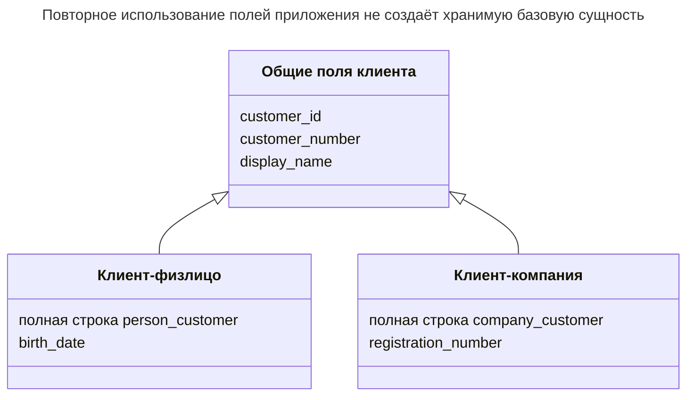
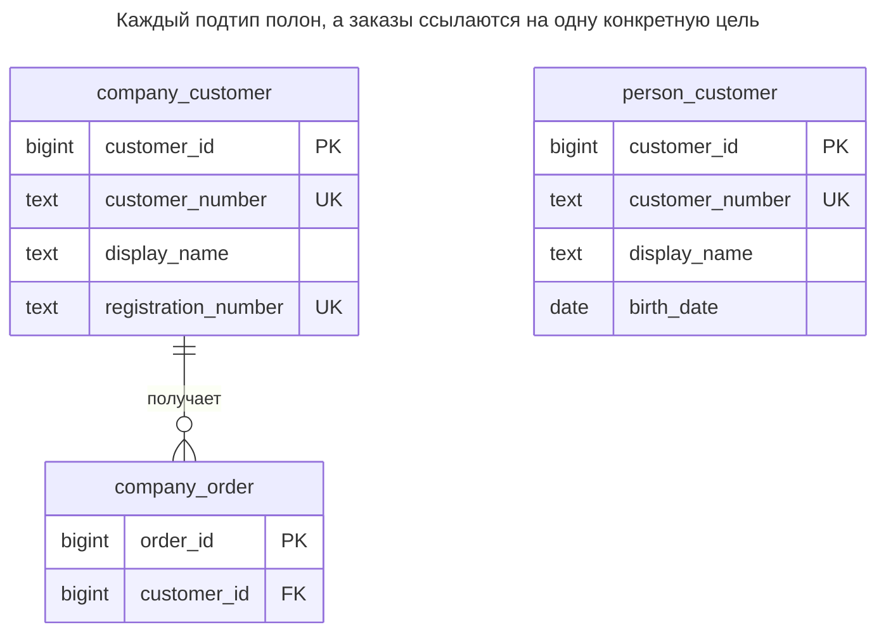
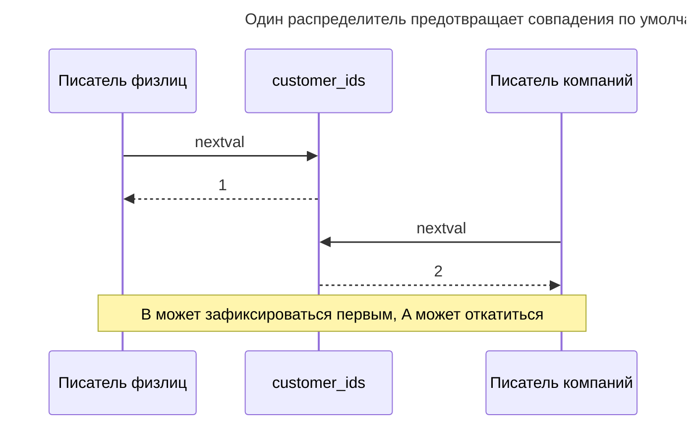
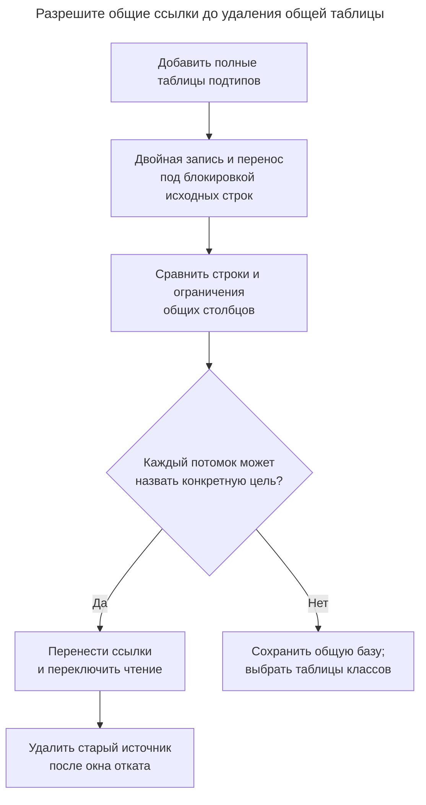

# Таблицы конкретных классов

## Назначение

Таблицы конкретных классов дают каждому конкретному подтипу собственную полную таблицу с повторением общих столбцов, без таблицы супертипа. Каждую таблицу просто и быстро читать отдельно, а каждый столбец получает ограничения своего подтипа. Глава показывает цену: запросам по подтипам нужен `UNION`, идентификаторы должны оставаться уникальными между таблицами, если один ID обозначает «любой подтип», а изменение общего столбца приходится повторять во всех таблицах.

## Также известен как

Concrete Table Inheritance; таблица на конкретный класс. [Concrete Table Inheritance Фаулера](https://martinfowler.com/eaaCatalog/concreteTableInheritance.html) даёт имя отображению; Hibernate называет его [`TABLE_PER_CLASS`](https://docs.hibernate.org/orm/6.6/userguide/html_single/Hibernate_User_Guide.html#entity-inheritance-table-per-class).

## Проблема

Вы продаёте людям и компаниям, но их процессы раздельны. Большинство экранов загружают один известный тип клиента, а заказ только для компании никогда не должен ссылаться на человека. Нужна полная строка каждого типа без соединения с общей базой при каждом чтении.

Возникает соблазн остановиться на этом и считать `customer_id` глобально осмысленным. Два независимых identity-столбца могут сгенерировать `1`; два уникальных ограничения `customer_number` могут принять `C-1` каждое. Представление с объединением унифицирует чтение, но не превращает отдельные ограничения в уникальность семейства и не даёт настоящую общую цель внешнего ключа.

## Решение

Дайте каждому конкретному типу полную таблицу с общими и специфичными полями. Записывайте прямо в выбранную таблицу. Предоставьте представление с объединением общей проекции и всегда включайте тип, когда идентификатор уникален лишь внутри таблицы.



База описывает общие поля приложения, но не имеет таблицы. Каждая сохранённая строка содержит эти поля заново. Повторение — выбранное отображение, а не случайная копия общей сущности.

В лабораторном примере одна последовательность выдаёт ID по умолчанию обеим таблицам. PostgreSQL [`nextval`](https://www.postgresql.org/docs/18/functions-sequence.html) выдаёт разные значения конкурентным вызовам, но явный импорт может обойти значение по умолчанию. Это политика выдачи, а не межтабличное ограничение уникальности. Если нужен принудительно соблюдаемый глобальный ключ с общей целью ссылок, выберите общий супертип.

## Альтернативы и выбор

| Соседний паттерн | Связь | Определяющее требование |
| --- | --- | --- |
| [Единая таблица](single-table-inheritance.md) | Замена | Уникальность семейства и общие ссылки важнее отдельных полных форм строк |
| [Таблицы классов](class-table-inheritance.md) | Замена | Нужны общие идентичность и поля без повторения их хранения |
| [Исключающая дуга](exclusive-arc.md) | Дополнение | Небольшое число полных таблиц подтипов должно служить целями одной зависимой таблицы |
| [Суррогатный ключ](surrogate-key.md) | Вариант выдачи | Выберите генератор, но отдельно решите, входит ли тип таблицы в идентичность |

Полная таблица — в [Атласе решений](decision-atlas.md). Общая последовательность не исправляет [Полиморфные связи](polymorphic-associations.md): паре `(type, id)` всё ещё нужны реальные ссылки на конкретные цели или общая база.

## Структура



Между двумя таблицами клиентов намеренно нет ребра. Каждая владеет строками и своими уникальными клиентскими номерами. Внешний ключ заказа принимает только компании, даже если у человека такой же числовой ID.

## Таблицы и инварианты

- **`person_customer`** хранит полного клиента-физлицо с обязательной датой рождения и локально уникальным клиентским номером.
- **`company_customer`** хранит полного клиента-компанию с обязательным локально уникальным регистрационным номером.
- **`company_order`** обязан ссылаться на существующую компанию. Его FK не может случайно разрешиться в человека с тем же ID.
- **`all_customers`** предоставляет общую проекцию вместе с `kind`. PostgreSQL [`UNION ALL`](https://www.postgresql.org/docs/18/queries-union.html) сохраняет все строки результата; обычный `UNION` удаляет дубликаты и не является проверкой идентичности.
- **Уникальности семейства** нет. Скрипт показывает совпадение явных ID и бизнес-номеров между таблицами при соблюдении всех объявленных ограничений.

## Когда применять

- Конкретные типы обычно запрашиваются и адресуются отдельно.
- Общие столбцы имеют стабильный смысл, и команда может согласованно поддерживать определения.
- Вы принимаете идентичность с типом либо дисциплинированную политику общей выдачи.
- Нет обязательной абстрактной сущности, которая должна существовать независимо от конкретной строки.

## Последствия и компромиссы

- ➕ Известный конкретный объект загружается и меняется в одной таблице.
- ➕ Все обязательные столбцы типа объявляются `NOT NULL` без условных проверок подтипов.
- ➖ Изменение общего поля нужно развернуть во всех конкретных таблицах и объединяющей проекции.
- ➖ Поиск по семейству охватывает все таблицы; добавление подтипа требует его обновить.
- ➖ Уникальность семейства и общие ссылки перестают быть локальными ограничениями таблицы.
- ➖ Смена подтипа — перенос между таблицами, а не обновление различителя; входящие ссылки могут её запретить или потребовать миграции.

## Реализация

[Полный скрипт](../assets/concrete-table-inheritance/concrete-table-inheritance.sql) показывает общую выдачу, запрос с объединением, FK конкретного подтипа и допустимую межтабличную коллизию:

```sql
CREATE SEQUENCE customer_ids AS bigint;
CREATE TABLE person_customer (
    customer_id bigint PRIMARY KEY DEFAULT nextval('customer_ids'),
    customer_number text NOT NULL UNIQUE,
    display_name text NOT NULL,
    birth_date date NOT NULL
);
CREATE TABLE company_customer (
    customer_id bigint PRIMARY KEY DEFAULT nextval('customer_ids'),
    customer_number text NOT NULL UNIQUE,
    display_name text NOT NULL,
    registration_number text NOT NULL UNIQUE
);
CREATE TABLE company_order (
    order_id bigint PRIMARY KEY,
    customer_id bigint NOT NULL REFERENCES company_customer (customer_id)
);
CREATE INDEX company_order_customer_idx ON company_order (customer_id);
CREATE VIEW all_customers AS
SELECT customer_id, 'person'::text AS kind, customer_number, display_name
FROM person_customer
UNION ALL
SELECT customer_id, 'company'::text AS kind, customer_number, display_name
FROM company_customer;
```

Представление с объединением — интерфейс чтения. PostgreSQL [не делает представление с объединением верхнего уровня автоматически обновляемым](https://www.postgresql.org/docs/18/sql-createview.html#SQL-CREATEVIEW-UPDATABLE-VIEWS); явно направляйте запись в конкретную таблицу.

```sql
INSERT INTO person_customer (customer_number, display_name, birth_date)
VALUES ('P-1', 'Ada', DATE '1990-01-01');
INSERT INTO company_customer (customer_number, display_name, registration_number)
VALUES ('C-1', 'Northwind', 'REG-2');
INSERT INTO company_order VALUES (10, 2);
SELECT customer_id, kind, display_name FROM all_customers ORDER BY customer_id;
UPDATE company_customer SET display_name = 'Northwind Ltd' WHERE customer_id = 2;
```

В пустой лабораторной базе запрос возвращает `(1, person, Ada)` и `(2, company, Northwind)`. Заказ не может ссылаться на ID человека:

```sql
INSERT INTO company_order VALUES (11, 1);
```

PostgreSQL 18.6 возвращает SQLSTATE `23503`: `ERROR: insert or update on table "company_order" violates foreign key constraint "company_order_customer_id_fkey"`. Уточнение сообщает, что `(customer_id)=(1)` отсутствует в `company_customer`.

Напротив, явный импорт ниже принимается, показывая отсутствующий инвариант семейства:

```sql
INSERT INTO company_customer (customer_id, customer_number, display_name, registration_number)
VALUES (1, 'P-1', 'Collision demonstration', 'REG-X');
SELECT customer_id, count(*) FROM all_customers GROUP BY customer_id HAVING count(*) > 1;
```

Результат — `(1, 2)`. И у человека, и у компании ID `1` и номер `P-1`. Сохраняйте тип в экспортируемой идентичности, если такие повторы допустимы. Если нет, используйте общий реестр ключей с принудительными ссылками или замените отображение таблицами классов; не утверждайте, что одна последовательность по умолчанию обеспечивает правило.

## Поддержка в движках

- **PostgreSQL 18:** используйте обычные таблицы и общую последовательность. Встроенный [`INHERITS`](https://www.postgresql.org/docs/18/ddl-inherit.html) — другая возможность хранения и запросов без уникальности всей иерархии.
- **MySQL 8.4 / InnoDB:** [счётчики `AUTO_INCREMENT` принадлежат таблицам](https://dev.mysql.com/doc/refman/8.4/en/innodb-auto-increment-handling.html). Два таких столбца не равны общей последовательности; выдавайте значения в приложении или сохраняйте идентичность с типом.
- **SQL Server 2025 (17.x):** [объект последовательности выдаёт значения нескольким таблицам](https://learn.microsoft.com/en-us/sql/relational-databases/sequence-numbers/sequence-numbers?view=sql-server-ver17). Это вариант выдачи с тем же различием генератора и принудительно обеспеченного общего ключа сущности.
- **Oracle AI Database 26ai:** [`SEQUENCE`](https://docs.oracle.com/en/database/oracle/oracle-database/26/sqlrf/CREATE-SEQUENCE.html) аналогично обслуживает несколько таблиц. Адаптируйте значения по умолчанию и типы, не добавляя независимые identity случайно.
- **SQLite 3:** [выдача `INTEGER PRIMARY KEY` локальна для таблицы](https://www.sqlite.org/lang_createtable.html#rowid). Используйте ID с типом или продуманный распределитель приложения и включайте [внешние ключи](https://www.sqlite.org/foreignkeys.html#fk_enable).

## Сбои и конкурентность

Пусть значения по умолчанию выдаёт последовательность, а не чтение максимума из объединения. PostgreSQL документирует, что [значения последовательности не возвращаются при откате](https://www.postgresql.org/docs/18/functions-sequence.html); пропуски не означают отсутствующих клиентов. Конкурентный распределитель может получить ID до фиксации другой транзакции.



Ни одна таблица не проверяет дубликат бизнес-ключа, вставляемый в другую. Запрос приложения к обеим до вставки подвержен гонке. Если нужна глобальная бизнес-уникальность, предпочтите общую таблицу с ограничением. Для переноса подтипа блокируйте источник до копирования общих полей, переносите зависимые ссылки в той же транзакции и определите распознавание уже завершённого переноса при повторе. Это отображение не делает переносы бесплатными.

## Миграция

Из широкой таблицы создайте по полной цели на конкретный тип, сохраните старые ID и исходную таблицу, пока двойные писатели заполняют выбранную цель. Проверьте, что каждая исходная строка встречается среди целей ровно один раз. Синхронизируйте перенос с действующими писателями через блокировку исходной строки; устаревшая копия не должна воскрешать удалённые или переклассифицированные данные.



Общий FK клиента — решающее препятствие миграции, а не мелкая правка запроса. Сохраняйте общую базу, если ссылки должны остаться общими. Пока представления синхронизированы, возвращайте чтение через сохранённый источник; после добавления конкретных типов или специфичных полей сначала убедитесь, что старое представление всё ещё их выражает. См. [Расширение и свёртывание](expand-contract.md).

## Антипаттерны и частые ошибки

- Повторять имя общего поля, молча меняя его тип или смысл в подтипе.
- Считать отдельные первичные ключи гарантией уникальности ID без типа между таблицами.
- Принимать объединяющее представление за общую цель ссылок с собственным первичным ключом.
- Скрывать повторяющиеся проекции обычным `UNION` вместо определения идентичности.
- Называть каждую клонированную таблицу конкретным наследованием: [Клонированные таблицы](cloned-tables.md) рассматривают копии по арендаторам и периодам с другой причиной существования.

## Известные применения

- [Отображение Hibernate `TABLE_PER_CLASS`](https://docs.hibernate.org/orm/6.6/userguide/html_single/Hibernate_User_Guide.html#entity-inheritance-table-per-class) хранит унаследованные поля в каждой конкретной таблице и использует объединения для полиморфного чтения.
- [Абстрактные базовые классы Django](https://docs.djangoproject.com/en/5.2/topics/db/models/#abstract-base-classes) копируют поля в дочерние модели без создания базовой таблицы. Это совместное использование объявлений приложения, а не хранимых базовых строк.

## Связанные паттерны

- [Единая таблица](single-table-inheritance.md) возвращает одну таблицу для проверок и ссылок всего семейства.
- [Таблицы классов](class-table-inheritance.md) сохраняют общую идентичность без повторения общего хранения.
- [Исключающая дуга](exclusive-arc.md) безопасно ссылается на ограниченный набор конкретных таблиц.
- [Полиморфные связи](polymorphic-associations.md) объясняют цену непроверяемой общей ссылки.
- [Клонированные таблицы](cloned-tables.md) отличают дублирование по арендатору или периоду от настоящих конкретных типов.
