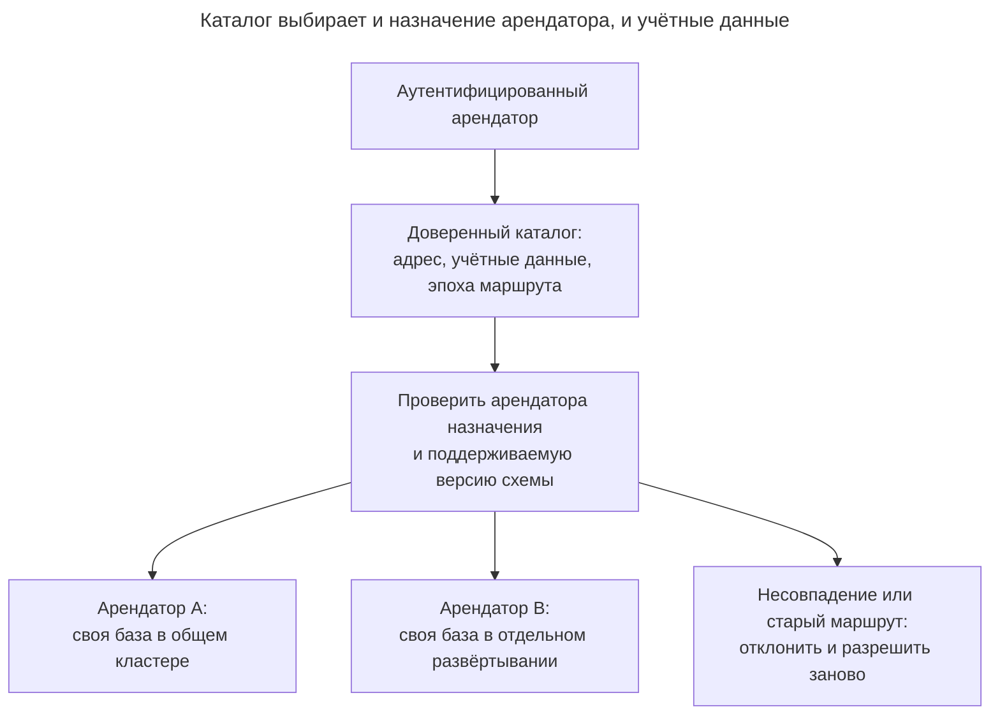
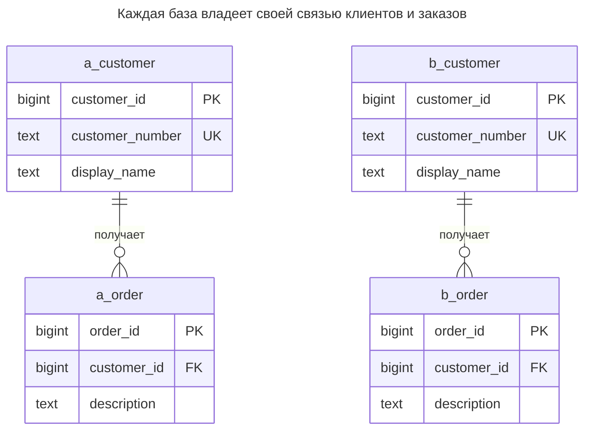
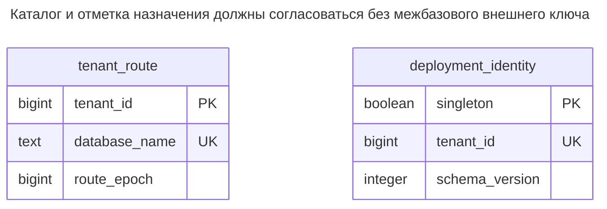
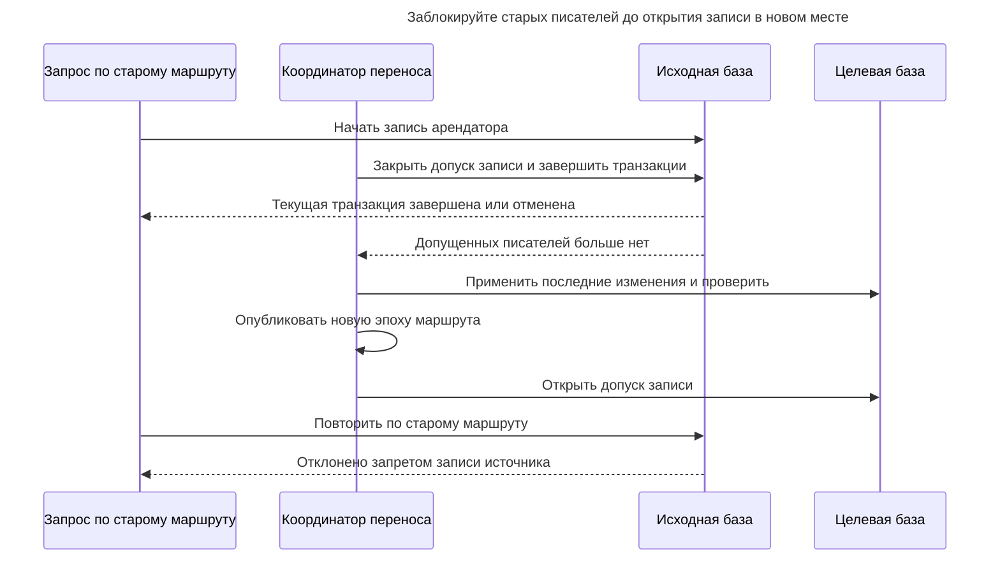
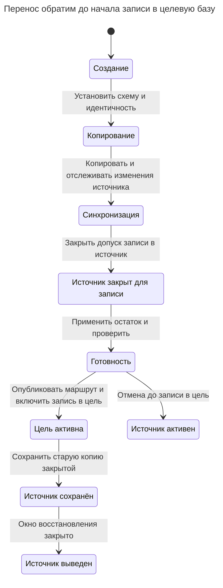

# База арендатора

## Назначение

Каждый арендатор получает отдельную базу данных, иногда на отдельном сервере. С отдельным сервером или управляемым развёртыванием модель может обеспечить наиболее строгую изоляцию: отдельные ресурсы, резервные копии, ключи шифрования, версии и даже размещение в обязательном регионе — возможное требование договора или нормативов. Глава разбирает эксплуатационную цену создания, миграций и мониторинга множества баз, маршрутизацию соединений, межарендаторскую отчётность и смешанные модели, где крупные арендаторы получают свои базы, а небольшие делят общую. PostgreSQL различает [границы баз данных](https://www.postgresql.org/docs/18/manage-ag-overview.html) и [общесерверные ресурсы](https://www.postgresql.org/docs/18/runtime-config-resource.html).

## Также известен как

Single-tenant database; dedicated tenant database. В [модели Microsoft database-per-tenant](https://learn.microsoft.com/en-us/azure/azure-sql/database/saas-tenancy-app-design-patterns) слой приложения остаётся мультитенантным, а каждая база обслуживает одного арендатора. Историческая [терминология silo AWS](https://docs.aws.amazon.com/pdfs/whitepapers/latest/multi-tenant-saas-storage-strategies/multi-tenant-saas-storage-strategies.pdf) включает отдельный экземпляр RDS на арендатора; такая граница развёртывания строже двух баз PostgreSQL в одном экземпляре.

## Проблема

Клиент хочет экспортировать, восстановить, перенести или обновить свои данные, не включая строки остальных клиентов в ту же операцию. Другому арендатору нужна такая ёмкость, что соседство с небольшими затрудняет соблюдение их целевых показателей сервиса. Вы хотите сохранить локальную схему клиентов и заказов, меняя размещение каждого арендатора.

Отдельная схема даёт пространство имён, но оставляет общими маршрутизацию соединений и операции уровня базы. Отдельная база добавляет управляемую границу и новую обязанность приложения: до любого бизнес-SQL нужно соединиться с правильной базой с правильными учётными данными. Обычный локальный запрос не обнаружит, что маршрутизатор выбрал внешне идентичные таблицы другого арендатора.

## Решение

Создавайте каждому арендатору одну базу с полной схемой его данных. Отделите владельца базы и полномочия миграций от рабочих учётных данных. Храните доверенный каталог, сопоставляющий арендатора с адресом подключения, ссылкой на учётные данные и поколением маршрута. Сначала аутентифицируйте запрос, затем найдите арендатора в каталоге и получите из пула соединение для выбранного адреса и учётной записи.

В PostgreSQL клиент [выбирает базу при установлении соединения](https://www.postgresql.org/docs/18/manage-ag-overview.html), а обычное соединение обращается к одной базе. Дайте каждой рабочей роли доступ к своей базе и отзовите общий доступ к подключению к базам арендаторов. Локальная идентичность развёртывания позволяет приложению до бизнес-операций проверить соответствие назначения каталогу.

Физическую границу выбирайте независимо. Две базы одного кластера всё ещё используют [общие ресурсы сервера](https://www.postgresql.org/docs/18/runtime-config-resource.html); выделенные вычисления или независимые версии движка автоматически не появляются. Если договор требует отдельного региона, жизненного цикла сервера или границы ключей шифрования, выберите и проверьте развёртывание, которое это обеспечивает. Одно имя базы не доказывает ни одного такого свойства.

## Альтернативы и выбор

| Соседний паттерн или механизм | Связь | Определяющее требование |
| --- | --- | --- |
| [Общая схема](shared-schema.md) | Замена; дополнение в гибридном наборе баз | Небольшие арендаторы делят выпуск и эксплуатационный пул, выбранные получают отдельное размещение |
| [Схема арендатора](schema-per-tenant.md) | Замена | Достаточно разделения объектов в одной базе, а межсхемная работа остаётся полезной |
| Несколько баз арендаторов в одном кластере | Вариант реализации | Достаточно отдельных логических данных и учётных записей; общие ресурсы и восстановление приемлемы |
| Отдельный кластер или управляемое развёртывание на арендатора | Вариант реализации | Требуемая граница включает ресурсы сервера, размещение или жизненный цикл движка |
| [Расширение и свёртывание](expand-contract.md) | Дополнение | Один выпуск приложения должен работать с несколькими версиями схем при обновлении |

Полная таблица — в [Атласе решений](decision-atlas.md). Оценивайте фактическую единицу резервного копирования и ресурсов развёртывания; не выводите её из слова «база».



Один контракт маршрутизации обслуживает и общую инфраструктуру, и выделенные развёртывания. Проверяйте выбранное назначение: корректный SQL в базе другого арендатора всё равно ошибочен.

## Структура



Метки `a_` и `b_` обозначают таблицы баз `dt_a` и `dt_b`, в обеих — в схеме `app`; `order` сокращает `customer_order`. Каждая база содержит полную связь, поэтому клиент `10` в B не удовлетворяет ссылку заказа в A.



Каталог живёт в управляющей базе; каждая база арендатора содержит свою `app.deployment_identity`. Внешнего ключа между ними намеренно нет. Создание и проверки соединений должны подтверждать, что выбранное каталогом назначение содержит ожидаемую отметку арендатора.

## Таблицы и инварианты

- **`dt_control.tenant_route`** находится в управляющей базе. Первичный ключ задаёт одно текущее назначение на арендатора; `database_name` уникален в единственном кластере практикума. Реальной системе нужен полный адрес, включая сервер или сервис, и отдельная ссылка на учётные данные вместо хранения пароля здесь.
- **`app.deployment_identity`** содержит не более одной строки, поскольку её логический первичный ключ обязан быть истинным. `tenant_id` и `schema_version` обязательны. Строку вставляет процесс создания; рабочая роль может только читать. Ограничения не гарантируют ни существование строки, ни соответствие внешнему каталогу.
- **`app.customer` и `app.customer_order`** используют обычные локальные ключи. Внешний ключ заказа требует клиента в той же базе. Одинаковые ID клиентов и заказов в разных базах намеренны.
- **Права подключения** ограничивают рабочую роль назначенной базой. Владельцы и администраторы остаются доверенными; [роли PostgreSQL — объекты всего кластера](https://www.postgresql.org/docs/18/manage-ag-overview.html), а не независимые сущности, создаваемые заново внутри каждой базы.
- **Единственное место записи** — инвариант оркестрации. `route_epoch` — учётная информация протокола маршрутизации, а не обеспечиваемый базой запрет для уже подключённого писателя.

## Когда применять

- Арендатору нужны независимо выполняемые логический экспорт, перенос или обновление схемы.
- Вы можете автоматизировать создание, учётные данные, статус миграций, мониторинг и восстановление всех создаваемых баз.
- Крупным арендаторам нужны варианты развёртывания, отличные от пула небольших.
- Большинство транзакций остаётся внутри арендатора; межарендаторская отчётность использует явный сбор или отчётный процесс.

## Последствия и компромиссы

- ➕ Бизнес-таблицы сохраняют локальные ограничения без столбца арендатора в каждой связи.
- ➕ Можно экспортировать полный локальный граф объектов одной базы и выбрать место восстановления.
- ➕ Индивидуальное расписание миграций не требует немедленно менять остальные базы.
- ➖ Каждому активному назначению и учётной записи нужна ёмкость соединений. Планируйте суммарное число открытых соединений всех процессов, закрывайте неактивные пулы и ограничивайте параллельное создание и миграции.
- ➖ Отчёты и глобальные операции обходят несколько баз или используют сводную модель чтения. Глобально уникальный номер клиента требует явного реестра.
- ➖ Успешный выпуск приложения не доказывает обновление каждой базы. Храните наблюдаемую версию, последнюю попытку и результат для каждого назначения, отличая недоступного арендатора от завершённого обновления.

## Реализация

[Полный скрипт PostgreSQL 18.6](../assets/database-per-tenant/database-per-tenant.sql) запускается через `psql` в базе `postgres` нового одноразового кластера. Он создаёт две базы арендаторов и переподключается под рабочими ролями. Практикум использует локальную доверенную аутентификацию и роли без паролей; производственную аутентификацию настройте отдельно. Создавайте от администратора:

```sql
CREATE ROLE dt_owner NOLOGIN;
CREATE ROLE dt_app_a LOGIN NOSUPERUSER NOBYPASSRLS;
CREATE ROLE dt_app_b LOGIN NOSUPERUSER NOBYPASSRLS;
CREATE DATABASE dt_a OWNER dt_owner;
CREATE DATABASE dt_b OWNER dt_owner;
REVOKE ALL ON DATABASE dt_a, dt_b FROM PUBLIC;
GRANT CONNECT ON DATABASE dt_a TO dt_app_a;
GRANT CONNECT ON DATABASE dt_b TO dt_app_b;
CREATE SCHEMA dt_control;
CREATE TABLE dt_control.tenant_route (
    tenant_id bigint PRIMARY KEY,
    database_name text NOT NULL UNIQUE,
    route_epoch bigint NOT NULL CHECK (route_epoch > 0)
);
INSERT INTO dt_control.tenant_route VALUES (1, 'dt_a', 1), (2, 'dt_b', 1);
```

[`CREATE DATABASE`](https://www.postgresql.org/docs/18/sql-createdatabase.html) PostgreSQL нельзя выполнять внутри блока транзакции. Рассматривайте создание как возобновляемый процесс: создать базу, установить схему и права, проверить, затем опубликовать маршрут. Скрипт демонстрирует компоненты, а не промышленный механизм создания; принадлежащая администратору управляющая таблица недоступна ролям арендаторов.

Подключитесь к `dt_a` администратором, отзовите создание в общей схеме и установите объекты арендатора от роли владельца:

```sql
REVOKE CREATE ON SCHEMA public FROM PUBLIC;
SET ROLE dt_owner;
CREATE SCHEMA app AUTHORIZATION dt_owner;
CREATE TABLE app.deployment_identity (
    singleton boolean PRIMARY KEY CHECK (singleton),
    tenant_id bigint NOT NULL UNIQUE,
    schema_version integer NOT NULL CHECK (schema_version > 0)
);
INSERT INTO app.deployment_identity VALUES (true, 1, 1);
CREATE TABLE app.customer (
    customer_id bigint PRIMARY KEY,
    customer_number text NOT NULL UNIQUE,
    display_name text NOT NULL
);
CREATE TABLE app.customer_order (
    order_id bigint PRIMARY KEY,
    customer_id bigint NOT NULL,
    description text NOT NULL,
    CONSTRAINT order_customer_fk FOREIGN KEY (customer_id)
        REFERENCES app.customer (customer_id)
);
CREATE INDEX order_customer_idx ON app.customer_order (customer_id);
GRANT USAGE ON SCHEMA app TO dt_app_a;
GRANT SELECT ON app.deployment_identity TO dt_app_a;
GRANT SELECT, INSERT, UPDATE, DELETE ON app.customer, app.customer_order TO dt_app_a;
RESET ROLE;
```

Создайте ту же структуру в `dt_b` с арендатором `2` и правами `dt_app_b`. Отделяйте владельца от рабочей роли: [права владения PostgreSQL](https://www.postgresql.org/docs/18/ddl-priv.html) включают изменение и уничтожение объектов. Общий владелец практикума — доверенный оператор всех баз, а не идентичность арендатора.

После подключения к `dt_a` под `dt_app_a` проверьте назначение и выполните локальные операции:

```sql
SELECT current_database(), tenant_id, schema_version FROM app.deployment_identity;
INSERT INTO app.customer VALUES (10, 'C-10', 'Acme customer');
INSERT INTO app.customer_order VALUES (100, 10, 'First order');
UPDATE app.customer SET display_name = 'Acme renamed' WHERE customer_id = 10;
SELECT o.order_id, c.display_name
FROM app.customer_order AS o JOIN app.customer AS c USING (customer_id);
```

Запрос идентичности возвращает `(dt_a, 1, 1)`, соединение — `(100, Acme renamed)`. Требуйте ровно одну строку идентичности, ожидаемого арендатора и поддерживаемую версию схемы; отклоняйте несовпадения до бизнес-операций. Ключ пула должен включать назначение и учётные данные; при смене маршрута сбрасывайте устаревшие пулы. [Параметры соединения PostgreSQL](https://www.postgresql.org/docs/18/libpq-connect.html#LIBPQ-PARAMKEYWORDS) различают хост, базу и пользователя; изменение `search_path` не переключает базу.

Заказ со ссылкой на отсутствующего локального клиента отклоняется:

```sql
INSERT INTO app.customer_order VALUES (101, 20, 'Missing customer');
```

PostgreSQL 18.6 возвращает SQLSTATE `23503`: `ERROR: insert or update on table "customer_order" violates foreign key constraint "order_customer_fk"`. Локальная целостность важна и при отдельных базах. Обычная попытка обратиться к другому арендатору трёхчастным именем тоже завершается ошибкой:

```sql
SELECT * FROM dt_b.app.customer;
```

Из `dt_a` это даёт SQLSTATE `0A000`: `ERROR: cross-database references are not implemented: "dt_b.app.customer"`. Ошибка запроса отделена от авторизации соединения. Скрипт также проверяет отсутствие `CONNECT` у `dt_app_a` для `dt_b`; новое соединение этой роли отклоняется с `FATAL: permission denied for database "dt_b"`. [Привилегия `CONNECT`](https://www.postgresql.org/docs/18/sql-grant.html) PostgreSQL проверяется при подключении дополнительно к аутентификации по хосту.

## Поддержка в движках

- **PostgreSQL 18:** [`pg_dump`](https://www.postgresql.org/docs/18/app-pgdump.html) экспортирует одну базу, но роли и другие глобальные объекты требуют отдельной обработки. Физическое [восстановление непрерывного архива](https://www.postgresql.org/docs/18/continuous-archiving.html) восстанавливает весь кластер, а не базу арендатора. Если в промышленном кластере есть другие арендаторы, восстанавливайте другой кластер и извлекайте нужного.
- **MySQL 8.4:** [база и схема — синонимы](https://dev.mysql.com/doc/refman/8.4/en/create-database.html). [Полные ссылки на таблицы](https://dev.mysql.com/doc/refman/8.4/en/identifier-qualifiers.html) MySQL могут указывать базу на том же сервере, поэтому отдельные базы не задают ту же границу соединения, что в PostgreSQL; выбирайте учётные данные и границы развёртывания по движку, а не буквальному названию контейнеров.
- **SQL Server 2025 (17.x):** встроенное [резервное копирование работает на уровне базы, файла или файловой группы](https://learn.microsoft.com/en-us/sql/relational-databases/backup-restore/backup-overview-sql-server?view=sql-server-ver17). [Рекомендации Azure SQL Database](https://learn.microsoft.com/en-us/azure/azure-sql/database/saas-tenancy-app-design-patterns) также описывают эластичные пулы и восстановление отдельных арендаторов; эти возможности управляемого сервиса не являются обещаниями для баз PostgreSQL.
- **Oracle AI Database 26ai:** [мультитенантная архитектура](https://docs.oracle.com/en/database/oracle/oracle-database/26/cncpt/introduction-to-oracle-database.html) различает контейнерную базу и подключаемые базы. До сравнения жизненного цикла и изоляции решите, получает ли арендатор схему, PDB или отдельное развёртывание.
- **SQLite 3:** вариант реализации — файл на арендатора. [`ATTACH`](https://www.sqlite.org/lang_attach.html) разрешает несколько файлов в одном соединении, но режим WAL не гарантирует атомарную фиксацию всех подключённых файлов. [Внешние ключи не пересекают границы схем](https://www.sqlite.org/foreignkeys.html#fk_unsupported), поэтому храните весь ограниченный граф арендатора в его файле.

## Сбои и конкурентность

Устаревшая запись каталога опасна при переносе, даже если все локальные внешние ключи корректны. Две доступные для записи копии могут принимать допустимые локальные изменения и расходиться. Одно увеличение эпохи каталога не остановит старое соединение, уже знающее адрес базы.



Запрет записи — часть протокола развёртывания, а не эффект таблицы маршрутов. Остановите допуск, освободите пулы и дождитесь исполнителей; убедитесь, что старые учётные данные и сервисные пути не возобновят запись в источник. Отзыв `CONNECT` влияет лишь на новые соединения, не завершая существующие сеансы, что следует из [определения привилегии](https://www.postgresql.org/docs/18/ddl-priv.html), проверяемой при входе. Практикум не реализует распределённый запрет записи.

Внутри базы арендатора локальные уникальные и внешние ключи сохраняют обычное конкурентное поведение. Между базами не предполагается, что одна локальная транзакция покрывает общую операцию. Разбивайте общую миграцию на независимо учитываемые транзакции арендаторов и повторяйте неудачные назначения. Берите блокировку миграции в каждой базе и повторно читайте версию после захвата; [рекомендательные блокировки PostgreSQL](https://www.postgresql.org/docs/18/explicit-locking.html#ADVISORY-LOCKS) координируют согласованных исполнителей, а не автоматически весь внешний набор баз.

Не подтверждайте запись клиента лишь потому, что успешно изменился управляющий каталог. Бизнес-фиксация происходит в выбранной базе арендатора. Если ответ потерян, найдите там операцию с тем же арендатором и идентичностью повтора, прежде чем повторять её в другом месте.

## Миграция

Введите доверенную маршрутизацию, пока все арендаторы ещё находятся на прежних местах. Отделите логическую идентичность арендатора от имени базы в API, заданиях, логах и внешних ссылках. Существующие [Публичные идентификаторы](public-identifier.md) должны продолжать находиться в области аутентифицированного арендатора после переноса; локальные целочисленные ID не обязаны становиться глобально уникальными.

Создайте назначение с ожидаемой версией схемы и идентичностью. Скопируйте согласованные данные арендатора, включая потомков и необходимые для интерпретации справочники. Настройте захват изменений или ограниченную паузу записи до начала копирования, чтобы не потерять ни одного интервала изменений источника. При финальном переключении запретите запись в источник, завершите текущие транзакции, примените остаток изменений, проверьте цель, опубликуйте маршрут и откройте запись в цель.



После начала целевой записи обратное переключение маршрута без копирования изменений назад теряет принятую работу. Сохраните прежнее назначение закрытым для записи на окно восстановления; при необходимости отката планируйте обратную синхронизацию или новое копирование с паузой. Не обещайте автоматический перенос без перерыва лишь потому, что схемы источника и цели одинаковы.

При обычных обновлениях применяйте [Расширение и свёртывание](expand-contract.md) к каждой базе, фиксируйте фактическое завершение и сохраняйте совместимость приложения с оставшимися версиями. Для восстановления сначала восстанавливайте изолированное назначение, проверяйте идентичность и версию, затем применяйте ту же процедуру маршрутизации и запрета записи. Логические экспорты и физическое восстановление PostgreSQL имеют разные единицы; репетируйте именно обещанный путь восстановления.

## Антипаттерны и частые ошибки

- Обещать выделенные ресурсы, независимые версии движка или отдельные ключи шифрования только на основании разных имён баз.
- Сохранять общий `CONNECT` на базах арендаторов или выдавать рабочей роли владение.
- Повторно использовать соединение другого арендатора из-за одинакового вида схемы.
- Направлять каталог на недосозданную базу или объявлять общую миграцию успешной после обновления только доступных арендаторов.
- Принимать сброс кеша маршрутов за запрет записи, пока существующие сеансы продолжают писать.
- Предполагать, что резервная копия кластера позволяет откатить одну базу PostgreSQL на месте, не затронув соседей.
- Заменять локальные внешние ключи проверками приложения из-за отдельной базы; см. [Отсутствующие внешние ключи](missing-foreign-keys.md).

## Известные применения

- [Мультитенантное приложение Microsoft с базой на арендатора](https://learn.microsoft.com/en-us/azure/azure-sql/database/saas-tenancy-app-design-patterns) создаёт каждому базу, поддерживает индивидуальную настройку схемы и описывает гибридную модель. Каталог арендаторов сопоставляет идентичность с расположением базы.
- Историческая [модель RDS silo AWS](https://docs.aws.amazon.com/pdfs/whitepapers/latest/multi-tenant-saas-storage-strategies/multi-tenant-saas-storage-strategies.pdf) создаёт отдельные экземпляры арендаторов. Это пример сочетания логической границы с отдельным развёртыванием, а не доказательство, что любая база общего экземпляра является silo.

## Связанные паттерны

- [Общая схема](shared-schema.md) обеспечивает пул небольших арендаторов в гибридной системе.
- [Схема арендатора](schema-per-tenant.md) разделяет пространства имён внутри одной базы.
- [Расширение и свёртывание](expand-contract.md) поэтапно меняет версии множества баз.
- [Публичный идентификатор](public-identifier.md) отделяет внешнюю идентичность от размещения и локальных ключей.
- [Отсутствующие внешние ключи](missing-foreign-keys.md) объясняют проверки целостности, необходимые каждой локальной схеме.
