# Атлас решений

Атлас решений собирает в одном месте сравнительные таблицы всех семейств альтернатив из книги: ключей, структур деревьев, отображений наследования, способов хранения переменных атрибутов, моделей истории и изоляции арендаторов. Каждая таблица перечисляет требования, определяющие выбор, и отсылает к главам. Используйте его, когда проблема уже известна, а подходящий паттерн — ещё нет.

Читайте каждое семейство как набор требований, а не рейтинг. Замены отвечают на один вопрос; дополнения добавляют гарантию; варианты реализации меняют способ её обеспечения. Главы по ссылкам определяют инварианты, протоколы конкурентности и оговорки для движков, стоящие за каждой строкой. Запускайте их примеры через [Практикум SQL](sql-lab.md).

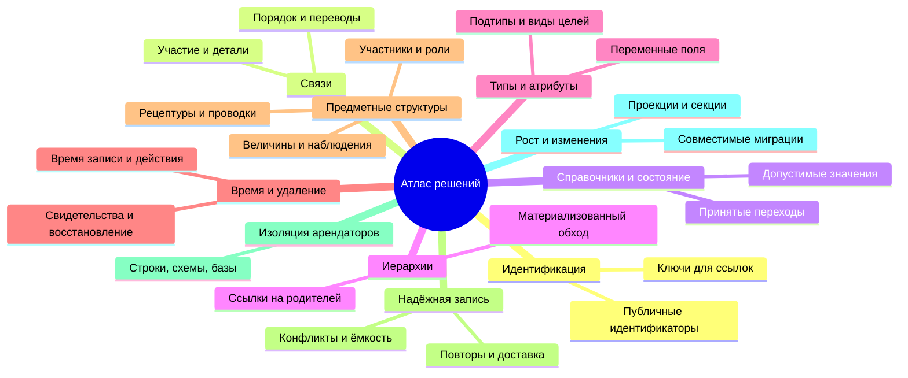

Карта разделяет семейства книги по вопросам, на которые они отвечают. Одной схеме могут понадобиться несколько ветвей: резервированию в области арендатора могут также требоваться дедупликация запросов и outbox.

## Идентификаторы

Что идентифицирует строку для зависимых записей и что могут видеть клиенты? Сначала выберите ключ для ссылок, затем его генератор, а внешний контракт определите отдельно.

| Выбор | Требование, определяющее выбор | Контракт ссылок и уникальности | Цена генерации или раскрытия |
| --- | --- | --- | --- |
| [Суррогатный ключ](surrogate-key.md) | Бизнес-значения меняются, появляются поздно или слишком широки для ссылок | Стабильный генерируемый PK; бизнес-уникальность сохраняется отдельно | Выдача целых чисел централизована; UUID — другой вариант реализации |
| [Естественный ключ](natural-key.md) | Короткий обязательный бизнес-кортеж имеет определённую область уникальности и управляемые исправления | Каждая зависимая запись хранит полный кортеж | Исправления и расширение области затрагивают ссылки; в Oracle нет `ON UPDATE CASCADE` |
| [Упорядоченный идентификатор](time-ordered-identifier.md) | Генерация до вставки или разными писателями, с подтверждённой измерениями пользой локальности индекса | Реализация суррогата; PK по-прежнему отклоняет коллизии | Раскрывает время генерации; порядок не равен порядку фиксации; PostgreSQL 18 предоставляет `uuidv7()` |
| [Публичный идентификатор](public-identifier.md) | Опубликованным ссылкам нужен отдельный контракт стабильности или раскрытия | Дополнение к любому внутреннему ключу; отдельный уникальный внешний ID | Поддерживайте поиск и политику смены/псевдонимов; случайные ID не заменяют авторизацию |

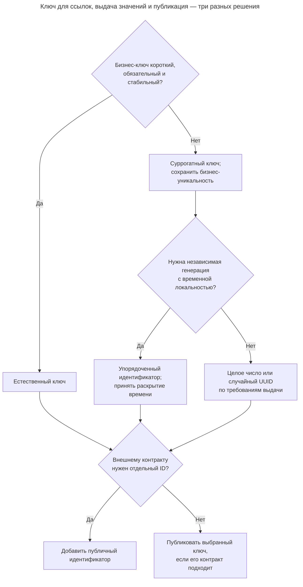

Публичный ID может сопровождать и естественный, и суррогатный ключ. Выбор UUIDv7 не определяет необходимость суррогата, а его локальность — вопрос нагрузки, а не гарантия пропускной способности.

## Связи

Обозначает ли другая строка участие, часть одной сущности, управляемый пользователем элемент или перевод? Структуру определяют кардинальность и границы редактирования; несколько этих паттернов могут применяться вместе.

| Выбор | Кардинальность и владение | Требование к чтению или редактированию | Цена целостности и сопровождения |
| --- | --- | --- | --- |
| [Обычный FK потомка](association-table.md) | У каждого потомка один родитель | Независимая связь многие-ко-многим не нужна | FK обеспечивает существование родителя; индексируйте направления поиска по необходимости |
| [Таблица связей](association-table.md) | Участие многие-ко-многим с атрибутами связи | Запрос и редактирование отдельных связей | FK на обе стороны и уникальность пары; дополнительный ID не заменяет правило пары |
| [Разделение таблицы](table-split.md) | Не более одной строки деталей на основную строку | Необязательная группа, отдельные разрешения или измеренная польза раздельных строк | Общий PK/FK; полное чтение требует соединения; обязательному циклическому варианту нужны отложенные проверки |
| [Упорядоченная коллекция](ordered-collection.md) | Элементы в пределах одного владельца | Пользователи вставляют и перемещают элементы независимо от времени создания | Сериализуйте изменения коллекции; стабильная идентичность элемента отличается от изменяемой позиции |
| [Локализованные значения](localized-values.md) | У одной сущности несколько строк локалей | Независимые редактирование, поиск и проверка переводов | Уникальная пара «сущность/локаль»; обязательный перевод по умолчанию требует протокола жизненного цикла |
| [Столбцы или JSON-карта локалей](localized-values.md) | Фиксированные языковые столбцы или одна общая карта | Небольшой фиксированный набор языков или чтение карты целиком | Столбцы добавляются через DDL; JSON требует явной проверки ключей, типов и перевода по умолчанию |

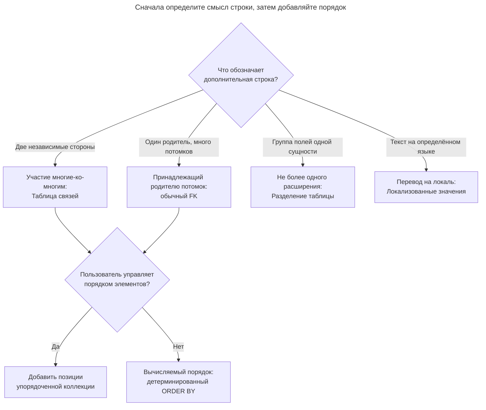

Упорядоченная связь остаётся связью. Перевод требует многих строк на сущность, поэтому таблица деталей с не более чем одной строкой не даёт нужной кардинальности.

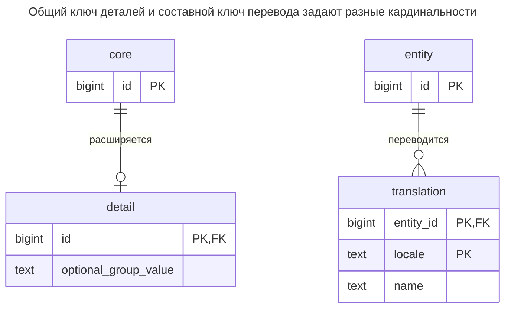

Ключ деталей допускает одно расширение; составной ключ перевода — одну строку на локаль. Здесь опущен вариант с обязательным переводом по умолчанию, обратная ссылка которого объяснена в главе «Локализованные значения».

Для порядка [Упорядоченная коллекция](ordered-collection.md) сравнивает плотные целые числа со сдвигами хвоста, целые с промежутками и периодической перенумерацией, точные числовые середины с конечным масштабом, лексикографические ранги с контрактом генератора и сортировки и ссылки на соседей с поддержанием связности и отсутствия циклов. PostgreSQL и Oracle поддерживают отложенную уникальность для обмена позициями; MySQL, SQL Server и SQLite для этой реализации требуют временных позиций без коллизий. Примеры обязательных деталей и перевода по умолчанию также требуют переработки в движках без отложенных FK.

## Ограниченные значения и статусы

Кто поддерживает словарь и нужна ли вам только принадлежность к допустимому набору или ещё и законность переходов? Список значений и история переходов обеспечивают разные правила.

| Выбор | Владение словарём и изменения | Требование к метаданным или повторному использованию | Граница переходов и движков |
| --- | --- | --- | --- |
| [Таблица значений](lookup-table.md) | Ответственные за бизнес добавляют и выводят значения из обращения через запись данных | Подписи, порядок отображения, доступность и переводы принадлежат строкам | FK проверяет принадлежность; защищённое присвоение учитывает вывод из обращения |
| [Встроенный enum](lookup-table.md) | Небольшой стабильный список под управлением разработчиков меняется с выпусками | Полезны идентичность типа и порядок объявления; редактируемая строка метаданных не нужна | PostgreSQL не позволяет удалить/переставить элементы без пересоздания типа; в MySQL другая семантика неверных значений |
| [Столбцовый `CHECK`](lookup-table.md) | Небольшой список под управлением выпусков локален для столбца | Метаданные значений не нужны | Локальный предикат принадлежности; не кодирует переход из старого состояния в новое |
| [Домен с `CHECK`](lookup-table.md) | Стабильное повторно используемое правило значений | Несколько столбцов разделяют проверку без подписей для каждого значения | Синтаксис домена PostgreSQL отличается от синтаксиса типов-псевдонимов SQL Server |
| [История статусов](status-history.md) | Принятые переходы жизненного цикла требуют управляемой записи | Сохраняются исходное и целевое состояния, ревизия и авторство | Текущая строка и история фиксируются вместе; блокировка или условное обновление версии отклоняет конкурентные устаревшие команды |
| [Столбцы этапов](status-history.md) | Фиксированный однопроходный процесс | Отчётам нужны только известные временные отметки | Теряются повторные посещения и произвольные переходы; автоматического контроля процесса нет |

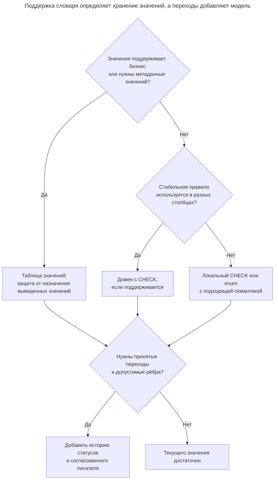

Два допустимых названия статуса могут образовывать недопустимый переход. Перенос словаря в строки не учит старое приложение смыслу нового состояния.

## Деревья

Какие обходы оправдывают избыточное хранение и как часто перемещаются ветви? Сравнение касается деревьев с одним родителем из соответствующих глав; графам количеств с несколькими родителями нужна отдельная [модель компонентов](#графы-компонентов).

| Паттерн | Чтение поддерева и предков | Цена записи при перемещении | Хранимая целостность и объём | Граница реализации |
| --- | --- | --- | --- | --- |
| [Список смежности](adjacency-list.md) | Рекурсивный обход; прямые потомки используют индекс родителя | Изменение одного родителя после проверки циклов | Одна ссылка на родителя на узел; FK доказывает существование, но не отсутствие циклов | Диалекты и ограничения рекурсивных запросов различаются |
| [Материализованный путь](materialized-path.md) | Индексируемое включение/префикс для потомков; путь задаёт предков | Переписываются пути потомков перемещённой ветви | Один путь на узел; поддерживается согласованность с сохранённым родителем | PostgreSQL `ltree` или SQL Server `hierarchyid`; текстовая кодировка — другой вариант |
| [Вложенные множества](nested-sets.md) | Чтение диапазонов и прямой обход; плотные границы позволяют арифметический подсчёт потомков | Перенумерация затронутых границ, возможно вне перемещаемой ветви | Две границы на узел; уникальность не доказывает отсутствие частичных пересечений и плотность интервалов | Преимущественно статическая публикация; перестановки с отложенной уникальностью требуют переработки в некоторых движках |
| [Таблица замыканий](closure-table.md) | Индексируемые соединения в обе стороны, включая расстояние | Заменяются пары внешних предков и потомков | Строка на каждую достижимую пару, включая себя; объём зависит от глубины; FK не доказывают полноту | Частичная/фильтрованная уникальность или сохранённый родитель обеспечивает одного прямого родителя |

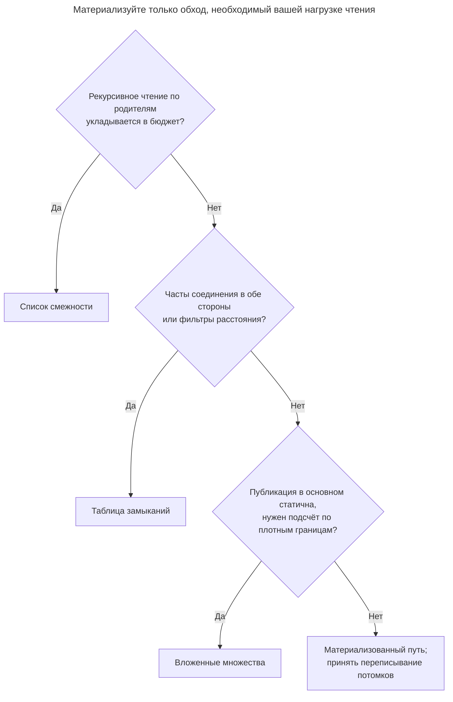

Универсального порога глубины нет. Ссылки на родителей могут оставаться источником истины, а пути, интервалы или замыкание — поддерживаемыми представлениями для чтения; все структурные писатели должны соблюдать выбранный протокол координации.

## Подтипы и ссылки на разные виды

Разделяют ли виды целей реальную идентичность или один потомок лишь выбирает среди несвязанных владельцев? Затем определите, что удобнее для полного чтения: одна строка, детали с общим ключом или отдельные таблицы конкретных типов.

| Выбор | Общая идентичность и ссылки | Форма чтения | Цена записи и развития |
| --- | --- | --- | --- |
| [Единая таблица](single-table-inheritance.md) | Один PK семейства и уникальность во всём семействе | Одна строка; условные поля подтипа | Проверки строки обеспечивают исключительную форму; новые типы меняют общий DDL |
| [Таблицы классов](class-table-inheritance.md) | База — общая цель FK; таблицы подтипов — конкретные цели | Соединение базы и обязательных деталей | Полнота «ровно один» требует дополнительных ограничений и атомарного жизненного цикла; отложенный циклический пример не переносится напрямую в MySQL/SQL Server |
| [Таблицы конкретных классов](concrete-table-inheritance.md) | Отдельные ключи; общий генератор не создаёт общую сущность с ограничениями | Таблица на известный тип; чтение семейства через объединение | Повтор общих определений; уникальность семейства и смена подтипа требуют явного проектирования |
| [Исключающая дуга](exclusive-arc.md) | FK на каждый вид цели; без искусственной общей сущности | Одна зависимая строка с допускающими `NULL` столбцами целей | Проверка «ровно один»; столбец/FK на вид; учитывайте ограничения каскадов движка |
| [Отдельные таблицы связей по целям](polymorphic-associations.md) | Настоящий FK на каждую связь | Раздельное чтение связей | Локальная целостность концов; единственный владелец среди таблиц требует отдельного протокола |
| [Полиморфные связи](polymorphic-associations.md) | Непроверяемая пара `(type, id)` не может быть одним обычным FK | Цель определяется дискриминатором | Ослабленный контракт внешнего ID оправдан лишь при явно допустимых отсутствующих/удалённых целях |

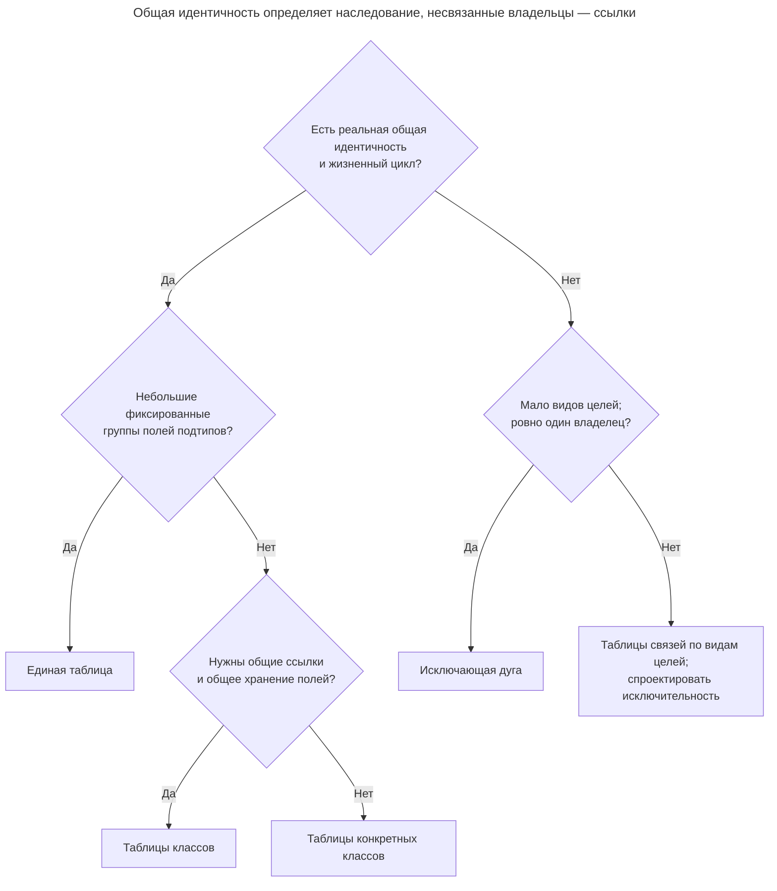

Общая последовательность не исправит непроверяемую ссылку. Пересекающиеся бизнес-роли ведут к [Участнику и ролям](#участник-и-роли), а не к исключительному дискриминатору подтипа.

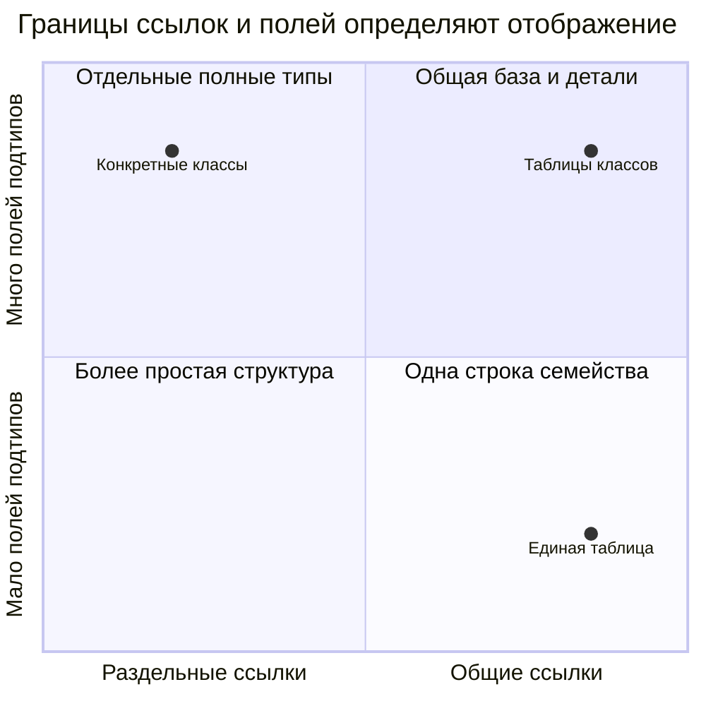

Позиции качественно напоминают о требованиях выбора, а не показывают измеренные оценки. Отдельные конкретные таблицы отказываются от локальных гарантий общих ссылок и уникальности семейства, которые дают общие отображения.

## Переменные атрибуты

Поля — стабильная схема под управлением разработчиков, один ограниченный документ или управляемые определения времени выполнения? Отличайте текущие атрибуты от независимо наблюдаемых фактов.

| Выбор | Требования к определениям и проверке | Требования к чтению и индексам | Цена редактирования или миграции |
| --- | --- | --- | --- |
| [Обычные типизированные столбцы](typed-properties.md) | Стабильные известные поля с прямыми ограничениями и FK | Прямые предикаты и обычные индексы | Новые поля добавляются миграциями схемы |
| [Столбец JSON](json-column.md) | Переменная структура агрегата; важные пути проверяются явно | Чтение документа целиком; извлечение/индексы для выбранных путей | Одна строка — граница редактирования; для устаревших сохранений целого документа добавьте версию; индексирование зависит от движка |
| [Типизированные свойства](typed-properties.md) | Администраторы публикуют типы, диапазоны, обязательность полей и версионируемые профили | Восстановление из строк значений; поиск по нескольким свойствам добавляет предикаты/соединения | Публикация определений и полнота требуют согласованной проверки; новые примитивные формы всё ещё требуют проектирования |
| [Известные отображения подтипов](single-table-inheritance.md) | Изменчивость следует фиксированным классам с обязательными группами | Хранение в одной таблице/подтипах с общим ключом выбирается по чтению | DDL описывает конечное семейство; это не система определения полей во время выполнения |
| [Нетипизированные свойства](untyped-properties.md) | Строковые имена и значения не имеют контракта определений | Приведения и восстановленные предикаты скрывают ошибки типизации | Исправляйте через аудит преобразований и целевые структуры с ограничениями; перенос строк в JSON сохраняет проблему |
| [Наблюдение](observation.md) | У каждого показания своё время, метод и происхождение | Запрос сохранённых фактов по явной политике выбора | Сохраняйте исправления и отклонения вместо перезаписи одного текущего свойства |

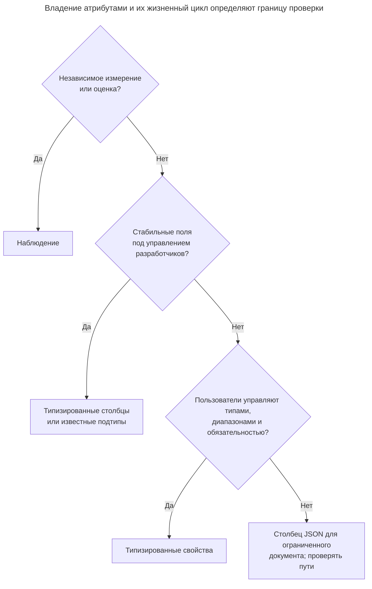

Поля, определяемые во время выполнения, оправдывают жизненный цикл метаданных паттерна «Типизированные свойства». Одной проверки синтаксиса JSON недостаточно для этого жизненного цикла, ссылок на сущности или бизнес-обязательности.

## Время и удаление

На какой вопрос о прошлом нужно ответить: записанные значения, бизнес-действительность, прежнее представление, действие или восстановление? Для выбранных фактов эти контракты могут сосуществовать.

| Паттерн или вариант | На какой вопрос отвечает | Требования к записи и запросам | Граница хранения или движка |
| --- | --- | --- | --- |
| [Таблица истории](history-table.md) | Какие значения строки были записаны в определённый момент? | Фиксировать старые значения и запрашивать текущую и закрытые версии вместе | Определите часы фиксации и срок хранения; встроенные периоды SQL Server используют время начала транзакции, в отличие от часов обработки в главе |
| [Период действия](effective-dating.md) | Что действует на бизнес-дату, включая будущие даты? | Явные периоды; запрет неоднозначных пересекающихся расписаний | Временные ключи PostgreSQL 18 или исключение; другим реализациям нужны согласованные проверки пересечений |
| [Битемпоральная таблица](bitemporal-table.md) | Что мы знали в одну дату о другой бизнес-дате? | Сохранять периоды действия и записи при атомарных исправлениях | Более сложное правило прямоугольников; один ключ непересечения бизнес-периодов отклоняет допустимые архивные представления |
| [Журнал аудита](audit-log.md) | Кто выполнил принятое действие, почему и в рамках какого запроса? | Атомарное свидетельство с авторством; доверенный контекст и ограничение обходных записей | Не становится автоматически моделью состояния на момент времени или средством обнаружения вмешательства; неудачным попыткам нужен отдельный путь журналирования |
| [Мягкое удаление](soft-delete.md) | Можно ли отменить удаление на месте с той же идентичностью? | Применять видимость живых строк везде; определить их уникальность и конфликты восстановления | Данные и цели FK сохраняются; обычный FK не требует, чтобы цель была живой |
| [История статусов](status-history.md) | Какие допустимые переходы жизненного цикла были приняты? | Защищать переходы и фиксировать историю с текущим состоянием | Не версионирует каждый атрибут и не фиксирует отклонённые команды |
| [Физическое удаление или архив удалённых записей](soft-delete.md) | Возможно ли немедленное удаление или восстановление как явный импорт? | Соблюдать правила ссылок/хранения; при необходимости копии для восстановления архивировать вне живых таблиц | Позволяет обойтись без фильтра живых строк, когда восстановление на месте не нужно |

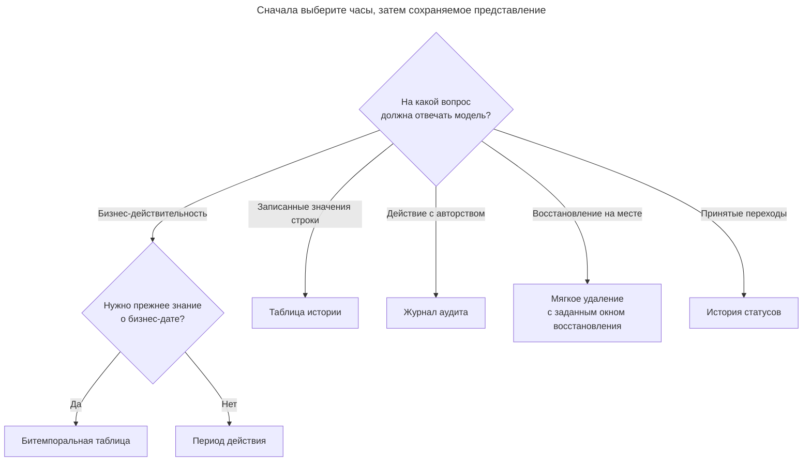

Ветви обозначают требования, которые можно сочетать. Данные аудита не становятся автоматически удобной моделью временных запросов, а сохранение последней версии строки не реализует восстановление.

## Участник и роли

Ссылаются ли процессы на одного и того же устойчивого контрагента, и могут ли его роли пересекаться или повторяться? Общая идентичность и эпизоды участия — разные решения.

| Выбор | Требование к идентичности | Классификация или участие | Цена жизненного цикла |
| --- | --- | --- | --- |
| [Участник](party.md) | Люди и организации разделяют реальные ссылки на контрагента | Детали человека/организации принадлежат этой идентичности | Сопоставление и слияние затрагивают все ссылки; пример не требует деталей подтипа к фиксации |
| [Объект роли](role-object.md) | Сохранить участника при смене ролей | Роли пересекаются или повторяются с атрибутами и ссылками конкретных эпизодов | Запросы по бизнес-датам и согласованное поддержание конфликтующих периодов |
| [Таблицы классов](class-table-inheritance.md) | Общая база с конкретными целями подтипов | Внутренняя исключительная классификация | Более сильная полнота «ровно один» добавляет атомарный протокол создания/преобразования |
| [Отдельные сущности или фиксированные столбцы ролей](role-object.md) | Независимые жизненные циклы или одна простая роль | Нет требования общего контрагента либо нет атрибутов/истории ролей | Не вводите механизм эпизодов, если его контракт не нужен |

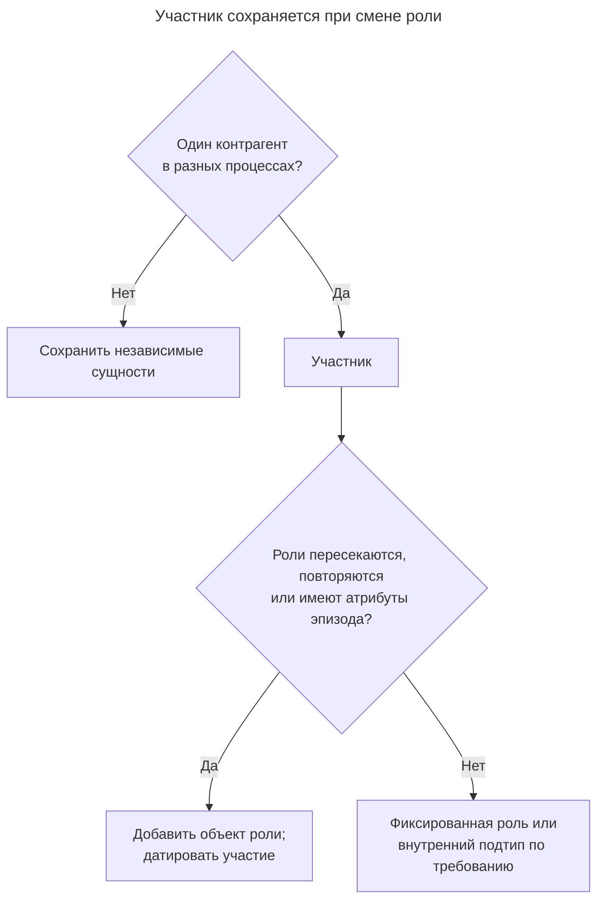

Клиенту, ставшему поставщиком, не нужна вторая идентичность участника. Простой пример общего ключа в «Участнике» и полный протокол подтипов в «Таблицах классов» намеренно дают разные гарантии.

## Величины и наблюдения

Нужны ли значению явные единицы, повторные свидетельства или лишь один текущий скаляр? Смысл, числовое представление и происхождение измерения — независимые требования.

| Выбор | Требования к смыслу и происхождению | Требования к чтению или арифметике | Цена хранения и изменений |
| --- | --- | --- | --- |
| [Величина](quantity.md) | Количество имеет совместимые единицу и размерность | Нормализовать совместимые единицы перед арифметикой; глава рассматривает только множители | Защищать определения единиц; валютам нужна явная контекстная модель пересчёта |
| [Наблюдение](observation.md) | Повторные факты содержат метод, наблюдателя и две временные метки | Выбирать действующие свидетельства по заданной политике; числовые показатели используют настроенные единицы | Хранить неизменяемые факты, замены и отклонения |
| [Столбец с фиксированной единицей](quantity.md) | Достаточно одной единицы под управлением разработчиков | Нормализовать входные значения на границе | Простая схема; общий каталог единиц не нужен |
| [Текущее типизированное свойство](typed-properties.md) | Одно редактируемое настраиваемое значение | Искать текущие атрибуты, а не отдельные показания | Публиковать контракты определений; научное происхождение не обеспечивается |
| [Точное десятичное или масштабированное целое](inexact-arithmetic.md) | У точных сумм есть разрешение и правила округления | Проверить промежуточную точность, диапазон и переполнение | PostgreSQL `numeric` отличается от сродства NUMERIC SQLite; фиксированный целочисленный масштаб — другой вариант |
| [Плавающая точка](inexact-arithmetic.md) | Для приближения приняты границы ошибки | Подходящая численная/измерительная арифметика в рамках контракта | Баланс итогов сам по себе не обеспечивает точный десятичный контракт |

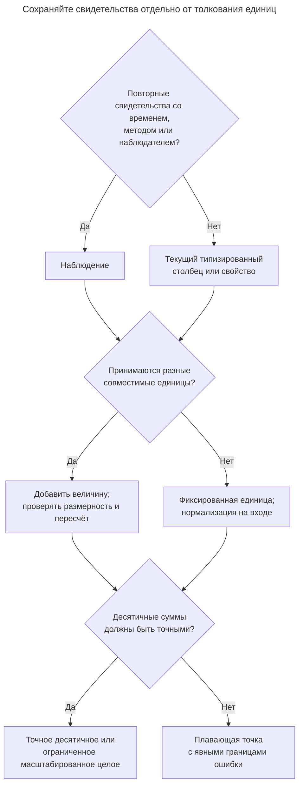

Наблюдение может поступить поздно или противоречить другому, не меняя идентичность субъекта. Точное десятичное хранение всё равно требует осознанного округления, если пересчёт даёт бесконечную периодическую дробь.

## Графы компонентов

Связи задают навигацию с одним родителем, требования общей рецептуры или лишь достижимость? Количества на путях и воспроизводимый выбор версий отличают рецептуру от индекса дерева.

| Паттерн | Требования к родителям и рёбрам | Требование к чтению | Цена изменений и воспроизводимости |
| --- | --- | --- | --- |
| [Состав изделия](bill-of-materials.md) | Повторно используемые компоненты; количество на ребре версий родителя/потомка | Перемножать по каждому маршруту и суммировать потребности в листьях | Проверять отсутствие циклов; неизменяемые выпуски; закреплять выбранную версию в заказах |
| [Список смежности](adjacency-list.md) | Не более одного родителя; нет требований общей рецептуры | Обход иерархии | Простые смены родителя с согласованными проверками циклов |
| [Таблица замыканий](closure-table.md) | Предвычисленные предки дополняют рёбра компонентов | Частые соединения «где используется»/достижимости | Алгоритм дерева требует переработки для нескольких путей; одни пары не вычисляют потребность |
| [Период действия](effective-dating.md) | Бизнес-даты выбирают выпущенные версии | Находить расписание для новой работы | Дополняет закрепление; позднее изменение расписания не должно переписывать старые заказы |

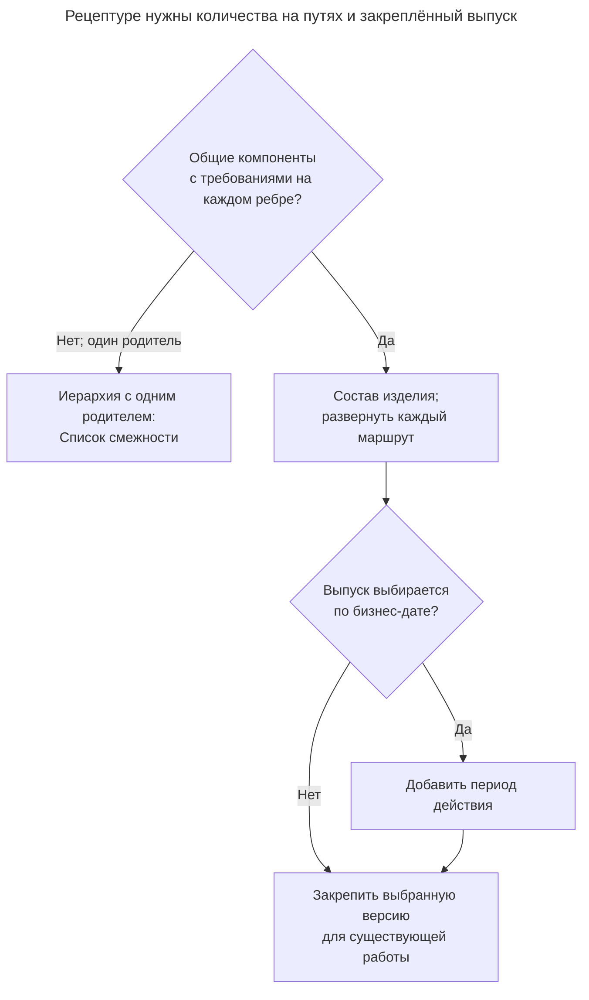

Дедупликация компонента до суммирования его путей теряет обоснованную потребность. Индекс замыкания может ускорить достижимость, но не заменяет исходные рёбра с количествами.

## Сохранение сумм

Должно ли каждое перемещение сохранять вторую сторону и объяснение или достаточно текущего счётчика? Выбирайте целостность проводки отдельно от стратегии чтения баланса.

| Выбор | Требование к перемещениям | Обеспечение и граница записи | Требование к чтению баланса |
| --- | --- | --- | --- |
| [Двойная запись](double-entry-ledger.md) | Несколько частей, точные суммы, неизменяемое объяснение и сторнирование | Атомарная запись сбалансированных проводок одной валюты; в PostgreSQL-примере отложенный агрегатный триггер | Выводить балансы из авторитетных проводок |
| [Строка перевода между двумя счетами](double-entry-ledger.md) | Каждое перемещение — ровно одна равная пара дебета/кредита | Равенство может быть структурным | Более простая форма записи, если ей соответствует каждое принятое перемещение |
| [Счёт только с балансом](double-entry-ledger.md) | Достаточно текущего счётчика; объяснение перемещений можно потерять | Атомарное обновление с необходимой координацией доступного количества | Прямое чтение текущего значения, более слабый контракт хранения |
| [Таблица итогов](summary-table.md) | Быстрые балансы по длинной истории проводок | Поддерживать/сверять проекцию с проводками | Дополнение; не заменяет сохранение сумм при записи |

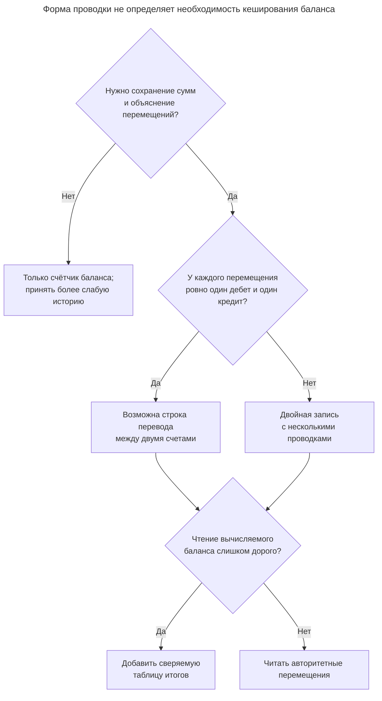

Нулевая сумма доказывает сохранение внутри моделируемой проводки, а не достаточность средств или согласие с внешним миром. Добавьте [Запись идемпотентности](idempotency-record.md) для повторов и [Величину](quantity.md) для явного толкования активов, если такие требования есть.

## Конкурентность и надёжная запись

Что может пойти не так между чтением, фиксацией, получением ответа и завершением внешней работы? Эти паттерны защищают разные границы и часто сочетаются.

| Выбор | Защищаемое требование | Поведение при конкурентности или сбое | Граница и эксплуатационная цена |
| --- | --- | --- | --- |
| [Столбец версии](version-column.md) | Команда зависит от показанного снимка | Условное обновление отклоняет устаревший токен; проигравший писатель согласует изменения | Каждое существенное изменение агрегата повышает версию; токены движков имеют разную семантику |
| [Короткая транзакция с блокировкой строки](version-column.md) | Чтение/решение/запись завершаются без ожидания пользователя/сети | Сериализовать короткое вычисление; может хватить простого атомарного увеличения | Не удерживать блокировку на время решения человека |
| [Резервирование](reservation.md) | Дефицитный ресурс должен удерживаться на время решения | Согласованное правило ёмкости плюс сохранённая политика истечения/подтверждения | Слоты требуют правил пересечения; общий запас — согласованных количеств; очистка входит в жизненный цикл |
| [Запись идемпотентности](idempotency-record.md) | Повтор после неопределённого ответа должен восстановить тот же результат | Уникальный ключ в заданной области разрешает конкуренцию; изменённые данные под тем же ключом отклоняются | Сохранять эффект и результат атомарно; срок хранения задаёт окно повторов |
| [Транзакционный outbox](transactional-outbox.md) | Локальная фиксация должна в итоге вызвать удалённую доставку | Устойчивая промежуточная запись переживает сбой; ретранслятор и потребители обрабатывают дубликаты | Опрос или чтение журнала; явные порядок, подтверждения и срок хранения |
| [Таблица очереди](queue-table.md) | Постановка локальной фоновой работы вместе с бизнес-данными | Короткий захват; аренда для работы вне транзакции; устаревшее поколение не завершает замену | Восстановление и ограниченные повторы; `SKIP LOCKED` не гарантирует строгий FIFO и отсутствие любых ожиданий |
| [Выделенный брокер](queue-table.md) | Рассылка, транспорт или изоляция нагрузки оправдывают отдельный сервис | Отдельный протокол доставки; дубликаты всё равно требуют обработки | Локальная постановка в той же транзакции требует моста через outbox |

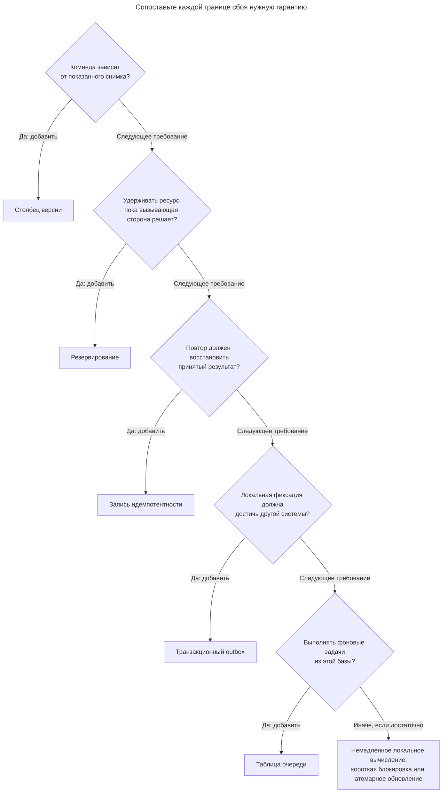

Читайте это как список независимых требований. Версия не резервирует ресурс, идентификатор корреляции не устраняет дубликаты команды, а запись идемпотентности не доставляет событие.

Примеры очереди/outbox для PostgreSQL используют `SKIP LOCKED`; перенос в SQL Server требует протокола `READPAST` с блокировкой обновления, учитывающего изоляцию. Единственный писатель SQLite меняет стратегию захвата и делает транзакцию записи, удерживаемую во время обмена с брокером, особенно ограничительной. Проверка резервирования никогда не должна считать пропущенную заблокированную заявку свободной ёмкостью.

## Изоляция арендаторов

Какой операции нужна граница арендатора: доступу к строкам, разрешениям на объекты, жизненному циклу базы или выделенному размещению? Выбирайте границу вместе с обслуживанием миграций и восстановления всего набора.

| Паттерн | Граница доступа и связей | Цена миграций и запросов | Жизненный цикл и оговорки движка |
| --- | --- | --- | --- |
| [Общая схема](shared-schema.md) | Составные ключи в области арендатора и доверенный контекст; RLS — вариант реализации | Один выпуск и набор объектов; все пути арендатора несут область | Восстановление арендатора выбирает граф строк; изоляции ресурсов нет; суперпользователи/`BYPASSRLS` PostgreSQL обходят политики |
| [Схема арендатора](schema-per-tenant.md) | Отдельное пространство имён/разрешения на объекты в одной базе | Повтор объектов и миграций; полные имена или доверенная маршрутизация в пределах транзакции | Управляемое поэтапное обновление версий; не выделенные ресурсы; в MySQL схема и база — синонимы |
| [База арендатора](database-per-tenant.md) | Каталог выбирает назначение и учётные данные; проверяйте идентичность/версию арендатора | Подготовка, пулы, миграции и общая отчётность становятся работой с набором баз | В PostgreSQL логическая выгрузка имеет масштаб базы, физическое восстановление — кластера; выделенные ресурсы требуют отдельного развёртывания |

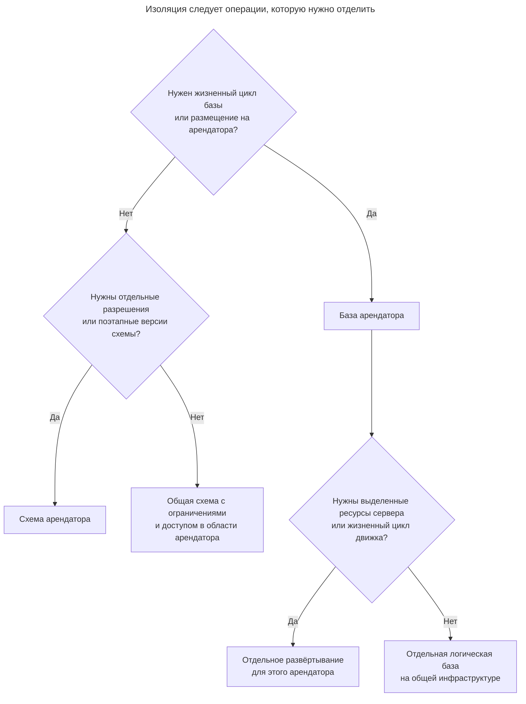

Гибридная маршрутизация может оставлять небольших арендаторов в общих таблицах и переносить выбранных в отдельные базы. Названия контейнеров не означают одинаковых гарантий разных движков: схемы/PDB Oracle и файлы SQLite имеют собственные границы доступа и восстановления.

## Рост и изменения

Измеренная цена связана с повторной агрегацией, физическим хранением/диапазонным доступом или несовместимыми версиями клиентов при развёртывании? Эти механизмы решают разные задачи и могут сочетаться.

| Выбор | Определяющее требование нагрузки | Цена записи или миграции | Граница целостности и движка |
| --- | --- | --- | --- |
| [Обычная индексированная таблица и агрегация по запросу](summary-table.md) | Текущие запросы и хранение укладываются в бюджет | Простейшая отправная точка; агрегация оплачивается при чтении | Сохраняет обычный выбор глобальных ключей |
| [Таблица итогов](summary-table.md) | Повторные группировки дороги, а свежесть определена | Синхронная поддержка усиливает конкуренцию записи; отложенное обновление допускает отставание; сохраняйте пересборку/сверку | Проекция не заменяет целостность проводок; контракты обновления материализованных/индексированных представлений различаются |
| [Секционирование таблицы](table-partitioning.md) | Целые периоды уходят вместе или важные предикаты ограничивают ключ секционирования | Обслуживать создание, отсоединение, восстановление и поздние записи; перенос существующей таблицы требует развёртывания | Уникальные ключи PostgreSQL включают ключ секционирования; секционированные таблицы InnoDB MySQL не участвуют в FK; у SQLite нет встроенного аналога |
| [Разделение таблицы](table-split.md) | Проблема в холодных или отдельно защищённых столбцах | Полное чтение требует соединения; сравните с чтением нужных столбцов исходной таблицы | Вертикальная граница атрибутов вместо нарезки периодов |
| [Расширение и свёртывание](expand-contract.md) | Старые и новые клиенты сосуществуют при несовместимом изменении | Добавить совместимую форму, связать запись, заполнить/сверить, переключить, вывести старый контракт | По-прежнему нужны блокировки DDL и бюджет ресурсов; неявные фиксации DDL MySQL меняют границы транзакций |
| [Согласованное развёртывание с остановкой](expand-contract.md) | Все клиенты могут остановиться на измеренное окно преобразования | Одна согласованная остановка может быть проще | Нет требования длительного моста совместимости |
| [Шардирование](table-partitioning.md) | Одна база не справляется с нагрузкой | Отдельное проектирование маршрутизации и целостности | Встроенные секции сами по себе не добавляют серверы |

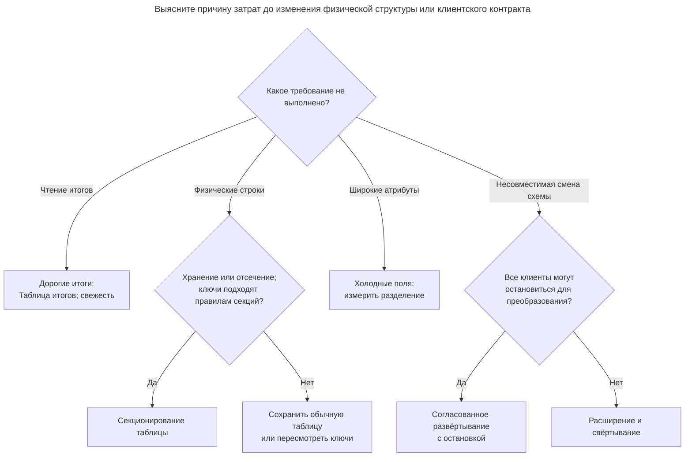

Секционирование не предвычисляет итоги, а итоговая таблица не управляет хранением источника. «Расширение и свёртывание» задаёт протокол развёртывания для любого из вариантов; свёртывание ждёт фактического ухода старых потребителей.

## Карта исправления антипаттернов

Начните с недостающего инварианта, затем используйте соответствующее семейство выше. Главы об антипаттернах также описывают оправданные исключения; исправление не требует замены каждой внешне похожей структуры.

| Антипаттерн | Исправление и определяющее условие |
| --- | --- |
| [Списки с разделителями](delimited-lists.md) | [Таблица связей](association-table.md) для независимо адресуемых участников; таблица принадлежащих родителю потомков для зависимых фактов. Типизированные массивы подходят одному агрегату без FK на элементы; при необходимости сохраняйте непрозрачный импортируемый текст отдельно. |
| [Обязательные суррогаты](mandatory-surrogates.md) | [Естественный ключ](natural-key.md) или идентичность пары концов в [Таблице связей](association-table.md); сохраняйте [Суррогатный ключ](surrogate-key.md) и бизнес-уникальность, когда его оправдывают независимые ссылки. |
| [Отсутствующие внешние ключи](missing-foreign-keys.md) | Обычные/отложенные FK внутри одной границы целостности; проверяемая промежуточная область для импорта; [Исключающая дуга](exclusive-arc.md) для разных видов целей; составные ключи [Общей схемы](shared-schema.md) для области арендатора. |
| [Повторяющиеся столбцы](repeated-columns.md) | [Таблица связей](association-table.md) для повторно используемых участников; зависимые строки для отдельно управляемых значений; [Локализованные значения](localized-values.md) для развивающегося набора языков. Сохраняйте отдельные постоянные столбцы ролей, если кортеж действительно фиксирован. |
| [Полиморфные связи](polymorphic-associations.md) | [Исключающая дуга](exclusive-arc.md) для немногих целей с выбором ровно одной, отдельные [Таблицы связей](association-table.md) для отдельных отношений или [Таблицы классов](class-table-inheritance.md) для реальной общей идентичности. |
| [Нетипизированные свойства](untyped-properties.md) | Обычные типизированные столбцы для стабильных полей; [Типизированные свойства](typed-properties.md) для управляемых определений времени выполнения; [Столбец JSON](json-column.md) для проверяемого агрегата; таблицы подтипов для известных групп полей. |
| [Изменчивые перечисления](volatile-enums.md) | [Таблица значений](lookup-table.md) для поддерживаемых подписей/вывода из обращения; сохраняйте защищённое присвоение. Стабильный enum под управлением разработчиков или локальный CHECK остаётся вариантом. |
| [Фиксированная глубина](fixed-depth-queries.md) | Рекурсивное чтение [Списка смежности](adjacency-list.md) или обоснованные измерениями представления: [Материализованный путь](materialized-path.md), [Вложенные множества](nested-sets.md), [Таблица замыканий](closure-table.md). Явно ограниченный запрос может оставаться ограниченным. |
| [Клонированные таблицы](cloned-tables.md) | Одно индексированное отношение, [Секционирование таблицы](table-partitioning.md) для физической нарезки или осознанная изоляция через [Общую схему](shared-schema.md), [Схему арендатора](schema-per-tenant.md) или [Базу арендатора](database-per-tenant.md). Перед секционированием проверьте требования глобального ключа. |
| [Неточная арифметика](inexact-arithmetic.md) | Точные десятичные или ограниченные целые в младших единицах с правилами округления; [Величина](quantity.md) для смысла единиц и [Двойная запись](double-entry-ledger.md) для сохранения сумм. Приближённые вычисления могут сохранять плавающую точку с принятыми границами ошибки. |
