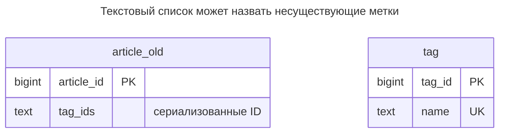
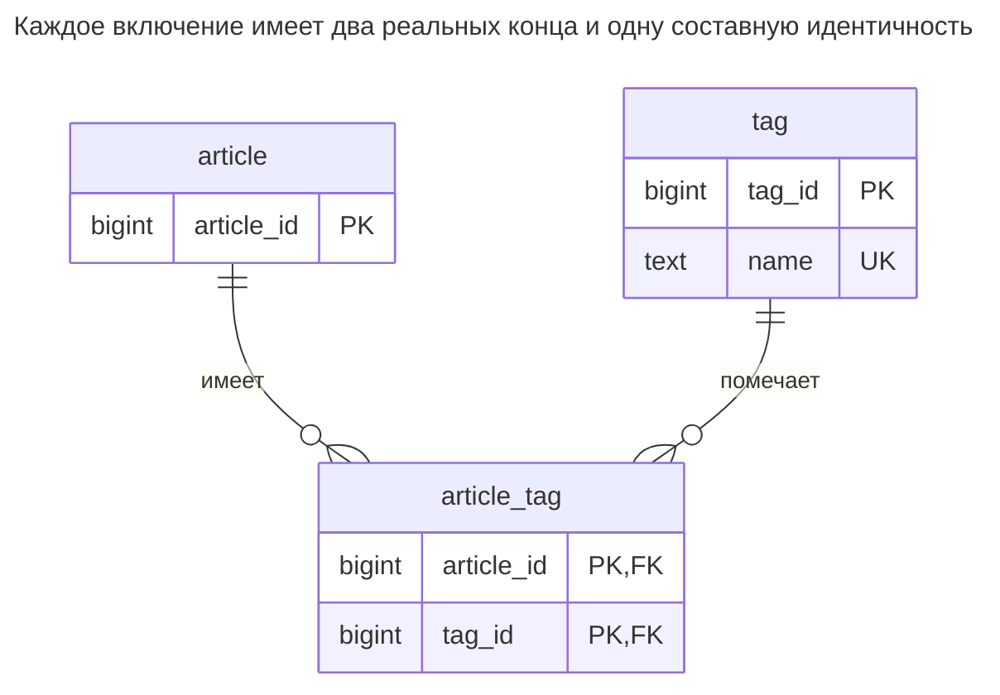
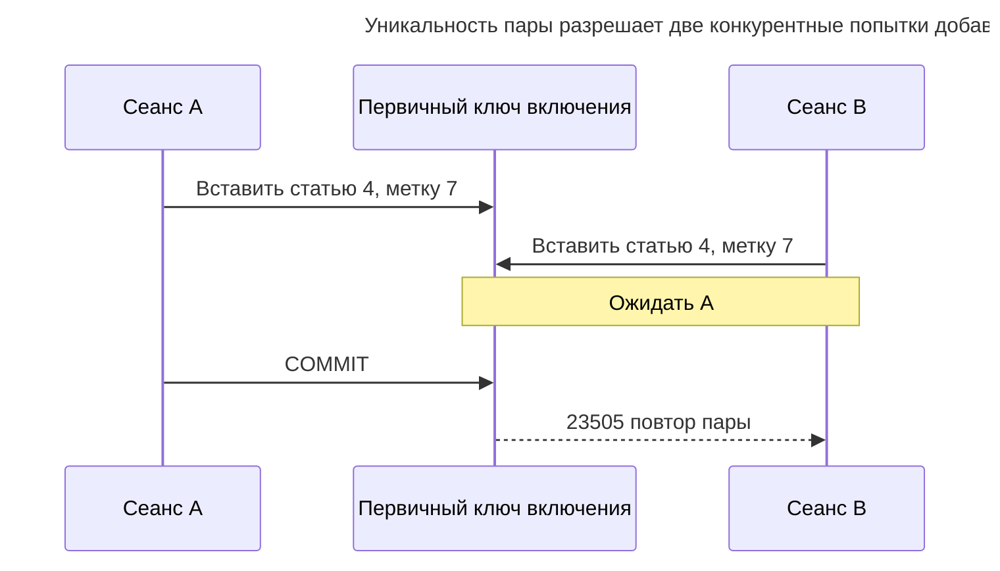
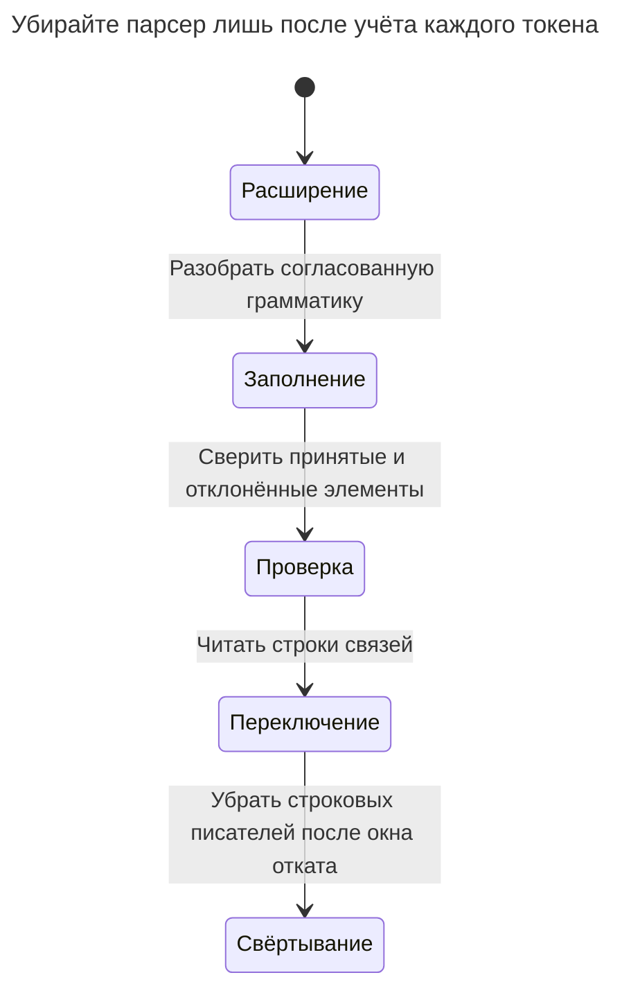

# Списки с разделителями

Списки с разделителями хранят несколько значений в одном строковом столбце — ID меток как `'3,7,12'` или адреса почты через точку с запятой, — чтобы не создавать другую таблицу. Тогда каждому запросу нужен разбор строки: поиск значения требует разбора или сопоставления с учётом разделителей, обычное B-дерево не обслуживает произвольную проверку вхождения подстроки, соединениям нужны разобранные элементы, внешние ключи не проверяют отдельные ID, а длина столбца ограничивает вместимость. Глава показывает, как список ломается, когда тип массива допустим как промежуточное решение и как перейти к таблице связей. Билл Карвин называет это Jaywalking.

## Также известен как

Jaywalking в [оглавлении SQL Antipatterns Билла Карвина](https://pragprog.com/titles/bksap1/sql-antipatterns-volume-1/). Название указывает на элемент каталога; практикум ниже независимо демонстрирует сбой.

## Контекст

Вы добавляете метки статьям. У статьи много меток, метки общие и уже имеют ID. Форма присылает список, поэтому запись одной строкой выглядит прямым отображением запроса. Важно, будете ли вы считать список непрозрачным текстом или каждый элемент — отдельной связью.

## Проблема

Вы храните сериализованный список как первичное представление связи. Тип столбца описывает текст, а читатели зависят от грамматики разделителей, пробелов, пустых элементов и ID. Предикат подстроки путает `2` с `12`; добавление разделителей в предикат устраняет лишь эту неоднозначность, не доказывая существование метки `12`. [Правила шаблонов B-дерева PostgreSQL](https://www.postgresql.org/docs/18/indexes-types.html) поддерживают подходящие шаблоны с фиксированным началом, а не произвольный поиск принадлежности с ведущим подстановочным символом.

Разбор делает соединения возможными, но возлагает на каждого писателя и запрос ответственность за одну кодировку. Специализированный [индекс по выражению](https://www.postgresql.org/docs/18/indexes-expressional.html) ускорит конкретный разобранный предикат, но не создаст внешний ключ для каждого токена. [Внешние ключи PostgreSQL](https://www.postgresql.org/docs/18/ddl-constraints.html#DDL-CONSTRAINTS-FK) сопоставляют значения столбцов объявленному ключу, не перебирая элементы строки.

## Почему так делают

Вы обходите вторую таблицу, сохраняете запрос одним присваиванием и показываете его без агрегации. Это разумные преимущества для импортированного поля источника, сохраняемого дословно. Они становятся невыгодной сделкой, когда поле управляет существованием меток, поиском по меткам или независимыми правками состава.

## Последствия

- ➖ Ошибочный или удалённый ID метки остаётся обычным допустимым текстом схемы.
- ➖ Сохранение полного списка стирает элемент, добавленный после открытия формы.
- ➖ Атрибутам связи, например автору назначения метки, нужна ещё одна вложенная кодировка.
- ➖ Устранение повторов и порядок становятся решениями грамматики. Сортировка строки не заменяет определения, является связь множеством или последовательностью.

## Признаки

- Перед каждым сопоставлением вы окружаете разделителями и столбец, и искомое значение.
- Перед соединением с предполагаемым родителем столбец разбивается на строки.
- Задание исправления удаляет неизвестные ID из строк.
- Два писателя расходятся во мнении, одинаковы ли `3,7` и `7,3,3`.

## Как лучше

Храните строку на каждое включение в [Таблице связей](association-table.md). Задайте паре ключ и настоящую ссылку на каждый конец. Явно определите допустимость повторов и значимость порядка. Пример — множество; сохраняйте исходную строку и отклонённые токены до сверки всех элементов.

### Альтернативы и выбор

| Выбор | Связь | Когда выбирать |
| --- | --- | --- |
| [Таблица связей](association-table.md) | Замена | Элементы обозначают независимые сущности и требуют соединений, ограничений или отдельных правок |
| Массив PostgreSQL | Вариант реализации одного составного значения | Типизированные скалярные элементы принадлежат и заменяются вместе, без отдельных связей по внешним ключам |
| Непрозрачный исходный текст | Дополнение | Точное импортированное представление сохраняется рядом с проверенными связями |
| [Повторяющиеся столбцы](repeated-columns.md) | Другой вид ошибки | Нумерованные места лишь переносят грамматику состава в имена столбцов |

[Массивы PostgreSQL](https://www.postgresql.org/docs/18/arrays.html#ARRAYS-SEARCHING) дают типизированные элементы и операторы принадлежности; документация рекомендует отдельную таблицу, когда поиск элементов указывает на множество. Проверка содержания массива использует [GIN](https://www.postgresql.org/docs/18/indexes-types.html#INDEXES-TYPES-GIN), но целочисленный массив всё равно не объявляет внешний ключ каждому элементу. Полная таблица — в [Атласе решений](decision-atlas.md).

## Пример

### Структура

**Было:** ID меток в строке не имеют объявленной связи с `tag`.



Отсутствие связи ER намеренно. Похожие на числа фрагменты строки не являются ограниченными ссылками.

```sql
CREATE TABLE tag (tag_id bigint PRIMARY KEY, name text NOT NULL UNIQUE);
CREATE TABLE article_old (article_id bigint PRIMARY KEY, tag_ids text NOT NULL);
INSERT INTO tag VALUES (3, 'sql'), (7, 'schema'), (12, 'keys');
INSERT INTO article_old VALUES (1, '3,7,12'), (2, '12'), (3, '7,999');
SELECT article_id FROM article_old WHERE tag_ids LIKE '%3%' ORDER BY article_id;
SELECT article_id FROM article_old WHERE tag_ids LIKE '%2%' ORDER BY article_id;
```

Первый запрос возвращает статью `1`. Поиск несуществующей метки `2` возвращает статьи `1, 2`, поскольку обе строки содержат `12`. Значение `999` в статье `3` принимается, хотя отсутствует в `tag`.

**Стало:** уникальная пара на каждую принятую связь.



У статьи может не быть меток, а метка может не использоваться. У включения всегда есть оба конца. Обратный индекс обслуживает чтение сначала по метке.

```sql
CREATE TABLE article (article_id bigint PRIMARY KEY);
CREATE TABLE article_tag (
    article_id bigint NOT NULL REFERENCES article (article_id),
    tag_id bigint NOT NULL REFERENCES tag (tag_id),
    CONSTRAINT article_tag_pkey PRIMARY KEY (article_id, tag_id)
);
CREATE INDEX article_tag_reverse_idx ON article_tag (tag_id, article_id);
CREATE TABLE tag_reject (
    article_id bigint NOT NULL,
    token text NOT NULL,
    reason text NOT NULL
);
BEGIN;
LOCK TABLE article_old IN SHARE ROW EXCLUSIVE MODE;
INSERT INTO article SELECT article_id FROM article_old;
CREATE TEMP TABLE tag_token ON COMMIT DROP AS
SELECT a.article_id, btrim(t.token) AS token
FROM article_old AS a
CROSS JOIN LATERAL unnest(string_to_array(a.tag_ids, ',')) AS t(token);
INSERT INTO tag_reject
SELECT t.article_id, t.token, 'unknown or noncanonical tag ID'
FROM tag_token AS t LEFT JOIN tag AS g ON g.tag_id::text = t.token
WHERE g.tag_id IS NULL;
INSERT INTO article_tag
SELECT DISTINCT t.article_id, g.tag_id
FROM tag_token AS t JOIN tag AS g ON g.tag_id::text = t.token;
COMMIT;
SELECT article_id FROM article_tag WHERE tag_id = 12 ORDER BY article_id;
SELECT * FROM tag_reject ORDER BY article_id, token;
```

Исправленный поиск возвращает статьи `1, 2` для метки `12`. Таблица отказов содержит `(3, 999, unknown or noncanonical tag ID)`. Импорт сопоставляет канонический текст существующим ID, поэтому ошибочный числовой текст никогда не доходит до приведения типа. Он намеренно отправляет `003` на разбор, не решая за вас, что это `3`. Разбиение скрипта предполагает документированную простую грамматику запятых; CSV с кавычками или адресам с разделителями нужен парсер исходного формата.

```sql
INSERT INTO article_tag VALUES (1, 999);
```

PostgreSQL 18.6 возвращает SQLSTATE `23503`: `ERROR: insert or update on table "article_tag" violates foreign key constraint "article_tag_tag_id_fkey"`. Уточнение указывает, что `(tag_id)=(999)` отсутствует в `tag`. [Полный скрипт](../assets/delimited-lists/delimited-lists.sql) выполняет миграцию и проверяет отказ.

### Поддержка в движках

- **PostgreSQL 18:** [`string_to_array`](https://www.postgresql.org/docs/18/functions-string.html) и [`unnest`](https://www.postgresql.org/docs/18/functions-array.html) здесь служат импорту. Из обычного чтения состава они исчезают.
- **MySQL 8.4 / InnoDB:** [внешним ключам нужны индексированные столбцы ссылок](https://dev.mysql.com/doc/refman/8.4/en/create-table-foreign-keys.html); переносите парсер импорта, сохраняя оба ограничения концов связи.
- **SQLite:** [включайте внешние ключи на каждом соединении](https://www.sqlite.org/foreignkeys.html#fk_enable). Иначе одних исправленных объявлений недостаточно для показанного отказа.

### Сбои и конкурентность

Со списком два клиента читают `3`, независимо добавляют `7` и `12`, затем затирают друг друга сохранением целой строки. Вставки строк связи избегают перезаписи всего значения. Два запроса, добавляющих одну пару, всё ещё конкурируют; [проверка уникального индекса PostgreSQL](https://www.postgresql.org/docs/18/index-unique-checks.html) ждёт конфликтующую транзакцию до решения о дубликате.



Если добавление существующей метки намеренно идемпотентно, обрабатывайте именно этот дубликат как желаемое состояние. Не считайте любую ошибку базы успехом. Замена всего набора меток — отдельная операция: сериализуйте по статье до сравнения и замены состава.

### Миграция

Практикум приостанавливает записи источника на время небольшого копирования. Для работающей системы сначала определите грамматику, проверьте ошибочные и неизвестные токены и сохраните исходный текст. Установите писателей, обновляющих обе формы одной транзакцией под блокировкой статьи, затем заполняйте под той же блокировкой. Это не даст старой строке заменить новый состав.



Перед переключением чтения сравните множества каждой статьи, включая отклонённые элементы. `DISTINCT` верен лишь потому, что пример определяет множество; сохраняйте число повторов отдельно, если оно может иметь смысл. Поддерживайте строку во время отката и удаляйте лишь после перевода всех писателей и экспортов на новый контракт. См. [Расширение и свёртывание](expand-contract.md).

## Связанные паттерны и антипаттерны

- [Таблица связей](association-table.md) даёт каждой связи отдельную строку с ограничениями.
- [Повторяющиеся столбцы](repeated-columns.md) задают другой произвольный предел представления той же коллекции.
- [Отсутствующие внешние ключи](missing-foreign-keys.md) объясняют пробел целостности, остающийся после разбора без ссылок.
