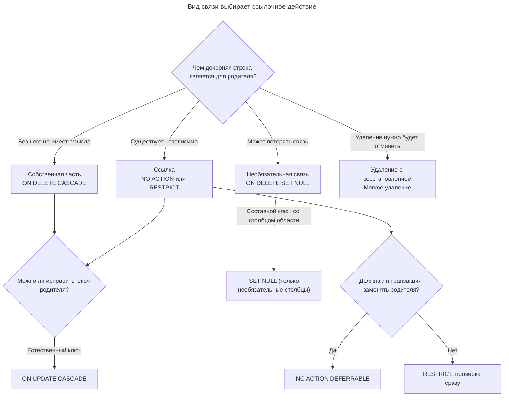
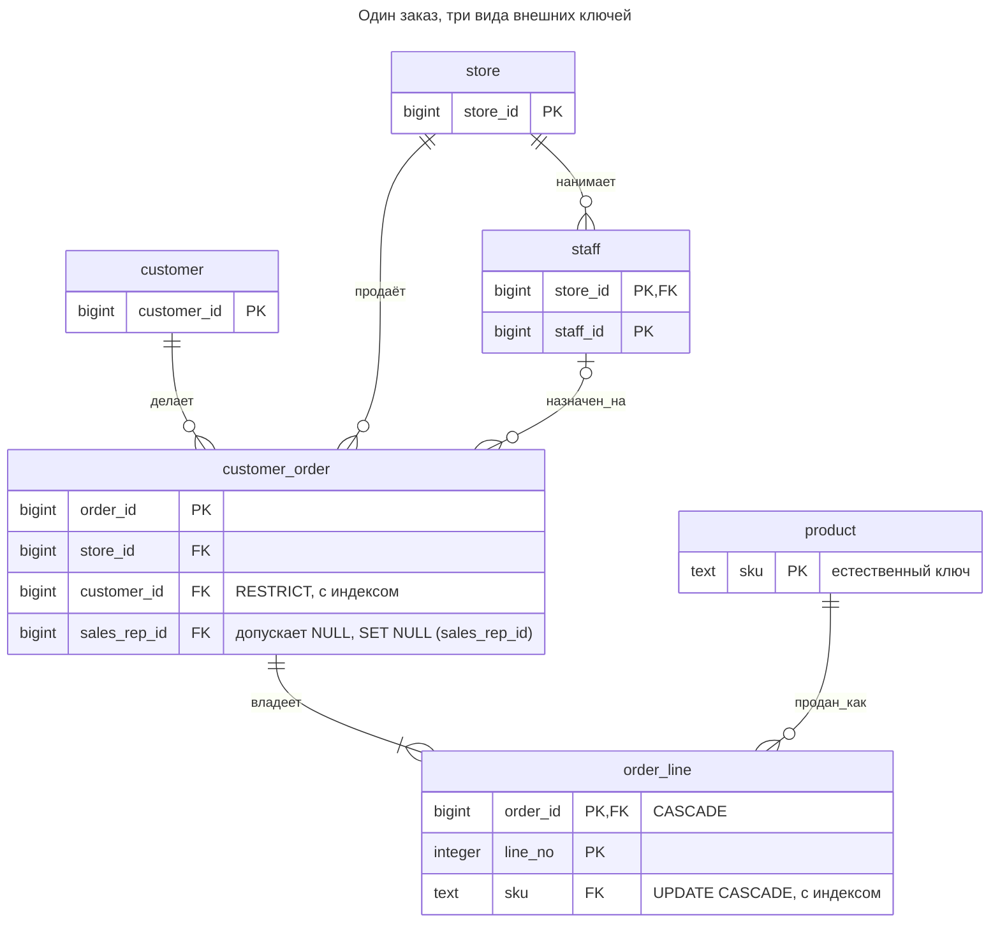
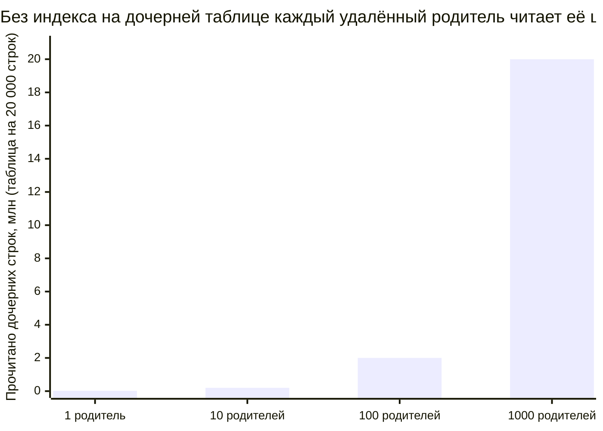
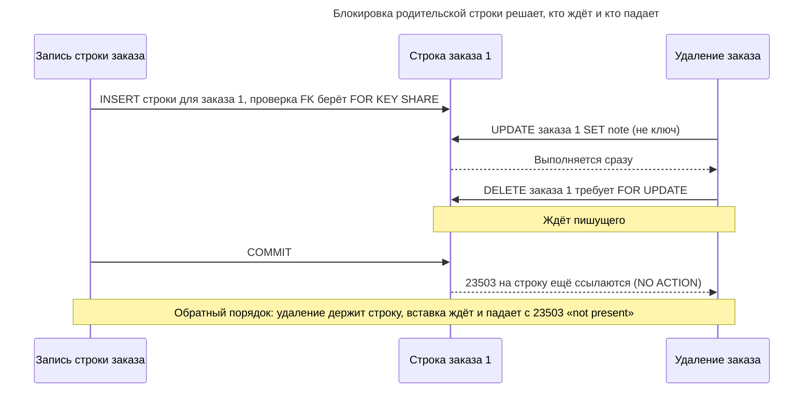
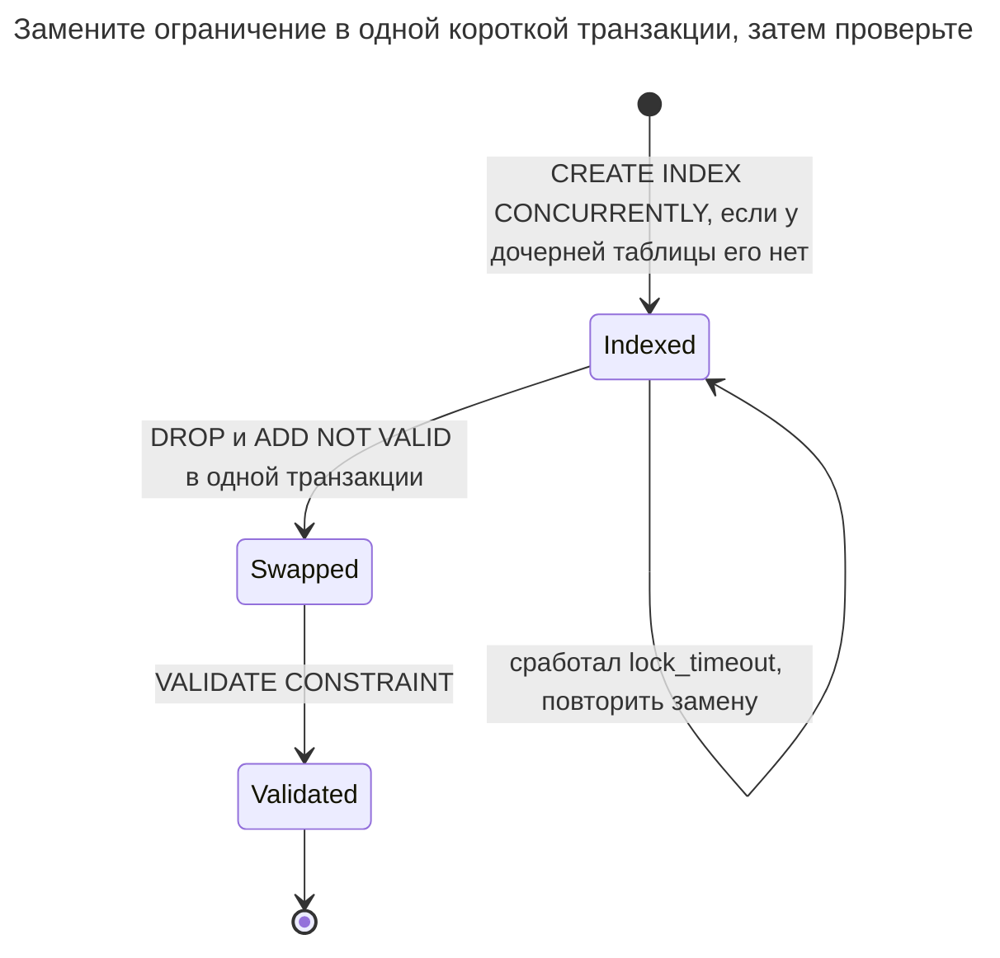

# Зависимая таблица

## Назначение

Зависимая таблица хранит строки, которые принадлежат родительской строке через внешний ключ: строки заказа — заказу, заказ — клиенту, который его сделал, заказ — назначенному на него менеджеру. Сам ключ говорит только о том, что родитель существует. Глава посвящена второй половине объявления: что удаление родителя или смена его ключа делают с дочерними строками. Выбирайте действие по виду связи: собственные части удаляются каскадом, ссылки на независимые сущности запрещают удаление, необязательные связи обнуляются, а исправленные естественные ключи каскадно обновляются. Глава также разбирает индекс, который PostgreSQL за вас не создаёт, большие каскады, триггеры и каскады на стороне ORM, а также блокировку, благодаря которой вставка дочерней строки и удаление родителя безопасно встречаются. См. [внешние ключи PostgreSQL](https://www.postgresql.org/docs/18/ddl-constraints.html#DDL-CONSTRAINTS-FK).

## Также известен как

[Dependent Mapping](https://martinfowler.com/eaaCatalog/dependentMapping.html) и [Foreign Key Mapping](https://martinfowler.com/eaaCatalog/foreignKeyMapping.html) в книге Фаулера «Patterns of Enterprise Application Architecture»: в первом один класс выполняет отображение в базу данных за дочерний класс, во втором связь между объектами отображается на ссылку внешнего ключа между таблицами. Ссылочные действия, правила `ON DELETE` и `ON UPDATE`, каскадное удаление.

## Проблема

Интернет-магазин хранит заказы, их строки, клиентов, товары и сотрудников. Сотрудник поддержки удаляет тестового клиента, и приложение удаляет строку клиента; его заказы остаются и указывают в никуда или, при бездумно скопированном `ON DELETE CASCADE`, исчезают вместе с клиентом и с выручкой, которую они фиксируют. Менеджер по ассортименту удаляет снятый с продажи товар и либо ломает старые счета, либо получает ошибку, которую никто не планировал. Менеджер по продажам увольняется, и каждый заказ, который он вёл, должен потерять назначение, но сохранить свой магазин.

Каждый из этих случаев — один внешний ключ, и каждому нужен свой ответ. Действие по умолчанию, `NO ACTION`, отклоняет удаление: это правильно для клиента и неправильно для строк заказа, владельца которых удаляют намеренно. Одно действие, скопированное на все ключи схемы, обращается со строкой заказа, у которой нет смысла без заказа, так же, как с клиентом, который существует и без заказов.

Удаления к тому же дороже, чем выглядят. PostgreSQL проверяет дочерние строки для каждой удалённой родительской строки, и без индекса на ссылающихся столбцах каждая проверка читает всю дочернюю таблицу. Каскад по большому дереву выполняется одной командой в одной транзакции и блокирует каждую удаляемую строку.

## Решение

Классифицируйте каждый внешний ключ по тому, чем дочерняя строка является для родителя, и объявите действие, которое из этого следует:

- **Собственная часть** — строка заказа, строка-дополнение из [Разделения таблицы](table-split.md), участие из [Таблицы связей](association-table.md) по отношению к стороне-владельцу: `ON DELETE CASCADE`. У дочерней строки нет смысла без родителя и нет другого владельца.
- **Ссылка на независимую сущность** — клиент заказа, товар в строке: `NO ACTION` (по умолчанию) или `RESTRICT`. Удаление родителя — бизнес-решение, которое сначала должно разобраться с дочерними строками. Проверку `NO ACTION` можно отложить до конца транзакции; `RESTRICT` проверяется сразу и никогда не откладывается.
- **Необязательная связь** — назначенный менеджер, «последним редактировал»: столбец, допускающий NULL, и `ON DELETE SET NULL`. В составном ключе, который несёт арендатора или магазин, перечислите только необязательный столбец: `ON DELETE SET NULL (sales_rep_id)`, такая форма есть начиная с [PostgreSQL 15](https://www.postgresql.org/docs/release/15.0/).
- **Запасное значение** — изредка `ON DELETE SET DEFAULT`, причём значение по умолчанию само должно быть существующей родительской строкой.
- **Исправляемый естественный ключ** — `ON UPDATE CASCADE`, если ключ родителя — бизнес-значение, которое могут исправить; см. [Естественный ключ](natural-key.md). Суррогатные ключи не меняются, поэтому их действие `ON UPDATE` не имеет значения.

Затем проиндексируйте ссылающиеся столбцы каждого ключа, родителя которого вы удаляете или переименовываете, и решите, какое большое дерево может удалить одна команда.

## Альтернативы и выбор

| Вариант | Отношение | Решающее требование |
| --- | --- | --- |
| `ON DELETE CASCADE` | Действие для собственных частей | У дочерней строки нет смысла и владельца без родителя |
| `NO ACTION` / `RESTRICT` | Действие для ссылок | Родитель существует независимо; его удаление нужно решить, а не подразумевать |
| `ON DELETE SET NULL (cols)` | Действие для необязательных связей | Дочерняя строка остаётся корректной без связи; остальные столбцы ключа сохраняются |
| Каскад в приложении или ORM | Замена, обычно худшая | Каждой дочерней строке нужна построчная логика предметной области, которую не выразить триггером |
| [Мягкое удаление](soft-delete.md) | Дополнение | Удалённых родителей нужно уметь восстановить; его каскады устроены иначе |
| [Таблица связей](association-table.md) | Дополнение | Дочерняя строка связывает две независимые сущности; у каждой стороны своё действие |
| [Исключающая дуга](exclusive-arc.md) | Дополнение | У дочерней строки ровно один владелец из нескольких таблиц, у каждой каскадный ключ |
| [Отсутствующие внешние ключи](missing-foreign-keys.md) | Антипаттерн, который он заменяет | Ссылки есть, но не объявлены, поэтому никакое действие невозможно |

Полное сравнение — в [Атласе решений](decision-atlas.md).



Действие при удалении и действие при обновлении — отдельные решения для одного ключа. Строка заказа удаляется каскадом вместе с заказом, а её ссылка на товар запрещает удаление, но каскадно следует за обновлением.

## Структура



`order_line` здесь — зависимая таблица: её ключ начинается с ключа владельца, и на неё не ссылается ничто, кроме её заказа. `customer_order` владеет своими строками, но сам никому не принадлежит: его ключи указывают на клиента, магазин и сотрудника, которые его переживают.

## Таблицы и инварианты

- **`customer`**, **`product`**, **`store`** существуют независимо. Они только родители; ничто, на что они ссылаются, не удаляется вместе с ними.
- **`staff`** имеет ключ `(store_id, staff_id)`, поэтому на менеджера можно сослаться только вместе с его магазином.
- **`customer_order`** обязан иметь клиента (`NOT NULL`, `ON DELETE RESTRICT`) и магазин. Менеджер необязателен: при `MATCH SIMPLE` по умолчанию NULL в `sales_rep_id` отключает проверку составного ключа, а удаление менеджера обнуляет только `sales_rep_id`.
- **`order_line`** не может пережить свой заказ (`ON DELETE CASCADE`), а её первичный ключ `(order_id, line_no)` уже служит индексом, по которому находятся строки заказа. Ссылка на товар — `NO ACTION` при удалении, `ON UPDATE CASCADE` для исправленного SKU и `DEFERRABLE`, чтобы транзакция могла заменить строку товара.
- **У каждого ссылающегося столбца есть индекс**, ведущие столбцы которого совпадают с ключом: `customer_order (customer_id)`, `customer_order (store_id, sales_rep_id)`, `order_line (sku)`. Первичный ключ `order_line` покрывает `order_id`.

## Когда применять

- Для каждого внешнего ключа, который вы объявляете: действие — часть объявления, напишете вы его или нет.
- Когда родителя удаляют пользователи или задания хранения данных, и судьбу дочерних строк нужно решить один раз, а не в каждой ветке кода.
- Когда естественный ключ могут исправить и ссылки на него должны последовать за ним.

## Последствия и компромиссы

- ➕ Вид связи виден в схеме; каждый, кто пишет в базу, включая разовый SQL, получает одно и то же правило удаления.
- ➕ Каскады удаляют собственное дерево одной командой, без заданий по чистке сирот.
- ➕ `RESTRICT` и `NO ACTION` превращают случайное удаление строки, на которую ссылаются, в ошибку, а не в потерю данных.
- ➖ Каскад молчалив: один `DELETE` родителя может удалить тысячи строк, а цепочка каскадов — дойти до таблиц, о которых автор команды не думал.
- ➖ Каждому ссылающемуся столбцу нужен индекс, чтобы удаления оставались дешёвыми; индекс стоит места и времени записи.
- ➖ Действия базы обходят код приложения: ни событий предметной области, ни колбэков ORM, ни обновлённого состояния в памяти.

## Реализация

[Полный скрипт для PostgreSQL 18.7](../assets/dependent-table/dependent-table.sql) проверяет каждое действие, ошибку и счётчик ниже и прогоняет гонки через два дополнительных соединения:

```sql
CREATE TABLE customer_order (
    order_id bigint PRIMARY KEY,
    store_id bigint NOT NULL REFERENCES store (store_id),
    customer_id bigint NOT NULL
        REFERENCES customer (customer_id) ON DELETE RESTRICT,
    sales_rep_id bigint,
    FOREIGN KEY (store_id, sales_rep_id)
        REFERENCES staff (store_id, staff_id)
        ON DELETE SET NULL (sales_rep_id)
);
CREATE INDEX customer_order_customer_idx ON customer_order (customer_id);
CREATE INDEX customer_order_sales_rep_idx ON customer_order (store_id, sales_rep_id);

CREATE TABLE order_line (
    order_id bigint NOT NULL
        REFERENCES customer_order (order_id) ON DELETE CASCADE,
    line_no integer NOT NULL,
    sku text NOT NULL
        REFERENCES product (sku) ON UPDATE CASCADE DEFERRABLE INITIALLY IMMEDIATE,
    quantity integer NOT NULL CHECK (quantity > 0),
    PRIMARY KEY (order_id, line_no)
);
CREATE INDEX order_line_sku_idx ON order_line (sku);
```

Удаление заказа `1` удаляет три его строки. Построчный триггер `AFTER DELETE` на `order_line` записывает три строки: каскады — обычные удаления в дочерней таблице, поэтому её построчные триггеры срабатывают для каждой удалённой каскадом строки. Удаление клиента, у которого ещё есть заказы, отклоняется сразу:

```sql
DELETE FROM customer WHERE customer_id = 100;
```

PostgreSQL 18.7 возвращает SQLSTATE `23001`: `ERROR: update or delete on table "customer" violates RESTRICT setting of foreign key constraint "customer_order_customer_id_fkey" on table "customer_order"` с `DETAIL: Key (customer_id)=(100) is referenced from table "customer_order".` Ссылка на товар использует `NO ACTION`, поэтому удаление проданного товара даёт вместо этого `23503`: `ERROR: update or delete on table "product" violates foreign key constraint "order_line_sku_fkey" on table "order_line"`. Разница проявляется в транзакции, которая заменяет родительскую строку. После `SET CONSTRAINTS ALL DEFERRED` удаление товара `CUP-01` и повторная вставка проходят отложенную проверку. Ключ `RESTRICT`, объявленный `DEFERRABLE INITIALLY DEFERRED`, всё равно падает с `23001` на самом `DELETE`; [документация](https://www.postgresql.org/docs/18/ddl-constraints.html#DDL-CONSTRAINTS-FK) прямо говорит, что `RESTRICT` не позволяет отложить проверку.

Исправленный SKU доходит до строк заказа:

```sql
UPDATE product SET sku = 'CUP-001' WHERE sku = 'CUP-01';
```

Строка заказа `2` теперь содержит `CUP-001`. Удаление менеджера `(1, 8)` оставляет заказу `2` значение `store_id = 1` и NULL в `sales_rep_id`. Список столбцов важен: таблица `delivery` с таким же составным ключом и простым `ON DELETE SET NULL` пытается обнулить оба столбца, и удаление падает с `23502`: `ERROR: null value in column "store_id" of relation "delivery" violates not-null constraint`. Списки столбцов допустимы только для `ON DELETE`, не для `ON UPDATE`.

`SET DEFAULT` переписывает дочерние строки на значение столбца по умолчанию, и оно проверяется как любое другое. Удаление канала `phone` переводит его заявки на `web`. Удаление самого `web` падает с `23503`: заявкам некуда откатиться, раз удаляется именно эта строка. Перенос дочерних строк на родителя-«корзину» к тому же переписывает то, что они зафиксировали, поэтому это действие редкое.

### Индекс, который PostgreSQL не создаёт

У родительской стороны каждого ключа есть уникальный индекс; у дочерней его нет, пока вы его не создадите. Каждая удалённая родительская строка или строка со сменённым ключом выполняет один поиск в дочерней таблице. Скрипт удаляет два непроданных товара, пока у `order_line` (около 20 000 строк) нет индекса по `sku`: `pg_stat_xact_user_tables` показывает ровно два дополнительных последовательных сканирования `order_line`. После `CREATE INDEX order_line_sku_idx` удаление третьего товара добавляет одно индексное сканирование и ни одного последовательного.



Столбцы умножают измеренное одно сканирование на удалённого родителя на 20 000 строк дочерней таблицы из скрипта; с индексом каждая проверка читает только совпадающие записи. Уже удалённые родительские строки остаются заблокированными, пока идут сканирования, и вставки дочерних строк для этих родителей ждут. Задание хранения, удаляющее тысячу родителей, умножает полное чтение дочерней таблицы на тысячу.

### Большие каскады

`DELETE FROM customer_order WHERE order_id = 500` при 20 000 строк заказа — одна команда: она удаляет и блокирует каждую строку в одной транзакции и до своего завершения вызывает построчный триггер дочерней таблицы для каждой строки. Для большого дерева сначала удалите дочерние строки ограниченными пачками, каждую в своей транзакции, а затем удалите владельца:

```sql
DELETE FROM order_line
WHERE (order_id, line_no) IN (
    SELECT order_id, line_no FROM order_line
    WHERE order_id = 500
    LIMIT 5000);
-- повторяйте, пока не удалится 0 строк, затем:
DELETE FROM customer_order WHERE order_id = 500;
```

Скрипт выполняет пачку четыре раза, вставляет ещё одну строку и затем удаляет заказ: каскад удаляет опоздавшую строку, а триггер записал все 20 001. Оставьте `ON DELETE CASCADE` на ключе, пока удаляете пачками, чтобы строки, вставленные между пачками, удаляла последняя команда, а не блокировали её.

### Каскады на стороне ORM

ORM предлагают собственные каскады, которые выполняются в приложении. В Rails [`has_many ... dependent: :destroy`](https://api.rubyonrails.org/classes/ActiveRecord/Associations/ClassMethods.html#method-i-has_many) уничтожает каждый связанный объект вместе с его колбэками; про [`destroy_all`](https://api.rubyonrails.org/classes/ActiveRecord/Relation.html#method-i-destroy_all) документация говорит, что он порождает «как минимум один SQL-запрос `DELETE` на запись». В Jakarta Persistence [`CascadeType.REMOVE`](https://jakarta.ee/specifications/persistence/3.2/jakarta-persistence-spec-3.2#a1946) распространяет операцию удаления на каждую связанную сущность, а `orphanRemoval` удаляет сущность, убранную из коллекции владельца; оба применяются при flush или фиксации. Такие каскады работают, только когда родителя удаляют через ORM: `DELETE` из SQL, другого сервиса или миграции их обходит. Они идут сущность за сущностью, и дочерняя строка, вставленная после загрузки коллекции, либо приводит к падению итогового удаления родителя на внешнем ключе, либо, если ключа нет, остаётся сиротой. Рядом с действием базы они его дублируют или ему противоречат. Используйте их только для дочерних строк, удаление которых требует построчной логики предметной области, а для всех остальных оставьте правилом действие базы. [`add_foreign_key`](https://api.rubyonrails.org/classes/ActiveRecord/ConnectionAdapters/SchemaStatements.html#method-i-add_foreign_key) в Rails принимает `on_delete: :cascade`, [`@OnDelete`](https://docs.hibernate.org/orm/7.0/javadocs/org/hibernate/annotations/OnDelete.html) в Hibernate добавляет `on delete cascade` в DDL, а Django 6.1 вводит [`DB_CASCADE` и `DB_SET_NULL`](https://docs.djangoproject.com/en/6.1/ref/models/fields/#django.db.models.ForeignKey.on_delete).

## Поддержка в движках

- **PostgreSQL 18:** все пять действий, списки столбцов для `ON DELETE SET NULL` и `SET DEFAULT` (с версии 15), откладываемый `NO ACTION` и [никакого автоматического индекса на ссылающихся столбцах](https://www.postgresql.org/docs/18/ddl-constraints.html#DDL-CONSTRAINTS-FK). Каскады выполняются как обычные удаления и обновления в дочерней таблице, поэтому её построчные триггеры срабатывают.
- **MySQL 8.4 / InnoDB:** поддерживает `CASCADE`, `SET NULL`, `RESTRICT` и `NO ACTION`, причём `NO ACTION` проверяется [сразу, как `RESTRICT`](https://dev.mysql.com/doc/refman/8.4/en/create-table-foreign-keys.html); `SET DEFAULT` InnoDB отклоняет. Индекс на ссылающихся столбцах создаётся сам, если его нет. «Cascaded foreign key actions do not activate triggers»: триггер аудита на дочерней таблице пропускает каждое каскадное удаление.
- **SQL Server 2025 (17.x):** [`ON DELETE` и `ON UPDATE`](https://learn.microsoft.com/en-us/sql/t-sql/statements/create-table-transact-sql?view=sql-server-ver17) принимают `NO ACTION`, `CASCADE`, `SET NULL` и `SET DEFAULT`; ключевого слова `RESTRICT` и откладываемых ограничений нет. Несколько каскадных путей к одной таблице отклоняются, как показывают [Исключающая дуга](exclusive-arc.md) и [Таблица замыканий](closure-table.md).
- **Oracle AI Database 26ai:** [предложение `ON DELETE`](https://docs.oracle.com/en/database/oracle/oracle-database/26/sqlrf/constraint.html) предлагает `CASCADE` и `SET NULL`; без него удалять ключи, на которые ссылаются, нельзя. `ON UPDATE CASCADE` нет, поэтому естественным ключам нужна процедура исправления.
- **SQLite 3:** поддерживает все пять [действий](https://www.sqlite.org/foreignkeys.html#fk_actions); `RESTRICT` срабатывает сразу даже на отложенном ключе. Внешние ключи работают только после `PRAGMA foreign_keys = ON` в каждом соединении, а без [индекса на дочернем ключе](https://www.sqlite.org/foreignkeys.html#fk_indexes) каждое удаление родителя сканирует дочернюю таблицу.

## Сбои и конкурентность

Проверка внешнего ключа при вставке дочерней строки блокирует родительскую строку в режиме `FOR KEY SHARE`; скрипт читает этот режим через `pgrowlocks`. Блокировка конфликтует с `DELETE` и с обновлением ключевых столбцов, которые берут `FOR UPDATE`, но не с остальными обновлениями, которые берут `FOR NO KEY UPDATE` ([блокировки строк](https://www.postgresql.org/docs/18/explicit-locking.html#LOCKING-ROWS)). Кто первым коснулся родительской строки, тот заставляет другого ждать:



При `NO ACTION` удаление ждёт вставляющую транзакцию и затем падает с `23503`: `update or delete on table "customer_order" violates foreign key constraint "order_line_order_id_fkey"`. Если удаление было первым, вставка ждёт его и после его фиксации падает тоже с `23503`: `Key (order_id)=(2) is not present in table "customer_order".` При `ON DELETE CASCADE` ожидающее удаление выполняется и удаляет строку, которую пишущий только что зафиксировал. В любом случае сирота не появляется, но одна сторона получает ошибку или теряет работу; считайте это бизнес-конфликтом, а не сбоем, который достаточно повторить.

Каскад к тому же держит блокировки на каждой удалённой дочерней строке до фиксации: пока каскад по заказу `4` в другом сеансе открыт, `SELECT ... FOR UPDATE NOWAIT` по одной из его строк падает с `55P03`. Приложение, которое блокирует родителя через `SELECT ... FOR UPDATE`, чтобы изменить неключевые столбцы, блокирует каждую вставку дочерних строк для этого родителя; используйте вместо этого `FOR NO KEY UPDATE`.

## Миграция

PostgreSQL не умеет менять действие на месте: `ALTER CONSTRAINT ... ON DELETE CASCADE` — синтаксическая ошибка (`42601`), потому что `ALTER CONSTRAINT` меняет такие атрибуты, как откладываемость, но не действие. Замените ограничение в одной транзакции и проверьте его позже:

```sql
BEGIN;
SET LOCAL lock_timeout = '2s';
ALTER TABLE order_line DROP CONSTRAINT order_line_order_id_fkey;
ALTER TABLE order_line ADD CONSTRAINT order_line_order_id_fkey
    FOREIGN KEY (order_id) REFERENCES customer_order (order_id)
    ON DELETE CASCADE NOT VALID;
COMMIT;
ALTER TABLE order_line VALIDATE CONSTRAINT order_line_order_id_fkey;
```



Замена держит `ACCESS EXCLUSIVE` на обеих таблицах до фиксации — скрипт читает это из `pg_locks`; ограниченный `lock_timeout` не даёт ей встать в очередь за долгими транзакциями. `NOT VALID` откладывает только сканирование существующих строк: скрипт удаляет заказ сразу после фиксации замены, и его строка удаляется каскадом ещё до проверки. Затем проверка сканирует дочернюю таблицу под более слабой блокировкой, как описано в [Отсутствующих внешних ключах](missing-foreign-keys.md). Прежде чем заменить каскад ORM каскадом базы, уберите опцию ORM в том же релизе, иначе оба попытаются удалить одни и те же строки.

## Антипаттерны и частые ошибки

- `ON DELETE CASCADE` на ссылке на независимую сущность: удаление клиента стирает его заказы, удаление товара стирает историю продаж.
- Одно и то же действие на всех ключах, скопированное из шаблона или из настроек ORM по умолчанию.
- Нет индекса на ссылающихся столбцах, и это обнаруживается, когда задание хранения работает часами.
- Простой `SET NULL` на составном ключе, который включает столбец арендатора или магазина.
- Удаление родителя с миллионами потомков одной командой в часы пиковой нагрузки.
- Триггер аудита на дочерней таблице в MySQL, от которого ждут, что он увидит каскадные удаления.
- Каскады ORM и каскады базы на одной связи, каждый из которых считает себя единственным.
- Попытка распространить мягкое удаление через `ON DELETE CASCADE`: мягкое удаление — это `UPDATE`, и он не запускает никакого ссылочного действия. См. [Мягкое удаление](soft-delete.md).

## Известные применения

- [Пример из документации PostgreSQL](https://www.postgresql.org/docs/18/ddl-constraints.html#DDL-CONSTRAINTS-FK) использует `ON DELETE SET NULL (author_id)` для публикаций, автор которых удалён, в схеме с несколькими арендаторами.
- Опции ассоциаций Rails (`dependent: :destroy`, `:delete_all`, `:nullify`, `:restrict_with_exception`) и `on_delete` в Django называют те же виды связей, что и действия этой главы.
- `@OnDelete` в Hibernate и `DB_CASCADE` в Django 6.1 переносят каскад из ORM в базу; документация Django отмечает, что варианты на стороне базы не загружают связанные объекты.

## Связанные паттерны

- [Таблица связей](association-table.md) применяет эти действия к обоим концам связи.
- [Разделение таблицы](table-split.md) — зависимая таблица один-к-одному, строка-дополнение которой удаляется каскадом вместе с основной.
- [Естественный ключ](natural-key.md) показывает `ON UPDATE CASCADE` через несколько уровней.
- [Исключающая дуга](exclusive-arc.md) удаляет строку каскадом от того из нескольких владельцев, который у неё есть.
- [Таблица замыканий](closure-table.md) каскадно удаляет пары путей вместе с узлом.
- [Отсутствующие внешние ключи](missing-foreign-keys.md) — антипаттерн, при котором никакое действие объявить нельзя.
- [Мягкое удаление](soft-delete.md) описывает удаление с возможностью восстановления и его каскады.
