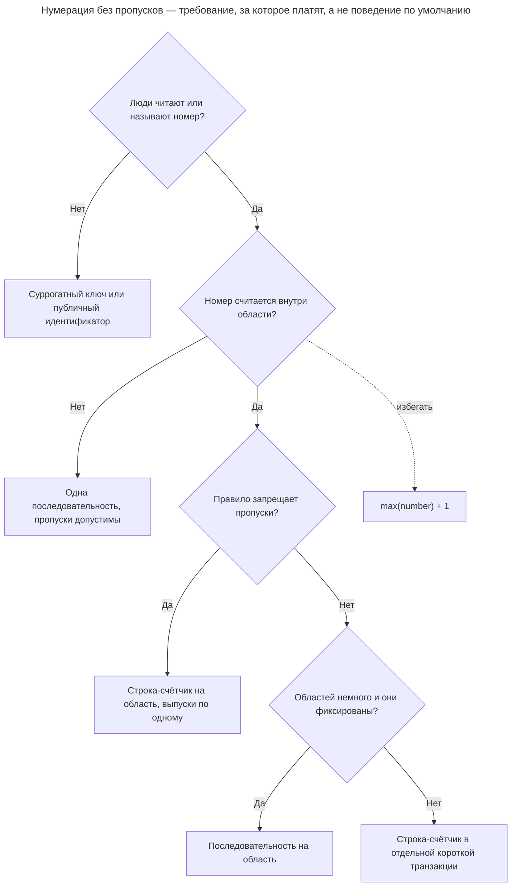
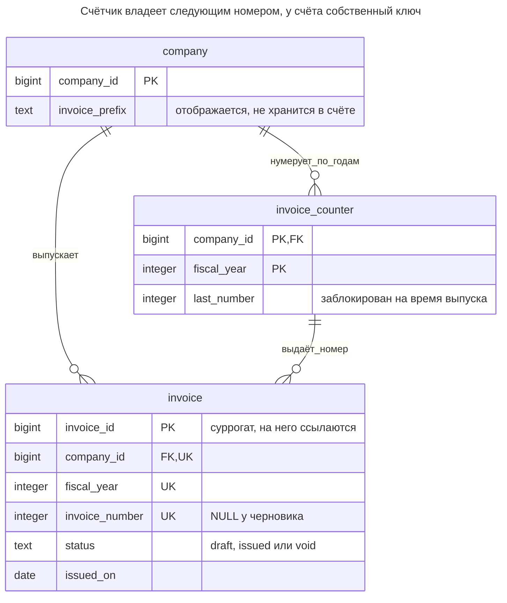
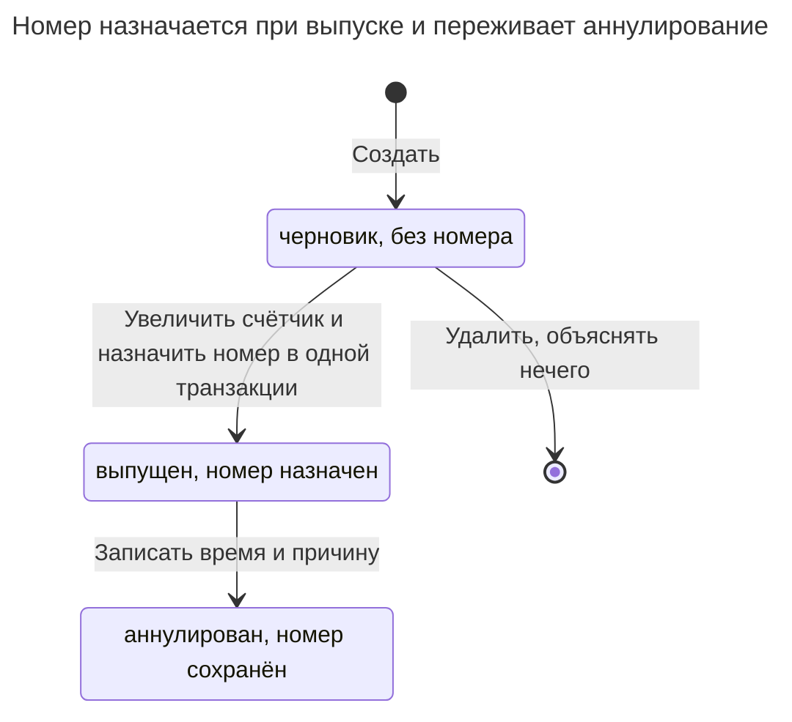
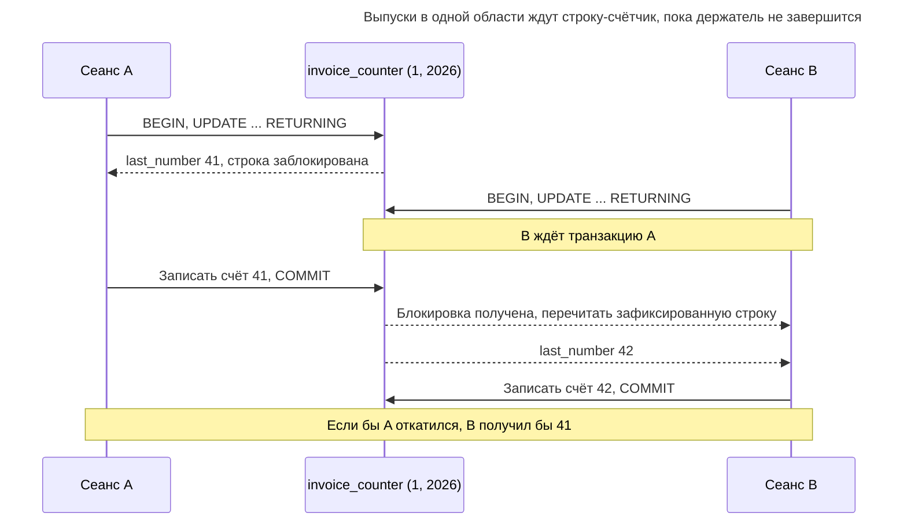

# Номер документа

## Назначение

Номер документа — последовательный номер для людей, который выдаётся внутри области нумерации: счёт `INV-2026-000123` — 123-й счёт одной компании за 2026 год, задача `#42` — 42-я задача одного проекта. Держите по одной строке-счётчику на область, увеличивайте её через `UPDATE ... RETURNING` в той же транзакции, которая выпускает документ, и обеспечивайте `UNIQUE (scope, number)` в таблице документов. У документа остаётся собственный суррогатный ключ; номер — уникальный атрибут, который люди называют и цитируют. Глава показывает, почему последовательность PostgreSQL не может выдавать такие номера без пропусков, чем нумерация без пропусков расплачивается за конкурентность и почему аннулированный документ сохраняет свой номер. См. [примечания к CREATE SEQUENCE](https://www.postgresql.org/docs/18/sql-createsequence.html) о выдаче номеров без пропусков.

## Также известен как

Номер счёта; последовательный номер документа; счётчик в области нумерации. GitLab называет номер задачи внутри проекта внутренним идентификатором (`iid`) и выдаёт его из [таблицы-счётчика `internal_ids`](https://gitlab.com/gitlab-org/gitlab/-/blob/master/app/models/internal_id.rb). Статья 226(2) директивы ЕС об НДС 2006/112/EC требует, чтобы на счёте был последовательный номер в одной или нескольких сериях, однозначно идентифицирующий счёт: в оригинале «a sequential number, based on one or more series, which uniquely identifies the invoice» ([текст статьи 226](https://www.legislation.gov.uk/eudr/2006/112/article/226)).

## Проблема

Бухгалтер ожидает, что номера счетов идут подряд — 1, 2, 3 — внутри каждой компании и года, и спрашивает о каждой дыре. Разработчик берёт identity-столбец таблицы: он ведь уже последовательный. Затем проверка оплаты падает после того, как номер был выдан, транзакция откатывается, и в реестре после 41 сразу идёт 43. К тому же identity общий для всех компаний, так что первый в году счёт компании B получает номер 5318.

Следующая попытка вычисляет `max(invoice_number) + 1` для компании и года. Два сотрудника выставляют счета одновременно, оба читают 41 и оба пишут 42: либо у двух документов один номер, либо, если есть уникальный ключ, второй падает. Когда кто-то удаляет последний счёт, то же выражение отдаёт его номер следующему документу, и на двух разных бумагах напечатан один номер.

## Решение

Отделите идентичность строки от номера, который читают люди. У счёта есть суррогатный `invoice_id` для внешних ключей и соединений и номер в области `(company_id, fiscal_year, invoice_number)` с ограничением уникальности. Таблица-счётчик хранит по одной строке на область с последним выданным номером.

Выпуск документа увеличивает строку-счётчик и записывает номер в одной транзакции. `UPDATE ... RETURNING` берёт блокировку строки счётчика, поэтому любой другой выпуск в этой области ждёт, пока транзакция не зафиксируется или не откатится. Откат отменяет и увеличение, так что неудавшийся выпуск не оставляет дыры. В этом и цена нумерации без пропусков: в каждой области выпуски идут по одному.

Платите эту цену только там, где правило требует номеров без пропусков. Номерам задач в проекте, заказов и обращений обычно нужна лишь уникальность в области и примерный порядок; там хватит последовательности на область или счётчика, который может пропускать номера. Сама директива ЕС об НДС требует последовательного номера в одной или нескольких сериях, однозначно идентифицирующего счёт, а [пояснительные записки Еврокомиссии](https://taxation-customs.ec.europa.eu/system/files/2016-09/explanatory_notes_en.pdf) оставляют выбор серий (по филиалу, по виду поставки) самому бизнесу. Нужно ли объяснять пропуск, решают национальные правила и аудиторы; проверьте их, прежде чем платить за строгую плотность.

Назначайте номер при выпуске, а не при создании черновика, — тогда брошенные черновики ничего не расходуют. Выпущенный документ аннулируют, но никогда не удаляют, и он сохраняет свой номер. Храните целое число и его область; префикс, год и дополнение нулями добавляйте при отображении.

## Альтернативы и выбор

| Вариант | Связь | Определяющее требование |
| --- | --- | --- |
| Строка-счётчик на область | Сам паттерн | Номера должны идти плотно внутри области, или число областей не ограничено (по одной на проект или клиента) |
| Последовательность на область | Вариант реализации | Пропуски допустимы, областей немного и они фиксированы; вставки никогда не ждут друг друга |
| Одна глобальная последовательность или identity | Замена | Важна только уникальность; номер — внутренний или справочный идентификатор, а не счёт внутри области |
| `max(number) + 1` | Избегать | Не подходит ни для чего: гонка при конкурентности и повторная выдача удалённых номеров |
| [Суррогатный ключ](surrogate-key.md) | Дополнение | Внешним ключам и соединениям нужна идентичность, которая никогда не меняется |
| [Публичный идентификатор](public-identifier.md) | Дополнение | Клиентам нужен идентификатор, который не раскрывает, сколько документов выпускает компания |

Семейство идентификаторов сравнивается в [Атласе решений](decision-atlas.md).



Выпуски выстраиваются в очередь только в ветке без пропусков. Если пропуски допустимы, счётчик, зафиксированный отдельно от документа, сразу снимает блокировку; номер остаётся выданным, даже если документ потом бросят, — это пропуск, но не ожидание.

## Структура



Область — первичный ключ счётчика, и те же три столбца образуют уникальный ключ счёта. Связь между счётчиком и счётом логическая, а не внешний ключ: важно ограничение, по которому два счёта в одной области не могут иметь один номер. Другие таблицы ссылаются на `invoice_id`, поэтому исправление клиента или аннулирование счёта их не затрагивает.

## Таблицы и инварианты

- **`invoice_counter`** хранит по одной строке на компанию и финансовый год с последним выданным номером. Первичный ключ по области делает эту строку единственной точкой, которую блокируют выпуски. `last_number >= 0` и отсутствие других писателей удерживают его равным наибольшему выданному номеру.
- **`invoice`** имеет суррогатный `invoice_id`. `invoice_number_key UNIQUE (company_id, fiscal_year, invoice_number)` отклоняет второй документ с тем же номером, каким бы путём он ни появился. `invoice_numbered_when_issued` требует, чтобы у черновиков номера не было, а у выпущенных и аннулированных счетов были номер, дата выпуска и год, — тогда ни один из них не ускользнёт от уникального ключа через `NULL`. Здесь `fiscal_year` — календарный год `issued_on`; если ваш финансовый год начинается с другой даты, берите его из таблицы-календаря. `invoice_void_explained` требует время и причину для каждого аннулирования.
- **`invoice_keep_issued`** — триггер, который запрещает удалять выпущенный или аннулированный счёт, возвращать его в черновик, повторно выпускать аннулированный и менять номер или область. Вдобавок не выдавайте роли приложения право `DELETE` на таблицу; триггер действует и для ролей, у которых это право есть.
- **`invoice_register`** — представление, которое собирает `INV-2026-000123` из префикса компании, года и целого числа. Префикс хранится один раз в `company`, а не в каждой строке.

## Когда применять

- Счета, кредит-ноты, чеки и другие документы, для которых налоговое правило или аудит требует последовательных номеров в серии.
- Номера внутри проекта или аккаунта, которые пользователи набирают вручную, например задача `#42` или заказ `1043`, когда нумерация в области важнее глобальной уникальности.
- Любой номер, который печатают на бумаге или отправляют наружу и который поэтому нельзя выдать повторно.

## Последствия и компромиссы

- ➕ Номера идут плотно внутри области; неудавшийся или откаченный выпуск не оставляет дыры.
- ➕ Уникальный ключ ловит дубликат из любого источника: ошибки, ручной вставки, импорта.
- ➕ Суррогатный ключ сохраняет ссылки стабильными, а номер остаётся бизнес-атрибутом.
- ➖ Все выпуски в одной области выстраиваются в очередь на строке-счётчике на всё время каждой выпускающей транзакции.
- ➖ Строка-счётчик обновляется при каждом выпуске и накапливает мёртвые версии строк, которые должен убирать vacuum.
- ➖ Если область не открыта или год указан неверно, выпуск падает; приложение должно открывать области заранее или создавать их при первом использовании.

## Реализация

[Полный скрипт для PostgreSQL 18.7](../assets/document-number/document-number.sql) проверяет нумерацию по областям, отображение, откат без пропусков, пропуски последовательностей, смену года, аннулирование и отказы, описанные ниже. Основные таблицы:

```sql
CREATE TABLE doc_example.invoice_counter (
    company_id bigint NOT NULL REFERENCES doc_example.company (company_id),
    fiscal_year integer NOT NULL CHECK (fiscal_year BETWEEN 2000 AND 9999),
    last_number integer NOT NULL CHECK (last_number >= 0),
    PRIMARY KEY (company_id, fiscal_year)
);
CREATE TABLE doc_example.invoice (
    invoice_id bigint GENERATED ALWAYS AS IDENTITY PRIMARY KEY,
    company_id bigint NOT NULL REFERENCES doc_example.company (company_id),
    status text NOT NULL DEFAULT 'draft' CHECK (status IN ('draft', 'issued', 'void')),
    customer_name text NOT NULL,
    total numeric(12, 2) NOT NULL,
    issued_on date,
    fiscal_year integer,
    invoice_number integer CHECK (invoice_number > 0),
    voided_at timestamptz,
    void_reason text,
    CONSTRAINT invoice_number_key UNIQUE (company_id, fiscal_year, invoice_number),
    CONSTRAINT invoice_numbered_when_issued CHECK (
        (status = 'draft' AND issued_on IS NULL AND fiscal_year IS NULL
            AND invoice_number IS NULL)
        OR (status <> 'draft' AND issued_on IS NOT NULL AND fiscal_year IS NOT NULL
            AND invoice_number IS NOT NULL
            AND fiscal_year = extract(year FROM issued_on))
    ),
    CONSTRAINT invoice_void_explained CHECK (
        (status = 'void') = (voided_at IS NOT NULL AND void_reason IS NOT NULL)
    )
);
```

Открытие года — одна вставка: `INSERT INTO doc_example.invoice_counter VALUES (1, 2026, 0)`. Выпуск черновика увеличивает счётчик и назначает номер одной командой; [изменяющий данные `WITH`](https://www.postgresql.org/docs/18/queries-with.html#QUERIES-WITH-MODIFYING) передаёт возвращённое значение во внешний `UPDATE`:

```sql
WITH allocated AS (
    UPDATE doc_example.invoice_counter
    SET last_number = last_number + 1
    WHERE company_id = 1 AND fiscal_year = 2026
    RETURNING last_number
)
UPDATE doc_example.invoice
SET status = 'issued', issued_on = DATE '2026-03-02', fiscal_year = 2026,
    invoice_number = (SELECT last_number FROM allocated)
WHERE invoice_id = 1 AND status = 'draft'
RETURNING invoice_number;
```

Первый выпуск возвращает `1`, следующий в той же области — `2`, а компания 2 начинает свою серию с `1`. Если команда не вернула строку, потому что счёт уже не черновик, откатите транзакцию: счётчик всё равно был увеличен, и скрипт это проверяет. Точка сохранения, которая увеличивает счётчик и откатывается, оставляет `last_number` прежним, и следующий выпуск получает тот же номер. Скрипт проверяет, что в каждой области число выпущенных счетов, наибольший номер и счётчик совпадают. Тот же запрос годится для аудита:

```sql
SELECT c.company_id, c.fiscal_year, c.last_number, n.issued, n.top
FROM doc_example.invoice_counter AS c
JOIN (SELECT company_id, fiscal_year, count(*) AS issued, max(invoice_number) AS top
      FROM doc_example.invoice WHERE status <> 'draft'
      GROUP BY company_id, fiscal_year) AS n USING (company_id, fiscal_year)
WHERE n.issued <> c.last_number OR n.top <> c.last_number;
```

Номер для отображения собирает реестр. Один `lpad` обрезает длинные значения (`lpad('1234567', 6, '0')` даёт `123456`), поэтому представление дополняет нулями до минимальной ширины:

```sql
SELECT format('%s-%s-%s', c.invoice_prefix, i.fiscal_year,
              lpad(i.invoice_number::text, greatest(6, length(i.invoice_number::text)), '0'))
FROM doc_example.invoice AS i JOIN doc_example.company AS c USING (company_id);
```

Последовательность оставляет дыры по замыслу. Скрипт вызывает `nextval` в точке сохранения и откатывает её, и следующий вызов возвращает `2`, а не `1`. `INSERT ... ON CONFLICT DO NOTHING`, наткнувшийся на конфликт, расходует значение identity без всякого отката, и следующая строка получает `3`. Последовательность с `CACHE 20` возвращает `21` после `DISCARD SEQUENCES`, который выбрасывает неиспользованные кешированные значения сеанса, как это делает конец сеанса. На странице [функций последовательностей](https://www.postgresql.org/docs/18/functions-sequence.html) сказано, что `nextval` никогда не откатывается и что откаты и сбои могут оставлять пропуски.

Для смены года либо откройте счётчики следующего года до 1 января, либо создавайте строку при первом использовании. Upsert даёт первому счёту 2027 года номер `1`, а конкурентный первый выпуск ждёт и получает `2`:

```sql
INSERT INTO doc_example.invoice_counter AS c (company_id, fiscal_year, last_number)
VALUES (1, 2027, 1)
ON CONFLICT (company_id, fiscal_year)
DO UPDATE SET last_number = c.last_number + 1
RETURNING last_number;
```

При явном открытии выпуск в неоткрытую область не получает строки из `UPDATE`, и номер оказывается `NULL`. PostgreSQL 18.7 отклоняет это с SQLSTATE `23514`: `ERROR: new row for relation "invoice" violates check constraint "invoice_numbered_when_issued"`. Без этой проверки команда выпустила бы счёт без номера.

Аннулирование меняет статус и сохраняет номер:

```sql
UPDATE doc_example.invoice
SET status = 'void', voided_at = now(), void_reason = 'Wrong customer'
WHERE invoice_id = 2;
```

Реестр по-прежнему показывает `INV-2026-000002 void`. Повторный выпуск номера 2 выдаёт SQLSTATE `23505`: `ERROR: duplicate key value violates unique constraint "invoice_number_key"` с `DETAIL: Key (company_id, fiscal_year, invoice_number)=(1, 2026, 2) already exists.` Удаление аннулированного счёта или возврат его в `issued` вызывает `P0001` из триггера: `ERROR: invoice 2 is void and keeps its number`. Так же падают перенумерация выпущенного счёта и возврат его в черновик. Выпущенная строка без `issued_on` и `fiscal_year` нарушает `invoice_numbered_when_issued` с кодом `23514`. Черновик удаляется без ошибок.



Из `void` нет переходов, а из `issued` нет пути ни обратно в `draft`, ни за пределы диаграммы. Исправление — это новый документ со своим номером, например кредит-нота, которая ссылается на аннулированный.

## Поддержка в движках

- **PostgreSQL 18:** строка-счётчик и `UPDATE ... RETURNING`, как показано. В [`CREATE SEQUENCE`](https://www.postgresql.org/docs/18/sql-createsequence.html) сказано, что последовательности нельзя использовать для выдачи номеров без пропусков, а в качестве более дорогой альтернативы предложена исключительная блокировка таблицы-счётчика.
- **MySQL 8.4:** объектов-последовательностей нет, а значения InnoDB `AUTO_INCREMENT` [теряются при откате транзакции](https://dev.mysql.com/doc/refman/8.4/en/innodb-auto-increment-handling.html). Так как `RETURNING` нет, читайте увеличенный счётчик через `UPDATE invoice_counter SET last_number = LAST_INSERT_ID(last_number + 1) WHERE ...` и затем `SELECT LAST_INSERT_ID()` — это эмуляция последовательности из справки по [информационным функциям](https://dev.mysql.com/doc/refman/8.4/en/information-functions.html#function_last-insert-id).
- **SQL Server 2025 (17.x):** [номера последовательности](https://learn.microsoft.com/en-us/sql/t-sql/statements/create-sequence-transact-sql?view=sql-server-ver17) генерируются вне текущей транзакции и расходуются независимо от того, зафиксирована она или откачена. Используйте таблицу-счётчик и читайте значение через `UPDATE ... OUTPUT inserted.last_number`.
- **Oracle AI Database 26ai:** последовательность [увеличивается независимо от фиксации или отката транзакции](https://docs.oracle.com/en/database/oracle/oracle-database/26/sqlrf/CREATE-SEQUENCE.html), а кешированные значения теряются при сбое системы. Используйте таблицу-счётчик с `UPDATE ... RETURNING last_number INTO`.
- **SQLite 3:** последовательностей нет; [`UPDATE ... RETURNING`](https://www.sqlite.org/lang_returning.html) работает с версии 3.35.0. В базе одновременно пишет только один писатель, поэтому начинайте выпускающую транзакцию с [`BEGIN IMMEDIATE`](https://www.sqlite.org/lang_transaction.html), чтобы взять блокировку записи до чтения.

## Сбои и конкурентность

Строка-счётчик — это блокировка области. `UPDATE` второго выпуска ждёт первую транзакцию, а на уровне `READ COMMITTED` по умолчанию перечитывает зафиксированную строку и получает следующий номер. На уровнях `REPEATABLE READ` и `SERIALIZABLE` ожидающий вместо этого получает SQLSTATE `40001`, `could not serialize access due to concurrent update`, и должен повторить всю транзакцию. Это поведение определяют [блокировки строк](https://www.postgresql.org/docs/18/explicit-locking.html#LOCKING-ROWS) и [правила изоляции](https://www.postgresql.org/docs/18/transaction-iso.html) PostgreSQL.



Проверено вручную двумя сеансами `psql` на PostgreSQL 18.7: у B видно `wait_event_type = Lock`, а A стоит в `pg_blocking_pids`, пока A не зафиксируется; затем B возвращает следующий номер. Пропускная способность одной области ограничена длиной выпускающей транзакции, а не самим обновлением счётчика.

Держите эту транзакцию короткой. Проверьте черновик, посчитайте суммы и вызовите сервисы оплаты и налогов до того, как берёте номер, затем увеличьте счётчик, запишите счёт и зафиксируйте. PDF и письмо формируйте после фиксации, через [транзакционный outbox](transactional-outbox.md), если их нельзя потерять. Если одна транзакция выпускает документы в нескольких областях, блокируйте счётчики в фиксированном порядке, например по `(company_id, fiscal_year)`, чтобы две такие транзакции не попали во взаимоблокировку.

Клиент, который повторяет запрос после потерянного подтверждения фиксации, не должен выпустить второй счёт. Привяжите выпуск к [записи идемпотентности](idempotency-record.md) или к `invoice_id` черновика: условие `WHERE status = 'draft'` не даёт повторному выпуску обновить ни одной строки, и вызывающий откатывает увеличение счётчика.

У `max(number) + 1` нет строки, которую можно заблокировать. Два сеанса читают один и тот же максимум; при уникальном ключе вторая вставка ждёт первую, а затем падает с `23505`. Скрипт воспроизводит этот порядок событий и показывает, что повтор с пересчётом максимума проходит. Без уникального ключа оба фиксируются с одинаковым номером. `SELECT ... FOR UPDATE` по родительскому проекту или компании тоже выстраивает такие выпуски в очередь, но по-прежнему повторно выдаёт номер удалённой последней строки — скрипт показывает и это.

Если пропуски допустимы, а область нагружена, берите номер из счётчика в отдельной короткой транзакции или используйте по последовательности на область. Тогда выпуски не ждут документов друг друга, а неудавшийся выпуск оставляет пропуск, который вы фиксируете, а не предотвращаете.

## Миграция

Если номером счёта служил identity: добавьте `fiscal_year` и `invoice_number` как необязательные столбцы и заполните их по областям через `row_number() OVER (PARTITION BY company_id, fiscal_year ORDER BY issued_on, invoice_id)`, но только если старые номера никогда не уходили наружу. Если уходили, сохраните напечатанные номера как есть в столбце `legacy_number` и начните серии по областям со следующего финансового года. Постройте уникальный индекс конкурентно, создайте по строке-счётчику на область с `last_number = max(invoice_number)`, переключите писателя на счётчик, затем добавьте `invoice_numbered_when_issued` как `NOT VALID` и проверьте его, как в [расширении и свёртывании](expand-contract.md).

Если номера выдавал `max(number) + 1`: создайте строки-счётчики из текущих максимумов в той же транзакции, которая переключает писателей, или заблокируйте области на это время. Иначе выпуск в промежутке выдаст номер, который счётчик выдаст ещё раз. Уникальный ключ поймает это совпадение, но только как неудавшийся выпуск.

## Антипаттерны и частые ошибки

- Перенумерация строк, чтобы закрыть пропуски после удалений или откатов. В [SQL Antipatterns](https://pragprog.com/titles/bksap1/sql-antipatterns-volume-1/) Карвина это значится как Pseudokey Neat-Freak; для номера документа это ещё и меняет уже напечатанные бумаги.
- Первичный ключ или одна глобальная последовательность в роли номера счёта — и объяснения по каждому пропуску.
- Выдача номера при создании черновика: брошенные черновики оставляют дыры.
- Удаление выпущенного документа вместо аннулирования, после которого `max + 1` или ручная вставка выдаёт его номер повторно.
- Хранение только отформатированной строки `INV-2026-000123`: смена префикса или ширины превращается в миграцию данных, а сортировка по номеру сортирует текст.
- Вызов внешних сервисов, пока удерживается блокировка счётчика: встают все выпуски области.
- Область, создаваемая лениво, при простом `UPDATE`, который не затронул ни одной строки, — документ записывается без номера; обеспечьте номер через `CHECK` или `NOT NULL`.

## Известные применения

- GitLab выдаёт номера задач и merge request внутри проекта из [таблицы `internal_ids`](https://gitlab.com/gitlab-org/gitlab/-/blob/master/app/models/internal_id.rb): он обновляет `last_value + 1` и возвращает значение, создаёт строку при первом использовании и повторяет попытку, если её успел создать конкурент. Комментарий в исходном коде называет получаемую последовательность последовательностью без пропусков.
- [Статья 226(2)](https://www.legislation.gov.uk/eudr/2006/112/article/226) директивы ЕС об НДС требует последовательных номеров счетов в одной или нескольких сериях, а [пояснительные записки Еврокомиссии](https://taxation-customs.ec.europa.eu/system/files/2016-09/explanatory_notes_en.pdf) допускают серию на филиал или вид поставки — это области нумерации в смысле этой главы.
- Документация PostgreSQL к [`CREATE SEQUENCE`](https://www.postgresql.org/docs/18/sql-createsequence.html) называет заблокированную таблицу-счётчик способом построить выдачу без пропусков.

## Связанные паттерны

- [Суррогатный ключ](surrogate-key.md) даёт документу стабильную идентичность для ссылок; номер остаётся уникальным атрибутом.
- [Естественный ключ](natural-key.md) разбирает бизнес-ключи в области, например номер заказа с номером строки.
- [Публичный идентификатор](public-identifier.md) скрывает объём выдачи, когда последовательный номер не должен покидать компанию.
- [Упорядоченный идентификатор](time-ordered-identifier.md) генерирует уникальные идентификаторы без центрального счётчика, когда плотность не важна.
- [Мягкое удаление](soft-delete.md) скрывает строки из рабочей выборки; аннулирование — другое, потому что аннулированный счёт остаётся в реестре.
- [История статусов](status-history.md) записывает, кто аннулировал документ, когда и почему.
