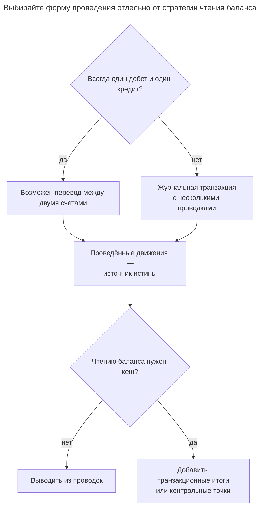
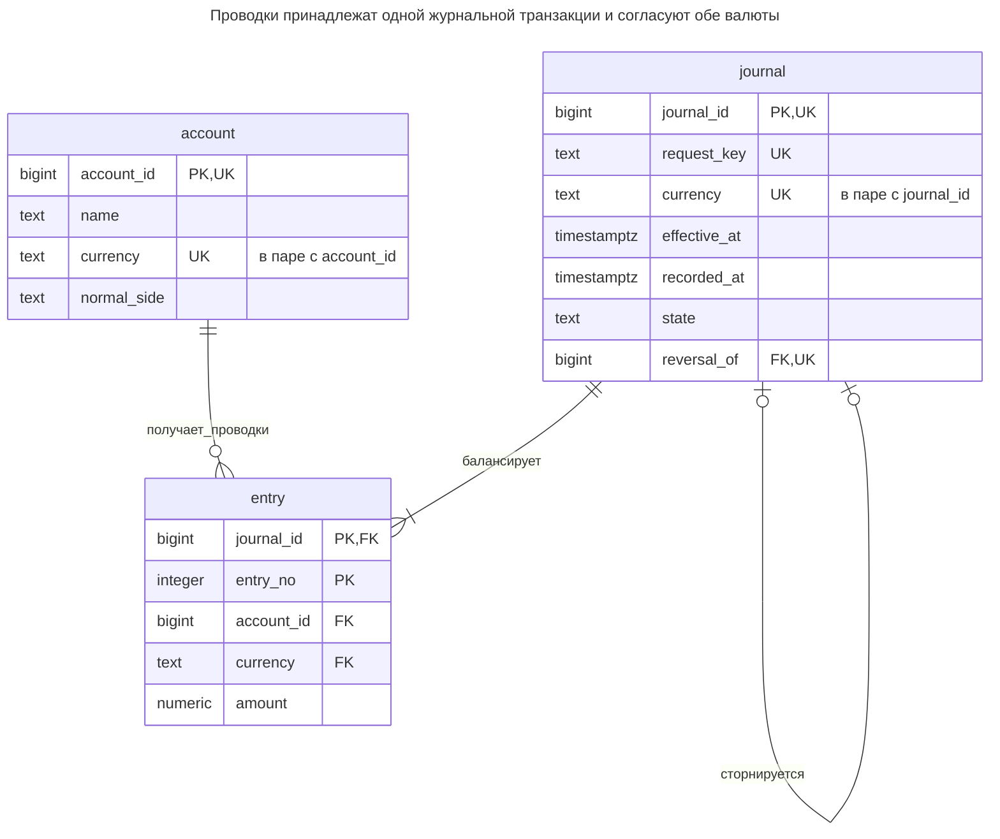
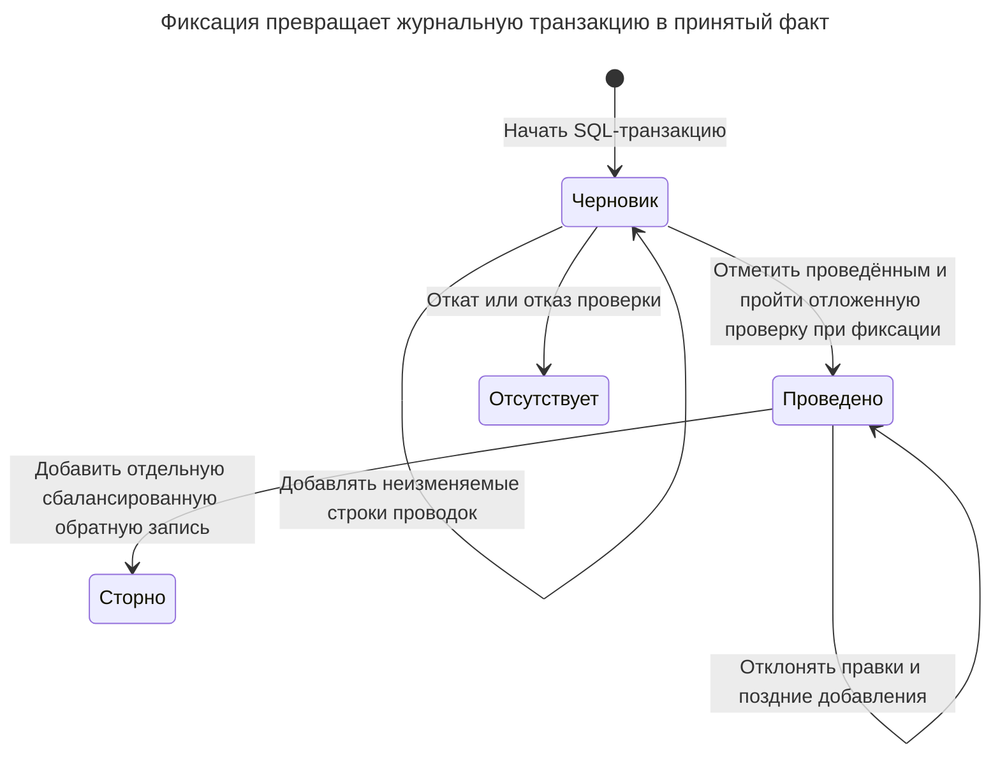
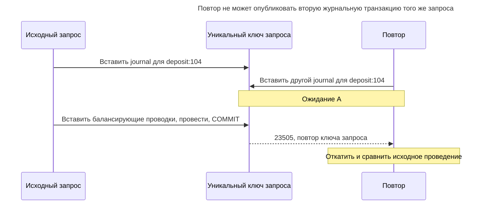
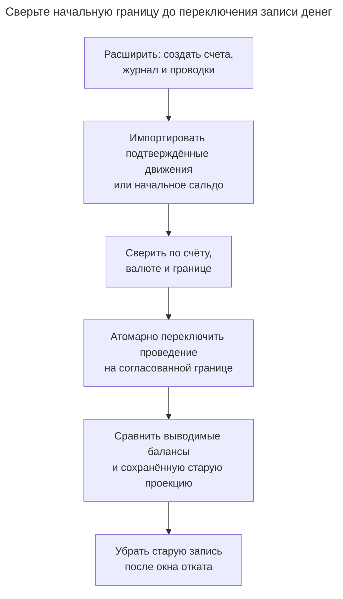

# Двойная запись

## Назначение

Двойная запись регистрирует каждое движение денег как транзакцию проводок между счетами, где сумма дебетов и кредитов равна нулю. Схема гарантирует, что деньги не создаются и не исчезают, а только перемещаются, и каждый баланс выводится из проводок. Глава показывает счета, транзакции и проводки, обеспечение баланса, неизменяемые проводки с исправлением сторнированием вместо обновления и сохранение текущих балансов ради скорости. Та же структура отслеживает запасы, перемещаемые между складами.

## Также известен как

Double-entry bookkeeping; accounting transaction with accounting entries — двойная бухгалтерская запись, учётная транзакция с проводками. [Accounting Transaction](https://martinfowler.com/eaaDev/AccountingTransaction.html) Фаулера связывает две или более проводки, чьи знаковые суммы дают ноль. Здесь `journal` — такая предметная транзакция; SQL-транзакция — атомарная операция базы, создающая её.

## Проблема

Вы вычитаете 100 из одного счёта и добавляете 100 другому. При раздельной фиксации сбой между записями оставляет необъяснённую разницу. Даже в одной SQL-транзакции ошибочная вторая сумма 90 зафиксируется, если ничто не проверяет связь. Атомарность сохраняет ваши команды вместе, но не доказывает их сбалансированность.

Таблица только балансов также не объясняет происхождение денег, отменённое исправлением или выполнение запроса с истёкшим ожиданием. Нужны основная история движений, граница балансирования и идентичность повтора. Полезный баланс становится проекцией истории, а не независимо редактируемым фактом.

## Решение

Храните неизменяемые счета с валютой и нормальной стороной баланса, журнальные транзакции с идентичностью запроса и временем действия, проводки между транзакциями и счетами. Используйте положительные суммы для дебетов и отрицательные для кредитов. У каждой журнальной транзакции не менее двух проводок одной валюты со знаковой суммой ноль. Это соглашение не делает каждый дебет увеличением: в примере нормальный кредитовый баланс обязательств равен отрицанию знаковой суммы проводок.

Собирайте черновую журнальную транзакцию внутри одной SQL-транзакции, вставьте все проводки, затем отметьте её проведённой. Отложенная проверка отклоняет фиксацию черновика, менее двух проводок или ненулевого итога. После фиксации в примере не остаётся постоянно видимых черновиков. Проведённые факты нередактируемы; точное сторнирование создаёт другую журнальную транзакцию с противоположными итогами по каждому счёту.

Для движений запасов используйте ту же границу сохранения с номенклатурой и единицей вместо валюты, а счета представляйте местами или внешними источниками/получателями. Никогда не балансируйте разные номенклатуры вместе. Производству, потреблению и исправлению запасов нужны явные корреспондирующие счета; баланс строк не устанавливает физическую верность складского количества.

## Альтернативы и выбор

| Соседний паттерн | Связь | Определяющее требование |
| --- | --- | --- |
| Строка счёта только с балансом | Замена с более слабым контрактом | Нужен только текущий счётчик, потеря объяснения движений допустима |
| Строка перевода двух счетов | Вариант реализации | У каждого движения ровно один дебет и кредит равной величины; равенство можно задать структурно вместо суммы произвольных проводок |
| [Таблица итогов](summary-table.md) | Дополнение | Длинной истории нужны кешированные балансы или периодические контрольные точки со сверкой по проводкам |
| [Запись идемпотентности](idempotency-record.md) | Дополнение | Повторы возвращают исходный результат и отклоняют изменённую нагрузку под прежним ключом |
| [Величина](quantity.md) | Дополнение | Валюта, масштаб актива и точная арифметика должны быть явными |

Полная таблица — в [Атласе решений](decision-atlas.md). Отдельный аудиторский след не заменяет сохранения на границе проведения. Фаулер также [различает двусторонние и многосторонние транзакции](https://martinfowler.com/eaaDev/AccountingTransaction.html); используйте более простое представление, если оно подходит каждому принимаемому движению.



Сохранённый баланс — выбор чтения и согласования. Он не убирает необходимость проверять каждое движение и сохранять объяснение.

## Структура



Ребро между журнальной транзакцией и проводками описывает зафиксированные проведения; у черновика временно меньше проводок. Отложенное правило усиливает минимум до двух. Обе валютные ссылки — составные ключи. У журнальной транзакции возможно одно точное сторнирование; политика примера допускает сторнирование самого сторно другой транзакцией.

## Таблицы и инварианты

- **`account`** владеет стабильными валютой и нормальной стороной. Защита определения отклоняет обновления и удаления; описательному обслуживанию счёта нужна отдельная разрешённая операция.
- **`journal`** имеет уникальный ключ запроса, время действия и регистрации. Единственное обновление — из черновика в проведённое с неизменными идентичностью и метаданными содержимого.
- **`entry`** требует согласованной валюты счёта и журнальной транзакции, ненулевой суммы, менее 12 целых разрядов по модулю и не более двух десятичных знаков. Это пределы примера, не универсальные правила валют.
- **Неизменяемость** запрещает обновление/удаление проводок и вставку в проведённые журнальные транзакции. Проверка перед вставкой блокирует строку `journal`, сериализуя добавления с проведением.
- **Проверка баланса** отложена при создании/проведении журнальной транзакции и вставке проводки. Строчный `CHECK` не обеспечивает агрегат других строк; PostgreSQL [документирует ограничение](https://www.postgresql.org/docs/18/ddl-constraints.html#DDL-CONSTRAINTS-CHECK-CONSTRAINTS).
- **Сторнирования** используют исходную валюту и обязаны отрицать итоги каждого счёта. `UNIQUE (reversal_of)` допускает только одного прямого преемника точного сторнирования.

## Когда применять

- Каждому принятому движению нужны явная корреспонденция и долговечное объяснение.
- Исправления должны сохранять проведённую историю.
- Нужны выводимые балансы, сверка и повторы, связанные с одним принятым проведением.

## Последствия и компромиссы

- ➕ Отсутствующая или ошибочная сторона не даёт зафиксировать всё проведение.
- ➕ Балансы и сторнирования объясняются сохранёнными проводками.
- ➖ Нулевая сумма доказывает сохранение внутри модели, но не корректную бизнес-цель, достаточность средств или согласие с внешним банком.
- ➖ Проведение создаёт несколько строк, а фиксация всё ещё может провалиться после успешных вставок.
- ➖ Правило овердрафта требует согласования разных журнальных транзакций одного счёта. Проверки баланса журнальной транзакции его не обеспечивают.
- ➖ Одновалютная журнальная транзакция не выражает обмен сложением разных валют. Используйте сбалансированные проведения каждой валюты с явными клиринговыми счетами и сохранённой котировкой или политикой курса.

## Реализация

[Полный скрипт PostgreSQL 18.6](../assets/double-entry-ledger/double-entry-ledger.sql) проверяет баланс, неизменяемость, запрет повторного запроса, несоответствие валюты счёта и сторнирование. Таблицы содержат основные идентичности и проверки сумм:

```sql
CREATE SCHEMA ledger_example;
SET search_path = ledger_example, public;

CREATE TABLE account (
    account_id bigint PRIMARY KEY,
    name text NOT NULL,
    currency text NOT NULL,
    normal_side text NOT NULL CHECK (normal_side IN ('debit', 'credit')),
    UNIQUE (account_id, currency)
);
CREATE TABLE journal (
    journal_id bigint PRIMARY KEY,
    request_key text NOT NULL UNIQUE,
    currency text NOT NULL,
    effective_at timestamptz NOT NULL,
    recorded_at timestamptz NOT NULL DEFAULT clock_timestamp(),
    state text NOT NULL DEFAULT 'draft' CHECK (state IN ('draft', 'posted')),
    reversal_of bigint UNIQUE,
    UNIQUE (journal_id, currency),
    FOREIGN KEY (reversal_of, currency) REFERENCES journal (journal_id, currency),
    CHECK (reversal_of <> journal_id)
);
CREATE TABLE entry (
    journal_id bigint,
    entry_no integer CHECK (entry_no > 0),
    account_id bigint NOT NULL,
    currency text NOT NULL,
    amount numeric NOT NULL,
    PRIMARY KEY (journal_id, entry_no),
    FOREIGN KEY (journal_id, currency) REFERENCES journal (journal_id, currency),
    FOREIGN KEY (account_id, currency) REFERENCES account (account_id, currency),
    CONSTRAINT entry_amount CHECK (amount <> 0 AND amount > -1000000000000
        AND amount < 1000000000000 AND scale(amount) <= 2)
);
CREATE INDEX entry_account_idx ON entry (account_id, journal_id);
```

Неограниченный [`numeric`](https://www.postgresql.org/docs/18/datatype-numeric.html) PostgreSQL вместе с `scale(amount) <= 2` отклоняет лишнюю дробную точность вместо округления при приведении к фиксированному масштабу. Выберите и примените правило округления до проведения. При моделировании других активов намеренно увеличивайте или меняйте политику масштаба.

Следующие проверки предотвращают позднее изменение и явно задают границу проведения. Отделяйте владельца базы от приложения, не выдавайте `TRUNCATE`, изменение триггеров и создание схем; [модель привилегий PostgreSQL](https://www.postgresql.org/docs/18/sql-grant.html) выделяет их как отдельные возможности. Лабораторный скрипт работает владельцем.

```sql
CREATE FUNCTION guard_entry() RETURNS trigger LANGUAGE plpgsql SET search_path = ledger_example, pg_temp AS $$
DECLARE
    journal_state text;
BEGIN
    IF TG_OP <> 'INSERT' THEN
        RAISE EXCEPTION 'ledger entries are immutable' USING ERRCODE = '23514';
    END IF;
    SELECT state INTO journal_state FROM journal
    WHERE journal_id = NEW.journal_id FOR UPDATE;
    IF journal_state IS DISTINCT FROM 'draft' THEN
        RAISE EXCEPTION 'entries require a draft journal' USING ERRCODE = '23514';
    END IF;
    RETURN NEW;
END $$;
CREATE TRIGGER entry_guard BEFORE INSERT OR UPDATE OR DELETE ON entry
    FOR EACH ROW EXECUTE FUNCTION guard_entry();
CREATE FUNCTION guard_journal() RETURNS trigger LANGUAGE plpgsql SET search_path = ledger_example, pg_temp AS $$
BEGIN
    IF TG_OP = 'INSERT' THEN
        IF NEW.state <> 'draft' THEN
            RAISE EXCEPTION 'create journals in draft' USING ERRCODE = '23514';
        END IF;
        IF NEW.reversal_of IS NOT NULL AND NOT EXISTS (
            SELECT FROM journal WHERE journal_id = NEW.reversal_of AND state = 'posted'
        ) THEN
            RAISE EXCEPTION 'reversal requires a posted original' USING ERRCODE = '23514';
        END IF;
        RETURN NEW;
    END IF;
    IF TG_OP = 'DELETE' OR OLD.state = 'posted' THEN
        RAISE EXCEPTION 'posted journal is immutable' USING ERRCODE = '23514';
    END IF;
    IF NEW.state <> 'posted' OR
        (NEW.journal_id, NEW.request_key, NEW.currency, NEW.effective_at, NEW.recorded_at, NEW.reversal_of)
        IS DISTINCT FROM
        (OLD.journal_id, OLD.request_key, OLD.currency, OLD.effective_at, OLD.recorded_at, OLD.reversal_of) THEN
        RAISE EXCEPTION 'only posting may change a draft journal' USING ERRCODE = '23514';
    END IF;
    RETURN NEW;
END $$;
CREATE TRIGGER journal_guard BEFORE INSERT OR UPDATE OR DELETE ON journal
    FOR EACH ROW EXECUTE FUNCTION guard_journal();
CREATE FUNCTION guard_account() RETURNS trigger LANGUAGE plpgsql SET search_path = ledger_example, pg_temp AS $$
BEGIN
    RAISE EXCEPTION 'ledger account definition is immutable' USING ERRCODE = '23514';
END $$;
CREATE TRIGGER account_guard BEFORE UPDATE OR DELETE ON account
    FOR EACH ROW EXECUTE FUNCTION guard_account();
```

Установите отложенную проверку агрегата. [Триггеры ограничений PostgreSQL](https://www.postgresql.org/docs/18/sql-createtrigger.html) могут выполняться в конце транзакции, допуская временный дисбаланс во время сборки проводок:

```sql
CREATE FUNCTION check_journal() RETURNS trigger LANGUAGE plpgsql SET search_path = ledger_example, pg_temp AS $$
DECLARE
    target_id bigint;
    original_id bigint;
BEGIN
    target_id := NEW.journal_id;
    SELECT reversal_of INTO original_id FROM journal WHERE journal_id = target_id;
    IF NOT EXISTS (SELECT FROM journal WHERE journal_id = target_id AND state = 'posted')
       OR (SELECT count(*) FROM entry WHERE journal_id = target_id) < 2
       OR (SELECT coalesce(sum(amount), 0) FROM entry WHERE journal_id = target_id) <> 0 THEN
        RAISE EXCEPTION 'journal must be posted with at least two balanced entries'
            USING ERRCODE = '23514';
    END IF;
    IF original_id IS NOT NULL AND EXISTS (
        SELECT FROM
            (SELECT account_id, sum(amount) AS total FROM entry
             WHERE journal_id = target_id GROUP BY account_id) AS n
        FULL JOIN
            (SELECT account_id, sum(amount) AS total FROM entry
             WHERE journal_id = original_id GROUP BY account_id) AS o USING (account_id)
        WHERE coalesce(n.total, 0) <> -coalesce(o.total, 0)
    ) THEN
        RAISE EXCEPTION 'reversal must negate original account totals' USING ERRCODE = '23514';
    END IF;
    RETURN NULL;
END $$;
CREATE CONSTRAINT TRIGGER journal_balanced AFTER INSERT OR UPDATE ON journal
    DEFERRABLE INITIALLY DEFERRED FOR EACH ROW EXECUTE FUNCTION check_journal();
CREATE CONSTRAINT TRIGGER entry_balanced AFTER INSERT ON entry
    DEFERRABLE INITIALLY DEFERRED FOR EACH ROW EXECUTE FUNCTION check_journal();
```

Повторные отложенные события проверяют окончательное состояние журнальной транзакции. Простая реализация может сканировать её несколько раз; ограничивайте размер проведения и измеряйте до оптимизации расписания проверок.

Проведите внесение 100 EUR, затем выведите балансы нормальной стороны:

```sql
INSERT INTO account VALUES
    (1, 'Cash', 'EUR', 'debit'), (2, 'Customer liability', 'EUR', 'credit'),
    (3, 'Dollar cash', 'USD', 'debit');
BEGIN;
INSERT INTO journal (journal_id, request_key, currency, effective_at)
VALUES (100, 'deposit:104', 'EUR', '2026-11-01 10:00Z');
INSERT INTO entry VALUES (100, 1, 1, 'EUR', 100), (100, 2, 2, 'EUR', -100);
UPDATE journal SET state = 'posted' WHERE journal_id = 100;
COMMIT;
SELECT a.account_id, a.normal_side,
       CASE WHEN a.normal_side = 'debit' THEN coalesce(sum(e.amount), 0)
            ELSE -coalesce(sum(e.amount), 0) END AS normal_balance
FROM account AS a LEFT JOIN entry AS e USING (account_id)
GROUP BY a.account_id ORDER BY a.account_id;
```

Денежный счёт `1` и счёт обязательств перед клиентом `2` показывают нормальный баланс `100`; счёт `3` — ноль. Их знаковые суммы противоположны. Поскольку черновик не может зафиксироваться, читателям не нужно исключать постоянно хранимое множество черновиков.

Эта полная попытка проведения недопустима:

```sql
BEGIN;
INSERT INTO journal (journal_id, request_key, currency, effective_at)
VALUES (101, 'bad:101', 'EUR', '2026-11-01 10:00Z');
INSERT INTO entry VALUES (101, 1, 1, 'EUR', 100), (101, 2, 2, 'EUR', -90);
UPDATE journal SET state = 'posted' WHERE journal_id = 101;
COMMIT;
```

PostgreSQL 18.6 возвращает SQLSTATE `23514` при фиксации: `ERROR: journal must be posted with at least two balanced entries`. Журнальная транзакция `101` и её проводки откатываются вместе. Скрипт принудительно запускает ту же отложенную проверку внутри блока исключения, чтобы проверить отказ и продолжить. Обновление проводки на месте вызывает `23514`: `ERROR: ledger entries are immutable`.

Исправьте принятое проведение добавлением точной обратной записи:

```sql
BEGIN;
INSERT INTO journal (journal_id, request_key, currency, effective_at, reversal_of)
VALUES (104, 'reverse:104', 'EUR', '2026-11-02 10:00Z', 100);
INSERT INTO entry
SELECT 104, entry_no, account_id, currency, -amount FROM entry WHERE journal_id = 100;
UPDATE journal SET state = 'posted' WHERE journal_id = 104;
COMMIT;
SELECT account_id, sum(amount) AS signed_balance FROM entry GROUP BY account_id ORDER BY account_id;
```

Оба знаковых баланса теперь равны нулю, а журнальные транзакции `100` и `104` сохранены. Если правильная сумма — 90, после сторнирования проведите отдельную новую сбалансированную транзакцию на 90 EUR с новым ключом запроса. Ссылка сторно записывает причину обратной записи, а не команду удаления исходной.



Черновик — внутреннее состояние сборки, а не принятый ожидающий платёж. Резервирование или жизненный цикл ожидающего перевода требуют отдельного проекта и не выводятся из этих строк.

## Поддержка в движках

- **PostgreSQL 18:** отложенные триггеры ограничений реализуют агрегатное правило фиксации. Проверки и внешние ключи обеспечивают локальные инварианты суммы и валюты.
- **MySQL 8.4 / InnoDB:** [проверки не допускают подзапросов](https://dev.mysql.com/doc/refman/8.4/en/create-table-check-constraints.html), а [внешние ключи немедленны](https://dev.mysql.com/doc/refman/8.4/en/create-table-foreign-keys.html). Переносите через управляемую процедуру проведения, атомарно проверяющую и публикующую; не превращайте агрегат в строчную проверку.
- **SQL Server 2025 (17.x):** [DML-триггеры работают с множествами](https://learn.microsoft.com/en-us/sql/relational-databases/triggers/create-dml-triggers-to-handle-multiple-rows-of-data?view=sql-server-ver17). Переносу нужна учитывающая множества граница проведения вместо построчной отложенной проверки PL/pgSQL.
- **Oracle AI Database 26ai:** [откладываемые ограничения](https://docs.oracle.com/en/database/oracle/oracle-database/26/sqlrf/constraint.html) не превращают произвольный агрегат в проверочное ограничение; проверки исключают подзапросы. Отдельно проектируйте и проверяйте процедуру проведения и права доступа.
- **SQLite 3:** [строчные триггеры](https://www.sqlite.org/lang_createtrigger.html) не предоставляют механизм отложенных пользовательских триггеров ограничений PostgreSQL. Управляемая транзакция может собрать и проверить проведение; для точных сумм используйте масштабированные целые или [расширение decimal](https://www.sqlite.org/floatingpoint.html#decext), не предполагая прямого переноса `numeric`.

## Сбои и конкурентность

Каждая вставка проводки блокирует журнальную транзакцию через [`FOR UPDATE`](https://www.postgresql.org/docs/18/explicit-locking.html#LOCKING-ROWS) до проверки чернового состояния. Черновик принадлежит создающей SQL-транзакции; другой сеанс не использует незафиксированный черновик, а черновик не может зафиксироваться. Поздние вставки в зафиксированную журнальную транзакцию видят проведённое состояние и отклоняются. Выполняйте всё проведение в одной транзакции при Read Committed.

Тем не менее два повтора могут собрать разные кандидаты для одного запроса. Уникальный ключ запроса определяет, кто может зафиксироваться, используя [проверку конфликтов уникального индекса PostgreSQL](https://www.postgresql.org/docs/18/index-unique-checks.html):



Проигравший должен отбросить своего кандидата и все предложенные проводки. Дубликат ключа обозначает существующий результат, но не доказывает равенства повторной нагрузки.

`request_key` делает два принятых проведения одного запроса невозможными, но не сравнивает содержимое. После неопределённой фиксации найдите исходную журнальную транзакцию по ключу и сравните валюту, время действия и все проводки. Повтор ключа с другим содержимым — ошибка. Более полная [Запись идемпотентности](idempotency-record.md) может сохранить хеш нормализованного запроса и ответ. Никогда не повторяйте с новым ключом лишь из-за потери прежнего ответа.

Для сохранённого баланса обновляйте итоги затронутых счетов в той же SQL-транзакции, что проводки, беря блокировки счетов по возрастанию ID. Для лимита средств используйте атомарное условное обновление или проверку после получения блокировок. Выводимая сумма также поддерживает правило средств, если все писатели сериализуются на счёте до чтения; математически кеш не обязателен. Обычные суммы без блокировок подвержены гонкам. Сверяйте кеши с основными проводками и повторяйте транзакции целиком после взаимоблокировок или ошибок сериализации согласно [рекомендациям PostgreSQL о транзакциях](https://www.postgresql.org/docs/18/transaction-iso.html).

## Миграция

До импорта истории определите счета, валюту и соглашения о знаке. Сохраняйте стабильные ID исходных запросов и согласуйте движения в сбалансированные журнальные транзакции. Помещайте неразрешённые расхождения в явно обозначенный процесс сверки; не изобретайте корреспонденцию лишь для успеха импорта с заявлением о корректности источника.



Если сохранились только текущие балансы, датированное проведение начального сальдо против раскрытого счёта начального капитала или миграционного клиринга задаёт отправную точку, а не восстановленную историю транзакций. Отмечайте границу в отчётах. При окончательной сверке фиксируйте изменения или приостанавливайте запись, чтобы движения не терялись и не импортировались дважды. Сохраняйте старых читателей и синхронизированные проекции баланса в окне отката; после появления новых проведений они остаются основными даже при временном возврате старого интерфейса.

## Антипаттерны и частые ошибки

- Балансировать разные валюты или номенклатуры, считая числа взаимозаменяемыми.
- Исправлять ошибку обновлением проведённой суммы, теряя след исправления.
- Возвращать успех до прохождения отложенной проверки при фиксации.
- Хранить кеш баланса без атомарной поддержки и сверки.
- Считать нулевую сумму доказательством платёжеспособности, авторизации или экономической корректности.

## Известные применения

- [Инженерная статья Square о Books](https://developer.squareup.com/blog/books-an-immutable-double-entry-accounting-database-service/) описывает сбалансированные журнальные проводки, неизменяемые записи и поддерживаемые балансы. Это рассказ поставщика о сервисе, а не утверждение о производительности данной реализации PostgreSQL.
- [Руководство моделирования данных TigerBeetle](https://docs.tigerbeetle.com/coding/data-modeling/) использует неизменяемые счета и переводы с разделением реестров активов. Это специализированная реализация, а не показанный реляционный журнал произвольных проводок.
- [Рассказ Фаулера об учёте](https://martinfowler.com/eaaDev/AccountingNarrative.html) связывает счета, проводки, балансы и транзакции; отложенный контроль и политика повторов — проект этой главы.

## Связанные паттерны

- [Величина](quantity.md) определяет смысл количества и политику округления.
- [Таблица итогов](summary-table.md) предоставляет проекции баланса, сверяемые с проводками.
- [Запись идемпотентности](idempotency-record.md) явно обрабатывает повторы после неопределённого ответа.
- [Неточная арифметика](inexact-arithmetic.md) описывает ошибки приближённых чисел для точных сумм.
