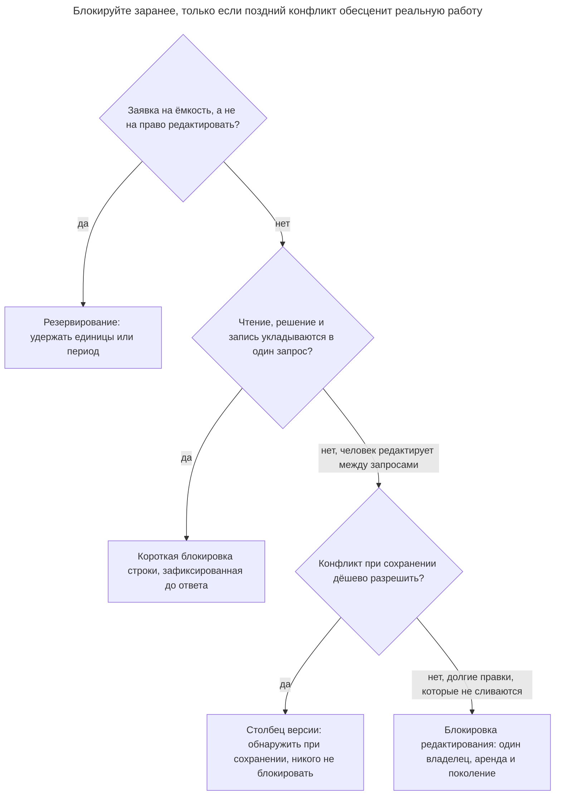
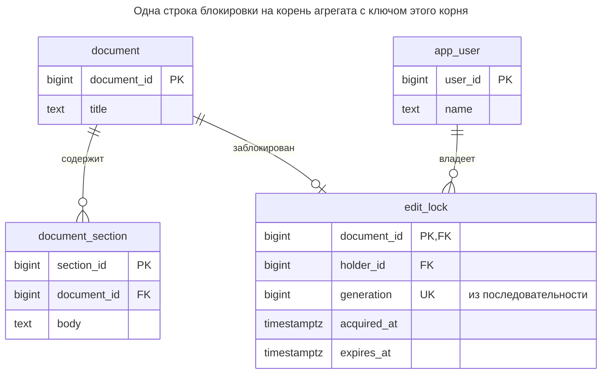
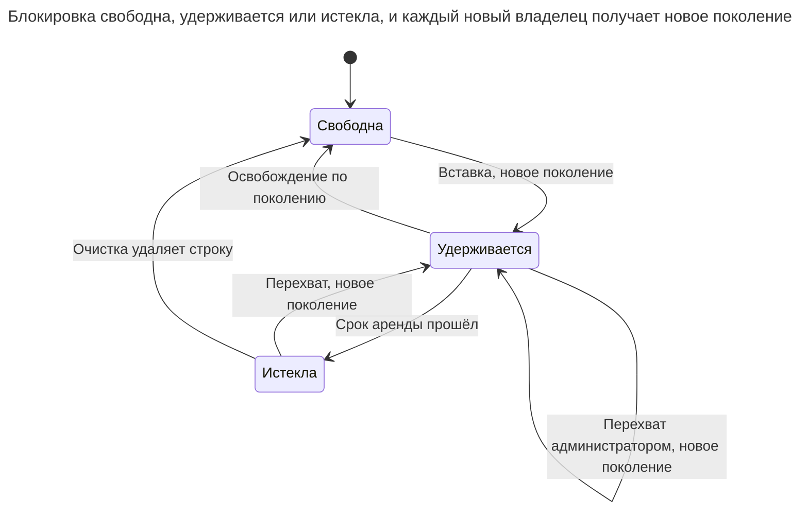
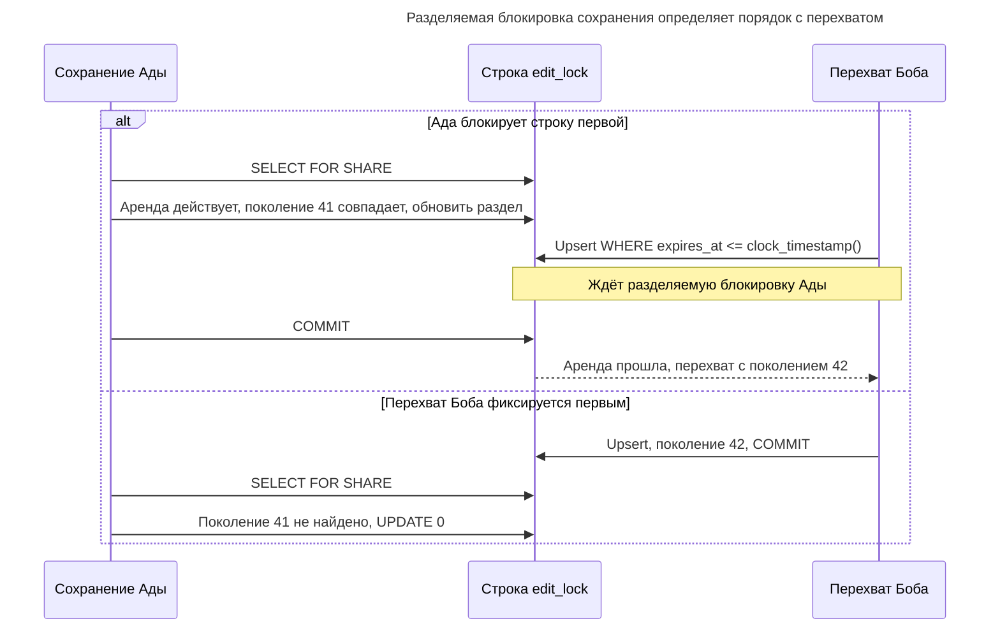

# Блокировка редактирования

## Назначение

Блокировка редактирования даёт одному пользователю исключительное право редактировать ресурс в течение ограниченного времени, на протяжении многих HTTP-запросов. Остальные видят «заблокировано Адой до 14:30» до того, как начнут работу, а не теряют её из-за конфликта при сохранении. Блокировка — обычная строка: одна на ресурс или на корень агрегата, с владельцем, сроком аренды и токеном поколения. Захват — это вставка по уникальному ключу или, тем же оператором, перехват строки с истёкшей арендой. Сигнал активности продлевает аренду, освобождение удаляет строку, администратор может перехватить блокировку. Каждое сохранение в той же транзакции, что и запись, проверяет, что вызывающая сторона всё ещё владеет блокировкой с тем же поколением, поэтому владелец, чья аренда истекла и была перехвачена, записать не может.

## Также известен как

[Pessimistic Offline Lock](https://martinfowler.com/eaaCatalog/pessimisticOfflineLock.html) — паттерн Дэвида Райса из книги Фаулера *Patterns of Enterprise Application Architecture*, который «предотвращает конфликты между параллельными бизнес-транзакциями, допуская к данным только одну бизнес-транзакцию за раз». Одна блокировка на целую группу строк — [Coarse-Grained Lock](https://martinfowler.com/eaaCatalog/coarseGrainedLock.html) из той же книги. Встречаются также названия check-out, блокировка документа и блокировка записи; в WebDAV это исключительная блокировка записи (exclusive write lock).

## Проблема

Ада открывает договор поставки в 14:00 и двадцать минут переписывает условия оплаты. Боб открывает тот же договор в 14:05 и переписывает раздел о доставке. Со [Столбцом версии](version-column.md) тот, кто сохраняет вторым, получает конфликт и либо сливает изменения вручную, либо делает работу заново. Это приемлемая цена, когда конфликты редки, а правки коротки. Но она слишком высока для долгих правок юридического текста, макетов или конфигурации, которые нельзя слить автоматически: жертва узнаёт о конфликте, только когда работа уже сделана.

Очевидные решения не работают. Столбец `locked_by` в документе без срока остаётся заполненным навсегда, если Ада закроет браузер, и кому-то придётся очищать его вручную. Если прочитать `locked_by IS NULL`, а установить значение вторым оператором, два пользователя могут одновременно увидеть документ свободным. Держать `SELECT ... FOR UPDATE` открытым, пока Ада редактирует, в веб-приложении без состояния невозможно: транзакция должна была бы жить на одном соединении из пула между запросами, а все остальные писатели ждали бы, пока человек допьёт кофе. Если проверять блокировку при открытии формы, а сохранять безусловно, пользователь, у которого блокировку перехватили, перезапишет работу нового владельца.

## Решение

Храните блокировку как строку, первичный ключ которой — блокируемый ресурс. Захват — это вставка строки; первичный ключ допускает только одну строку, поэтому из двух пользователей, пришедших одновременно, выигрывает один. Тем же оператором `ON CONFLICT ... DO UPDATE ... WHERE expires_at <= clock_timestamp()` перехватывает блокировку, у которой истекла аренда. Отклонённый захват возвращает ноль строк, и экран читает текущую строку, чтобы показать, кто держит блокировку и до какого времени.

Аренда и поколение — это механизм, которым [Таблица очереди](queue-table.md) защищает получение задания обработчиком, только применённый к человеку: страница редактора отправляет сигналы активности, продлевающие `expires_at`, пока пользователь работает; каждый захват или перехват выдаёт новое поколение; каждое продление, сохранение и освобождение называет поколение, которым владеет. Одно отличие существенно. Строка задания в очереди переживает свои попытки, поэтому поколением может служить счётчик в этой строке. Здесь освобождение удаляет строку блокировки, поэтому счётчик в строке начинался бы заново с 1, и старый токен мог бы снова совпасть. Берите поколения из последовательности; RFC 4918 требует того же от токенов блокировок WebDAV, которые должны быть [«уникальны для всех ресурсов на все времена»](https://www.rfc-editor.org/rfc/rfc4918.html#section-6.5).

Сохранение сначала блокирует строку блокировки через `FOR SHARE`, затем записывает, только если в этой строке по-прежнему владелец и поколение вызывающей стороны и аренда действует. Разделяемая блокировка строки заставляет параллельный перехват ждать фиксации сохранения. Блокируйте корень агрегата, а не каждую дочернюю строку: одна блокировка документа покрывает его разделы — это и есть Coarse-Grained Lock. Все сроки считаются по часам базы данных; клиенты никогда не присылают `expires_at`.

## Альтернативы и выбор

| Соседний паттерн или механизм | Связь | Определяющее требование |
| --- | --- | --- |
| [Столбец версии](version-column.md) | Замена; также дополнение | Конфликты редки или их дёшево слить: обнаруживайте их при сохранении и никого не блокируйте. Сохраняйте версию и при блокировках редактирования — для писателей, которые не берут блокировку, и для владельца, захватившего её заново после истечения |
| Короткая блокировка строки, `SELECT ... FOR UPDATE` | Вариант реализации внутри каждого сохранения, но не замена | Чтение, решение и запись укладываются в один запрос. Она не должна охватывать время, пока пользователь думает |
| [Резервирование](reservation.md) | Другое назначение | Заявка на ёмкость — период комнаты или единицы товара — и заканчивается подтверждением или истечением. Блокировка редактирования заявляет право менять ресурс и заканчивается освобождением; подтверждать нечего |
| [Таблица очереди](queue-table.md) | Тот же механизм аренды и поколения | Владелец — обработчик, выполняющий задание, а не редактирующий человек |
| Сеансовая рекомендательная блокировка | Отвергнутый вариант реализации | PostgreSQL удерживает сеансовую [рекомендательную блокировку](https://www.postgresql.org/docs/18/explicit-locking.html#ADVISORY-LOCKS) «до явного освобождения или конца сеанса»; HTTP-запрос через пул соединений свой сеанс не сохраняет |
| [Журнал аудита](audit-log.md) | Дополнение | Перехваты администратором и снятые блокировки должны иметь автора |

Полное сравнение — в [Атласе решений](decision-atlas.md).



Блокировка редактирования меняет доступность на определённость: пока договор у Ады, никто другой не может его изменить, даже если собирался править другой раздел. Выбирайте её для долгих несливаемых правок, где именно это и нужно.

## Структура



Первичный ключ блокировки — ключ документа, поэтому у документа не больше одной строки блокировки. У разделов нет собственной блокировки: сохранение раздела проверяет блокировку его документа. Поколение уникально среди всех строк блокировок, прошлых и нынешних.

## Таблицы и инварианты

- **`document`** — корень агрегата и единица блокировки. Его удаление каскадно удаляет блокировку.
- **`document_section`** принадлежит одному документу. Его запись защищает блокировка документа, а не отдельная блокировка раздела.
- **`edit_lock`** содержит не больше одной строки на документ — это обеспечивает первичный ключ. `generation` уникален и берётся из последовательности, поэтому освобождённая и снова захваченная блокировка никогда не повторяет старый токен. `edit_lock_lease` требует `expires_at > acquired_at`.
- **Действующая блокировка** — строка, у которой `expires_at` позже текущего времени базы. Истечение срока строку не удаляет; оно лишь делает её доступной для перехвата. Задача очистки может удалять истёкшие строки, но корректность от неё не зависит.
- **Право записи** принадлежит протоколу сохранения. Ограничение `CHECK` не может заглянуть в другую таблицу, поэтому база не остановит писателя, который пропускает блокировку. Направляйте запись разделов через одну границу приложения или функцию, выполняющую проверку, и ограничьте прямые права на таблицы, как это делает [Журнал аудита](audit-log.md) для своей управляемой операции.

## Когда применять

- Пользователи редактируют ресурс минутами или часами на протяжении многих запросов, и конфликт при сохранении выбросил бы реальную работу.
- Правки нельзя слить автоматически: юридический текст, макеты, таблицы цен, конфигурация.
- Остальным полезно видеть, кто редактирует и до какого времени, ещё до начала работы.
- Вы можете определить длину аренды, сигнал активности и то, кто вправе перехватить блокировку.

## Последствия и компромиссы

- ➕ Конфликты предотвращаются заранее; пользователь с блокировкой может закончить работу, не получив отказ при сохранении.
- ➕ Текущего владельца и срок можно запросить, поэтому интерфейс может показать, кто редактирует.
- ➕ Упавший или брошенный редактор блокирует остальных только до истечения аренды, без ручной очистки.
- ➕ Поколение точно отсекает устаревших владельцев, потому что проверка токена и запись выполняются в одной транзакции базы.
- ➖ Доступность падает: пока блокировка удерживается, никто другой не может редактировать ресурс, даже не связанную с правкой часть. Крупная блокировка блокирует больше, чем мелкая.
- ➖ Длина аренды — компромисс: короткая аренда быстро освобождает брошенные документы, но отнимает блокировку у пользователя, чьи сигналы активности прервались из-за спящего ноутбука или обрыва сети.
- ➖ Каждый путь записи должен проверять блокировку. Один импорт или административный инструмент, пишущий напрямую, обходит весь протокол.
- ➖ Владелец, захвативший блокировку заново после истечения, не может по одной блокировке понять, редактировал ли кто-то документ в промежутке; нужен столбец версии или перечитывание.

## Реализация

[Полный скрипт для PostgreSQL 18.7](../assets/edit-lock/edit-lock.sql) проверяет захват, отказ во втором захвате, обе отклонённые записи, продление, сохранение раздела, истечение и перехват, отклонённые позднее сохранение и освобождение, перехват администратором и вызванное им устаревшее продление, новые поколения после освобождения, очистку и защищённое сохранение вообще без блокировки. Один сеанс по очереди играет всех пользователей и имитирует истечение, сдвигая аренду в прошлое; ожидания между параллельными сеансами, описанные в разделе «Сбои и конкурентность», в скрипт не входят:

```sql
CREATE TABLE app_user (user_id bigint PRIMARY KEY, name text NOT NULL);
CREATE TABLE document (document_id bigint PRIMARY KEY, title text NOT NULL);
CREATE TABLE document_section (
    section_id bigint PRIMARY KEY,
    document_id bigint NOT NULL REFERENCES document (document_id),
    body text NOT NULL
);
CREATE SEQUENCE lock_generation;
CREATE TABLE edit_lock (
    document_id bigint PRIMARY KEY REFERENCES document (document_id) ON DELETE CASCADE,
    holder_id bigint NOT NULL REFERENCES app_user (user_id),
    generation bigint NOT NULL UNIQUE DEFAULT nextval('lock_generation'),
    acquired_at timestamptz NOT NULL,
    expires_at timestamptz NOT NULL,
    CONSTRAINT edit_lock_lease CHECK (expires_at > acquired_at)
);
CREATE INDEX edit_lock_expiry_idx ON edit_lock (expires_at);
```

Захват или перехват истёкшей блокировки одним оператором:

```sql
INSERT INTO edit_lock (document_id, holder_id, acquired_at, expires_at)
VALUES (1, 1, clock_timestamp(), clock_timestamp() + interval '15 minutes')
ON CONFLICT (document_id) DO UPDATE
SET holder_id = EXCLUDED.holder_id, generation = EXCLUDED.generation,
    acquired_at = EXCLUDED.acquired_at, expires_at = EXCLUDED.expires_at
WHERE edit_lock.expires_at <= clock_timestamp()
RETURNING generation;
```

Ада получает одну строку со своим поколением, и страница хранит его вместе с сеансом редактирования. Такой же оператор Боба, пока аренда Ады действует, возвращает ноль строк без ошибки; то же происходит со второй вкладкой браузера самой Ады: владелец сам по себе не идентифицирует блокировку, её идентифицирует поколение. Строка `EXCLUDED` уже содержит свежий `nextval`, поэтому перехват получает новый токен. Отклонённые попытки тоже расходуют значения последовательности; пропуски безвредны, важна только уникальность. Затем экран Боба читает:

```sql
SELECT u.name, l.expires_at
FROM edit_lock AS l JOIN app_user AS u ON u.user_id = l.holder_id
WHERE l.document_id = 1 AND l.expires_at > clock_timestamp();
```

Обычная вставка без условия перехвата показывает, что гарантирует первичный ключ. PostgreSQL 18.7 возвращает SQLSTATE `23505`: `ERROR: duplicate key value violates unique constraint "edit_lock_pkey"` с `DETAIL: Key (document_id)=(1) already exists.` Аренда, которая заканчивается в момент начала, вызывает `23514`: `ERROR: new row for relation "edit_lock" violates check constraint "edit_lock_lease"`.

В операторах ниже поколение Ады — 41, а Боба — 42; скрипт подставляет те значения, которые вернула последовательность. Сигнал активности продлевает только действующую аренду с поколением вызывающей стороны, а освобождение удаляет только её поколение. Ноль строк в любом из случаев означает, что блокировки больше нет:

```sql
UPDATE edit_lock SET expires_at = clock_timestamp() + interval '20 minutes'
WHERE document_id = 1 AND holder_id = 1 AND generation = 41
  AND expires_at > clock_timestamp()
RETURNING expires_at;

DELETE FROM edit_lock WHERE document_id = 1 AND generation = 41;
```

Сохранение сначала блокирует строку блокировки, а затем записывает, только пока блокировка принадлежит вызывающей стороне, — так же, как Таблица очереди, когда обработчик подтверждает задание:

```sql
BEGIN;
SELECT document_id FROM edit_lock WHERE document_id = 1 FOR SHARE;
UPDATE document_section SET body = 'Payment terms: 45 days'
WHERE document_id = 1 AND section_id = 10
  AND EXISTS (
      SELECT FROM edit_lock
      WHERE document_id = 1 AND holder_id = 1 AND generation = 41
        AND expires_at > clock_timestamp())
RETURNING section_id;
COMMIT;
```

Одна возвращённая строка означает, что сохранение принято. Ноль строк означает, что Ада больше не владеет блокировкой: откатите транзакцию и сообщите ей, кто владеет. После того как скрипт сдвигает аренду Ады в прошлое и Боб её перехватывает, то же сохранение с поколением 41 ничего не меняет, и раздел сохраняет свой текст; позднее освобождение Ады ничего не удаляет, и блокировка Боба остаётся.

Перехват администратором — это оператор захвата без условия истечения. Он работает и тогда, когда строки блокировки нет:

```sql
INSERT INTO edit_lock (document_id, holder_id, acquired_at, expires_at)
VALUES (1, 3, clock_timestamp(), clock_timestamp() + interval '15 minutes')
ON CONFLICT (document_id) DO UPDATE
SET holder_id = EXCLUDED.holder_id, generation = EXCLUDED.generation,
    acquired_at = EXCLUDED.acquired_at, expires_at = EXCLUDED.expires_at
RETURNING generation;
```

Поколение Боба сразу перестаёт совпадать, и его следующее продление или сохранение получает ноль строк. Записывайте перехват, его причину и вытесненного владельца в [Журнал аудита](audit-log.md) в той же транзакции. Чтобы снять блокировку, не забирая её себе, удалите строку безусловно по тому же правилу аудита.



Обратите внимание: «Истекла» — не хранимое состояние, а удерживаемая строка, срок которой прошёл; с ней ничего не происходит, пока кто-нибудь её не перехватит или очистка её не удалит. Каждый переход в «Удерживается», кроме сигнала активности, выдаёт новое поколение и делает недействительными все выданные до него токены.

## Поддержка в движках

- **PostgreSQL 18:** [`INSERT ... ON CONFLICT DO UPDATE`](https://www.postgresql.org/docs/18/sql-insert.html) «гарантирует атомарный исход `INSERT` или `UPDATE`» при конкурентной работе, а его условие `WHERE` делает обновление условным; конфликтующая строка блокируется, даже когда условие ложно. [`FOR SHARE`](https://www.postgresql.org/docs/18/sql-select.html#SQL-FOR-UPDATE-SHARE) не даёт другим транзакциям выполнить `UPDATE` и `DELETE` строки, поэтому перехват или чужое освобождение ждут фиксации сохранения. [`clock_timestamp()`](https://www.postgresql.org/docs/18/functions-datetime.html#FUNCTIONS-DATETIME-CURRENT) читает часы сервера в момент вызова.
- **MySQL 8.4:** [`INSERT ... ON DUPLICATE KEY UPDATE`](https://dev.mysql.com/doc/refman/8.4/en/insert-on-duplicate.html) принимает список присваиваний столбцам. Захватывайте обычным `INSERT`; при ошибке дубликата ключа перехватывайте через `UPDATE ... WHERE document_id = ? AND expires_at <= CURRENT_TIMESTAMP(6)` и проверяйте число затронутых строк. Берите поколения из генератора, который никогда не повторяется, например из строки-счётчика, обновляемой в той же транзакции. Блокируйте строку при сохранении через [`FOR SHARE`](https://dev.mysql.com/doc/refman/8.4/en/innodb-locking-reads.html). [`GET_LOCK()`](https://dev.mysql.com/doc/refman/8.4/en/locking-functions.html) не замена: такая блокировка освобождается в конце сеанса и не освобождается при фиксации.
- **SQL Server 2025 (17.x):** используйте условный `UPDATE` для перехвата и `INSERT` для захвата либо [`MERGE`](https://learn.microsoft.com/en-us/sql/t-sql/statements/merge-transact-sql?view=sql-server-ver17), документация которого рекомендует `HOLDLOCK`, чтобы избежать нарушений уникального ключа, когда одни и те же ключи одновременно вставляются и обновляются. Читайте строку блокировки с подсказкой [`UPDLOCK`](https://learn.microsoft.com/en-us/sql/t-sql/queries/hints-transact-sql-table?view=sql-server-ver17) в транзакции сохранения, берите поколения из [`CREATE SEQUENCE`](https://learn.microsoft.com/en-us/sql/t-sql/statements/create-sequence-transact-sql?view=sql-server-ver17), а время — из [`SYSDATETIMEOFFSET()`](https://learn.microsoft.com/en-us/sql/t-sql/functions/sysdatetimeoffset-transact-sql?view=sql-server-ver17). Блокировки [`sp_getapplock`](https://learn.microsoft.com/en-us/sql/relational-databases/system-stored-procedures/sp-getapplock-transact-sql?view=sql-server-ver17) принадлежат транзакции или сеансу и не переживают ни ту, ни другой.
- **Oracle AI Database 26ai:** [`MERGE`](https://docs.oracle.com/en/database/oracle/oracle-database/26/sqlrf/MERGE.html) допускает `WHERE` в части обновления, что выражает «перехватить, только если истекла». Блокируйте строку через [`FOR UPDATE`](https://docs.oracle.com/en/database/oracle/oracle-database/26/sqlrf/SELECT.html) в транзакции сохранения и сравнивайте с [`SYSTIMESTAMP`](https://docs.oracle.com/en/database/oracle/oracle-database/26/sqlrf/SYSTIMESTAMP.html), который читает часы системы, где работает база.
- **SQLite 3:** [upsert](https://www.sqlite.org/lang_upsert.html) поддерживает `ON CONFLICT DO UPDATE ... WHERE`, поэтому оператор захвата переносится; поколения берите из строки-счётчика, а не из последовательности. Писатели сериализуются, поэтому начинайте сохранение с [`BEGIN IMMEDIATE`](https://www.sqlite.org/lang_transaction.html) и проверяйте блокировку внутри этой транзакции. «Часы базы» здесь — часы хоста, на котором работает библиотека.

## Сбои и конкурентность

Два пользователя, одновременно нажавшие «Редактировать», оба выполняют оператор захвата. Первичный ключ допускает одну строку; PostgreSQL разрешает конфликт атомарно, и второй оператор видит действующую блокировку первого пользователя и возвращает ноль строк. Никому не нужна блокировка отдельного флага «документ свободен», и никто не видит ошибку. Пользователь, нашедший документ заблокированным, может повторить попытку после показанного срока.

Опасная гонка — перехват против позднего сохранения прежнего владельца. Аренда Ады заканчивается в 14:30, пока её ноутбук спит; Боб перехватывает блокировку в 14:32; в 14:40 ноутбук Ады просыпается и отправляет сохранение из очереди.

```mermaid
---
title: Аренда ограничивает прежнего владельца, а поколение отклоняет его позднее сохранение
config:
  gantt:
    useWidth: 900
---
gantt
    dateFormat HH:mm
    axisFormat %H:%M
    todayMarker off
    section Ада, поколение 41
    Аренда, продлеваемая сигналами :active, a1, 14:00, 14:30
    Ноутбук спит :crit, a2, 14:12, 14:40
    Позднее сохранение отклонено :milestone, crit, a3, 14:40, 0m
    section Боб, поколение 42
    Ждёт, экран показывает блокировку Ады :b1, 14:05, 14:32
    Аренда после перехвата :active, b2, 14:32, 14:47
```



Сигналы активности Ады прекращаются в 14:12, но аренда действует до 14:30, поэтому Боб ждёт. После перехвата сохранение Ады называет поколение 41 и ничего не находит. Без проверки поколения её сохранение перезаписало бы работу Боба.

Порядок внутри базы определяет блокировка строки `edit_lock`:



В обеих ветках запись и перехват упорядочены: сохранение Ады фиксируется, пока она владеет действующей арендой, или не проходит. Без `FOR SHARE` проверка существования у Ады и перехват Боба могли бы зафиксироваться вокруг её записи в любом порядке, и сохранение, проверенное по поколению 41, легло бы уже после появления поколения 42. Сохранение, заблокировавшее строку в 14:29:59, законно фиксируется после срока: срок проверяется сразу после блокировки строки.

Сравнивайте сроки по часам базы. У серверов приложений, отправляющих сигналы активности, и у браузеров пользователей свои часы, которые могут расходиться на минуты; если бы клиент присылал `expires_at`, спешащие часы могли бы удерживать блокировку вечно. Вычисляйте каждый срок в самом операторе как `clock_timestamp() + interval`. `now()` фиксируется в начале транзакции, поэтому после ожидания блокировки он раньше момента решения; какие часы читает каждая функция, объясняет [Момент времени](time-point.md). Переводите `expires_at` в часовой пояс зрителя только для показа.

Поколение точно отсекает записи в эту базу, потому что проверка и запись фиксируются вместе. Оно не мешает устаревшему владельцу отправить письмо или вызвать другой сервис; таким эффектам нужна собственная идемпотентность, как объясняет Таблица очереди для обработчиков. Блокировка строки, которую берёт сохранение, длится миллисекунды; блокировка редактирования — минуты. Не смешивайте их: никогда не держите `SELECT ... FOR UPDATE` с момента, когда пользователь открыл форму. PostgreSQL умеет завершать такие сеансы через [`idle_in_transaction_session_timeout`](https://www.postgresql.org/docs/18/runtime-config-client.html#GUC-IDLE-IN-TRANSACTION-SESSION-TIMEOUT), но архитектура не должна на это рассчитывать.

## Миграция

Исходная точка — оптимистический контроль конфликтов или его отсутствие. Создайте `edit_lock` и последовательность поколений; пока их никто не читает. Разверните редактор, который захватывает блокировку по кнопке «Редактировать», отправляет сигналы активности и освобождает по кнопке «Готово», а сохранения пока идут старым путём. Затем переключите сохранения на защищённую форму для клиентов, владеющих блокировкой. Найдите всех остальных писателей — импорт, административные инструменты, фоновые задания — и либо заставьте их захватывать блокировку, либо задокументируйте, что они её обходят и сохраняют проверку [Столбца версии](version-column.md). Отклоняйте незащищённую запись разделов только после того, как старый редактор исчезнет, через [Расширение и свёртывание](expand-contract.md).

Чтобы откатиться, сначала верните сохранения на путь с проверкой версии, потому что защищённое сохранение не проходит, когда строки блокировки нет; затем прекратите захват, дождитесь истечения действующих аренд и удалите таблицу. Сохраняйте столбец версии на всём протяжении: он защищает переход, а позже подсказывает владельцу, захватившему блокировку заново после истечения, менялся ли документ в его отсутствие.

## Антипаттерны и частые ошибки

- Удерживать транзакцию базы или `SELECT ... FOR UPDATE`, пока пользователь думает.
- Флаг `locked_by` без срока, который снимают только вручную.
- Захват «проверить, затем установить» двумя операторами, без решающего уникального ключа.
- Проверять блокировку при открытии формы, а сохранять безусловно, или проверять её в другой транзакции, чем запись.
- Проверять владельца, но не поколение, так что вторая вкладка или заново захваченная блокировка пропускают устаревшие сохранения.
- Счётчик поколения в самой строке, которую освобождение удаляет, из-за чего токены повторяются.
- Брать срок у клиента или из `now()` после ожидания вместо `clock_timestamp()`.
- Не блокировать строку `edit_lock` при сохранении, так что перехват может зафиксироваться между проверкой и записью.
- Блокировать каждую дочернюю строку отдельно вместо корня агрегата, так что каждому писателю приходится самому находить и блокировать всю группу.
- Сеансовые рекомендательные блокировки или `GET_LOCK()`, удерживаемые между HTTP-запросами через пул соединений.
- Молчаливые перехваты администратором без записи о том, кто кого вытеснил.

## Известные применения

- WebDAV ([RFC 4918](https://www.rfc-editor.org/rfc/rfc4918.html)) определяет протокольную форму этого паттерна. `LOCK` создаёт блокировку с [тайм-аутом](https://www.rfc-editor.org/rfc/rfc4918.html#section-6.6), который выбирает сервер, и возвращает токен блокировки, уникальный на все времена; [обновление](https://www.rfc-editor.org/rfc/rfc4918.html#section-9.10.2) перезапускает тайм-аут; `UNLOCK` освобождает блокировку; запись в заблокированный ресурс должна передать токен в заголовке `If`, иначе она не проходит — обычно с [`423 Locked`](https://www.rfc-editor.org/rfc/rfc4918.html#section-11.3). RFC также требует от клиентов исходить из того, что блокировка может исчезнуть в любой момент, например когда её снимает «достаточно привилегированный пользователь».
- [Solid Queue](https://github.com/rails/solid_queue) для Rails хранит ограничения конкурентности в таблице [`solid_queue_semaphores`](https://raw.githubusercontent.com/rails/solid_queue/main/lib/generators/solid_queue/install/templates/db/queue_schema.rb) с уникальным `key`, `value` и `expires_at`. Это считающий семафор для заданий, а не блокировка с одним владельцем: задание занимает слот, вставляя ключ или уменьшая `value`, а README описывает срок как страховку для задания, которое так и не освободило слот. Здесь та же основная идея — уникальный ключ на блокируемый объект плюс срок по часам базы, — но без владельца и поколения.

## Связанные паттерны

- [Столбец версии](version-column.md) обнаруживает конфликты при сохранении, а не предотвращает их, и дополняет блокировку редактирования для писателей вне её.
- [Таблица очереди](queue-table.md) объясняет аренду и поколение, которые эта глава применяет к редакторам-людям.
- [Резервирование](reservation.md) удерживает ёмкость до подтверждения или истечения, а не исключительное право редактировать.
- [Момент времени](time-point.md) объясняет, какие часы читают `now()` и `clock_timestamp()`.
- [Журнал аудита](audit-log.md) записывает перехваты администратором и снятые блокировки.
- [Расширение и свёртывание](expand-contract.md) поэтапно переводит запись с незащищённых сохранений на защищённые.
