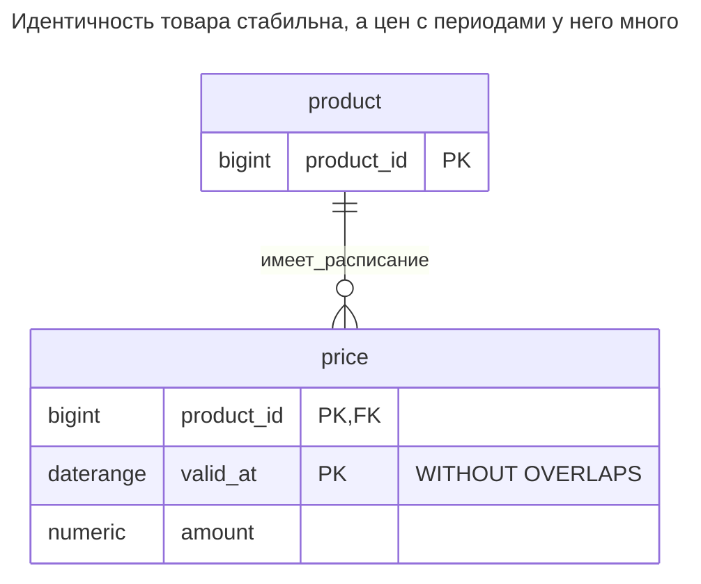
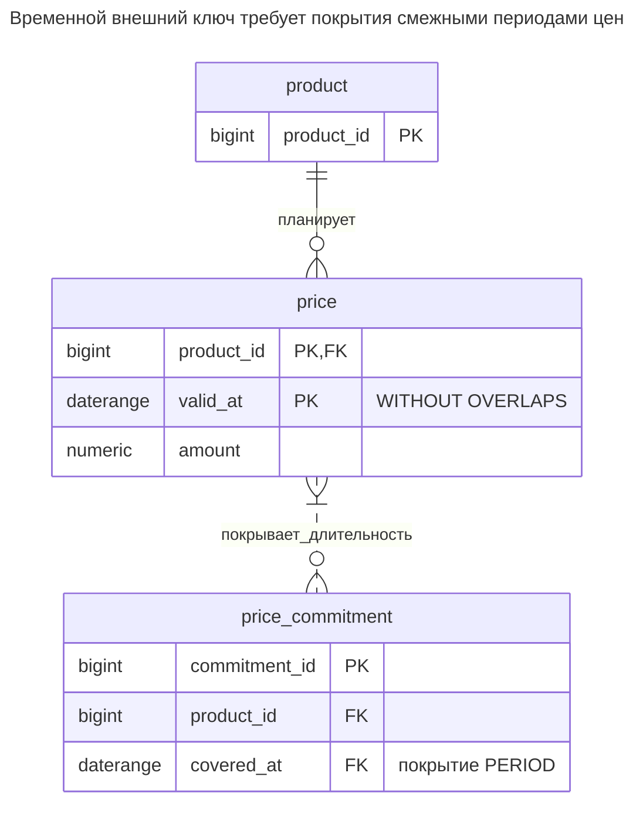
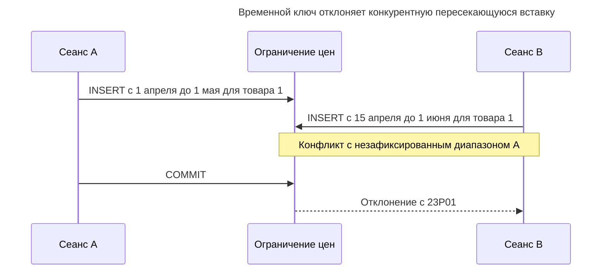
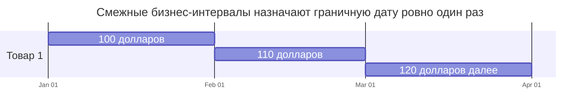
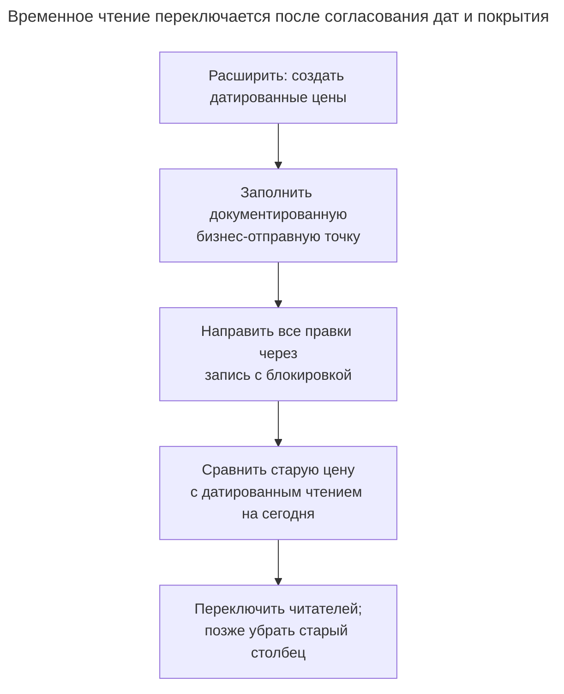

# Период действия

## Назначение

Период действия задаёт каждой строке бизнес-интервал, в котором она действительна: цена с первого числа месяца, должность сотрудника до указанной даты, версия договора на год. Ключ состоит из сущности и периода, а база запрещает пересечение периодов одной сущности — исключающим ограничением на диапазонном типе, `WITHOUT OVERLAPS` в PostgreSQL 18 или периодами прикладного времени SQL:2011 в других движках. Глава рассматривает полуоткрытые интервалы, поиск действующего на дату значения и изменение периода без пробелов. Сравните [временные ключи PostgreSQL 18](https://www.postgresql.org/docs/18/sql-createtable.html) с [моделью периодов SQL:2011](https://sigmodrecord.org/?download_id=3338&smd_process_download=1).

## Также известен как

[Effectivity](https://martinfowler.com/eaaDev/Effectivity.html) в каталоге Фаулера; прикладное время, или время действия. Кулкарни и Михельс описывают [таблицы с периодами прикладного времени SQL:2011](https://sigmodrecord.org/?download_id=3338&smd_process_download=1), где именованный период — метаданные над столбцами начала и конца. Временные ключи PostgreSQL со значениями диапазонного типа предоставляют другой SQL-интерфейс.

## Проблема

В феврале нужно опубликовать мартовскую цену, не меняя сегодняшнюю плату покупателей. Один столбец `price` не хранит оба ответа, а `next_price` лишь откладывает проблему до следующего запланированного изменения. Прежние цены тоже важны при расчёте заказа на более раннюю дату оказания услуги.

Неоднозначность определяется товаром и бизнес-датой: две пересекающиеся цены не могут одновременно быть основными. Отсутствие цены — отдельный вопрос. До запуска или между сезонами продаж цена товара может намеренно отсутствовать. Определите требуемое покрытие вместо предположения, что запрет пересечений заполняет и пробелы.

## Решение

Храните по одной строке на товар и период действия. Всюду используйте `[start, end)`: февральская строка заканчивается ровно там, где начинается мартовская, а 1 марта относится только к мартовской. [Документация диапазонов PostgreSQL](https://www.postgresql.org/docs/18/rangetypes.html) определяет границы, включение и пересечение; `daterange` приводит значения к каноническому полуоткрытому представлению.

Используйте временной первичный ключ PostgreSQL 18 `(product_id, valid_at WITHOUT OVERLAPS)`, чтобы отклонять пересекающиеся периоды одного товара. Перед изменением расписания блокируйте стабильную строку товара, сокращайте старый интервал и вставляйте замену в одной транзакции. Ограничение обеспечивает уникальность на каждую дату; протокол записи сохраняет именно то покрытие, которое обещает операция.

## Альтернативы и выбор

| Соседний паттерн | Связь | Определяющее требование |
| --- | --- | --- |
| [Таблица истории](history-table.md) | Замена временной шкалы; дополнение для регистрации правок | Важно, когда база записала значение, а не когда оно действует |
| [Битемпоральная таблица](bitemporal-table.md) | Замена, включающая период действия | Исправление должно сохранять прежнее представление и исправленное бизнес-расписание |
| [Резервирование](reservation.md) | Дополнение с тем же механизмом пересечений | Периоды обозначают требования на ресурс, которые истекают или подтверждаются |
| [История статусов](status-history.md) | Замена для вопросов о переходах | Нужна последовательность принятых переходов жизненного цикла, а не значения на интервалах |
| Исключающее ограничение | Вариант реализации | Нужны условный запрет пересечений или несколько измерений диапазонов |

Полное сравнение — в [Атласе решений](decision-atlas.md). Сам по себе запрос бизнес-состояния на дату не требует регистрировать каждую правку расписания.

## Структура



У товара много датированных цен, но на заданную дату подходит не более одной. Ссылкам на товар нужен только обычный ID; ссылкам с требованием покрытия длительности нужно больше.

## Таблицы и инварианты

- **`product`** обеспечивает стабильную идентичность и цель блокировки, даже если цены ещё нет.
- **`price`** требует непустого периода через временной первичный ключ, ограниченного нижнего конца через проверку и неотрицательной суммы. Ключ запрещает пересечения в пределах товара. PostgreSQL указывает, что [`WITHOUT OVERLAPS` использует семантику исключения GiST](https://www.postgresql.org/docs/18/sql-createtable.html).
- **Покрытие** не является инвариантом всей таблицы в этой схеме. Показанное разбиение сохраняет покрытие исходного интервала; прямое удаление может создать пробел.
- **Гранулярность даты** определяется предметной областью: пример задаёт цены на целые бизнес-даты. Для внутридневных изменений задайте политику часовых поясов и диапазоны временных меток вместо неявного приведения меток к датам.

## Когда применять

- Вы планируете несколько будущих цен, назначений, условий или разрешений.
- Вызывающая сторона может передать осмысленную бизнес-дату при выборе значения.
- На дату для сущности допустимо не более одного значения, а отсутствие покрытия имеет явный смысл.

## Последствия и компромиссы

- ➕ Будущие изменения сосуществуют с сегодняшним и прежними значениями.
- ➕ Ограничение пересечений отклоняет неоднозначное расписание даже при гонке проверок приложения.
- ➖ Каждый поиск требует бизнес-даты; выбор строки с максимальным началом может дать будущее значение или перескочить пробел.
- ➖ Исправления требуют арифметики интервалов, особенно при затрагивании нескольких запланированных строк.
- ➖ Обновление старой суммы уничтожает прежнее представление об этой дате. Добавьте время регистрации, если это представление должно оставаться доступным.

## Реализация

[Полный скрипт PostgreSQL 18.6](../assets/effective-dating/effective-dating.sql) проверяет смежные интервалы, сохраняющее покрытие разбиение, запрет пересечений и временное ссылочное покрытие. [`btree_gist`](https://www.postgresql.org/docs/18/btree-gist.html) предоставляет класс операторов равенства для ID товара типа bigint:

```sql
CREATE EXTENSION IF NOT EXISTS btree_gist;
CREATE SCHEMA effective_example;
CREATE TABLE effective_example.product (
    product_id bigint PRIMARY KEY
);
CREATE TABLE effective_example.price (
    product_id bigint REFERENCES effective_example.product (product_id),
    valid_at daterange NOT NULL CHECK (NOT lower_inf(valid_at)),
    amount numeric(12,2) NOT NULL CHECK (amount >= 0),
    CONSTRAINT price_no_overlap PRIMARY KEY (product_id, valid_at WITHOUT OVERLAPS)
);
```

При создании сохраните январскую цену и февральскую без верхней границы. Затем разделите последнюю по 1 марта. Выполняйте операцию при Read Committed, требуйте в приложении ожидаемое число обновлённых строк — одну — и откатывайте транзакцию, если старый интервал больше не совпадает:

```sql
INSERT INTO effective_example.product VALUES (1);
INSERT INTO effective_example.price VALUES
    (1, daterange('2026-01-01', '2026-02-01', '[)'), 100),
    (1, daterange('2026-02-01', NULL, '[)'), 110);
BEGIN;
SELECT product_id FROM effective_example.product WHERE product_id = 1 FOR UPDATE;
UPDATE effective_example.price
SET valid_at = daterange('2026-02-01', '2026-03-01', '[)')
WHERE product_id = 1 AND valid_at = daterange('2026-02-01', NULL, '[)');
INSERT INTO effective_example.price VALUES
    (1, daterange('2026-03-01', NULL, '[)'), 120);
COMMIT;
SELECT amount FROM effective_example.price
WHERE product_id = 1 AND valid_at @> DATE '2026-03-01';
```

Запрос возвращает `120.00`. Строки покрывают январь ценой `100.00`, февраль — `110.00`, март и далее — `120.00`. Блокировка нужна для редактирования расписания; база отклонит это пересечение даже у писателя, пропустившего блокировку:

```sql
INSERT INTO effective_example.price VALUES
    (1, daterange('2026-02-15', '2026-03-15', '[)'), 99);
```

PostgreSQL 18.6 возвращает SQLSTATE `23P01`: `ERROR: conflicting key value violates exclusion constraint "price_no_overlap"`. Детали показывают конфликт `[2026-02-15,2026-03-15)` с `[2026-02-01,2026-03-01)`. Совпадение начальных дат — не единственная коллизия, поэтому уникальности `(product_id, lower(valid_at))` недостаточно.

Зависимая длительность может требовать покрытия объединением родительских периодов через [внешний ключ `PERIOD`](https://www.postgresql.org/docs/18/sql-createtable.html) PostgreSQL 18. Он не означает «существует один идентичный диапазон» и не фиксирует согласованную сумму цены:

```sql
CREATE TABLE effective_example.price_commitment (
    commitment_id bigint PRIMARY KEY,
    product_id bigint NOT NULL,
    covered_at daterange NOT NULL,
    CONSTRAINT commitment_coverage FOREIGN KEY (product_id, PERIOD covered_at)
        REFERENCES effective_example.price (product_id, PERIOD valid_at)
);
INSERT INTO effective_example.price_commitment VALUES
    (1, 1, daterange('2026-01-15', '2026-03-15', '[)'));
```

Вставка проходит через три смежные строки цен. Далее скрипт проверяет, что удаление февральской цены отклоняется с SQLSTATE `23503` ограничением `commitment_coverage`. Если обязательство должно сохранять договорную сумму после исправления цены, сохраните её снимок отдельно.



Пунктирная связь обозначает покрытие, а не обычный внешний ключ на одну родительскую строку: несколько подходящих цен могут совместно покрывать обязательство. Напротив, пробел в датах делает ссылку недопустимой.

## Поддержка в движках

- **PostgreSQL 18:** используйте показанный временной ключ или [исключающее ограничение](https://www.postgresql.org/docs/18/rangetypes.html#RANGETYPES-CONSTRAINT) на равенство сущности и пересечение диапазонов. Последнее поддерживает и условные варианты; временным внешним ключам нужен целевой ключ `WITHOUT OVERLAPS`.
- **MySQL 8.4 / InnoDB:** в [грамматике `CREATE TABLE`](https://dev.mysql.com/doc/refman/8.4/en/create-table.html) нет аналогичного временного ключа. При переносе можно хранить столбцы начала/конца, блокировать родителя через [`FOR UPDATE` в явной транзакции](https://dev.mysql.com/doc/refman/8.4/en/innodb-locking-reads.html), проверять пересечения и записывать. Ограничьте всех писателей этим протоколом; простой предварительной проверки недостаточно.
- **SQL Server 2025 (17.x):** [встроенные темпоральные таблицы](https://learn.microsoft.com/en-us/sql/relational-databases/tables/temporal/overview?view=sql-server-ver17) отслеживают системную историю. Их генерируемый системный период не является расписанием бизнес-действительности; при переносе сохраняйте явные бизнес-границы и согласованный путь записи с запретом пересечений.
- **Oracle Database 21c:** [Temporal Validity](https://docs.oracle.com/en/database/oracle/oracle-database/21/adfns/design_basics.html) предоставляет видимость и запросы по времени действия. Сама возможность не доказывает наличие использованного здесь исключения по товару; сохраните отдельный механизм обеспечения правила.
- **SQLite 3:** реализуйте сравнение начала/конца [триггерами](https://www.sqlite.org/lang_createtrigger.html) или управляемым писателем под [`BEGIN IMMEDIATE`](https://www.sqlite.org/lang_transaction.html), обрабатывая `SQLITE_BUSY`. Модель единственного писателя меняет согласование, но не делает незащищённую последовательность чтения и записи безопасной.

## Сбои и конкурентность



Ограничение разрешает неоднозначность, даже если оба клиента изначально видят пустое апрельское расписание. Не превращайте отказ в безусловную перезапись. Перезагрузите затронутое расписание и передайте разрешение конкурирующего изменения приложению.

Для разбиения несколькими операторами берите [блокировку родительской строки](https://www.postgresql.org/docs/18/explicit-locking.html#LOCKING-ROWS) до чтения интервалов и требуйте этого от каждого редактора расписания. Блокировка только существующих цен не сериализует двух писателей, когда цены ещё нет. Обновление и вставка разбиения должны фиксироваться вместе; сбой вставки обязан восстановить прежний открытый интервал. При немедленных ограничениях сначала сокращайте, потом вставляйте. Массовой переработке с временными пересечениями нужен намеренно спроектированный отложенный контроль, а не удаление ограничений.



1 марта относится к последнему интервалу. Рисунок обрывается на 1 апреля ради отображения; мартовский диапазон примера не имеет верхней границы. Смежность — намеренное покрытие, а не следствие ключа без пересечений.

## Миграция

Переходя от одной текущей цены, выберите достоверную начальную дату действия. Если прежняя действительность неизвестна, укажите это вместо вывода из меток вставки. Создайте датированную таблицу рядом со старыми столбцами, скопируйте согласованный начальный снимок и в период совместной работы направляйте каждое изменение цены через новый путь записи. Если в старой схеме уже есть периоды, устраните пересечения и определите намеренные пробелы до установки ключа.



Используйте [Расширение и свёртывание](expand-contract.md), чтобы сохранить старых читателей, но не поддерживайте два независимых источника истины о цене. Учитывайте [блокировки DDL](https://www.postgresql.org/docs/18/sql-altertable.html) при установке ограничений; это не обещание миграции без блокировок. Для отката выводите старый текущий столбец из датированного расписания и сохраняйте будущие строки. Удаление датированной таблицы потеряет уже принятые будущие изменения.

## Антипаттерны и частые ошибки

- Проверка даты через `BETWEEN` с включёнными концами, назначающая границу двум строкам. Последовательно используйте предикат включения в диапазон.
- Предположение, что временной ключ запрещает пробелы или внешний ключ товара доказывает датированное покрытие.
- Обновление прежней цены на месте при обещании воспроизвести знания предыдущего отчёта.
- Блокировка только разбиваемой строки при разрешении другим писателям менять расписание того же товара иным путём.
- Интервал дат для внутридневной предметной области без определения бизнес-часового пояса и границы суток.

## Известные применения

- [Effectivity](https://martinfowler.com/eaaDev/Effectivity.html) Фаулера моделирует занятость периодами действия и показывает допустимость пересечений в некоторых областях. Здесь запрет пересечений относится именно к одной основной цене товара, а не ко всем датированным фактам.
- [Периоды прикладного времени MariaDB](https://mariadb.com/docs/server/reference/sql-structure/temporal-tables/application-time-periods) поддерживают бизнес-периоды и операции `FOR PORTION OF`; это встроенные варианты редактирования интервалов, а не синтаксис PostgreSQL.

## Связанные паттерны

- [Таблица истории](history-table.md) сохраняет записанные значения до правки расписания.
- [Битемпоральная таблица](bitemporal-table.md) независимо хранит бизнес-действительность и записанные знания.
- [Резервирование](reservation.md) добавляет истечение и подтверждение требований на интервалы.
- [История статусов](status-history.md) записывает рёбра жизненного цикла вместо датированных значений.
- [Расширение и свёртывание](expand-contract.md) поэтапно меняет контракты чтения и записи.
