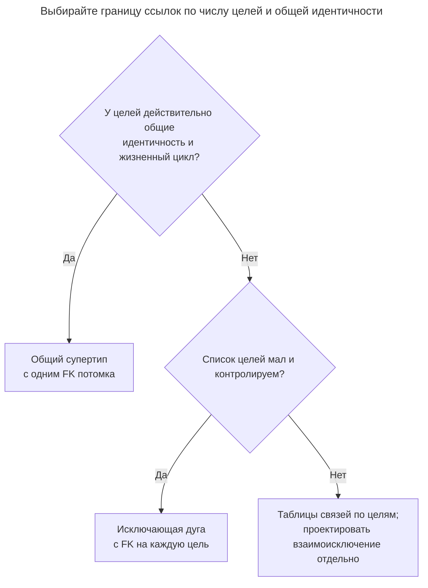
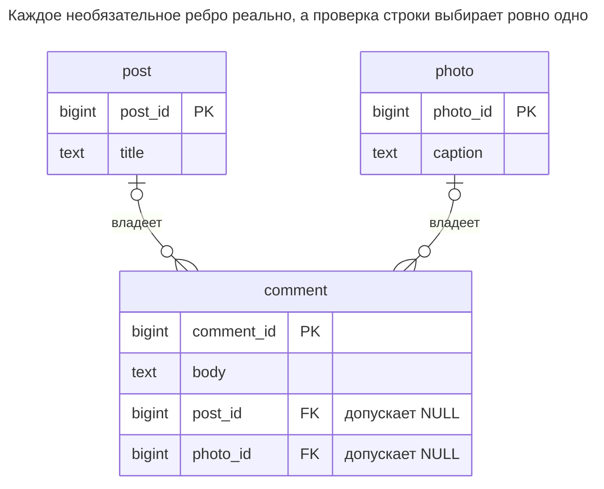
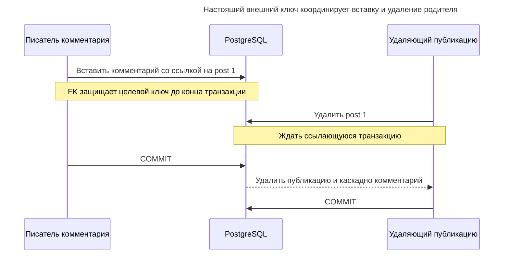
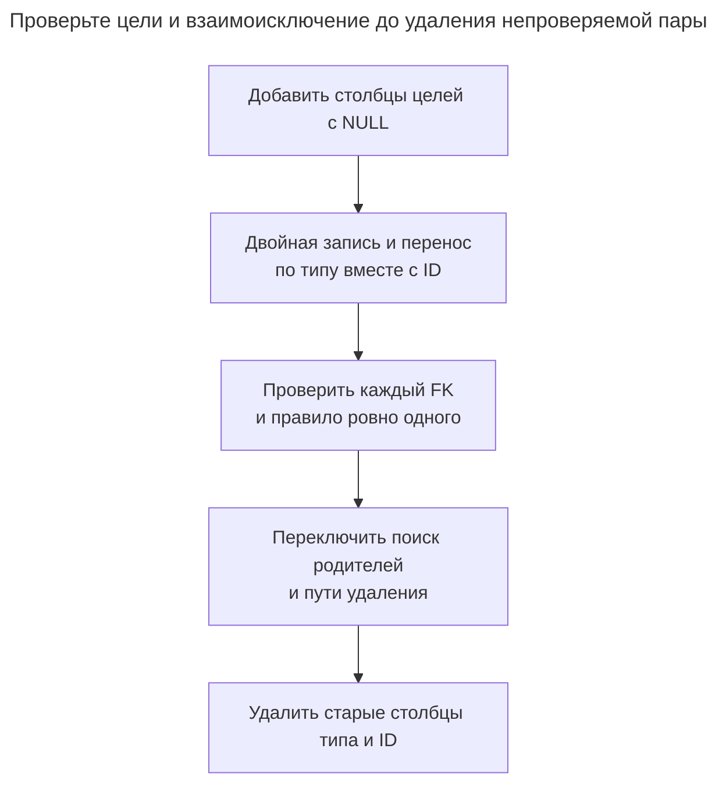

# Исключающая дуга

## Назначение

Исключающая дуга позволяет строке ссылаться ровно на одну из нескольких родительских таблиц — например, комментарию на публикацию или фотографию — через отдельный допускающий `NULL` внешний ключ на каждую цель и `CHECK`, требующий ровно одного заполненного ключа. Каждая ссылка — настоящий внешний ключ, поэтому база гарантирует существование цели и обычную работу каскадов. Глава показывает ограничение и индекс каждого ключа, а также число целей, при котором общий супертип или отдельные таблицы связей становятся лучшим выбором.

## Также известен как

Исключающие отношения; exclusive arcs в [Practical Object-Oriented Models in SQL Билла Карвина](https://www.slideshare.net/slideshow/practical-object-oriented-models-in-sql/1762095). Название описывает взаимоисключение отношений, а не специальный тип ограничения SQL.

## Проблема

Комментарии принадлежат публикациям или фотографиям. Пара `(parent_type, parent_id)` экономит столбец, но не даёт обычному внешнему ключу фиксированной целевой таблицы. Опечатка в типе или удалённая цель оставляют ссылку, которую база не может разрешить.

Два настоящих внешних ключа обеспечивают существование цели, но оставляют два неверных сочетания: комментарий может указывать на обе цели или ни на одну. Два независимых FK не выражают «ровно один». Нужно также выбрать поведение при удалении выбранного родителя.

## Решение

Добавьте по допускающему `NULL` FK на каждую разрешённую цель. Добавьте проверку строки, принимающую ровно одну заполненную ссылку. Выберите политику удаления каждой цели; здесь комментариями владеет родитель, поэтому удаление родителя удаляет комментарии через `ON DELETE CASCADE`. Это обычные [действия внешних ключей PostgreSQL](https://www.postgresql.org/docs/18/ddl-constraints.html#DDL-CONSTRAINTS-FK), а не отдельная очистка осиротевших записей.

Применяйте дугу для короткого явного списка видов родителей. Если новые виды появляются часто, растущий набор столбцов, проверок и соединений делает общий супертип более подходящей границей. Взаимоисключение полезно, лишь когда у комментария действительно один владелец; связь с несколькими целями требует модели отношений.

## Альтернативы и выбор

| Соседний паттерн | Связь | Определяющее требование |
| --- | --- | --- |
| [Таблицы классов](class-table-inheritance.md) с общим супертипом | Замена | У многих видов есть осмысленная общая идентичность, на которую ссылаются потомки |
| Отдельная [Таблица связей](association-table.md) на вид цели | Замена размещения ссылок | Каждое отношение отдельно; явно обеспечьте межтабличное взаимоисключение, если всё ещё нужен один владелец |
| [Единая таблица](single-table-inheritance.md) | Замена хранения родителей | Виды родителей образуют компактное семейство сущностей в одной таблице с ограничениями |
| [Таблицы конкретных классов](concrete-table-inheritance.md) | Дополнение | Виды родителей остаются раздельными, а потомки сохраняют настоящие ссылки на конкретные цели |

Полная таблица — в [Атласе решений](decision-atlas.md). Дуга исправляет [Полиморфные связи](polymorphic-associations.md), а не переименовывает непроверяемую пару `(type, id)`.



Раздельные таблицы отношений локально обеспечивают существование концов. Они не запрещают автоматически одному комментарию появиться по разу в каждой таблице; проверка строки дуги ценна именно размещением конкурирующих вариантов в одной строке.

## Структура



По каждому отдельному ребру у комментария ноль или одна публикация и ноль или одна фотография. `comment_one_parent` совместно ограничивает рёбра ровно одним. Числовые ID двух целевых таблиц могут пересекаться без неоднозначности.

## Таблицы и инварианты

- **`post` и `photo`** владеют независимыми ключами и содержимым. Глобальная выдача родительских ID не нужна.
- **`comment`** имеет одну строку на комментарий и обязательный текст. Каждый заполненный столбец цели обязан указывать на реальную цель.
- **`comment_one_parent`** отклоняет оба заполненных и оба `NULL`. Проверки `NULL` дают `true` или `false` для каждого сочетания, а не неопределённый результат.
- **Удаление** каскадирует лишь от выбранной цели. `SET NULL` нарушил бы проверку ровно одного при удалении последней ссылки.
- **Индексы** покрывают каждую ненулевую родительскую ссылку для чтения по родителю. PostgreSQL [не создаёт индексы ссылающейся стороны автоматически](https://www.postgresql.org/docs/18/ddl-constraints.html#DDL-CONSTRAINTS-FK).

## Когда применять

- У зависимой записи ровно один владелец из небольшого стабильного набора таблиц.
- Вы хотите отклонять отсутствующие цели и обеспечивать поведение удаления базой.
- Виды целей должны оставаться отдельными сущностями, а не делить искусственную базу.

## Последствия и компромиссы

- ➕ Существование и выбор владельца проверяются при каждой обычной записи.
- ➕ Комментарии публикации находятся прямым индексным поиском без различителя типа в условии.
- ➖ Каждый новый вид цели требует столбца, FK, индекса и изменения проверки.
- ➖ Отображение разнородных родителей требует соединений или отдельных запросов по типам целей.
- ➖ Проверки дуги описывают одну строку. Они не обеспечивают более широкие правила вроде «у каждой публикации хотя бы один комментарий».

## Реализация

[Полный скрипт](../assets/exclusive-arc/exclusive-arc.sql) проверяет обе неверные формы, отсутствующую цель, переназначение и каскады:

```sql
CREATE TABLE post (post_id bigint PRIMARY KEY, title text NOT NULL);
CREATE TABLE photo (photo_id bigint PRIMARY KEY, caption text NOT NULL);
CREATE TABLE comment (
    comment_id bigint PRIMARY KEY,
    body text NOT NULL,
    post_id bigint REFERENCES post (post_id) ON DELETE CASCADE,
    photo_id bigint REFERENCES photo (photo_id) ON DELETE CASCADE,
    CONSTRAINT comment_one_parent CHECK (
        (post_id IS NOT NULL AND photo_id IS NULL)
        OR (post_id IS NULL AND photo_id IS NOT NULL)
    )
);
CREATE INDEX comment_post_idx ON comment (post_id) WHERE post_id IS NOT NULL;
CREATE INDEX comment_photo_idx ON comment (photo_id) WHERE photo_id IS NOT NULL;
```

Булево выражение двух столбцов намеренно явное. Для длинной дуги PostgreSQL [`num_nonnulls`](https://www.postgresql.org/docs/18/functions-comparison.html) позволяет считать заполненные цели, но прежде чем сокращать трудную для развития схему, пересмотрите число целей.

```sql
INSERT INTO post VALUES (1, 'Schema notes');
INSERT INTO photo VALUES (2, 'Whiteboard');
INSERT INTO comment VALUES (10, 'Useful', 1, NULL);
SELECT comment_id, body FROM comment WHERE post_id = 1;
```

Запрос возвращает `(10, Useful)`. Назначить комментарию двух родителей нельзя:

```sql
INSERT INTO comment VALUES (11, 'Ambiguous', 1, 2);
```

PostgreSQL 18.6 возвращает SQLSTATE `23514`: `ERROR: new row for relation "comment" violates check constraint "comment_one_parent"`. Оба `NULL` нарушают ту же проверку; единственный `post_id` со значением `999` вместо этого нарушает `comment_post_id_fkey` с SQLSTATE `23503`.

При перемещении комментария меняйте оба столбца одним оператором:

```sql
UPDATE comment SET post_id = NULL, photo_id = 2 WHERE comment_id = 10;
DELETE FROM post WHERE post_id = 1;
SELECT comment_id, photo_id FROM comment;
DELETE FROM photo WHERE photo_id = 2;
SELECT count(*) AS remaining_comments FROM comment;
```

После удаления старой публикации переназначенный комментарий остаётся `(10, 2)`. Удаление текущей фотографии оставляет `0` комментариев. Отдельные обновления с предварительной очисткой старой цели нарушили бы немедленную проверку строки.

## Поддержка в движках

- **PostgreSQL 18:** допускающие `NULL` FK, проверка строки и [частичные индексы](https://www.postgresql.org/docs/18/indexes-partial.html) реализуют пример напрямую.
- **MySQL 8.4 / InnoDB:** [ограничения `CHECK`](https://dev.mysql.com/doc/refman/8.4/en/create-table-check-constraints.html) запрещают ссылочные действия FK для столбцов, используемых в проверках. Не копируйте сочетание проверки с каскадом без изменений; используйте ограничивающие ссылки и явно удаляйте комментарии перед родителями в транзакции либо выберите общий супертип.
- **SQL Server 2025 (17.x):** поддерживает [внешние ключи с `NULL` и проверки](https://learn.microsoft.com/en-us/sql/t-sql/statements/create-table-transact-sql?view=sql-server-ver17), но [несколько каскадных путей запрещены](https://learn.microsoft.com/en-us/sql/relational-databases/errors-events/mssqlserver-1785-database-engine-error?view=sql-server-ver17). Проверяйте весь граф зависимостей родителей, а не только эти три таблицы.
- **Oracle AI Database 26ai:** обычные [FK с `ON DELETE CASCADE`](https://docs.oracle.com/en/database/oracle/oracle-database/26/sqlrf/constraint.html) и явная проверка условий `NULL` выражают дугу. Функция подсчёта PostgreSQL не обязательна.
- **SQLite 3:** включайте [проверку внешних ключей для каждого соединения](https://www.sqlite.org/foreignkeys.html#fk_enable). При переносе DDL сохраняйте явную проверку двух столбцов.

## Сбои и конкурентность

Два сеанса не обходят проверку строки независимым заполнением разных столбцов: каждая получившаяся строка обязана пройти проверку. При [изоляции read committed PostgreSQL](https://www.postgresql.org/docs/18/transaction-iso.html#XACT-READ-COMMITTED) конкурентные обновления строки ждут и перепроверяют условия. Используйте условие с прежним родителем или [Столбец версии](version-column.md), если переназначение должно отказать после перемещения другим писателем.

Гонки удаления цели обрабатывают настоящие внешние ключи. PostgreSQL использует [блокировки строк key-share](https://www.postgresql.org/docs/18/explicit-locking.html#LOCKING-ROWS) для защиты целевых ключей от удаления до конца ссылающейся транзакции.



Комментарий может успешно вставиться, а затем удалиться последующим допустимым удалением родителя. Если удаление зафиксировано первым, последующая вставка ссылки отклоняется. Оба исхода сохраняют ссылочную целостность; ни один не гарантирует вечной жизни нового комментария.

## Миграция

При переходе с `(parent_type, parent_id)` соберите все хранимые имена типов и устраните отсутствующих родителей до копирования ссылок. Добавьте допускающие `NULL` столбцы целей, разверните атомарную запись обоих представлений и перенесите данные по типу вместе с ID. Никогда не сопоставляйте лишь по ID: публикация `1` и фотография `1` могут быть разными родителями.



В PostgreSQL добавляйте проверки и FK как [`NOT VALID`, затем проверяйте](https://www.postgresql.org/docs/18/sql-altertable.html) после переноса. Предусмотрите окно блокировки установки и синхронизируйте перенос той же блокировкой строки комментария, что используют действующие писатели. Сохраняйте старую пару для отката до перехода всех писателей и путей удаления на дугу; при добавлении вида цели пара должна уметь его представлять. См. [Расширение и свёртывание](expand-contract.md).

## Антипаттерны и частые ошибки

- Два внешних ключа без проверки ровно одного: остаются возможными и обе цели, и ни одной.
- Проверять только «хотя бы один», разрешая неоднозначное владение.
- Очищать текущего родителя одним оператором, а назначать следующего другим.
- Выбирать `SET NULL`, сохраняя требование ровно одной цели.
- Переносить ссылки в таблицы связей по целям и считать, что взаимоисключение сохранилось автоматически.

## Известные применения

- [Слайды, опубликованные Карвином](https://www.slideshare.net/slideshow/practical-object-oriented-models-in-sql/1762095), показывают исключающие дуги комментариев к ошибкам или возможностям и сравнивают их с отдельными таблицами связей и базовой таблицей родителей. Эта глава добавляет явную проверку ровно одного.

## Связанные паттерны

- [Таблицы классов](class-table-inheritance.md) предлагают общую цель, когда семейству нужна общая идентичность.
- [Полиморфные связи](polymorphic-associations.md) описывают непроверяемую пару, заменяемую дугой.
- [Таблица связей](association-table.md) объясняет строки отношений, когда потомок связывается с несколькими целями.
- [Таблицы конкретных классов](concrete-table-inheritance.md) оставляют хранение родителей раздельным, пока дуга проверяет зависимые ссылки.
