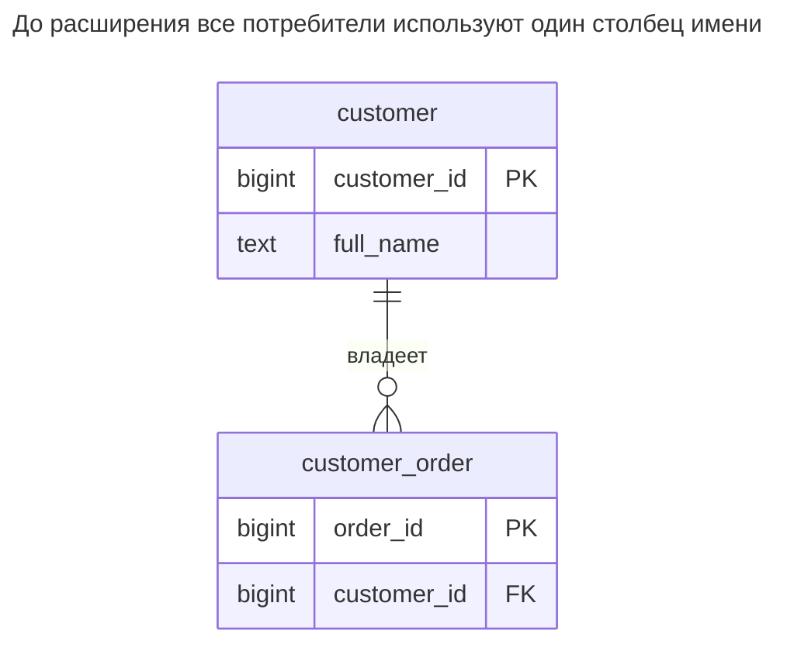
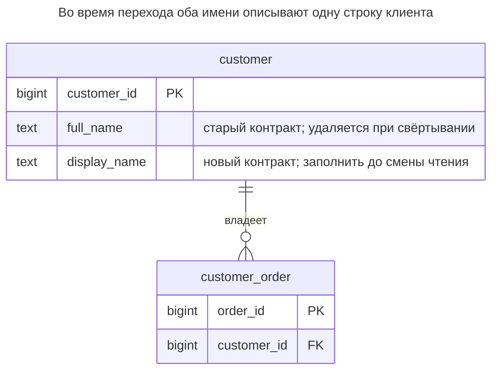
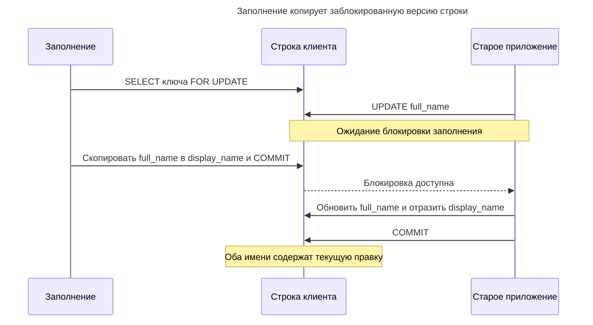
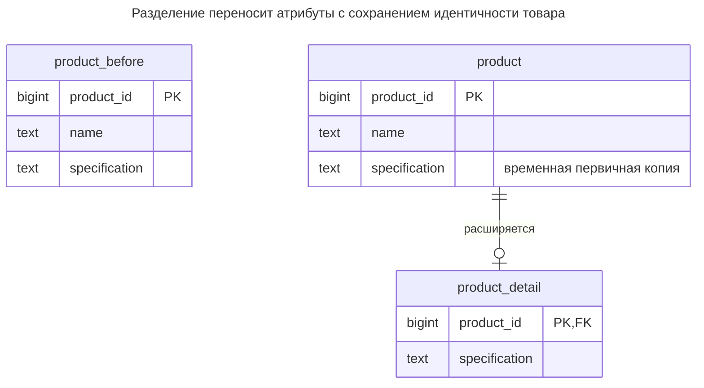
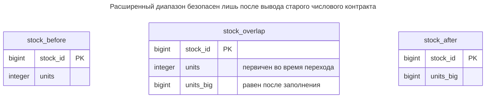

# Расширение и свёртывание

## Назначение

Расширение и свёртывание меняет схему последовательностью обратно совместимых шагов, позволяя старым и новым версиям приложения сосуществовать при миграции без одновременного переключения всех клиентов. Сначала вы расширяете схему — добавляете столбец или таблицу, — затем записываете обе формы и заполняете старые строки, переключаете чтение и лишь потом свёртываете, удаляя старую структуру. Глава показывает переименование столбца, разделение таблицы и смену типа таким способом, а также то, как блокировки DDL всё ещё могут остановить промышленную систему при неосторожном шаге. PostgreSQL [документирует требования блокировок DDL](https://www.postgresql.org/docs/18/sql-altertable.html), поэтому последовательность совместимости сама по себе не гарантирует непрерывную доступность.

## Также известен как

Parallel Change в [описании Данило Сато](https://martinfowler.com/bliki/ParallelChange.html): расширить интерфейс, перевести потребителей, затем свернуть его. [Процесс рефакторинга баз Эмблера](https://agiledata.org/essays/databaseRefactoring.html) описывает переходный период с временными средствами синхронизации. Паттерн касается совместимости версий, а не конкретного фреймворка миграций.

## Проблема

Вы хотите переименовать `customer.full_name` в `display_name`. Прямое переименование может выполниться быстро, но старый процесс продолжает выбирать `full_name`, а новый — `display_name`. Поэтому поэтапное развёртывание, задание в очереди или откат могут сломаться даже при успешном DDL.

Добавление второго столбца лишь откладывает сбой. Если новый код пишет один столбец, а старый — другой, в базе возникают два конкурирующих имени. Фоновая копия также может прочитать старое значение и затереть новую правку. Во время сосуществования нужны явные правила первичности и синхронизации, а перед удалением — доказательства прекращения работы старых читателей и писателей.

## Решение

Рассматривайте состояние схемы и возможности приложения как отдельные шаги развёртывания. Расширяйте добавлением хранилища и синхронизации, сохраняя старый контракт. Переносите существующие строки ограниченными возобновляемыми пакетами, проверяйте эквивалентность и переводите читателей. Свёртывайте лишь после того, как каждый читатель и писатель переносит удаление, а окно отката закрыто.

Для переименования без потерь синхронизируйте изменение любого столбца в другой построчным триггером до записи. Отклоняйте команду, меняющую оба на разные значения. Устанавливайте столбец и триггер вместе, чтобы не было зафиксированного интервала с новой структурой без её обслуживания. [Построчные триггеры PostgreSQL до записи могут менять `NEW`](https://www.postgresql.org/docs/18/plpgsql-trigger.html), позволяя старому обязательному столбцу оставаться корректным при вставках только нового имени.

Не применяйте двунаправленное копирование к произвольному преобразованию. Разделению или расширению типа может понадобиться одна первичная старая форма в течение всего перехода, с новыми читателями и совместимыми со старой формой писателями. Определите момент первичности новой модели и представимость каждого нового значения в старой.

## Альтернативы и выбор

| Соседний паттерн или механизм | Связь | Определяющее требование |
| --- | --- | --- |
| Согласованное развёртывание с обслуживанием | Замена | Можно остановить всех клиентов и принять измеренное окно DDL и преобразования данных |
| Представление совместимости или триггер | Вариант реализации | База переводит старый контракт, пока клиенты мигрируют |
| [Разделение таблицы](table-split.md) | Дополнение | Цель — таблица деталей с общим ключом; эта глава задаёт протокол развёртывания |
| [Секционирование таблицы](table-partitioning.md) | Дополнение | Цель меняет физическую маршрутизацию и, возможно, ключ ссылок |
| [Таблица итогов](summary-table.md) | Дополнение | Читатели переходят к новой проекции после согласования исходного заполнения и текущего обновления |
| Переопределение на основе редакций Oracle | Вариант реализации | Развёртывание Oracle поддерживает представления редакций и межредакционную синхронизацию |

Полное сравнение — в [Атласе решений](decision-atlas.md). Добавочная миграция всё ещё требует блокировок DDL и ресурсов; паттерн снимает требование одновременной замены клиентов, а не исключает любую паузу.

## Структура

Исходная схема содержит одно имя и заказ, ссылающийся на стабильную идентичность клиента:



Переименование касается описательного поля. Заказам не нужны новый ключ или заполнение, поскольку ссылка на клиента не меняется.



Новый столбец временно допускает `NULL` в ещё не обработанных строках. После проверки оба столбца обязательны и равны. Свёртывание удаляет `full_name` и связующий механизм, а не переименовывает `display_name` ещё раз, что вновь сломало бы клиентов.

## Таблицы и инварианты

- **`customer`** сохраняет один первичный ключ во всех фазах. При расширении у старых строк может отсутствовать `display_name`; каждая вставленная или обновлённая строка проходит связующий механизм.
- **`bridge_customer_name`** копирует изменение любого имени в другое. Противоречивую двойную запись он отклоняет с SQLSTATE `23514`, но не решает, какая из независимых пользовательских правок побеждает.
- **Полнота** — условие перехода миграции: заполнить все строки, проверить ограничение отсутствия `NULL` и сравнить значения до переключения чтения.
- **`customer_order`** сохраняет внешний ключ. Миграция неполна, если неучтённый потребитель ещё зависит от удалённого столбца, даже когда все смоделированные ограничения таблиц проходят.
- **Совместимость отката** зависит от представимости. Переименованная строка остаётся представимой, а новое число вне старого целочисленного диапазона — нет.

## Когда применять

- Версии приложений, исполнители или интеграции сосуществуют при развёртывании.
- Ломающее совместимость переименование, разделение или преобразование нельзя установить одной согласованной остановкой.
- Вы можете учесть потребителей, обслуживать временную синхронизацию и измерить завершение до удаления.

## Последствия и компромиссы

- ➕ Каждая версия приложения переходит независимо, пока связующий механизм сохраняет согласованный контракт.
- ➕ До свёртывания можно вернуть старых читателей без потери последующих правок.
- ➖ Дублированное хранение, дополнительные записи и код миграции остаются до явного удаления.
- ➖ Логически добавочный шаг всё ещё может ждать блокировку или сканировать большую таблицу.
- ➖ Откат становится преобразованием данных, когда новые записи превосходят возможности старой модели.
- ➖ Бесконечный переход оставляет два контракта и постоянную неоднозначность. Назначьте владельца связующего механизма и условие его удаления.

## Реализация

[Полный скрипт PostgreSQL 18.6](../assets/expand-contract/expand-contract.sql) проводит переименование до свёртывания и включает варианты разделения таблицы и расширения целого типа. Практикум начинается со старой схемы и двух клиентов:

```sql
CREATE TABLE customer (
    customer_id bigint PRIMARY KEY,
    full_name text NOT NULL
);
CREATE TABLE customer_order (
    order_id bigint PRIMARY KEY,
    customer_id bigint NOT NULL REFERENCES customer (customer_id)
);
INSERT INTO customer VALUES (1, 'Harbor'), (2, 'Meadow');
INSERT INTO customer_order VALUES (10, 1);
```

Расширяйте короткой транзакцией. [`lock_timeout`](https://www.postgresql.org/docs/18/runtime-config-client.html#GUC-LOCK-TIMEOUT) ограничивает каждое ожидание захвата блокировки, а не длительность успешного сканирования или всей миграции:

```sql
BEGIN;
SET LOCAL lock_timeout = '1s';
ALTER TABLE customer ADD COLUMN display_name text;
CREATE FUNCTION bridge_customer_name() RETURNS trigger LANGUAGE plpgsql AS $$
BEGIN
    IF TG_OP = 'INSERT' THEN
        NEW.full_name := coalesce(NEW.full_name, NEW.display_name);
        NEW.display_name := coalesce(NEW.display_name, NEW.full_name);
    ELSE
        IF NEW.full_name IS DISTINCT FROM OLD.full_name
           AND NEW.display_name IS NOT DISTINCT FROM OLD.display_name THEN
            NEW.display_name := NEW.full_name;
        ELSIF NEW.display_name IS DISTINCT FROM OLD.display_name
           AND NEW.full_name IS NOT DISTINCT FROM OLD.full_name THEN
            NEW.full_name := NEW.display_name;
        ELSIF NEW.display_name IS NULL
           AND NEW.full_name IS NOT DISTINCT FROM OLD.full_name
           AND NEW.display_name IS NOT DISTINCT FROM OLD.display_name THEN
            NEW.display_name := NEW.full_name;
        END IF;
    END IF;
    IF NEW.full_name IS DISTINCT FROM NEW.display_name THEN
        RAISE EXCEPTION 'customer names must agree' USING ERRCODE = '23514';
    END IF;
    RETURN NEW;
END $$;
CREATE TRIGGER customer_name_bridge
BEFORE INSERT OR UPDATE ON customer
FOR EACH ROW EXECUTE FUNCTION bridge_customer_name();
COMMIT;
```

Старые клиенты продолжают писать `full_name`, новые могут писать `display_name`. Вставка любого имени заполняет другое. Обновление несвязанных столбцов необработанной строки также инициализирует новое имя. Явная установка `NULL` не поддерживается как операция переименования: существующий обязательный старый столбец по-прежнему отклоняет пустое имя.

Заполняйте строки, блокируя именно копируемую исходную версию. [`FOR UPDATE SKIP LOCKED`](https://www.postgresql.org/docs/18/sql-select.html#SQL-FOR-UPDATE-SHARE) PostgreSQL позволяет исполнителям пропускать заблокированные строки; пропущенные остаются незавершённой работой:

```sql
WITH batch AS (
    SELECT customer_id FROM customer
    WHERE display_name IS NULL
    ORDER BY customer_id LIMIT 100
    FOR UPDATE SKIP LOCKED
)
UPDATE customer AS c SET display_name = c.full_name
FROM batch AS b WHERE c.customer_id = b.customer_id;
UPDATE customer SET full_name = 'Harbor Shop' WHERE customer_id = 1;
INSERT INTO customer (customer_id, display_name) VALUES (3, 'Brook');
SELECT customer_id, full_name, display_name FROM customer ORDER BY customer_id;
```

У трёх строк совпадающие имена: `Harbor Shop`, `Meadow` и `Brook`. Повторяйте пакет отдельными фиксируемыми транзакциями, пока проверка не покажет отсутствие `NULL` и несовпадений. Ноль обновлённых строк может означать блокировку всех оставшихся, поэтому сам по себе не доказывает завершение.

Противоречивая двойная запись недопустима:

```sql
UPDATE customer SET full_name = 'Old choice', display_name = 'New choice'
WHERE customer_id = 1;
```

PostgreSQL 18.6 возвращает SQLSTATE `23514`: `ERROR: customer names must agree`. В обоих столбцах остаётся `Harbor Shop`. Это проверка согласованности связующего механизма, а не оптимистическая защита от последующей независимой правки.

Установите полноту отдельными установкой и проверкой ограничения, затем сделайте новый столбец обязательным:

```sql
ALTER TABLE customer ADD CONSTRAINT customer_display_ready
    CHECK (display_name IS NOT NULL) NOT VALID;
ALTER TABLE customer VALIDATE CONSTRAINT customer_display_ready;
ALTER TABLE customer ALTER COLUMN display_name SET NOT NULL;
ALTER TABLE customer DROP CONSTRAINT customer_display_ready;
SELECT count(*) AS mismatches FROM customer
WHERE full_name IS DISTINCT FROM display_name;
```

Число несовпадений — `0`. [`NOT VALID` и проверка](https://www.postgresql.org/docs/18/sql-altertable.html) разделяют установку и сканирование существующих строк. Действующее ограничение, доказывающее отсутствие `NULL`, позволяет `SET NOT NULL` пропустить обычное сканирование. В эксплуатации фиксируйте это отдельными шагами, чтобы более строгая блокировка установки не сохранялась на время проверки. Переключайте новых читателей лишь после выполнения условий; поддерживайте синхронизацию, пока остаётся старый писатель.

После вывода старых потребителей и двоичных файлов для отката выполните свёртывание в коротком окне блокировки:

```sql
BEGIN;
SET LOCAL lock_timeout = '1s';
DROP TRIGGER customer_name_bridge ON customer;
ALTER TABLE customer DROP COLUMN full_name;
DROP FUNCTION bridge_customer_name();
COMMIT;
UPDATE customer SET display_name = 'Harbor Market' WHERE customer_id = 1;
SELECT o.order_id, c.display_name
FROM customer_order AS o JOIN customer AS c USING (customer_id);
```

Заказ по-прежнему находится как `(10, Harbor Market)`. Старый клиент теперь завершится ошибкой из-за удалённого столбца; отсутствие таких клиентов — предварительное условие, а не факт, устанавливаемый DDL.

## Поддержка в движках

- **PostgreSQL 18:** [`ALTER TABLE`](https://www.postgresql.org/docs/18/sql-altertable.html) берёт `ACCESS EXCLUSIVE`, если форма команды не обещает более слабую блокировку. Столбец с `NULL` без значения по умолчанию не требует переписывания таблицы; проверка и смена типов имеют собственные правила сканирования и переписывания. Разбивайте миграцию на измеренные шаги.
- **MySQL 8.4:** [`ALTER TABLE` вызывает неявную фиксацию](https://dev.mysql.com/doc/refman/8.4/en/implicit-commit.html). Не переносите гарантию PostgreSQL «столбец и связующий механизм в одной транзакции»; обеспечьте совместимое развёртывание писателей вокруг отдельно фиксируемого DDL.
- **SQL Server 2025 (17.x):** Microsoft [предупреждает, что смена типа заполненного столбца может потерять данные и сломать зависимый код](https://learn.microsoft.com/en-us/sql/relational-databases/tables/modify-columns-database-engine?view=sql-server-ver17). Сохраняйте обе формы на период совместимости и используйте обработку наборов: [DML-триггеры SQL Server обрабатывают много строк](https://learn.microsoft.com/en-us/sql/relational-databases/triggers/create-dml-triggers-to-handle-multiple-rows-of-data?view=sql-server-ver17), в отличие от тела этого построчного триггера.
- **Oracle Database 19c:** [переопределение на основе редакций](https://docs.oracle.com/en/database/oracle/oracle-database/19/adfns/editions.html) предоставляет представления редакций и межредакционные триггеры; сами таблицы не имеют редакций. Это встроенный вариант сосуществования версий со своим протоколом развёртывания.
- **SQLite 3:** [`ALTER TABLE`](https://www.sqlite.org/lang_altertable.html) ограничен небольшим набором прямых операций; для других изменений документируется обобщённая процедура перестроения таблицы. Из-за [модели одного писателя](https://www.sqlite.org/lang_transaction.html) копирование крупной таблицы в транзакции записи требует запланированного окна.

## Сбои и конкурентность

Связующий механизм сохраняет равенство имён при Read Committed, но две допустимые правки всё ещё требуют политики конфликтов приложения. Фоновый исполнитель, читающий значения в память клиента, фиксирующий транзакцию и позже записывающий их обратно, может затереть промежуточную правку. Сохраняйте выборку, блокировку и копирование в одной пакетной транзакции:



[Правила блокировки строк PostgreSQL](https://www.postgresql.org/docs/18/explicit-locking.html#LOCKING-ROWS) заставляют рабочую правку ждать. Если приложение заблокировало первым, пакет пропустит строку и должен вернуться к ней. Делайте транзакции небольшими и соблюдайте единый порядок строк; после взаимоблокировок или ошибок сериализации повторяйте пакеты целиком.

DDL может ждать старую транзакцию, даже если изменение метаданных мало. Поскольку [`ACCESS EXCLUSIVE` конфликтует и с читателями](https://www.postgresql.org/docs/18/explicit-locking.html#LOCKING-TABLES), ожидающая миграция способна нарушить обработку запросов. Изучайте блокирующие процессы, ограничивайте ожидание захвата и осознанно повторяйте; не оставляйте миграцию ждать бесконечно. Сбой внутри приведённой транзакции PostgreSQL откатывает этот шаг, а ранее зафиксированные фазы остаются установленными.

Явно отслеживайте эксплуатационные условия перехода: незаполненные строки, несовпадения, статус проверки ограничений, ошибки по версиям клиента и свидетельства использования старого SQL в заданиях, экспортах и интеграциях. «Веб-развёртывание завершилось» не доказывает перевод всех потребителей базы.

## Миграция

Полный пример переименования приведён выше. Сохраняйте эти условия фаз независимо от требуемого числа выпусков приложения:

```mermaid
---
title: Свёртывание ждёт проверки данных и вывода старых потребителей
---
stateDiagram-v2
    state "Только старая форма" as OldOnly
    state "Расширено" as Expanded
    state "Заполнение" as Backfilling
    state "Проверено" as Verified
    state "Новое чтение" as NewReads
    state "Готово к свёртыванию" as ContractReady
    state "Только новая форма" as NewOnly
    [*] --> OldOnly
    OldOnly --> Expanded: Добавить хранение и синхронизацию
    Expanded --> Backfilling: Доступны совместимые писатели
    Backfilling --> Verified: Данные полны; ограничения проверены
    Verified --> NewReads: Переключить читателей
    NewReads --> Verified: Откат чтения, пока механизм сохранён
    NewReads --> ContractReady: Старые клиенты выведены; откат закрыт
    ContractReady --> NewOnly: Убрать старую форму и синхронизацию
    class OldOnly muted
    class Expanded,Backfilling,Verified,NewReads accent
    class ContractReady,NewOnly warn
```



До свёртывания откат означает переключение читателей и версий приложения при сохранённом связующем механизме. После свёртывания старый двоичный файл требует нового расширения и восстановления его контракта. Обратная миграция безопасна, только если каждое записанное после переключения значение остаётся представимым.

Для **разделения таблицы** начните с `product(product_id, name, specification)` и перенесите спецификацию в расширение с общим ключом. Старый столбец остаётся первичным на время перехода; триггер после записи отражает его в `product_detail`, сохраняя совместимость старых писателей. Новые читатели соединяют детали только после заполнения. Это механизм необязательного расширения из [Разделения таблицы](table-split.md), с дополнительным требованием полноты при переключении чтения в этой миграции.



`product_before` изображает исходную схему, а не дополнительную рабочую таблицу. Во время перехода ограничения расширения ещё допускают отсутствие строк; проверка должна доказать покрытие. Свёртывание удаляет временную спецификацию из `product` и её отражение.

Основные расширение и заполнение:

```sql
CREATE TABLE product_detail (
    product_id bigint PRIMARY KEY REFERENCES product (product_id) ON DELETE CASCADE,
    specification text NOT NULL
);
CREATE FUNCTION mirror_product_detail() RETURNS trigger LANGUAGE plpgsql AS $$
BEGIN
    INSERT INTO product_detail VALUES (NEW.product_id, NEW.specification)
    ON CONFLICT (product_id) DO UPDATE SET specification = EXCLUDED.specification;
    RETURN NULL;
END $$;
CREATE TRIGGER product_detail_bridge AFTER INSERT OR UPDATE ON product
FOR EACH ROW EXECUTE FUNCTION mirror_product_detail();
WITH batch AS (
    SELECT product_id, specification FROM product
    WHERE NOT EXISTS (
        SELECT FROM product_detail AS d WHERE d.product_id = product.product_id
    )
    ORDER BY product_id LIMIT 100 FOR UPDATE OF product SKIP LOCKED
)
INSERT INTO product_detail SELECT * FROM batch
ON CONFLICT (product_id) DO UPDATE SET specification = EXCLUDED.specification;
```

В практикуме расширение устанавливается одной транзакцией. Блокировка исходной строки общая с текущими обновлениями, поэтому устаревшее заполнение не заменяет более новую отражённую спецификацию. Удаление использует каскад внешнего ключа. Новые писатели продолжают пользоваться старым первичным столбцом, пока протокол переключения не выведет старых писателей; независимая запись деталей в этой фазе нарушает правило первичности связующего механизма. Скрипт проверяет покрытие и значения, удаляет связующий механизм и старый столбец, затем показывает новую правку только деталей.

Для **смены типа** скрипт расширяет `stock.units` из `integer` в новый столбец `bigint`, `units_big`. Во время перехода однонаправленный триггер копирует старые записи, а построчное ограничение после заполнения требует равенства:



Это три версии одной таблицы. Более широкий столбец не разрешает большие бизнес-значения, пока старые клиенты зависят от меньшего представления.

```sql
ALTER TABLE stock ADD COLUMN units_big bigint;
CREATE FUNCTION mirror_stock_units() RETURNS trigger LANGUAGE plpgsql AS $$
BEGIN
    NEW.units_big := NEW.units;
    RETURN NEW;
END $$;
CREATE TRIGGER stock_units_bridge BEFORE INSERT OR UPDATE ON stock
FOR EACH ROW EXECUTE FUNCTION mirror_stock_units();
UPDATE stock SET units_big = units;
ALTER TABLE stock ADD CONSTRAINT stock_units_agree
    CHECK (units_big IS NOT NULL AND units_big = units) NOT VALID;
ALTER TABLE stock VALIDATE CONSTRAINT stock_units_agree;
ALTER TABLE stock ALTER COLUMN units_big SET NOT NULL;
```

Практикум заполняет две строки одним оператором; для большой таблицы используйте ограниченные пакеты с блокировкой. Новые читатели могут использовать `units_big`, но все писатели переходного периода передают `units`. После их вывода удалите ограничение равенства, связующий механизм и старый столбец вместе. Лишь затем принимайте `2147483648` в `units_big`. [Диапазон `integer` PostgreSQL заканчивается на `2147483647`](https://www.postgresql.org/docs/18/datatype-numeric.html); большее значение прекращает возможность отката без потерь к старому типу. Преобразования единиц, точности или смысла требуют заданного отображения и политики отказа до применения последовательности.

## Антипаттерны и частые ошибки

- Переименовывать или удалять столбец при поэтапном развёртывании, потому что DDL быстро выполнился в разработке.
- Называть две независимо зафиксированные записи «двойной записью»: сбой может изменить лишь одно представление.
- Делать обе формы независимо первичными без правила конфликтов.
- Заполнять из незаблокированных клиентских снимков или считать пропущенный пакет завершением.
- Включать значения, доступные только новой модели, обещая откат к модели, которая их не представляет.
- Свёртывать до перевода запланированных заданий, аналитики, интеграций и версий для отката.
- Бессрочно оставлять временные триггеры и столбцы без назначенного ответственного за удаление.

## Известные применения

- [Parallel Change Сато](https://martinfowler.com/bliki/ParallelChange.html) разделяет расширение интерфейса, миграцию клиентов и удаление старого интерфейса. Его пример — API приложения; схема здесь применяет ту же последовательность.
- [Описание рефакторинга баз Эмблера](https://agiledata.org/essays/databaseRefactoring.html) обсуждает сложные развёртывания с переходным периодом и необходимость удаления временных средств после изменения зависимых систем.
- [Руководство Oracle по переопределению на основе редакций](https://docs.oracle.com/en/database/oracle/oracle-database/19/adfns/editions.html) описывает прямые и обратные межредакционные триггеры для обновления приложений без остановки. Руководство предоставляет механизм; примеры здесь используют обычные таблицы и триггеры PostgreSQL.

## Связанные паттерны

- [Разделение таблицы](table-split.md) определяет цель с общим ключом и правила необязательности.
- [Секционирование таблицы](table-partitioning.md) меняет маршрутизацию хранения и удаление старых данных, иногда требуя нового контракта ключей.
- [Таблица итогов](summary-table.md) требует согласованного исходного заполнения до переключения читателей.
