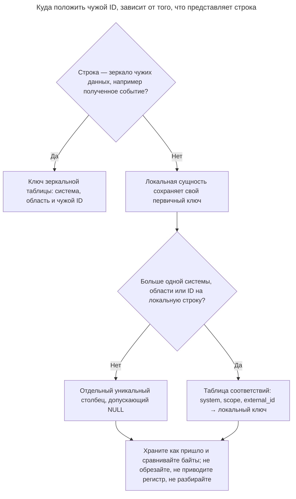
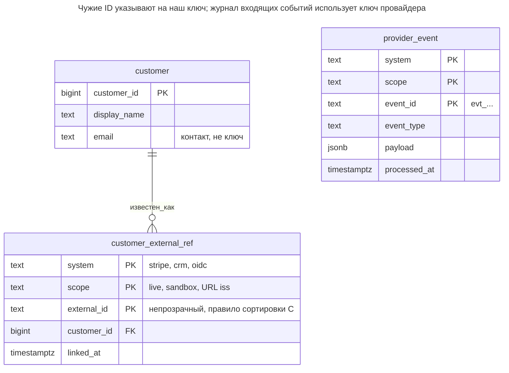
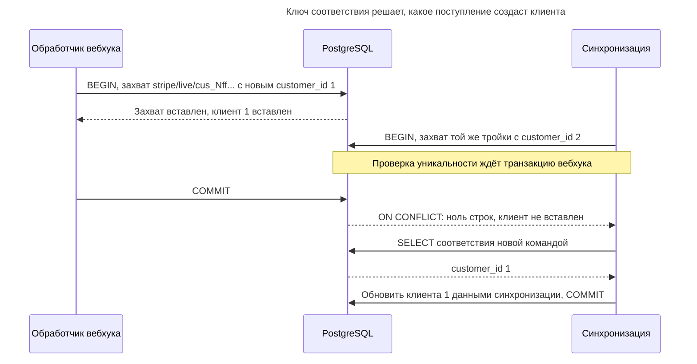
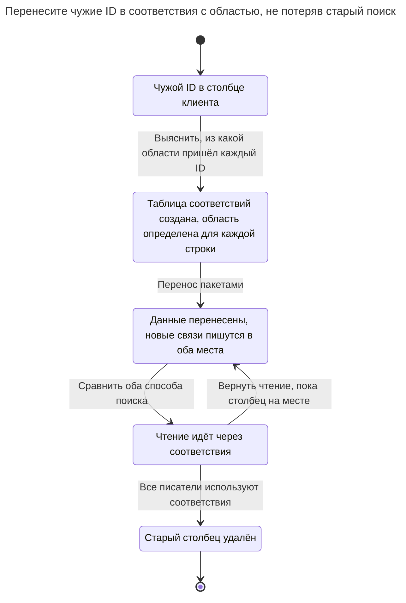

# Внешняя ссылка

## Назначение

Внешняя ссылка хранит идентификатор, который выдала другая система: ID клиента у платёжного провайдера, например `cus_...` в Stripe, номер записи в CRM или subject входа через OpenID Connect. Храните его рядом со своим ключом как уникальный атрибут и никогда не делайте его первичным ключом. Уточняйте его системой и пространством имён внутри неё, в котором он уникален, сравнивайте побайтно и поручите уникальному ограничению решать, какое из двух одновременных поступлений создаст локальную строку. Глава показывает, когда хватает одного столбца, когда нужна таблица соответствий, почему идентичность в OIDC сводится к паре `(iss, sub)` и почему журнал входящих событий вебхуков может использовать ID события провайдера как ключ.

## Также известен как

Foreign ID; сопоставление внешних ID; таблица перекрёстных ссылок (xref). В «Analysis Patterns» Фаулера есть паттерн с названием Identification Scheme. Важно направление: [Публичный идентификатор](public-identifier.md) тоже упоминает псевдоним «External ID», но для обратного потока — идентификатора, который выдаём *мы* своим клиентам. Внешняя ссылка — входящая: её выдал кто-то другой, а мы только храним.

## Проблема

Клиент платит через Stripe Checkout. Stripe отправляет вебхук `customer.created`, и в тот же момент ночная синхронизация постранично читает список клиентов Stripe. Оба процесса видят `cus_NffrFeUfNV2Hib`, оба ищут его локально, ничего не находят, и каждый вставляет клиента. Теперь на одного клиента Stripe приходятся два локальных. Счета уходят одному, заметки поддержки — другому. К тому же Stripe [не гарантирует порядок событий](https://docs.stripe.com/webhooks#event-ordering), поэтому первым сообщением о клиенте может оказаться `customer.updated`.

Другие ошибки происходят из предположений о самой строке. Копия тестовой базы, перенесённая в продакшен, приносит ID из песочницы, которые боевой ключ API не находит: у Stripe [отдельные ключи для песочниц и боевого режима, и объекты одного режима недоступны в другом](https://docs.stripe.com/keys#test-live-modes). Столбец `varchar(18)` по длине сегодняшних ID или регулярное выражение на префикс `cus_` ломаются от изменения, которое Stripe [считает обратно совместимым](https://docs.stripe.com/api-versions): Stripe может менять длину и формат ID объектов, добавлять и убирать префиксы и просит интеграции принимать до 255 символов. Правило сортировки без учёта регистра сливает два ID, различающихся только регистром. А вход пользователей по e-mail, который вернул провайдер идентификации, позволяет повторно выданному адресу открыть чужую учётную запись.

[Суррогатный ключ](surrogate-key.md) в разделе об идентификаторах клиента в двух системах уже объясняет, почему чужой ID не должен быть первичным ключом клиента и почему рядом с ID нужна система, которая его выдала. Эта глава продолжает ту мысль: пространство имён внутри системы, выбор между столбцом и таблицей, гонка первого поступления и правила сравнения.

## Решение

Дайте локальной сущности собственный ключ, а каждый чужой ID храните как факт о ней: *система S в области C называет этого клиента X*. Тройка `(system, scope, external_id)` уникальна и указывает ровно на один локальный ключ.

- **System** называет семейство выдающих систем: `stripe`, `crm`, `oidc`.
- **Scope** называет пространство имён, в котором выдающая сторона обещает уникальность. Для Stripe это аккаунт и режим или песочница, к которым относятся учётные данные; в примерах это сокращено до `live` и `sandbox`. Для OIDC это URL издателя `iss`. Берите область из учётных данных или конечной точки, которые аутентифицировали данные, а не из вида ID.
- **External ID** — непрозрачная строка: `text` с правилом сортировки `C`, хранится ровно в том виде, в каком пришла. Не обрезайте пробелы, не приводите регистр, не убирайте ведущие нули и ничего не выводите из префикса.

OpenID Connect формулирует правило идентичности прямо. `sub` — это [«локально уникальный и никогда не переназначаемый идентификатор конечного пользователя в пределах издателя»](https://openid.net/specs/openid-connect-core-1_0.html#IDToken), чувствительная к регистру строка не длиннее 255 символов ASCII, а [единственный гарантированно уникальный идентификатор конечного пользователя — сочетание `iss` и `sub`](https://openid.net/specs/openid-connect-core-1_0.html#ClaimStability). В том же разделе сказано, что издатель может со временем отдать один e-mail разным пользователям и что `email`, `phone_number`, `preferred_username` и `name` нельзя использовать как уникальные идентификаторы. Храните e-mail как контактный атрибут клиента, а вход привязывайте к `(iss, sub)`.

Если ровно одна система в одной фиксированной области выдаёт не больше одного ID на строку, хватит отдельного уникального столбца, допускающего `NULL`: `stripe_customer_id text COLLATE "C" UNIQUE`. Продакшен-база общается только с боевым режимом, так что область — факт развёртывания. Переходите к таблице соответствий, как только в одной базе могут оказаться ID из двух областей, появляется вторая система или поиск должен указывать, какому издателю он доверяет.

Запись собственного ключа в объект провайдера (у клиентов Stripe есть набор пар ключ–значение [`metadata`](https://docs.stripe.com/api/customers/object)) даёт обратный поиск для сверки. Локальный уникальный ключ она не заменяет: ваша база не может обеспечить уникальность значений, хранящихся в другой системе.

## Альтернативы и выбор

| Выбор или соседний паттерн | Отношение | Требование, определяющее выбор |
| --- | --- | --- |
| Отдельный столбец | Вариант реализации | Одна система, одна фиксированная область, не больше одного чужого ID на локальную строку |
| Таблица соответствий (эта глава) | Вариант реализации | Несколько систем или областей, вход через нескольких издателей или поиск, который должен назвать издателя |
| Зеркальная таблица с ключом по чужому ID | Исключение | Строка *и есть* чужие данные, например полученное событие вебхука, а не сущность, на которую ссылается остальная схема |
| [Суррогатный ключ](surrogate-key.md) | Дополнение | Даёт локальный ключ, к которому привязывается каждый чужой ID |
| [Публичный идентификатор](public-identifier.md) | Обратное направление | ID выдаёте вы и обещаете другим его стабильность |
| [Естественный ключ](natural-key.md) | Другой вопрос | Значение пришло из публичного стандарта и идентифицирует саму вещь, а не запись в системе одного поставщика |
| [Каноническое значение](canonical-value.md) | Противопоставление | Значение вводят люди, и разные написания должны совпадать; машинные ID приводить нельзя |
| [Запись идемпотентности](idempotency-record.md) | Дополнение | Каждая доставка обрабатывается один раз, отдельно от вопроса, к кому она относится |

Семейство идентификаторов целиком сравнивается в [Атласе решений](decision-atlas.md).



Первая ветка — исключение: у строки журнала входящих событий нет иной идентичности, кроме ID события у провайдера. Любая сущность, на которую ссылается ваша схема, идёт по другой ветке и сохраняет собственный ключ.

## Структура



Один клиент может быть известен под многими чужими ID: боевой клиент Stripe, запись CRM и два входа через разных издателей. Каждый чужой ID называет ровно одного клиента. У `provider_event` нет внешнего ключа на `customer`: таблица хранит то, что прислал провайдер, до того как обработчик решит, к кому это относится.

## Таблицы и инварианты

- **`customer`** владеет `customer_id` — идентификационным столбцом `GENERATED ALWAYS`. Прямая вставка в него чужого номера завершается ошибкой с SQLSTATE `428C9`, поэтому импорт не может незаметно сделать ID из CRM локальным ключом.
- **`customer_external_ref`** имеет первичный ключ `(system, scope, external_id)`: один чужой ID в одной области указывает на одного клиента. Та же строка в другой области — отдельная запись, поэтому связь из песочницы никогда не ответит на боевой поиск. Все три столбца используют правило сортировки `C`; `customer_external_ref_id_present` отклоняет пустой ID. Индекс по `customer_id` обслуживает исходящий поиск: «какого клиента Stripe мне списывать?».
- **`provider_event`** — зеркало: его первичный ключ — ID события провайдера с областью, то есть ровно тот ключ дедупликации, который повторяет повторная доставка.
- **Стабильность связи** — правило записи: обычный код не перенаправляет уже записанную строку. Перенос чужого ID на другого клиента и слияние дублей клиентов — отдельная тема со своим протоколом, здесь она не рассматривается.

## Когда применять

- Вы получаете вебхуки, синхронизацию или входы пользователей, где ваши записи названы чужими ID.
- Вы вызываете внешний API и должны знать, какой чужой объект соответствует вашему клиенту.
- До одной базы могут дотянуться несколько окружений, аккаунтов или арендаторов одного провайдера.
- Вы принимаете вход от одного или нескольких издателей OIDC.

## Последствия и компромиссы

- ➕ Смена провайдера, вторая CRM или второй способ входа добавляют строки, а не столбцы и не изменения ключей.
- ➕ Уникальный ключ решает, кто пришёл первым, при любой конкурентности и без блокировок в коде приложения.
- ➕ Побайтное сравнение сохраняет все различия, которые делает выдающая сторона, включая регистр и ведущие нули.
- ➖ Каждое входящее сообщение проходит поиск по таблице соответствий, прежде чем дойти до вашего ключа.
- ➖ Область нужно правильно зафиксировать при записи. По одному ID неверную область не обнаружить.
- ➖ Схема не мешает провайдеру держать два объекта для одного вашего клиента. Она хранит их как две строки, указывающие на одного или двух клиентов; признать их дублями — бизнес-решение.

## Реализация

[Полный скрипт для PostgreSQL 18.7](../assets/external-reference/external-reference.sql) проверяет первое поступление без осиротевшего клиента, разделение областей, пару OIDC, отказ на дубли и пустые ID, сравнение с учётом регистра и ведущих нулей, дедупликацию журнала входящих событий, вариант с одним столбцом и защиту идентификационного столбца:

```sql
CREATE TABLE customer (
    customer_id bigint GENERATED ALWAYS AS IDENTITY PRIMARY KEY,
    display_name text NOT NULL,
    email text
);
CREATE TABLE customer_external_ref (
    system text COLLATE "C" NOT NULL,
    scope text COLLATE "C" NOT NULL,
    external_id text COLLATE "C" NOT NULL,
    customer_id bigint NOT NULL REFERENCES customer (customer_id),
    linked_at timestamptz NOT NULL DEFAULT now(),
    CONSTRAINT customer_external_ref_pkey PRIMARY KEY (system, scope, external_id),
    CONSTRAINT customer_external_ref_id_present CHECK (external_id <> '')
);
CREATE INDEX customer_external_ref_customer_idx ON customer_external_ref (customer_id);
```

Обработчик вебхука и синхронизация выполняют одну и ту же команду. Она сначала захватывает соответствие и создаёт клиента, только если захват вставил строку:

```sql
WITH claimed AS (
    INSERT INTO customer_external_ref (system, scope, external_id, customer_id)
    VALUES ('stripe', 'live', 'cus_NffrFeUfNV2Hib',
            nextval(pg_get_serial_sequence('customer', 'customer_id')))
    ON CONFLICT (system, scope, external_id) DO NOTHING
    RETURNING customer_id
)
INSERT INTO customer (customer_id, display_name)
OVERRIDING SYSTEM VALUE
SELECT customer_id, 'Jenny Rosen' FROM claimed
RETURNING customer_id;
```

Первый запуск возвращает клиента `1`. Второй ничего не вставляет ни в одну таблицу, и вызывающий находит победителя отдельной командой:

```sql
SELECT customer_id FROM customer_external_ref
WHERE system = 'stripe' AND scope = 'live' AND external_id = 'cus_NffrFeUfNV2Hib';
```

На трёх деталях держится вся конструкция. Цель конфликта называет ключ, поэтому нарушение любого другого ограничения по-прежнему вызывает ошибку, а не принимается за «победил кто-то другой». ID клиента берётся из собственной последовательности идентификационного столбца и вставляется с [`OVERRIDING SYSTEM VALUE`](https://www.postgresql.org/docs/18/sql-insert.html), так что для всех остальных писателей столбец остаётся `GENERATED ALWAYS`. Неоткладываемый внешний ключ проверяется [сразу после каждой команды](https://www.postgresql.org/docs/18/sql-createtable.html#SQL-CREATETABLE-PARMS-DEFERRABLE), то есть после всей команды целиком, поэтому соответствие может указывать на клиента, которого вставляет та же команда. Проигравший захват расходует значение последовательности; пропуск безвреден, как и в [Суррогатном ключе](surrogate-key.md).

Та же строка в другой области — отдельное соответствие. Клиент, созданный через песочницу, получает ID `3`, потому что проигравший захват израсходовал `2`:

```sql
INSERT INTO customer (display_name) VALUES ('Sandbox tester');
INSERT INTO customer_external_ref (system, scope, external_id, customer_id)
VALUES ('stripe', 'sandbox', 'cus_NffrFeUfNV2Hib', 3);
```

Боевой поиск по-прежнему возвращает клиента `1`, а поиск в песочнице — `3`. Ключ не зависит от того, повторяет ли провайдер ID в разных режимах: он просто не даёт одной области отвечать за другую. Вход через OIDC использует ту же таблицу, а областью служит издатель:

```sql
INSERT INTO customer_external_ref (system, scope, external_id, customer_id)
VALUES ('oidc', 'https://server.example.com', '248289761001', 1),
       ('oidc', 'https://login.example.org', '248289761001', 3);
```

У двух строк одинаковый `sub`, но это разные люди, потому что издатели разные. Последующая смена e-mail у клиента `1` не затрагивает его вход. Второе соответствие для уже связанного ID с областью отклоняется:

```sql
INSERT INTO customer_external_ref (system, scope, external_id, customer_id)
VALUES ('stripe', 'live', 'cus_NffrFeUfNV2Hib', 3);
```

PostgreSQL 18.7 выдаёт SQLSTATE `23505`: `ERROR: duplicate key value violates unique constraint "customer_external_ref_pkey"` с `DETAIL: Key (system, scope, external_id)=(stripe, live, cus_NffrFeUfNV2Hib) already exists.` Пустой ID нарушает `customer_external_ref_id_present` с кодом `23514`.

При правиле сортировки `C` значения `cus_Q8sZA` и `cus_Q8sZa` связываются с двумя разными клиентами, а ID `007` из CRM не совпадает с `7`. Скрипт также строит такой же ключ с [недетерминированным правилом сортировки](https://www.postgresql.org/docs/18/collation.html#COLLATION-NONDETERMINISTIC) без учёта регистра; там второй ID отклоняется с `23505` как дубль первого. Не подгоняйте размер столбца под сегодняшние ID: потолок Stripe в 255 символов и предел в 255 символов для `sub` — границы, которые нужно вместить в `text`, а не `CHECK`, который нужно навязывать.

Журнал входящих вебхуков устраняет дубли по ID события провайдера. Stripe советует [записывать ID уже обработанных событий](https://docs.stripe.com/webhooks#handle-duplicate-events), потому что конечная точка может получить одно событие несколько раз:

```sql
INSERT INTO provider_event (system, scope, event_id, event_type, payload)
VALUES ('stripe', 'live', 'evt_1NG8Du2eZvKYlo2CUI79vXWy', 'customer.created',
        '{"object": {"id": "cus_NffrFeUfNV2Hib"}}')
ON CONFLICT (system, scope, event_id) DO NOTHING
RETURNING event_id;
```

Повторная доставка не возвращает строк. Это единственное место, где чужой ID служит первичным ключом: у строки нет смысла помимо «провайдер прислал событие X», и больше ничто в схеме на неё не ссылается. На той же странице сказано, что иногда Stripe создаёт для одного изменения два отдельных объекта Event, и ключ по ID события их не поймает; устранение дублей *эффекта* — задача обработчика и варианта с обработанными сообщениями из [Записи идемпотентности](idempotency-record.md).

В варианте с одним столбцом `billing_profile.stripe_customer_id text COLLATE "C" UNIQUE` принимает сколько угодно несвязанных строк (`NULL`) и отклоняет вторую строку с тем же ID с кодом `23505` по `billing_profile_stripe_customer_id_key`.

## Поддержка в движках

- **PostgreSQL 18:** `COLLATE "C"` сравнивает байты. Захват одной командой опирается на изменяющий данные `WITH`, `ON CONFLICT` с явной целью и `OVERRIDING SYSTEM VALUE`. Недетерминированные правила сортировки существуют и не учитывают регистр, если их так настроить; для чужих ID их не используйте.
- **MySQL 8.4:** правило сортировки сервера по умолчанию — [`utf8mb4_0900_ai_ci`](https://dev.mysql.com/doc/refman/8.4/en/charset-server.html), которое [не учитывает ни диакритику, ни регистр](https://dev.mysql.com/doc/refman/8.4/en/charset-unicode-sets.html). Уникальный ключ по чужому ID с таким правилом сливает ID, различающиеся регистром; объявите на столбце двоичное правило сортировки, например `utf8mb4_bin`, как в [примере самого Stripe](https://docs.stripe.com/api-versions) с `VARCHAR(255) COLLATE utf8_bin`. Без захвата одной командой вставляйте в одной транзакции сначала клиента, затем соответствие; при ошибке дубликата ключа откатите транзакцию и прочитайте соответствие победителя.
- **SQL Server 2025 (17.x):** правило сортировки по умолчанию [определяется языковым стандартом операционной системы при установке](https://learn.microsoft.com/en-us/sql/relational-databases/collations/collation-and-unicode-support?view=sql-server-ver17), например `SQL_Latin1_General_CP1_CI_AS` для English (United States), а оно не учитывает регистр. Задайте столбцу правило сортировки `_BIN2` через `COLLATE`.
- **Oracle AI Database 26ai:** база [сейчас считает символьное значение нулевой длины равным `NULL`](https://docs.oracle.com/en/database/oracle/oracle-database/26/sqlrf/Nulls.html), поэтому `NOT NULL` уже отклоняет пустой ID; всё равно оставьте явную проверку, так как Oracle предупреждает, что это может измениться.
- **SQLite 3:** строки сравниваются [функцией сравнения `BINARY`](https://www.sqlite.org/datatype3.html#collating_sequences), если не объявлена другая. [UPSERT](https://www.sqlite.org/lang_upsert.html), появившийся в 3.24.0, поддерживает `ON CONFLICT ... DO NOTHING` и действует только для ограничений уникальности.

## Сбои и конкурентность

Гонка из раздела «Проблема» разрешается первичным ключом `customer_external_ref`:



Проигравший никогда не создаёт клиента, поэтому ничего не остаётся осиротевшим и ничего не нужно убирать. Если транзакция вебхука откатится, захват синхронизации пройдёт, и клиента создаст она. [Арбитраж уникального индекса](https://www.postgresql.org/docs/18/index-unique-checks.html) даёт такой результат на уровне Read Committed по умолчанию, без явных блокировок.

Две детали легко сделать неправильно. Поиск должен быть отдельной командой: на Read Committed [`ON CONFLICT DO NOTHING` может пропустить вставку из-за строки, которую не видит снимок самой команды](https://www.postgresql.org/docs/18/transaction-iso.html#XACT-READ-COMMITTED), поэтому объединение в той же команде может ничего не вернуть. На Repeatable Read и Serializable ожидающий сеанс не получает ноль строк. В ручных прогонах двух сеансов на PostgreSQL 18.7 на обоих уровнях он завершился с SQLSTATE `40001`, `ERROR: could not serialize access due to concurrent update`; повторите всю транзакцию, и повтор найдёт соответствие. Когда первый сеанс вместо фиксации откатывался, захват ожидающего сеанса проходил на любом уровне, и он создавал единственного клиента.

Вариант «проверить, затем вставить» в приложении (`SELECT` соответствия, затем `INSERT` клиента и соответствия) — та самая ошибка, которую заменяет этот протокол. Оба сеанса проходят проверку и оба вставляют клиента. Затем вставка соответствия во втором сеансе падает с `23505`, и ему нужно откатиться и повторить; если две вставки шли не в одной транзакции, его клиент остаётся сиротой. Без уникального ключа на тройку обе вставки соответствий проходят, и дубль остаётся навсегда.

Доставка может прийти и раньше своего предмета. Если `invoice.paid` называет клиента, которого вы ещё не связали, выполните тот же захват с имеющимися данными или оставьте событие в журнале входящих событий и обработайте его, когда клиент появится; ключ журнала в любом случае не пропускает повторные доставки.

## Миграция

Обычно встречаются две исходные точки: чужой ID в обычном столбце и чужой ID в роли первичного ключа. Во втором случае сначала введите локальный ключ, как описано в [Суррогатном ключе](surrogate-key.md), и перенаправьте на него дочерние таблицы; после этого чужой столбец становится первым случаем.



Определите область каждой строки до переноса. Если продакшен всегда использовал только боевые ключи, все существующие ID относятся к `live`. Если в базу когда-либо попадали данные из песочницы, запросите каждый ID учётными данными каждого окружения; ID, который находит только одно окружение, принадлежит его области. Переносите ограниченными пакетами через `INSERT ... ON CONFLICT DO NOTHING`, затем сравните старый столбец с соответствиями и разберите каждое расхождение до переключения чтения. Пишите в оба места, пока не перейдут все писатели, и удалите столбец по схеме [Расширение и свёртывание](expand-contract.md). Если заодно меняете правило сортировки столбца, найдите ID, совпавшие по старому правилу без учёта регистра: они уже слиты, и единственное свидетельство для их разделения — записи провайдера.

## Антипаттерны и частые ошибки

- ID провайдера как первичный ключ собственной сущности; см. [Суррогатный ключ](surrogate-key.md).
- Сопоставление входа с учётной записью по e-mail. OIDC это запрещает; используйте ключ `(iss, sub)`.
- Уникальное ограничение только на `external_id`, без системы и области. Тогда две CRM или песочница и боевой режим конфликтуют или, хуже, находят клиентов друг друга.
- Размер столбца по текущим ID, проверка префикса или разбор ID в поисках смысла. Провайдеры могут менять всё это совместимым образом.
- Правило сортировки без учёта регистра, `lower()` при поиске или `citext`. Они уместны для [Канонического значения](canonical-value.md) и ошибочны для машинных ID.
- Хранение похожего на число ID в целочисленном столбце: ведущие нули теряются, а первая буква от выдающей стороны всё ломает.
- Область, взятая из неаутентифицированной части запроса, а не из учётных данных или проверенной конечной точки вебхука.
- Создание клиента и соответствия не в одной транзакции: после каждой проигранной гонки остаётся осиротевший клиент.
- Чужие ID только внутри JSON-столбца с метаданными, где их уникальность ничем не обеспечена.

## Известные применения

- [OpenID Connect Core 1.0, раздел 5.7](https://openid.net/specs/openid-connect-core-1_0.html#ClaimStability) объявляет `(iss, sub)` единственным стабильным идентификатором пользователя и запрещает использовать для этого `email`.
- [django-allauth](https://github.com/pennersr/django-allauth/blob/main/allauth/socialaccount/models.py) хранит входы через соцсети в `SocialAccount` с `unique_together = ("provider", "uid")` — таблице соответствий с ключом из издателя и чужого ID рядом с локальным пользователем.
- [Руководство Stripe по вебхукам](https://docs.stripe.com/webhooks#handle-duplicate-events) советует записывать ID обработанных событий — это и есть исключение для зеркальной таблицы из этой главы.

## Связанные паттерны

- [Суррогатный ключ](surrogate-key.md) даёт локальный ключ и уже исключает чужие ID в роли первичного ключа.
- [Публичный идентификатор](public-identifier.md) — исходящий двойник: ID, который вы выдаёте другим.
- [Естественный ключ](natural-key.md) описывает идентификаторы из публичных стандартов, а не от одного поставщика.
- [Каноническое значение](canonical-value.md) нормализует вводимые людьми идентификаторы; внешние ссылки нормализовать нельзя.
- [Запись идемпотентности](idempotency-record.md) устраняет повторную обработку доставок, несущих внешние ссылки.
- [Участник](party.md) — частая локальная сущность для клиентов и поставщиков, к которой привязываются чужие ID.
