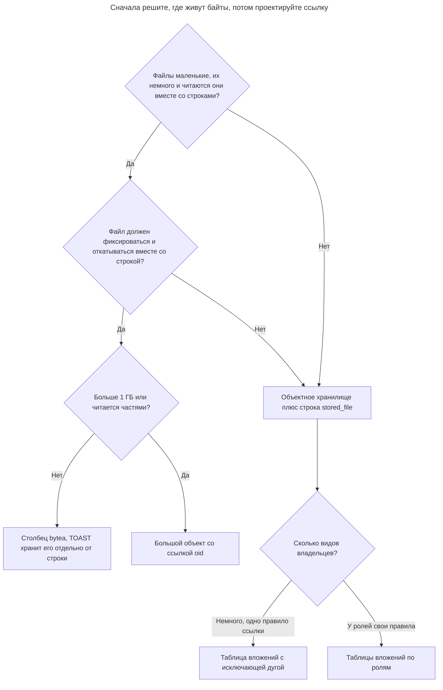
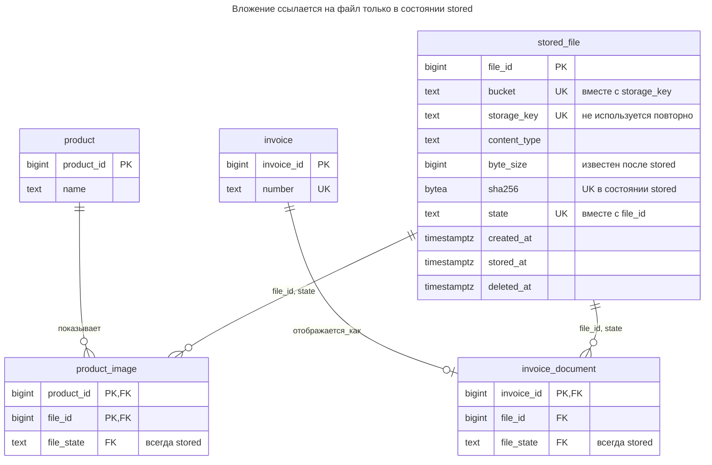
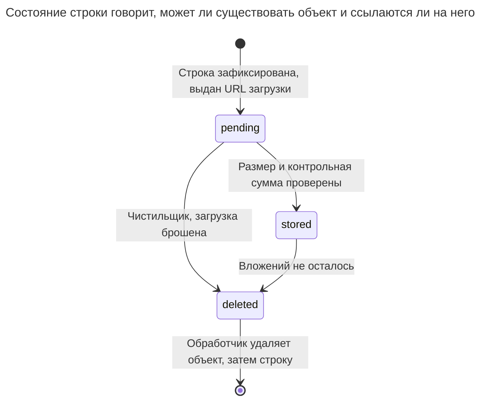
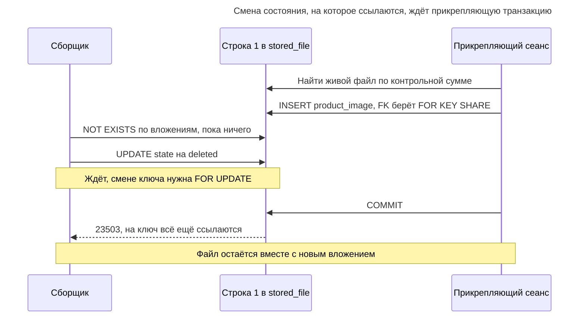
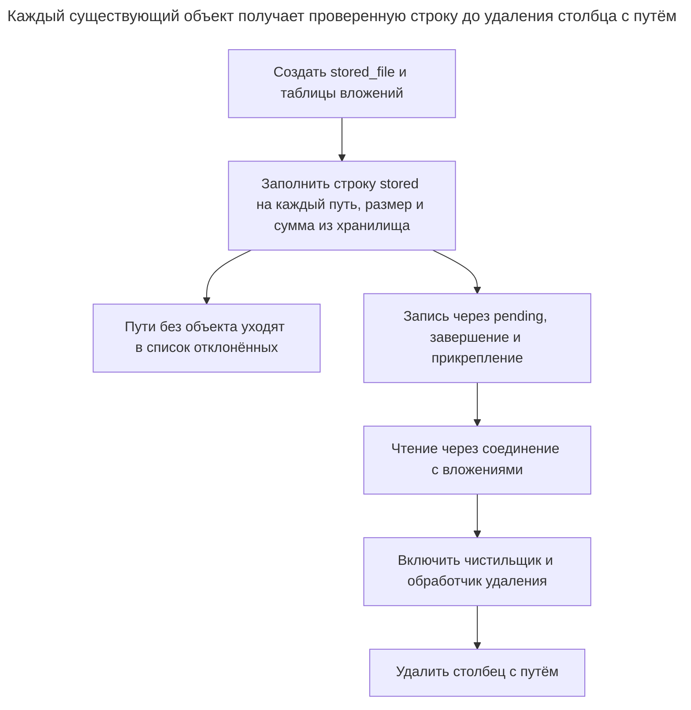

# Ссылка на файл

## Назначение

Ссылка на файл хранит байты изображения или PDF в объектном хранилище или файловой системе, а в базе держит строку метаданных о них: бакет и ключ хранения, тип содержимого, размер в байтах, контрольную сумму SHA-256, исходное имя файла и состояние загрузки, которое переходит от pending к stored и к deleted. Бизнес-строки прикрепляют файлы через типизированные таблицы связей с настоящими внешними ключами, и решает, ссылается ли кто-то на файл, строка в базе, а не список объектов в бакете. Глава показывает, как избежать сирот в обе стороны, как дедуплицировать файлы по контрольной сумме и не удалить файл, который другая строка только что прикрепила, и когда `bytea` или большие объекты внутри PostgreSQL оказываются более простым выбором. См. [хранение TOAST](https://www.postgresql.org/docs/18/storage-toast.html) и [большие объекты](https://www.postgresql.org/docs/18/largeobjects.html) в PostgreSQL.

## Также известен как

Blob и attachment в Rails [Active Storage](https://guides.rubyonrails.org/active_storage_overview.html#setup): таблица `active_storage_blobs` хранит метаданные, а `active_storage_attachments` связывает записи с blob-ами. В [оглавлении SQL Antipatterns Билла Карвина](https://pragprog.com/titles/bksap1/sql-antipatterns-volume-1/) есть родственный элемент каталога Phantom Files.

## Проблема

Страница товара показывает фотографию. Первая схема хранит `photo_path text` в `product`, и обработчик загрузки сначала записывает файл в бакет, а потом вставляет товар. Если вставка не удалась или её транзакция откатилась, объект остаётся в бакете, и на него ничто не указывает. О нём никто не знает, пока не вырастет счёт за хранилище. Обратный порядок не помогает: строка фиксируется, загрузка падает, и страница ссылается на файл, который так и не был записан.

У удаления те же две стороны. Если сначала удалить объект, а потом строку, объект пропадёт, даже когда транзакция строки откатится. Если сначала удалить строку, а потом объект, объект останется, когда процесс упадёт между двумя шагами. У бакета и базы нет общей фиксации, поэтому любой порядок операций оставляет окно, и схема должна сказать, какая сторона главная и как исправляется другая.

Столбец с путём создаёт и другие проблемы. В нём нет размера, типа и контрольной суммы, поэтому приложение не может проверить, что оно отдаёт, обнаружить обрезанную загрузку или найти дубликаты. Чтобы использовать тот же файл для второго товара, путь копируют, и тогда при удалении одного товара непонятно, нужен ли объект другому. Обобщённая таблица вложений с ключом `(record_type, record_id)`, как в Active Storage, отвечает на вопрос «какие файлы есть у этой записи», но не может доказать, что сама запись существует; почему её не проверит ни один внешний ключ, объясняет глава [Полиморфные связи](polymorphic-associations.md).

## Решение

Сделайте строку в базе источником истины о том, существует ли файл и ссылаются ли на него, а хранилище пусть следует за ней:

- **Одна строка метаданных на каждый объект.** `stored_file` хранит бакет и ключ хранения, который генерируется один раз и никогда не используется повторно, заявленный тип содержимого и исходное имя файла, а после проверки загрузки — размер в байтах и SHA-256. Столбец `state` переходит от `pending` к `stored` и к `deleted`, для каждого шага есть отметка времени.
- **Строка pending до загрузки.** Зафиксируйте строку `pending` до того, как клиент получит URL для загрузки. Если дальше что-то сломается, строка записывает, что объект мог появиться. Чистильщик помечает устаревшие строки pending как удалённые и тем самым собирает загрузки, бизнес-транзакция которых так и не состоялась.
- **Условное завершение.** После загрузки сервер проверяет размер и контрольную сумму объекта и выполняет `UPDATE ... WHERE state = 'pending'`. Ноль затронутых строк означает, что чистильщик успел раньше, и клиенту придётся начать заново.
- **Типизированные вложения.** У каждой роли файла своя таблица связей, например `product_image` или `invoice_document`, с внешним ключом на бизнес-строку и внешним ключом на файл. Ссылка на файл — пара `(file_id, file_state)`, где `file_state` всегда равен `stored`, поэтому база не даст прикрепить файл в состоянии pending или deleted и не даст пометить удалённым прикреплённый файл.
- **Удаление через надгробие.** Удаление файла — сначала изменение в базе: вложение удаляется, а строка файла в той же транзакции получает состояние `deleted`. Обработчик после фиксации удаляет объект, а затем строку. Считайте «объекта уже нет» успехом, чтобы любой шаг можно было повторить.

## Альтернативы и выбор

| Выбор | Отношение | Решающее требование |
| --- | --- | --- |
| Столбец `bytea`, возможно вынесенный по схеме [Разделение таблицы](table-split.md) | Замена | Файлы маленькие и их немного, они нужны в той же транзакции и резервной копии, что и строки, и ограничения размера приемлемы |
| Большие объекты (ссылка `oid`) | Замена внутри PostgreSQL | Значения больше 1 ГБ или нужны частичное чтение и запись, и вы готовы сами управлять их удалением |
| Столбец с путём в бизнес-строке | Упрощение | Ровно один файл на строку, без дедупликации, и сбой или брошенная загрузка ничего не стоят |
| Одна полиморфная таблица вложений | Замена типизированных таблиц | Вы принимаете непроверяемую ссылку на запись; см. [Полиморфные связи](polymorphic-associations.md) |
| Таблица вложений по схеме [Исключающая дуга](exclusive-arc.md) | Вариант реализации вложений | Видов владельцев немного, и на вопрос «ссылается ли кто-то на файл» должна отвечать одна таблица |
| Отдельная [Таблица связей](association-table.md) для каждой роли | Вариант реализации вложений (показан здесь) | У ролей свои правила, ключи и кардинальности |
| [Таблица очереди](queue-table.md) или [Транзакционный outbox](transactional-outbox.md) | Дополнение | Удаление объектов и другие вызовы хранилища выполняются после фиксации |

Полное сравнение — в [Атласе решений](decision-atlas.md).



База — хорошее место для байтов, когда файлы — часть транзакционной записи. Объектное хранилище выигрывает, когда файлы большие, их много, их отдают прямо в браузер или делят с другими системами, и тогда следующим решением становится устройство вложений.

## Структура



У товара может быть много изображений, и один дедуплицированный файл может появиться у многих товаров. У счёта не больше одного сформированного PDF, поэтому ключ его вложения — сам счёт. Обе таблицы вложений ссылаются на `stored_file` через `(file_id, state)`, и эту пару поддерживает уникальное ограничение; именно составная ссылка связывает вложение с жизненным циклом файла.

## Таблицы и инварианты

- **`stored_file`** имеет суррогатный ключ и уникальную пару `(bucket, storage_key)`, поэтому две строки никогда не претендуют на один объект. Проверка `stored_file_content_known` требует размера, контрольной суммы и `stored_at` в состоянии `stored`, а `stored_file_deleted_at` связывает `deleted_at` с состоянием `deleted`. Частичный уникальный индекс `stored_file_sha256_live` допускает одну строку в состоянии stored на каждый хеш содержимого — это и есть вариант с дедупликацией.
- **`product_image`** и **`invoice_document`** удаляются каскадом вместе со своими бизнес-строками: удаление товара удаляет его вложения, но не файлы. Каждая объявляет `file_state text CHECK (file_state = 'stored')` и внешний ключ `(file_id, file_state)` на `stored_file (file_id, state)`. У файла в состоянии pending или deleted нет подходящего ключа, а прикреплённый файл не может покинуть состояние `stored`, пока ссылка существует.
- **Индексы** по `file_id` в каждой таблице вложений обслуживают проверку внешнего ключа при смене состояния файла и проверки `NOT EXISTS` чистильщика.
- **Переходы** обеспечивают операции записи, а не ограничение: завершение обновляет только строки `pending`, и ничто не превращает строку `deleted` обратно в `stored`. Добавьте триггер, если в таблицу пишут и другие.



`pending` означает «под этим ключом может существовать объект». `deleted` означает «объект ещё может существовать и должен быть удалён». Прикрепить можно только строку `stored`, и покинуть это состояние может только неприкреплённая строка.

## Когда применять

- Файлы больше нескольких сотен килобайт, их много или их отдают прямо из хранилища или CDN.
- Один файл используют несколько бизнес-строк, или вы хотите дедуплицировать одинаковые загрузки.
- Клиент загружает файлы прямо в хранилище, поэтому транзакция базы не может включить загрузку.
- На вопросы «на какие файлы есть ссылки», «сколько места занимает этот арендатор» или «цел ли этот файл» нужно отвечать из базы.

## Последствия и компромиссы

- ➕ Сироты в обоих направлениях становятся строками в известном состоянии, и их находит индексированный запрос, а не просмотр бакета.
- ➕ Контрольные суммы и размеры позволяют проверять загрузки, замечать повреждения и дедуплицировать файлы.
- ➕ У типизированных вложений настоящие внешние ключи с обеих сторон, поэтому бизнес-строку и её файлы удаляют и соединяют, как любые другие данные.
- ➖ Изменения в хранилище отстают от изменений в базе. Удалённый файл остаётся в бакете, пока не сработает обработчик, а резервные копии базы и бакета снимаются в разные моменты.
- ➖ Загрузке нужен протокол из двух запросов, а также чистильщик и обработчик удаления, и за всеми нужно следить.
- ➖ Каждая новая роль вложения — это таблица, и вопрос «ссылается ли кто-то на файл» должен опрашивать их все. Исключающая дуга держит ответ в одной таблице ценой столбца на каждый вид владельца.

## Реализация

[Полный скрипт для PostgreSQL 18.7](../assets/file-reference/file-reference.sql) проверяет строку pending, отклонённые вложения, завершение и дедупликацию, защищённое удаление, чистильщик, обработчик удаления, хранение значения `bytea` в TOAST и жизненный цикл больших объектов:

```sql
CREATE TABLE file_example.stored_file (
    file_id bigint GENERATED ALWAYS AS IDENTITY PRIMARY KEY,
    bucket text NOT NULL,
    storage_key text NOT NULL,
    original_filename text NOT NULL,
    content_type text NOT NULL,
    byte_size bigint CHECK (byte_size >= 0),
    sha256 bytea CHECK (octet_length(sha256) = 32),
    state text NOT NULL DEFAULT 'pending'
        CHECK (state IN ('pending', 'stored', 'deleted')),
    created_at timestamptz NOT NULL DEFAULT now(),
    stored_at timestamptz,
    deleted_at timestamptz,
    CONSTRAINT stored_file_location_key UNIQUE (bucket, storage_key),
    CONSTRAINT stored_file_state_key UNIQUE (file_id, state),
    CONSTRAINT stored_file_content_known CHECK (
        state <> 'stored'
        OR (byte_size IS NOT NULL AND sha256 IS NOT NULL AND stored_at IS NOT NULL)),
    CONSTRAINT stored_file_deleted_at CHECK ((state = 'deleted') = (deleted_at IS NOT NULL))
);
CREATE UNIQUE INDEX stored_file_sha256_live ON file_example.stored_file (sha256)
WHERE state = 'stored';
CREATE TABLE file_example.product_image (
    product_id bigint NOT NULL
        REFERENCES file_example.product (product_id) ON DELETE CASCADE,
    file_id bigint NOT NULL,
    file_state text NOT NULL DEFAULT 'stored' CHECK (file_state = 'stored'),
    PRIMARY KEY (product_id, file_id),
    CONSTRAINT product_image_file_fkey FOREIGN KEY (file_id, file_state)
        REFERENCES file_example.stored_file (file_id, state)
);
CREATE INDEX product_image_file_idx ON file_example.product_image (file_id);
```

Сначала зафиксируйте строку pending; сгенерированный ключ — это то, куда загружает клиент:

```sql
INSERT INTO file_example.stored_file
    (bucket, storage_key, original_filename, content_type)
VALUES ('media', 'uploads/0b8f2c1e-lamp', 'lamp.jpg', 'image/jpeg');
INSERT INTO file_example.product_image (product_id, file_id) VALUES (1, 1);
```

Пока файл в состоянии pending, вложение не проходит. PostgreSQL 18.7 выдаёт SQLSTATE `23503`: `ERROR: insert or update on table "product_image" violates foreign key constraint "product_image_file_fkey"` с `DETAIL: Key (file_id, file_state)=(1, stored) is not present in table "stored_file".` Попытка пометить строку как stored без размера и контрольной суммы нарушает `stored_file_content_known` с кодом `23514`.

После загрузки сервер читает размер и контрольную сумму объекта из хранилища, а не берёт их у клиента, и завершает только строку, которая всё ещё в состоянии pending:

```sql
UPDATE file_example.stored_file
SET state = 'stored', byte_size = 18, stored_at = now(),
    sha256 = sha256('lamp photo content'::bytea)
WHERE file_id = 1 AND state = 'pending'
RETURNING file_id;
INSERT INTO file_example.product_image (product_id, file_id) VALUES (1, 1);
```

Повторная загрузка тех же байтов не может стать второй живой строкой: её завершение выдаёт `23505`, `ERROR: duplicate key value violates unique constraint "stored_file_sha256_live"`. Приложение помечает свою строку pending удалённой и прикрепляет к товару 2 уже существующий файл. Дедуплицируйте только по контрольной сумме, которую вычислил сервер. Иначе клиент, который может заявить хеш, получит доступ к файлу, которого никогда не видел. В общем бакете включите арендатора в уникальный индекс, чтобы загрузка одного арендатора не раскрывала файлы другого.

Теперь у файла два вложения. Удаление вложения у товара 1 оставляет вложение у товара 2, и защита не даёт пометить файл удалённым:

```sql
DELETE FROM file_example.product_image WHERE product_id = 1 AND file_id = 1;
UPDATE file_example.stored_file SET state = 'deleted', deleted_at = now()
WHERE file_id = 1;
```

PostgreSQL 18.7 выдаёт SQLSTATE `23503`: `ERROR: update or delete on table "stored_file" violates foreign key constraint "product_image_file_fkey" on table "product_image"` с `DETAIL: Key (file_id, state)=(1, stored) is still referenced from table "product_image".` Удаление товара 2 каскадом удаляет его вложение и оставляет файл неприкреплённым.

Чистильщик после льготного периода собирает сирот обоих видов:

```sql
UPDATE file_example.stored_file AS f
SET state = 'deleted', deleted_at = now()
WHERE (f.state = 'pending' AND f.created_at < now() - interval '1 day')
   OR (f.state = 'stored' AND f.stored_at < now() - interval '1 day'
       AND NOT EXISTS (SELECT 1 FROM file_example.product_image AS i
                       WHERE i.file_id = f.file_id)
       AND NOT EXISTS (SELECT 1 FROM file_example.invoice_document AS d
                       WHERE d.file_id = f.file_id))
RETURNING f.file_id;
```

В практикуме он возвращает неприкреплённую фотографию лампы и загрузку pending двухдневной давности и не трогает прикреплённый PDF счёта и свежую загрузку pending. Запоздалое завершение собранной загрузки обновляет ноль строк. Льготный период должен быть больше срока жизни выданного URL загрузки; иначе медленный клиент может закончить загрузку после того, как обработчик удалил объект, и у нового объекта не будет строки. В практикуме чистильщик — одна операция над множеством строк, поэтому `23503` от файла, который только что прикрепил параллельный сеанс, прерывает её целиком; рабочий чистильщик сначала выбирает кандидатов, а затем помечает каждого в отдельной транзакции или точке сохранения.

Альтернатива чистильщику — подсчёт ссылок: столбец `attachment_count` в `stored_file`, который меняется в той же транзакции, что и каждое прикрепление и открепление. Он сразу показывает, что на файл больше не ссылаются, но каждое прикрепление пишет в общую строку файла, что выстраивает в очередь прикрепления популярного содержимого, а счётчик, разошедшийся со строками вложений, можно исправить только тем же просмотром, который выполнил бы чистильщик.

Обработчик удаления захватывает надгробия так же, как [Таблица очереди](queue-table.md) захватывает задания, удаляет каждый объект, а затем строку:

```sql
SELECT file_id, bucket, storage_key FROM file_example.stored_file
WHERE state = 'deleted'
ORDER BY deleted_at, file_id
LIMIT 10
FOR UPDATE SKIP LOCKED;
-- удалить каждый объект в хранилище, затем:
DELETE FROM file_example.stored_file WHERE file_id = ANY ($1) AND state = 'deleted';
```

Здесь блокировки строк удерживаются на время коротких вызовов хранилища, которые безопасно повторять. Если вызовы хранилища могут быть медленными, фиксируйте захват с арендой, как описывает [Таблица очереди](queue-table.md).

Сбой между вызовом хранилища и удалением строки повторит вызов хранилища при следующем запуске, поэтому обработчик должен считать «не найдено» выполненной работой. Удаление, поставленное в очередь для надгробия, никогда не должно удалить объект, который более поздняя загрузка записала под тем же ключом. При новом ключе для каждой строки, как здесь, этого не случится: генерируйте ключи из UUID или из никогда не повторяющегося значения identity, но не из имени файла.

Адресация по содержимому идёт на шаг дальше и делает ключом сам хеш, так что одинаковые байты становятся одним объектом, а ключ используется повторно намеренно. Безопасным это делает протокол со строкой pending. Новой загрузке нужна строка до записи, и `UNIQUE (bucket, storage_key)` отклоняет такую строку, пока существует надгробие того же содержимого, — практикум показывает это на ключе надгробия. Обработчик удаляет объект раньше строки-надгробия, поэтому к тому моменту, когда новая строка может появиться, старое удаление уже завершено. Цена — повторная загрузка недавно удалённого содержимого должна дождаться очистки или повторить попытку.

Тот же скрипт сохраняет несжимаемое значение `bytea` размером 1 МиБ: основная часть таблицы остаётся одной страницей в 8 кБ, а значение попадает в её таблицу TOAST. Ещё он создаёт большой объект внутри точки сохранения и откатывается к ней, после чего объекта нет, и удаляет строку с `oid` большого объекта, после чего объект продолжает существовать до вызова `lo_unlink`.

## Поддержка в движках

- **PostgreSQL 18:** значение [`bytea`](https://www.postgresql.org/docs/18/datatype-binary.html) выносится из строки механизмом [TOAST](https://www.postgresql.org/docs/18/storage-toast.html), когда строка превышает примерно 2 кБ, ограничено 1 ГБ, и большинство операций читает или пишет его целиком; обновления, которые его не трогают, его не копируют. [Большие объекты](https://www.postgresql.org/docs/18/lo-intro.html) живут в `pg_largeobject`, достигают 4 ТБ и поддерживают чтение и запись по частям. Создание большого объекта откатывается вместе с транзакцией, но удаление или изменение строки с его `oid` его не удаляет: [триггер `lo_manage` модуля `lo`](https://www.postgresql.org/docs/18/lo.html) вызывает удаление при изменении и удалении строки, предполагая одну ссылку на объект, а [`vacuumlo`](https://www.postgresql.org/docs/18/vacuumlo.html) удаляет большие объекты, которые не упомянуты ни в одном столбце `oid` или `lo`. [`pg_dump`](https://www.postgresql.org/docs/18/app-pgdump.html) по умолчанию включает большие объекты, но не включает их при выгрузке выбранных схем или таблиц. Оба варианта пропускают каждый байт через WAL, реплики и резервные копии: в этом их смысл, когда файлы надо восстанавливать вместе со строками, и их цена, когда файлы большие.
- **MySQL 8.4:** четыре [типа `BLOB`](https://dev.mysql.com/doc/refman/8.4/en/blob.html) отличаются только максимальной длиной, а наибольшее значение, которое клиент может передать, ограничено `max_allowed_packet` и на клиенте, и на сервере. Таблица метаданных из этой главы применяется без изменений.
- **SQL Server 2025 (17.x):** [`varbinary(max)`](https://learn.microsoft.com/en-us/sql/t-sql/data-types/binary-and-varbinary-transact-sql?view=sql-server-ver17) вмещает до 2^31-1 байт. В Windows [FILESTREAM](https://learn.microsoft.com/en-us/sql/relational-databases/blob/filestream-sql-server?view=sql-server-ver17) хранит столбец `varbinary(max)` как файлы на NTFS или ReFS, поддерживает их транзакционную согласованность со строкой, удаляет вместе с ней и включает в резервные копии. Microsoft советует рассматривать его, когда объекты в среднем больше 1 МБ.
- **Oracle AI Database 26ai:** [`BLOB`](https://docs.oracle.com/en/database/oracle/oracle-database/26/sqlrf/Data-Types.html) хранит двоичные данные в базе. `BFILE` хранит указатель на файл только для чтения в файловой системе сервера; такие файлы не участвуют в транзакциях, поэтому `BFILE` — ссылка на файл без жизненного цикла, который добавляет эта глава.
- **SQLite 3:** файлы кладут в столбцы `BLOB`. [Измерения](https://www.sqlite.org/intern-v-extern-blob.html) проекта показали, что BLOB меньше примерно 100 КБ быстрее читать из базы, а больше — из отдельных файлов.

## Сбои и конкурентность

Дедупликация создаёт самую трудную гонку: один файл, два владельца, и удаление у одного владельца собирает файл, пока другой сеанс его прикрепляет. Сборщик проверяет, что вложений нет, и помечает файл удалённым. Если его `NOT EXISTS` выполняется до фиксации вложения в другом сеансе, он ничего не видит, и при обычном внешнем ключе по `file_id` обновление проходит. Новое вложение указывает на файл, который обработчик вот-вот удалит. Запуск в двух сеансах на PostgreSQL 18.7, вне практикума, который работает в одном сеансе, воспроизвёл ровно этот исход с простой ссылкой.

Составная ссылка закрывает окно. `state` входит в уникальное ограничение `(file_id, state)`, которое использует внешний ключ, поэтому его изменение берёт блокировку строки `FOR UPDATE`, а она [конфликтует с блокировкой `FOR KEY SHARE`](https://www.postgresql.org/docs/18/explicit-locking.html#LOCKING-ROWS), которую проверка внешнего ключа в прикрепляющем сеансе держит до конца транзакции.



При обратном порядке незафиксированное обновление сборщика блокирует проверку внешнего ключа в прикрепляющем сеансе. Когда сборщик фиксируется, ключа `(1, stored)` больше нет, и вставка падает с `23503`; прикрепляющий сеанс снова ищет контрольную сумму, не находит живого файла и загружает новую копию. Запуск в двух сеансах подтвердил оба порядка; практикум проверяет их эквиваленты с уже зафиксированными данными: прикрепление удалённого файла и удаление прикреплённого. Если `NOT EXISTS` забудет одну из таблиц вложений, ошибка тоже безопасна: внешний ключ из этой таблицы всё равно выдаст `23503` и не отпустит файл.

Выполняйте сборку в отдельной транзакции, по одному файлу или с точкой сохранения на каждый файл, а не внутри пользовательского запроса. Открепление, которое заодно пыталось бы пометить общий файл удалённым, откатывало бы изменение пользователя всякий раз, когда срабатывает гонка. Без дедупликации, когда у каждого файла один владелец, помечать файл удалённым в той же транзакции, что и открепление, безопасно, и льготный период не нужен.

Два правила покрывают сторону хранилища. Никогда не удаляйте объект до фиксации транзакции, которая помечает его удалённым: удаление — это работа, которую создаёт фиксация, поэтому несите её в очереди по схеме [Таблица очереди](queue-table.md) или, если хранилищем владеет другой сервис, через [Транзакционный outbox](transactional-outbox.md). Никогда не позволяйте повтору обработчика попасть в другой объект: ключи уникальны и не используются повторно, и обработчик удаляет по ключу, который несёт его надгробие. Периодическая сверка списка объектов хранилища с таблицей находит то, что пропустили оба протокола, например объекты, записанные вручную.

## Миграция

От столбца `photo_path` создайте рядом `stored_file` и таблицу вложений. Заполните по одной строке `stored` на каждый уникальный путь, с размером и контрольной суммой, прочитанными из хранилища, и по одному вложению на товар. Пути, которые указывают на отсутствующие объекты, отправляются в список отклонённых, а не становятся строками `stored`. Переключите запись на протокол загрузки, затем чтение на соединение через вложения и удалите столбец после периода совместимости, как в главе [Расширение и свёртывание](expand-contract.md).



Чистильщик включайте последним: пока не все пишущие создают вложения, он соберёт файлы, на которые старый код ещё ссылается по пути. От столбца `bytea` скопируйте каждое значение в хранилище под новым ключом, вставьте его строку `stored` с контрольной суммой, вычисленной в базе, прикрепите её и очистите столбец пакетами. От полиморфной таблицы вложений разнесите строки по типам в типизированные таблицы, сопоставляя тип и ID вместе, как описывает глава [Полиморфные связи](polymorphic-associations.md).

## Антипаттерны и частые ошибки

- Загрузка до появления какой-либо строки: от загрузки, чья транзакция откатилась, не остаётся следа.
- Удаление объекта внутри или до транзакции базы, которая удаляет ссылку на него.
- Исходное имя файла в роли ключа хранения или хеш содержимого без строки, которая занимает ключ до загрузки: поставленное в очередь удаление может удалить более позднюю загрузку того же содержимого.
- Доверие к заявленным клиентом размеру, типу или контрольной сумме вместо проверки сохранённого объекта.
- Прикрепление через пару `(record_type, record_id)` с расчётом на то, что очистку сделают обратные вызовы приложения.
- Сборка дедуплицированных файлов с простой ссылкой по `file_id` и проверкой `NOT EXISTS`, которая проигрывает описанную выше гонку.
- Большие объекты в PostgreSQL без `lo_manage` или `vacuumlo`: неиспользуемые большие объекты копятся так же незаметно, как сироты в бакете.
- Льготный период чистильщика короче срока жизни URL загрузки.

## Известные применения

- Rails Active Storage хранит метаданные blob (`key`, `filename`, `content_type`, `byte_size`, `checksum`, `service_name`) в `active_storage_blobs`, как видно из [миграции его таблиц](https://github.com/rails/rails/blob/8-0-stable/activestorage/db/migrate/20170806125915_create_active_storage_tables.rb). Таблица `active_storage_attachments` по словам руководства — [«a polymorphic join table»](https://guides.rubyonrails.org/active_storage_overview.html#setup): у `blob_id` есть внешний ключ, а у `record_type` и `record_id` его нет. Руководство просит переносить `record_type` миграцией при переименовании класса модели, отмечает, что прямые загрузки могут оставить файл, который «never attaches to a record», и приводит задачу, которая [удаляет неприкреплённые blob-ы](https://guides.rubyonrails.org/active_storage_overview.html#purging-unattached-uploads) старше двух дней.
- Документация Django по [`FileField`](https://docs.djangoproject.com/en/5.2/ref/models/fields/#filefield-and-fieldfile) говорит, что при удалении модели связанные файлы не удаляются, и оставляет очистку сирот приложению.
- PostgreSQL поставляет модуль `lo` и `vacuumlo` для той же проблемы сирот внутри базы, где вместо объектов в бакете — большие объекты.

## Связанные паттерны

- [Полиморфные связи](polymorphic-associations.md) объясняют, почему обобщённая таблица вложений не может проверить свои записи.
- [Исключающая дуга](exclusive-arc.md) собирает все виды владельцев вложения в одну проверяемую таблицу.
- [Таблица связей](association-table.md) описывает строки-связи, которыми и являются вложения.
- [Таблица очереди](queue-table.md) захватывает надгробия для удаления объектов.
- [Транзакционный outbox](transactional-outbox.md) доставляет команды хранилищу, когда бакетом владеет другой сервис.
- [Мягкое удаление](soft-delete.md) обсуждает удалённую строку, которая остаётся видимой, — состояние `deleted` делает это только до удаления объекта.
- [Разделение таблицы](table-split.md) выносит столбец `bytea` из горячей таблицы, когда файлы остаются в базе.
