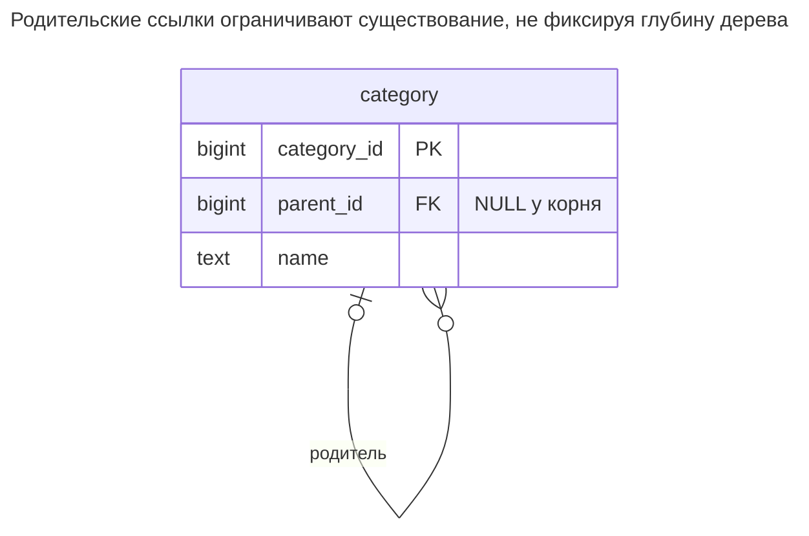
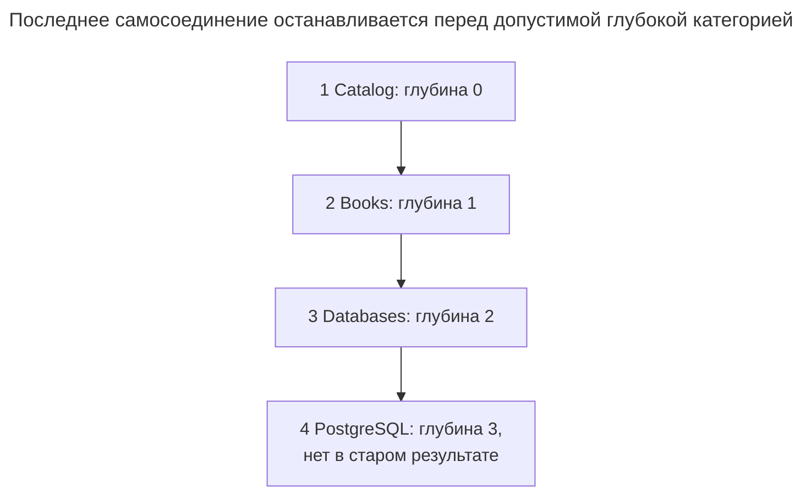
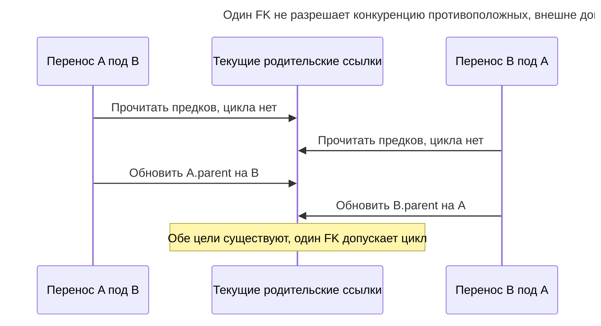
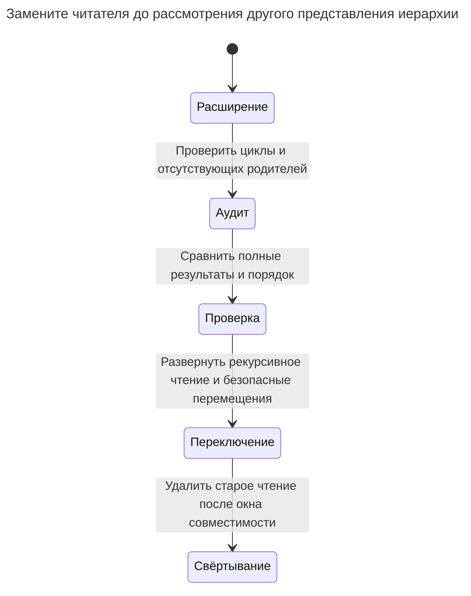

# Фиксированная глубина

Запросы фиксированной глубины читают дерево, хранящееся списком смежности, через фиксированное число самосоединений — по одному на уровень, — предполагая, что иерархия никогда не превысит три-четыре уровня. Запрос молча теряет узлы ниже последнего соединения, а каждый новый уровень требует переписывания. Глава показывает, как рекурсивные CTE снимают ограничение и когда лучше подходит другая структура дерева; проблема не в самом списке смежности. Билл Карвин называет это Naive Trees.

## Также известен как

Naive Trees в [оглавлении SQL Antipatterns Билла Карвина](https://pragprog.com/titles/bksap1/sql-antipatterns-volume-1/). Глава выделяет ошибку обхода с фиксированной глубиной. [Список смежности](adjacency-list.md) остаётся полезной схемой при подходящем способе обхода.

## Контекст

Вы храните ID родителя категории в таблице категорий. Отчёт сначала показывает корень, ребёнка и внука, поэтому вы дважды соединяете таблицу с собой. Позднее редакторы создают более глубокую ветвь, а назначение отчёта остаётся прежним: «все потомки».

## Проблема

Вы кодируете наблюдаемую сегодня максимальную глубину в запросе, не объявляя границу требованием. Строка за последним соединением — допустимые данные, отсутствующие в результате. Ещё одно соединение лишь откладывает тот же сбой. Вред — молчаливая неполнота, особенно когда отсутствующие строки влияют на авторизацию, итоги или решения об удалении.

Запрос ровно двух уровней вполне допустим. Если API намеренно возвращает детей и внуков, ограниченное самосоединение или явный фильтр глубины верно выражает запрос. Антипаттерн — выдавать эту границу за полный обход, когда предметная область допускает большую глубину.

## Почему так делают

Самосоединения привычны и позволяют легко изучить небольшой пример. Результат фиксированной глубины также удобно отображается на экране со столбцом на уровень. Это хорошие причины возвращать ограниченную проекцию, но не вводить необъявленный максимум для самой иерархии.

Вы также можете путать существование родителя с корректностью дерева. FK проверяет родительскую строку, но не предотвращает длинный цикл. Рекурсивный обход должен учитывать этот отдельный риск, а не заменять молчаливое усечение незавершающимся запросом.

## Последствия

- ➖ Более глубокие допустимые узлы исчезают из якобы полных результатов.
- ➖ Каждый новый уровень меняет текст запроса и часто форму результата.
- ➖ Удаление поддерева по усечённому результату может завершиться ошибкой или остаться незавершённым.
- ➖ Пример фиксированной глубины скрывает циклы за видимым горизонтом.
- ➖ Переход к незащищённой рекурсии может обнаружить неверные старые связи, которые прежний запрос никогда не обходил полностью.

## Признаки

- Запрос с псевдонимами `parent`, `grandparent` и `great_grandparent` претендует на возвращение всего дерева.
- Увеличение глубины иерархии требует нового выпуска отчёта.
- Тесты используют лишь деревья глубины, предусмотренной текстом SQL.
- Удаление или распространение разрешений проходит фиксированное число уровней.

## Как лучше

Сохраните ссылку на родителя и замените обход рекурсивным CTE. [Документация рекурсивных запросов PostgreSQL](https://www.postgresql.org/docs/18/queries-with.html#QUERIES-WITH-RECURSIVE) определяет начальную часть и повторное расширение; [предложение CYCLE](https://www.postgresql.org/docs/18/queries-with.html#QUERIES-WITH-CYCLE) защищает от циклов при чтении. Оно не проверяет запись и не выбирает автоматически порядок отображения.

### Альтернативы и выбор

| Соседний паттерн | Связь | Определяющее требование |
| --- | --- | --- |
| [Список смежности](adjacency-list.md) с рекурсией | Вариант реализации существующей схемы | Смена родителей часта, а обход укладывается в бюджет чтения |
| [Таблица замыканий](closure-table.md) | Замена или поддерживаемое дополнение | Частые соединения достижимости оправдывают хранение пар предков/потомков |
| [Материализованный путь](materialized-path.md) | Замена или поддерживаемое дополнение | Чтение поддерева по префиксу оправдывает переписывание путей потомков при перемещении |
| [Вложенные множества](nested-sets.md) | Замена или публикуемое дополнение для чтения | Преимущественно статичные иерархии предпочитают чтение интервалов частой перенумерации |

Используйте [Атлас решений](decision-atlas.md). Универсального порога глубины для смены хранения нет; измеряйте размеры ветвей и соотношение чтения/записи. Ограниченный запрос остаётся вариантом реализации, если ограничение и есть настоящий запрос.

## Пример

### Структура

**Было:** схема допускает большую глубину, чем читает отчёт.



У каждой категории не более одного родителя и может быть много детей. Замысел — лес; отсутствие циклов всё ещё требует политики записи.

```sql
CREATE TABLE category (
    category_id bigint PRIMARY KEY,
    parent_id bigint,
    name text NOT NULL,
    CONSTRAINT category_parent_fk FOREIGN KEY (parent_id) REFERENCES category (category_id),
    CONSTRAINT category_not_self CHECK (parent_id <> category_id)
);
CREATE INDEX category_parent_idx ON category (parent_id);
INSERT INTO category VALUES
    (1, NULL, 'Catalog'), (2, 1, 'Books'), (3, 2, 'Databases'), (4, 3, 'PostgreSQL');
SELECT c.category_id FROM category AS c
LEFT JOIN category AS p ON p.category_id = c.parent_id
LEFT JOIN category AS gp ON gp.category_id = p.parent_id
WHERE c.category_id = 1 OR p.category_id = 1 OR gp.category_id = 1
ORDER BY c.category_id;
```

Запрос возвращает `1, 2, 3`, исключая PostgreSQL на глубине `3`. Все четыре строки допустимы при объявленных ограничениях.



Старый запрос заканчивается на Databases. Отсутствующий узел не сирота: его родитель существует и уже есть в результате.

**Стало:** сохраните таблицу и определяйте глубину обхода данными.

```sql
WITH RECURSIVE subtree AS (
    SELECT category_id, parent_id, name, 0 AS depth FROM category WHERE category_id = 1
    UNION ALL
    SELECT c.category_id, c.parent_id, c.name, s.depth + 1
    FROM category AS c JOIN subtree AS s ON c.parent_id = s.category_id
) CYCLE category_id SET is_cycle USING path
SELECT category_id, name, depth FROM subtree WHERE NOT is_cycle ORDER BY path;
```

Результат — `(1, Catalog, 0)`, `(2, Books, 1)`, `(3, Databases, 2)`, `(4, PostgreSQL, 3)`. `ORDER BY path` явно задаёт порядок отображения. Для исправления не нужны DDL или новая схема. `CYCLE` помечает замыкающий повторный узел и прекращает расширение этого пути; фильтр исключает помеченную строку из обычного вывода.

```sql
INSERT INTO category VALUES (5, 999, 'Missing parent');
```

PostgreSQL 18.6 возвращает SQLSTATE `23503`: `ERROR: insert or update on table "category" violates foreign key constraint "category_parent_fk"`. Это проверяет существование, а не отсутствие циклов. Та же схема принимает следующий временный цикл, который затем откатывается:

```sql
BEGIN;
LOCK TABLE category IN SHARE ROW EXCLUSIVE MODE;
UPDATE category SET parent_id = 4 WHERE category_id = 1;
WITH RECURSIVE walk AS (
    SELECT category_id, parent_id, 0 AS depth FROM category WHERE category_id = 1
    UNION ALL
    SELECT c.category_id, c.parent_id, w.depth + 1
    FROM category AS c JOIN walk AS w ON c.parent_id = w.category_id
) CYCLE category_id SET is_cycle USING path
SELECT category_id, depth, is_cycle FROM walk WHERE is_cycle;
ROLLBACK;
```

Диагностика возвращает `(1, 4, true)`. Считайте обнаруженный цикл недопустимым входом операции над деревом, а не успешным полным результатом с одной скрытой строкой. [Полный скрипт](../assets/fixed-depth-queries/fixed-depth-queries.sql) проверяет оба обхода, ошибку FK и откат цикла.

### Поддержка в движках

- **PostgreSQL 18:** [`SEARCH` и `CYCLE`](https://www.postgresql.org/docs/18/queries-with.html) вычисляют ключи порядка и обнаруживают повторные узлы. Отображением по-прежнему управляет итоговый `ORDER BY`.
- **MySQL 8.4:** [глубина рекурсивных CTE по умолчанию ограничена 1000](https://dev.mysql.com/doc/refman/8.4/en/with.html). Настройте осознанную границу и перенесите защиту от циклов; предложение PostgreSQL не является взаимозаменяемым синтаксисом.
- **SQL Server:** [рекурсивные CTE используют `WITH` без `RECURSIVE`, а предел задаёт `MAXRECURSION`](https://learn.microsoft.com/en-us/sql/t-sql/queries/recursive-common-table-expression-transact-sql?view=sql-server-ver17). Защитный предел с ошибкой отличается от молчаливой потери глубоких узлов.
- **Oracle:** [`START WITH ... CONNECT BY` и `NOCYCLE`](https://docs.oracle.com/en/database/oracle/oracle-database/26/sqlrf/Hierarchical-Queries.html) поддерживают иерархический обход и чтение с учётом циклов. Сохраняйте отдельную политику корректности записи.
- **SQLite:** [рекурсивные CTE](https://www.sqlite.org/lang_with.html) обходят родительские ссылки; перенесите защиту пути и не забудьте [включить FK](https://www.sqlite.org/foreignkeys.html#fk_enable).

### Сбои и конкурентность

Защита при чтении не может помешать двум структурным писателям создать цикл. Если A и B — отдельные корни, один писатель может переместить A под B, пока другой перемещает B под A. Оба пройдут незаблокированную предварительную проверку предков по старому дереву. [Список смежности](adjacency-list.md) даёт сериализованный протокол перемещения.



Диаграмма показывает недостающую координацию, а не контракт записи примера. Сериализуйте структурные изменения до проверки предков. PostgreSQL документирует [самоконфликтующие режимы блокировки таблицы](https://www.postgresql.org/docs/18/explicit-locking.html#LOCKING-TABLES), которые дают простую общую границу; более точный протокол должен согласованно охватывать вставки, перемещения и удаления.

### Миграция

Начните с аудита отсутствующих родителей и циклов без записи. Сравните старые и рекурсивные результаты на неглубоких корнях, длинных цепочках и ветвящихся деревьях, проверяя полноту и порядок отображения. Замена только запроса не требует заполнения строк; её миграция — контракт читателя и политика структурной записи.



Если глубокие узлы раньше были скрыты от разрешений или экспорта, определите нужное поведение до их раскрытия. Сохраняйте путь отката к прежней версии приложения, но не принимайте её неполный результат за правильную основу сверки. Если рекурсия не укладывается в измеренный бюджет, постройте и проверьте соседнее представление из проверенных родительских ссылок до смены хранения.

## Связанные паттерны и антипаттерны

- [Список смежности](adjacency-list.md) определяет родительские ссылки и структурную запись без циклов.
- [Таблица замыканий](closure-table.md) хранит достижимость парами концов с ограничениями.
- [Материализованный путь](materialized-path.md) переносит работу с предками в сохранённые пути.
- [Вложенные множества](nested-sets.md) публикуют чтение поддеревьев по интервалам.
