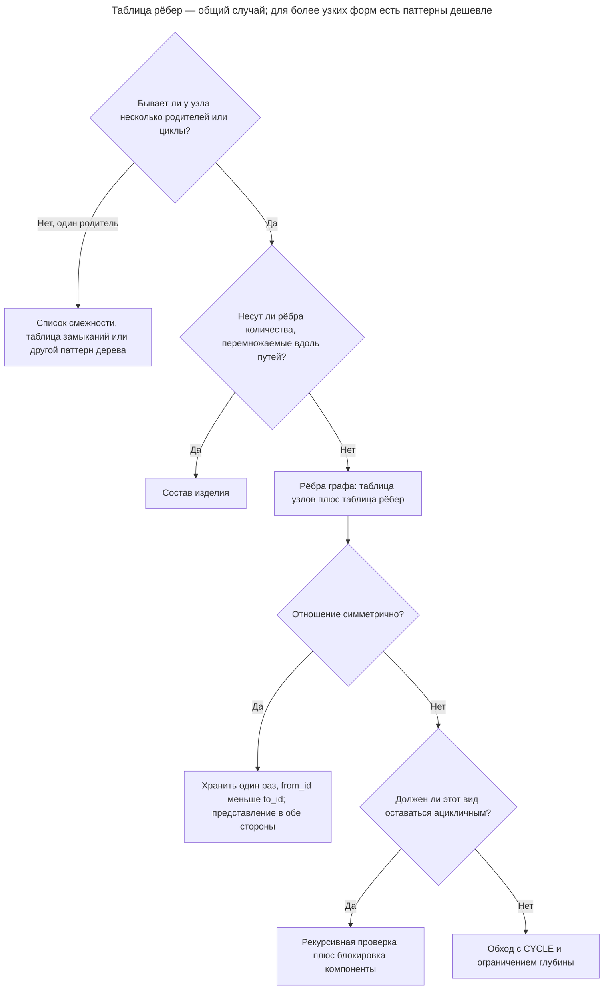
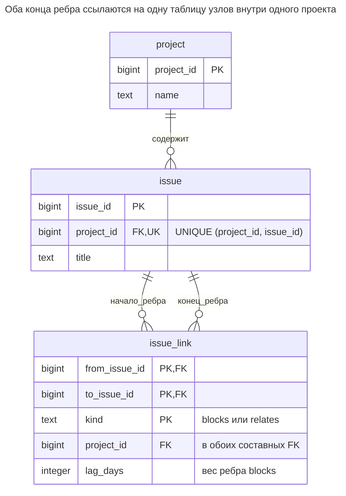
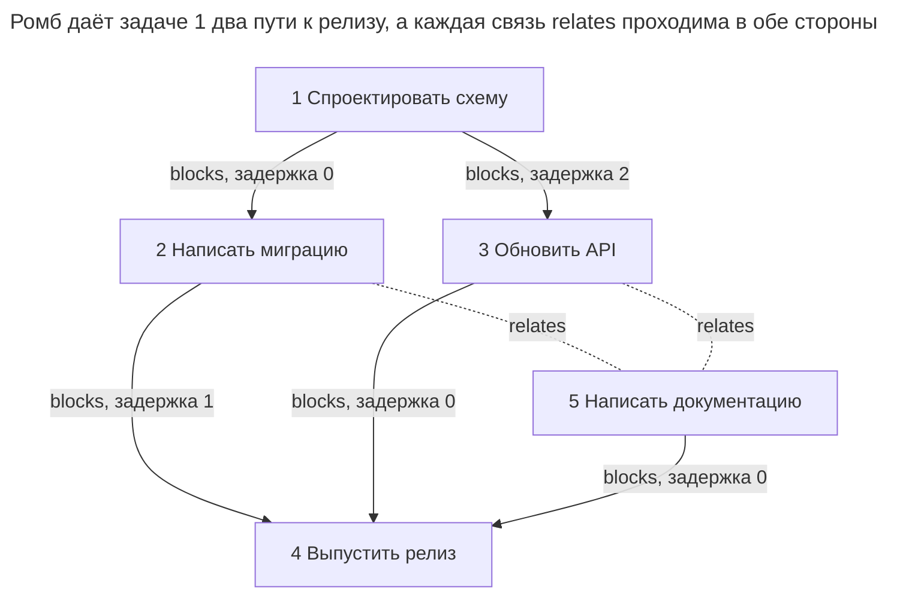
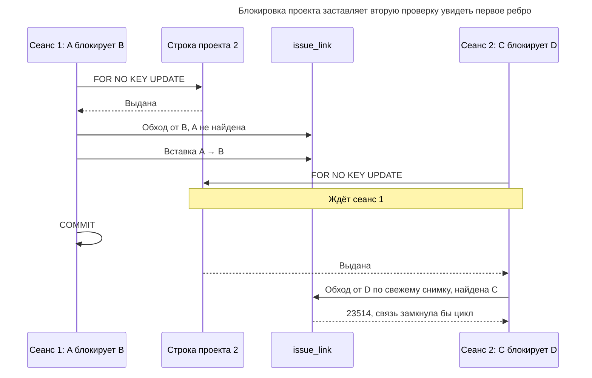
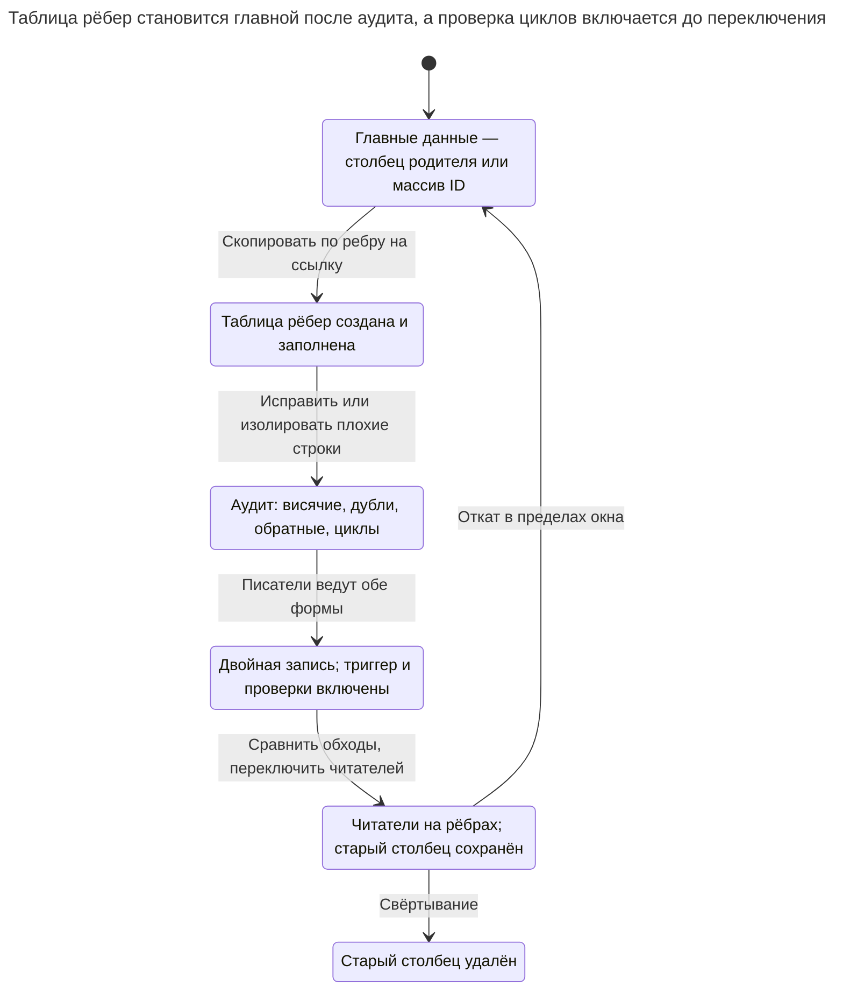

# Рёбра графа

## Назначение

Рёбра графа хранят связь «многие ко многим» между строками одной таблицы в отдельной таблице рёбер, по строке на каждую связь, когда связи не образуют дерево. У таблицы рёбер есть внешний ключ на таблицу узлов с каждого конца, составной ключ из пары и вида связи и столбцы для собственных фактов ребра, например веса. Глава показывает, как проверки строки запрещают петли, как симметричное отношение хранится один раз и читается в обе стороны, как [`WITH RECURSIVE` с `SEARCH` и `CYCLE`](https://www.postgresql.org/docs/18/queries-with.html) обходит граф, в котором бывают циклы, и как сохранить граф зависимостей ацикличным, когда два сеанса добавляют рёбра одновременно.

## Также известен как

Список рёбер (edge list); таблицы узлов и рёбер; ссылка «многие ко многим» на ту же таблицу. В [графовых таблицах](https://learn.microsoft.com/en-us/sql/relational-databases/graphs/sql-graph-overview?view=sql-server-ver17) SQL Server эти две таблицы называются таблицей узлов и таблицей рёбер, в [графах свойств](https://docs.oracle.com/en/database/oracle/oracle-database/26/sqlrf/create-property-graph.html) Oracle — таблицами вершин и рёбер. См. также книгу Джо Селко *Trees and Hierarchies in SQL for Smarties*.

## Проблема

Четыре связи на ER-эскизе выглядят одинаково, а допускают разное. Зависимости задач направлены и не должны замыкаться в цикл: если A ждёт B, а B ждёт A, ни одна не начнётся. Дружба симметрична: Ада дружит с Бобом — тот же факт, что Боб дружит с Адой. Подписка направлена, и циклы в ней нормальны: два человека могут подписаться друг на друга. Участки дорог направлены (бывают улицы с односторонним движением) и несут длину, которую маршрут суммирует.

Ни одна из них не укладывается в столбец родителя. Задачу могут блокировать несколько задач, и сама она может блокировать несколько, поэтому `blocked_by_id` удержит только одну. Массив или строка идентификаторов через запятую не даёт внешних ключей и места для атрибутов ребра; см. [Списки с разделителями](delimited-lists.md). Представление дерева предполагает одного родителя на узел и такую форму просто не принимает.

У обычной таблицы связей свои ловушки, когда оба конца указывают на одну таблицу. Ничто не мешает сохранить и `(2, 5)`, и `(5, 2)` для одного симметричного факта, связать узел с самим собой или замкнуть цикл зависимостей через три другие задачи. Рекурсивный запрос по таким данным может работать, пока не упрётся в лимиты, а два сеанса, каждый из которых проверил новое ребро по старому графу, вместе создают цикл, которого ни один не видел.

## Решение

Храните узлы и рёбра в разных таблицах. У таблицы рёбер есть:

- **Два внешних ключа на таблицу узлов**, `from_id` и `to_id`. Если граф живёт внутри области, например проекта, сделайте каждый внешний ключ составным со столбцом области: тогда оба конца доказуемо принадлежат одной области.
- **Столбец `kind`**, если одна таблица хранит несколько отношений, и составной первичный ключ `(from_id, to_id, kind)`. Каждый факт хранится один раз.
- **Атрибуты ребра** — вес, задержка, время создания: они описывают связь, а не какой-либо из узлов.
- **Проверки строки** для формы каждого вида: `from_id <> to_id`, где петля ничего не значит, и `from_id < to_id` для симметричного вида, чтобы у каждой неупорядоченной пары было ровно одно написание. Читателям представление объединяет оба направления.
- **Проверка ацикличности** для видов, которые должны образовывать ориентированный ациклический граф (DAG): перед вставкой `A → B` пройдите вперёд от `B` и отклоните ребро, если обход дошёл до `A`. Сериализуйте эти проверки блокировкой графа или компоненты, которой принадлежит ребро, потому что проверка читает строки, которых новое ребро не касается.

Обходите граф рекурсивным CTE. Ограничьте глубину в рекурсивной части, используйте `CYCLE` везде, где граф может зацикливаться, и решите, нужен ли запросу каждый путь или каждый достижимый узел.

## Альтернативы и выбор

| Вариант | Отношение | Решающее требование |
| --- | --- | --- |
| [Список смежности](adjacency-list.md) | Замена для данных с одним родителем | У каждого узла не больше одного родителя; один столбец заменяет таблицу рёбер |
| [Таблица замыканий](closure-table.md) | Дополнение: индекс достижимости поверх рёбер | Чтения достижимости преобладают и оправдывают хранение каждой достижимой пары; удаления в DAG требуют обслуживания с учётом путей |
| [Состав изделия](bill-of-materials.md) | Специализация для количеств | Каждое ребро несёт количество, которое перемножается вдоль путей, а выпущенные структуры версионируются |
| [Таблица связей](association-table.md) | Общий случай для двух таблиц | Концы — разные сущности; обходов, симметрии и правила циклов нет |
| Встроенные графовые таблицы или графовая СУБД | Вариант реализации | Преобладают запросы по шаблонам через много переходов, и движок их поддерживает; см. «Поддержку в движках» |

Сравнение иерархий — в [Атласе решений](decision-atlas.md).



Вопросы задаются для каждого вида рёбер, а не для таблицы: одна таблица рёбер ниже держит рядом симметричный вид и ацикличный, каждый со своими проверками.

## Структура



Трекер задач хранит два вида связей между задачами. `blocks` направлена и должна оставаться ацикличной; её `lag_days` — вес ребра, минимальное ожидание после того, как блокирующая задача готова. `relates` симметрична и может образовывать любые циклы. `project_id` входит в оба составных внешних ключа, поэтому ребро не может соединить задачи разных проектов, а проект — та компонента, которую блокирует проверка ацикличности.

## Таблицы и инварианты

- **`issue`** — таблица узлов. `UNIQUE (project_id, issue_id)` существует только как цель составных внешних ключей рёбер.
- **`issue_link`** хранит по строке на направленную пару и вид. Первичный ключ отклоняет повтор ребра; `issue_link_from_fk` и `issue_link_to_fk` требуют, чтобы оба конца существовали в проекте ребра, а `ON DELETE CASCADE` удаляет рёбра удалённой задачи.
- **`issue_link_no_self_loop`** отклоняет задачу, связанную сама с собой. Уберите эту проверку для вида, где петля что-то значит, например для перехода состояния, который оставляет его на месте.
- **`issue_link_relates_canonical`** требует `from_issue_id < to_issue_id` для `relates`, поэтому у пары одно написание, и дубликат ловит первичный ключ. Представление `related_issue` возвращает каждую такую строку в обоих направлениях.
- **`issue_link_acyclic`** — триггер на рёбрах `blocks`. Он блокирует строку проекта и отклоняет вставку или изменение, которое замкнуло бы цикл. Больше ничто в схеме не может выразить это правило: оно зависит от других строк, а не от записываемой.

## Когда применять

- У узла может быть несколько предшественников и несколько последователей: зависимости, пререквизиты, цитирования, подписки, транспортные сети.
- У связи есть собственные факты: вес, тип, время создания.
- Нужен какой-то обход в SQL (достижимость, пути, окрестности в несколько переходов), но граф — побочная структура OLTP-системы, а не её основная нагрузка.

## Последствия и компромиссы

- ➕ Любое число связей на узел, у каждой свой ключ, внешние ключи и атрибуты.
- ➕ Ограничения выражают форму каждого вида: никаких петель, одно написание на симметричную пару, оба конца в одной области.
- ➕ Удаление ребра — удаление одной строки, которое никогда не создаёт цикл, поэтому глобальная проверка графа ему не нужна.
- ➖ Обход рекурсивен и перечисляет пути, а не узлы. В DAG со множеством ромбов число путей растёт экспоненциально с глубиной, даже когда узлов немного.
- ➖ Ацикличность обеспечивают триггер и блокировка, а не декларативное ограничение. Каждый писатель должен проходить через триггер, а правки связей `blocks` в одной компоненте выстраиваются в очередь.
- ➖ Симметричные виды перекладывают нормализацию на писателя: `least` и `greatest` перед вставкой и представление-объединение для каждого читателя.

## Реализация

[Полный скрипт для PostgreSQL 18.7](../assets/graph-edges/graph-edges.sql) проверяет порядок обхода и повторы, достижимость, взвешенную цепочку, пометку циклов, каждую отклонённую запись ниже и эмуляцию гонки. Таблицы:

```sql
CREATE TABLE issue (
    issue_id bigint PRIMARY KEY,
    project_id bigint NOT NULL REFERENCES project (project_id),
    title text NOT NULL,
    UNIQUE (project_id, issue_id)
);
CREATE TABLE issue_link (
    project_id bigint NOT NULL,
    from_issue_id bigint NOT NULL,
    to_issue_id bigint NOT NULL,
    kind text NOT NULL CHECK (kind IN ('blocks', 'relates')),
    lag_days integer NOT NULL DEFAULT 0 CHECK (lag_days >= 0),
    PRIMARY KEY (from_issue_id, to_issue_id, kind),
    CONSTRAINT issue_link_from_fk FOREIGN KEY (project_id, from_issue_id)
        REFERENCES issue (project_id, issue_id) ON DELETE CASCADE,
    CONSTRAINT issue_link_to_fk FOREIGN KEY (project_id, to_issue_id)
        REFERENCES issue (project_id, issue_id) ON DELETE CASCADE,
    CONSTRAINT issue_link_no_self_loop CHECK (from_issue_id <> to_issue_id),
    CONSTRAINT issue_link_relates_canonical
        CHECK (kind <> 'relates' OR from_issue_id < to_issue_id),
    CONSTRAINT issue_link_lag_only_on_blocks CHECK (kind = 'blocks' OR lag_days = 0)
);
CREATE INDEX issue_link_to_idx ON issue_link (to_issue_id, kind);

CREATE VIEW related_issue AS
SELECT from_issue_id AS issue_id, to_issue_id AS related_issue_id
FROM issue_link WHERE kind = 'relates'
UNION ALL
SELECT to_issue_id, from_issue_id FROM issue_link WHERE kind = 'relates';
```

Первичный ключ обслуживает обходы по исходящим рёбрам, `issue_link_to_idx` — по входящим. Триггер ацикличности блокирует строку проекта, затем идёт вперёд от цели нового ребра:

```sql
CREATE FUNCTION reject_blocking_cycle() RETURNS trigger
LANGUAGE plpgsql SET search_path = graph_example, pg_temp AS $$
BEGIN
    IF NEW.kind <> 'blocks' OR NEW.from_issue_id = NEW.to_issue_id THEN
        RETURN NEW;
    END IF;
    PERFORM FROM project WHERE project_id = NEW.project_id FOR NO KEY UPDATE;
    IF EXISTS (
        WITH RECURSIVE downstream(issue_id) AS (
            VALUES (NEW.to_issue_id)
            UNION
            SELECT l.to_issue_id
            FROM issue_link AS l JOIN downstream AS d ON l.from_issue_id = d.issue_id
            WHERE l.kind = 'blocks'
        )
        SELECT FROM downstream WHERE issue_id = NEW.from_issue_id
    ) THEN
        RAISE EXCEPTION 'blocking link % -> % would close a cycle',
            NEW.from_issue_id, NEW.to_issue_id USING ERRCODE = '23514';
    END IF;
    RETURN NEW;
END;
$$;
CREATE TRIGGER issue_link_acyclic
BEFORE INSERT OR UPDATE OF from_issue_id, to_issue_id, kind ON issue_link
FOR EACH ROW EXECUTE FUNCTION reject_blocking_cycle();
```

`UNION` в обходе отбрасывает уже посещённые узлы, поэтому проверка завершается и остаётся линейной по числу прочитанных рёбер. Петли оставлены проверке строки, которая сообщает о них по имени. [`FOR NO KEY UPDATE`](https://www.postgresql.org/docs/18/explicit-locking.html#LOCKING-ROWS) конфликтует сам с собой, но не с блокировкой `FOR KEY SHARE`, которую берут проверки внешних ключей, поэтому создание задач в проекте не блокируется. Загрузите ромб и две симметричные связи:

```sql
INSERT INTO issue_link (project_id, from_issue_id, to_issue_id, kind, lag_days) VALUES
    (1, 1, 2, 'blocks', 0), (1, 1, 3, 'blocks', 2),
    (1, 2, 4, 'blocks', 1), (1, 3, 4, 'blocks', 0), (1, 5, 4, 'blocks', 0);
INSERT INTO issue_link (project_id, from_issue_id, to_issue_id, kind) VALUES
    (1, 2, 5, 'relates'), (1, 3, 5, 'relates');
```



Обход вверх от задачи 4 встречает задачу 1 один раз через задачу 2 и ещё раз через задачу 3. Обход пунктирных связей через симметричное представление может шагнуть от 2 к 5 и сразу обратно к 2.

Перечислите всё, что блокирует релиз, в ширину, с накопленной задержкой:

```sql
WITH RECURSIVE upstream(issue_id, depth, lag_total) AS (
    SELECT from_issue_id, 1, lag_days
    FROM issue_link WHERE to_issue_id = 4 AND kind = 'blocks'
    UNION ALL
    SELECT l.from_issue_id, u.depth + 1, u.lag_total + l.lag_days
    FROM issue_link AS l JOIN upstream AS u ON l.to_issue_id = u.issue_id
    WHERE l.kind = 'blocks' AND u.depth < 10
) SEARCH BREADTH FIRST BY issue_id SET ord
SELECT issue_id, depth, lag_total FROM upstream ORDER BY ord;
```

Запрос возвращает пять строк для четырёх задач в порядке `2, 3, 5, 1, 1`: задача 1 встречается по разу на каждый путь. Именно это нужно взвешенному вопросу: самая длинная цепочка задержек перед релизом — `max(lag_total) = 2`, через задачу 3. Для простой достижимости сгруппируйте строки: `min(depth)` по задаче даёт `1:2, 2:1, 3:1, 5:1`. [`SEARCH BREADTH FIRST`](https://www.postgresql.org/docs/18/queries-with.html#QUERIES-WITH-SEARCH) лишь вычисляет столбец `ord`; порядок задаёт итоговый `ORDER BY`. Условие `u.depth < 10` в рекурсивной части ограничивает обход, даже если цикл всё-таки проскочил; внешний `LIMIT` этого не сделает, как только результат сортируется или соединяется.

В симметричном представлении каждая связь — цикл длины два. Одно лишь ограничение глубины позволяет обходу от задачи 2 вернуться к задаче 2. [`CYCLE`](https://www.postgresql.org/docs/18/queries-with.html#QUERIES-WITH-CYCLE) помечает такие строки и перестаёт их продолжать:

```sql
WITH RECURSIVE walk(issue_id, depth) AS (
    SELECT 2::bigint, 0
    UNION ALL
    SELECT r.related_issue_id, w.depth + 1
    FROM related_issue AS r JOIN walk AS w ON r.issue_id = w.issue_id
    WHERE w.depth < 3
) CYCLE issue_id SET is_cycle USING path
SELECT issue_id, depth, path FROM walk WHERE NOT is_cycle ORDER BY path;
```

Он возвращает задачи `2, 5, 3` с путями `{(2)}`, `{(2),(5)}`, `{(2),(5),(3)}` и помечает две строки как циклы. `CYCLE` останавливает петли внутри одного пути, а не повторы между путями: в графе с ромбами узел всё равно появляется по разу на каждый простой путь, поэтому ограничение глубины остаётся.

Схема отклоняет некорректные рёбра. Петля:

```sql
INSERT INTO issue_link (project_id, from_issue_id, to_issue_id, kind) VALUES (1, 3, 3, 'blocks');
```

PostgreSQL 18.7 выдаёт SQLSTATE `23514`: `ERROR: new row for relation "issue_link" violates check constraint "issue_link_no_self_loop"` с `DETAIL: Failing row contains (1, 3, 3, blocks, 0).` Обратное написание `(5, 2, 'relates')` существующей симметричной связи нарушает `issue_link_relates_canonical` с тем же SQLSTATE. Писатель, который нормализует пару через `least(5, 2), greatest(5, 2)`, упирается уже в ключ: `23505`, `ERROR: duplicate key value violates unique constraint "issue_link_pkey"`, `DETAIL: Key (from_issue_id, to_issue_id, kind)=(2, 5, relates) already exists.` Ребро в другой проект нарушает `issue_link_to_fk` с `23503` и `DETAIL: Key (project_id, to_issue_id)=(1, 6) is not present in table "issue".`

Замыкание цикла через ромб:

```sql
INSERT INTO issue_link (project_id, from_issue_id, to_issue_id, kind) VALUES (1, 4, 1, 'blocks');
```

Триггер выдаёт `23514`: `ERROR: blocking link 4 -> 1 would close a cycle`. Перенацеливание ребра `5 → 4` на `4 → 2` через `UPDATE` падает так же, а один `INSERT` с обоими рёбрами `3 → 5` и `5 → 3` падает на второй строке, потому что строковый триггер `BEFORE` [видит строки, которые его оператор обработал раньше](https://www.postgresql.org/docs/18/trigger-datachanges.html). Связь `relates` от 1 к 4 принимается: обход идёт только по рёбрам `blocks`.

## Поддержка в движках

- **PostgreSQL 18:** [предложения `SEARCH` и `CYCLE`](https://www.postgresql.org/docs/18/queries-with.html) появились в [PostgreSQL 14](https://www.postgresql.org/docs/release/14.0/). Графовых таблиц нет; таблица рёбер, проверки и триггер выше — весь механизм. Для кратчайших маршрутов по дорожным сетям расширение pgRouting предоставляет [`pgr_dijkstra`](https://docs.pgrouting.org/latest/en/pgr_dijkstra.html) вместо перебора путей рекурсией.
- **MySQL 8.4:** [рекурсивные CTE](https://dev.mysql.com/doc/refman/8.4/en/with.html) описаны в документации без предложений `SEARCH` и `CYCLE`; руководство предлагает `UNION DISTINCT` против зацикливания при транзитивном замыкании и ограничивает рекурсию через `cte_max_recursion_depth`, по умолчанию 1000. Если нужны глубина или пути, несите строку пути и сами проверяйте принадлежность. [Проверочные ограничения](https://dev.mysql.com/doc/refman/8.4/en/create-table-check-constraints.html) не могут использовать столбцы, на которых у внешнего ключа задано действие `ON DELETE` или `ON UPDATE`, поэтому проверки петли и канонического порядка исключают `ON DELETE CASCADE` на этих концах. Удаляйте рёбра раньше узла.
- **SQL Server 2025 (17.x):** [`CREATE TABLE ... AS NODE` и `AS EDGE`](https://learn.microsoft.com/en-us/sql/relational-databases/graphs/sql-graph-overview?view=sql-server-ver17) дают встроенные таблицы узлов и рёбер со столбцами `$from_id` и `$to_id`, к которым обращаются через [`MATCH`](https://learn.microsoft.com/en-us/sql/t-sql/queries/match-sql-graph?view=sql-server-ver17). По умолчанию ребро может соединить любой узел с любым; [ограничения рёбер](https://learn.microsoft.com/en-us/sql/relational-databases/tables/graph-edge-constraints?view=sql-server-ver17) (SQL Server 2019 и новее) ограничивают, какие таблицы узлов может соединять ребро, и, если не объявлен `ON DELETE CASCADE`, запрещают удалять связанный узел, но индекс на `$from_id` и `$to_id` не создают. [`SHORTEST_PATH`](https://learn.microsoft.com/en-us/sql/relational-databases/graphs/sql-graph-shortest-path?view=sql-server-ver17) находит невзвешенный кратчайший путь, поэтому длине дороги по-прежнему нужен рекурсивный CTE или код приложения.
- **Oracle AI Database 26ai:** [`CREATE PROPERTY GRAPH`](https://docs.oracle.com/en/database/oracle/oracle-database/26/sqlrf/create-property-graph.html) определяет граф поверх существующих таблиц: `SOURCE KEY ... REFERENCES` и `DESTINATION KEY ... REFERENCES` называют столбцы концов в таблице рёбер, а [`GRAPH_TABLE`](https://docs.oracle.com/en/database/oracle/oracle-database/26/sqlrf/graph_table-operator.html) запрашивает граф шаблонами `MATCH`. Поскольку у `issue_link` два внешних ключа на `issue`, отображение должно явно назвать ключи обоих концов. В режиме по умолчанию `TRUSTED` граф не требует, чтобы ключи были действующими ограничениями, поэтому внешние ключи и проверки оставьте на таблицах.
- **SQLite 3:** [рекурсивные CTE](https://www.sqlite.org/lang_with.html#queries_against_a_graph) обходят таблицу рёбер; пример с графом в документации использует `UNION`, чтобы останавливаться на уже посещённых узлах, а та же страница советует `LIMIT` как страховку. Проверочные ограничения работают; включайте [внешние ключи](https://www.sqlite.org/foreignkeys.html) в каждом соединении. SQLite допускает одного писателя за раз: выполняйте проверку цикла и вставку в одной транзакции, начатой с [`BEGIN IMMEDIATE`](https://www.sqlite.org/lang_transaction.html), чтобы никакой другой писатель не изменил граф между ними.

## Сбои и конкурентность

Проверка цикла читает рёбра, которых новое ребро не касается, поэтому два сеанса могут каждый пройти её по одному и тому же старому графу. Возьмите проект 2 с рёбрами `B → C` и `D → A`. Сеанс 1 добавляет `A → B`, сеанс 2 — `C → D`. Ни один не видит незафиксированного ребра другого, обе проверки проходят, оба коммитят, и в графе оказывается `A → B → C → D → A`. У новых рёбер нет общего конца, поэтому блокировка строк затронутых задач не упорядочила бы сеансы. Блокировка должна покрывать всю компоненту: здесь — строку проекта, поскольку составные внешние ключи держат каждое ребро `blocks` внутри одного проекта.



Без строки блокировки в триггере оба сеанса коммитят. Скрипт практикума воспроизводит этот исход в одном сеансе: каждое ребро по отдельности проходит проверку, а с выключенным триггером сохраняются оба, их принимают все ключи, внешние ключи и проверки, пока обход с `CYCLE` от A не находит `{(6),(7),(8),(9),(6)}`. С включённым триггером второе ребро отклоняется.

Запуск двух сеансов на PostgreSQL 18.7 показывает зависимость от уровня изоляции. На Read Committed сеанс 2 ждёт, а затем падает с `ERROR: blocking link 8 -> 9 would close a cycle`: [изменчивая (volatile) функция берёт свежий снимок](https://www.postgresql.org/docs/18/xfunc-volatility.html) для каждого запроса, поэтому обход после ожидания видит коммит сеанса 1. На Repeatable Read сеанс 2 ждёт ту же блокировку, а затем проверяет снимок своей транзакции, сделанный до коммита сеанса 1; оба ребра фиксируются, и цикл сохраняется. На Serializable, с блокировкой или без неё, один из сеансов падает с SQLSTATE `40001`, `could not serialize access due to read/write dependencies among transactions`, и его нужно повторить. Serializable защищает только от других транзакций Serializable: если сеанс 1 работает на Serializable, а сеанс 2 на Read Committed, блокировка всё равно их упорядочивает, но если сеанс 1 на Read Committed, а сеанс 2 на Serializable, фиксируются оба ребра. Выберите один режим для всех, кто пишет рёбра `blocks`: Read Committed с блокировкой или Serializable с циклом повторов, и никогда Repeatable Read.

Блокировка компоненты сериализует правки `blocks` внутри одного проекта и не трогает остальные проекты. Если у графа нет естественной области, заблокируйте всю таблицу рёбер в режиме `SHARE ROW EXCLUSIVE` отдельным оператором до вставки, как делает [Список смежности](adjacency-list.md); взять эту блокировку внутри триггера означало бы повысить блокировку, которую вставка уже держит, и напроситься на взаимоблокировки. Удалениям блокировка не нужна никогда. Неясный исход коммита разрешается чтением ребра по ключу перед повтором: первичный ключ превращает повторную вставку в ошибку, а не в дубликат.

## Миграция

Обычно всё начинается со столбца родителя, которому нужно допустить второго родителя, или с массива идентификаторов предшественников. Сначала аудит, потом ограничения: найдите висячие ссылки, дубликаты, обратные написания симметричных пар и уже существующие циклы. Триггер проверяет только новые рёбра, поэтому цикл, уже лежащий в данных, его переживёт. Найдите такие циклы обходом с `CYCLE` от каждого узла с фильтром по `is_cycle`.



Заполняйте симметричные пары через `least` и `greatest` и решите, не означала ли ссылка, существовавшая лишь в одну сторону, односторонний факт, который вы сейчас сделаете взаимным. Перед переключением читателей сравните рекурсивные результаты по старой и новой формам для показательных узлов. Старый столбец можно вернуть, пока писатели его поддерживают; удаляйте его через [Расширение и свёртывание](expand-contract.md), когда ни один читатель им больше не пользуется.

## Антипаттерны и частые ошибки

- Хранить симметричное отношение в обоих направлениях без правила, которое держит две строки согласованными; одну сторону удаляют, и дружба становится односторонней.
- Уникальный индекс по `(least(a, b), greatest(a, b))` без проверки канонического порядка: дубликаты отклоняются, но каждая строка хранит то направление, которое выбрал писатель, и читателям всё равно нужно представление-объединение.
- Рекурсия с `UNION ALL` без ограничения глубины и без `CYCLE` по графу, в котором бывают циклы.
- Дедупликация путей через `UNION` или `DISTINCT`, когда запрос суммирует веса вдоль каждого пути, или суммирование весов, когда нужна лишь достижимость.
- Доверие триггеру ацикличности без блокировки, его запуск на Repeatable Read или писатели на разных уровнях изоляции.
- Узлы разных типов за одной парой `(type, id)` в таблице рёбер; см. [Полиморфные связи](polymorphic-associations.md). Заведите отдельную таблицу рёбер на каждую пару таблиц узлов или общую таблицу-супертип узлов.

## Известные применения

- [Обзор SQL Graph](https://learn.microsoft.com/en-us/sql/relational-databases/graphs/sql-graph-overview?view=sql-server-ver17) от Microsoft моделирует узлы `Person`, соединённые таблицей рёбер `friends` с собственным `StartDate`, — то же разделение на узлы и рёбра, что в этой главе.
- [Пример запроса по графу](https://www.sqlite.org/lang_with.html#queries_against_a_graph) в SQLite хранит неориентированный граф как таблицу `edge(aa, bb)` с индексом на каждом столбце и обходит её в обе стороны.
- [Пример обнаружения циклов](https://www.postgresql.org/docs/18/queries-with.html#QUERIES-WITH-CYCLE) в PostgreSQL обходит таблицу `graph` со столбцом `link` и показывает написанный вручную массив пути, который заменяет `CYCLE`.

## Связанные паттерны

- [Список смежности](adjacency-list.md) — частный случай с одним родителем и протокол блокировки таблицы.
- [Таблица замыканий](closure-table.md) материализует достижимость; для DAG ей нужно решить, что значит расстояние, когда маршрутов несколько.
- [Состав изделия](bill-of-materials.md) добавляет количества, перемножаемые вдоль каждого пути, и версионируемые структуры.
- [Таблица связей](association-table.md) описывает идентичность и атрибуты связи, когда концы — разные таблицы.
- [Фиксированная глубина](fixed-depth-queries.md) объясняет, почему фиксированное число самосоединений — не обход.
