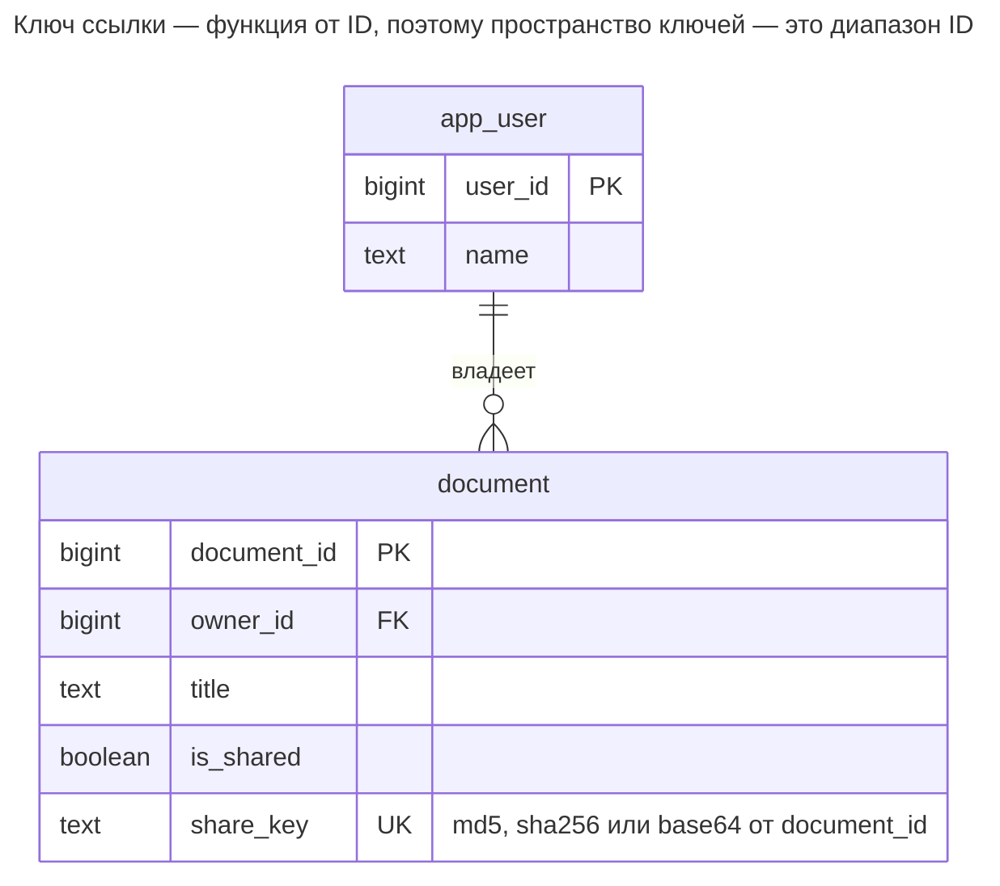
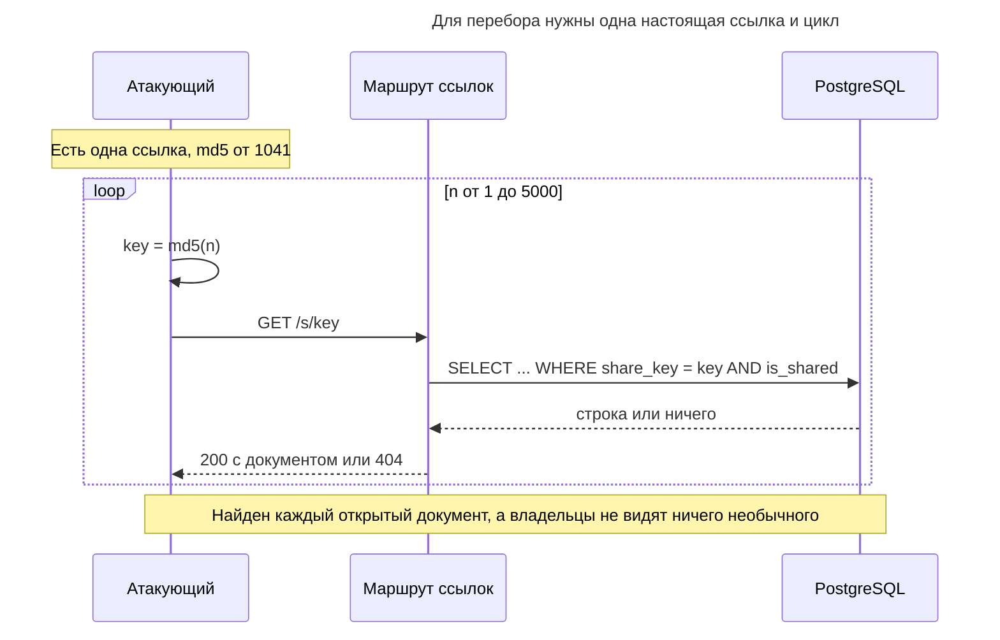
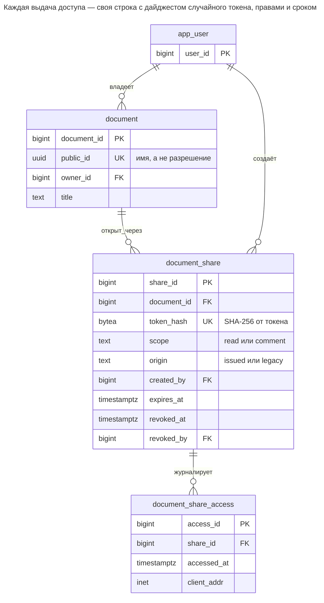
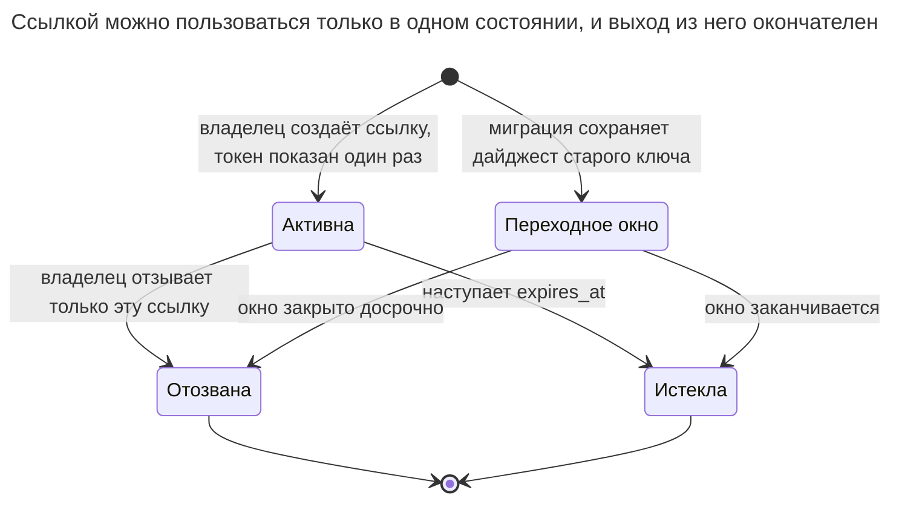
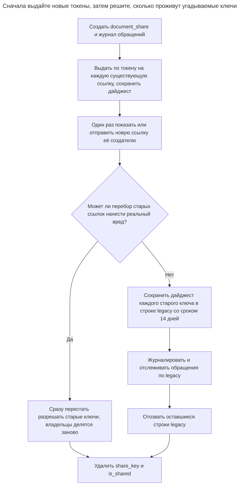

# Угадываемые ссылки

Угадываемая ссылка — публичный URL или ссылка «для всех, у кого она есть», единственный секрет которой — последовательный ID объекта или детерминированное преобразование этого ID: `md5(id)`, `sha256(id)`, Hashids или Sqids, base64. Кто получил одну ссылку, вычислит следующую, а скрипт переберёт весь диапазон ID за минуты. Глава показывает, почему хеширование или кодирование ID ничего не защищает, заменяет ключ случайным токеном-полномочием на каждую выдачу доступа — хранимым в виде дайджеста, ограниченным по правам, со сроком действия и отзывом — и переносит существующие ссылки так, чтобы старые не оставались открытыми бессрочно.

## Также известен как

Insecure Direct Object Reference (IDOR) в [шпаргалке OWASP](https://cheatsheetseries.owasp.org/cheatsheets/Insecure_Direct_Object_Reference_Prevention_Cheat_Sheet.html) и [API1:2023 Broken Object Level Authorization](https://owasp.org/API-Security/editions/2023/en/0xa1-broken-object-level-authorization/) в OWASP API Security Top 10; оба названия описывают общую ошибку — отдавать объект любому, кто предъявил ссылку на него. Правильное устройство называется capability URL в документе W3C TAG [Good Practices for Capability URLs](https://www.w3.org/TR/capability-urls/) — это First Public Working Draft 2014 года, который сам TAG просит цитировать только как незавершённую работу.

## Контекст

Пользователи хотят отправить документ, счёт или отчёт тому, у кого нет учётной записи: клиенту, бухгалтеру, коллеге из другой компании. Продукт добавляет кнопку «Поделиться», которая превращает страницу объекта в ссылку, открываемую кем угодно, например `/invoices/123/share` или `/docs/1042?public=1`. Ссылка должна работать без входа, переживать вставку в чат и письмо и быстро разрешаться.

## Проблема

Ссылка не несёт ничего, что сервер ещё не опубликовал. В `/docs/1042?public=1` единственная проверка — флаг на документе, а `1042` — [суррогатный ключ](surrogate-key.md): `1041` и `1043` — соседи, и некоторыми из них тоже поделились. Замена числа функцией от него меняет вид URL, но не работу атакующего. Ему не нужно обращать функцию: достаточно вычислить её в прямом направлении для `1`, `2`, `3` и так далее и запросить каждый результат.

- **Хеш от ID** — `md5(id)`, `sha256(id)`, с фиксированным префиксом или без — отображает маленькое упорядоченное множество входов в столько же выходов. Пять тысяч документов требуют пяти тысяч вычислений хеша, а это миллисекунды. Секретный ключ, подмешанный правильно, то есть через HMAC, делает функцию неугадываемой, пока ключ остаётся секретным, но ссылка на объект по-прежнему ровно одна и навсегда. Нельзя ограничить сроком ссылку одного получателя или отозвать её, не сменив ключ для всех ссылок, а утёкший ключ открывает сразу все объекты.
- **Base64 или hex от ID** — это кодировка; `MTA0Mw==` декодируется в `1043`.
- **Hashids и Sqids** — обратимая обфускация по замыслу. [FAQ Sqids](https://sqids.org/faq#not-recommended) перечисляет, для чего библиотека не годится: «Any data that's sensitive. Generated IDs are not hashes and could be decoded back into numbers.» Перемешанный алфавит этого не меняет: «given enough effort, somebody could reverse-engineer your shuffled alphabet, so this is by no means a technique to hide sensitive data» ([FAQ](https://sqids.org/faq#unique)). В Sqids убрали параметр соли из Hashids, поскольку он «was never meant to be associated with security or safety»; «There is no encryption of any kind» ([FAQ](https://sqids.org/faq#salt)).

## Почему так делают

У объекта уже есть ID, маршрут уже его загружает, а столбец-флаг — одна миграция. Кажется, что хеширование добавляет секрет; Sqids выдают короткие приятные строки, похожие на случайные. Долгое время никто ничего не замечает: законный получатель, открывший ссылку, и атакующий, открывший угаданную, в журналах выглядят одинаково. Черновик W3C говорит о том же: «there is nothing to distinguish legitimate access from illegitimate access» ([§4.2](https://www.w3.org/TR/capability-urls/#detecting-compromises)).

## Последствия

- ➖ Любой, кто увидел одну ссылку, перечислит все объекты, которыми поделились все пользователи; три кодировки в практикуме это показывают.
- ➖ У ссылки нет срока жизни: ссылка, отправленная подрядчику два года назад, сегодня открывает текущую версию документа.
- ➖ Одна ссылка на объект делает отзыв принципом «всё или ничего»: чтобы отрезать одного получателя, владелец закрывает доступ всем.
- ➖ Нигде не записано, какой ссылкой воспользовались, поэтому масштаб инцидента не определить.
- ➖ Последовательные или декодируемые ключи раскрывают и объёмы: FAQ Sqids сам предупреждает, что декодированные ID пользователей «could reveal your app's user count».

## Признаки

- Маршрут для ссылок ищет объект по первичному ключу или по столбцу, вычисленному из него.
- У столбца вроде `share_key` значение по умолчанию наподобие `md5(id::text)`, или приложение строит ссылки кодировщиком Sqids/Hashids.
- Доступ по ссылке — булев флаг на объекте (`is_public`, `is_shared`), а не строка на каждую ссылку.
- У ссылок нет срока действия, и отозвать одну можно, только закрыв доступ к объекту целиком.
- Столбец UUID, часто UUIDv7 или функция GUID базы данных, объявлен «неугадываемым» и служит единственной проверкой.

## Как лучше

Выдавайте токен-полномочие (capability token) на каждую выдачу доступа. Токен — отдельный секрет, не связанный с идентичностью объекта, а строка, в которой он хранится, говорит, что он разрешает и до какого момента:

- **Случайный:** не меньше 128 бит из криптографически стойкого генератора, например 32 байта в base64url с узнаваемым префиксом вроде `shr_`. Не UUID: [RFC 9562 §8](https://www.rfc-editor.org/rfc/rfc9562.html#section-8) требует, чтобы UUID «MUST NOT be used as security capabilities (identifiers whose mere possession grants access)». Черновик W3C ещё называет хорошим неугадываемым идентификатором «a UUID» ([§5.2](https://www.w3.org/TR/capability-urls/#capability-url-design)); RFC, опубликованный десятью годами позже, это исключает. В UUIDv4 122 случайных бита. UUIDv7 хуже: его первые 48 бит — миллисекунда Unix-времени создания (см. [Упорядоченный идентификатор](time-ordered-identifier.md)), остаётся не больше 74 бит, и генератор может потратить часть из них на счётчики — RFC называет приращение на 1 «easily guessable» ([§6.2](https://www.rfc-editor.org/rfc/rfc9562.html#section-6.2)) — или на доли миллисекунды, как документирует [`uuidv7()`](https://www.postgresql.org/docs/18/functions-uuid.html) в PostgreSQL.
- **Хранится как дайджест:** дайджест SHA-256 под ограничением уникальности, никогда не сам токен — ровно механизм токенов из [Хешированного секрета](hashed-secret.md), включая то, где вычисляется хеш и почему достаточно быстрого дайджеста.
- **Ограничен по правам и времени:** строка называет цель, права (`read` или `comment`, но не больше, чем реализует страница по ссылке), создателя, `expires_at` и `revoked_at`. Черновик W3C рекомендует, чтобы capability URL истекали, а пользователь мог создать несколько таких ссылок на ресурс, «so that they can revoke access through a compromised capability URL without affecting access from other capability URLs» ([§5.1](https://www.w3.org/TR/capability-urls/#application-design)).
- **Отделён от публичного идентификатора:** [Публичный идентификатор](public-identifier.md) — это имя. Он попадает в журналы, обращения в поддержку и URL для вошедших пользователей, его трудно отозвать, и он ничего не разрешает. Токен — это разрешение: его показывают один раз, отзывают по отдельности, и он истекает.

Неугадываемый ID — не управление доступом. Обычные URL для вошедших пользователей, такие как `/documents/{public_id}`, по-прежнему требуют проверки прав на объект при каждом запросе, будь идентификатор целым числом или случайным UUID; шпаргалка OWASP по IDOR считает сложные идентификаторы лишь «a defense-in-depth measure» ([Mitigation](https://cheatsheetseries.owasp.org/cheatsheets/Insecure_Direct_Object_Reference_Prevention_Cheat_Sheet.html#mitigation)). Токен-полномочие и есть авторизация для единственного анонимного маршрута, который его принимает, и этот маршрут больше ничего не отдаёт.

### Альтернативы и выбор

| Вариант | Отношение | Когда выбирать |
| --- | --- | --- |
| Открытый ID за проверкой прав на объект | Оправданный исходный выбор | Все, кто смотрит объект, вошли в систему; ID — имя, а доступ решает проверка |
| Токен-полномочие на каждую выдачу доступа | Замена угадываемой ссылки | Объект должны открывать люди без учётной записи, а владельцам нужны срок действия и отзыв отдельной ссылки |
| Строка выдачи прав учётной записи в [Таблице связей](association-table.md) | Замена | Получатели могут войти; черновик W3C сначала спрашивает: «Could access be restricted using an account-based mechanism instead?» |
| Подписанный URL: HMAC от цели и срока | Вариант реализации | Ссылки короткоживущие, например скачивание из письма, и отзывать их до истечения не нужно; смена ключа отзывает их все |
| [Публичный идентификатор](public-identifier.md) | Дополнение | Объекту нужно стабильное непоследовательное имя в URL для вошедших пользователей; токен оно не заменяет |

Оправданный случай реален: `/invoices/123` допустим, если маршрут требует сессию и проверяет, что счёт принадлежит учётной записи вызывающего. Тогда число раскрывает лишь объём и порядок; если это важно, выберите [Публичный идентификатор](public-identifier.md). Семейство идентификаторов сравнивается в [Атласе решений](decision-atlas.md).

## Пример

### Структура

**Было**



Ограничение уникальности на `share_key` гарантирует, что каждый ключ разрешается в один документ, — именно это и нужно перебирающему. Ключ у документа один, и записать срок, права или отзыв некуда.

```sql
CREATE TABLE document (
    document_id bigint PRIMARY KEY,
    owner_id bigint NOT NULL REFERENCES app_user (user_id),
    title text NOT NULL,
    is_shared boolean NOT NULL DEFAULT false,
    share_key text UNIQUE
);
UPDATE document SET share_key = md5(document_id::text);

SELECT title FROM document WHERE share_key = $key AND is_shared;
```

Атакующий фактически выполняет такой запрос — по одному HTTP-запросу на строку `generate_series`:

```sql
SELECT d.document_id, d.owner_id, d.title
FROM generate_series(1, 5000) AS guess(n)
JOIN document AS d ON d.share_key = md5(guess.n::text)
WHERE d.is_shared;
```

В [практикуме](../assets/guessable-links/guessable-links.sql) три документа двух разных владельцев открыты по ссылкам с ключами `md5`, `sha256` в hex и base64 от ID; одно соединение по трём кандидатным кодировкам находит все три.



Каждый запрос корректен, и сервер отвечает на него так, как задумано. Ограничение частоты запросов замедляет цикл, но пространство ключей по-прежнему не больше диапазона ID.

**Стало**



У документа может быть сколько угодно ссылок, и каждую можно отозвать отдельно. `public_id` называет документ в URL для вошедших пользователей и не участвует ни в одном поиске по ссылке. `origin` нужен только для миграции ниже.

```sql
CREATE TABLE document_share (
    share_id bigint GENERATED ALWAYS AS IDENTITY PRIMARY KEY,
    document_id bigint NOT NULL REFERENCES document (document_id) ON DELETE CASCADE,
    token_hash bytea NOT NULL,
    scope text NOT NULL DEFAULT 'read',
    origin text NOT NULL DEFAULT 'issued',
    created_by bigint NOT NULL REFERENCES app_user (user_id),
    created_at timestamptz NOT NULL DEFAULT now(),
    expires_at timestamptz NOT NULL,
    revoked_at timestamptz,
    revoked_by bigint REFERENCES app_user (user_id),
    CONSTRAINT document_share_token_hash_key UNIQUE (token_hash),
    CONSTRAINT document_share_token_hash_length CHECK (octet_length(token_hash) = 32),
    CONSTRAINT document_share_scope CHECK (scope IN ('read', 'comment')),
    CONSTRAINT document_share_origin CHECK (origin IN ('issued', 'legacy')),
    CONSTRAINT document_share_lifetime CHECK (
        expires_at > created_at AND expires_at <= created_at + interval '2160 hours'),
    CONSTRAINT document_share_revocation CHECK ((revoked_at IS NULL) = (revoked_by IS NULL))
);
CREATE INDEX document_share_document_idx ON document_share (document_id);
```

`expires_at` обязателен и ограничен 90 днями, поэтому «никогда не истекает» нельзя выбрать по недосмотру. Предел записан как 2160 часов: прибавление `'90 days'` к `timestamptz` следует часовому поясу сессии при переходах на летнее время, а ограничение не должно от него зависеть; см. [Момент времени](time-point.md). Маршрут ссылок разрешает токен, проверяет срок и отзыв и записывает обращение одним оператором. Дайджест вычисляет приложение; практикум вызывает `sha256()` только ради самодостаточности:

```sql
WITH hit AS (
    SELECT s.share_id, s.document_id, s.scope
    FROM document_share AS s
    WHERE s.token_hash = $token_digest
      AND s.revoked_at IS NULL
      AND s.expires_at > now()
), logged AS (
    INSERT INTO document_share_access (share_id, client_addr)
    SELECT share_id, $client_addr FROM hit
)
SELECT d.title, hit.scope FROM hit JOIN document AS d USING (document_id);
```

В практикуме у документа `1041` две ссылки: `read` для коллеги и `comment` для клиента. Отзыв ссылки коллеги через `UPDATE document_share SET revoked_at = now(), revoked_by = 1 WHERE token_hash = $digest AND revoked_at IS NULL` оставляет ссылку клиента рабочей. Истёкшая ссылка не возвращает строк. Повторный перебор — `md5`, `sha256`, base64 и само число для каждого ID до 5000 — не находит ничего.

Запись байтов самого токена вместо дайджеста завершается SQLSTATE `23514`: `ERROR: new row for relation "document_share" violates check constraint "document_share_token_hash_length"`. Повторная выдача того же токена — SQLSTATE `23505`: `ERROR: duplicate key value violates unique constraint "document_share_token_hash_key"`. Права `write` и срок в один год нарушают `document_share_scope` и `document_share_lifetime` с кодом `23514`, а отзыв без `revoked_by` нарушает `document_share_revocation`. Все сообщения получены в PostgreSQL 18.7.



Ничто не возвращает ссылку в состояние «Активна»: получатель, которому снова нужен доступ, получает новую ссылку с новым токеном. В поиске «Переходное окно» ведёт себя как «Активна», поэтому оно должно быть коротким.

### Поддержка в движках

Генерируйте и хешируйте токен в приложении по причинам из [Хешированного секрета](hashed-secret.md); там же перечислены типы для 32-байтового дайджеста в каждом движке. Если случайные байты всё-таки должна сгенерировать база данных, используйте её криптографический генератор, но никогда не функцию UUID:

- **PostgreSQL 18:** встроенные [`uuidv4()` и `uuidv7()`](https://www.postgresql.org/docs/18/functions-uuid.html) возвращают UUID, которые RFC 9562 исключает как полномочия. Функция `gen_random_bytes(count)` расширения [`pgcrypto`](https://www.postgresql.org/docs/18/pgcrypto.html#PGCRYPTO-RANDOM-DATA-FUNCS) возвращает «cryptographically strong random bytes», не больше 1024 за вызов. `encode()` в PostgreSQL 18.7 отвергает `base64url` как неизвестную кодировку, так что URL-безопасное кодирование всё равно остаётся в приложении.
- **MySQL 8.4:** [`RANDOM_BYTES(len)`](https://dev.mysql.com/doc/refman/8.4/en/encryption-functions.html#function_random-bytes) возвращает байты из «the random number generator of the SSL library», от 1 до 1024 за вызов.
- **SQL Server 2025 (17.x):** [`CRYPT_GEN_RANDOM(length)`](https://learn.microsoft.com/en-us/sql/t-sql/functions/crypt-gen-random-transact-sql?view=sql-server-ver17) возвращает «a cryptographic, randomly-generated number, generated by the Crypto API». `NEWSEQUENTIALID()` — противоположность того, что нужно токену; см. [Публичный идентификатор](public-identifier.md).
- **Oracle AI Database 26ai:** [`DBMS_CRYPTO.RANDOMBYTES`](https://docs.oracle.com/en/database/oracle/oracle-database/26/arpls/DBMS_CRYPTO.html) возвращает «a cryptographically secure pseudo-random sequence of bytes».
- **SQLite 3:** [`randomblob(N)`](https://www.sqlite.org/lang_corefunc.html) документирована лишь как возвращающая «pseudo-random bytes», без заявлений о криптостойкости; генерируйте токены в приложении.

### Сбои и конкурентность

Отзыв — один `UPDATE`, а каждый поиск проверяет `revoked_at`, поэтому отзыв действует для каждого оператора, начатого после фиксации отзывающей транзакции. На уровне read committed уже выполняющийся поиск сохраняет свой снимок и может отдать последний ответ; скачивание, которое идёт минутами, продолжится. Если вы кешируете успешные поиски, время жизни кеша становится задержкой отзыва. Повторный отзыв безвреден: `UPDATE` требует `revoked_at IS NULL` и, как проверяет практикум, во второй раз не обновляет ни одной строки.

Две одновременно созданные ссылки на практике не столкнутся при 256 случайных битах, а уникальный дайджест превращает невозможный случай в SQLSTATE `23505`, а не в токен, открывающий два документа. Токен передаётся в URL, поэтому попадает в историю браузера, журналы прокси и заголовки `Referer`; черновик W3C называет этот риск «very high» ([§4.1](https://www.w3.org/TR/capability-urls/#risk-of-exposure)) и рекомендует HTTPS, отсутствие сторонних ссылок и скриптов на странице и `rel="noreferrer"` на оставшихся ссылках. Срок действия и отзыв отдельных ссылок ограничивают ущерб, когда ссылка утечёт, — а она утечёт. Строка журнала на каждый запрос — это запись на каждый запрос; при большом трафике агрегируйте её, как [Хешированный секрет](hashed-secret.md) советует для `last_used_at`.

### Миграция

Старые ссылки угадываемы, пока они работают, поэтому миграция — решение об уязвимости, а не только о совместимости.



Строки legacy используют ту же таблицу и тот же поиск, поэтому окно закрывается по сроку без изменения кода. Практикум доказывает цену окна: пока строки legacy действуют, перебор, который отправляет `md5(n)` как токен, всё ещё находит документ со старым ключом MD5.

1. Создайте `document_share` и `document_share_access` рядом со старыми столбцами.
2. Для каждого документа с `is_shared` приложение генерирует токен, вставляет его дайджест с владельцем в `created_by` и один раз передаёт новую ссылку владельцу — в диалоге «Поделиться» или по почте. Если продукт должен показывать ссылку повторно, дешёвый ответ — новая ссылка на каждый запрос, ведь ссылок на объект может быть много; обратимое хранение токенов — альтернатива, которую [Хешированный секрет](hashed-secret.md) описывает для секретов, которые нужно предъявить снова.
3. Отключите старые ключи или вставьте `sha256(old_key)` строками `origin = 'legacy'` с коротким `expires_at`. Пусть маршрут ссылок принимает обе формы URL и разрешает обе через поиск по дайджесту.
4. Следите за обращениями по строкам legacy в `document_share_access`: всплеск разных legacy-ссылок с одного `client_addr` — это идущий перебор, а отзыв всех строк legacy — один `UPDATE`.
5. После окна отзовите оставшиеся строки, удалите `share_key` и `is_shared` и старый маршрут, чтобы старые URL отвечали 404 или 410, как черновик W3C рекомендует для истёкших capability URL.

## Связанные паттерны и антипаттерны

- [Хешированный секрет](hashed-secret.md) хранит токен в виде дайджеста и даёт столбцы его жизненного цикла.
- [Публичный идентификатор](public-identifier.md) называет объект, не давая доступа; именно его оправданно помещать в URL для вошедших пользователей.
- [Суррогатный ключ](surrogate-key.md) — внутренняя идентичность, последовательность которой раскрывает угадываемая ссылка.
- [Упорядоченный идентификатор](time-ordered-identifier.md) объясняет, почему UUIDv7 раскрывает время создания и не годится в токены.
- [Таблица связей](association-table.md) моделирует выдачу прав учётным записям, когда получатели могут войти.
