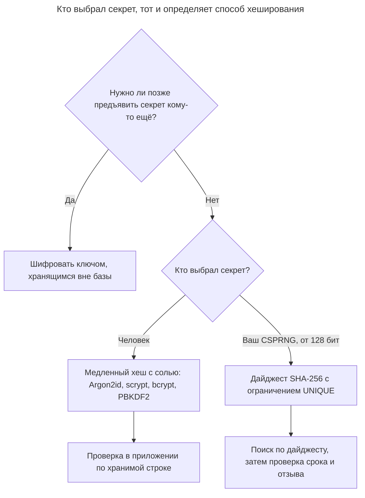
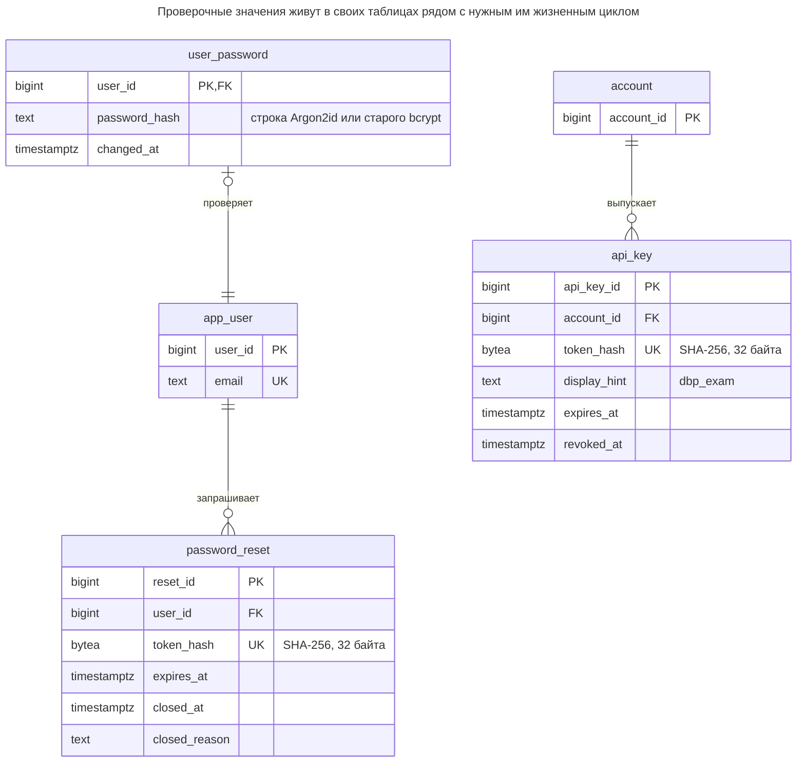
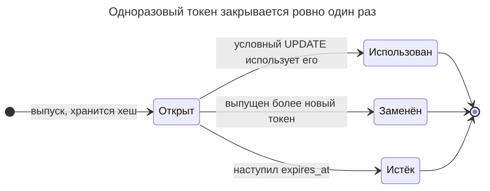
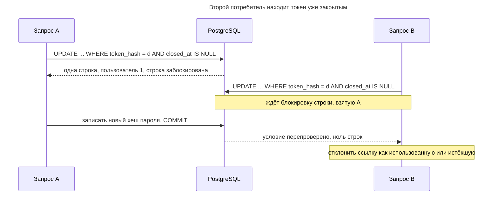

# Хешированный секрет

## Назначение

Хешированный секрет хранит проверочное значение вместо самого секрета: тот, кто прочитает таблицу — резервную копию, реплику, утёкший дамп, запрос поддержки, — не сможет с найденным войти в систему или вызвать API. Пароли получают медленный хеш с солью в самоописывающем формате, чтобы трудоёмкость можно было наращивать; случайные токены, такие как API-ключи и ссылки сброса пароля, получают быстрый дайджест, который одновременно служит индексируемым ключом поиска. Паттерн дополняют столбцы жизненного цикла — срок действия, отзыв, однократное использование — и ограничения, отвергающие всё, что похоже на открытый текст.

## Также известен как

Хеш пароля; дайджест токена; проверочное значение учётных данных (verifier). В книге Билла Карвина [*SQL Antipatterns*](https://pragprog.com/titles/bksap1/sql-antipatterns-volume-1/) предотвращаемая ошибка называется Readable Passwords, а решение — «Store a Salted Hash of the Password». [NIST SP 800-63B](https://pages.nist.gov/800-63-4/sp800-63b.html#passwordver) говорит о верификаторах, которые хранят пароли «salted and hashed using a suitable password hashing scheme»; [OWASP Password Storage Cheat Sheet](https://cheatsheetseries.owasp.org/cheatsheets/Password_Storage_Cheat_Sheet.html) приводит актуальные алгоритмы и параметры.

## Проблема

В таблице пользователей есть столбец `password`, а позже рядом с ним появляются `api_token` и `reset_token`. Теперь рабочие учётные данные есть у любого, кто может прочитать таблицу: у аналитика с доступом на чтение, в неверно настроенном хранилище резервных копий, в журнале медленных запросов, который записал `UPDATE`. Поскольку люди повторяют пароли, утечка открывает и их учётные записи в других сервисах. Шифрование ключом, который хранит приложение, мало что меняет: приложение должно уметь расшифровывать, поэтому тот, кто получит ключ вместе с данными, получит все секреты.

К тому же секреты различаются. Пароль выбирает человек, он короткий и угадываемый и должен выдерживать перебор офлайн после утечки. API-ключ или токен сброса генерируете вы с такой случайностью, что угадать его безнадёжно, но его предъявляют в каждом запросе и находить его нужно быстро. Единое правило хеширования для обоих либо слишком медленно для токенов, либо слишком слабо для паролей.

## Решение

Никогда не храните секрет; храните то, что нужно для его проверки.

- **Пароли:** приложение вычисляет медленный хеш с солью, требовательный к памяти, и сохраняет закодированный результат. Минимум OWASP для Argon2id — 19 МиБ памяти, две итерации и степень параллелизма 1; [запасные варианты](https://cheatsheetseries.owasp.org/cheatsheets/Password_Storage_Cheat_Sheet.html) — scrypt, bcrypt с work factor не меньше 10 или PBKDF2-HMAC-SHA-256 не меньше чем с 600 000 итераций. Кодировка — обычно [формат строк PHC](https://c2sp.org/phc-strings) — называет алгоритм, его параметры и соль, поэтому для проверки больше ничего не нужно, а старые хеши можно распознать и обновить при следующем входе. NIST тоже просит хранить вместе с каждым паролем ссылку на схему хеширования и её параметр стоимости.
- **Случайные токены:** приложение генерирует не меньше 128 бит криптографически стойким генератором, показывает токен пользователю один раз и хранит его дайджест SHA-256 под ограничением уникальности. [OWASP Forgot Password Cheat Sheet](https://cheatsheetseries.owasp.org/cheatsheets/Forgot_Password_Cheat_Sheet.html#general-security-practices) требует, чтобы токены сброса создавались таким генератором, были одноразовыми, истекали и хранились безопасно. Быстрого дайджеста достаточно, потому что вход невозможно угадать, а поиск по равенству дайджеста находит строку за одно обращение к индексу.
- **Жизненный цикл:** каждая строка токена несёт `expires_at` и `revoked_at`; одноразовые токены закрываются тем же условным `UPDATE`, который их использует.

Хеширование выполняет приложение. Если хеш вычисляет база, открытый текст доходит до сервера и может попасть в журналы запросов, `pg_stat_activity` и сообщения об ошибках.

## Альтернативы и выбор

| Соседний паттерн | Связь | Определяющее требование |
| --- | --- | --- |
| Обратимое шифрование секрета | Замена для другого требования | Сам секрет понадобится позже: учётные данные исходящей интеграции или ключ подписи вебхуков, нужный для вычисления HMAC; тогда храните его зашифрованным ключом, который лежит вне базы |
| Медленный хеш пароля | Вариант реализации внутри паттерна | Секрет выбрал человек |
| Быстрый дайджест как ключ поиска | Вариант реализации внутри паттерна | Секрет случайный, с высокой энтропией, и его нужно находить в каждом запросе |
| [Публичный идентификатор](public-identifier.md) | Дополнение | Несекретный идентификатор называет ключ в интерфейсе, логах и обращениях в поддержку |
| [Разделение таблицы](table-split.md) | Дополнение | Проверочные значения нужно убрать из широкой, часто читаемой строки пользователя и выдавать доступ к ним отдельно |

Идентификаторы сравниваются в [Атласе решений](decision-atlas.md). Исходящие учётные данные, которые ваша система должна предъявлять повторно, — не хешированные секреты; это задача управления секретами, а не паттерн схемы.



Разделение следует цене для атакующего: подобрать пароль человека дёшево, если каждая попытка не стоит дорого, а подобрать 128-битный случайный токен невозможно, даже если каждая попытка быстрая.

## Структура



`user_password` — разделение пользователя один к одному, поэтому список пользователей никогда не читает хеши. `api_key` и `password_reset` находят строку по дайджесту; подсказка — несекретный префикс, по которому человек узнаёт ключ в списке. Скрипт практикума хранит `account_id` как обычный столбец без таблицы `account`.



Каждое закрытое состояние конечное, а частичный уникальный индекс `password_reset_one_open` допускает только один открытый токен на пользователя. В состояние «Истёк» токен попадает по времени; задача очистки может записать это в `closed_reason`, но запрос использования сам проверяет `expires_at`.

## Таблицы и инварианты

- **`user_password`** хранит один хеш на пользователя. `user_password_hash_format` принимает строку Argon2id в [формате PHC](https://c2sp.org/phc-strings) или строку старого bcrypt и отвергает всё остальное, поэтому путь кода, забывший хешировать, громко падает.
- **`api_key.token_hash`** уникален и занимает ровно 32 байта (`api_key_token_hash_length`) — длину дайджеста SHA-256; байты самого токена не проходят проверку.
- **`api_key`** пригоден, только пока `revoked_at IS NULL`, а `expires_at` отсутствует или в будущем; каждый поиск указывает оба условия.
- **`password_reset`** имеет уникальный дайджест, пару закрытия, которая либо заполнена целиком, либо пуста, и не больше одной открытой строки на пользователя благодаря `password_reset_one_open`.

## Когда применять

- Вы проверяете секрет, который предъявляет человек или клиент: пароли, PIN-коды, API-ключи, персональные токены доступа, ссылки подтверждения e-mail и сброса пароля.
- Доступ на чтение к базе шире, чем круг тех, кто должен иметь возможность войти от имени ваших пользователей.
- Вы хотите повышать трудоёмкость хеширования, не заставляя всех сбрасывать пароль.

## Последствия и компромиссы

- ➕ Утёкшая таблица не даёт пригодных учётных данных для случайных токенов и требует дорогого перебора по каждому пользователю для паролей.
- ➕ Хранимая строка хеша несёт собственные параметры, поэтому более сильные настройки применяются постепенно, при каждом входе.
- ➕ Поиск токена — одно обращение к уникальному индексу по дайджесту фиксированной длины.
- ➖ Потерянный токен нельзя показать снова; пользователю придётся создать новый.
- ➖ Проверка пароля намеренно тратит время и память. NIST требует от верификаторов [ограничивать частоту неудачных попыток](https://pages.nist.gov/800-63-4/sp800-63b.html#throttle), что заодно не даёт этой цене стать рычагом для отказа в обслуживании.
- ➖ Хеширование в приложении означает, что все пишущие стороны должны использовать одну библиотеку и одни параметры; ограничение формата ловит только самые грубые ошибки.
- ➖ Ограничение CHECK — последний рубеж: отвергая строку, PostgreSQL повторяет её, включая открытый текст, в `DETAIL` ошибки и, возможно, в журнале сервера.

## Реализация

[Полный скрипт](../assets/hashed-secret/hashed-secret.sql) проверяет каждый оператор ниже. Он вызывает `sha256()` в SQL только ради самодостаточности; в приложении вычисляйте дайджест до запроса.

```sql
CREATE TABLE user_password (
    user_id bigint PRIMARY KEY REFERENCES app_user (user_id) ON DELETE CASCADE,
    password_hash text NOT NULL,
    changed_at timestamptz NOT NULL DEFAULT now(),
    CONSTRAINT user_password_hash_format CHECK (
        password_hash ~ '^\$argon2id\$v=19\$m=[0-9]+,t=[0-9]+,p=[0-9]+\$[A-Za-z0-9+/]{11,}\$[A-Za-z0-9+/]{16,}$'
        OR password_hash ~ '^\$2[aby]\$[0-9]{2}\$[./A-Za-z0-9]{53}$'
    )
);
```

Практикум вставляет настоящую строку Argon2id, полученную эталонной утилитой командной строки Argon2 с `m=19456,t=2,p=1` — 19 МиБ памяти, два прохода, одна полоса, — и строку старого bcrypt. Путь кода, записывающий сам пароль, отвергается:

```sql
UPDATE user_password SET password_hash = 'correct horse battery staple'
WHERE user_id = 1;
```

PostgreSQL 18.7 возвращает SQLSTATE `23514`: `ERROR: new row for relation "user_password" violates check constraint "user_password_hash_format"`. Строка `DETAIL` показывает отвергнутую строку вместе с открытым текстом, поэтому это ограничение — страховка, а не место, где обеспечивается хеширование.

Найдите хеши, которые стоит обновить, и обновляйте хеш при успешном входе, только если это всё ещё тот хеш, который вы проверили:

```sql
SELECT user_id FROM user_password
WHERE password_hash NOT LIKE '$argon2id$v=19$m=19456,t=2,p=1$%';

UPDATE user_password
SET password_hash = $new_hash, changed_at = now()
WHERE user_id = $user_id AND password_hash = $verified_hash;
```

Первый запрос возвращает пользователя `2` с bcrypt. `UPDATE` показан с параметрами приложения; в скрипте — литералы. Требование проверенного хеша в условии не даёт обновлению затереть одновременную смену пароля.

API-ключи используют дайджест как ключ:

```sql
CREATE TABLE api_key (
    api_key_id bigint GENERATED ALWAYS AS IDENTITY PRIMARY KEY,
    account_id bigint NOT NULL,
    token_hash bytea NOT NULL,
    display_hint text NOT NULL,
    created_at timestamptz NOT NULL DEFAULT now(),
    expires_at timestamptz,
    revoked_at timestamptz,
    CONSTRAINT api_key_token_hash_key UNIQUE (token_hash),
    CONSTRAINT api_key_token_hash_length CHECK (octet_length(token_hash) = 32),
    CONSTRAINT api_key_display_hint_shape CHECK (display_hint ~ '^dbp_[a-z0-9_]{4}$')
);

SELECT account_id FROM api_key
WHERE token_hash = sha256(convert_to('dbp_example_not_a_real_key_000001', 'UTF8'))
  AND revoked_at IS NULL
  AND (expires_at IS NULL OR expires_at > now());
```

Поиск возвращает учётную запись `42`, пока ключ не отозван, и ничего после отзыва. Вставка `convert_to(token, 'UTF8')` вместо дайджеста нарушает `api_key_token_hash_length` с SQLSTATE `23514`. Литерал — намеренно неслучайное значение для практикума; настоящий ключ содержит после префикса не меньше 128 случайных бит. Давайте токенам отличительный префикс, как `dbp_` здесь, чтобы сканеры секретов распознавали утёкший токен. Записывайте `last_used_at` экономно, например раз в час на ключ, чтобы аутентификация не превращала каждый запрос в запись.

## Поддержка в движках

- **PostgreSQL 18:** для практикума достаточно `bytea` и [`sha256()`](https://www.postgresql.org/docs/18/functions-binarystring.html#FUNCTIONS-BINARYSTRING-OTHER). Расширение [`pgcrypto`](https://www.postgresql.org/docs/18/pgcrypto.html#PGCRYPTO-CRYPT-ALGORITHMS) предлагает `crypt()` со схемами bcrypt и SHA-crypt, но без Argon2id и scrypt, а его [замечания о безопасности](https://www.postgresql.org/docs/18/pgcrypto.html#PGCRYPTO-NOTES-SEC-LIMITS) предупреждают, что данные и пароли передаются между клиентом и сервером открытым текстом; предпочитайте хеширование в приложении.
- **MySQL 8.4:** храните дайджесты в [`BINARY(32)`](https://dev.mysql.com/doc/refman/8.4/en/binary-varbinary.html), где при сравнении значим каждый байт. Если вы сравниваете строки хешей паролей, как это делает условное обновление, задайте им двоичное правило сортировки: [сравнение недвоичных строк по умолчанию не учитывает регистр](https://dev.mysql.com/doc/refman/8.4/en/case-sensitivity.html), и строки base64, различающиеся только регистром, окажутся равными.
- **SQL Server 2025 (17.x):** `varbinary(32)` для дайджестов. [`HASHBYTES`](https://learn.microsoft.com/en-us/sql/t-sql/functions/hashbytes-transact-sql?view=sql-server-ver17) поддерживает `SHA2_256`, но, как любое хеширование в базе, приносит открытый текст на сервер.
- **Oracle AI Database 26ai:** `RAW(32)` для дайджестов. У [`STANDARD_HASH`](https://docs.oracle.com/en/database/oracle/oracle-database/26/sqlrf/STANDARD_HASH.html) та же оговорка об открытом тексте, а алгоритм по умолчанию — SHA-1, поэтому в практикуме указывайте `SHA256` явно.
- **SQLite 3:** `BLOB` с `CHECK (length(token_hash) = 32)`. Среди [основных функций](https://www.sqlite.org/lang_corefunc.html) нет функции хеширования, так что дайджест всё равно вычисляет приложение.

## Сбои и конкурентность

Два щелчка по одной ссылке сброса или атакующий, соревнующийся с владельцем, не должны оба добиться успеха. Поэтому использование токена — один условный оператор, а не чтение, за которым следует запись:

```sql
UPDATE password_reset
SET closed_at = now(), closed_reason = 'used'
WHERE token_hash = $digest
  AND closed_at IS NULL
  AND expires_at > now()
RETURNING user_id;
```



На уровне read committed ожидающий `UPDATE` заново вычисляет `closed_at IS NULL` для зафиксированной строки и пропускает её. Меняйте пароль в той же транзакции, которая использует токен, чтобы сбой между двумя действиями не оставил использованный токен со старым паролем или новый пароль с токеном, пригодным для повторного использования. Выпуск нового сброса закрывает предыдущий открытый токен в той же транзакции; `password_reset_one_open` превращает забытое закрытие в SQLSTATE `23505`, а не в две живые ссылки.

Отзыв API-ключа — один `UPDATE`, и каждый поиск проверяет `revoked_at`, поэтому отзыв действует со следующего запроса без инвалидации кэша. Если вы кэшируете успешные поиски, время жизни кэша становится задержкой отзыва.

## Миграция

От столбца с паролями в открытом виде или с обратимым шифрованием перейдите так: добавьте `user_password`, пакетами скопируйте хеш каждого пароля в коде приложения, затем удалите старый столбец и дождитесь, пока он исчезнет из резервных копий при их обычной ротации. Если старые значения сами слабые хеши, например несолёный MD5, пароли не восстановить; оберните их — сохраните `argon2id(md5_value)` с пометкой об обёртке — и заменяйте обёртку обычным хешем Argon2id при следующем входе каждого пользователя. OWASP [описывает такое наслоение](https://cheatsheetseries.owasp.org/cheatsheets/Password_Storage_Cheat_Sheet.html#upgrading-legacy-hashes) и предупреждает, что наслоённые хеши бывает легче взломать, поэтому это переходное состояние, а не цель; альтернатива — отменить хеши давно неактивных пользователей и потребовать сброс пароля.

Для токенов, хранившихся в открытом виде, захешируйте существующие значения на месте в новый столбец `token_hash`, переключите поиск на дайджест и удалите открытый столбец. Токены остаются действительными для владельцев, потому что дайджест той же строки тот же.

## Антипаттерны и частые ошибки

- Хранить пароли зашифрованными, «чтобы поддержка могла подсказать пароль».
- Использовать для паролей быстрый хеш вроде SHA-256 или MD5, с солью или без.
- Использовать для API-ключей медленный хеш паролей: каждый запрос дорожает, а против 128-битного секрета это ничего не даёт.
- Хешировать в SQL через `crypt()` или `sha256()` в продакшене, так что открытый текст попадает в журналы запросов и сообщения об ошибках.
- Проверять токен сброса через `SELECT` и закрывать его отдельным `UPDATE`, что позволяет двум запросам использовать его.
- Копировать таблицы учётных данных в [журнал аудита](audit-log.md) или [таблицу истории](history-table.md) полными образами строк, умножая места, где лежат хеши.
- Токены без срока действия и без столбца отзыва.

## Известные применения

- [Объявление GitHub о формате токенов](https://github.blog/engineering/platform-security/behind-githubs-new-authentication-token-formats/) добавляет узнаваемые префиксы вроде `ghp_` и контрольную сумму, чтобы утёкшие токены находились сканированием секретов с малым числом ложных срабатываний.
- [Управление паролями в Django](https://docs.djangoproject.com/en/6.1/topics/auth/passwords/#how-django-stores-passwords) хранит строки `<algorithm>$<iterations>$<salt>$<hash>` и [обновляет хеш пользователя](https://docs.djangoproject.com/en/6.1/topics/auth/passwords/#password-upgrading) при входе, если он записан не предпочтительным алгоритмом.
- Stripe [показывает созданный вами live-ключ только один раз](https://docs.stripe.com/keys#reveal-an-api-key) и не может показать его позже; у его ключей есть префиксы вроде `sk_live_` и `rk_live_`.

## Связанные паттерны

- [Публичный идентификатор](public-identifier.md) называет объект, не давая доступа; хешированный секрет даёт доступ, не будучи сохранённым.
- [Разделение таблицы](table-split.md) держит проверочные значения отдельно от часто читаемой строки пользователя.
- [Каноническое значение](canonical-value.md) нормализует имя для входа, с которым сверяется пароль.
- [Журнал аудита](audit-log.md) записывает, кто изменил учётные данные, а не сами учётные данные.
- [Угадываемые ссылки](guessable-links.md) применяют дайджест токена к ссылкам для общего доступа: одна отзываемая строка на ссылку.
