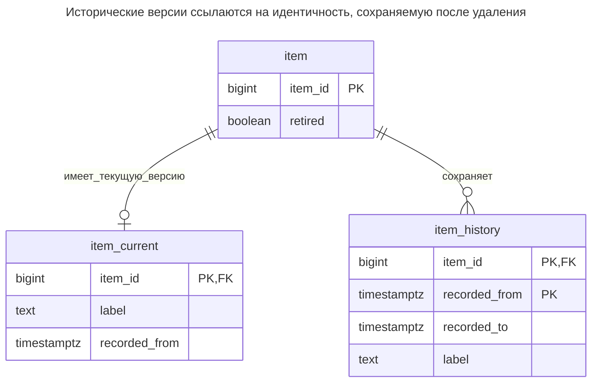
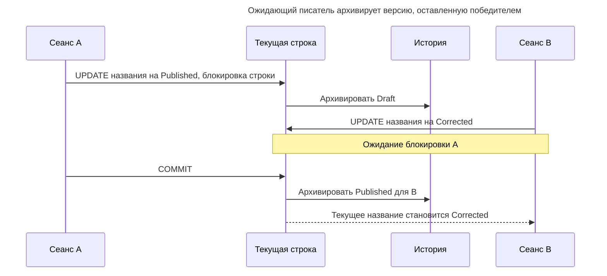
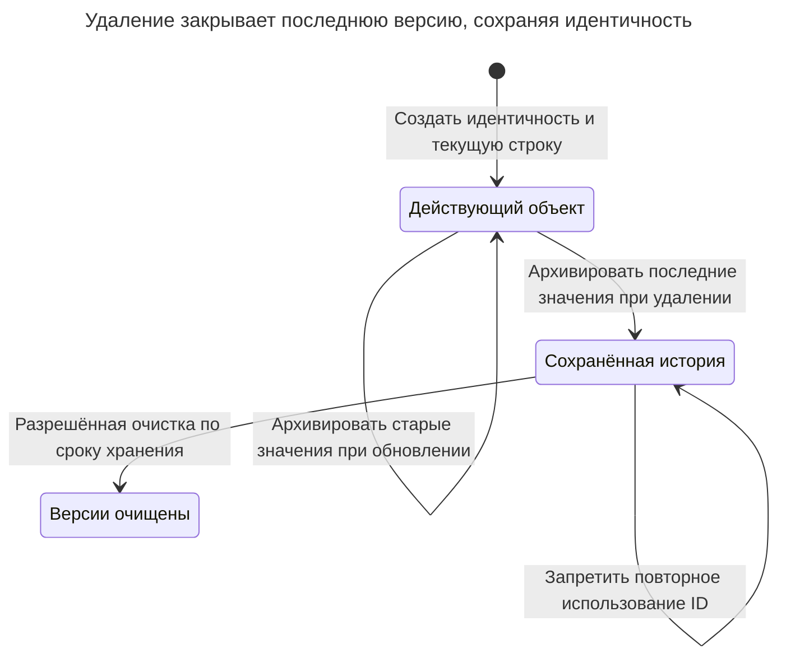
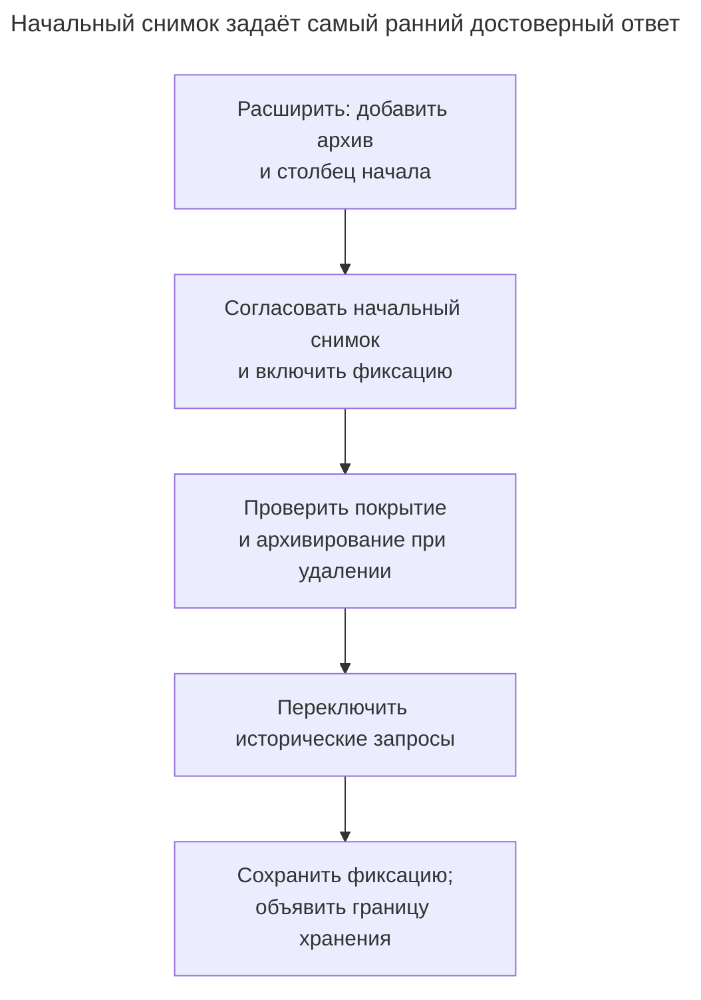

# Таблица истории

## Назначение

Таблица истории сохраняет предыдущие версии строки вместе с периодами их регистрации, чтобы вы могли запросить записанное значение на прошлый момент в пределах сохранённой истории. Смысл этого момента зависит от часов регистрации; пример PostgreSQL использует время обработки. Глава показывает два способа ведения истории: вручную, триггерами, копирующими старую строку при каждом обновлении и удалении, и встроенным системным версионированием SQL:2011 в SQL Server, MariaDB и Db2, где база поддерживает столбцы периода и отвечает на запросы `FOR SYSTEM_TIME AS OF`. Также рассматриваются сведения, которых история не содержит, например автор изменения, и способы ограничить её рост. Стандартную модель описывают [Кулкарни и Михельс](https://sigmodrecord.org/?download_id=3338&smd_process_download=1), встроенные реализации — [Microsoft](https://learn.microsoft.com/en-us/sql/relational-databases/tables/temporal/overview?view=sql-server-ver17), [MariaDB](https://mariadb.com/docs/server/reference/sql-structure/temporal-tables/system-versioned-tables) и [IBM](https://www.ibm.com/docs/en/db2-for-zos/13.0.0?topic=tables-creating-bitemporal).

## Также известен как

System-versioned table — таблица с системным версионированием, когда версии поддерживает движок. [Temporal Object](https://martinfowler.com/eaaDev/TemporalObject.html) Фаулера описывает близкое различие между постоянной идентичностью и её меняющимися версиями; это объектная модель, а не конкретная реализация на триггерах.

## Проблема

При публикации редактором вы перезаписываете название элемента. Через неделю поддержка спрашивает, какое название было записано до изменения. Текущая строка не отвечает на этот вопрос, а список действий «элемент обновлён» поможет лишь тогда, когда сохранил нужные значения. Датированная копия перед каждым изменением превращает восстановление состояния в обычный запрос.

Определите смысл даты. Сегодня редактор может исправить ошибку, сделанную в прошлом месяце. Эта глава сохраняет время регистрации каждого значения. Она не делает исправление действительным в бизнесе задним числом и не устанавливает точное время, когда транзакция стала видна другому сеансу. Это разные контракты.

## Решение

Храните действующие значения в `item_current`, а закрытые версии — в `item_history`. При каждом обновлении копируйте старые значения с исходным началом и новым концом, затем задавайте текущей строке ту же границу как новое начало. При удалении архивируйте последнюю версию и удаляйте действующую строку. Объединяющее представление показывает обе совокупности через полуоткрытые интервалы: начало включено, конец исключён. [Переменные триггеров](https://www.postgresql.org/docs/18/plpgsql-trigger.html) PostgreSQL предоставляют для этого `OLD` и `NEW`.

После удаления сохраняйте небольшую строку идентичности `item`, чтобы у исторических версий оставалась стабильная цель внешнего ключа. Отмечайте идентичность как выведенную из обращения и запрещайте повторное использование удалённого ID даже после истечения срока истории. Тогда новый элемент нельзя спутать с историей прежнего. Пример регистрирует каждое обновление, включая не меняющее значения, и намеренно сохраняет промежуточные записи одной транзакции; прежде чем принять такую политику, решите, полезны ли вам эти версии обработки.

## Альтернативы и выбор

| Соседний паттерн | Связь | Определяющее требование |
| --- | --- | --- |
| [Период действия](effective-dating.md) | Замена единственной временной шкалы | Нужно знать, когда значение действует в бизнесе, включая будущие расписания |
| [Битемпоральная таблица](bitemporal-table.md) | Замена, объединяющая обе модели | Нужно воспроизвести, что было известно на одну дату о другой дате |
| [Журнал аудита](audit-log.md) | Дополнение; замена для редких расследований действий | Нужны автор, причина и контекст запроса, а не регулярные запросы состояния на момент времени |
| [История статусов](status-history.md) | Замена для истории только жизненного цикла | Нужны принятые переходы и их условия, а не версии всех столбцов |
| [Мягкое удаление](soft-delete.md) | Дополнение | Нужно обратимое удаление; одна сохранённая последняя версия не реализует восстановление |
| Встроенное системное версионирование | Вариант реализации | Семантика времени и ограничения схемы движка соответствуют вашему контракту |

Полное сравнение семейства — в [Атласе решений](decision-atlas.md). Добавить сведения об авторе в версии может быть полезно, но это не фиксирует действия без изменения строки и неудачные попытки.

## Структура



У одной идентичности может быть ноль или одна текущая строка и любое число закрытых версий. Внешнего ключа из истории на текущую строку намеренно нет: удаление действующей версии должно сохранять архив.

## Таблицы и инварианты

- **`item`** идентифицирует постоянный объект и хранит отметку о выводе из обращения независимо от архивных значений. Не меняйте ID и не удаляйте строку, пока на неё ссылаются сохранённые версии.
- **`item_current`** хранит текущее название. Первичный ключ разрешает одну действующую версию; триггер управляет `recorded_from` и запрещает изменение идентичности.
- **`item_history`** хранит закрытые версии с ключом из идентичности и начала. Проверка требует положительной длительности. Она сама по себе не обеспечивает смежность и не исключает пересечения с текущей таблицей; этот межтабличный инвариант поддерживают триггер и ограниченные пути записи.
- **`item_versions`** задаёт текущим строкам конец `NULL` со смыслом «всё ещё текущая». Условие запроса на момент времени должно проверять обе границы; выбор одного максимального начала вернул бы удалённый элемент и после удаления.

## Когда применять

- Поддержке или отчётам регулярно нужны полные прежние значения отдельных сущностей.
- Основной путь доступа должен продолжать читать небольшую текущую таблицу.
- Вы можете определить, какие изменения фиксируются, когда начинается регистрация и как долго доступна история.

## Последствия и компромиссы

- ➕ Запрос прошлого состояния читает сохранённые значения вместо воспроизведения изменений полей.
- ➕ Удаление действующей строки сохраняет её последнее записанное состояние.
- ➖ Каждое архивируемое обновление записывает ещё одну строку и поддерживает её индексы. Широкие часто меняющиеся значения делают это дорогим; измеряйте нагрузку вместо предположения о фиксированном множителе.
- ➖ Изменения схемы должны сохранять смысл старых и новых версий. Новый столбец не раскрывает своего значения до начала регистрации.
- ➖ Срок хранения ограничивает вопросы, на которые можно ответить. Очистка версий должна также сдвигать документированную самую раннюю поддерживаемую дату.

## Реализация

[Полный скрипт PostgreSQL 18.6](../assets/history-table/history-table.sql) проверяет фиксацию обновления, удаление, смежность и запрет повторного использования ID. Основная схема и триггер:

```sql
CREATE SCHEMA history_example;
CREATE TABLE history_example.item (
    item_id bigint PRIMARY KEY,
    retired boolean NOT NULL DEFAULT false
);
CREATE TABLE history_example.item_current (
    item_id bigint PRIMARY KEY REFERENCES history_example.item (item_id),
    label text NOT NULL,
    recorded_from timestamptz NOT NULL
);
CREATE TABLE history_example.item_history (
    item_id bigint REFERENCES history_example.item (item_id),
    recorded_from timestamptz NOT NULL,
    recorded_to timestamptz NOT NULL,
    label text NOT NULL,
    PRIMARY KEY (item_id, recorded_from),
    CHECK (recorded_from < recorded_to)
);
CREATE FUNCTION history_example.keep_version()
RETURNS trigger LANGUAGE plpgsql SECURITY DEFINER
SET search_path = pg_catalog, pg_temp AS $$
DECLARE
    boundary timestamptz;
BEGIN
    -- Serialize creation/reuse checks with archival of this identity.
    PERFORM 1 FROM history_example.item
    WHERE item_id = CASE WHEN TG_OP = 'INSERT' THEN NEW.item_id ELSE OLD.item_id END
    FOR UPDATE;
    IF TG_OP = 'INSERT' THEN
        IF (SELECT retired FROM history_example.item WHERE item_id = NEW.item_id) THEN
            RAISE EXCEPTION 'item identity cannot be reused'
                USING ERRCODE = '23514';
        END IF;
        NEW.recorded_from := clock_timestamp();
        RETURN NEW;
    END IF;
    IF TG_OP = 'UPDATE' AND NEW.item_id IS DISTINCT FROM OLD.item_id THEN
        RAISE EXCEPTION 'item identity is immutable' USING ERRCODE = '23514';
    END IF;
    boundary := greatest(clock_timestamp(),
                         OLD.recorded_from + interval '1 microsecond');
    INSERT INTO history_example.item_history
        (item_id, recorded_from, recorded_to, label)
    VALUES (OLD.item_id, OLD.recorded_from, boundary, OLD.label);
    IF TG_OP = 'DELETE' THEN
        UPDATE history_example.item SET retired = true WHERE item_id = OLD.item_id;
        RETURN OLD;
    END IF;
    NEW.recorded_from := boundary;
    RETURN NEW;
END;
$$;
REVOKE ALL ON FUNCTION history_example.keep_version() FROM PUBLIC;
CREATE TRIGGER keep_version BEFORE INSERT OR UPDATE OR DELETE
ON history_example.item_current
FOR EACH ROW EXECUTE FUNCTION history_example.keep_version();
CREATE VIEW history_example.item_versions AS
SELECT item_id, label, recorded_from, recorded_to
FROM history_example.item_history
UNION ALL
SELECT item_id, label, recorded_from, NULL::timestamptz
FROM history_example.item_current;
```

Функция с правами владельца использует полные имена таблиц и ограниченный путь поиска согласно [рекомендациям PostgreSQL по безопасным функциям](https://www.postgresql.org/docs/18/sql-createfunction.html#SQL-CREATEFUNCTION-SECURITY). Развёртывайте её под доверенным владельцем; предоставьте приложению чтение, вставку `item_id` и `label`, обновление `label`, удаление текущих строк и управляемый путь создания идентичности. Не выдавайте запись истории, изменение идентичности, создание схем и `TRUNCATE`. Лабораторный скрипт выполняется владельцем для проверки механики; отзыв прав у `PUBLIC` не является полной настройкой прикладной роли.

Граница использует [`clock_timestamp()`](https://www.postgresql.org/docs/18/functions-datetime.html#FUNCTIONS-DATETIME-CURRENT) с минимальным шагом в одну микросекунду от прежнего начала. Это отдельные часы обработки элемента, предотвращающие пустые интервалы и движение границ назад. Они не отражают время фиксации и не дают глобально согласованного снимка базы. Долгая транзакция может зафиксироваться позже записанной границы, а коррекция часов — сдвинуть синтетическую границу вперёд относительно реального времени. Для воспроизводимых отчётов по многим сущностям сохраняйте явный снимок отчёта или выбирайте более сильный контракт регистрации.

```sql
INSERT INTO history_example.item VALUES (1);
INSERT INTO history_example.item_current (item_id, label)
VALUES (1, 'Draft');
UPDATE history_example.item_current SET label = 'Published' WHERE item_id = 1;
SELECT label FROM history_example.item_versions
WHERE item_id = 1
  AND recorded_from <= (SELECT min(recorded_from)
                       FROM history_example.item_history WHERE item_id = 1)
  AND (recorded_to IS NULL OR recorded_to >
       (SELECT min(recorded_from) FROM history_example.item_history WHERE item_id = 1));
```

Запрос возвращает `Draft`, используя начало первой архивной версии как воспроизводимый прошлый момент. Реальный запрос передаёт нужный момент параметром. Изменение постоянной идентичности недопустимо:

```sql
UPDATE history_example.item_current SET item_id = 2 WHERE item_id = 1;
```

PostgreSQL 18.6 возвращает SQLSTATE `23514`: `ERROR: item identity is immutable`. Последующее удаление текущей строки оставляет две архивные строки, `Draft` и `Published`, и ни одной действующей. Попытка вновь вставить текущий ID `1` вызывает `23514`: `ERROR: item identity cannot be reused`.

## Поддержка в движках

- **PostgreSQL 18:** реализация использует триггеры; [синтаксис временных ключей `CREATE TABLE`](https://www.postgresql.org/docs/18/sql-createtable.html) задаёт ограничения пересечений, а не автоматическое системное версионирование. Диапазонный ключ не заменяет триггер фиксации.
- **MySQL 8.4 / InnoDB:** переносите фиксацию через [строчные триггеры `BEFORE`/`AFTER` с `OLD` и `NEW`](https://dev.mysql.com/doc/refman/8.4/en/create-trigger.html). [`WITH SYSTEM VERSIONING`](https://mariadb.com/docs/server/reference/sql-structure/temporal-tables/system-versioned-tables) MariaDB — отдельная возможность движка, а не переносимый синтаксис MySQL.
- **SQL Server 2025 (17.x):** [встроенные темпоральные таблицы](https://learn.microsoft.com/en-us/sql/relational-databases/tables/temporal/overview?view=sql-server-ver17) поддерживают текущую таблицу, историю и `FOR SYSTEM_TIME AS OF`. Периоды используют время начала транзакции в UTC, в отличие от часов обработки этого триггера. [Таблица истории не может иметь первичного ключа](https://learn.microsoft.com/en-us/sql/relational-databases/tables/temporal/considerations-limitations?view=sql-server-ver17); не копируйте DDL ручной истории без изменений.
- **Oracle Database 21c:** [Flashback Time Travel](https://docs.oracle.com/en/database/oracle/oracle-database/21/adfns/flashback.html) архивирует изменения с заданным сроком хранения. Обычные flashback-запросы на основе undo имеют другую зависимость от хранения; для сохраняемой прикладной истории выбирайте архивный механизм.
- **SQLite 3:** используйте [строчные триггеры](https://www.sqlite.org/lang_createtrigger.html), согласуя запись с [транзакционной моделью единственного писателя](https://www.sqlite.org/lang_transaction.html). Явно переносите представление времени; функция триггера PostgreSQL не исполняется как синтаксис SQLite.

## Сбои и конкурентность

Триггер и исходная запись выполняются в одной транзакции; [ошибка триггера откатывает эффекты оператора](https://www.postgresql.org/docs/18/trigger-definition.html). При сбое архивации название не должно меняться. Не перехватывайте такой сбой, чтобы повторить только запись текущей таблицы в обход архивации.



При Read Committed ожидающее обновление работает с обновлённой строкой согласно [правилам блокировки строк PostgreSQL](https://www.postgresql.org/docs/18/explicit-locking.html#LOCKING-ROWS). История сохраняет обе записи, но не отклоняет команду редактора с устаревшими данными. Добавьте [Столбец версии](version-column.md), если вторая команда должна завершаться ошибкой вместо перезаписи.

Триггер также блокирует постоянную идентичность, поэтому конкурентная вставка не пройдёт проверку повторного использования, пока удаление архивирует эту идентичность. Для составных операций берите блокировки идентичностей до записи текущих строк в едином порядке ID. Иначе прямая вставка, конкурирующая с удалением, может захватить блокировки в обратном порядке; PostgreSQL [обнаруживает взаимоблокировки и прерывает участника](https://www.postgresql.org/docs/18/explicit-locking.html#LOCKING-DEADLOCKS), которому нужно повторить всю транзакцию.



Удаление заканчивает последний записанный интервал. Очистка по сроку хранения — отдельная административная возможность; пример намеренно не предоставляет автоматической очистки или воскрешения объекта.

## Миграция

Установите границу регистрации, прежде чем обещать исторические ответы. Создайте хранилище истории, добавьте текущим строкам столбец начала и включите фиксацию вместе с согласованным начальным снимком в запланированном окне блокировки записи. Для большой таблицы сначала подготовьте схему и согласуйте пакетное создание снимка с теми же блокировками строк, что используют писатели; отслеживайте подготовленные строки, чтобы запоздалое заполнение не затёрло более новое начало. Текущий снимок служит свидетельством только с момента его создания. Не выдумывайте прежние периоды.



Критический момент — передача управления от начального снимка к фиксации, где незаписанное изменение создаст постоянный пробел. Используйте [Расширение и свёртывание](expand-contract.md), чтобы сохранять старое чтение при развёртывании. Откатить читателей легко; отключение фиксации создаёт пробел, который нужно отметить явно.

Для управления ростом индексируйте реальные условия запросов на момент времени и определите пакетное удаление или архивную политику. [Секционирование таблицы](table-partitioning.md) дополняет подход, но [ограничения уникальности секционированных таблиц PostgreSQL](https://www.postgresql.org/docs/18/sql-createtable.html) означают, что секционирование по концу периода потребует пересмотра первичного ключа истории. Не представляйте его как прозрачное изменение этих инвариантов.

Для ограниченной очистки выбирайте целые истёкшие версии и удаляйте их тем же оператором через [запрос, изменяющий данные](https://www.postgresql.org/docs/18/queries-with.html). Лабораторный пример выводит порог из первой закрытой версии, чтобы удалить `Draft`, сохранив `Published`; сервис вместо этого передаёт настроенную границу хранения:

```sql
WITH cutoff AS (
    SELECT min(recorded_to) AS retain_from FROM history_example.item_history
), expired AS (
    SELECT item_id, recorded_from FROM history_example.item_history, cutoff
    WHERE recorded_to <= retain_from ORDER BY recorded_to LIMIT 1000
)
DELETE FROM history_example.item_history AS h USING expired AS e
WHERE h.item_id = e.item_id AND h.recorded_from = e.recorded_from;
```

Удаляйте по времени окончания: версия, начавшаяся раньше порога, может оставаться ответом на самом пороге. Вместе с политикой обслуживания публикуйте самый ранний поддерживаемый момент запроса. Сохраняйте отметку о выведенной из обращения идентичности, даже если все её версии значений со временем истекут.

## Антипаттерны и частые ошибки

- Внешний ключ истории на действующую строку с последующим каскадным уничтожением свидетельств при удалении.
- Регистрация версий в отдельной транзакции приложения или разрешение массовому загрузчику обходить фиксацию.
- Объявление времени обработки временем фиксации транзакции или трактовка историй независимых строк как одного согласованного прошлого снимка.
- Выдача `TRUNCATE` при расчёте на строчный триггер удаления. PostgreSQL различает [триггеры усечения на уровне оператора и строчные события](https://www.postgresql.org/docs/18/trigger-definition.html).
- Бессрочное хранение всего без определения, какие старые ответы могут исчезнуть и какие чувствительные значения нужно удалить.

## Известные применения

- [Пример системно-версионируемой темпоральной таблицы Microsoft](https://learn.microsoft.com/en-us/sql/relational-databases/tables/temporal/overview?view=sql-server-ver17) автоматически сохраняет прежние строки сотрудников; это встроенный вариант фиксации.
- [Таблицы с системным версионированием MariaDB](https://mariadb.com/docs/server/reference/sql-structure/temporal-tables/system-versioned-tables) предоставляют исторические запросы через `FOR SYSTEM_TIME`.
- [Битемпоральный пример Db2 13 for z/OS IBM](https://www.ibm.com/docs/en/db2-for-zos/13.0.0?topic=tables-creating-bitemporal) связывает текущую таблицу с историей через `ADD VERSIONING USE HISTORY TABLE`; его компонент системного времени реализует механизм таблицы истории.

## Связанные паттерны

- [Период действия](effective-dating.md) задаёт периодам бизнес-смысл.
- [Битемпоральная таблица](bitemporal-table.md) сохраняет прежние представления о бизнес-периодах.
- [Журнал аудита](audit-log.md) добавляет действия с установленным автором и контекст запроса.
- [История статусов](status-history.md) записывает принятые переходы жизненного цикла.
- [Мягкое удаление](soft-delete.md) сохраняет удалённый объект в действующей схеме ради восстановления.
- [Столбец версии](version-column.md) обнаруживает устаревшие записи, а не только запоминает их.
- [Секционирование таблицы](table-partitioning.md) помогает управлять сохранённой историей после пересмотра области ключа.
