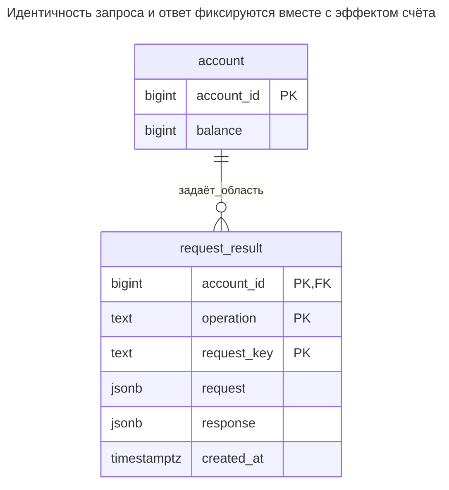
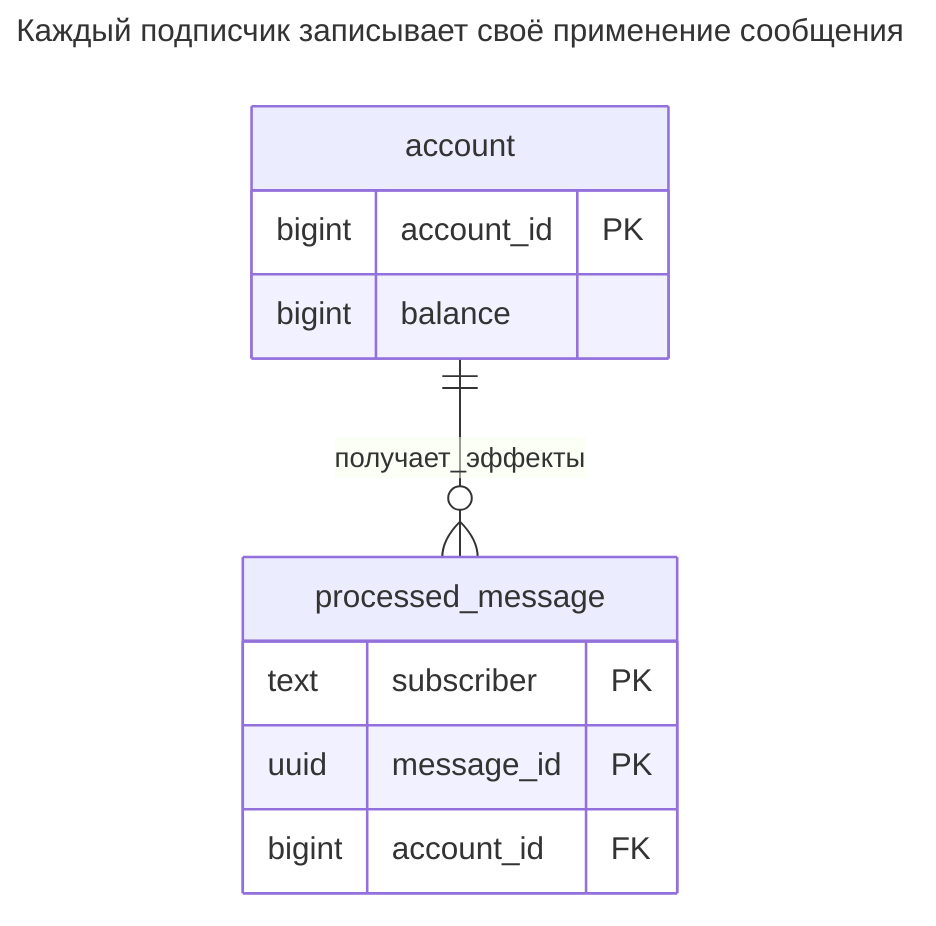
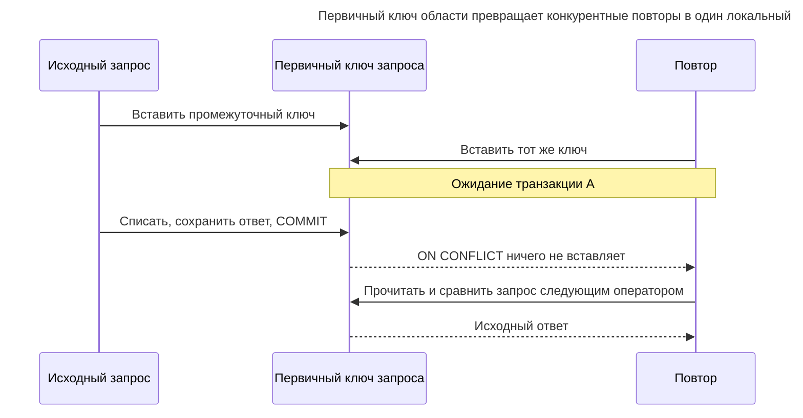
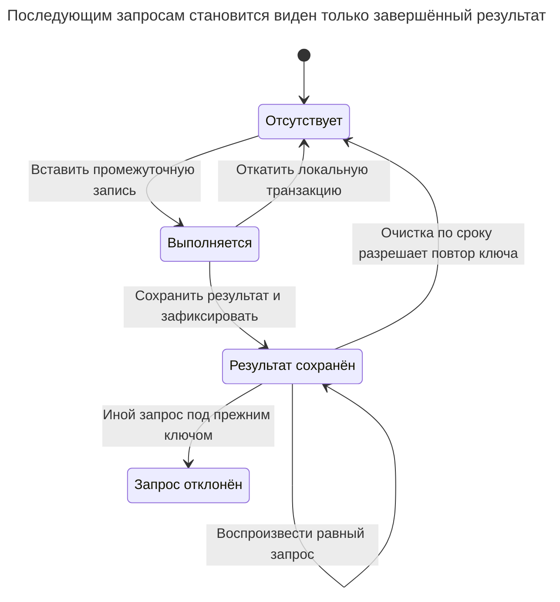

# Запись идемпотентности

## Назначение

Запись идемпотентности делает повторяемую операцию базы безопасной: клиент передаёт уникальный ключ запроса, сервер сохраняет ключ и результат в одной транзакции с локальным эффектом. Повтор с тем же ключом и содержимым возвращает сохранённый результат вместо двойного списания локального баланса. Глава показывает таблицу, уникальное ограничение гонок конкурентных повторов, срок хранения ключей, обнаружение ключа от другого запроса и потребительский вариант с ID обработанных сообщений.

## Также известен как

Idempotency-key table; request-result record — таблица ключей идемпотентности, запись результата запроса. Потребительская форма — [Idempotent Consumer](https://microservices.io/patterns/communication-style/idempotent-consumer.html) Ричардсона, сохраняющий идентичности обработанных сообщений вместо тел клиентских ответов.

## Проблема

Вы фиксируете списание и теряете соединение до получения ответа клиентом. Он не отличает отсутствие эффекта от успешного списания. Слепой повтор может вычесть дважды; отказ от всех повторов не даёт восстановить определённый результат.

Ключ, сохраняемый после фиксации списания, оставляет тот же пробел сбоя. Ключ, сохранённый до него отдельной транзакцией, может подавить никогда не случившееся списание. Один уникальный ключ также не сообщает о случайном повторном использовании для другой суммы.

## Решение

Ограничьте область ключа аутентифицированным счётом и контрактом операции. Сохраните нормализованный запрос и окончательный ответ с ключом, фиксируя вместе с локальным бизнес-эффектом. Пусть первичный ключ разрешает конкурентные попытки. Победитель выполняет эффект и сохраняет результат; проигравший сравнивает запросы и возвращает исходный результат либо отклоняет несовпадение.

Пример списывает локальный баланс в целых единицах. Внешним эффектам вроде списания карты платёжным провайдером нужно дополнительное сотрудничество: стабильный ключ идемпотентности провайдера, сохранённое состояние восстановления или команда в [Транзакционном outbox](transactional-outbox.md). Локальная запись не откатывает внешнее списание. [Реализация Брандура Лича](https://brandur.org/idempotency-keys) разделяет локальные атомарные фазы и внешние изменения именно из-за этой границы.

## Альтернативы и выбор

| Соседний паттерн или механизм | Связь | Определяющее требование |
| --- | --- | --- |
| Уникальная бизнес-ссылка строки эффекта | Замена для меньшего контракта | Достаточно найти существующий эффект и проверить исходные параметры без полного ответа |
| [Столбец версии](version-column.md) | Дополнение | Команды на устаревшем состоянии отклоняются; новая версия сама не определяет изменивший её запрос |
| [Транзакционный outbox](transactional-outbox.md) | Дополнение | Зафиксированная локальная команда должна в итоге достичь другой системы |
| [Таблица очереди](queue-table.md) | Дополнение | Выполнение асинхронно и может повториться после истечения аренды |
| [Двойная запись](double-entry-ledger.md) | Дополнение | Финансовому эффекту нужны баланс и неизменяемое объяснение независимо от идентичности повтора |
| Таблица обработанных сообщений | Вариант реализации | Вызывает потребитель сообщений; сохраняйте `(subscriber, message_id)` с локальным эффектом |

Полное сравнение — в [Атласе решений](decision-atlas.md). Устранение дубликатов по сумме и счёту объединяет два законных одинаковых платежа. Клиент отличает повтор от нового намерения сохранением или сменой ключа запроса.

## Структура



У счёта много результатов запросов. Составной первичный ключ даёт один результат на счёт, операцию и ключ; одинаковые ключи разных областей независимы. Область счёта берите из доверенной аутентификации, а не произвольного ID тела запроса.

## Таблицы и инварианты

- **`account`** хранит неотрицательный баланс в целых единицах. Это демонстрация повторов, не замена реестра проводок.
- **`request_result`** хранит точные нормализованные бизнес-параметры примера, сохранённый ответ и время создания. Составной первичный ключ обеспечивает уникальность области; текстовые части используют побайтовое равенство через [правило сортировки `C`](https://www.postgresql.org/docs/18/collation.html) PostgreSQL.
- **Процедура записи** создаёт промежуточный результат и завершает его до возврата одним атомарным вызовом. Одни ограничения не мешают привилегированному писателю вставить незавершённый ответ или изменить сохранённый запрос; ограничьте производственные пути записи соответственно.
- **Срок хранения** определяет, как долго повтор остаётся той же операцией. После удаления записи схема может снова принять ключ. Если дубликаты запрещены навсегда, сохраняйте независимую постоянную бизнес-ссылку.

## Когда применять

- Клиенты повторяют изменяющие запросы после неопределённых ответов.
- Эффект атомарно фиксируется с результатом либо внешний провайдер даёт отдельный восстанавливаемый протокол.
- Повтор ключа с другими бизнес-параметрами должен отклоняться.

## Последствия и компромиссы

- ➕ Потерянный ответ восстанавливается без повторения локального эффекта.
- ➕ Исходный ответ возвращается, даже если позднейшие операции снова изменили счёт.
- ➖ На принятый запрос в окне хранения нужна индексируемая запись, возможно с чувствительными данными ответа.
- ➖ Конкурентные повторы ждут победителя; медленная транзакция замедляет и их.
- ➖ Канонизация становится частью API. До вычисления отпечатка решите, какие значения по умолчанию, версия операции и единицы входят в идентичность запроса.

## Реализация

[Полный скрипт PostgreSQL 18.6](../assets/idempotency-record/idempotency-record.sql) проверяет воспроизведение ответа, несовпадающий повтор, откат недостатка средств и устранение дубликатов потребителем. Функция хранит нормализованный JSON прямо, обходясь без хеш-алгоритма и недокументированного канонического формата байтов:

```sql
CREATE TABLE account (
    account_id bigint PRIMARY KEY,
    balance bigint NOT NULL CHECK (balance >= 0)
);
CREATE TABLE request_result (
    account_id bigint NOT NULL REFERENCES account (account_id),
    operation text COLLATE "C" NOT NULL,
    request_key text COLLATE "C" NOT NULL,
    request jsonb NOT NULL,
    response jsonb NOT NULL,
    created_at timestamptz NOT NULL DEFAULT clock_timestamp(),
    CONSTRAINT request_result_pkey PRIMARY KEY (account_id, operation, request_key)
);
CREATE FUNCTION debit_once(p_account bigint, p_key text, p_amount bigint)
RETURNS jsonb LANGUAGE plpgsql AS $$
DECLARE
    supplied jsonb := jsonb_build_object('amount', p_amount);
    saved_request jsonb;
    reply jsonb;
    remaining bigint;
BEGIN
    IF p_key IS NULL OR p_key = '' OR p_amount IS NULL OR p_amount <= 0 THEN
        RAISE EXCEPTION 'key and positive amount required' USING ERRCODE = '22023';
    END IF;
    INSERT INTO request_result (account_id, operation, request_key, request, response)
    VALUES (p_account, 'debit:v1', p_key, supplied, '{}'::jsonb)
    ON CONFLICT (account_id, operation, request_key) DO NOTHING;
    IF NOT FOUND THEN
        SELECT request, response INTO STRICT saved_request, reply
        FROM request_result
        WHERE account_id = p_account AND operation = 'debit:v1' AND request_key = p_key;
        IF saved_request IS DISTINCT FROM supplied THEN
            RAISE EXCEPTION 'idempotency key reused with different request'
                USING ERRCODE = '22023';
        END IF;
        RETURN reply;
    END IF;
    UPDATE account SET balance = balance - p_amount
    WHERE account_id = p_account AND balance >= p_amount
    RETURNING balance INTO remaining;
    IF NOT FOUND THEN
        RAISE EXCEPTION 'insufficient balance' USING ERRCODE = 'P0001';
    END IF;
    reply := jsonb_build_object('balance', remaining);
    UPDATE request_result SET response = reply
    WHERE account_id = p_account AND operation = 'debit:v1' AND request_key = p_key;
    RETURN reply;
END;
$$;
INSERT INTO account VALUES (1, 1000);
SELECT debit_once(1, 'checkout-42', 100);
SELECT debit_once(1, 'checkout-42', 100);
SELECT balance FROM account WHERE account_id = 1;
```

Оба вызова возвращают `{"balance": 900}`, баланс равен `900`. Для лабораторного примера процедура использует права вызывающего. В производстве развёртывайте управляемого писателя с полными именами объектов и тщательно ограниченными правами; [рекомендации безопасности функций PostgreSQL](https://www.postgresql.org/docs/18/sql-createfunction.html#SQL-CREATEFUNCTION-SECURITY) объясняют требования при выборе границы с правами владельца. Не давайте альтернативного пути правки запросов или фиксации промежуточного ответа `{}`.

При Read Committed [`ON CONFLICT DO NOTHING`](https://www.postgresql.org/docs/18/transaction-iso.html#XACT-READ-COMMITTED) PostgreSQL может отказаться от вставки из-за конфликтующей строки, отсутствующей в снимке оператора. Поэтому процедура делает **отдельный** последующий `SELECT`, а не пытается вернуть победителя через объединение в том же операторе. Не удаляйте сохранённые ключи конкурентно активным повторам; поиск предполагает доступность победившей записи. Несовпадение отклоняется до второго списания:

```sql
-- Expected SQLSTATE 22023.
SELECT debit_once(1, 'checkout-42', 101);
```

Процедура возвращает SQLSTATE `22023`: `ERROR: idempotency key reused with different request`. Прямая попытка повторить сохранённую идентичность тоже отклоняется схемой:

```sql
-- Expected SQLSTATE 23505.
INSERT INTO request_result (account_id, operation, request_key, request, response)
VALUES (1, 'debit:v1', 'checkout-42', '{"amount":100}', '{"balance":900}');
```

PostgreSQL 18.6 возвращает `ERROR: duplicate key value violates unique constraint "request_result_pkey"` (SQLSTATE `23505`). Неудачное локальное списание откатывает промежуточный ключ вместе с эффектом. Пример сохраняет только успешные результаты; сохранение окончательного бизнес-отказа ответом — другая явная политика API.

Для потребителей имя подписчика входит в идентичность, поскольку независимые проекции должны каждая применить сообщение:



ID сообщения обозначает внешнее событие, поэтому не имеет внешнего ключа на локальную таблицу брокера. Ссылка на счёт обозначает локальный объект, затронутый этим подписчиком.

```sql
CREATE TABLE processed_message (
    subscriber text NOT NULL,
    message_id uuid NOT NULL,
    account_id bigint NOT NULL REFERENCES account (account_id),
    PRIMARY KEY (subscriber, message_id)
);
WITH accepted AS (
    INSERT INTO processed_message VALUES
        ('balance-projection', '00000000-0000-4000-8000-000000000001', 1)
    ON CONFLICT DO NOTHING
    RETURNING account_id
)
UPDATE account SET balance = balance + 50
WHERE account_id IN (SELECT account_id FROM accepted)
RETURNING balance;
```

Первое выполнение возвращает `950`; повтор обновляет ноль строк. Подтверждайте брокеру сообщение только после фиксации. [Idempotent Consumer](https://microservices.io/patterns/communication-style/idempotent-consumer.html) Ричардсона описывает ту же транзакционную границу обработанного ID и локального эффекта. Считайте полезную нагрузку события неизменяемой под ID сообщения; если транспорт допускает иное содержимое, сохраняйте и сравнивайте его тоже.

## Поддержка в движках

- **PostgreSQL 18:** используйте показанные составной ключ и транзакцию. [Разрешение конфликта уникального индекса](https://www.postgresql.org/docs/18/index-unique-checks.html) ждёт конфликтующую транзакцию и повторно проверяет исход.
- **MySQL 8.4 / InnoDB:** явно выбирайте [регистрозависимое или двоичное правило сортировки ключа](https://dev.mysql.com/doc/refman/8.4/en/case-sensitivity.html). Если генератор различает регистр, сравнение без учёта регистра не должно объединять идентичности.
- **SQL Server 2025 (17.x):** [`UNIQUE` или первичный ключ](https://learn.microsoft.com/en-us/sql/relational-databases/tables/unique-constraints-and-check-constraints?view=sql-server-ver17) разрешает конфликт. Обрабатывайте повторную вставку транзакционным путём диалекта; процедура PL/pgSQL и `ON CONFLICT` не являются переносимым SQL.
- **Oracle AI Database 26ai:** оставляйте ключ идемпотентности [непустым](https://docs.oracle.com/en/database/oracle/oracle-database/26/sqlrf/Nulls.html): Oracle сейчас считает строки нулевой длины `NULL`. Проверяйте до вставки и сохраняйте обязательность столбцов составного ключа области.
- **SQLite 3:** локальный эффект и результат могут разделять [транзакцию записи](https://www.sqlite.org/lang_transaction.html). Один активный писатель ограничивает параллельные запросы даже независимых ключей; включите обработку занятости в протокол повторов.

## Сбои и конкурентность



Если A откатится, B получит ключ и выполнит операцию. Если A зафиксируется, потеряв ответ, сохранённый ответ выживет. Вся транзакция эффекта и результата должна завершиться до возврата успеха. При более сильной изоляции перезапускайте неудачную транзакцию с тем же ключом, не новым.



`InFlight` существует внутри создающей транзакции, а не как зафиксированная аренда в этой реализации. Долгим удалённым процессам нужен другой сохраняемый цикл восстановления, например атомарные фазы [проекта Лича](https://brandur.org/idempotency-keys).

Выбирайте срок из максимальных обещанных окон повторов, повторной доставки и восстановления, включая запоздалых клиентов. [Политика Stripe API v1](https://docs.stripe.com/api/idempotent_requests) разрешает удаление ключей не ранее 24 часов, сравнивает параметры и возвращает сохранённые статус/тело, включая `500`, после начала выполнения. Это контракт поставщика, не универсальный TTL; он отличается от отката при ошибке этого примера. API v2 на той же странице имеет другую семантику повторов; не переносите правило v1 на него.

## Миграция

Создайте таблицу результатов и введите клиентские ключи до обязательного требования. Направляйте принятые операции с ключом через одного транзакционного писателя. Сохраните ограниченный период совместимости для клиентов без ключей, объявив более слабое поведение повторов. Нельзя надёжно восстановить отсутствующий исходный ответ из сегодняшнего баланса.

Переключите повторы на сохранённые результаты и отклоняйте отсутствие ключей у операций контракта. Сохраняйте записи при откате: старый эндпоинт, игнорирующий ключи, не должен обслуживать клиентов, уже имеющих право на воспроизведение. Используйте [Расширение и свёртывание](expand-contract.md), сохраняя совместимого с откатом писателя с устранением дубликатов до закрытия всех обещанных окон. Потребительская миграция тоже требует определённой начальной позиции или отправной точки, а не выдуманных обработанных ID неизвестной истории.

## Антипаттерны и частые ошибки

- Выдавать новый ключ на каждый повтор или устранять дубликаты по параметрам вместо намерения запроса.
- Возвращать текущий баланс вместо сохранённого ответа; позднейшие операции могли изменить его.
- Фиксировать ключ отдельно от эффекта или перехватывать ошибку и фиксировать незавершённую запись.
- Удалять записи, пока запоздалые повторы ещё покрываются обещанной гарантией.
- Считать, что таблица делает произвольное удалённое списание атомарным с базой.

## Известные применения

- [API идемпотентных запросов Stripe](https://docs.stripe.com/api/idempotent_requests) предоставляет клиентские ключи и документирует версионные правила воспроизведения и хранения; он не раскрывает внутреннюю структуру таблиц.
- [Реализация Лича на PostgreSQL](https://brandur.org/idempotency-keys) сохраняет учёт запросов, точки восстановления и результаты, отделяя внешние вызовы атомарными фазами.
- [Idempotent Consumer](https://microservices.io/patterns/communication-style/idempotent-consumer.html) Ричардсона помещает ID обработанных сообщений и локальные изменения в одну транзакцию.

## Связанные паттерны

- [Транзакционный outbox](transactional-outbox.md) надёжно подготавливает удалённую работу.
- [Таблица очереди](queue-table.md) повторяет асинхронное выполнение, которому всё равно нужны идемпотентные эффекты.
- [Столбец версии](version-column.md) защищает исходный снимок независимо от идентичности повтора.
- [Двойная запись](double-entry-ledger.md) проверяет финансовое проведение, дубликаты которого устраняет ключ.
- [Расширение и свёртывание](expand-contract.md) поэтапно вводит обязательные ключи без потери результатов.
